# 2. Remote Control

## 2.1 Mobile App Control

> [!NOTE]
>
> **The Tankbot factory program includes app control, which can be experienced immediately after power-on.**
### 2.1.1 Mobile App Installation

Apple users can download the app by searching for **Wonderbot** in the App Store.

Android users can scan the QR code below to download, or go to [**Software Tools & Program Suite**](https://drive.google.com/drive/folders/1Lsr_VqCEv4Wq9Okv0eBGHTK-x6EZjtlb?usp=sharing) to locate the **Wonderbot** installation package and install it on the phone.

### 2.1.2 Mobile App Connection

> [!NOTE]
>
> * **Before using the Wonderbot app, enable Bluetooth and location services in the phone settings.**
>
> * **Pair and connect with the device through the Bluetooth button in the app. Do not pair through a passkey in the phone settings.**

1. Turn on the device power switch.

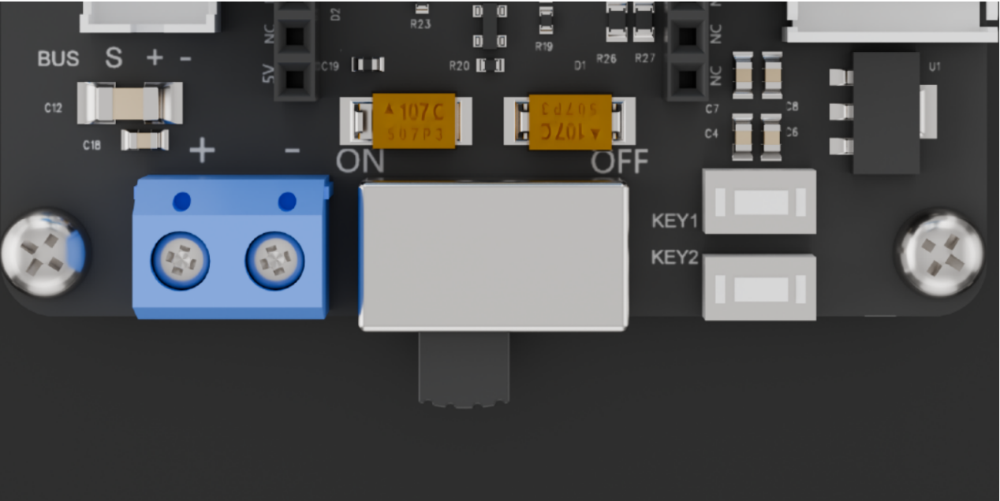

2. Open the mobile app **Wonderbot**, tap the  icon in the upper-left corner to select the robot type, and choose **Tankbot** here.

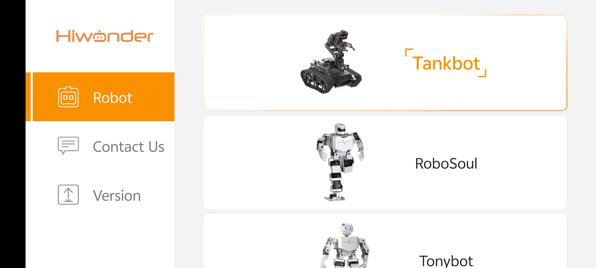

3. After selection, enter the mode selection interface and tap **Robot Control** . Tap the flashing  icon in the upper right corner, find **Hiwonder** in the Bluetooth list, and then tap it for connection.

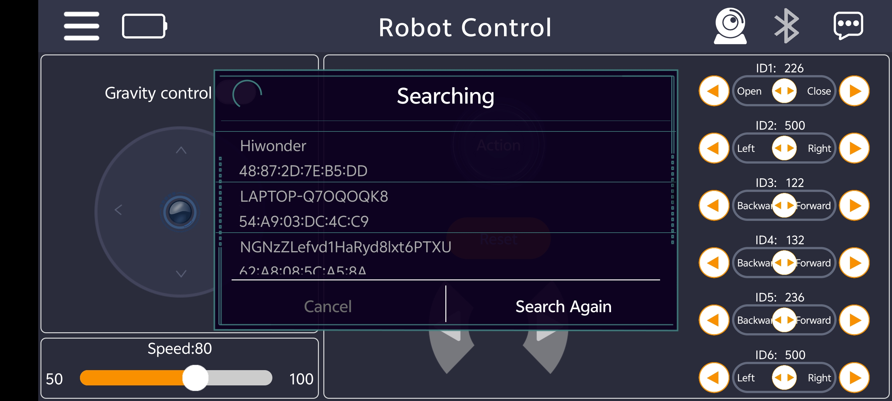

> [!NOTE]
>
> **If no Hiwonder-related name appears initially, tap Search Again to search for the device.** 

4. After successful connection, the Bluetooth icon in the upper right corner remains lit.

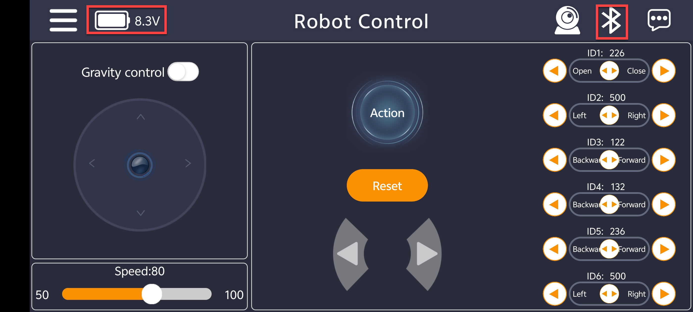

### 2.1.3 Introduction to App Functions

* **Control Interface Overview**

After entering the control interface, the robot movement can be controlled via buttons and sliders. The interface is divided into two parts, as shown in the figure below.

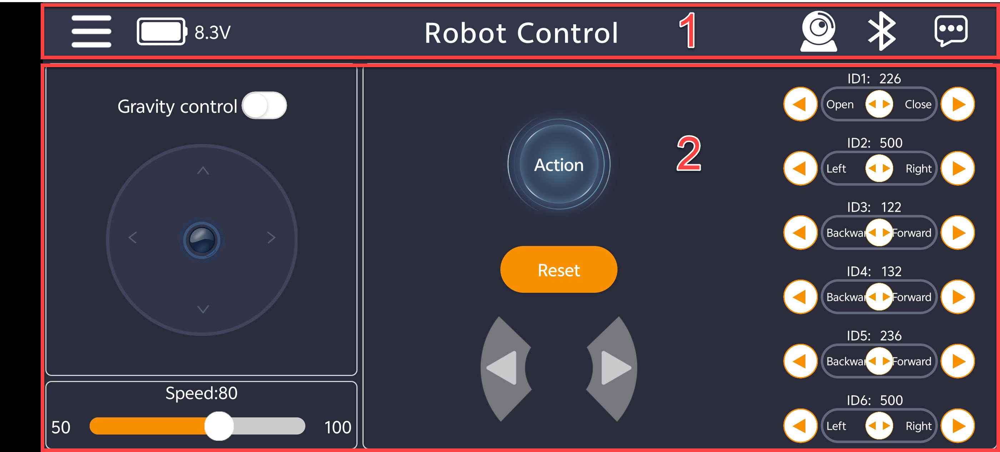

① Menu Bar

|                                Icon                                |                          Function                          |
| :----------------------------------------------------------: | :--------------------------------------------------------: |
|  |      Returns to the main interface to select the robot type      |
|  |                 Displays the current battery voltage                 |
|  |                    Enables image transmission                    |
|  | Bluetooth connection status. The icon blinks when disconnected and stays solid when connected |
|  |                       More information                       |

② Control Area

|                              Icon                             |             Function            |
| :----------------------------------------------------------: | :----------------------------: |
| 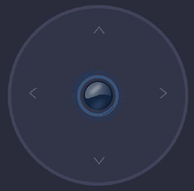 |        Controls chassis movement        |
|  |        Controls chassis steering        |
|  | Controls chassis movement via the built-in gyroscope of the mobile phone |
| 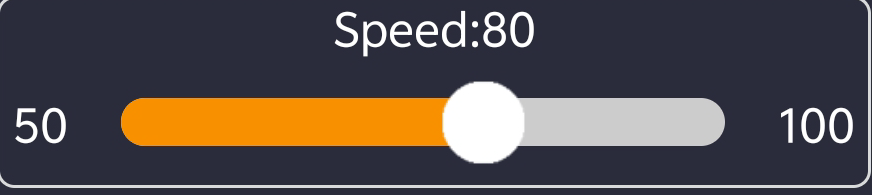 |  Controls chassis speed      |
|  | Controls rotation of a single servo on the robotic arm |
|  |    Controls the robotic arm to execute action groups    |
|  |  Controls the robotic arm to return to its initial posture  |

* **Introduction to Custom Action Groups**

The app provides six action group execution commands. Execution commands for other action groups can be added as follows:

1. Tap the action icon, then tap the **Add** button in the lower-right corner.

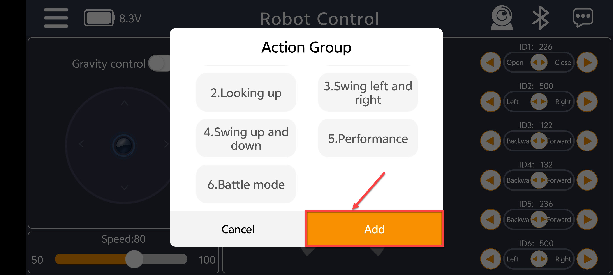

2. In **Add Action**, enter the action group name and number, then tap **Ok**.

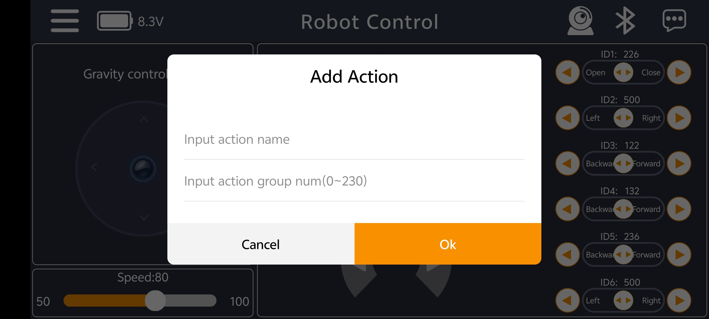

3. Once the addition is complete, the new action group appears in the action group list. Tap it to run.

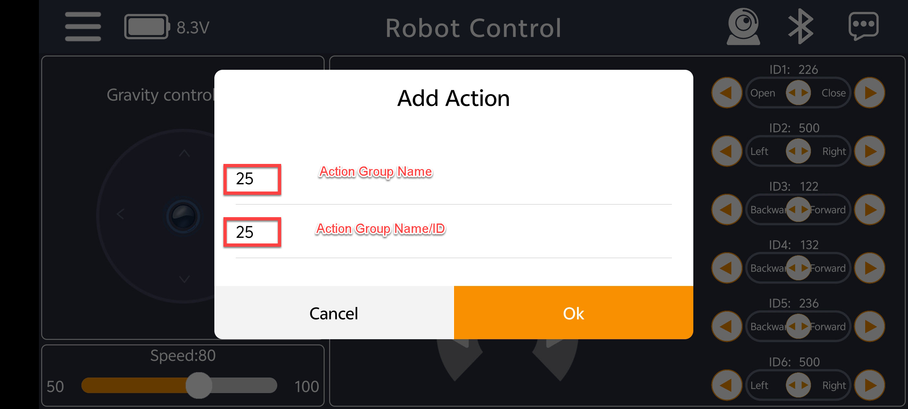

## 2.2 Wireless Controller Control

### 2.2.1 Preparation

1) Ensure the controller receiver is inserted into the control board, as shown below:

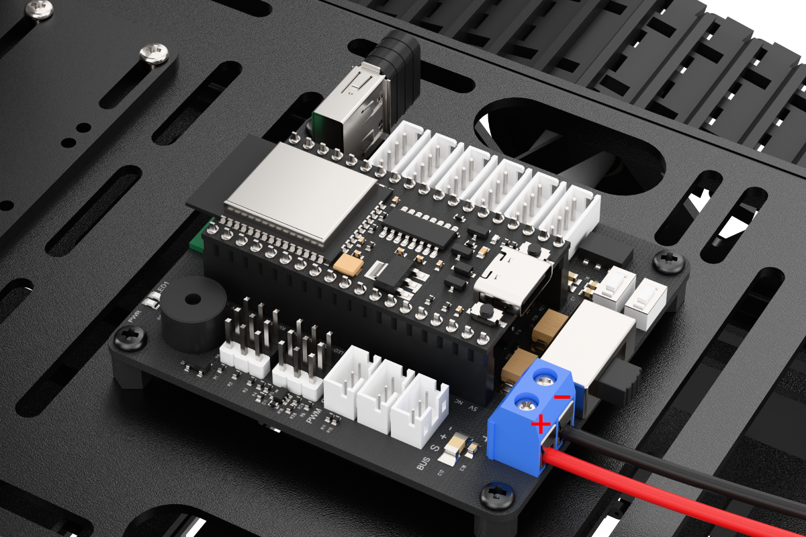

2) Remove the back cover of the wireless controller and insert two AAA batteries into the battery compartment. Ensure the positive and negative terminals are not reversed.

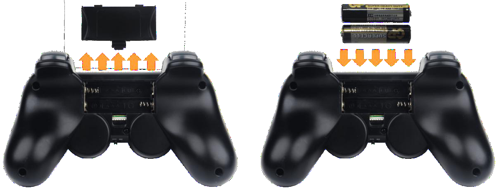

### 2.2.2 Device Connection

1. Push the device power switch to **ON**, then briefly press the onboard **KEY1** button twice. The buzzer will sound three times, indicating that the wireless controller control mode has been entered.

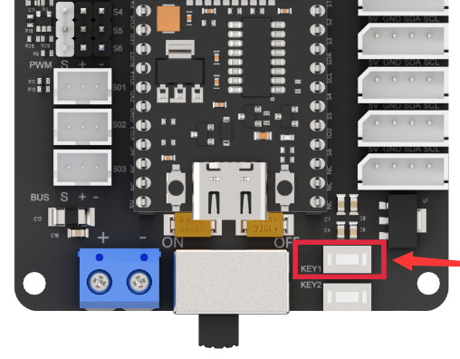

2. Turn on the wireless controller power switch, and both the red and green LED lights will blink simultaneously.

3. Wait a few seconds, and the robotic arm will automatically pair with the wireless controller. After successful pairing, the red and green LEDs will stay solidly lit. If only one green or one red LED is lit after power-on, press the **MODE** key.

4. If the connection is not successful, turn off the robotic arm and the wireless controller first, then repeat the above steps.

Sleep Mode: If the wireless controller is not connected to the robotic arm within 30 seconds after power-on, or no operation is performed on the wireless controller within five minutes after connection, the wireless controller enters sleep mode. To wake the wireless controller, press the **START** button.

### 2.2.3 Button Description

The following table describes the functions of buttons of the wireless controller.

|        Button        |               Function               |
| :------------------: | :----------------------------------: |
|   Left joystick up   |               Forward                |
|  Left joystick down  |               Backward               |
| Right joystick left  |              Turn left               |
| Right joystick right |              Turn right              |
|        START         | All servos return to initial posture |
|          Y           |           Close servo ID1            |
|          A           |            Open servo ID1            |
|          X           |        Rotate servo ID2 left         |
|          B           |        Rotate servo ID2 right        |
|          R2          |       Rotate servo ID3 forward       |
|          R1          |      Rotate servo ID3 backward       |
|          L2          |       Rotate servo ID4 forward       |
|          L1          |      Rotate servo ID4 backward       |
|          <kbd>↑</kbd>          |       Rotate servo ID5 forward       |
|        <kbd>↓</kbd> |      Rotate servo ID5 backward       |
|        <kbd>←</kbd>← |        Rotate servo ID6 left         |
|        <kbd>→</kbd> |        Rotate servo ID6 right        |
|      SELECT + ↑<kbd>↑</kbd>      |        Execute action group 0        |
|      SELECT + ↓<kbd>↓</kbd>      |        Execute action group 1        |
|      SELECT + ←<kbd>←</kbd>←      |        Execute action group 2        |
|      SELECT + <kbd>→</kbd>      |        Execute action group 3        |
|     SELECT + L1      |        Execute action group 4        |
|     SELECT + L2      |        Execute action group 5        |
|      SELECT + Y      |        Execute action group 6        |