# 3. PC Software Action Group Control

## 3.1 Introduction to PC Software

> [!Note]
>
> **The PC software used in this section is LeArm, and the PC software control protocol of Tankbot is consistent with that of LeArm.**

### 3.1.1 Serial Port Driver Installation

1. Double-click to open the folder **[2. Software Tools & Program Suite\2.2 PC Software Installation Package](https://drive.google.com/drive/folders/1Lsr_VqCEv4Wq9Okv0eBGHTK-x6EZjtlb?usp=sharing)**, and then double-click **ch341ser.exe** to open it.

2. Click the **Install** button, and then the Install and Uninstall buttons become gray. Wait for a moment, and an installation success prompt appears.

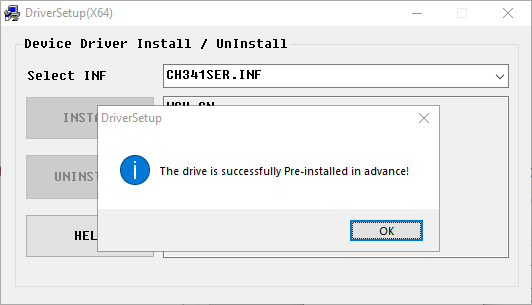

### 3.1.2 Software Startup

> [!NOTE]
>
> **The PC software is installation-free. Only the driver installation on the computer needs to be completed in advance.**

1. In the **[2. Software Tools & Program Suite\2.2 PC Software Installation Package](https://drive.google.com/drive/folders/1Lsr_VqCEv4Wq9Okv0eBGHTK-x6EZjtlb?usp=sharing)** folder, find the PC software **LeArm V2.1.exe**.
2. Copy the LeArm V2.1.exe to any path and double-click to open and use it.
3. Switch the software language in the upper-left corner of the interface.

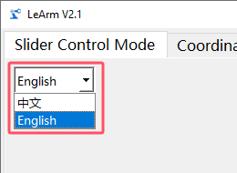

### 3.1.3 Device Connection

> [!NOTE]
>
> * **Before performing this step, ensure that the robotic arm has been assembled and wired, and that a core board is installed on the 6-channel servo controller and connected to adapter power.**
>
> * **When attempting PC software control, if the core board runs the factory program, briefly press the KEY1 button on the servo controller once to switch the working mode. When the buzzer emits two short beeps, the robotic arm enters PC software control mode and begins processing PC software control commands.**

1. Connect the adapter to the robotic arm servo controller, and turn on the controller switch. Use a USB cable to connect to the Type-C port of the core board, and then double-click to open the PC software.

The following figure uses an ESP32 core board as an example to show the USB cable connection method.

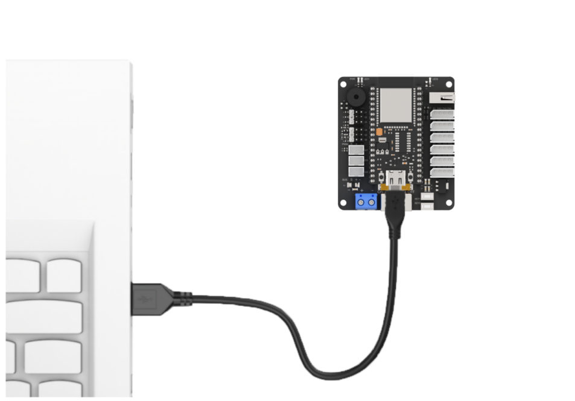

2. Open the PC software and select the port corresponding to the device.

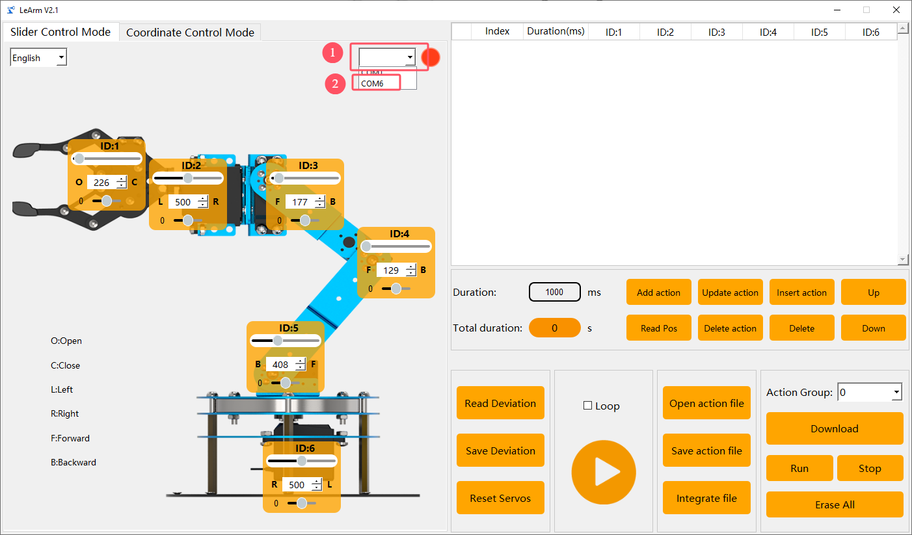

3. When the red circular icon turns green, the connection is successful.

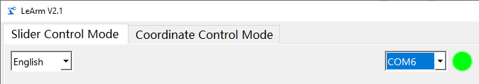

### 3.1.4 Function Description

The PC software can control the movement of the robotic arm through two modes: **Slider Control Mode** and **Coordinate Control Mode**. In the slider control mode, single servo control and action group control of the robotic arm are realized. In the coordinate control mode, inverse kinematics control of the robotic arm is realized.

The PC software automatically switches to the corresponding mode when any mode icon in the upper-left corner of the software is clicked.

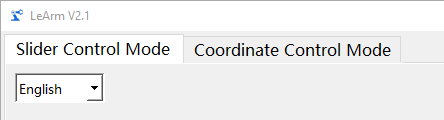

* **Slider Control Function**

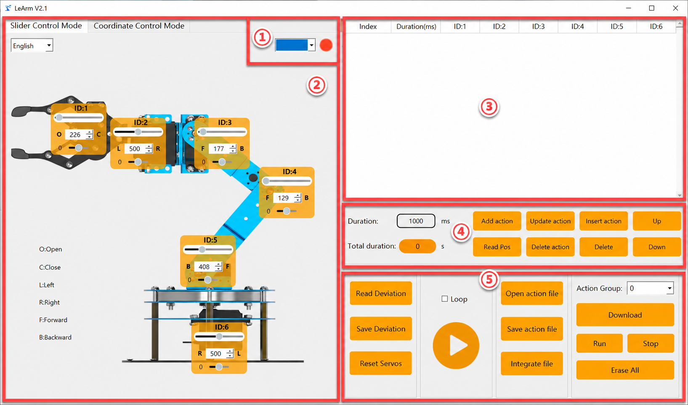

① Device Connection Status

|**Icon**| **Function Description** |
| :----------------------------------------------------------: | :----------------------------------------------------------: |
|  | Displays the device connection status. Green is displayed when the connection succeeds, and red is displayed when the device is not connected or is disconnected. |
| 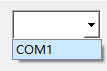 | Used to select the external device port for communication with the PC software. The port corresponding to Tankbot must be selected here for a successful connection. |

② Servo Control Area: The servo control area displays the selected servo icon, and the servo position is adjusted by moving the corresponding slider.

|**Icon**|  **Function Description**|
| :----------------------------------------------------------: | :-------------------------------------------: |
| 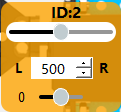 |Represents the servo ID number, with servo ID2 as an example.|
|  |  Adjusts the servo position, with a minimum value of 0 and a maximum value of 1000.  |
|  | Adjusts the servo deviation, with a minimum value of -100 and a maximum value of 100. |

③ Action Detail List: Displays the execution time of each action in the current action group and the servo values for each action.

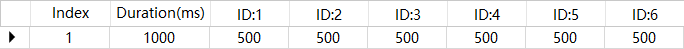

|**Icon**| **Function Description** |
| :----------------------------------------------------------: | :----------------------------------------------------------: |
| 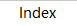 | Action group number. There are 230 action groups in total, and each action group can hold up to 1020 actions. If this limit is exceeded, a prompt indicates that it can only be run online and cannot be downloaded. |
| 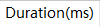 | Action running time, or the time required to execute this action. The value below can be modified directly by double-clicking it. |
| 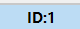 |  The action value corresponding to the ID.  |

④ Action Group Setting Area

|**Icon** | **Function Description** |
| :----------------------------------------------------------: | :----------------------------------------------------------: |
| 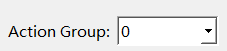 | Action group sequence number selection button. After a click, a sequence number from 0 to 254 can be selected. Action group 0 is generally used as the initial position. |
|  | The actions in the current list are downloaded to the controller. The download overwrites the original actions of that action group. |
|  | Executes the action group with the selected sequence number once. |
|  | Stops the action group that is currently running. |
|  | Caution: This deletes all data in action groups 0 to 254. |
| 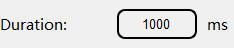 | This duration is preset to control the time required for each servo of the robotic arm to move to a specified position in the servo control area of the left robotic arm image. |
| 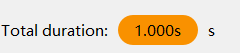 | The total time required to completely execute all actions in the action detail list. |
| 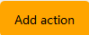 | The servo values in the servo control area are added as an action to the last row of the action detail list. |
|  | Reads the current position information of each servo of the robotic arm. |
| 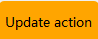 | Replaces the selected position value in the action detail list. The position value is replaced with the servo value in the middle servo control area, and the action run time is replaced with the time set in **Duration**. |
| 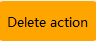 | Deletes the selected action in the action detail list. |
| 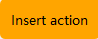 | Inserts an action row above the selected action. The action time is taken from **Duration, ms**, and the angle value is the servo value in the middle servo control area. |
|  | Caution: This deletes all actions in the action detail list. |
|  | Moves the currently selected action forward in the action detail list to execute before the previous action. |
|  | Moves the currently selected action backward in the action detail list to execute after the next action. |
| 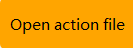 | After clicking and selecting the desired action group, the action group data can be loaded into the action detail list. The provided action group file path is located in **[2. Software Tools & Program Suite](https://drive.google.com/drive/folders/1Lsr_VqCEv4Wq9Okv0eBGHTK-x6EZjtlb?usp=sharing)/[2.3 Action Group Files](https://drive.google.com/drive/folders/1_M59xFPPToGxwWIVppFUDW6-Pgy2ebpy?usp=sharing).** |
|  | Saves the actions in the action detail list to a specified location. |
| 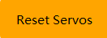 | After an action group is opened, clicking the integrate file button opens another action group file and combines the two action group files into a new action group. |
|  | After clicking this button, the actions in the action detail list run once. If **Loop** is checked, the robotic arm repeats the actions. |

⑤ Servo Settings Area

|**Icon**|  **Function Description**  |
| :----------------------------------------------------------: | :------------------------------------------------: |
|  | Clicking this icon automatically reads the deviation saved on the controller. |
|  | Clicking this icon downloads the deviation adjusted via the PC software to the robotic arm. |
|  |  All servos rotate to the central position, and the robotic arm points vertically upward.  |

* **Coordinate Control Function**

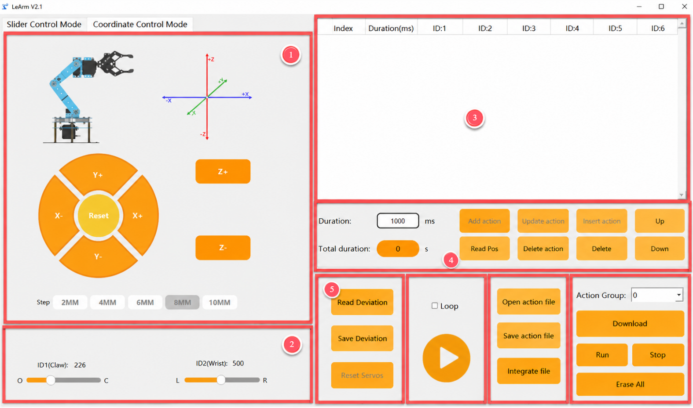

Coordinate control mode also has 5 areas, namely: **① Kinematic coordinate control area ② End-effector servo control area ③ Action detail list ④ Action group setting area ⑤ Servo setting area**.

Among items ③, ④, and ⑤, the functions are the same as those in the slider control function. Some functions are disabled with the icon text shown in gray, and are not further described here.

① Kinematic Coordinate Control Area

In coordinate control mode, the three-dimensional coordinate values of the robotic arm end effector, located at the front end of the gripper, in the robotic arm coordinate system, as shown on the right side of the figure below, can be controlled through the PC software. The robotic arm then uses an inverse kinematics algorithm to move the end effector to the specified position.

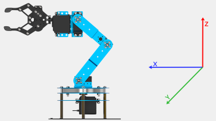

| Icon                                                         | Function description                                         |
| ------------------------------------------------------------ | ------------------------------------------------------------ |
| 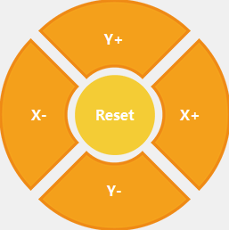 | Clicking X+ increases the X-axis coordinate of the robotic arm end and moves the arm forward. Clicking X- decreases the X-axis coordinate of the robotic arm end and moves the arm backward. Clicking Y+ increases the Y-axis coordinate of the robotic arm end and moves the arm to the left. Clicking Y- decreases the Y-axis coordinate of the robotic arm end and moves the arm to the right. Clicking Reset returns the robotic arm to its initial posture. |
|  | Clicking this icon increases the Z-axis coordinate of the robotic arm end and raises the arm. |
|  | Clicking this icon decreases the Z-axis coordinate of the robotic arm end and lowers the arm. |
| 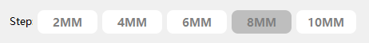 | Clicking this icon sets the change amount of the X/Y/Z coordinate values of the robotic arm end per single adjustment. |

② End-Effector Servo Control Area

|**Icon**| **Function Description** |
| :----------------------------------------------------------: | :----------------------------------------------------------: |
| 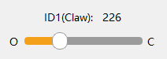 | The position value of servo ID1 is controlled, thereby driving the gripper claw to open and close. The figure indicates the correspondence between the position value and the gripper claw open/close state. |
| 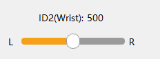 | The position value of servo ID2 is controlled, thereby driving the gripper wrist structure to rotate left and right. The figure indicates the correspondence between the position value and the rotation direction. |

## 3.2 Action Call and Download

### 3.2.1 Implementation Objectives

To use the PC software to control the robotic arm to flash the action group file **3_swing_left_and_right** to the servo controller and invoke it to run once.

### 3.2.2 Action Download

1. Turn on the robotic arm switch and connect robotic arm to the computer using a USB cable.

> [!NOTE]
>
> **If the factory program runs on the core board, briefly press the KEY1 button on the servo controller once after power-on to switch the working mode. When the buzzer emits two short beeps, the robotic arm enters the PC software control mode and begins processing PC software control operations.**

2. Open the PC software, and in the path **1. Tutorials\3. PC Software Action Group Control\03 Action Group Files\EN**, select the action group file to download.

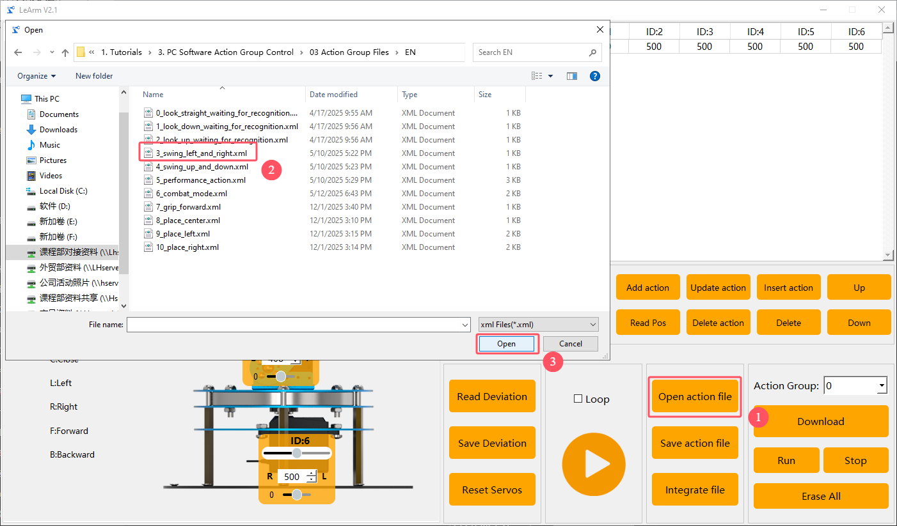

3. In the action group list, select the storage space of the numbered action group to which the action group file is to be downloaded. Select 3 here.

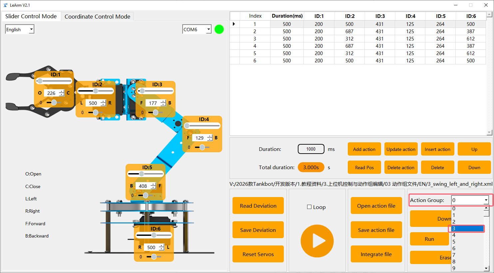

4. Click **Download** to automatically complete the action group download.

### 3.2.3 Action Call

* **Method 1**

1. Turn on the robotic arm switch and connect the robotic arm to the computer as described previously.

> [!NOTE]
>
> **If the factory program runs on the core board, briefly press the KEY1 button on the servo controller once after power-on to switch the working mode. When the buzzer emits two short beeps, the robotic arm enters the PC software control mode and begins processing PC software control operations.**

2. Double-click to open the PC software, click the **Open action file** button, then under the path **1. Tutorials\3. PC Software Action Group Control\03 Action Group Files\EN**, select the **3_swing_left_and_right** action file.

3. Click  and Tankbot's robotic arm will immediately execute the action group.

> [!NOTE]
>
> **When the Loop is checked, the robotic arm will execute the action repeatedly.**

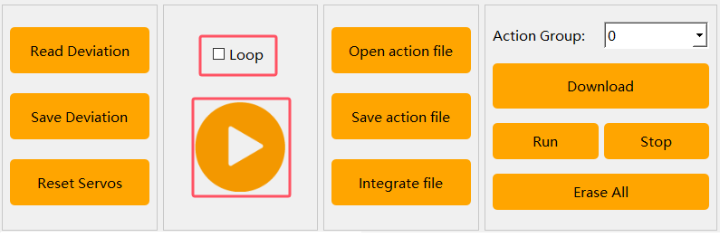

* **Method 2**

1. Turn on the robotic arm power switch and connect the robotic arm to the computer via a USB cable.

> [!NOTE]
>
> **If the factory program runs on the core board, briefly press the KEY1 button on the servo controller once after power-on to switch the working mode. When the buzzer emits two short beeps, the robotic arm enters the PC software control mode and begins processing PC software control operations.**

2. Double-click to open the PC software. In the **Action Group** drop-down menu, select 3.

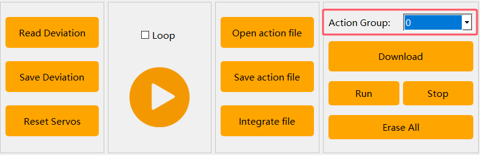

3. Click the  button, and the Tankbot robotic arm will immediately start executing action group 3.

> [!NOTE]
>
> **When invoking an action group using this method, the action group must have been downloaded to the servo controller in advance.**

* **Other Methods**

Tankbot also supports other methods for invoking action group files, such as:

① Offline execution of action groups. See **[3.5 Offline Operation Learning](#3.5)** for details.

② Calling action groups via serial commands. Refer to details in the **1. Tutorials** folder, specifically the **Serial Communication Practical Course** folder within each core board programming project.

## 3.3 Action Editing Course

### 3.3.1 Implementation Objectives

To create an action group consisting of 7 actions for **grip forward**.

> [!NOTE]
>
> **The actions in this section are provided as examples only, intended to facilitate quick mastery of the action editing feature. Standard actions can be referenced from the sample action group files located in the 2. Software Tools & Program Suite\2.3 Action Group Files directory.**

### 3.3.2 Action Implementation

* **Action Design**

1. Turn on the switch of the robotic arm and connect it to the computer with a USB cable.

> [!NOTE]
>
> **If the factory program runs on the core board, briefly press the KEY1 button on the servo controller once after power-on to switch the working mode. When the buzzer emits two short beeps, the robotic arm enters the PC software control mode and begins processing PC software control operations.**

2. Then double-click to open the PC software, click the **Open action file** button, and select the **0_look_straight_waiting_for_recognition** action file. Then click  to synchronize the left-side servo values. The first action is thus obtained.

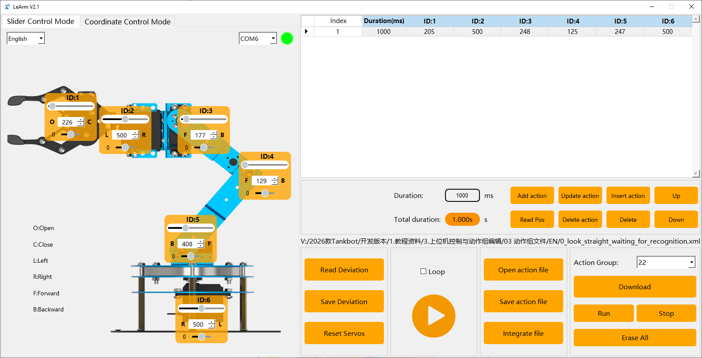

3. To make the robotic arm bend forward and extend with the claws slightly open, in the servo control area on the left, slide the sliders of servos with IDs 1, 3, 4, and 5 to the values shown in the figure below.

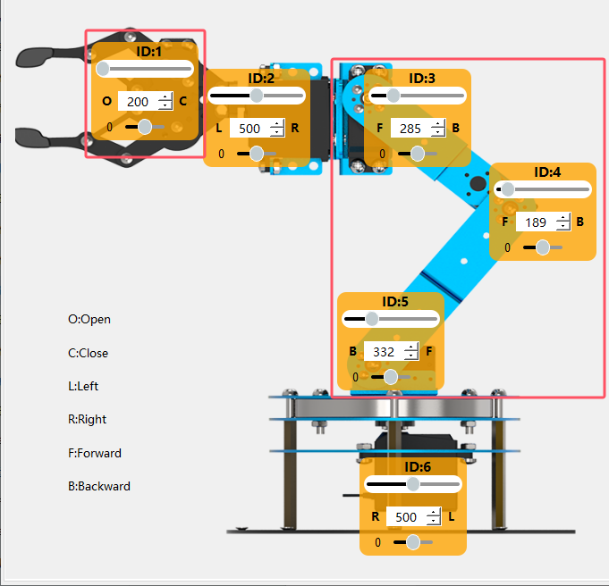

> [!NOTE]
>
> **Hold the left mouse button down and quickly click the slider to fine-tune.**

4. Click the **Add action** icon to add the bend-forward action to the action list on the right.

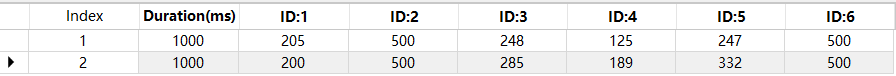

5. Lower the robotic arm slightly by adjusting its lifting height, and fine-tune the claw position as a transition for the next claw-closing step. Slide the sliders of servos 1, 3, and 4 as shown in the figure below, then add them.

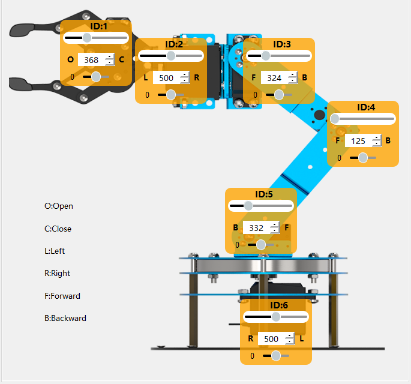

6. Next, make the claw clamp and grip the object. Following the previous method, add the 4th action according to the figure below.

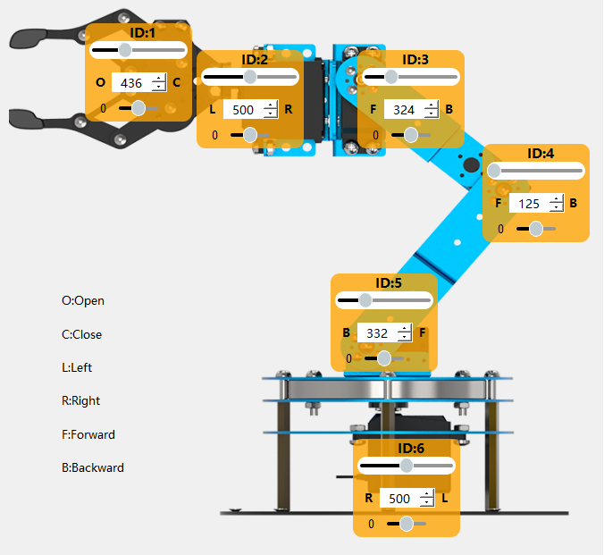

7. Keep the clamped object stationary, and then move the turntable. Therefore, the main adjustment here is for servo ID6. Complete adding action 5 according to the figure below.

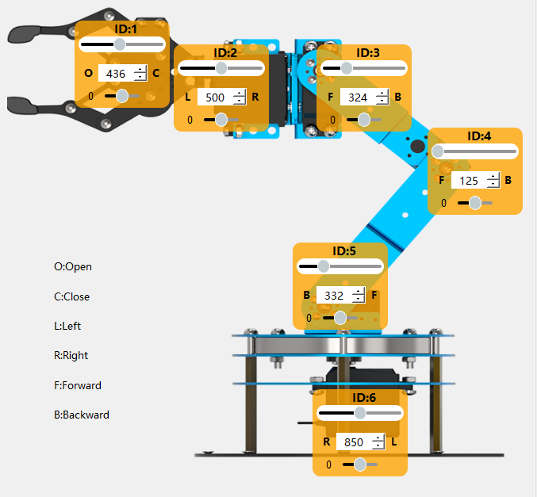

8. After reaching the specified position, the robotic arm lowers slightly, opens the gripper, and places the item down. Add the action 6:

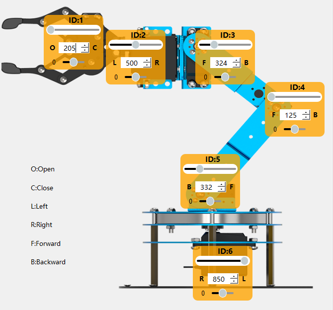

9. Finally, return the robotic arm to its initial position. Click action 1 in the action list, and the robotic arm rotates back to its initial posture. Then click **Add action**. The action 7 is added after the sixth action in the action list, and its servo position values match the values on the left screen at this moment, which are exactly those of action 1.

* **Action Download**

1. After editing the action, save it locally for later debugging. Click the **Save action file** button, and enter the file name and sequence number in the pop-up dialog, and then save. Here, **Item 22: Picking up an object** is used for the file name in this example, as shown below.

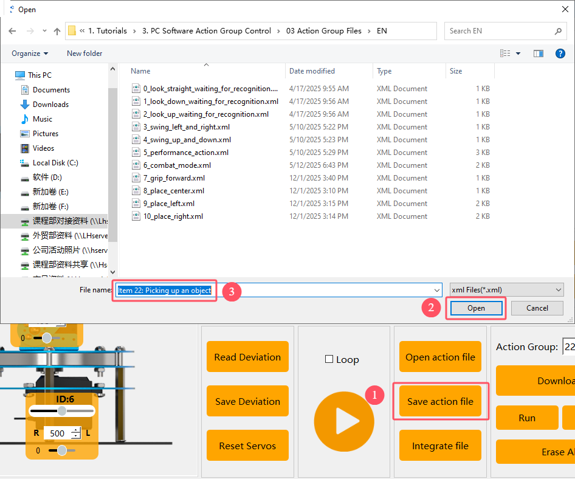

2. After the file is saved, download the action to the corresponding action group. On the right side of the interface, select the action group number 22, then click the **Download** button.

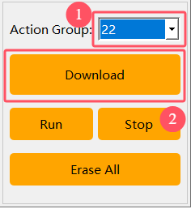

3. After the download is complete, a dialog box appears displaying Download Complete. Click OK to close the dialog box.

## 3.4 Integrate Action Files

### 3.4.1 Implementation Objectives

To study the integration functionality of robotic arm action files and implement the merging between action groups.

### 3.4.2 Hands-on Implementation

1. Turn on the power switch of the robotic arm and connect it to the computer using a USB cable.

> [!NOTE]
>
> **If the factory program runs on the core board, briefly press the KEY1 button on the servo controller once after power-on to switch the working mode. When the buzzer emits two short beeps, the robotic arm enters the PC software control mode and begins processing PC software control operations.**

2. Open the PC software, connect the software serial port, and click the **Integrate file** button in the action group settings area to open action group 0 in **1. Tutorials\3. PC Software Action Group Control\03 Action Group Files\EN**.

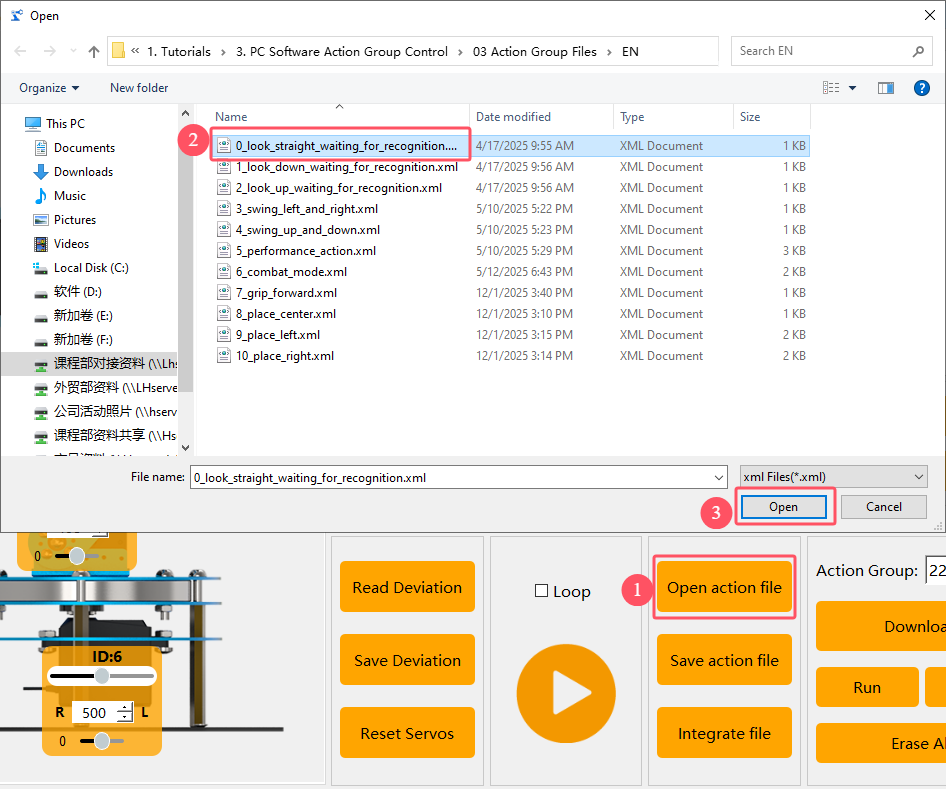

3. At this point, the action group details list displays the parameters of action group 0.

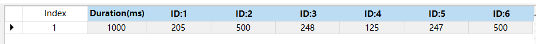

4. Click the **Integrate file** button again, and select action group file 3 for chaining.

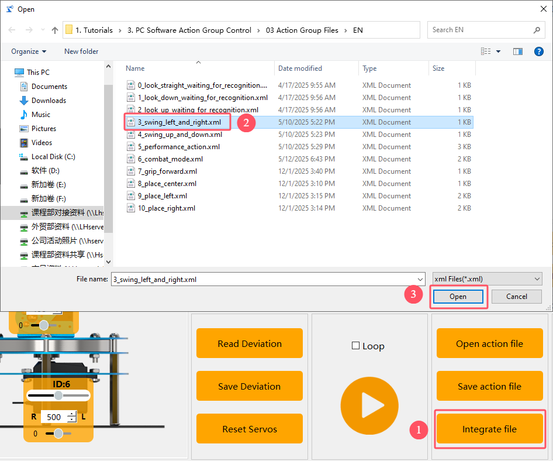

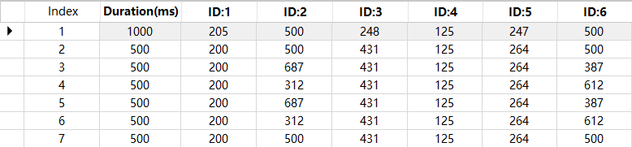

5. Clicking the  button runs the new chained action group online once.

6. Click the **Save action file** button to save the newly chained action group for later debugging. Name the action group **Sways left and right after initialization, No.21**.

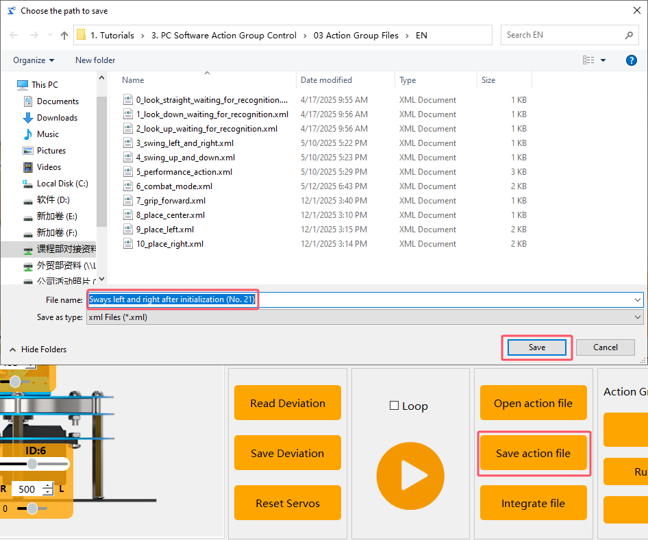

> [!NOTE]
>
> **If too many actions are chained in the action detail list, the PC software will display an over-limit message. In this case, the actions cannot be downloaded to the controller and can only be executed and viewed online.**

## 3.5 Offline Operation Learning

### 3.5.1 Section Objectives

To release the robotic arm from computer control and execute actions through button triggering.

> [!NOTE]
>
> * **The offline operation function is available only when any core board on the servo controller is flashed with the corresponding factory program.**
>
> * **Core boards are pre-flashed with the factory program by default before shipment. If this function needs to be used again after the factory program is overwritten, the corresponding factory program can be retrieved from the following path: 2. Software Tools & Program Suite.**

### 3.5.2 Hands-On Implementation

1. Turn on the power switch to power up the device.

2. After power-on, briefly press the **KEY1** button on the servo controller three times to switch the working mode. When the buzzer emits four short beeps, the robotic arm enters offline control mode.

3. Briefly press the **KEY2** button on the servo controller once, and the robotic arm will execute the action group 7 offline.

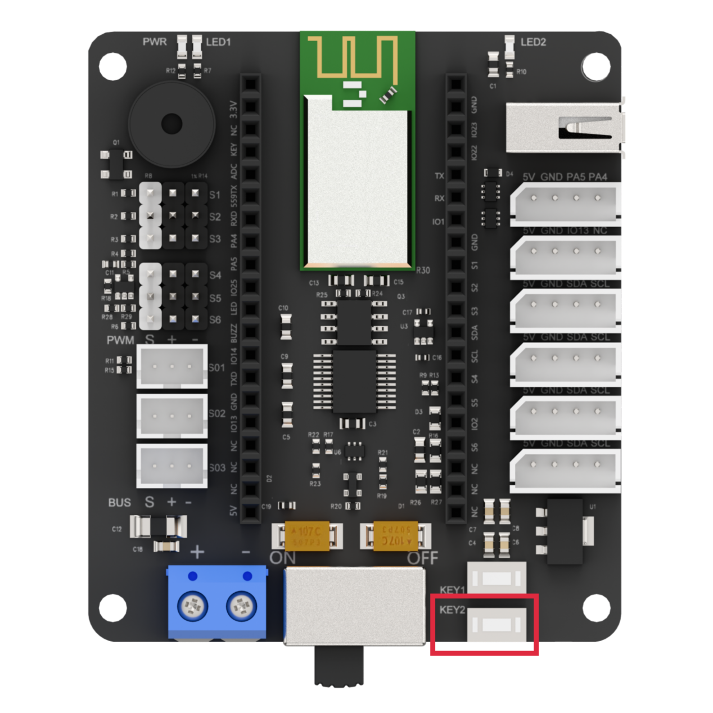

### 3.5.3 Extension

The program logic in the factory programs of various core boards is as follows: **detection of a short press on KEY2 of the controller triggers the execution of action group 7**.

Therefore, a new action group file can be downloaded to action group 7 via the PC software, enabling the robotic arm to execute defined action groups offline.

> [!NOTE]
>
> **The action group download method has been described in detail earlier and will not be elaborated here.**