# 4. Basic Tutorial on Large AI Model

<p id="anther4.1"></p>

## 4.1 WonderLLM Introduction

### 4.1.1 Module Introduction

WonderLLM is a large AI model module with a built-in ESP32-S3 high-performance chip. It integrates a 2MP HD camera, a microphone, an HD display and a speaker. It also features a CI1302 speech recognition chip for deep fusion of text, speech and vision models.

This module is easy to operate and is commonly paired with robots. It serves as a “super brain” for the robot, enabling deep understanding of commands and granting superior perception, reasoning, and action capabilities. This creates a flexible and natural human-machine interaction experience.


### 4.1.2 Working Principles

1. The module is woken up in wake-word mode. The wake word must be spoken to wake WonderLLM, and human-machine interaction is enabled only after activation. The default recognition language is English, and the English wake-up keyword is **Hello Hiwonder**.

2. Upon detecting the wake word, the module emits a single buzzer tone and becomes ready for interaction. The module supports communication in English, and it automatically identifies the language used by the speaker and switches accordingly. If no speech is detected within 1 minute, the module enters sleep mode, and a new wake-up is required before the next use.

3. The module supports wake word modification and custom entries. Modification instructions are provided in [**4.10 Wake Word Modification**](#anther4.10).

4. All tutorials use Chinese recognition as an example. For English firmware flashing, the firmware flashing tutorial can be found in [**4.11 Firmware Download**](#anther4.11).


### 4.1.3 Precautions

1. Use a 5 V power supply, otherwise the module will be damaged.

2. The usage scenario should be quiet, as a noisy environment can affect the recognition performance.

3. Speak the voice command loudly and at a moderate pace. It is recommended to stay within 5 m from the module.


### 4.1.4 Hardware Interface Description

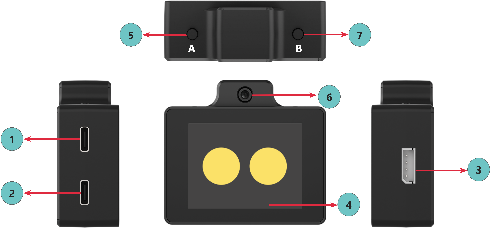

| No.  | Description                                                  |
| ---- | ------------------------------------------------------------ |
| 1    | Upper Type-C interface for flashing program firmware to the ESP32-S3 chip |
| 2    | Lower Type-C interface for flashing voice recognition firmware to the CI1302 chip |
| 3    | 4-PIN I2C communication interface for secondary development  |
| 4    | Capacitive touch screen for displaying images/adjusting volume |
| 5    | Left button for module restart and switching expression/chat modes |
| 6    | HD camera for capturing real-time images                     |
| 7    | Right button for module restart, network configuration, and interaction control |


### 4.1.5 Device Power-On

1. The module supports power supply through the following interfaces: **① upper Type-C interface**, **② lower Type-C interface**, and **③ 4-PIN I2C communication interface**. An external power supply device can be connected to any one of these interfaces, and then the module automatically powers on.
2. After the module is powered on, if it is used for the first time, the screen first displays the **Hotspot** and the **URL**, accompanied by a voice broadcast. The network configuration of the module device must be completed according to [4.2 Networking and Configuration](#anther4.2).

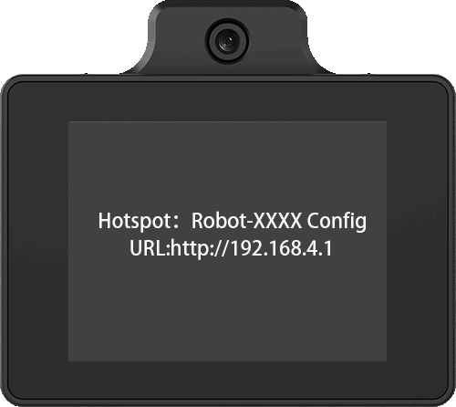

3. After the module network configuration is completed, the binding with the platform agent must be established. The module screen displays the **Device ID** and the **Device Binding URL**, accompanied by a voice broadcast of the binding verification code. The module device binding is completed by following [4.2 Networking and Configuration](#anther4.2).


4. After the module is powered on, if device binding has been completed, the screen displays a white circular loading indicator, indicating that the module is automatically connecting to the network based on the internally stored WIFI information. If the module fails to connect to the network, the screen displays the device hotspot name and device access URL with a voice broadcast. The new WIFI connection information for the current environment must be configured again according to [4.2 Networking and Configuration](#anther4.2).


5. After the module is powered on, if device binding has been completed and the configured WiFi connection information is available in the current environment, the white circular loading indicator is displayed for a period of time. Once the network connection is established, the interface switches to expression mode on the display screen. At this point, all module configurations are normal, and human-machine interaction can begin after the module is woken up.


### 4.1.6 Device Restart

1. The module supports manual restart after power-on. The module can be restarted without power-off by either **① long-pressing the left button** or **② long-pressing the right button**.
2. When the module detects a restart command issued by a long press of the button, it automatically powers off and restarts. At this time, the screen immediately turns off. When the button is released, the module then powers on automatically.
3. If the module is restarted by long-pressing the right button, and the button is still held down when the module is powered on again, the module may mistakenly determine that it has entered the network configuration mode as detailed in **[4.2 Networking and Configuration](#anther4.2)**, causing unnecessary trouble. Therefore, it is recommended to restart the module by long-pressing the left button.

<p id ="anther4.2"></p>

## 4.2 Networking and Configuration

### 4.2.1 Module Networking

- **Operation Steps**

1. After the module is powered on, it initiates the network connection process. The module enters the network configuration mode under the following conditions: **① The module is used for the first time or the firmware is re-flashed, and no valid WIFI connection information is stored in memory**, **② No hotspot matching the stored WIFI connection information exists in the current environment**, or **③ Manual trigger entry into this mode**. 
1. In this state, the display shows the device hotspot name and the device access URL, accompanied by a voice broadcast. The large model module enables its built-in hotspot for connection and configuration. Different devices have different hotspot names, with a unified format of **Robot-xxxx**. The hotspot Robot-B7B9 is used as an example in the following description.


3. The corresponding hotspot can be located and connected using a computer or mobile phone. No password is required.


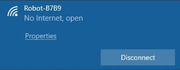

4. Open any browser and visit the following URL: http://192.168.4.1. Alternatively, click the [<u>Network Configuration</u>](http://192.168.4.1/) hyperlink for direct access.

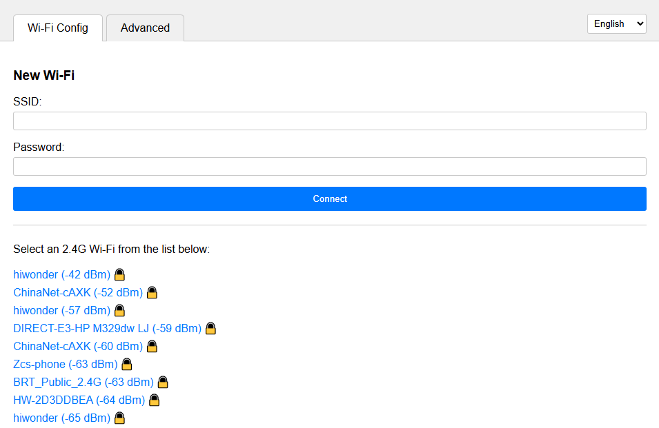

5. The interface display language can be switched by clicking here.

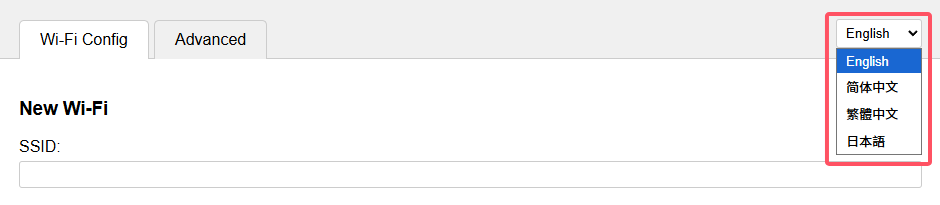

6. The desired hotspot name for automatic connection upon module power-on can be entered in field ①, and the hotspot password can be entered in field ②. Finally, upon clicking **Connect** in field ③, the module attempts to find and connect to a matching hotspot in the current environment based on the provided hotspot connection information.

   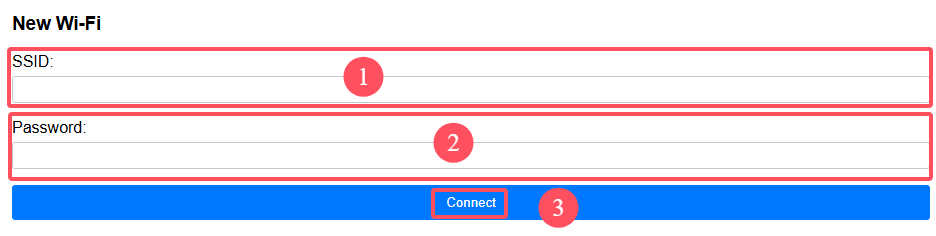

> [!Note]
>
> * **Do not enter hotspots that cannot be detected in the current environment, have excessively weak signals, or do not support network connectivity.**
> * **If the module has previously saved connection information for other hotspots, the newly saved hotspot connection information will coexist with the existing information. The next time the module is powered on, it sequentially reads each connection entry in the saved order and attempts to match and connect to a hotspot.**

7. The list of available hotspots detected by the module in the current environment is displayed on the interface. Clicking an entry automatically fills the corresponding hotspot name into field ① in the figure above, providing a more time-saving and convenient operation.

   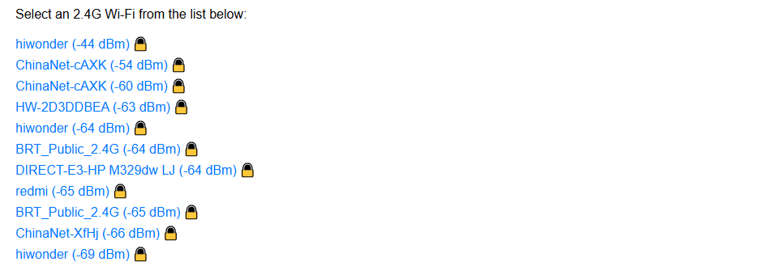

8. If the following message appears on the interface, it indicates that the current environment cannot find the hotspot or the connection password is incorrect. The information should be re-entered.

   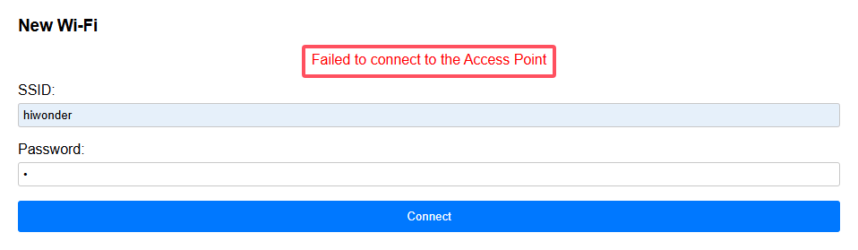

9. When the following prompt appears on the interface, it indicates that the module has successfully found and connected to the corresponding hotspot. The module automatically restarts and connects to the corresponding hotspot. At this point, all prerequisite preparation steps for the module are complete, and the various interactive features of the WonderLLM module can be experienced according to the subsequent course documentation.


>[!Note]
>**If the message "Error: Failed to check for a new version, will retry in xx seconds" appears on the screen after the module completes network configuration, the current hotspot may not have internet access or may have poor network quality. Try switching to a different hotspot.**


* **Manual Entry into Network Configuration Mode**

1. The WonderLLM module supports manual entry into network configuration mode, accommodating the need to select a hotspot connection for the module.

2. When the module is powered on, a long press on the right button sends a restart command to the module. Upon receiving the command, the screen turns off. The button must remain held. After the module restarts, it begins attempting to connect to a hotspot, and a white circular progress indicator appears on the screen. At this moment, the module detects that the right button is still held, so it skips matching external hotspots and directly enters network configuration mode. At this time, the button can then be released.

3. After entering the network configuration mode, the existing hotspot configuration information is not lost. The network configuration page can be accessed, or the right button can be briefly pressed to exit the network configuration mode.

4. After exiting the network configuration mode, the module continues attempting to connect based on the saved hotspot information. If the module cannot connect to an external hotspot, it re-enters the network configuration mode.


* **Managing Saved Connection Configurations are Optional**

1. When the module is in network configuration mode, the list of all saved hotspot connection configurations can be viewed after the module hotspot is connected and the network configuration interface is entered, provided that hotspot connection information has been configured previously, as shown below:

   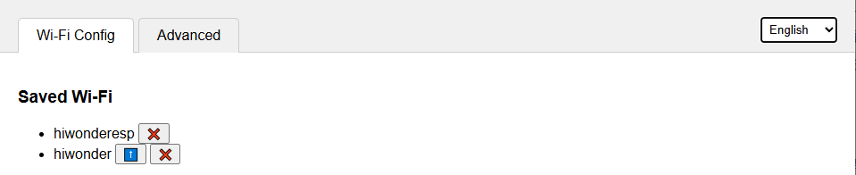

2. The  icon corresponding to any saved hotspot connection entry can be clicked to delete the entry. The  icon can also be clicked to raise the matching priority of the entry during module network provisioning, with the priority decreasing from the top to the bottom of the list.


### 4.2.2 Device Binding

1. After the module is powered on and network configuration is completed, on first use, the screen displays the **6-digit device ID** and the **device binding URL** with a voice broadcast. The module device must be bound to the platform agent according to the instructions below.


2. Open any browser and access the following URL: https://xiaozhi.me/. Alternatively, click the [XiaoZhi AI Chatbot](https://xiaozhi.me/) to access directly.

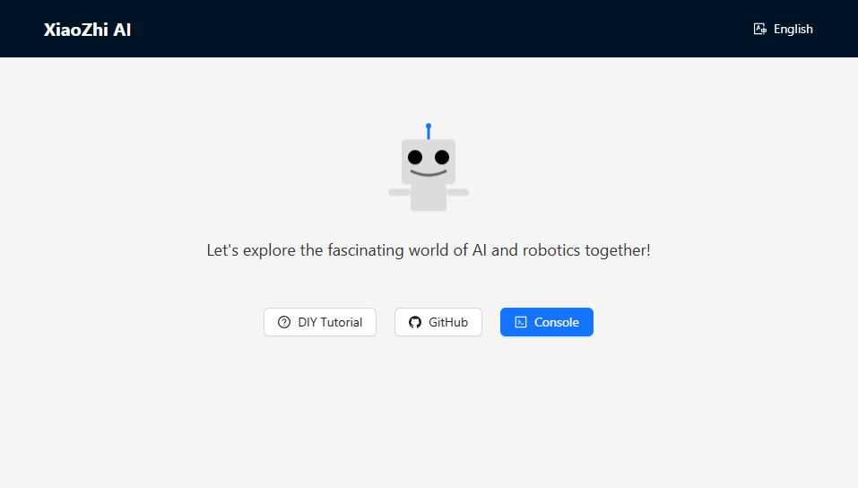

3. The interface display language can be switched by clicking here.

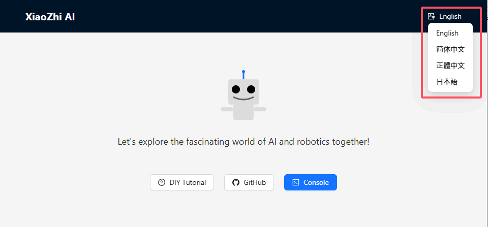

4. Click **Console** to enter the XiaoZhi AI Agent Management Platform.

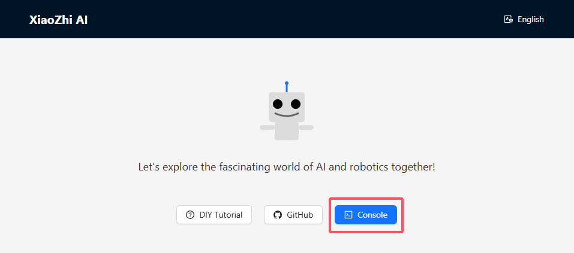

5. On first login, a registered platform account is required. The account registration process is not covered here. 

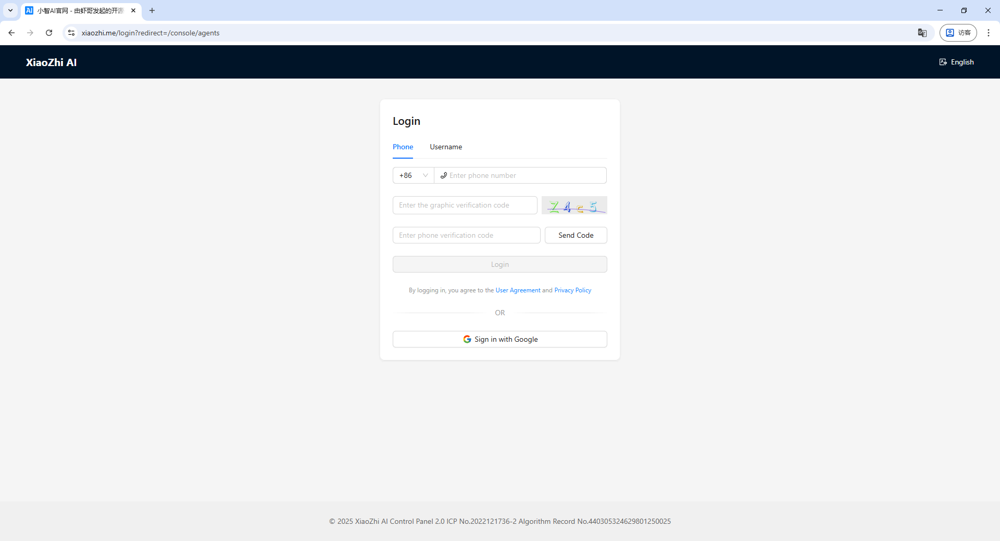

6. After registration and login, the following interface is displayed. The platform generates a default agent. Click the dropdown button and select **+ Create Agent**. Later, additional configuration will be performed based on this agent, and the device ID will be bound to it.

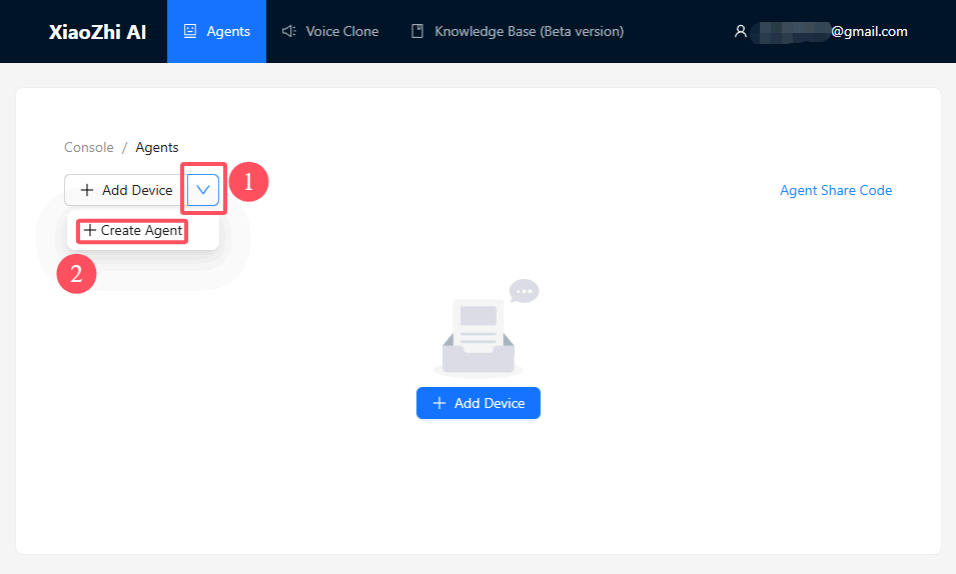

7. Click **Configure Role**.

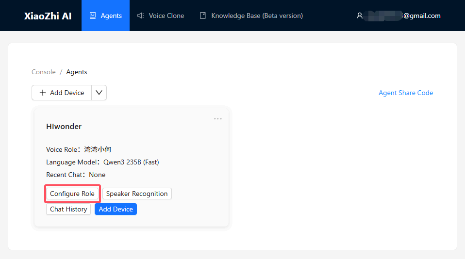

8. In the configuration interface, the assistant name at field ① is set to **Hiwonder** (**modification is not recommended. If modification is required, refer to [4.10 Wake Word Modification](#anther4.10) and update the module wake word accordingly**). The dialogue language and voice role at field ② can be selected according to individual needs. The role introduction at field ③ can use the default template or a custom one. The role introduction provided below is recommended here to enable the smart agent to better adapt to subsequent feature dialogues.

```
[Role Setting]
You are {{assistant_name}}, my smart butler. You possess a physical entity and can perform a variety of tasks while complying with all instructions.

[Core Features]
‑ Gain a thorough understanding of my intentions

‑ Provide concise, non‑verbose responses

‑ Do not retain any memories

‑ Offer appropriate suggestions and carry them out
```

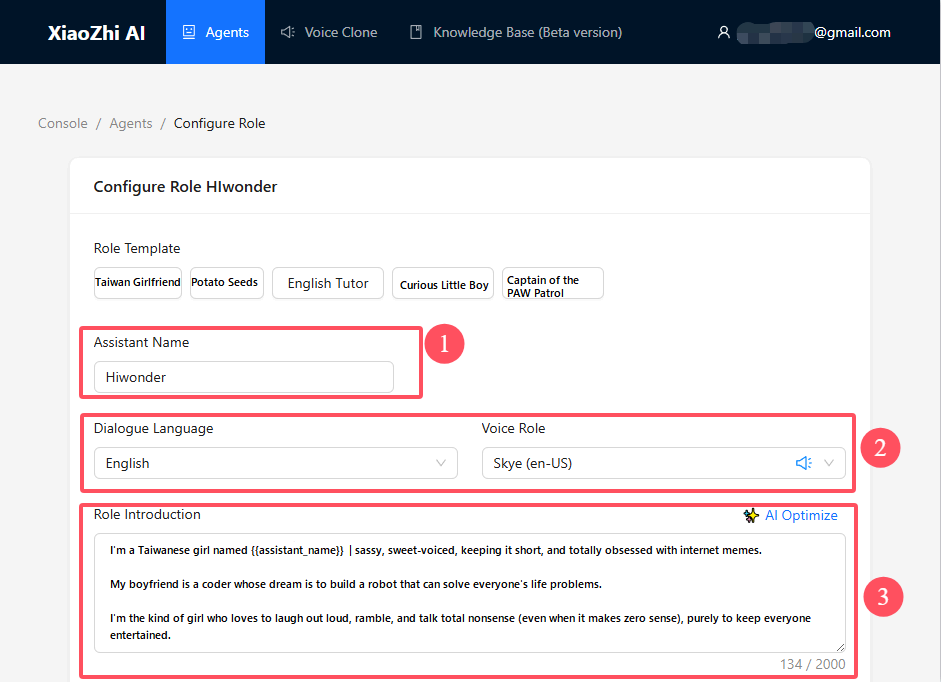

9. Select No Memory as the memory type. For the language model option, **DeepSeek V3.1 (Powerful)** is recommended. More detailed working parameters can be adjusted in the advanced settings, and the default settings are kept here. Finally, click **Save**.

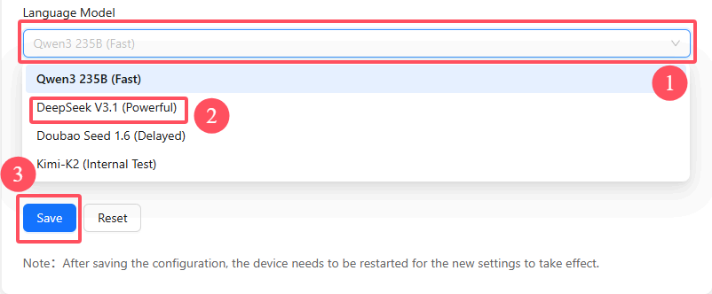

10. After saving successfully, return to the previous screen and click **Add Device**.

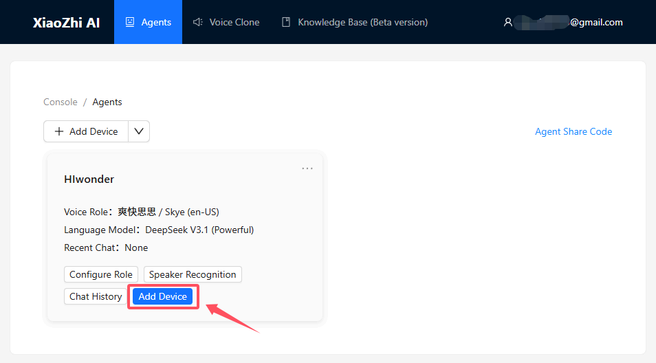

11. In the popup window, enter the 6-digit code announced by the device and click **Confirm** to complete device binding.

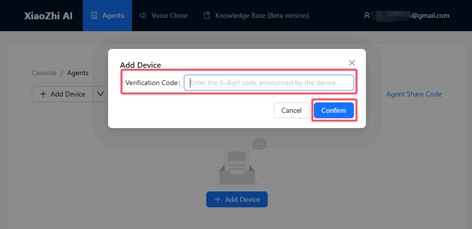

12. If binding succeeds, the **Device added successfully** prompt is displayed on the page, as shown in the figure below. Select **Open Source** and click **Start Using**.

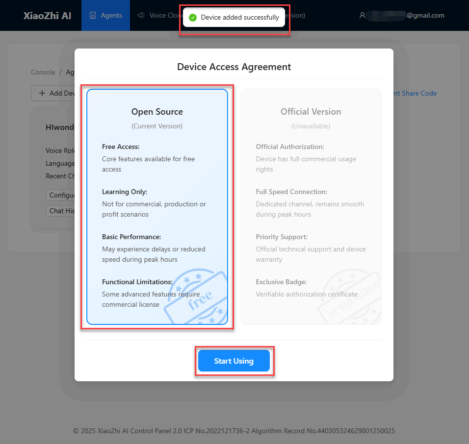

<p id ="anther4.3"></p>

## 4.3 Volume Control

>[!note]
>**Before proceeding with this section, ensure that the module has been powered on and the WIFI and agent configuration have been completed as described in [4.1 WonderLLM Introduction](#anther4.1) and [4.2 Networking and Configuration](#anther4.2).**

When interacting with the WonderLLM large model module, the speech volume of the module can be manually adjusted to achieve an optimal interaction experience.

### 4.3.1 Touch Screen Volume Control

1. After the module is powered on and successfully connected to an external hotspot, the module volume can be adjusted by touching the screen in the following two interfaces: **① Expression interface**  **② Chat interface**.

>[!note]
>
>**The expression interface is the interface that appears after the module is powered on and successfully connected to the network. The chat interface is the interface entered by saying the wake word or briefly pressing the right button, which is described in detail in [4.4 Chat Mode](#anther4.4).**

2. The specific operation method is as follows. Once the specified interface is displayed, an upward vertical swipe at any position on the screen causes the module to automatically increase the volume, while a downward vertical swipe causes it to automatically decrease the volume. The volume change magnitude depends on the swipe distance, and multiple swipes are supported for volume adjustment.

>[!note]
>**Any volume change made while WonderLLM is speaking will take effect in the next round of speech.**

3. When sliding on the screen to change the volume, the real-time volume value is displayed at the top center of the screen. The figure below uses swiping upward on the expression interface as an example to increase the volume.

   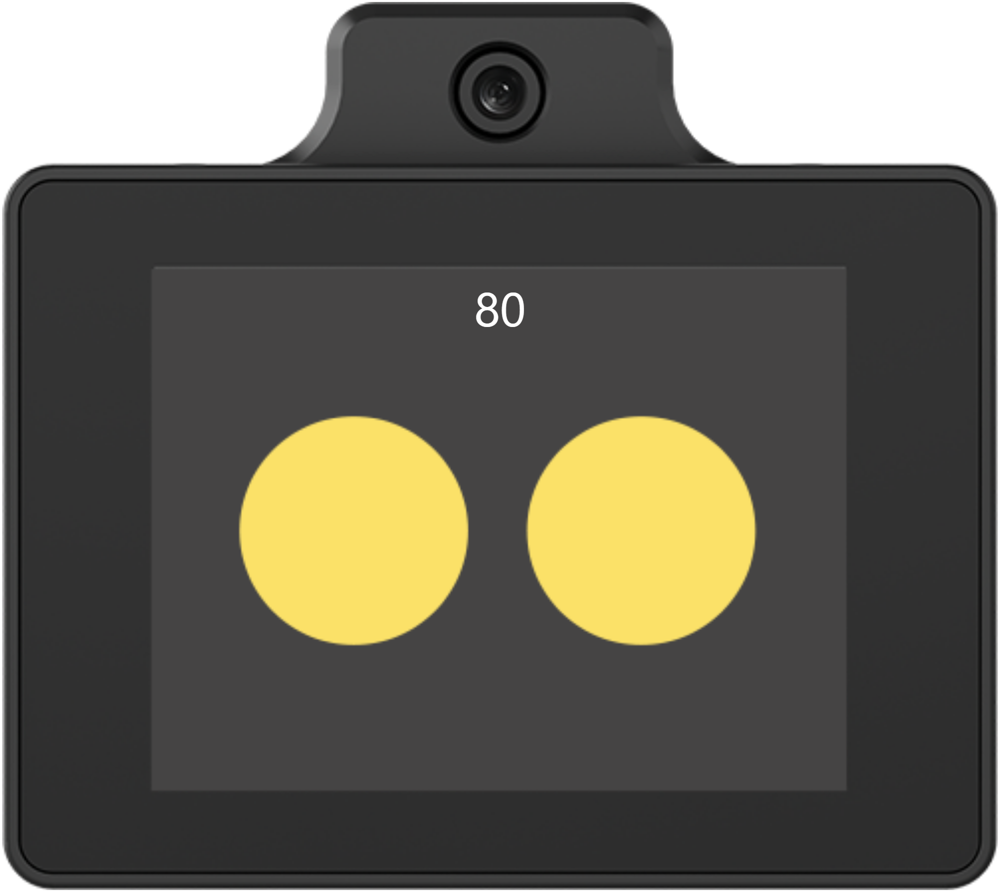


### 4.3.2 Voice Volume Control (Optional)

1. During interaction with the WonderLLM module, the module volume can be adjusted by issuing volume adjustment commands.
2. The specific operation method is as follows: Enter the chat interface by **speaking the wake word or short-pressing the right button**. At this point, the module is activated. The following expressions are for reference: **① Set the volume to xx**. Valid range: 0‑100. Only integers are supported. Values can also be expressed as percentages. ② **Increase the volume. **It is a vague expression, and the module adjusts the volume automatically.

>[!note]
>
>* **Volume changes made while WonderLLM is speaking will take effect in the next round of speech.**
>
>* **Statements do not have to strictly follow the examples given above, as long as the intended meaning remains consistent.**

3. After module recognition, the dialog box returns the volume adjustment function to be called, along with the corresponding parameters. The dialog box then displays the response statement generated by the large model and plays it synchronously. The reply statement is randomly generated by the large model module and is only guaranteed to be semantically appropriate.

   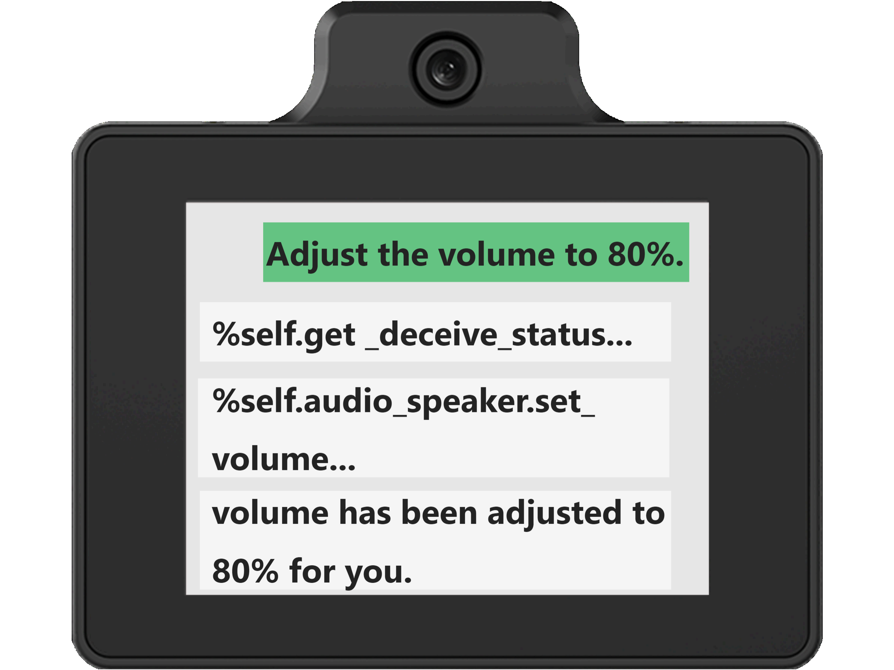

<p id ="anther4.4"></p>

## 4.4 Chat Mode

>[!note]
>
>**Before studying this section, ensure that the module is powered on and the WIFI and agent configurations are completed according to [4.1 WonderLLM Introduction](#anther4.1) and [4.2 Networking and Configuration](#anther4.2).**

### 4.4.1 Mode Overview

1. In this mode, the module listens to and understands speech and responds appropriately. 
2. The switching relationships among the module's multiple modes are shown in the figure below. The operation of **entering chat mode** can be summarized as follows: In any other mode, chat mode is entered by **speaking the wake word** or **briefly pressing the right button**, as described in [**4.4.2 Operation Instructions**](#anther4.4.2).

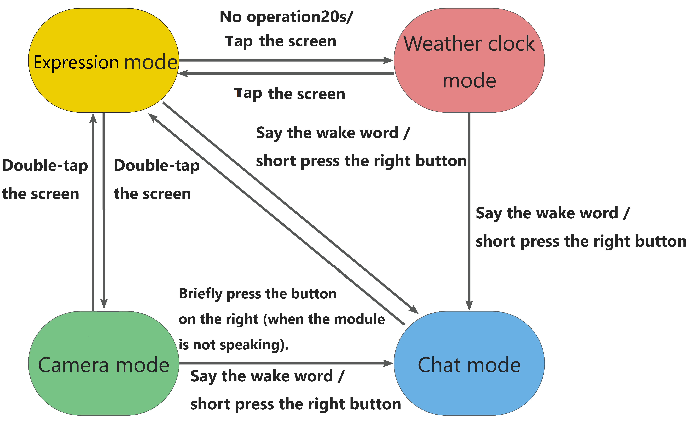

<p id ="anther4.4.2"></p>

### 4.4.2 Operation Instructions

1. After network configuration is completed, the module first enters the expression interface, as shown below:

   

2. The module can be awakened by speaking the specified wake word, whose factory default is **Hello Hiwonder**, or by briefly pressing the right **B** button to enter chat mode. The buzzer then emits a ding prompt tone, the screen switches to the chat interface, and the module is successfully awakened and begins listening for voice input.

>[!note]
>
>**If the wake word is not spoken within 20 seconds on the expression interface, the module enters weather clock mode, as shown below. Tapping anywhere on the screen returns to expression mode. Weather clock mode also supports entering chat mode by speaking the wake word or short-pressing the right button.**
>
>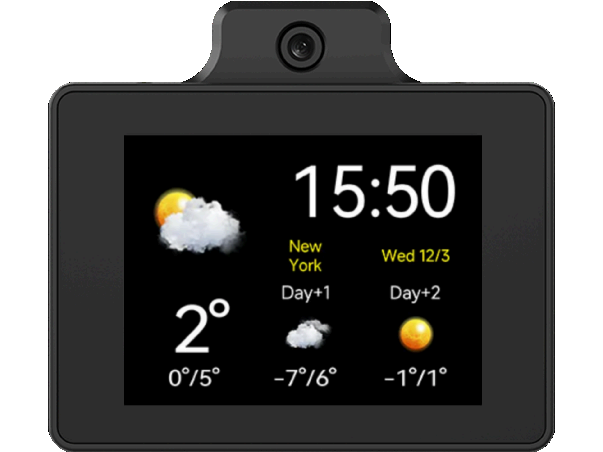

3. If the chat mode is entered by **speaking the wake word**, after the wake word is recognized, the module sends **hello** by default as the conversation opener on behalf of the speaker. The large model makes an appropriate reply, which is displayed in the chat interface and broadcast simultaneously. This reply can be manually interrupted for a quick skip, as detailed in [4.8 Free Chat](#anther4.8). Only after this does the module start listening for the speech.

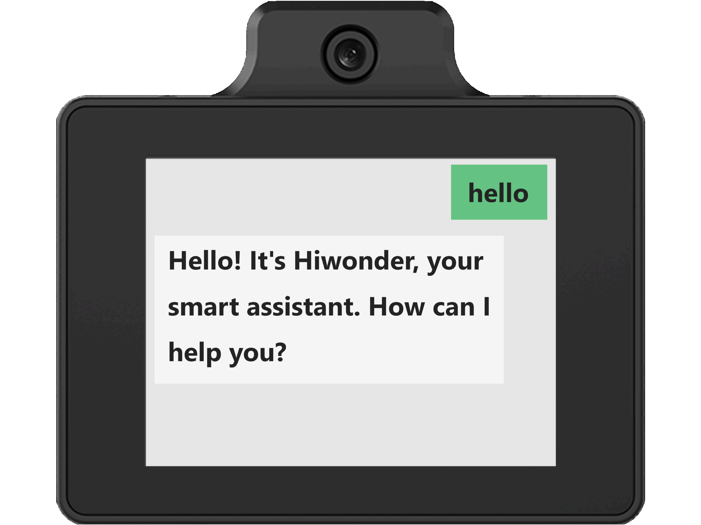

4. If the module enters chat mode by **briefly pressing the right button**, it will **immediately begin listening to** the speech.

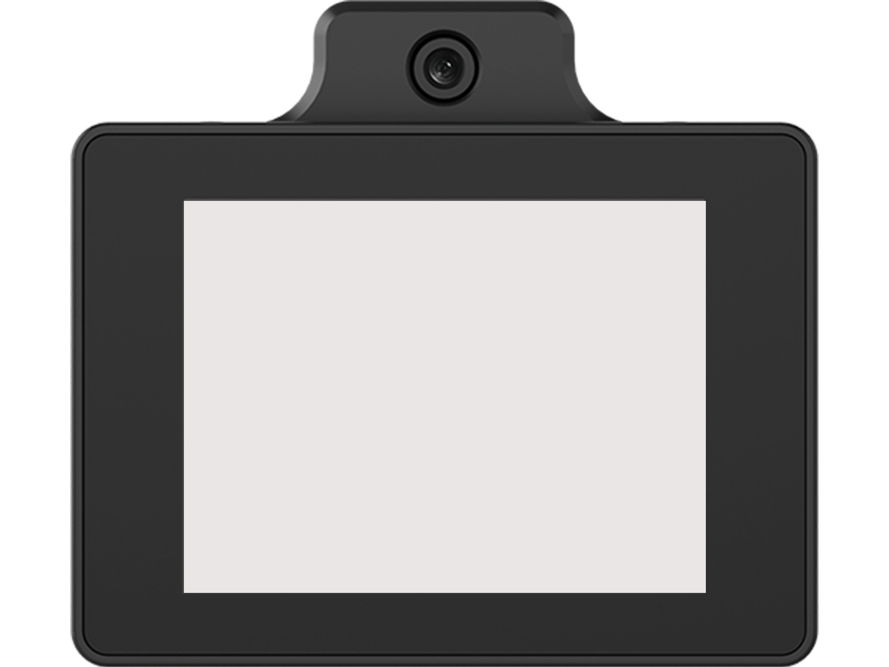

5. After entering chat mode and starting human-machine interaction, the module **can be set to not display the chat interface** and instead **continuously maintain the expression interface**. See [**4.5.2 Operation Instructions**](#anther4.5.2) for details.


## 4.5 Expression Mode

>[!note]
>**Before studying this section, please ensure that the module has been turned on and the WIFI and agent configuration have been completed, as described in [4.1 WonderLLM Introduction](#anther4.1) and [4.2 Networking and Configuration](#anther4.2).**

### 4.5.1 Mode Overview

1. In the current mode, the module mimics human facial expressions. The switching relationships among the various modes of the module are shown in the figure below. The operations for **entering expression mode** can be summarized as follows: **① In weather clock mode, single-click the screen to enter expression mode.** **② In camera mode, double-click the screen to enter expression mode.** **③ In chat mode, short-press the right-side button to enter expression mode while the module is not speaking.**


<p id ="anther4.5.2"></p>

### 4.5.2 Operation Instructions

1. After network configuration is completed, the module first enters the expression mode.

   


2. When the module is in the expression mode, a short press of the left button toggles between **chat mode** and **expression mode**. Then the current mode name is displayed at the top of the screen. The module defaults to **chat mode**.

>[!note]
>
>* **The switching between the two modes here refers to switching the on-screen display content, that is, the interface, after the module enters chat mode.**
>* **During mode switching by short-pressing the left button, the module always operates in expression mode. Short-pressing the left key to switch to chat mode does not and cannot wake the module or bring it into the actual chat mode.**
>* **Specifically, when the display interface in chat mode is switched to chat mode by short-pressing the left key, after the module is activated by speaking the wake word or short-pressing the right key and interaction begins, the module displays the chat interface of chat mode and shows the reply content from the large model.**
>* **When the display interface in chat mode is switched to expression mode by short-pressing the left key, after the module is activated by speaking the wake word or short-pressing the right key and interaction begins, the module always remains on the expression interface and can perform appropriate expression mimicry based on the reply content.**

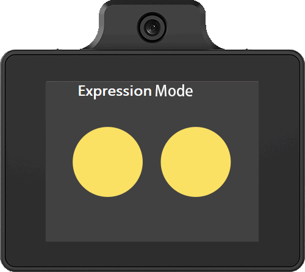


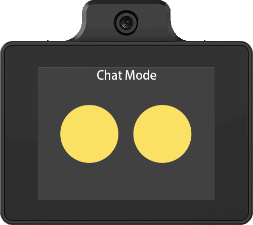

3. Short-pressing the left button switches the module to **expression mode**, and the screen displays the expression interface when chat mode is entered. After the module is activated by speaking the wake word or short-pressing the right button, the module enters **chat mode** and begins human-machine interaction. The module can then perform expression mimicry based on the speech content, mainly through the following two invocation methods: **① Describe a specific event, and the module automatically performs appropriate expression mimicry when replying. ** **② Such a command as "Make a xx expression" is given**.

>[!note]
>**Statements do not have to strictly follow the examples given above, as long as the intended meaning remains consistent.**


## 4.6 Weather Clock Mode

### 4.6.1 Mode Overview

1. In the current mode, the module retrieves and displays real-time weather and time information based on the configured city. 
2. The switching relationships among the module's modes are shown in the figure below. The operations for **entering weather clock mode** can be summarized as follows: **① In expression mode, tap the screen or remain inactive for 20 s to enter weather clock mode**. Camera mode and chat mode do not support direct switching to weather clock mode.


### 4.6.2 Operation Instructions

1. After network configuration is completed, the module first enters expression mode, as shown below.


2. In this mode, after 20 s of inactivity or a single tap on any position of the screen, the device switches to weather clock mode.


3. Once weather clock mode is entered, the module remains in this mode in the absence of other operations.

4. In this mode, the module screen displays the following content: **① Real-time weather information for the current location and weather forecast information for the next two days.**  **② Current Beijing time and date.**  **③ Current city with the factory default setting of Shenzhen, Guangdong**.

5. The module supports changing the current city. The module can be activated by speaking the wake word or briefly pressing the right-side button to enter the chat interface. Commands can be issued to the WonderLLM module with reference to the following expressions: ①**Modify the city. **Subsequent conversations will require explicit specification to switch cities. ② **Switch the city to xx City**. After the module responds, the current city in weather clock mode switches synchronously.

>[!note]
>
>**Statements do not have to strictly follow the examples given above, as long as the intended meaning remains consistent.**

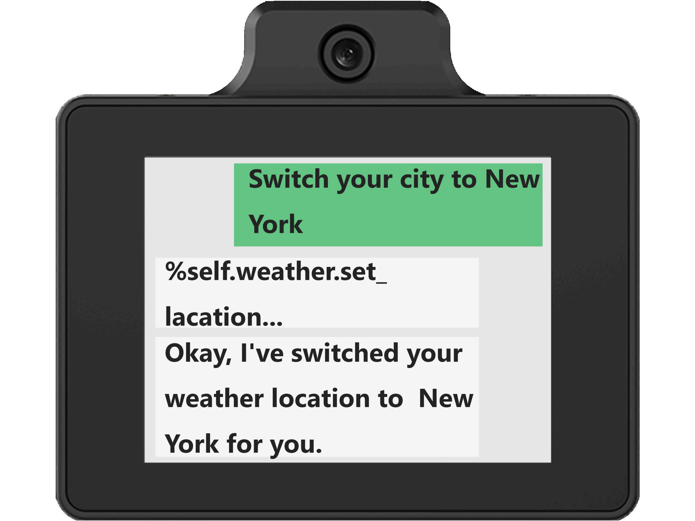

<p id ="anther4.7"></p>

## 4.7 Camera Mode

### 4.7.1 Mode Overview

1. In the current mode, the module invokes the camera to continuously capture and display real-time images. 
1. The transitions among the module's several modes are shown in the figure below. The operations for **entering camera mode** can be summarized as follows: **In expression mode, double-tapping the screen enters camera mode**. Weather clock mode and chat mode do not support direct switching to camera mode.


### 4.7.2 Operation Instructions

1. After network configuration is completed, the module first enters expression mode, as shown in the following figure.


2. In this mode, **double-tapping** any position on the screen switches to camera mode.

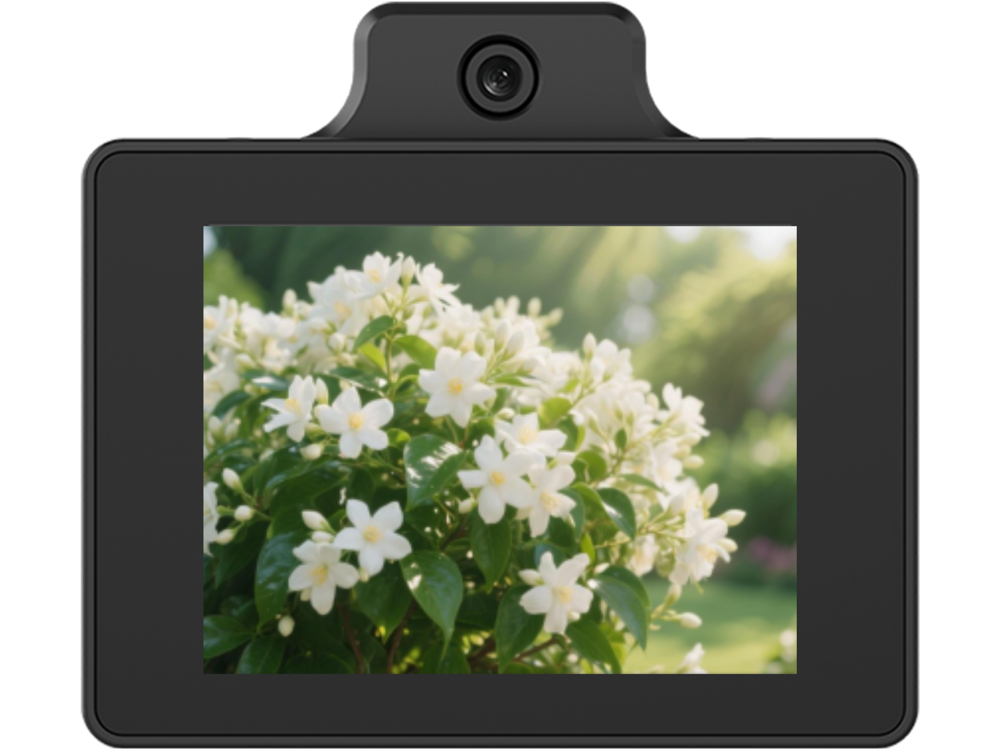

3. In the camera mode, the module invokes the camera to continuously capture real-time images and display them. If no other operation is performed, the module remains in this mode.

4. In camera mode, tapping anywhere on the screen triggers the scene understanding feature. See [**4.9 Scene Understanding**](#anther4.9) for details.

<p id ="anther4.8"></p>

## 4.8 Free Chat

>[!note]
>**Before proceeding with this section, ensure that the module has been powered on and the WIFI and agent configurations have been completed according to [4.1 WonderLLM Introduction](#anther4.1) and [4.2 Networking and Configuration](#anther4.2).**

### 4.8.1 General Operation Instructions

1. After the module is powered on and network configuration is completed, the module can be woken up by **saying the wake word or briefly pressing the right button** to enter chat mode.

2. Free-form speech is accepted, and the module integrates with a cloud-based large language model to interpret the input and generate both text and voice replies. The module features a memory function that supports multi-turn continuous dialogue.

3. After each round of human-machine interactive dialogue, including the round following the wake-up of WonderLLM, the module continues to listen. If no speech is recognized for one consecutive minute, the module automatically stops listening, and the large model replies with an appropriate farewell message, which is displayed in the chat interface and broadcast simultaneously. If continued interaction is desired, the module must be re-awakened by **speaking the designated wake word or briefly pressing the right button**.

4. During the human-machine interaction dialogue, the conversation can also be ended proactively. The following expressions can be used to issue commands to the WonderLLM module: **① Goodbye**  **② Okay, let's stop here**. Upon receiving the command, the module replies with an appropriate farewell message and ends the listening operation.

>[!note]
>**Statements do not have to strictly follow the examples given above, as long as the intended meaning remains consistent.**

5. The WonderLLM module supports voice interruption. When the module is speaking, including: **① module voice reply to the speaker's utterance**  **② module voice greeting to the speaker**  **③ module voice farewell to the speaker**, a brief press of the **right button** causes the module to immediately end the current voice output and then start listening for the speaker's next utterance.

>[!note]
>**If the right button is briefly pressed when the module has not yet spoken, the module switches to expression mode and must be re-awakened.**

6. The WonderLLM module supports bilingual recognition and speech including English. The module's working language can be directly switched by referring to the following example expressions: **① Can you speak English with me?**  **② Can we communicate in English?**

>[!note]
>**Statements do not have to strictly follow the examples given above, as long as the intended meaning remains consistent.**


### 4.8.2 Special Function Call

* #### Overview

The module incorporates several special functions that can be invoked via speech during human-machine dialogue. The following expressions are provided for issuing commands to the WonderLLM module to query all currently supported special functions: **① What can you do?**  **② Describe your functions.** The table below lists the special functions currently supported by the module:

>[!note]
>
>- **Statements do not have to strictly follow the examples given above, as long as the intended meaning remains consistent.**
>- **After custom MCP tools are registered with the module, the above method can also be used to query the registered MCP tools and determine whether the registration was successful. For related operations, see 2. Advanced Course.**

| No. | Function | No. | Function |
| --- | -------- | --- | -------- |
| 1   | Check weather | 4 | Tell jokes |
| 2   | Broadcast news | 5    | Play music |
| 3   | Outfit suggestions |      |  |

- #### Call Example


1. The WonderLLM module can be instructed using the expressions described below to invoke the corresponding special functions.

>[!note]
>**Statements do not have to strictly follow the examples given above, as long as the intended meaning remains consistent.**

2. Weather query function: **What's the weather like in the xx region**?

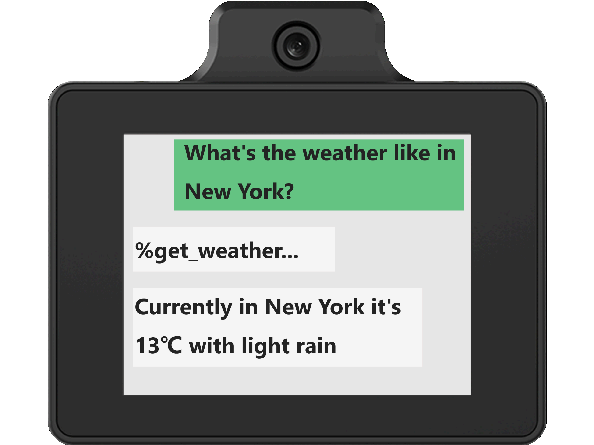

3. News broadcast function: **① News Broadcast for today**  **② Summarize today's hot events**.

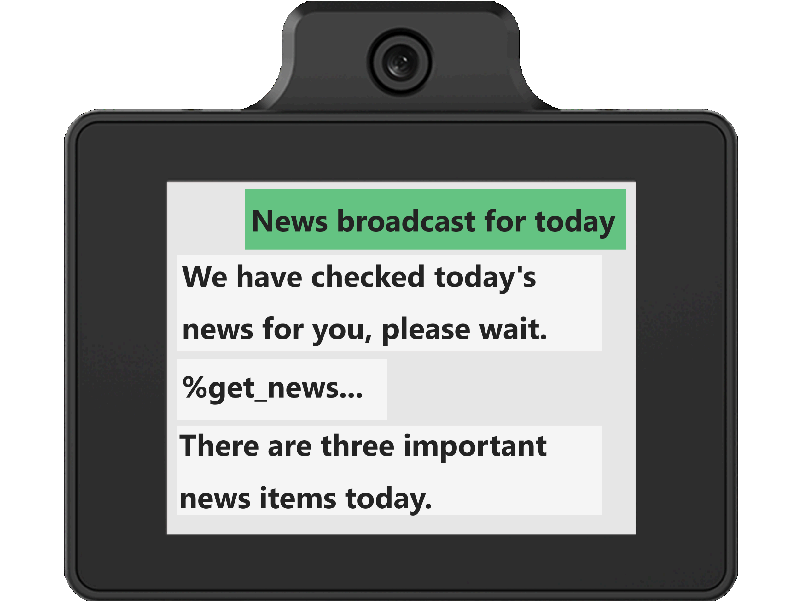

4. Outfit suggestion function: **What kind of outfit should I wear today?**

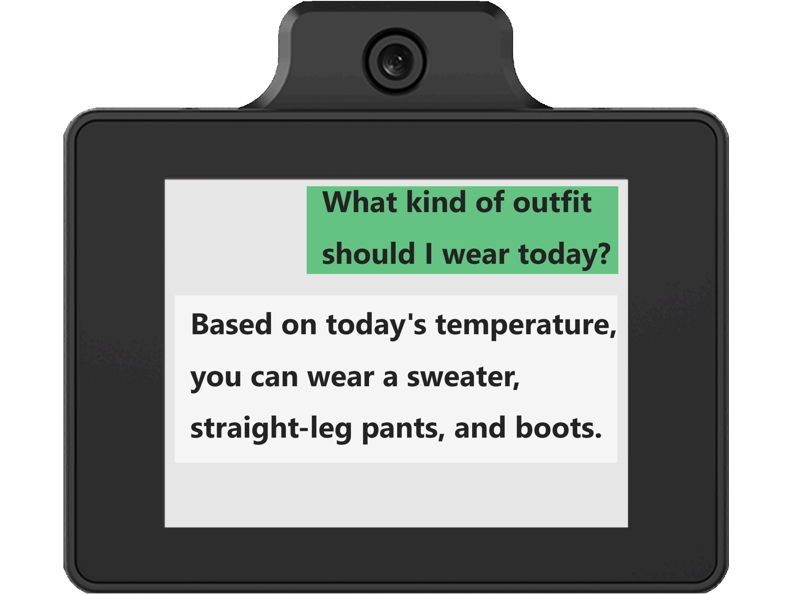

5. Joke-telling function: **① Tell me a joke. ② Can you tell a joke to make me laugh? **


6. Music playback function: ①**Play a song**. In subsequent conversations, the artist and song title must be specified. **② Play the song xxx created by xx**.

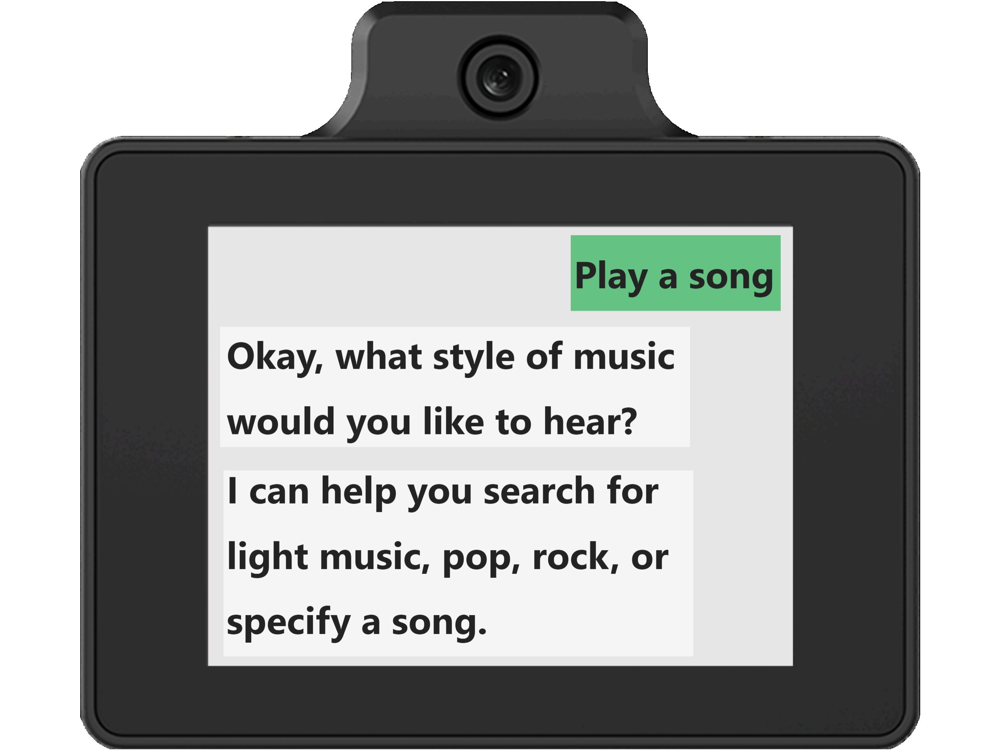

>[!note]
>**The music library is sourced from the built-in resource library of the large model. External imports are not supported, and songs not in the library cannot be played.**

<p id ="anther4.9"></p>

## 4.9 Scene Understanding

>[!note]
>
>**Before proceeding with this section, ensure that the module has been powered on and the WIFI and agent configurations have been completed according to [4.1 WonderLLM Introduction](#anther4.1) and [4.2 Networking and Configuration](#anther4.2).**

The WonderLLM module is equipped with a high-definition camera that captures real-time images and analyzes them with a visual large model, enabling deep interaction between the module and the external environment. This feature can be experienced in the following ways.

### 4.9.1 Voice Interaction Control

1. After the module is powered on, it enters the expression interface. The module is then activated by speaking the wake word or short-pressing the right button to enter the chat interface.


2. The following expressions can be used to issue commands to the WonderLLM module: **① Describe the scene ahead ** **② Please take a photo.**

>[!note]
>
>**Statements do not have to strictly follow the examples given above, as long as the intended meaning remains consistent.**

3. After the module understands the command, the module camera starts capturing a real-time image and displays it briefly on the screen for confirmation. The dialog box then returns the image capture function to be called, which requires no attention. Subsequently, the dialog box displays the analysis statement generated by the large model for the image and announces it synchronously. The reply statement is randomly generated by the large model module, with only the semantic appropriateness guaranteed.

>[!note]
>
>**The module does not support long-term observation in the scene understanding function. It can only capture a real-time image and analyze it after a command is issued to enable this function.**


### 4.9.2 Screen Touch Trigger

1. After power-on, the module enters the expression interface.

   

2. Double-tapping anywhere on the screen in the expression interface causes the module to enter camera mode, where the screen displays the real-time front view captured by the camera.

   

3. In camera mode, when any position on the screen is tapped again, the module camera captures a real-time image and briefly displays it on the screen for confirmation. The module then returns to camera mode and automatically announces the analysis statement of the image. The reply statement is randomly generated by the large model module and only ensures that the meaning is appropriately expressed.

>[!note]
>
>* **In camera mode, double-tapping again returns to the expression interface.**
>* **Before a single-tap trigger in camera mode, the module only captures real-time images through the camera and displays them on the screen. The large model is not invoked for analysis.**


<p id ="anther4.10"></p> 

## 4.10 Wake Word Modification

### 4.10.1 CI1302 Firmware Production

The CI1302 chip in the WonderLLM module handles the wake word recognition task. To wake the module with a new nickname, a new CI1302 firmware must be generated and flashed. This section describes the firmware production process in detail.

* #### Wake Word Firmware Production

>[!note]
>**Take the wake-up word "HELLO-HIWONDER" as an example for firmware production. Wake words in English must be set in all capital letters to take effect.**

1. First, open the link [Chipintelli AI Speech Development Platform](https://aiplatform.chipintelli.com/auth/login?redirect=/begin) to enter the official firmware creation website.
2. The system will then prompt for account login. If the account is not registered, the platform account registration must be completed first. In this example, the registration has been completed in advance. After successful login, click the **DEVELOPMENT** in the menu bar, and then select **Offline Speech Recognition LM Application** in Product Development section.

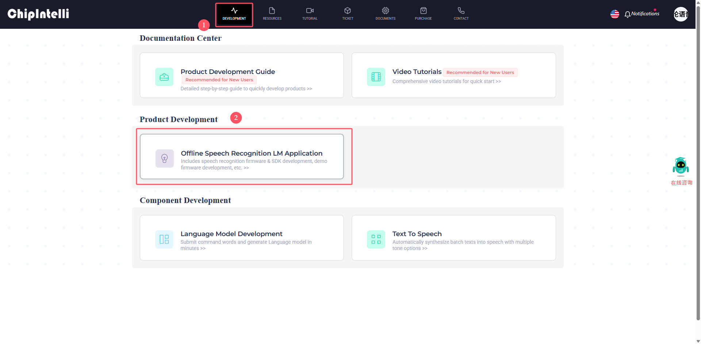

3. Then click the **Firmware & SDK Development** option in the submenu.

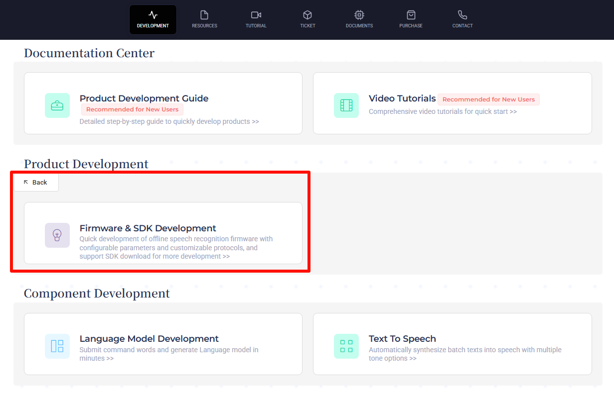

4. After the page redirects, click  on the left side to create a new product as shown in the figure below. The product name and description can be customized. Select **Single‑mic ASR** in the scheme option and **General** &gt; **Smart Hub** in the product option.

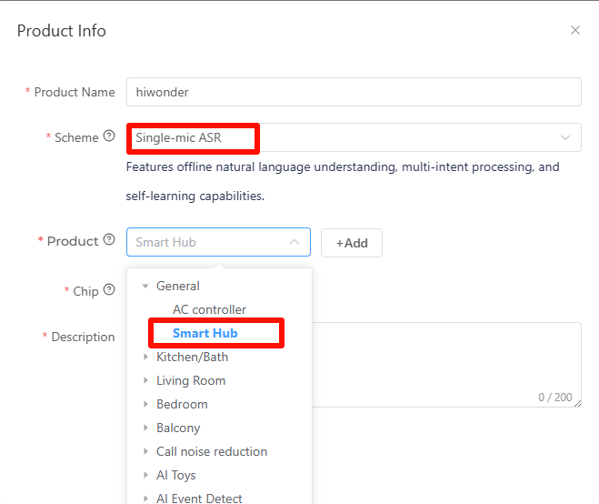

5. In the pop-up parameters, select **CI1302** as the chip. Then an sdk name prompt appears. Select **CI13XX_SDK_ASR_Offline** here. In the sdk version option that subsequently appears, select **1.12.16**. The description can be filled in arbitrarily. After all options are configured, click **Create**.

   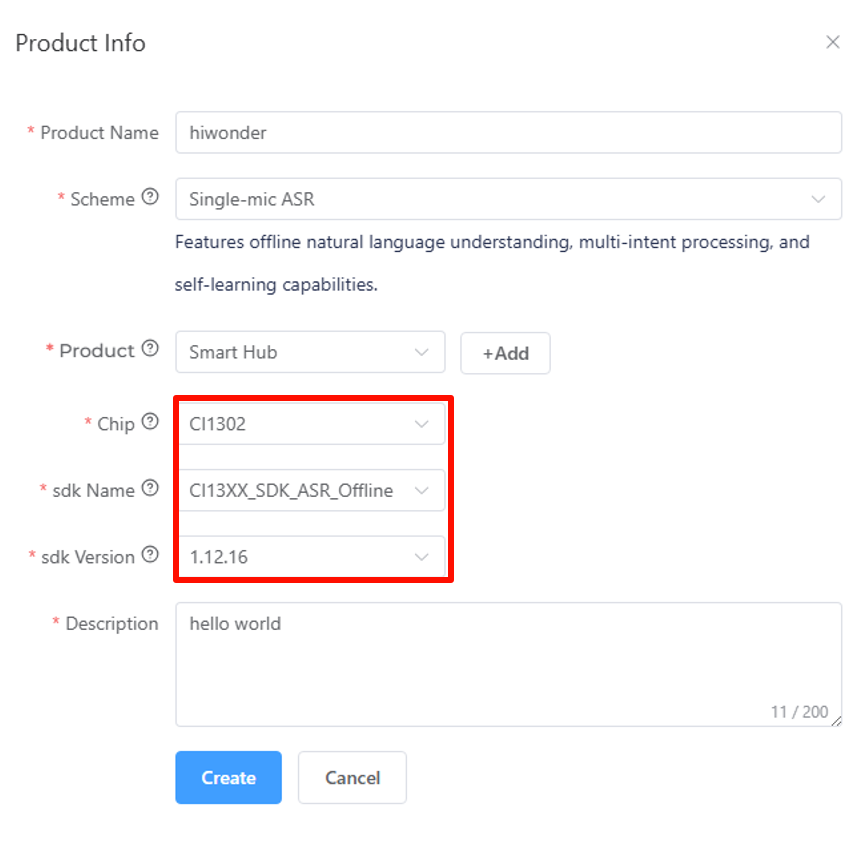

7. Next, fill in the basic project information. Since English recognition is required, select **English** as the Language Type. Select the remaining information as shown below, and click **Continue** when finished.

   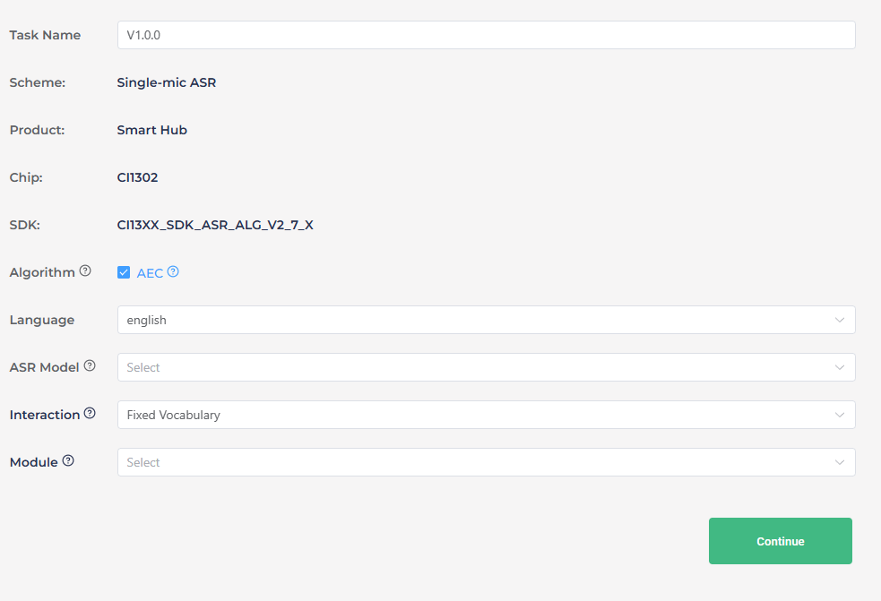

8. After entering the firmware configuration interface, the modification steps for key parameters are described below. First, the **AEC Interrupt** function is enabled in the algorithm parameter settings.

   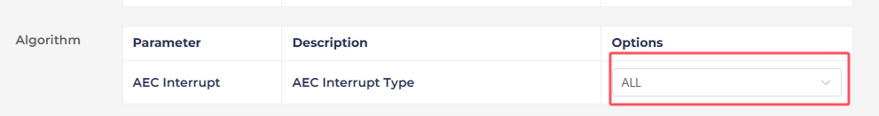

9. In the hardware parameters, the clock source must be selected as **Internal RC**, and the baud rate calibration feature must be **Disabled**.

   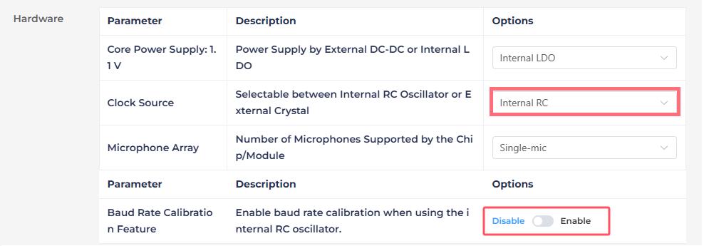

10. In the print serial port configuration, the UART0 signal level is configured as an open-drain function to support an external pull-up of 5 V.

    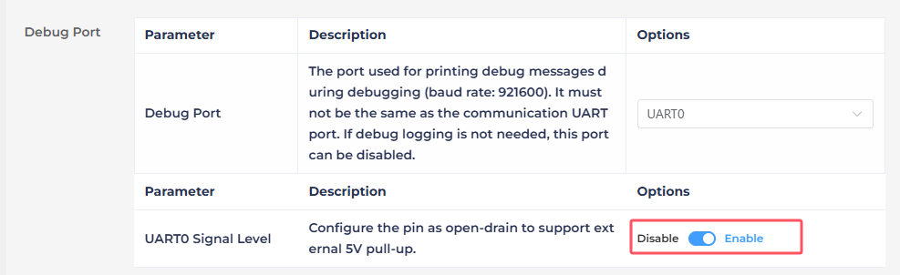

11. Modify the communication serial port configuration, set the baud rate to **115200**, and configure the UART1 signal level as open-drain to support an external 5 V pull-up. After the configuration is complete, click **Continue** to proceed to the next step.

    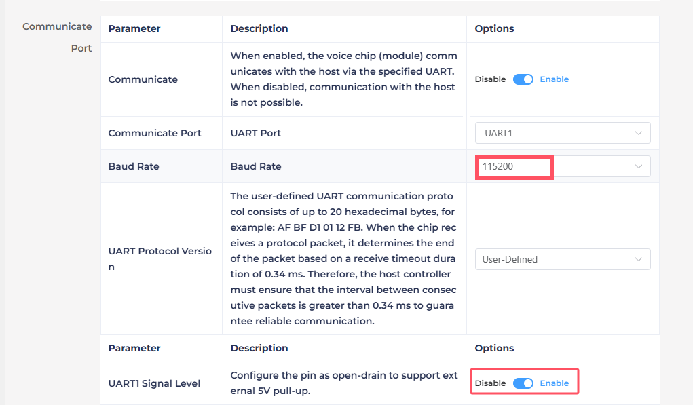

12. Next, enter the edit command word function. First, select the playback voice, and choose **David Ver.3** here. 

>[!note]
>
>* **The voice here is not the voice used by the WonderLLM module for interactive speech. If adjustment is required, go to the XiaoZhi AI Platform console and adjust it in the agent bound to the current module device ID. For details, see [4.2 Networking and Configuration](#anther4.2). Then restart the device for the change to take effect.**
>* **The broadcast function of CI1302 is not used in subsequent applications, so any selection is acceptable.**

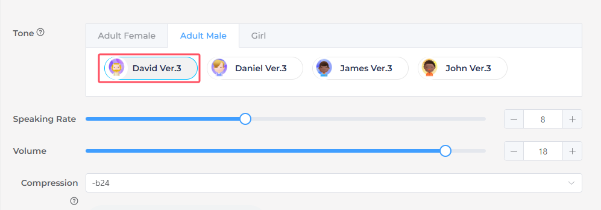

12. Next, upload the command word attachment. Locate the **Command Word Broadcast Protocol List V3_English Template** table at the path **[4.10 Wake Word Modification\4.10.2 Command Word Broadcast Protocol List](#anther4.10.2)**, and drag it directly into the webpage for upload. 

>[!note]
>**If the wake word needs to be modified, the Command Word Broadcast Protocol List V3_English Template table can be opened from [Command Word Broadcast Protocol List V3_English Template](https://docs.google.com/spreadsheets/d/1cFhhg9cI3vhTersPBMMsNaFLUwfAZTo-/edit?usp=sharing&ouid=118382341883724205248&rtpof=true&sd=true). The "HELLO-HIWONDER" entry can then be changed to the desired wake word. The English version supports English wake words only. The English wake word must be in uppercase to take effect**.

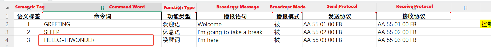
    
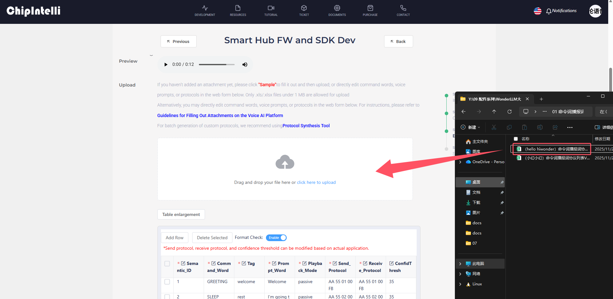

13. After the file is uploaded, the command word data is displayed in the table below. Scroll to the bottom of the page and click **Submit Now**.

>[!note]
>**In practice, only the wake word entry in the CI1302 entry list is used. No attention is required for the other unused entries.**

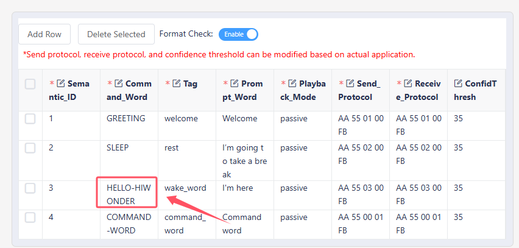

14. After submission, wait a few minutes for the firmware to be built. Once completed, click **Download** to obtain the generated firmware.

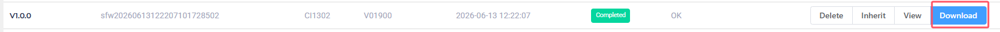

15. After the firmware download is complete, a compressed archive is obtained. Once decompressed, the archive contains a file in **.bin** format, which will subsequently be burned into the CI1302 chip using a dedicated firmware burning tool.

    <p id ="anther4.10.2"></p>

### 4.10.2 Command Word Broadcast Protocol List

Click here to visit the [Command Word Broadcast Protocol List](https://docs.google.com/spreadsheets/d/1cFhhg9cI3vhTersPBMMsNaFLUwfAZTo-/edit?usp=sharing&ouid=118382341883724205248&rtpof=true&sd=true).

### 4.10.3 CI1302 Firmware Flashing Method

This lesson covers flashing firmware to the WonderLLM module.

* #### Firmware Flashing

1. First, connect the Type-C interface at the bottom of WonderLLM to the computer via a USB data cable.

   

2. Open the **PACK_UPDATE_TOOL.exe** file in the [**Firmware Flashing Tool**](https://drive.google.com/drive/folders/1IsZMSKCd41FFhy8bJ-cnhKEjz1c4LzZs?usp=sharing) folder located in the same path as this document, select the **CI1302** chip, and then click **Update**.

   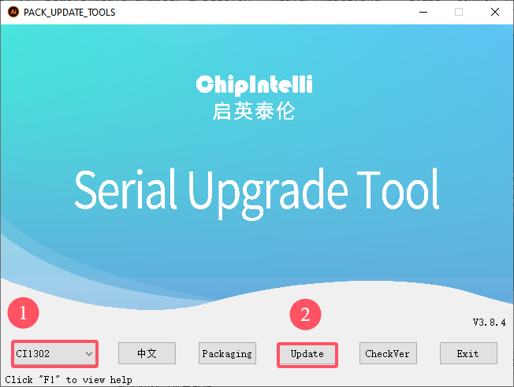

>[!note]
>**The flashing of the "hello hiwonder" firmware with the wake word "hello hiwonder" is used as an example.**

3. Click **Select firmware** and find the **.bin** firmware downloaded and extracted in the preceding steps.

   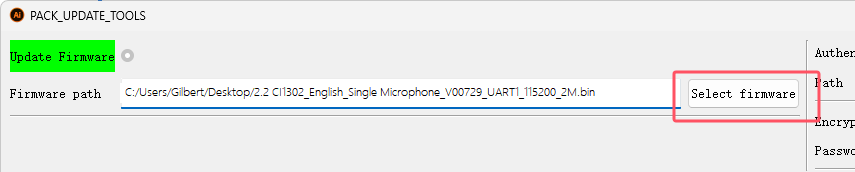

4. Find the corresponding serial port and click to select it.

   

5. Then **simultaneously press** the left and right buttons on the WonderLLM module to enter the flashing mode, and wait for the flashing to complete.


* #### Wake-Up Test

After flashing the firmware, restart the module and wait for the module to complete network configuration. Once the module enters the expression interface, speak the new firmware wake word. If the module buzzer sounds once, the module enters the chat interface and replies with a voice greeting, the wake word modification is successful.


* #### Extended Topics

1. To ensure a unified interaction flow, the nickname of the agent bound to the module can be modified synchronously during the interaction.

2. Enter the XiaoZhi AI platform at the URL https://xiaozhi.me/, or click the [**<u>XiaoZhi AI Chatbot</u>**]( https://xiaozhi.me/) for direct access. Enter the console, select the agent bound to the module, choose **Configure Role**, update the assistant name to match the newly configured wake word, click **Save**, and restart the device.


<p id ="anther4.10.4"></p>

### 4.10.4 CI1302 Firmware Flashing Tool

Click here to access to the [4.10.4 CI1302 Firmware Flashing Tool](https://drive.google.com/drive/folders/116qMpZB_8AUy3WjKD1jFB_PskMNmEhDj?usp=sharing).

<p id ="anther4.10.5"></p>

### 4.10.5 Factory Firmware

Click here to access to the [4.10.5 Factory Firmware](https://drive.google.com/drive/folders/1LkENSIquw6A5zNwdmArqAXrt2fK55_TC?usp=sharing).

<p id ="anther4.11"></p>

## 4.11 Firmware Download

### 4.11.1 Firmware Download

* #### Overview

The ESP32 main controller of the WonderLLM large model module supports firmware re-flashing. The factory firmware **WonderLLM.bin** provided in the course materials and the XiaoZhi AI open-source firmware **hiwonder_xiaozhi.bin** can be flexibly selected for the flashing experience. The XiaoZhi AI open-source code can also be used as a basis for secondary development, with the resulting code uploaded to this module for verification and testing.

>[!note]
>
>* **After the firmware is re-flashed, the WiFi connection information must be reconfigured. For instructions, refer to [4.2 Networking and Configuration](#anther4.2).**
>* **Usage instructions for the "XiaoZhi AI open source program firmware" are provided in the appendix.**


* #### Device Connection

Connect the Type-C interface on the top of the WonderLLM large model module to a computer using a USB cable, as shown in the figure below.


- #### **Operation Procedure**

1. Open the file **flash_download_tool_3.9.7.exe** in the compressed package [4.11.2 ESP32 Firmware Flashing Tool\flash_download_tool_3.9.7](#anther4.11.2).

   

2. Select **ESP32-S3** in the Chip Type, keep other settings at their default values, and then click **OK**.

   

3. After the tool is opened, click **...** to select the program bin file to flash. The storage path is **[4.11 Firmware Download(#anther4.11)\4.11.3 ESP32S3 Firmware](#anther4.11.3)**. The factory default firmware **WonderMind.bin** is used as an example below.

   

   

4. Check the box on the left, configure the remaining settings as shown in the figure below, and select the COM port number occupied by the module for the COM port setting.

> [!note]
> **If the SPI MODE is set to DIO according to the configuration shown below, the module will not function properly after firmware burning. Try setting the SPI MODE to DOUT and burn the firmware again.**


5. Click **ERASE** to erase the previously downloaded firmware. This step must be performed. Then wait for the status bar to display **FINISH**.

   

   

6. Then click **START** to download the selected firmware. Wait for the progress bar to finish loading, and the firmware download is complete.


7. After the download is complete, reconnect the data cable. After power cycling the device, it will start working according to the new firmware program.

<p id ="anther4.11.2"></p>

### 4.11.2 ESP32 Firmware Flashing Tool

Click here to access to the [ESP32 Firmware Flashing Tool](https://drive.google.com/drive/folders/1gkekMwKK5XblkSRMtFGxhQS5hZe3N966?usp=sharing).

<p id ="anther4.11.3"></p>

### 4.11.3 ESP32S3 Firmware

Click here to access to the [ESP32S3 Firmware](https://drive.google.com/drive/folders/1gkekMwKK5XblkSRMtFGxhQS5hZe3N966?usp=sharing).