# 5 ESP32 Programming Project

## 5.1 Programming Tool Installation and Introduction

### 5.1.1 Arduino IDE Installation and Usage

#### 5.1.1.1 Arduino IDE Installation and Interface Introduction

Arduino IDE is software specifically designed for Arduino microcontrollers and offers powerful functionality. Regardless of the version, the installation process remains the same. This section uses the Windows version of Arduino IDE 2.2.1 as an example for explanation.

> [!NOTE]
>
> **The installation method for the Mac version can be found in this section's table of contents.**

1) Locate the [**Arduino IDE Installation Package**](https://drive.google.com/drive/folders/11xZJwPrrG6jGyMwe53ovfW-PbwB1BOto?usp=sharing) in the same directory as this document, as shown below, and double-click to open it. To download the latest version of the software, visit the Arduino official website [**<u>https://www.arduino.cc/en/software</u>**](https://www.arduino.cc/en/software).

    

2) Click **I Agree** to proceed with the installation.


3) Select the default checked option and click **Next** to proceed to the next step.


4) Click **Browse...** to select the installation path, and then click **Install** to start installation.


5. Wait for the software installation to complete.


> [!NOTE]
>
> **If the installation process prompts that a chip driver needs to be installed, check Always trust software from Arduino LLC, A, and then click Install.**

6) After installation is complete, click **Finish**.


* **Interface Layout Overview**

The main interface of the Arduino IDE is shown in the figure below and can be divided into five areas:


1. **Menu Bar**: Responsible for settings related to the Arduino IDE.

| **Icon**                                                     | **Function**                                                 |
| ------------------------------------------------------------ | ------------------------------------------------------------ |
|  | File options for creating or opening project files and setting interface preferences |
|  | Edit options for code editing such as comments, indentation, and search |
|  | Sketch options for configuring the entire project, including compiling and running, adding library files, etc. |
|  | Tool options for selecting the development board and port, and obtaining development board information, etc. |
|  | Help options for getting started and resolving common issues, etc. |

2. **Toolbar**: provides tools related to the project, including the compiler, upload, serial monitor, and other tools.

| **Icon** | **Function** |
| ------------------------------------------------------------ | --------------------------------------------------- |
|  | Verify: checks whether a program is written correctly, and compiles the project if no errors. |
|  | Upload: uploads the program to the Arduino controller. |
|  | Debug: some development boards support real-time debugging via Arduino IDE. |
|  | Select Board: allows different development boards to be selected for project development. |
|  | Serial Plotter: plots data printed to the Arduino serial port into charts. |
|  | Serial Monitor: prints serial port information. |

3. **Editing Area**: the area for editing code.

4. **Status Bar**: displays the current editor status, such as the code line and column, development board information, etc.

5. **Sidebar**: the core of the Arduino IDE, responsible for displaying the working folder, code debugging, library installation, and more.

| **Icon**                                                     | **Function**                         |
| ------------------------------------------------------------ | -------------------------------- |
|  | Sketchbook: displays the files of the current project. |
|  | Boards Manager: adds development board toolkits. |
|  | Library Manager: adds or removes program library files. |
|  | Debug: performs real-time debugging of the project. |
|  | Search: searches or replaces code or variables. |

#### 5.1.1.2 Arduino IDE Usage Instructions

* **Arduino IDE Interface Settings**

1) Change the interface language: In the Arduino IDE interface, select **File** > **Preferences**. In the pop-up window, select the desired language from the **Language** option, then click **OK**.

    

2) By selecting **File > Preferences**, settings such as the project file path, editor font size, and color theme can be modified in the pop-up window.

    

* **Arduino Program Upload**

1) The example code that prints **hiwonder** is used here for illustration. Open the **Demo.ino** example program by double-clicking it in the [**Demo**](https://drive.google.com/drive/folders/1pI269CM1uQgaLYWOZTvTdNpovwKM9p3a?usp=sharing) folder located in the same directory as this document.

    

2) Connect the ESP32 controller to the computer via a data cable.

    

3) In the **Select Board** option, find the development board corresponding to Arduino. **The COM port is not unique. The COM number can be checked in Device Manager. COM6 is used here as an example.**

    

4) Click the  button to compile the program and verify whether the program has any syntax errors or other issues.

    

5)  After successful compilation, click the **** button to upload the program to the ESP32 controller.

    

6) After the upload is complete, click  to open the Serial Monitor, where the message **hiwonder** is printed.

    

* **Library File Import**

To run the program, the required **u8g2** and **LeArm_Kinematics_lib library** files need to be imported. The procedure is described below, with the **u8g2** library used as an example to demonstrate the import steps.

1) In the Arduino IDE, select **Sketch > Include Library > Add .ZIP Library**.

    

2) In the pop-up window, find **u8g2.zip** in the [**Arduino IDE Installation Package**](https://drive.google.com/drive/folders/11xZJwPrrG6jGyMwe53ovfW-PbwB1BOto?usp=sharing) folder, which is in the same directory as this document, and click Open.

    

3) If the following prompt appears, the library file installation is complete.

    

## 5.2 Basic Development Project Course

### 5.2.1 LED Lighting

#### 5.2.1.1 Project Introduction

The program causes the LED on the control board to blink.


#### 5.2.1.2 Implementation Procedure


#### 5.2.1.3 Module Description


The LED module is a common human-machine interaction component in embedded systems and development boards, primarily used for status indication, information feedback, and control function implementation. Its typical application scenarios include system debugging, visualization of operating status, and execution feedback for specific operation commands.

The LEDs on the servo controller and the core board use a common-anode design: the anode is connected to the 3.3 V power supply through a current-limiting resistor, and the cathode is connected to the main control GPIO. The LED turns off when the GPIO outputs a high level of 3.3 V and turns on when it outputs a low level of 0 V.


#### 5.2.1.4 Program Download

>[!Note]
>**Before downloading the program, confirm that the serial port driver has been installed.**

1. Connect the core board to the computer via a USB cable.

   

2. Find the corresponding example project file in the Arduino project folder [Tankbot_ESP32_Arduino](https://drive.google.com/file/d/1NC28PJvAJyPvJCa69qY1KRuGLWzsR7wV/view?usp=sharing) in the same directory as the document.

   

3. After opening, select the development board model as shown below:

   

4. First click the  verify icon, and then click the  upload icon. After the upload completes, if the output box at the bottom of the software displays the following interface, the program download is complete.

   


#### 5.2.1.5 Program Outcome

After the robotic arm completes the system power-on initialization, the LED1 indicator on the controller flashes synchronously at a frequency of 1 Hz.


#### 5.2.1.6 Program Analysis

1) The program imports the `Config.h` and `Hiwonder.hpp` library files, where `Hiwonder.hpp` contains the definition of the LED object.

```cpp
#include "Config.h"
#include "Hiwonder.hpp"
```

2) An `led` object is created for subsequent control.

```cpp
Led_t led_obj;
```

3) In the `setup()` function, a 1000 ms or 1 s delay is first introduced before disconnecting the Bluetooth module from the power supply. Afterwards, `led_obj.init()` is called to initialize the LED object and bind it to the chip pin `IO_LED`. The serial port is then enabled at a baud rate of 9600.


```cpp
delay(1000);
pinMode(IO_BLE_CTL, OUTPUT);
digitalWrite(IO_BLE_CTL, LOW);  // Set the Bluetooth control pin to low level to cut off power to the Bluetooth module

led_obj.init(IO_LED);
Serial.begin(9600);
```

4)  The code calls the `blink()` method of the `led` object to set the LED to blink with an on duration of 1 s, an off duration of 1 s, and a blink count of 0, indicating continuous blinking.

```cpp
led_obj.blink(1000,1000,0);
```

**Another Method (Optional): **

In the main loop, the `on_off()` method of the `led` object is called to turn the LED on, wait for 1 s, turn it off, wait for another 1 s, and repeat this cycle continuously.

```cpp
led_obj.on_off(0);
delay(1000);
led_obj.on_off(1);
delay(1000);
```


### 5.2.2 Button Control

#### 5.2.2.1 Project Introduction

The LED light is turned on and off via the buttons.


#### 5.2.2.2 Implementation Process


#### 5.2.2.3 Module Description


Onboard buttons are standardized human-machine interaction components in embedded systems and development boards, providing critical command input and system control functions. Typical application scenarios include system wakeup, hardware reset, and trigger mechanisms for specific operation processes.


#### 5.2.2.4 Program Download

>[!Note]
>**Before downloading the program, confirm that the serial port driver is installed.**

1. Connect the core board to the computer via a USB cable.

   

2. Find the corresponding example project file in the Arduino project folder [Tankbot_ESP32_Arduino](https://drive.google.com/file/d/1NC28PJvAJyPvJCa69qY1KRuGLWzsR7wV/view?usp=sharing) at the same path as the document.

   

3. After opening, select the development board model, as shown in the figure below.


4. First click the  verify icon, and then click the  upload icon. After the upload completes, if the output box at the bottom of the software displays the following interface, the program download is complete.

   


#### 5.2.2.5 Program Outcome

After power-on of the robotic arm:

Press **KEY1** on the controller, and the LED on the control board will flash once with a frequency of 100 ms on, 100 ms off.

Press **KEY2** on the controller, and the LED on the control board will flash twice with a frequency of 100 ms on, 100 ms off.


#### 5.2.2.6 Program Analysis

1) The program imports the `Config.h` and `Hiwonder.hpp` library files. The `Hiwonder.hpp` file contains the definitions of the `led` object and the `key` object.

```cpp
#include "Config.h"
#include "Hiwonder.hpp"
```

2) The `key` and `led` objects are created to acquire button data and control the LED.

```cpp
Button_t key_obj;
Led_t led_obj;
```

3) In the `setup()` function, a 1000 ms or 1 s delay is first introduced before disconnecting the Bluetooth module from the power supply. The `led` and `key` objects are then initialized, followed by enabling the serial port at a baud rate of 9600.

```cpp
delay(1000);
pinMode(IO_BLE_CTL, OUTPUT);
digitalWrite(IO_BLE_CTL, LOW);  // Set the Bluetooth control pin to low level to cut off power to the Bluetooth module

led_obj.init(IO_LED);
key_obj.init();
Serial.begin(9600);
```

4) In the main loop, the `read` method of the `key` object is called first to read the state of KEY1. If the state of KEY1 is `1`, it indicates that KEY1 is pressed. The `blink` method of the `led` object is then called to make the LED blink once with a cycle of 100 ms on and 100 ms off. The program then waits in a loop for the button to be released before executing the next main loop iteration.

```cpp
if(key_obj.read(1) == 1){
  led_obj.blink(100 , 100 , 1); // KEY1 pressed, LED blinks 1 time
  while(key_obj.read(1) == 1); // wait for button release
}
```

5) If KEY1 is not pressed, the state of KEY2 is checked. If the state of KEY2 is `1`, KEY2 is considered pressed. The `blink()` method of the `led` object is called, causing the LED to blink twice with a cycle of 100 ms on and 100 ms off. The system then loops until KEY2 is released, after which the next main loop iteration is executed.

```cpp
else if (key_obj.read(2) == 1){
  led_obj.blink(100, 100, 2); // KEY2 pressed, LED blinks 2 times
  while(key_obj.read(2) == 1); // Wait for button release
}
delay(50);
```


### 5.2.3 Buzzer Control

#### 5.2.3.1 Project Introduction

The program enables the buzzer to sound when the button on the control board is pressed.


#### 5.2.3.2 Implementation Process


#### 5.2.3.3 Module Description

A buzzer is an integrated electronic sound device widely used as a sound-emitting component in electronic products such as computers and printers.

Its sounding principle is that current flows through the electromagnetic coil, causing the coil to generate a magnetic field that drives the vibrating diaphragm to produce sound. Therefore, a certain amount of current is required for sound generation. The buzzer tone can be adjusted by changing the signal frequency. The higher the frequency, the higher the tone. In addition, the sound volume of the buzzer can be controlled by changing the high/low level duty cycle of the driving signal.


#### 5.2.3.4 Program Download

>[!Note]
>**Before downloading the program, confirm that the serial port driver is installed.**

1. Connect the core board to the computer using a USB cable.

   

2. Find the corresponding example project file in the Arduino project folder [Tankbot_ESP32_Arduino](https://drive.google.com/file/d/1NC28PJvAJyPvJCa69qY1KRuGLWzsR7wV/view?usp=sharing) at the same path as the document.

   

3. After opening, select the development board model, as shown in the figure below.

   

4. First click the  verify icon, and then click the  upload icon. After the upload completes, if the output box at the bottom of the software displays the following interface, the program download is complete.

   


#### 5.2.3.5 Program Outcome

After the robotic arm is powered on, pressing **KEY1** once causes the buzzer to beep once.


#### 5.2.3.6 Program Analysis

1. The program imports the `Config.h` and `Hiwonder.hpp` library files. The `Hiwonder.hpp` file contains the definitions of the `buzzer` object and the `key` object.

```cpp
#include "Config.h"
#include "Hiwonder.hpp"
```

2) The `key` and `buzzer` objects are created for subsequent control.

```cpp
Button_t key_obj;
Buzzer_t buzzer_obj;
```

3) In the `setup` function, a delay of 1000 ms or 1 s is first applied. The power to the Bluetooth module is then disconnected. Following that, the `buzzer` and `key` objects are initialized, after which the serial port is enabled at a baud rate of 9600.

```cpp
delay(1000);
pinMode(IO_BLE_CTL, OUTPUT);
digitalWrite(IO_BLE_CTL, LOW);  // when setting the bluetooth control pin to low level, disconnect the bluetooth module power

buzzer_obj.init(IO_BUZZER);
key_obj.init();
Serial.begin(9600);
```

4) In the main loop, the `read` method of the `key` object is called first to read the state of KEY1. If the state is `1`, KEY1 is considered pressed, and the `blink` method of the `buzzer` object is called to sound the buzzer for one cycle at a frequency of 1500 Hz, with a 100 ms sounding duration followed by a 100 ms silent duration. The code then waits in a loop for the button to be released before proceeding to the next main loop iteration.

```cpp
if(key_obj.read(1) == 1){
  buzzer_obj.blink(1500 , 100 , 100 , 1); // KEY 1 pressed, buzzer sounds once
  while(key_obj.read(1) == 1); // wait for button release
}
delay(50);
```


### 5.2.4 Bus Servo Control

#### 5.2.4.1 Project Introduction

In this lesson, the bus servo is controlled to rotate cyclically.


#### 5.2.4.2 Implementation Procedure


#### 5.2.4.3 Module Description

A bus servo, also known as a serial bus intelligent servo, can essentially be regarded as a derivative of a digital servo. It typically uses a single-wire serial port, meaning that communication is carried out over a single wire.

A serial port typically uses two lines for communication, one for transmitting and one for receiving, so data can be transmitted and received simultaneously. A single-wire serial port uses a single line for both reception and transmission. When not transmitting, the single-wire serial port is always ready to receive, and reception stops during transmission.

On the servo controller, a double-pole double-throw switch is used to convert the conventional two-wire serial port into a single-wire serial port. The RX and TX lines of the serial port are connected to the communication line through a logic circuit.

When no data is being transmitted, a low‑level signal is output to the switch enable pin. RX is connected to the communication line, while TX is disconnected from it. When transmitting data, a high‑level signal is output to the switch enable pin. The logic circuit connects TX to the communication line and disconnects RX from the communication line.

>[!Note]
>**The bus servo communication protocol used in this section's example is compatible with all bus servo models of Hiwonder. The protocol format can be found in the Bus Servo Communication Protocol document located in the same folder as this document.**


#### 5.2.4.4 Program Download

>[!Note]
>**Before downloading the program, confirm that the serial port driver has been installed.**

1. Connect the core board to the computer via a USB cable.

   

2. Find the corresponding example project file in the Arduino project folder [Tankbot_ESP32_Arduino](https://drive.google.com/file/d/1NC28PJvAJyPvJCa69qY1KRuGLWzsR7wV/view?usp=sharing) at the same path as the document.

   

3. After opening, select the development board model as shown in the figure below:

   

4. First click the  verify icon, and then click the  upload icon. After the upload completes, if the output box at the bottom of the software displays the following interface, the program download is complete.

   


#### 5.2.4.5 Program Outcome

After the robotic arm is powered on, bus servo ID1 rotates back and forth.


#### 5.2.4.6 Program Analysis

1) The program imports the `Config.h` and `Hiwonder.hpp` library files, where `Hiwonder.hpp` contains the definition of the `bus servo` object.

```cpp
#include "Config.h"
#include "Hiwonder.hpp"
```

2) A `bus servo` object is created for communication with the bus servo.

```cpp
BusServo_t busservo_obj;
```

3) In the `setup` function, a delay of 1000 ms or 1s, is executed first, and then the power to the Bluetooth module is disconnected. Subsequently, software serial `Serial1` is created, serial port 1 is opened, and the baud rate is set to 115200. Then the `bus servo` object is initialized, and its serial communication is bound to software serial `Serial1`. Finally, the serial port is opened at a baud rate of 9600, and a delay of 2 s is executed.


```cpp
delay(1000);
pinMode(IO_BLE_CTL, OUTPUT);
digitalWrite(IO_BLE_CTL, LOW);  // Set the Bluetooth control pin to low level to cut off power to the Bluetooth module

Serial1.begin(115200 ,SERIAL_8N1 , BUS_RX , BUS_TX);
busservo_obj.init(&Serial1);

Serial.begin(9600);
delay(2000);
```

4) In the main loop, the `set_angle` method of the `bus servo` object is first called to control servo ID1 to rotate to the 0° position within 1000 ms. After a delay of 1100 ms and 1.1 s, the `read_angle` method of the `bus servo` object is called to obtain the current angle of servo ID1, which is then printed out through the serial port.


```cpp
busservo_obj.set_angle(1, 0, 1000);
delay(1100);
Serial.println(busservo_obj.read_angle(1));
delay(500);
```

5) After a further 500 ms (0.5 s) delay, the `set_angle` method of the `bus servo` object is called to control servo ID1 to rotate to the 180° position within 2000 ms. After a 2100 ms (2.1 s) delay, the current angle of servo ID1 is obtained by calling the `read_angle` method of the `bus servo` object and is printed via the serial port. Finally, after another 500 ms (0.5 s) delay, the next loop is executed.


```cpp
busservo_obj.set_angle(1, 180, 2000);
delay(2100);
Serial.println(busservo_obj.read_angle(1));
delay(500);
```


### 5.2.5 PWM Servo Control

#### 5.2.5.1 Project Introduction

The PWM servo is controlled to rotate cyclically in this lesson.


#### 5.2.5.2 Implementation Procedure


#### 5.2.5.3 Module Description

A standard PWM servo has three control lines: power line, ground line, and signal line.


A periodic positive pulse signal is input. The low-level duration of this periodic pulse signal should be between 5 ms and 20 ms. A PWM analog servo requires a continuous periodic signal to maintain the servo angle. When the signal is lost, the servo stops outputting power.

>[!Note]
>
>* **A digital PWM servo does not require periodic PWM wave driving. It focuses only on the single high-level pulse width time and is not strict about the low-level time. In other words, any frequency within the control frequency range listed in the above table can be selected as the servo operating frequency, thereby determining the period of the analog PWM wave for a single servo.**
>
>* **Within this period, a high level is output starting from a certain moment and lasting for the pulse width duration, while the remainder of the period is kept at a low level. The servo then rotates to the corresponding position.**
>
>* **On this basis, a single timer/task can be used to control multiple servos simultaneously. During the period when the timer/task controls a specific servo, a high level with the target pulse width duration is output to that servo, and a low level is output during the remaining time. During the period when the timer/task does not control a specific servo, a low level is output directly, and no further processing is performed.**


#### 5.2.5.4 Program Download

>[!Note]
>**Before downloading the program, confirm that the serial port driver has been installed.**

1. Connect the core board to the computer via a USB cable.

   

2. Find the corresponding example project file in the Arduino project folder [Tankbot_ESP32_Arduino](https://drive.google.com/file/d/1NC28PJvAJyPvJCa69qY1KRuGLWzsR7wV/view?usp=sharing) at the same path as the document.

   

3. After opening, select the development board model. The specific model is shown in the following figure:

   

4. First click the  verify icon, and then click the  upload icon. After the upload completes, if the output box at the bottom of the software displays the following interface, the program download is complete.

   


#### 5.2.5.5 Program Outcome

After power-up, PWM servo ID1 oscillates back and forth between the two sides.


#### 5.2.5.6 Program Analysis

1) The program imports the library files `Config.h`, and `Robot_arm.hpp`, where `Robot_arm.hpp` contains the definition of the robot arm object.

```cpp
#include "Config.h"
#include "Robot_arm.hpp"
```

2) A robotic arm object is created to control the servo angle.

```cpp
LeArm_t arm;
```

3) In the `setup()` function, a 1000 ms or 1 s delay is first introduced before disconnecting the Bluetooth module from the power supply. After that, the robotic arm object is initialized. Then the serial port is enabled at a baud rate of 9600, followed by a delay of 2 s.


```cpp
delay(1000);
pinMode(IO_BLE_CTL, OUTPUT);
digitalWrite(IO_BLE_CTL, LOW);  // Set Bluetooth control pin to low to disconnect Bluetooth module power
arm.init();
Serial.begin(9600);
delay(2000);
```

4) In the main loop, the `knot_run` method of the robotic arm object is first called to control PWM servo ID1 to rotate to the pulse width position of 500 within 1000 ms. The servo rotates to 0° at this time, causing the gripper to close. After a delay of 1000 ms, the `knot_run` method is called again to control PWM servo ID1 to rotate to the pulse width position of 1500 within 2000 ms. The servo then rotates to 90°, causing the gripper to open. After another 1000 ms delay, the next loop is executed.


```cpp
arm.knot_run(1 , 500 , 1000);
delay(1000);
arm.knot_run(1, 1500 , 2000);
delay(2000);
```

>[!Note]
>
>**The servo control angle ranges from 0° to 180°, and the corresponding pulse width ranges from 500 μsec to 2500 μsec.**


### 5.2.6 Action Group Read/Write 

#### 5.2.6.1 Project Introduction

The program in this lesson executes the previously written action groups 30 and 31 in a loop.


#### 5.2.6.2 Implementation Process


#### 5.2.6.3 Module Description

Flash memory is a type of non-volatile memory capable of retaining data for extended periods even without an electrical power supply. Its storage characteristics are comparable to those of a hard disk drive. This property is the foundation for flash memory becoming the storage medium for various portable digital devices.

The W25Q64 is a Flash memory device that is read from and written to via the SPI interface. Its read and write operations have the following two characteristics:

1) During write operations, only 1 can be written, and 0 cannot be written.

2) Erasure is performed on a sector basis, where all data is set to 0. The sector size varies by chip. The chip used in this design has 4096 bytes per sector.

Based on the above two points, it can be understood that writing one byte of data means changing the corresponding data bits in the chip from 0 to 1 or from 1 to 0. Since flash does not support writing 0 during the write operation, the corresponding sector must be erased to change the bits to 0. However, erasing the sector causes the original data to be lost. Therefore, the general practice is to first read the data from the sector, then erase the sector, and finally write the modified data back to the flash.

>[!Note]
>
>- **In the program, two complete sectors totaling 8 KB are allocated for storing the action frame data of each action group, and 21 bytes are allocated for storing each action frame in an action group.**
>- **In Flash, different types of action group data are stored separately in spaces at different addresses. The frame count of each action group is stored together in one space, and the per-frame action data of each action group is stored together in another space.**
>- **In Flash, every 256 bytes form 1 page. When writing data, attention must be paid to possible cross-page write handling.**


#### 5.2.6.4 Program Download

>[!Note]
>**Before downloading the program, confirm that the serial port driver is installed.**

1. Connect the core board to the computer via a USB cable.

   

2. In the Arduino project folder at the same path as the document, locate the corresponding example project file.

   

3. Find the corresponding example project file in the Arduino project folder [Tankbot_ESP32_Arduino](https://drive.google.com/file/d/1NC28PJvAJyPvJCa69qY1KRuGLWzsR7wV/view?usp=sharing) at the same path as the document.

   

4. First click the  verify icon, and then click the  upload icon. After the upload completes, if the output box at the bottom of the software displays the following interface, the program download is complete.

   


#### 5.2.6.5 Program Outcome

After the robotic arm is powered on, the data of action groups 30 and 31 is written to flash, and the two action groups are executed in a loop.


#### 5.2.6.6 Program Analysis

1) The program includes the library files `Config.h`, `Hiwonder.hpp`, and `Robot_arm.hpp`. The robotic arm control class is defined in the `Robot_arm.hpp`.

```cpp
#include "Config.h"
#include "Hiwonder.hpp"
#include "Robot_arm.hpp"
```

2) The code creates a robotic arm object named `arm` for subsequent control.

```cpp
LeArm_t arm;
```

3. The action frame data structure is declared. This structure contains `num` for the number of servos, `time` for the run time, and `configs` for the servo configuration array, which includes the servo ID and pulse width.


```cpp
#pragma pack(1)
typedef struct {
  uint8_t id;       // servo ID
  uint16_t duty;    // servo pulse width
} ServoConfig;

typedef struct {
  uint8_t num;        // servo count
  uint16_t time;      // run time
  ServoConfig configs[6]; // servo config array
} ActionFrame;
#pragma pack(0)
```

4) In the `setup` function, the serial port is first enabled at a baud rate of 9600. After a 1000 ms delay, the Bluetooth module is disconnected. Then, the robotic arm object `arm` is initialized, followed by a 2-second delay.


```cpp
Serial.begin(9600);
delay(1000);
pinMode(IO_BLE_CTL, OUTPUT);
digitalWrite(IO_BLE_CTL, LOW);  // Set the Bluetooth control pin to low level to cut off power to the Bluetooth module.

arm.init();
delay(2000);
```

5)  The code initializes the action‑frame data structure `act`, where the angle value of all six servos is set to 500 and the motion time is set to 1500 ms. This action frame is saved as frame 0 of action group 30 via the `arm.action_group_save()` function. A one‑second delay is applied before action group 30 is executed once.


```cpp
ActionFrame act = {
  .num = 6,
  .time = 1500,
  .configs = {
      {1, 500}, {2, 500}, {3, 500},
      {4, 500}, {5, 500}, {6, 500}
  }
};
arm.action_group_save(30 , 1 , 0 , (uint8_t*)&act , ACTION_FRAME_SIZE);
delay(1000);
arm.action_run(30, 1);
delay(1000);
```

6) The code modifies the action‑frame data by changing the pulse widths of servo ID1 and servo ID2 to 0. The modified frame is saved to action group 31 and executed. Action group 3 is finally run three times.

```cpp
act.configs[0].duty = 0;
act.configs[1].duty = 0;
arm.action_group_save(31 , 1 , 0 , (uint8_t*)&act , ACTION_FRAME_SIZE);
delay(1000);
arm.action_run(31, 1);
delay(1000);
arm.action_run(3, 3);
```

7) In the main loop, action groups 30 and 31 are executed cyclically.

```cpp
arm.action_run(30, 1);
delay(1000);
arm.action_run(31, 1);
delay(1000);
```


### 5.2.7 Kinematic Control 

#### 5.2.7.1 Project Introduction

In this lesson, the program controls the robotic arm through a kinematics algorithm to move cyclically among the set three-dimensional coordinate points, realizing vertical up-and-down motion of the robotic arm end and a three-point cyclic motion effect.


#### 5.2.7.2 Implementation Procedure


#### 5.2.7.3 Kinematic Algorithm Analysis

**Forward Kinematics**

Introduction: Forward kinematics is a very intuitive problem. Its goal is to determine the position and orientation of the end effector of a manipulator given the angles or positions of each joint. A manipulator can be imagined as a robot arm, where the joint angles control the arm's motion. The position of the end effector, such as a gripper, can be determined once the angle of each joint is known. For example, if the angle of each joint of the arm is known, forward kinematics can be used to calculate the exact position and orientation of the gripper.

**Inverse Kinematics**

Introduction: Inverse kinematics is exactly the opposite of forward kinematics. In this case, the desired position and orientation of the end effector, such as a gripper, are known, while the required rotation of each joint is calculated to bring the end effector to the target position. For example, when the gripper of a robotic arm is required to reach a specified point, inverse kinematics computes the angle to which each joint must rotate to accomplish the goal.

**Model Analysis**

The robotic arm model is simplified:

1. The structural component between servo ID6 and servo ID5 is abstracted as link **l₁**, with servo ID6 as the driving joint.
2. The structural component between servo ID5 and servo ID4 is abstracted as link **l₂**, with servo ID5 as the driving joint.
3. The structural component between servo ID4 and servo ID3 is abstracted as link **l₃**, with servo ID4 as the driving joint.
4. The structural component between servo ID3 and the mechanical claw root is abstracted as link **l₄**, with servo ID3 as the driving joint.

The rotation of servo ID1 and servo ID2 can only drive the rotation and opening and closing of the gripper. It cannot change the orientation or length of the gripper as a structural component, because its orientation always remains identical to the direction of **l₄**. Therefore, this rotation does not affect the coordinate position of the end of the robotic arm, namely the gripper root, in the robotic arm coordinate system. Hence, these two servos should be classified as part of the actuator attached to the end of the robotic arm, such as the gripper and the suction nozzle that interact with objects, rather than as part of the robotic arm.

In the inverse kinematics model for analyzing the reachable coordinates of the robotic arm end-effector, these two servos can be ignored.

**l₁, l₂, l₃, and l₄** are the link lengths. **θ₁** is the angle of the top-view projected length **len** of the servo link in the plane. **θ₂** is the angle between **l₂** and the horizontal line. **θ₃** and **θ₄** are the angles between the current link and the extension line of the previous link. **θₙ** is defined as positive in the counterclockwise direction.


#### 5.2.7.4 Program Download

>[!Note]
>**Before downloading the program, confirm that the serial port driver has been installed.**

1. Connect the core board to the computer via a USB cable.

   

2. Find the corresponding example project file in the Arduino project folder [Tankbot_ESP32_Arduino](https://drive.google.com/file/d/1NC28PJvAJyPvJCa69qY1KRuGLWzsR7wV/view?usp=sharing) at the same path as the document.

   

3. After opening, select the development board model as shown in the following figure.

   

4. First click the  verify icon, and then click the  upload icon. After the upload completes, if the output box at the bottom of the software displays the following interface, the program download is complete.

   


#### 5.2.7.5 Program Outcome

1. Robotic arm vertical movement: Upon power‑on of the robotic arm, its end‑effector travels vertically  between two upper and lower points.

2. Robotic arm fixed‑point movement: Upon power‑on, the robotic arm executes cyclic motion among three vertices of an inverted triangle.


#### 5.2.7.6 Program Analysis

> [!NOTE]
>
> **This section analyzes the Robotic Arm Vertical Movement program, and the Robotic Arm Fixed-Point Movement program has similar functionality.**

1) The program imports the `Config.h`, `Hiwonder.hpp`, and `Robot_arm.hpp` library files. The robotic arm control class is defined in `Robot_arm.hpp`.

```cpp
#include "Config.h"
#include "Hiwonder.hpp"
#include "Robot_arm.hpp"
```

2) A robotic arm object is created for subsequent control.

```cpp
LeArm_t arm;
```

3) In the `setup` function, a delay of 1000 ms (1 s) is first performed, and then the power supply to the Bluetooth module is disconnected. Afterward, the robotic arm object is initialized, and the serial port is enabled at a baud rate of 9600, followed by a delay of 2 s.


```cpp
delay(1000);
pinMode(IO_BLE_CTL, OUTPUT);
digitalWrite(IO_BLE_CTL, LOW);  // when the Bluetooth control pin is set to low level, disconnect the Bluetooth module power
arm.init();
Serial.begin(9600);
delay(2000);
```

4) In the main loop, the `coordinate_set()` function is used to set the three-dimensional coordinate points of the robotic arm end effector. The x, y, and z coordinates are (20,0,15) and (20,0,20), enabling the arm to cycle between these two points. Parameters 1, 2, and 3 of the function represent the x, y, and z axis coordinates in centimeters. Parameter 4 is the default pitch angle of the robotic arm, set to 0 degrees. Parameters 5 and 6 are the maximum and minimum pitch angles. Parameter 7 is the motion time in milliseconds.


```cpp
arm.coordinate_set(20,0,15,0,-90,90,1000);
delay(2000);
arm.coordinate_set(20,0,20,0,-90,90,1000);
delay(2000);
```

### 5.2.8 Wireless Controller Protocol Parsing

#### 5.2.8.1 Project Introduction

This lesson uses the program **Tankbot_ESP32_Arduino_simple** as an example to explain the wireless controller protocol and its receiving and parsing program.


#### 5.2.8.2 Implementation Flow


#### 5.2.8.3 Module Description


The PS2 wireless controller requires a controller receiver to communicate with the main control board. The controller communicates wirelessly with the receiver via a 2.4 G signal. The controller provides two modes, which can be switched using the **ANALOG (MODE)** button.


#### 5.2.8.4 Program Download

>[!Note]
>**Before downloading the program, ensure that the serial port driver is installed.**

1. Connect the core board to the computer via a USB cable.

   

2. Find the corresponding example project file in the Arduino project folder [Tankbot_ESP32_Arduino](https://drive.google.com/file/d/1NC28PJvAJyPvJCa69qY1KRuGLWzsR7wV/view?usp=sharing) simple at the same path as the document.

   

3. After opening, select the development board model, as shown in the figure below.

   

4. First click the  verify icon, and then click the  upload icon. After the upload completes, if the output box at the bottom of the software displays the following interface, the program download is complete.

   


#### 5.2.8.5 Program Outcome

After the robotic arm is powered on, connect the controller and press the **MODE** button to select digital mode, indicated by a single green light. The triangle and cross buttons can then be used to control the opening and closing of the robotic arm gripper.


#### 5.2.8.6 Program Analysis

1) The program imports the `Config.h`, `Hiwonder.hpp`, `Robot_arm.hpp`, and `PS2_CTL.hpp` library files, where `PS2_CTL.hpp` contains the wireless controller reception control class.

```cpp
#include "Config.h"
#include "Hiwonder.hpp"
#include "Robot_arm.hpp"
#include "PS2_CTL.hpp"
```

2) The LED object, buzzer object, robotic arm object, and PS2 controller object are created.

```cpp
Led_t led_obj;
Buzzer_t buzzer_obj;
LeArm_t arm;
PS2_CTL ps2;
```

3) In the `setup` function, a delay of 1000 ms or 1 s is performed first. The power supply to the Bluetooth module is then disconnected. Next, the robotic arm object, LED object, and buzzer object are initialized, followed by the initialization of PS2 wireless controller object. Finally, the serial port is enabled with the baud rate set to 9600. The buzzer emits a single beep, followed by a 1-second delay.


```cpp
delay(1000);
pinMode(IO_BLE_CTL, OUTPUT);
digitalWrite(IO_BLE_CTL, LOW);  // Set the Bluetooth control pin low to disconnect Bluetooth module power

arm.init();
led_obj.init(IO_LED);
buzzer_obj.init(IO_BUZZER);
ps2.init();

Serial.begin(9600);
buzzer_obj.blink(1500 , 100 , 100 , 1);
delay(1000);
```

4) In the main loop, the `PS2_Task()` controller task function is called. This function receives and parses the controller data, and then controls the robotic arm to execute the corresponding actions.


```cpp
ps2.PS2_Task(&arm, &led_obj, &buzzer_obj);
```

5) The PS2 wireless controller object function initializes the software serial port as the wireless controller signal receiving serial port.

```cpp
void PS2_CTL::init(void)
{
  Serial_PS2.begin(9600 ,SERIAL_8N1 , USB_TX , -1);
  action_running_time = 1000;
}
```

6. The function `PS2_Task()` first sets the LEDs based on the current control mode, receives wireless controller data through the `receive_msg()` function, and then determines the current button states of the wireless controller in the `get_result()` function to control the robotic arm accordingly. The core workflow of the `PS2_Task()` function is as follows:


```cpp
void PS2_Task(LeArm_t *arm, Led_t *led, Buzzer_t *buzzer) {
  // Set LED status based on the current control mode
  if(mode == PS2_COORDINATE_MODE) {
    led->on_off(1);  // Analog mode: LED turns on
  } else {
    led->blink(500, 500, 0);  // Digital mode: LED blinks 
  }
  
  // Receive and parse PS2 controller data
  receive_msg();
  
  // Process commands from the PS2 controller
  get_result(arm, buzzer);
}
```

7) The `receive_msg()` function receives controller data through the controller serial port and parses it according to the protocol. Inside this function, the `Serial_PS2.available` function is called to obtain the number of unread bytes in the buffer. Processing proceeds according to the `step` value as follows: ① The first frame header is matched. ② The second frame header is matched. ③ The data value of one frame is extracted. ④ The data is parsed according to the operating mode of the controller command frame object. When parsing is successful, the `rec_flag` flag is set to `true`.


```cpp
while (Serial_PS2.available()>0) {
    switch(step){
      case 0:{
        if(Serial_PS2.read() == FRAME_HEADER)
        {
          step++;
        }
      }break;
      case 1:{
        if(Serial_PS2.read() == FRAME_HEADER)
        {
          index = 0;
          step++;
        }else{
          step = 0;
        }
      }break;
      case 2:{
        recbuff[index++] = Serial_PS2.read();
        if(index > 9)
        {
          rec_flag = true;
          step = 0;
        }
      }break;
      default:{
        step = 0;
      }break;
    }
```

8. When the `rec_flag` flag is `true`, result parsing is performed. First, the current mode of the wireless controller is determined as either the digital mode `PS2_SINGLE_SERVO_MODE` or the analog mode `PS2_COORDINATE_MODE`. Then, the current button and joystick states are parsed according to the mode.

```cpp
if(recbuff[9] == 0x80 && recbuff[8] == 0x80)
      {
        keyvalue.mode = PS2_SINGLE_SERVO_MODE;
      }else{
        keyvalue.mode = PS2_COORDINATE_MODE;
      }
```

9. The `get_result()` function checks the current controller working mode `mode`. The current program only handles commands in `PS2_SINGLE_SERVO_MODE` mode. If the mode matches, it checks the pressed states of the triangle and cross buttons. A simplified example of the `get_result()` function is as follows:


```cpp
void get_result(LeArm_t *arm, Buzzer_t *buzzer) {
  if (!rec_flag) return;  // Return directly if complete data is not received
  
  if (mode == PS2_SINGLE_SERVO_MODE) {
    //  Handle digital‑mode logic
    if (msg.triangle) {  // Triangle button is pressed
      arm->knot_run(1, PS2_SET_MAX_DUTY, 500);
      last_triangle = 1;
    } else if (msg.cross) {  // Cross button is pressed
      arm->knot_run(1, PS2_SET_MIN_DUTY, 500);
      last_cross = 1;
    } else if (last_triangle || last_cross) {  // Buttons are released
      arm->knot_stop(1);
      last_triangle = 0;
      last_cross = 0;
    }
  }
  rec_flag = false;
}
```


### 5.2.9 Wireless Controller Control Program

#### 5.2.9.1 Project Introduction

This lesson uses the **Tankbot_ESP32_Arduino** program as an example to implement wireless controller-controlled robotic arm functionality, focusing on the logical relationship between wireless controller buttons and robotic arm control.


#### 5.2.9.2 Implementation Process


#### 5.2.9.3 Module Description


The PS2 controller communicates with the main control board through a matching receiver. The wireless link between the controller and the receiver operates over a 2.4 G signal. The controller itself includes two modes, which can be switched using the **ANALOG MODE** button.


#### 5.2.9.4 Program Download

>[!Note]
>**Before downloading the program, please confirm that the serial port driver has been installed.**

1. Connect the core board to the computer via a USB cable.


2. Find the corresponding example project file in the Arduino project folder [Tankbot_ESP32_Arduino](https://drive.google.com/file/d/1NC28PJvAJyPvJCa69qY1KRuGLWzsR7wV/view?usp=sharing) at the same path as the document.

   

3. After opening, select the development board model, as shown in the figure below:

   

4. First click the  verify icon, and then click the  upload icon. After the upload completes, if the output box at the bottom of the software displays the following interface, the program download is complete.

   


#### 5.2.9.5 Program Outcome

When the controller is in **analog mode with both red and green lights on**, kinematic control of the robotic arm can be performed.

When the controller is in **digital mode with only the green light on**, servo control is available. When any button is pressed together with the **SELECT** button, the robotic arm runs the action group.


#### 5.2.9.6 Program Analysis

1. The program imports the `Config.h`, `Hiwonder.hpp`, `Robot_arm.hpp`, and `PS2_CTL.hpp` library files, where `PS2_CTL.hpp` contains the controller receiving control class.

```cpp
#include "Config.h"
#include "Hiwonder.hpp"
#include "Robot_arm.hpp"
#include "./src/PS2/PS2_CTL.hpp"
```

2) LED light object, battery object, buzzer object, robotic arm class object, PS2 controller control object, IIC object, and motor object are created.

```cpp
Led_t led_obj;
Battery_t battery_obj;
Buzzer_t buzzer_obj;
LeArm_t arm;
PS2_CTL ps2;
IIC iic_obj;
Motor motor_obj;
```

3) In the `setup` function, a delay of 1000ms or 1s is first introduced, and the power to the Bluetooth module is then disconnected. The serial port is subsequently enabled at a baud rate of 9600. The robotic arm object, LED object, IIC object, motor object, buzzer object, battery object, and PS2 controller control object are initialized. The battery check timer is started, the differential drive chassis is initialized, and a delay of 1 second is applied.


```cpp
delay(1000);
pinMode(IO_BLE_CTL, OUTPUT);
digitalWrite(IO_BLE_CTL, LOW);  // When the Bluetooth control pin is set to low, the Bluetooth module power is disconnected.

Serial.begin(9600);
arm.init();
led_obj.init(IO_LED);
iic_obj.init();
motor_obj.init(&iic_obj);
buzzer_obj.init(IO_BUZZER);
battery_obj.init(ADC_BAT);
ps2.init();

battery_timer.attach_ms(1000, battery_check_callback);
differentials_chassis_run(0,0);

delay(1000);
```

4) In the main loop, the controller task function `PS2_Task()` is called. This function receives and parses the controller data, and then controls the robotic arm to perform the corresponding actions.


```cpp
ps2.PS2_Task(&arm, &led_obj, &buzzer_obj);
```

5) A battery check callback function `battery_check_callback` is defined. This function is executed once per second to check the battery voltage. When the battery voltage drops below 6500 mV, the buzzer sounds an alarm.

```cpp
void battery_check_callback() {
  voltage = battery_obj.read_mV();
  // battery voltage check
  if (voltage < 6500) {
    buzzer_obj.blink(1500, 100, 100, 1); 
  }
}
```

6) The program flow of the `get_result()` function in the wireless controller task function `PS2_Task()` is as follows:

**① The system checks whether complete data has been received.** If data is available, program execution continues. If not, the function is exited.

```cpp
if (!rec_flag) return;
```

**② If the wireless controller is in digital mode** `PS2_SINGLE_SERVO_MODE`, a check is performed. If the SELECT button is not pressed, but any other button is pressed, the corresponding servo is controlled to move or stop. For example:

```cpp
if (mode == PS2_SINGLE_SERVO_MODE) {
  if (!msg.select) {  // SELECT button not pressed
    // control each servo
    if (msg.up) arm->knot_run(6, target_duty, move_time);
    else if (msg.down) arm->knot_run(6, target_duty, move_time);
    // ... other buttons control other servos
  }
}
```

**③ If the SELECT button is pressed **, the action group corresponding to the key pressed must be executed.

```cpp
if (msg.select) {  // SELECT button pressed
  if (msg.triangle) arm->action_run(1, 1);  // execute action group 1
  else if (msg.cross) arm->action_run(2, 1);  // execute action group 2
  else if (msg.circle) arm->action_run(3, 1);  // execute action group 3
  // ... other buttons execute other action groups
}
```

**④ If the START button is pressed**, a reset is performed.

```cpp
if (msg.start) {
  arm->reset();  // reset the robotic arm
}
```

**⑤ When the left and right joysticks are pressed**, the movement time is incremented or decremented.

```cpp
if (msg.L3) {  // left stick pressed
  move_time += 50;  // increase movement time
  if (move_time > 2000) move_time = 2000;
}
if (msg.R3) {  // right stick pressed
  move_time -= 50;  // decrease movement time
  if (move_time < 100) move_time = 100;
}
```

**⑥ When the controller is in analog mode** `PS2_COORDINATE_MODE`, the robotic arm is controlled to perform coordinate motion based on the left and right joystick values.

```cpp
if (mode == PS2_COORDINATE_MODE) {
  // Calculate coordinate increment based on joystick value
  float dx = (msg.LX - 128) / 128.0 * speed;
  float dy = (msg.LY - 128) / 128.0 * speed;
  float dz = (msg.RY - 128) / 128.0 * speed;
  
  // Update coordinates and control robotic arm movement
  arm->coordinate_set(x + dx, y + dy, z + dz, pitch, -90, 90, move_time);
}
```


### 5.2.10 PC Software Protocol Parsing

#### 5.2.10.1 Project Introduction

This lesson uses the **Tankbot_ESP32_Arduino_simple** program as an example to explain the PC software protocol and its reception and parsing program.


#### 5.2.10.2 Implementation Flow


#### 5.2.10.3 PC software Introduction

>[!Note]
>**The study of [1. Tutorials\3. PC Software Action Group Control](https://drive.google.com/drive/folders/13c2whS8HvqyJY0CbaztchXZFkyXu7EhE?usp=sharing) section must be completed before studying the example in this section.**


The example in this section uses the Tankbot-specific software **LeArm.exe** to control the robotic arm to move according to the function icons on the PC software.


#### 5.2.10.4 Program Download

>[!Note]
>**Before downloading the program, ensure the serial port driver is installed.**

1. Connect the core board to the computer via a USB cable.

   

2. Find the corresponding example project file in the Arduino project folder [Tankbot_ESP32_Arduino](https://drive.google.com/file/d/1NC28PJvAJyPvJCa69qY1KRuGLWzsR7wV/view?usp=sharing) simple at the same path as the document.

   

3. After opening, select the development board model. The specific model is shown in the figure below.

   

4. First click the  verify icon, and then click the  upload icon. After the upload completes, if the output box at the bottom of the software displays the following interface, the program download is complete.

   


#### 5.2.10.5 Program Outcome

After powering on the robotic arm, connect the computer to the Type-C interface of Tankbot and use the PC software to control the robotic arm.


#### 5.2.10.6 Program Analysis

1) The library files `Config.h`, `Hiwonder.hpp`, `Robot_arm.hpp`, and `PC_BLE_CTL.hpp` are imported, where `PC_BLE_CTL.hpp` contains the PC software control class.

```cpp
#include "Config.h"
#include "Hiwonder.hpp"
#include "Robot_arm.hpp"
#include "PC_BLE_CTL.hpp"
```

2) The code creates the LED object, buzzer object, robotic arm class object, and PC software control object.

```cpp
Led_t led_obj;
Buzzer_t buzzer_obj;
LeArm_t arm;
PC_BLE_CTL pc_ble_obj;
```

3. In the `setup` function, a delay of 1000 ms or 1 s is first introduced, and the power to the Bluetooth module is then disconnected. After that, the robotic arm object, LED object, and buzzer object are initialized. The serial port is subsequently enabled at a baud rate of 9600. After a 2 s delay, the PC software control object is initialized with the parameter set to 0 to indicate the PC software control mode. Finally, the buzzer sounds once.


```cpp
delay(1000);
pinMode(IO_BLE_CTL, OUTPUT);
digitalWrite(IO_BLE_CTL, LOW);  // when the Bluetooth control pin is set low, disconnect the Bluetooth module power.

arm.init();
led_obj.init(IO_LED);
buzzer_obj.init(IO_BUZZER);

Serial.begin(9600);
delay(2000);

pc_ble_obj.init(0);

buzzer_obj.blink(1500, 100, 100, 1);
```

4) In the main loop, the PC software command parsing task function `PC_BLE_Task()` is invoked. This function receives and parses the data from the PC software, and then controls the robotic arm to perform the corresponding actions.

```cpp
pc_ble_obj.PC_BLE_Task(&arm , &led_obj , &buzzer_obj);
```

5) The initialization function for the PC software control object sets the control mode to PC software control when the passed parameter is `0`, and to Bluetooth control for any other value. It also initializes the coordinate system parameters of the robotic arm. Example of the initialization function:

```cpp
void PC_BLE_CTL::init(uint8_t mode) {
  if (mode == 0) {
    serial = &Serial;  // Serial port is used for PC software communication
  } else {
    serial = &Serial;  //  Serial port is used for Bluetooth communication
  }
  
  // Initialize robotic‑arm coordinate system parameters
  x = 15.0;
  y = 0.0;
  z = 2.0;
  pitch = 0;
}
```

6) In the PC software command parsing task function `PC_BLE_Task`, the data received from the serial port is first parsed using the `unpack()` function. When the `unpack_successful` flag is set to true, complete control data is available. Different control commands are then parsed based on the command bit.

```cpp
void PC_BLE_Task(LeArm_t *arm, Led_t *led, Buzzer_t *buzzer) {
  unpack();  // Unpack received serial‑port data
  
  if (unpack_successful) {
    switch (status) {
      case APP_VERSION_QUERY:
        // Handle firmware version query 
        break;
      case APP_MULT_SERVO_MOVE:
        // Handle multi‑servo control 
        break;
      // ... Process other commands
    }
  }
}
```

7. When the firmware query command `APP_VERSION_QUERY` is received, the program reads the servo version `SERVO_TYPE` and the software version `SOFTWARE_VERSION` from the global configuration file, writes them into the reply command frame data parameter array `send_data`, and calls the `packet_transmit` function to send the reply back to the PC software.

```cpp
case APP_VERSION_QUERY:
  delay(50);  // Wait for the PC software to enter receiving state
  send_data[0] = SERVO_TYPE;       // Servo type
  send_data[1] = SOFTWARE_VERSION; // Software version
  packet_transmit(send_data, 2);   // Send to the PC software
  status = APP_IDLE;
  break;
```

8) When a PC software command frame of the `APP_MULT_SERVO_MOVE` type, which is a PWM pulse width control command for single or multiple servos, is received, the position of one or more servos can be controlled. The program reads the number of servos and the motion time, then iterates through each servo ID and position value, and calls the `knot_run` function to control the corresponding servo motion.

```cpp
case APP_MULT_SERVO_MOVE:
  uint8_t servo_num = packet.buffer[0];  // Number of servos
  uint16_t move_time = MERGE_HL(packet.buffer[1], packet.buffer[2]);  // Motion duration
  
  for (int i = 0; i < servo_num; i++) {
    uint8_t id = packet.buffer[3 + i * 3];  // Servo ID
    uint16_t duty = MERGE_HL(packet.buffer[4 + i * 3], packet.buffer[5 + i * 3]);  // Pulse‑width 
    arm->knot_run(id, duty, move_time);  // Control Servo motion
  }
  status = APP_IDLE;
  break;
```


### 5.2.11 PC Software Control Program

#### 5.2.11.1 Project Introduction

This lesson uses the **Tankbot_ESP32_Arduino** program as an example to implement PC software control of the robotic arm, with a focus on the logical relationship between the PC software and the robotic arm control.


#### 5.2.11.2 Implementation Procedure


#### 5.2.11.3 PC Software Introduction

>[!Note]
>**Before studying the example in this section, the 1. Tutorials\2. Remote Control\2.2 Wireless Controller Control section must be completed.**


The example in this section uses the Tankbot-specific software **LeArm.exe** to control the robotic arm to move according to the function icons on the PC software.


#### 5.2.11.4 Program Download

>[!Note]
>**Before downloading the program, please confirm that the serial port driver has been installed.**

1. Connect the core board to the computer using a USB cable.

   

2. Locate the corresponding example project file in the Arduino project folder [Tankbot_ESP32_Arduino](https://drive.google.com/file/d/1NC28PJvAJyPvJCa69qY1KRuGLWzsR7wV/view?usp=sharing) at the same path as the document.

   

3. After opening, select the development board model, as shown in the figure below.

   

4. First, click the  verify icon, and then click the  upload icon. After the upload completes, if the output box at the bottom of the software displays the following interface, the program download is complete.

   


#### 5.2.11.5 Program Outcome

After the robotic arm is powered on and the computer is connected to Tankbot, the robotic arm can respond to and process any function key commands from the PC software.


#### 5.2.11.6 Program Analysis

>[!Note]
>**The PC software receiving interface and protocol parsing can be found in the PC software Protocol Parsing Guide document in the same directory. The Tankbot PC software & app Communication Protocol document can also be referenced for further study.**

1. The library files `Config.h`, `Hiwonder.hpp`, `Robot_arm.hpp`, and `PC_BLE_CTL.hpp` are imported. `PC_BLE_CTL.hpp` contains the PC software control class.

```cpp
#include "Config.h"
#include "Hiwonder.hpp"
#include "Robot_arm.hpp"
#include "./src/PC_BLE/PC_BLE_CTL.hpp"
```

2) The program creates the battery object, buzzer object, LED object, robotic arm class object, PC software control object, IIC object, and motor object.

```cpp
Battery_t battery_obj;
Buzzer_t buzzer_obj;
Led_t led_obj;
RobotArm_t arm;
PC_BLE_CTL pc_ble_obj;
IIC iic_obj;
Motor motor_obj;
```

3) In the `setup` function, a 1000 ms delay is first executed. The Bluetooth module power supply is then disconnected, and PA4 and PA5 pins are set to output mode. Afterward, the serial port is enabled with a baud rate of 9600. The robot arm object, LED object, buzzer object, battery object, IIC object, and motor object are initialized. The PC software control object is initialized with parameter 0, which indicates PC software control. The battery check timer is started, the differential chassis is initialized, the buzzer beeps once, and a 1 s delay is applied.

```cpp
delay(1000);
pinMode(IO_BLE_CTL, OUTPUT);
digitalWrite(IO_BLE_CTL, LOW);  // When Bluetooth control pin is set low, disconnect Bluetooth module power

pinMode(PA4, OUTPUT);
pinMode(PA5, OUTPUT);

Serial.begin(9600);
arm.init();
led_obj.init(IO_LED);
buzzer_obj.init(IO_BUZZER);
battery_obj.init(ADC_BAT);
iic_obj.init();
motor_obj.init(&iic_obj);
pc_ble_obj.init(0);
delay(100);
battery_timer.attach_ms(1000, battery_check_callback);
differentials_chassis_run(0,0);
buzzer_obj.blink(5000 , 50, 50, 1);
Serial.println("begin");
delay(1000);
```

4) In the main loop `loop`, the PC software control task function `PC_BLE_Task()` is called. This function receives and parses the PC software data and controls the robotic arm to execute corresponding actions. The loop then delays for 10 ms.

```cpp
pc_ble_obj.PC_BLE_Task(&arm , &led_obj , &buzzer_obj, &motor_obj);
delay(10);
```

5) The battery check callback function `battery_check_callback` is defined. This function executes once per second to check the battery voltage. When the battery voltage is lower than 6500 mV, the buzzer beeps as a warning. Meanwhile, the battery voltage data is sent to the PC software every 3 seconds.

```cpp
void battery_check_callback() {
  sys_count++;

  voltage = battery_obj.read_mV();
  // battery voltage check
  if (voltage < 6500) {
    buzzer_obj.blink(1500, 100, 100, 1); 
  }
  
  if(sys_count % 3 == 0){
    send_voltage = voltage;
    send_voltage_data[0] = APP_VOLTAGE_SEND;
    send_voltage_data[1] = send_voltage & 0xFF;   //low
    send_voltage_data[2] = (send_voltage >> 8) & 0xFF;   //hight
    pc_ble_obj.packet_transmit(send_voltage_data,3);
  }
}
```

6) The program flow of the `app_handler` function in the `PC_BLE_CTL.cpp` file is as follows. The function first receives the data from the PC software and calls the `unpack` function for parsing. The `status` is set to the corresponding command processing state. Then different states are handled and controlled based on the `status`. The main instruction categories handled include the following.

**① Firmware Query Command**: This command sends the servo type and software version number to the PC software. A 50 ms delay is required before sending to allow the PC software to enter the receiving state.

```cpp
case APP_VERSION_QUERY:
  delay(50);
  send_data[0] = SERVO_TYPE;
  send_data[1] = SOFTWARE_VERSION;
  packet_transmit(send_data, 2);
  status = APP_IDLE;
  break;
```

**② Servo Deviation Read Command**: The servo deviation is read and then sent to the PC software.

```cpp
case APP_SERVO_OFFSET_READ:
  for (int i = 0; i < 6; i++) {
    int16_t offset = arm->get_offset(i + 1);  // read offset
    send_data[i * 2] = offset & 0xFF;
    send_data[i * 2 + 1] = (offset >> 8) & 0xFF;
  }
  packet_transmit(send_data, 12);
  status = APP_IDLE;
  break;
```

**③ Servo Control Command**: The PC software sends variable-length servo control data and performs control based on the parsed ID number.

```cpp
case APP_MULT_SERVO_MOVE:
  uint8_t servo_num = packet.buffer[0];
  uint16_t move_time = MERGE_HL(packet.buffer[1], packet.buffer[2]);
  
  for (int i = 0; i < servo_num; i++) {
    uint8_t id = packet.buffer[3 + i * 3];
    uint16_t duty = MERGE_HL(packet.buffer[4 + i * 3], packet.buffer[5 + i * 3]);
    arm->knot_run(id, duty, move_time);
  }
  status = APP_IDLE;
  break;
```

**④Coordinate System Control Command**: Based on the instruction data, the position increments of the x, y, and z axes are controlled to move the robotic arm end to the specified three-dimensional coordinate point.

```cpp
case APP_COORDINATE_CTRL:
  int8_t dx = packet.buffer[0];  // X‑axis increment
  int8_t dy = packet.buffer[1];  // Y‑axis increment
  int8_t dz = packet.buffer[2];  // Zaxis increment
  
  x += dx * 0.1;
  y += dy * 0.1;
  z += dz * 0.1;
  
  bool result = arm->coordinate_set(x, y, z, pitch, -90, 90, 500);
  if (!result) {
    buzzer->blink(1500, 100, 100, 1);  // No valid kinematic solution: buzzer alarm
  }
  status = APP_IDLE;
  break;
```

**⑤ Action Group Execution, Stop, and Erase**: The corresponding action group is run, the current action is stopped, and all action groups are erased according to PC software commands.

```cpp
case APP_ACTION_RUN:
  uint8_t action_id = packet.buffer[0];  // action group ID
  uint8_t times = packet.buffer[1];      // execution count
  arm->action_run(action_id, times);
  status = APP_IDLE;
  break;
  
case APP_ACTION_STOP:
  arm->action_stop();
  status = APP_IDLE;
  break;
```

**⑥Servo Deviation Download**: The servo deviation is controlled according to the data. The deviation must be downloaded before it can be saved.

```cpp
case APP_SERVO_OFFSET_WRITE:
  for (int i = 0; i < 6; i++) {
    int16_t offset = MERGE_HL(packet.buffer[i * 2], packet.buffer[i * 2 + 1]);
    arm->set_offset(i + 1, offset);  // Set the offset
  }
  arm->save_offset();  // Save the offset to flash
  status = APP_IDLE;
  break;
```

**⑦ Servo Reset and Angle Reading**: The servo is reset to the default angle state, and the current servo angle is read and sent to the PC software.

```cpp
case APP_SERVO_RESET:
  arm->reset();  // Reset to coordinate point (15,0,2)
  status = APP_IDLE;
  break;
  
case APP_SERVO_ANGLE_READ:
  for (int i = 0; i < 6; i++) {
    uint16_t angle = arm->get_angle(i + 1);
    send_data[i * 2] = angle & 0xFF;
    send_data[i * 2 + 1] = (angle >> 8) & 0xFF;
  }
  packet_transmit(send_data, 12);
  status = APP_IDLE;
  break;
```

**⑧ Action Group Download**: The action data of each frame is individually received to form a complete action group.

```cpp
case APP_ACTION_DOWNLOAD:
  uint8_t ag_id = packet.buffer[0];       // Action‑group ID
  uint8_t frame_num = packet.buffer[1];   // Total number of frames
  uint8_t frame_idx = packet.buffer[2];   // Current frame index
  arm->action_group_save(ag_id, frame_num, frame_idx, 
                         &packet.buffer[3], packet.length - 3);
  status = APP_IDLE;
  break;
```


### 5.2.12 App Control 

#### 5.2.12.1 Project Introduction

This lesson mainly explains the program for controlling the robotic arm through the app.


#### 5.2.12.2 Implementation Process


#### 5.2.12.3 App Introduction


The example in this section uses the Tankbot-specific app, **Wonderbot**, to control the robotic arm to move according to the function icons.

>[!Note]
>**Completion of the [2.1 Mobile App Control](\#anther2.1) section is a prerequisite for studying the example in this section, along with mastery of the usage of each functional icon on the app interface.**


#### 5.2.12.4 Program Download

>[!Note]
>**Before downloading the program, ensure the serial port driver is installed.**

1. Connect the core board to the computer via a USB cable.


2. Locate the corresponding example project file in the Arduino project folder [Tankbot_ESP32_Arduino](https://drive.google.com/file/d/1NC28PJvAJyPvJCa69qY1KRuGLWzsR7wV/view?usp=sharing) at the same path as the document.

   

3. After opening, select the development board model, as shown in the following figure.

   

4. First click the  verify icon, and then click the  upload icon. After the upload completes, if the output box at the bottom of the software displays the following interface, the program download is complete.

   


#### 5.2.12.5 Program Outcome

After the robotic arm is powered on, use the app to control the robotic arm for functions such as servo control, coordinate system control, and action group execution.


#### 5.2.12.6 Program Analysis

>[!Note]
>**The PC software and mobile app share the same communication protocol, and their processing methods are highly similar. Detailed program analysis is provided in the PC software control program description.**

1) The program imports the library files `Config.h`, `Hiwonder.hpp`, `Robot_arm.hpp`, and `PC_BLE_CTL.hpp`, where `PC_BLE_CTL.hpp` contains the Bluetooth control class.

```cpp
#include "Config.h"
#include "Hiwonder.hpp"
#include "Robot_arm.hpp"
#include "./src/PC_BLE/PC_BLE_CTL.hpp"
```

2) Battery object, buzzer object, LED object, robotic arm class object, PC software/Bluetooth control object, IIC object, and motor object are created.

```cpp
Battery_t battery_obj;
Buzzer_t buzzer_obj;
Led_t led_obj;
RobotArm_t arm;
PC_BLE_CTL pc_ble_obj;
IIC iic_obj;
Motor motor_obj;
```

3) In the `setup` function, a delay of 1000 ms or 1 s is applied first. The Bluetooth module is then powered off, and PA4 and PA5 pins are set to output mode. After that, the serial port is enabled at a baud rate of 9600. The robotic arm object, LED object, buzzer object, battery object, IIC object, and motor object are initialized. The Bluetooth control object is initialized with a parameter of `1` indicating Bluetooth control. The battery check timer is started. The differential chassis is initialized. The buzzer beeps once, and a delay of 1 second is applied.


```cpp
delay(1000);
pinMode(IO_BLE_CTL, OUTPUT);
digitalWrite(IO_BLE_CTL, LOW);  // set the Bluetooth control pin low to disconnect the Bluetooth module power

pinMode(PA4, OUTPUT);
pinMode(PA5, OUTPUT);

Serial.begin(9600);
arm.init();
led_obj.init(IO_LED);
buzzer_obj.init(IO_BUZZER);
battery_obj.init(ADC_BAT);
iic_obj.init();
motor_obj.init(&iic_obj);
pc_ble_obj.init(1);  // parameter 1 indicates Bluetooth control
delay(100);
battery_timer.attach_ms(1000, battery_check_callback);
differentials_chassis_run(0,0);
buzzer_obj.blink(5000 , 50, 50, 1);
Serial.println("begin");
delay(1000);
```

4) In the main loop, the Bluetooth control task function `PC_BLE_Task()` is called. This function receives and parses the app data, and then controls the robotic arm to perform corresponding actions, followed by a delay of 10 ms.

```cpp
pc_ble_obj.PC_BLE_Task(&arm , &led_obj , &buzzer_obj, &motor_obj);
delay(10);
```

5) The battery check callback function `battery_check_callback` is defined to execute once per second to check the battery voltage. When the battery voltage is lower than 6500 mV, the buzzer sounds an alert. Meanwhile, the battery voltage data is sent to the app via Bluetooth every 3 seconds.

```cpp
void battery_check_callback() {
  sys_count++;

  voltage = battery_obj.read_mV();
  // battery voltage check
  if (voltage < 6500) {
    buzzer_obj.blink(1500, 100, 100, 1); 
  }
  
  if(sys_count % 3 == 0){
    send_voltage = voltage;
    send_voltage_data[0] = APP_VOLTAGE_SEND;
    send_voltage_data[1] = send_voltage & 0xFF;   //low
    send_voltage_data[2] = (send_voltage >> 8) & 0xFF;   //hight
    pc_ble_obj.packet_transmit(send_voltage_data,3);
  }
}
```

6) The Bluetooth control object initialization function sets the control mode to PC software control when the input parameter is 0, and to Bluetooth control when the parameter is any other value, such as 1. The coordinate system parameters of the robotic arm are also initialized.

```cpp
void PC_BLE_CTL::init(int pc_ble_flag)
{
  running_time = 200;
  unpack_successful = false;
  pinMode(IO_BLE_CTL, OUTPUT);
  /* Control power supply of Bluetooth module */
  if(pc_ble_flag == 0) // PC control mode
  {
    digitalWrite(IO_BLE_CTL, LOW);
  }else{ //  Bluetooth control mode
    digitalWrite(IO_BLE_CTL, HIGH);
  }
  pose.x = 15;
  pose.y = 0;
  pose.z = 2;
  pose.pitch = -30;
}
```

7) The app control task function and the PC software control task function use the same `PC_BLE_Task` function, with initialization parameters distinguishing PC software control from Bluetooth control. In the Bluetooth control task function, the data received from the serial port is first parsed through the `unpack` function. When the `unpack_successful` flag is set to `true`, it indicates that complete control data is available. Then, different controls are parsed based on the command bits to handle various app commands. The code structure is the same as that of PC software control, so the detailed code is not repeated here:

**①Firmware Query Command**: Sends the servo type and software version number to the app.

**② Servo Deviation Read Command**: The servo deviation is read and sent to the app.

**③ Servo Control Command**: The corresponding servo is controlled based on the parsed servo ID and position value.

**④ Coordinate System Control Command**: The robotic arm end effector is controlled to move to the specified position based on the x, y, and z axis coordinates sent by the app.

**⑤ Action Group Control Command**: Executes, stops, or erases action groups.

**⑥Servo Deviation Control Command**: Reads or sets the servo deviation value.

**⑦ Servo Reset and Angle Reading Command**: This command resets the servo to the default angle state, reads the servo angle, and sends it to the app.

**⑧ Action Group Download Command**: Receives action group data sent by the app and saves it to Flash.

**⑨ Battery Voltage Transmission**: Battery voltage data is automatically sent to the app every 3 seconds for display.

>[!Note]
>**The main differences between the app control program and the PC software control program are:**
>
>- **The initialization parameters differ, with app set to `1` and the PC software set to `0`**.
>- **The app program periodically sends battery voltage data**.
>- **The processing logic for all other commands is completely identical**.

## 5.3 Secondary Development Project Course

### 5.3.1 Breathing Light

#### 5.3.1.1 Project Introduction

This lesson controls the light of the glowing ultrasonic sensor to display in breathing light mode.


#### 5.3.1.2 Implementation Process


#### 5.3.1.3 Module Description

The glowing ultrasonic sensor module uses the I2C communication interface and can read distance measurements from the ultrasonic sensor via I2C communication. Additionally, two RGB LEDs are integrated at the ultrasonic probe position, enabling not only adjustable brightness but also diverse color changes through the variation and superposition of the R , G , and B color channels, also regarded as R, G, B.


During ranging, the module automatically sends eight 40 khz square waves and then detects whether a signal returns. If a signal returns, the module outputs a high level. The duration of the high level is the time from ultrasonic transmission to return.

Module wiring: As shown below, before running the program in this section, connect the module to any I2C port in the red box of the servo controller.


#### 5.3.1.4 Program Download

>[!Note]
>**Before downloading the program, confirm that the serial port driver has been installed.**

1. Connect the core board to the computer via a USB cable.

   

2. Find the corresponding example project file in the Arduino project folder [Tankbot_ESP32_Arduino](https://drive.google.com/file/d/1cZK2G04Oq-Y2ALuVWLuf1bLQRtEFaZlC/view?usp=sharing) in the same directory as the document.

   

3. After opening, select the development board model as shown below.

   

4. First click the verify icon, and then click the  upload icon. After the upload completes, if the output box at the bottom of the software displays the following interface, the program download is complete.

   

#### 5.3.1.5 Program Outcome

The RGB light of the glowing ultrasonic sensor lights up in red breathing light mode.


#### 5.3.1.6 Program Analysis

1) Hardware library and module library files are imported, which include the various libraries required for robot control. The `Ultrasound.hpp` module contains ultrasonic control functions for controlling the RGB lighting of the glowing ultrasonic sensor.

```cpp
#include "Config.h"
#include "Hiwonder.hpp"
#include "Robot_arm.hpp"
#include "motor.hpp"
#include "Ultrasound.hpp"
#include "Ticker.h"
```

2. Variables for the breathing light are created to control the brightness variation of the RGB light. The `dir` variable controls the direction of brightness increase or decrease, and the `num` variable stores the current brightness value.

```cpp
uint8_t dir = 0;
uint8_t num = 0;
```

3) The hardware interfaces required by Tankbot are initialized first. The LED, robotic arm, buzzer, I2C communication, and ultrasonic sensor module are then initialized, and the motor speed is set to 0. The buzzer is controlled to beep once to indicate that the system startup is complete.

```cpp
Serial.begin(9600);
arm.init();
led_obj.init(IO_LED);
iic_obj.init();
motor_obj.init(&iic_obj);
buzzer_obj.init(IO_BUZZER);
battery_obj.init(ADC_BAT);

motor_obj.set_speed(0, 0);
buzzer_obj.blink(1500 , 50, 50, 1);
```

4) In the loop, the `csb.Color()` function is used to set the ultrasonic RGB light color, with parameters in the order of the R, G, B values of the right RGB light and the R, G, B values of the left RGB light. The brightness variation is controlled by the `dir` and `num` variables. When `dir` is 0, `num` increments to 250, and then `dir` changes to 1. When `dir` is 1, `num` decrements to 0, and then `dir` changes to 0. This produces a breathing light effect with gradual brightness transitions. The program updates the brightness every 10 ms.

```cpp
csb.Color(num , 0, 0, num, 0, 0);
if(dir == 0){
    num++;
    if(num >= 250){
        dir = 1;
    }
}else{
    num--;
    if(num <= 0){
        dir = 0;
    }
}
delay(10);
```

---

### 5.3.2 Ranging Display 

#### 5.3.2.1 Project Introduction

This lesson obtains the distance detected by the ultrasonic sensor and displays it on the dot matrix module.


#### 5.3.2.2 Implementation Process


#### 5.3.2.3 Module Description

##### 5.3.2.3.1 Glowing Ultrasonic Sensor

The glowing ultrasonic sensor module uses the I2C communication interface and can read distance measurements from the ultrasonic sensor via I2C communication. Additionally, two RGB LEDs are integrated at the ultrasonic probe position, enabling not only adjustable brightness but also diverse color changes through the variation and superposition of red,  green, and blue color channels, also regarded as R, G, B.


During ranging, the module automatically sends eight 40 kHz square waves and then detects whether a signal returns. If a return signal is detected, a high level is output. The duration of the high level corresponds to the time from ultrasonic transmission to return.

Module wiring: As shown in the figure below, connect the module to any I2C port in the red frame of the servo controller before running the program in this section.


##### 5.3.2.3.2 Dot Matrix Module

The LED dot matrix module incorporates an LED dot matrix display module that features high brightness, flicker-free display, and easy wiring. This module can display numbers, text, patterns, and other content.


This module consists of two red 8 x 8 LED dot matrix units and enables control of the dot matrix screen through the driver control chip TM640B.

Module installation: Use M4 × 6 screws and M4 × 15 double-pass nylon standoffs to install the dot matrix module onto the chassis.


Module wiring: Connect the dot matrix module to the PA4 and PA5 interfaces of the controller.


#### 5.3.2.4 Program Download

>[!Note]
>**Before downloading the program, confirm that the serial port driver has been installed.**

1. Connect the core board to the computer via a USB cable.

   

2. Find the corresponding example project file in the Arduino project folder [Tankbot_ESP32_Arduino](https://drive.google.com/file/d/1cZK2G04Oq-Y2ALuVWLuf1bLQRtEFaZlC/view?usp=sharing) in the same directory as the document.

   

3. After opening, select the development board model as shown below.

   

4. First click the verify icon, and then click the  upload icon. After the upload completes, if the output box at the bottom of the software displays the following interface, the program download is complete.

   

#### 5.3.2.5 Program Outcome

After the ultrasonic sensor detects the distance to an object, the distance is displayed on the dot-matrix screen.


#### 5.3.2.6 Program Analysis

1) The program imports the hardware library and module library files, which contain various libraries required for ultrasonic ranging and dot-matrix display. `Ultrasound.hpp` includes ultrasonic control functions, and `WMMatrixLed.h` includes dot-matrix display library functions.

```cpp
#include "Config.h"
#include "Hiwonder.hpp"
#include "Robot_arm.hpp"
#include "motor.hpp"
#include "Ultrasound.hpp"
#include "src/WMMatrixLed/WMMatrixLed.h"
#include "Ticker.h"
```

2) Objects related to ranging display are created. The `mx` is a dot matrix display object that communicates via the `PA4` and `PA5` pins. The `csb` is an ultrasonic object used for ranging.

```cpp
WMMatrixLed mx(PA4 , PA5);
Ultrasound csb;
```

3) The hardware interfaces required by Tankbot are initialized first, followed by initialization of the LED light, robotic arm, buzzer, I2C communication, and ultrasonic module. The color and brightness of the dot matrix display are also set. The program sets the motor speed to 0 and triggers the buzzer to sound once, indicating that the system startup is complete.

```cpp
Serial.begin(9600);
arm.init();
led_obj.init(IO_LED);
iic_obj.init();
motor_obj.init(&iic_obj);
buzzer_obj.init(IO_BUZZER);
battery_obj.init(ADC_BAT);

motor_obj.set_speed(0, 0);
buzzer_obj.blink(1500 , 50, 50, 1);
mx.setColorIndex(1);  //Set the color
mx.setBrightness(2);  //8‑level adjustable brightness
```

4) In the loop, the distance measured by the ultrasonic sensor is obtained using the `csb.GetDistance()` function in millimeters. To avoid displaying abnormal values, the distance is clamped to 1000 mm if it exceeds 1000 mm. Finally, the distance value is displayed on the dot matrix screen by calling the `mx.showNum()` function, and the display is refreshed every 200 ms.

```cpp
uint16_t distance = csb.GetDistance();
distance = distance > 1000 ? 1000 : distance;
mx.showNum(distance);
delay(200);
```

---

### 5.3.3 Maze Crossing

#### 5.3.3.1 Project Introduction

In this lesson, the distance detected by the ultrasonic sensor is obtained, and the Tankbot is controlled to avoid obstacles based on this distance.


#### 5.3.3.2 Implementation Process


#### 5.3.3.3 Module Description

The glowing ultrasonic sensor module uses the I2C communication interface and can read distance measurements from the ultrasonic sensor via I2C communication. Additionally, two RGB LEDs are integrated at the ultrasonic probe position, enabling not only adjustable brightness but also diverse color changes through the variation and superposition of the R (red), G (green), and B (blue) color channels.


During ranging, the module automatically transmits eight square waves at 40 kHz and then detects whether a signal returns. If a signal returns, a high level is output, and the duration of the high level represents the time from ultrasonic transmission to return.

Module Wiring: As shown in the figure below, connect the module to any I2C port in the red box of the servo controller before running the program in this section.


#### 5.3.3.4 Program Download

>[!Note]
>**Before downloading the program, confirm that the serial port driver has been installed.**

1. Connect the core board to the computer via a USB cable.

   

2. Find the corresponding example project file in the Arduino project folder [Tankbot_ESP32_Arduino](https://drive.google.com/file/d/1cZK2G04Oq-Y2ALuVWLuf1bLQRtEFaZlC/view?usp=sharing) in the same directory as the document.

   

3. After opening, select the development board model as shown below.

   

4. First click the verify icon, and then click the  upload icon. After the upload completes, if the output box at the bottom of the software displays the following interface, the program download is complete.

   

#### 5.3.3.5 Program Outcome

After the ultrasonic sensor detects the distance to an object, if the distance is too close, the system rotates the robotic arm to the left or right and measures the obstacle distances. The robotic car is then steered based on the measured distances.


#### 5.3.3.6 Program Analysis

1) The hardware and module library files are imported, which include the various libraries required for maze traversal. `Ultrasound.hpp` contains the ultrasonic control functions, and `differential_chassis.hpp` contains the chassis control functions for implementing obstacle avoidance and steering.

```cpp
#include "Config.h"
#include "Hiwonder.hpp"
#include "Robot_arm.hpp"
#include "motor.hpp"
#include "Ultrasound.hpp"
#include "differential_chassis.hpp"
#include "Ticker.h"
```

2) Maze crossing-related variables are created to store state and distance data. The `step` variable controls the state machine, with `0` representing the forward state and `1` representing the obstacle avoidance turning state. The `distance`, `left_distance`, and `right_distance` variables store the obstacle distances to the front, left, and right, respectively.

```cpp
uint8_t step = 0;
float speed = 0.0f;
uint16_t distance;
uint16_t left_distance;
uint16_t right_distance;
```

3) The hardware interfaces required by Tankbot are initialized first. Then, the LED, robotic arm, buzzer, I2C communication, and ultrasonic modules are initialized. The program initializes the differential drive chassis, sets the ultrasonic RGB light to blue, and controls the buzzer to emit one beep to indicate that the system startup is complete. After a 1-second delay, the RGB light is set to green.

```cpp
Serial.begin(9600);
arm.init();
led_obj.init(IO_LED);
iic_obj.init();
motor_obj.init(&iic_obj);
buzzer_obj.init(IO_BUZZER);
battery_obj.init(ADC_BAT);

differentials_chassis_run(0.0f, 0.0f);

csb.Color(0, 0 , 250, 0, 0 , 250);
buzzer_obj.blink(1500 , 50, 50, 1);

delay(1000);
csb.Color(0 , 250, 0, 0 , 250 , 0);
```

4) The obstacle avoidance logic is implemented in the loop using a `switch-case` state machine. In the `case 0` forward state, the front ultrasonic distance is obtained and limited to 600 mm. When the distance is less than 300 mm, the RGB light is set to red, the speed is set to 0, and the state switches to the `case 1` obstacle avoidance state. Otherwise, the speed is calculated based on the distance: speed = (distance - 100) / 2 with a maximum of 80, and the robotic car is controlled to move forward.

```cpp
distance = csb.GetDistance();
distance = distance > 600 ? 600 : distance;

switch(step){
  case 0:{
    if(distance < 300){
      csb.Color(250, 0, 0 , 250 , 0, 0);
      speed = 0.0f;
      step = 1;
    }else{
      speed = (float)((distance - 100) / 2) > 80 ? 80 : ((distance - 100) / 2);
    }
    differentials_chassis_run(speed, 0.0f);
    break;
  }
}
```

5. In the obstacle avoidance turning state of `case 1`, the system controls the robotic arm to rotate left to the 875 position to measure the left-side distance, then rotate right to the 125 position to measure the right-side distance, and finally return to the central 500 position. After comparing the left and right distances, the robotic arm turns toward the direction with the larger distance. After turning for 1 second, the RGB light is set to green, the chassis is stopped, and the system switches back to `case 0` to continue moving forward.

```cpp
case 1:{
  arm.knot_run(6 , 875 , 900);
  delay(1200);
  left_distance = csb.GetDistance();
  arm.knot_run(6, 125 , 1900);
  delay(2200);
  right_distance = csb.GetDistance();
  arm.knot_run(6, 500, 1000);
  
  if(left_distance > right_distance){
    differentials_chassis_run(0.0f, 1.0f);
  }else{
    differentials_chassis_run(0.0f, -1.0f);
  }
  delay(1000);
  
  csb.Color(0 , 250, 0, 0 , 250 , 0);
  differentials_chassis_run(0.0f, 0.0f);
  step = 0;
  break;
}
```

---

### 5.3.4 Ultrasonic Following 

#### 5.3.4.1 Project Introduction

This lesson retrieves the distance detected by the ultrasonic sensor and controls the Tankbot to follow based on the measured distance.


#### 5.3.4.2 Implementation Process


#### 5.3.4.3 Module Description

The glowing ultrasonic sensor uses an I2C communication interface, through which the distance measured by the ultrasonic sensor can be read. Meanwhile, two RGB lights are integrated at the ultrasonic probe position, enabling not only brightness adjustment but also multicolor changes through variations of the red, green, and blue channels and their mutual superposition.


During distance measurement, the module automatically sends eight square waves at 40 khz and then detects whether any signal returns. If a signal returns, the module outputs a high level. The duration of the high level is the time elapsed from the transmission to the return of the ultrasonic wave.

Module wiring: As shown in the figure below, connect the module to any I2C port within the red box of the servo controller before running the program in this section.


#### 5.3.4.4 Program Download

>[!Note]
>**Before downloading the program, confirm that the serial port driver has been installed.**

1. Connect the core board to the computer via a USB cable.

   

2. Find the corresponding example project file in the Arduino project folder [Tankbot_ESP32_Arduino](https://drive.google.com/file/d/1cZK2G04Oq-Y2ALuVWLuf1bLQRtEFaZlC/view?usp=sharing) in the same directory as the document.

   

3. After opening, select the development board model as shown below.

   

4. First click the verify icon, and then click the  upload icon. After the upload completes, if the output box at the bottom of the software displays the following interface, the program download is complete.

   

#### 5.3.4.5 Program Outcome

After the ultrasonic sensor detects the distance to an object, the robotic car is driven forward when the distance is greater than or equal to 300 mm and less than 500 mm. The robotic car is driven backward when the distance is less than 250 mm. Otherwise, the robotic car stops moving.


#### 5.3.4.6 Program Analysis

1) Hardware library and module library files are imported, which contain the various libraries required for ultrasonic following. `Ultrasound.hpp` includes the ultrasonic control functions, and `differential_chassis.hpp` includes the chassis control functions, which are used to implement the following movement functionality.

```cpp
#include "Config.h"
#include "Hiwonder.hpp"
#include "Robot_arm.hpp"
#include "motor.hpp"
#include "Ultrasound.hpp"
#include "differential_chassis.hpp"
#include "Ticker.h"
```

2) The ultrasonic following variables are created. The `dis` variable is used to store the distance value measured by the ultrasonic sensor, while the `running_state` variable controls the state machine with four states: `0` for distance evaluation, `1` for forward, `2` for backward, and `3` for stop.

```cpp
uint16_t dis;
uint8_t running_state = 0;
```

3) First, the hardware interfaces required by the Tankbot are initialized. Then, the LED light, robotic arm, buzzer, I2C communication, ultrasonic sensor, and other modules are initialized. The program initializes the differential chassis, controls the buzzer to emit one beep to indicate system startup completion, and sets the ultrasonic RGB light to blue.

```cpp
Serial.begin(9600);
arm.init();
led_obj.init(IO_LED);
iic_obj.init();
motor_obj.init(&iic_obj);
buzzer_obj.init(IO_BUZZER);
battery_obj.init(ADC_BAT);

differentials_chassis_run(0.0f, 0.0f);
buzzer_obj.blink(1500 , 50, 50, 1);

csb.Color(0, 0, 250, 0, 0, 250);
```

4. A `switch-case` state machine is used in the loop to implement the following logic. In the `case 0` distance check state, the ultrasonic distance is acquired and confirmed with a second measurement after a 100 ms delay to prevent false triggering. The system switches to the corresponding running state based on the distance range. The forward state is entered when the distance is between 350 mm and 500 mm. The backward state is entered when the distance is less than 250 mm. For other distance values, the system switches to the stop state.

```cpp
dis = csb.GetDistance();

switch(running_state)
{
  case 0:
    if(dis >= 300 && dis < 500)
    {
      delay(100);
      dis = csb.GetDistance();
      if(dis >= 350 && dis < 500)
      {
        running_state = 1;
      }
    }
    else if(dis > 0 && dis < 250)
    {
      delay(100);
      dis = csb.GetDistance();
      if(dis >= 0 && dis < 250)
      {
        running_state = 2;
      }
    }
    else
    {
      running_state = 3;
    }
    break;
}
```

5) In the forward state of `case 1`, the RGB light is set to green, and `differentials_chassis_run(60.0f, 0.0f)` is called to drive the robotic car forward at a speed of 60. After a 100 ms delay, the program returns to `case 0` to continue distance detection. In the backward state of `case 2`, the RGB light is set to red, and the robotic car is driven backward at a speed of -60. In the stop state of `case 3`, the RGB light is set to blue, and the robotic car is stopped.

```cpp
case 1:
  csb.Color(0, 255, 0, 0, 255, 0);
  differentials_chassis_run(60.0f, 0.0f);  
  delay(100);
  running_state = 0;
  break;

case 2:
  csb.Color(255, 0, 0, 255, 0, 0);
  differentials_chassis_run(-60.0f, 0.0f);  
  delay(100);
  running_state = 0;
  break;		

case 3:
  csb.Color(0, 0, 255, 0, 0, 255);
  differentials_chassis_run(0.0f, 0.0f);  
  delay(100);
  running_state = 0;	
  break;
```

---

### 5.3.5 Fixed-Distance Gripping 

#### 5.3.5.1 Project Introduction

The distance measured by the glowing ultrasonic sensor is obtained, and the Tankbot is controlled to grasp objects based on the distance.


#### 5.3.5.2 Implementation Process


#### 5.3.5.3 Module Description

The glowing ultrasonic sensor module uses the I2C communication interface and can read distance measurements from the ultrasonic sensor via I2C communication. Additionally, two RGB LEDs are integrated at the ultrasonic probe position, enabling not only adjustable brightness but also diverse color changes through the variation and superposition of red,  green, and blue color channels, also regarded as R, G, B .


During distance measurement, the module automatically transmits eight square waves at 40 kHz, then detects whether a signal returns. If a signal returns, it outputs a high level, and the duration of the high level represents the time from ultrasonic transmission to return.

Module Connection: As shown in the figure below, connect the module to any I2C port inside the red frame of the servo controller before running the program in this section.


#### 5.3.5.4 Program Download

>[!Note]
>**Before downloading the program, confirm that the serial port driver has been installed.**

1. Connect the core board to the computer via a USB cable.

   

2. Find the corresponding example project file in the Arduino project folder [Tankbot_ESP32_Arduino](https://drive.google.com/file/d/1cZK2G04Oq-Y2ALuVWLuf1bLQRtEFaZlC/view?usp=sharing) in the same directory as the document.

   

3. After opening, select the development board model as shown below.

   

4. First click the verify icon, and then click the  upload icon. After the upload completes, if the output box at the bottom of the software displays the following interface, the program download is complete.

   

#### 5.3.5.5 Program Outcome

After the ultrasonic sensor detects the object distance, the system controls the robotic arm to perform adaptive gripping according to the distance.


#### 5.3.5.6 Program Analysis

1) The hardware and module library files are imported, which contain the various libraries required for fixed-distance grasping. `Ultrasound.hpp` includes ultrasonic control functions, and `differential_chassis.hpp` includes chassis control functions, which are used to implement the adaptive grasping function.

```cpp
#include "Config.h"
#include "Hiwonder.hpp"
#include "Robot_arm.hpp"
#include "motor.hpp"
#include "Ultrasound.hpp"
#include "differential_chassis.hpp"
#include "Ticker.h"
```

2) Variables related to fixed-distance grabbing are created. The `distance` variable is used to store the distance value measured by the ultrasonic sensor.

```cpp
uint16_t distance;
```

3) The hardware interfaces required by Tankbot are initialized first, followed by the initialization of modules such as the LED light, robotic arm, buzzer, I2C communication, and ultrasonic sensor. The program initializes the differential chassis, controls the buzzer to beep once to indicate the completion of system startup, and sets the ultrasonic RGB light to blue.

```cpp
Serial.begin(9600);
arm.init();
led_obj.init(IO_LED);
iic_obj.init();
motor_obj.init(&iic_obj);
buzzer_obj.init(IO_BUZZER);
battery_obj.init(ADC_BAT);

differentials_chassis_run(0.0f, 0.0f);
buzzer_obj.blink(1500 , 50, 50, 1);

csb.Color(0, 0, 250, 0, 0, 250);
```

4) In the loop, the ultrasonic distance is obtained via `csb.GetDistance()` function. When the distance is less than 200 mm and greater than 0, the RGB LED light is set to green, and a second confirmation is performed by detecting again after a 1-second delay to avoid false triggering. If the distance in the second confirmation is still less than 200 mm, the gripping action is executed.

```cpp
distance = csb.GetDistance();
if(distance < 200 && distance > 0){
  
  csb.Color(0, 250, 0, 0, 250, 0);
  
  delay(1000);
  distance = csb.GetDistance();
  if(distance < 200 && distance > 0){
    buzzer_obj.blink(1500, 50, 50, 1);
    delay(1000);
    // execute gripping process
  }
}
```

5) The gripping process uses an adaptive distance algorithm, and the `coordinate_set()` function is used to control the robotic arm to reach the gripping position. The X-coordinate is calculated using the formula 8 + ( distance / 10), enabling automatic adjustment of the gripping position based on obstacle distance. After gripping, the claw is closed via `claw_set(0, 500)`, and the robotic arm is then raised to a safe height.

```cpp
arm.coordinate_set(8+((float)distance)/10, 0, -3 , -45 , -90 , 90 , 1000);
delay(1000);
arm.claw_set(0, 500);
delay(800);
arm.coordinate_set(15, 0, 6, -45, -90, 90, 1000);
delay(1000);
```

6) Placement procedure: The robotic arm moves to the left side at `Y=-20` and descends to the placement height at `Z=-2`, opens the gripper using `claw_set(90, 500)` to release the object, then raises to `Z=6` and returns to the initial position. After the entire procedure is complete, the RGB light returns to blue.

```cpp
arm.coordinate_set(0.5, -20 , 6 , -45, -90, 90, 1000);
delay(1000);
arm.coordinate_set(0.5, -20, -2, -45, -90, 90, 1000);
delay(1000);
arm.claw_set(90, 500);
delay(800);
arm.coordinate_set(0.5, -15 , 6 , -45, -90, 90, 1000);
delay(1000);
arm.coordinate_set(15, 0, 6, -45, -90, 90, 1000);
delay(1000);

csb.Color(0, 0, 250, 0, 0, 250);
```

---

### 5.3.6 Acceleration Sensor Control 

#### 5.3.6.1 Project Introduction

In this lesson, the Euler angles of the acceleration sensor are acquired, and the robotic arm is controlled based on the angles to perform gripping and placing operations.


#### 5.3.6.2 Implementation Process


#### 5.3.6.3 Module Description


This sensor primarily uses the QMI8658 sensor element. It integrates a 3-axis MEMS gyroscope, a 3-axis MEMS acceleration sensor, and an extensible digital motion processor DMP.

The sensor uses three 16-bit ADCs for the gyroscope and acceleration sensor respectively, converting the measured analog signals into digital values that can be output.

Module wiring: As shown in the figure below, connect the module to any I2C port in the red frame on the servo controller before running the program in this section.


#### 5.3.6.4 Program Download

>[!Note]
>**Before downloading the program, confirm that the serial port driver has been installed.**

1. Connect the core board to the computer via a USB cable.

   

2. Find the corresponding example project file in the Arduino project folder [Tankbot_ESP32_Arduino](https://drive.google.com/file/d/1cZK2G04Oq-Y2ALuVWLuf1bLQRtEFaZlC/view?usp=sharing) in the same directory as the document.

   

3. After opening, select the development board model as shown below:

   

4. First click the verify icon, and then click the  upload icon. After the upload completes, if the output box at the bottom of the software displays the following interface, the program download is complete.

   

#### 5.3.6.5 Program Outcome

The Roll and Pitch angles are obtained from the acceleration sensor. When the Roll angle is less than -60 degrees, the robotic arm is controlled to grip downward. When the Pitch angle is less than -60 degrees, the object is placed to the left. When the Pitch angle is greater than 60 degrees, the object is placed to the right.


#### 5.3.6.6 Program Analysis

1) The hardware and module library files are imported, including the libraries required for acceleration sensor control. `I2C.hpp` contains the I2C communication interface functions, `IMU.hpp` contains the attitude sensor control functions, and `differential_chassis.hpp` contains the chassis control functions.

```cpp
#include "Config.h"
#include "Hiwonder.hpp"
#include "Robot_arm.hpp"
#include "motor.hpp"
#include "IIC.hpp"
#include "IMU.hpp"
#include "differential_chassis.hpp"
#include "Ticker.h"
```

2) The variables related to acceleration sensor control are created. The `euler` array stores the Euler angle data, including `Roll`, `Pitch`, and `Yaw`. The `arm_state` variable controls the state machine, with `0` representing the waiting-for-grasp state and `1` representing the waiting-for-placement state. The `action_completed` flag prevents repeated triggering of actions.

```cpp
float euler[3];
uint8_t arm_state = 0;
bool action_completed = false;
unsigned long state_change_time = 0;
```

3) First, the hardware interfaces required by the Tankbot are initialized, followed by modules such as the LED, robotic arm, buzzer, I2C communication, and IMU sensor. The program initializes the differential drive chassis, triggers the buzzer to beep once to indicate that system startup is complete, and sets the robotic arm to the initial position with coordinates `X=15`, `Y=0`,` Z=2`, with the gripper opened to 65 degrees.

```cpp
Serial.begin(9600);
arm.init();
led_obj.init(IO_LED);
iic_obj.init();
motor_obj.init(&iic_obj);
buzzer_obj.init(IO_BUZZER);
battery_obj.init(ADC_BAT);
imu.init(&iic_obj);

differentials_chassis_run(0.0f, 0.0f);
buzzer_obj.blink(1500 , 50, 50, 1);
arm.coordinate_set(15,0,2,-40,-90,10,1500);
arm.claw_set(65, 500);
delay(1000);
```

4) Attitude control is implemented in a loop using a `switch-case` state machine. In the wait-for-gripping state `case 0`, Euler angle data is obtained via `imu.get_euler(euler)`. If `Roll` is detected to be ≤ -60° forward tilt and the action has not been completed, a second detection is performed after a 100 ms delay for confirmation. The robotic arm is then controlled to descend to the gripping position at `Z=-9`, close the gripper to 0 degrees, lift to the initial height, and switch to `case 1` the wait-for-placement state. The flag is reset after the attitude returns to the normal range above -30°.

```cpp
imu.get_euler(euler);

switch(arm_state){
  case 0:
    // Detect forward tilt (Roll < -60) and action not completed
    if(euler[0] <= -60.0f && !action_completed){
      delay(100);  // // Short delay for validation
      imu.get_euler(euler);
      if(euler[0] <= -60.0f)
      {
        action_completed = true;  //  Mark action start
        buzzer_obj.blink(1500 , 100, 100, 1);
        arm.coordinate_set(25,0,-9,-60,0,90,1500);   //clamp
        delay(2000);
        arm.claw_set(0, 500);
        delay(1000);
        arm.coordinate_set(15,0,2,-40,-90,10,1500);  //Restore default posture
        delay(2000);
        arm_state = 1;
        state_change_time = millis();
      }
    }
    // Reset flag when posture returns to normal range
    else if(euler[0] > -30.0f && action_completed){
      action_completed = false;
    }
    break;
}
```

5) In the `case 1` waiting state, the `Pitch` angle is detected. If `Pitch` is less than or equal to -60 degrees, which indicates a left tilt, the robotic arm is controlled to move to the left side where `Y=25` and descend where `Z=-9`, the gripper is opened to 65 degrees to release the object, and the robotic arm then returns to the initial position and switches back to `case 0`. If `Pitch` is greater than or equal to 60 degrees, which indicates a right tilt, the object is placed on the right side where Y=-25. The program uses the `action_completed` flag to prevent repeated triggering, and the flag is reset after the posture returns to the neutral zone from -30 to 30 degrees.

```cpp
case 1:
  // detect left tilt（Pitch < -60）
  if(euler[1] <= -60.0f && !action_completed){
    delay(100);
    imu.get_euler(euler);
    if(euler[1] <= -60.0f)
    {
      action_completed = true;
      buzzer_obj.blink(1500 , 100, 100, 1);
      arm.coordinate_set(0.5,15,2,-40,-90,10,1500);  //Place on the left
      delay(2000);
      arm.coordinate_set(0.5,25,-9,-60,0,90,1500);
      delay(2000);
      arm.claw_set(65, 500);
      delay(1000);
      arm.coordinate_set(0.5,15,2,-40,-90,10,1500);
      delay(2000);
      arm.coordinate_set(15,0,2,-40,-90,10,1500);
      delay(2000);
      arm_state = 0;
      action_completed = false;  // reset flag to prepare for next detection
    }
  }
  // detect right tilt（Pitch > 60）
  else if(euler[1] >= 60.0f && !action_completed){
    delay(100);
    imu.get_euler(euler);
    if(euler[1] >= 60.0f)
    {
      action_completed = true;
      buzzer_obj.blink(1500 , 100, 100, 1);
      arm.coordinate_set(0.5,-15,2,-40,-90,10,1500);  //Place on the right
      delay(2000);
      arm.coordinate_set(0.5,-25,-9,-60,0,90,1500);
      delay(2000);
      arm.claw_set(65, 500);
      delay(1000);
      arm.coordinate_set(0.5,-15,2,-40,-90,10,1500);
      delay(2000);
      arm.coordinate_set(15,0,2,-40,-90,10,1500);
      delay(2000);
      arm_state = 0;
      action_completed = false;
    }
  }
  // posture returns to normal range，reset flag
  else if(euler[1] > -30.0f && euler[1] < 30.0f && action_completed){
    action_completed = false;
  }
  break;
```

---

### 5.3.7 Rollover Recovery 

#### 5.3.7.1 Project Introduction

This lesson uses the Euler angles from the attitude sensor to detect the rollover state of the Tankbot and controls the robotic arm to execute recovery actions according to the rollover direction, enabling the robot to automatically restore from a rollover state to a normal posture.


#### 5.3.7.2 Implementation Process

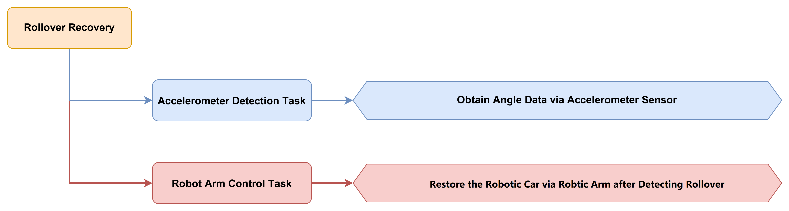


#### 5.3.7.3 Module Description


This sensor mainly utilizes the QMI8658 sensor element. It integrates a 3-axis MEMS gyroscope, a 3-axis MEMS acceleration sensor, and an expandable digital motion processor DMP.

The sensor uses three 16-bit ADCs for the gyroscope and acceleration sensor, respectively, converting the measured analog quantities into output digital values.

Module installation: Use M4 × 6 screws and M4 × 15 double-pass nylon standoffs to mount the acceleration sensor module onto the chassis.


Module wiring: As shown below, connect the module to any I2C port in the red box of the servo controller before running the program in this section.


#### 5.3.7.4 Program Download

>[!Note]
>**Before downloading the program, confirm that the serial port driver has been installed.**

1. Connect the core board to the computer via a USB cable.

   

2. Find the corresponding example project file in the Arduino project folder [Tankbot_ESP32_Arduino](https://drive.google.com/file/d/1cZK2G04Oq-Y2ALuVWLuf1bLQRtEFaZlC/view?usp=sharing) in the same directory as the document.

   

3. After opening, select the development board model as shown below.

   

4. First click the verify icon, and then click the  upload icon. After the upload completes, if the output box at the bottom of the software displays the following interface, the program download is complete.

   

#### 5.3.7.5 Program Outcome

The Pitch angle is obtained via the attitude sensor. When the Pitch angle is less than or equal to -60°, it is identified as a left-side rollover, and the robotic arm is controlled to execute the left-side rollover recovery action sequence. When the Pitch angle is greater than or equal to 60°, it is identified as a right-side rollover, and the robotic arm is controlled to execute the right-side rollover recovery action sequence. After the recovery is completed, the robot automatically returns to its normal posture.


#### 5.3.7.6 Program Analysis

1) The hardware library and module library files are imported, containing the libraries required for rollover recovery. The `I2C.hpp` file contains the I2C communication interface functions, the `IMU.hpp` file contains the attitude sensor control functions, and the `differential_chassis.hpp` file contains the chassis control functions.

```cpp
#include "Config.h"
#include "Hiwonder.hpp"
#include "Robot_arm.hpp"
#include "motor.hpp"
#include "IIC.hpp"
#include "IMU.hpp"
#include "differential_chassis.hpp"
#include "Ticker.h"
```

2) Variables and state machine enumerations related to rollover recovery are created. The `euler` array stores Euler angle data (`Roll`, `Pitch`, `Yaw`). The `RecoveryState` enumeration defines the states of the recovery action: idle state, left rollover recovery steps 1–5, right rollover recovery steps 1–5. The `recovery_state` variable controls the current recovery state, and the `recovery_triggered` flag prevents repeated triggering of the recovery action.

```cpp
float euler[3];

// recovery action state machine
enum RecoveryState {
  RECOVERY_IDLE,           // idle state
  RECOVERY_LEFT_STEP1,     // left roll recovery step 1
  RECOVERY_LEFT_STEP2,     // left roll recovery step 2
  RECOVERY_LEFT_STEP3,     // left roll recovery step 3
  RECOVERY_LEFT_STEP4,     // left roll recovery step 4
  RECOVERY_LEFT_STEP5,     // left roll recovery step 5
  RECOVERY_RIGHT_STEP1,    // right roll recovery step 1
  RECOVERY_RIGHT_STEP2,    // right roll recovery step 2
  RECOVERY_RIGHT_STEP3,    // right roll recovery step 3
  RECOVERY_RIGHT_STEP4,    // right roll recovery step 4
  RECOVERY_RIGHT_STEP5     // right roll recovery step 5
};

RecoveryState recovery_state = RECOVERY_IDLE;
unsigned long recovery_step_start_time = 0;  // current step start time
bool recovery_triggered = false;  // whether recovery action has been triggered
unsigned long last_imu_check_time = 0;  // last IMU check time (for debounce)
```

3) The hardware interfaces required by the Tankbot are initialized first, followed by the initialization of the LED, robotic arm, buzzer, I2C communication, and IMU sensor modules. The program initializes the differential drive chassis, controls the buzzer to emit a single beep to indicate that the system startup is complete, and opens the gripper to 65 degrees.

```cpp
Serial.begin(9600);
arm.init();
led_obj.init(IO_LED);
iic_obj.init();
motor_obj.init(&iic_obj);
buzzer_obj.init(IO_BUZZER);
battery_obj.init(ADC_BAT);
imu.init(&iic_obj);

differentials_chassis_run(0.0f, 0.0f);
buzzer_obj.blink(1500 , 50, 50, 1);
arm.claw_set(65, 500);
delay(1000);
```

4) A `switch-case` state machine in the loop implements rollover detection and recovery. In the `RECOVERY_IDLE` idle state, Euler angle data is acquired through `imu.get_euler(euler)`. If `Pitch` ≤ -60° is detected, indicating a left rollover, and no recovery action has been triggered, a second detection is performed after a 100 ms delay for debounce confirmation. The buzzer then sounds, the robotic arm is controlled to move to the left support position `X=0.5`, `Y=9.4`, `Z=9.8`, and the state transitions to `RECOVERY_LEFT_STEP1`. If `Pitch` ≥ 60° is detected, indicating a right rollover, the right rollover recovery procedure is executed. Once the attitude returns to the normal range of -30° to 30°, the trigger flag is reset.

```cpp
imu.get_euler(euler);

switch(recovery_state) {
  case RECOVERY_IDLE: {
    // detect left rollover (Pitch < -60)
    if(euler[1] <= -60.0f && !recovery_triggered) {
      if(current_time - last_imu_check_time > 100) {  // debounce: continuous detection within 100ms
        last_imu_check_time = current_time;
        imu.get_euler(euler);
        if(euler[1] <= -60.0f) {
          recovery_state = RECOVERY_LEFT_STEP1;
          recovery_step_start_time = current_time;
          recovery_triggered = true;
          buzzer_obj.blink(1500, 100, 100, 1);
          arm.coordinate_set(0.5, 9.4, 9.8, -40, -90, 10, 1500);
        }
      }
    }
    // detect right rollover (Pitch > 60)
    else if(euler[1] >= 60.0f && !recovery_triggered) {
      if(current_time - last_imu_check_time > 100) {  // debounce: continuous detection within 100ms
        last_imu_check_time = current_time;
        imu.get_euler(euler);
        if(euler[1] >= 60.0f) {
          recovery_state = RECOVERY_RIGHT_STEP1;
          recovery_step_start_time = current_time;
          recovery_triggered = true;
          buzzer_obj.blink(1500, 100, 100, 1);
          arm.coordinate_set(0.5, -9.4, 9.8, -40, -90, 10, 1500);
        }
      }
    }
    if(euler[1] > -30.0f && euler[1] < 30.0f) {
      recovery_triggered = false;
    }
    break;
  }
}
```

5) Left-Side Rollover Recovery Steps: In `RECOVERY_LEFT_STEP1`, after a 2-second wait, the robotic arm is controlled to move to the left ground support position at X=0.5, Y=25, Z=-9, and the state switches to `RECOVERY_LEFT_STEP2`. In `RECOVERY_LEFT_STEP2`, after a 2-second wait, the state switches to `RECOVERY_LEFT_STEP3`. In `RECOVERY_LEFT_STEP3`, after a 1-second wait, the robotic arm is controlled to move to the middle position at X=0.5, Y=15, Z=2, and the state switches to `RECOVERY_LEFT_STEP4`. In `RECOVERY_LEFT_STEP4`, after a 2-second wait, the robotic arm is controlled to move to the right support position at X=9.4, Y=0, Z=9.8, and the state switches to `RECOVERY_LEFT_STEP5`. In `RECOVERY_LEFT_STEP5`, after a 2-second wait, the state returns to the `RECOVERY_IDLE` idle state.

```cpp
// Left-Side Rollover Recovery Steps
case RECOVERY_LEFT_STEP1:
  if(current_time - recovery_step_start_time >= 2000) {
    recovery_state = RECOVERY_LEFT_STEP2;
    recovery_step_start_time = current_time;
    arm.coordinate_set(0.5, 25, -9, -60, 0, 90, 1500);
  }
  break;
  
case RECOVERY_LEFT_STEP2:
  if(current_time - recovery_step_start_time >= 2000) {
    recovery_state = RECOVERY_LEFT_STEP3;
    recovery_step_start_time = current_time;
  }
  break;
  
case RECOVERY_LEFT_STEP3:
  if(current_time - recovery_step_start_time >= 1000) {
    recovery_state = RECOVERY_LEFT_STEP4;
    recovery_step_start_time = current_time;
    arm.coordinate_set(0.5, 15, 2, -40, -90, 10, 1500);
  }
  break;
  
case RECOVERY_LEFT_STEP4:
  if(current_time - recovery_step_start_time >= 2000) {
    recovery_state = RECOVERY_LEFT_STEP5;
    recovery_step_start_time = current_time;
    arm.coordinate_set(9.4,0,9.8,-40,-90,10,1500);
  }
  break;
  
case RECOVERY_LEFT_STEP5:
  if(current_time - recovery_step_start_time >= 2000) {
    recovery_state = RECOVERY_IDLE;
    arm_state = 0;
  }
  break;
```

6) Right-side rollover recovery procedure: In `RECOVERY_RIGHT_STEP1`, after a 2-second delay, the robotic arm is moved to the right ground support position at X=0.5, Y=-25, Z=-9, and the state transitions to `RECOVERY_RIGHT_STEP2`. After a 2-second delay, `RECOVERY_RIGHT_STEP2` transitions to `RECOVERY_RIGHT_STEP3`. In `RECOVERY_RIGHT_STEP3`, after a 1-second delay, the robotic arm is moved to the middle position at X=0.5, Y=-9.4, Z=9.8, and the state transitions to `RECOVERY_RIGHT_STEP4`. In `RECOVERY_RIGHT_STEP4`, after a 2-second delay, the robotic arm is moved to the left support position at X=9.4, Y=0, Z=9.8, and the state transitions to `RECOVERY_RIGHT_STEP5`. After a 2-second delay, `RECOVERY_RIGHT_STEP5` returns to the `RECOVERY_IDLE` idle state. During the recovery action, if the posture has returned to normal with Pitch within the range of -30° to 30°, the trigger flag is reset.

```cpp
// Right-side rollover recovery procedure
case RECOVERY_RIGHT_STEP1:
  if(current_time - recovery_step_start_time >= 2000) {
    recovery_state = RECOVERY_RIGHT_STEP2;
    recovery_step_start_time = current_time;
    arm.coordinate_set(0.5, -25, -9, -60, 0, 90, 1500);
  }
  break;
  
case RECOVERY_RIGHT_STEP2:
  if(current_time - recovery_step_start_time >= 2000) {
    recovery_state = RECOVERY_RIGHT_STEP3;
    recovery_step_start_time = current_time;
  }
  break;
  
case RECOVERY_RIGHT_STEP3:
  if(current_time - recovery_step_start_time >= 1000) {
    recovery_state = RECOVERY_RIGHT_STEP4;
    recovery_step_start_time = current_time;
    arm.coordinate_set(0.5, -9.4, 9.8, -40, -90, 10, 1500);
  }
  break;
  
case RECOVERY_RIGHT_STEP4:
  if(current_time - recovery_step_start_time >= 2000) {
    recovery_state = RECOVERY_RIGHT_STEP5;
    recovery_step_start_time = current_time;
    arm.coordinate_set(9.4,0,9.8,-40,-90,10,1500);
  }
  break;
  
case RECOVERY_RIGHT_STEP5:
  if(current_time - recovery_step_start_time >= 2000) {
    recovery_state = RECOVERY_IDLE;
    arm_state = 0;
  }
  break;
```

---

### 5.3.8 8-Channel Line Follower Sensor

#### 5.3.8.1 Usage Introduction

This lesson covers the usage of the 8-channel line follower sensor for quick mastery. The sensor consists of 8 industrial-grade infrared sensors and features a learning button that supports learning line-following tasks with different grayscale values.


#### 5.3.8.2 Usage Steps

1. Move the sensor over the **background color** to be learned and press and hold the **white learning button**. The sensor automatically learns the grayscale value of the background color. During the learning process, the four outermost LEDs on the sensor flash. When all LEDs start flashing, learning is successful and the white learning button can be released.

   

2. Move the sensor into the **target tracking color** to be learned and briefly press the **white learning button**. The sensor automatically learns the grayscale value of the target tracking color. During the learning process, the four innermost LEDs of the target tracking color being learned flash. When all LEDs start flashing at a normal rate, the learning succeeds. If learning fails, all LEDs enter rapid flash mode.

   

#### 5.3.8.3 Test Results

Here, white is used as the background color and black as the target tracking color. The sensor is placed on black. When the target color is recognized, the LED of the corresponding channel lights up.


### 5.3.9 Introduction to the 8-Channel Line Follower Sensor Communication Protocol

#### 5.3.9.1 Product Overview

This course covers the core communication protocol of the 8-channel line follower sensor, along with its design logic and secondary development methods. Through the standardized protocol, multi-sensor collaborative control can be quickly implemented, laying a foundation for projects such as robot navigation and industrial automation.


#### 5.3.9.2 Communication Protocol Overview

The 8-channel line follower sensor provides three flexible communication interface options to meet the requirements of various application scenarios.

1. The I2C Communication Mode: Adopts the standard I2C bus protocol, supports parallel connection of multiple devices, and is suitable for application scenarios that require saving I/O pins.

2. UART Communication Mode: Provides a serial asynchronous communication interface with configurable baud rate, enabling direct connection to various controllers.

3. GPIO Communication Mode: Outputs through parallel digital signals, featuring fast response speed and suitability for applications with high real-time requirements.

* **I2C Communication Protocol**

The I2C communication protocol address of the 8-channel line follower sensor is 0 x 5D, a fixed address. The relevant sensor data can be obtained by reading the register address of the 8-channel line follower sensor.

The following figure shows the register mapping table for the 8-channel sensor data analog values:

| Register address |        Function description        | Data type | Data length |          Data format           |
| :--------------: | :--------------------------------: | :-------: | :---------: | :----------------------------: |
|        5         |  Read all sensor digital results   |  uint8_t  |   1 byte    |               /                |
|        6         | Read sensor 1 channel analog value | uint16_t  |   2 bytes   | Low byte first, high byte last |
|        8         | Read sensor 2 channel analog value | uint16_t  |   2 bytes   | Low byte first, high byte last |
|        10        | Read sensor 3 channel analog value | uint16_t  |   2 bytes   | Low byte first, high byte last |
|        12        | Read sensor 4 channel analog value | uint16_t  |   2 bytes   | Low byte first, high byte last |
|        14        | Read sensor 5 channel analog value | uint16_t  |   2 bytes   | Low byte first, high byte last |
|        16        | Read sensor 6 channel analog value | uint16_t  |   2 bytes   | Low byte first, high byte last |
|        18        | Read sensor 7 channel analog value | uint16_t  |   2 bytes   | Low byte first, high byte last |
|        20        | Read sensor 8 channel analog value | uint16_t  |   2 bytes   | Low byte first, high byte last |

The following figure shows the threshold register mapping table for the 8-channel sensor data:

| Register address |      Function description       | Data type | Data length |          Data format           |
| :--------------: | :-----------------------------: | :-------: | :---------: | :----------------------------: |
|        22        | Read sensor 1 channel threshold | uint16_t  |   2 bytes   | Low byte first, high byte last |
|        24        | Read sensor 2 channel threshold | uint16_t  |   2 bytes   | Low byte first, high byte last |
|        26        | Read sensor 3 channel threshold | uint16_t  |   2 bytes   | Low byte first, high byte last |
|        28        | Read sensor 4 channel threshold | uint16_t  |   2 bytes   | Low byte first, high byte last |
|        30        | Read sensor 5 channel threshold | uint16_t  |   2 bytes   | Low byte first, high byte last |
|        32        | Read sensor 6 channel threshold | uint16_t  |   2 bytes   | Low byte first, high byte last |
|        34        | Read sensor 7 channel threshold | uint16_t  |   2 bytes   | Low byte first, high byte last |
|        36        | Read sensor 8 channel threshold | uint16_t  |   2 bytes   | Low byte first, high byte last |

* **UART Communication Protocol**

The UART communication protocol for the 8-channel line follower sensor supports four initialization modes:

|         Initialization Mode         | Configuration Command |
| :---------------------------------: | :-------------------: |
|        Manual configuration         |           0           |
| Automatic level value transmission  |           1           |
| Automatic analog value transmission |           2           |
|  Automatic threshold transmission   |           3           |

The following section describes the manual mode in detail. After the controller sends a read command, the sensor returns the corresponding data.

Related Read Instructions:

1. Return level value, returns 1‑Byte data.

2. Read analog value, returned per the following serial port protocol.

3. Read threshold value, returned per the following serial port protocol.

> [!NOTE]
>
> **The running mode cannot be reconfigured after configuration. If a mode change is required, the system must be reset and re-initialized.**

The following figure shows the 8-channel sensor serial port protocol:


#### 5.3.9.3 GPIO Communication Protocol

GPIO, or General-Purpose Input/Output, is a flexible hardware interface that enables microcontrollers such as MCU and SoC to communicate with external devices through digital pins. It does not rely on any specific protocol. Instead, it performs simple control or data transmission through high and low level signals. GPIO is commonly used in embedded systems, sensors, LED control, and other scenarios.

The 8-channel line following sensor can directly read the IO pins of the corresponding sensor channels and outputs a low level when a target is detected.

> [!NOTE]
>
> **The returned data is inverted relative to the level signal read via I2C/UART**.


### 5.3.10 T-Junction Detection 

#### 5.3.10.1 Project Introduction

This lesson uses an 8-channel line follower sensor to identify the track and T-junctions, and controls the robotic car to follow the line.


#### 5.3.10.2 Implementation Process


#### 5.3.10.3 Module Description


The sensor emits and receives infrared light through an infrared sensor. The stronger the infrared reflection, the greater the output, and the weaker the reflection, the smaller the output. A high-performance 32-bit ARM chip then processes the signal data, controls the LED of the corresponding probe based on signal strength, and transmits the data to other controllers through the output interface.

The sensor employs an innovative one-click intelligent calibration technology that requires no preset parameter adjustment. Calibration can be completed within 1 minute with a simple button press.

Module wiring: As shown in the figure below, connect the module to any I2C port in the red box of the servo controller before running the program in this section.


#### 5.3.10.4 Program Download

>[!Note]
>**Before downloading the program, confirm that the serial port driver has been installed.**

1. Connect the core board to the computer via a USB cable.

   

2. Find the corresponding example project file in the Arduino project folder [Tankbot_ESP32_Arduino](https://drive.google.com/file/d/1cZK2G04Oq-Y2ALuVWLuf1bLQRtEFaZlC/view?usp=sharing) in the same directory as the document.

   

3. After opening, select the development board model as shown below:

   

4. First click the verify icon, and then click the  upload icon. After the upload completes, if the output box at the bottom of the software displays the following interface, the program download is complete.

   

#### 5.3.10.5 Program Outcome

Tankbot follows the line during line-following operation. When a fork or T-junction is encountered, the robot turns according to the junction type.


#### 5.3.10.6 Program Analysis

1) The hardware and module library files are imported, which contain the various libraries required for T-junction detection. `linefollower8.hpp` includes the control functions for the 8-channel line follower sensor, `Ultrasound.hpp` includes the ultrasonic control functions, and `differential_chassis.hpp` includes the chassis control functions.

```cpp
#include "Config.h"
#include "Hiwonder.hpp"
#include "Robot_arm.hpp"
#include "motor.hpp"
#include "linefollower8.hpp"
#include "Ultrasound.hpp"
#include "differential_chassis.hpp"
#include "Ticker.h"
```

2) Objects for line-following detection are created. The `lf_obj` object of `Linefollower8` class is used to acquire data from the 8-channel line follower sensor, and the `ult_obj` object of `Ultrasound` class is used for ultrasonic ranging as a reserved interface.

```cpp
Linefollower8 lf_obj;
Ultrasound ult_obj;
```

3) First, the hardware interfaces required by Tankbot are initialized. Then, modules including the LED light, robotic arm, buzzer, I2C communication, 8-channel line follower sensor, and ultrasonic sensor are initialized. The program initializes the differential drive chassis and triggers a single buzzer beep after a 3-second delay to indicate successful system startup.

```cpp
Serial.begin(9600);
arm.init();
led_obj.init(IO_LED);
iic_obj.init();
motor_obj.init(&iic_obj);
buzzer_obj.init(IO_BUZZER);
battery_obj.init(ADC_BAT);
lf_obj.init(&iic_obj);
ult_obj.init(&iic_obj);

differentials_chassis_run(0.0f, 0.0f);

delay(3000);
buzzer_obj.blink(1500 , 50, 50, 1);
```

4) In the loop, the status values of the 8-channel line follower sensor are obtained via `lf_obj.GetLineValue()`. Each bit represents a sensor channel, and a value of 1 indicates detection of a black line. The count of sensors detecting black lines is stored in `cnt`, and crossroad judgment is then performed.

```cpp
uint8_t value = lf_obj.GetLineValue();

// count the number of sensors detecting black line
int cnt = 0;
for(int i = 0; i < 8; i++){
  if((value >> i) & 0x01) cnt++;
}
```

5) T-junction determination: A T-junction is determined when five or six sensors are triggered and a black line is present in the middle. Bitwise operations are used to check whether left-side sensors 0, 1, and 2 all detect a black line (`value & 0x07`) or right-side sensors 5, 6, and 7 all detect a black line (`(value >> 5) & 0x07`). For a left T-junction, the robot first goes straight for 1 second and then turns right for 1.4 seconds. For a right T-junction, it turns left for 1.4 seconds.

```cpp
// T-junction detection: five or six sensors detected + black line in the middle
if(cnt >= 5 && cnt <= 6 && (((value >> 3) & 0x03) > 0)){
  // left T-junction: left sensors[0,1,2] detected → turn right
  if((value & 0x07) == 0x07){  // 0b00000111
    differentials_chassis_run(40.0f, 0.0f);
    delay(1000);
    differentials_chassis_run(40.0f, -1.0f);  // turn right
    delay(1400);
    differentials_chassis_run(0.0f, 0.0f);
  }
  // right T-junction: right sensors[5,6,7] detected → turn left
  else if(((value >> 5) & 0x07) == 0x07){  // 0b11100000
    differentials_chassis_run(40.0f, 0.0f);
    delay(1000);
    differentials_chassis_run(40.0f, 1.0f);  // turn left
    delay(1400);
    differentials_chassis_run(0.0f, 0.0f);
  }
}
```

6) Normal line-following control: If the middle sensor 3 or 4 detects a black line, the system moves straight. If the left sensor 2 detects a black line, the system makes a slight right adjustment with an angular velocity of -0.3. If the right sensor 5 detects a black line, the system makes a slight left adjustment with an angular velocity of 0.3. If no sensor detects a black line, the system continues moving straight.

```cpp
// black line in middle: go straight
else if(((value >> 3) & 0x03) > 0){
  differentials_chassis_run(40.0f, 0.0f);
}
// black line on left: adjust right slightly
else if((value >> 2) & 0x01){
  differentials_chassis_run(20.0f, -0.3f);
}
// black line on right: adjust left slightly
else if((value >> 5) & 0x01){
  differentials_chassis_run(20.0f, 0.3f);
}
// line lost: go straight
else if(cnt == 0){
  differentials_chassis_run(40.0f, 0.0f);
}
```

---

### 5.3.11 Intersection Detection 

#### 5.3.11.1 Project Introduction

This lesson uses an 8-channel line follower sensor to detect the line and intersections, and controls the robotic car to follow the line.


#### 5.3.11.2 Implementation Process


#### 5.3.11.3 Module Description


The sensor emits and receives infrared light via an infrared sensor. A stronger infrared reflection results in a larger output, while a weaker reflection results in a smaller output. The signal data is then processed by a high-performance 32-bit ARM chip, which controls the LED of the corresponding probe on the sensor based on the signal strength. The data is then transmitted to other controllers through the output interface.

The sensor employs an innovative one-click intelligent calibration technology that requires no preset parameter adjustment. Calibration is completed within 1 minute by a single button operation.

Module wiring: Before running the program in this section, connect the module to any I2C port in the red frame of the servo controller.


#### 5.3.11.4 Program Download

>[!Note]
>**Before downloading the program, confirm that the serial port driver has been installed.**

1. Connect the core board to the computer via a USB cable.

   

2. Find the corresponding example project file in the Arduino project folder [Tankbot_ESP32_Arduino]() in the same directory as the document.

   

3. After opening, select the development board model as shown below.

   

4. First click the verify icon, and then click the  upload icon. After the upload completes, if the output box at the bottom of the software displays the following interface, the program download is complete.

   

#### 5.3.11.5 Program Outcome

Tankbot follows the line for line following. When it encounters an intersection, it stops for 2 seconds and then proceeds forward.


#### 5.3.11.6 Program Analysis

1) The hardware library and module library files are imported, which include the libraries required for crossroad detection. `linefollower8.hpp` contains the control functions of the 8-channel line follower sensor, `Ultrasound.hpp` contains the ultrasonic control functions, and `differential_chassis.hpp` contains the chassis control functions.

```cpp
#include "Config.h"
#include "Hiwonder.hpp"
#include "Robot_arm.hpp"
#include "motor.hpp"
#include "linefollower8.hpp"
#include "Ultrasound.hpp"
#include "differential_chassis.hpp"
#include "Ticker.h"
```

2)  Objects related to line-following detection are created. The `lf_obj` object of `Linefollower8` class is used to acquire data from the 8-channel line follower sensor, and the `ult_obj` object of `Ultrasound` class is used for ultrasonic ranging as a reserved interface.

```cpp
Linefollower8 lf_obj;
Ultrasound ult_obj;
```

3) First, the hardware interfaces required by Tankbot are initialized, followed by the initialization of modules such as the LED, robotic arm, buzzer, I2C communication, 8-channel line follower sensor, and ultrasonic sensor. The program initializes the differential drive chassis, delays for 3 seconds, and then controls the buzzer to emit one beep, indicating that the system startup is complete.

```cpp
Serial.begin(9600);
arm.init();
led_obj.init(IO_LED);
iic_obj.init();
motor_obj.init(&iic_obj);
buzzer_obj.init(IO_BUZZER);
battery_obj.init(ADC_BAT);
lf_obj.init(&iic_obj);
ult_obj.init(&iic_obj);

differentials_chassis_run(0.0f, 0.0f);

delay(3000);
buzzer_obj.blink(1500 , 50, 50, 1);
```

4) In the loop, the status values of the 8-channel sensors are obtained via `lf_obj.GetLineValue()`. Each bit represents one sensor, with 1 indicating detection of the black line. The number of sensors detecting the black line is counted as `cnt`, and then crossroad determination is performed.

```cpp
uint8_t value = lf_obj.GetLineValue();

// count number of sensors detecting black line
int cnt = 0;
for(int i = 0; i < 8; i++){
  if((value >> i) & 0x01) cnt++;
}
```

5) Intersection detection: When seven or more sensors are triggered and a black line is detected at the middle position by sensor 3 or sensor 4, the condition is determined to be an intersection. The robotic car is controlled to stop for 2 seconds and then keeps going straight at a speed of 40.

```cpp
// crossroad judgment: 7-8 sensors detected + black line in middle
if(cnt >= 7 && (((value >> 3) & 0x03) > 0)){
  differentials_chassis_run(0.0f, 0.0f);  // stop
  delay(2000);  // stop for 2 seconds
  differentials_chassis_run(40.0f, 0.0f);  // continue straight
}
```

6) Normal line following control: If the middle sensor 3 or 4 detects the black line, the robot moves straight. If the left sensor 2 detects the black line, the robot adjusts slightly to the right with an angular velocity of -0.3. If the right sensor 5 detects the black line, the robot adjusts slightly to the left with an angular velocity of 0.3. If none of the sensors detects the black line, the robot keeps going straight.

```cpp
// black line in the middle: go straight
else if(((value >> 3) & 0x03) > 0){
  differentials_chassis_run(40.0f, 0.0f);
}
// black line on left: fine-tune right
else if((value >> 2) & 0x01){
  differentials_chassis_run(20.0f, -0.3f);
}
// black line on right: fine-tune left
else if((value >> 5) & 0x01){
  differentials_chassis_run(20.0f, 0.3f);
}
// line lost: go straight
else if(cnt == 0){
  differentials_chassis_run(40.0f, 0.0f);
}
```

---

### 5.3.12 Intelligent Line Following 

#### 5.3.12.1 Project Introduction

In this lesson, an 8-channel line follower sensor is used for line recognition, and the robotic car is controlled for intelligent line following.


#### 5.3.12.2 Implementation Process


#### 5.3.12.3 Module Description


The sensor transmits and receives infrared light through infrared sensors. A stronger infrared reflection produces a larger output, while a weaker infrared reflection produces a smaller output. The signal data is subsequently processed by a high-performance 32-bit ARM chip. The LED light on the corresponding probe is controlled according to the signal strength, and the data is transmitted to other controllers through the output interface.

The sensor adopts an innovative one-click intelligent calibration technology, requiring no preset parameter adjustment. Calibration can be completed within one minute with a simple button press.

Module wiring: Before running the program in this section, connect the module to any I2C port in the red box of the servo controller.


#### 5.3.12.4 Program Download

>[!Note]
>**Before downloading the program, confirm that the serial port driver has been installed.**

1. Connect the core board to the computer via a USB cable.

   

2. Find the corresponding example project file in the Arduino project folder [Tankbot_ESP32_Arduino](https://drive.google.com/file/d/1cZK2G04Oq-Y2ALuVWLuf1bLQRtEFaZlC/view?usp=sharing) in the same directory as the document.

   

3. After opening, select the development board model as shown below:

   

4. First click the verify icon, and then click the  upload icon. After the upload completes, if the output box at the bottom of the software displays the following interface, the program download is complete.

   

#### 5.3.12.5 Program Outcome

Tankbot performs line-following navigation by tracking the line, applies control handling at different branch points, and executes line-loss handling when the line cannot be detected.


#### 5.3.12.6 Program Analysis

1) The hardware library and module library files are imported, which contain the various libraries required for intelligent line following. `linefollower8.hpp` contains the control functions for the 8-channel line follower sensor, and `differential_chassis.hpp` contains the chassis control functions.

```cpp
#include "Config.h"
#include "Hiwonder.hpp"
#include "Robot_arm.hpp"
#include "motor.hpp"
#include "linefollower8.hpp"
#include "differential_chassis.hpp"
#include "Ticker.h"
```

2) Variables related to intelligent line following are created. The `last_error` variable stores the last error value and is used to determine the line direction during line loss handling.

```cpp
float last_error = 0.0f;
```

3) First, the hardware interfaces required by Tankbot are initialized. Then, modules such as the LED, robotic arm, buzzer, I2C communication, and 8-channel line follower sensor are initialized. The program initializes the differential chassis and, after a 3-second delay, triggers the buzzer to sound once to indicate that system startup is complete.

```cpp
Serial.begin(9600);
arm.init();
led_obj.init(IO_LED);
iic_obj.init();
motor_obj.init(&iic_obj);
buzzer_obj.init(IO_BUZZER);
battery_obj.init(ADC_BAT);
lf_obj.init(&iic_obj);

differentials_chassis_run(0.0f, 0.0f);

delay(3000);
buzzer_obj.blink(5000 , 50, 50, 1);
```

4) In the loop, a weighted algorithm is used for smart line following. The sensor status values are first obtained. The `sensor_weights` weight array is defined with left-side sensor weights positive `{5,3,2,1}` and right-side weights negative `{-1,-2,-3,-5}`. The `for` loop counts the number of triggered sensors and calculates the weighted sum.

```cpp
uint8_t value = lf_obj.GetLineValue();

int weighted_sum = 0;
int active_sensors = 0;  // number of triggered sensors
float error = 0.0f;

// sensor weights: positive on left, negative on right
int sensor_weights[8] = {5, 3, 2, 1, -1, -2, -3, -5};

// calculate weighted sum and number of triggered sensors
for(int i = 0; i < 8; i++){
  if((value >> i) & 0x01){
    weighted_sum += sensor_weights[i];
    active_sensors++;
  }
}
```

5) When sensors are triggered `active_sensors > 0`, crossroad detection and line-following judgment are performed. If seven or eight sensors are triggered, the scenario is identified as a cross intersection, and the system stops for 2 seconds before continuing. If four or five sensors are triggered and `weighted_sum>0`, the scenario is identified as a left T-junction, and the system turns right. If `weighted_sum<0`, the scenario is identified as a right T-junction, and the system turns left. In other cases, the error value is calculated as `error = weighted_sum / active_sensors`, and the line offset is derived using the weighted average method.

```cpp
// Calculate error based on sensor status
if(active_sensors > 0){
  // Cross intersection: 7-8 sensors triggered
  if(active_sensors > 6){
    differentials_chassis_run(0.0f, 0.0f);  // stop
    delay(2000);
    error = 0;
  }
  // T-intersection: 4-5 sensors triggered
  else if(active_sensors >= 4 && active_sensors <= 5 && weighted_sum > 0){
    // left T: weight positive (more left sensors) → turn right
    differentials_chassis_run(0.0f, -1.0f);
    delay(800);
    error = 0;
  }
  else if(active_sensors >= 4 && active_sensors <= 5 && weighted_sum < 0){
    // right T: weight negative (more right sensors) → turn left
    differentials_chassis_run(0.0f, 1.0f);
    delay(800);
    error = 0;
  }
  else{
    // normal line following: error = weighted sum / number of triggered
    error = (float)weighted_sum / active_sensors;
  }
}
```

6) Line loss handling: When no sensor is triggered `active_sensors == 0`, the line direction is determined based on the previous error `last_error`. If `last_error>0.5`, the line is on the left and the vehicle continues to turn left with `error=5`. If `last_error<-0.5`, the vehicle turns right with `error=-5`. Otherwise, it proceeds straight with `error=0`. Finally, the error is scaled to the range ±0.9, and the vehicle is controlled for line following at a speed of 50 and an angular velocity of `last_error`.

```cpp
else{
  // Line‑loss handling: keep turning based on the direction of last error
  if(last_error > 0.5){
    error = 5;  // Previously deviated left, keep turning left
  }
  else if(last_error < -0.5){
    error = -5;  // Previously deviated right, keep turning right
  }
  else{
    error = 0;  // Go straight
  }
}

float scaled = error * 0.2f;
if(scaled > 0.9f) scaled = 0.9f;
if(scaled < -0.9f) scaled = -0.9f;
last_error = scaled;

// Line‑following: use error as steering value
differentials_chassis_run(50.0f, last_error);
delay(20);
```

---

### 5.3.13 Line Following and Clamping 

#### 5.3.13.1 Project Introduction

This lesson uses an 8-channel line follower sensor to identify the track path and control the robotic car for line following. Once an obstacle is detected, the robotic arm is controlled to perform gripping.

#### 5.3.13.2 Implementation Process


#### 5.3.13.3 Module Description


The sensor emits and receives infrared light through an infrared sensor. The output increases with stronger infrared reflection and decreases with weaker infrared reflection. The signal data is then processed by a high-performance 32-bit ARM chip. Based on the signal intensity, the LED of the corresponding probe is controlled. Finally, the data is transmitted to other controllers via the output interface.

The sensor features an innovative one-click intelligent calibration technology. No preset parameter tuning is required, and calibration is completed within 1 minute by a simple button press.

Module wiring: Before running the program in this section, connect the module to any I2C port in the red box on the servo controller.


#### 5.3.13.4 Program Download

>[!Note]
>**Before downloading the program, confirm that the serial port driver has been installed.**

1. Connect the core board to the computer via a USB cable.

   

2. Find the corresponding example project file in the Arduino project folder [Tankbot_ESP32_Arduino](https://drive.google.com/file/d/1cZK2G04Oq-Y2ALuVWLuf1bLQRtEFaZlC/view?usp=sharing) in the same directory as the document.

   

3. After opening, select the development board model as shown below.

   

4. First click the verify icon, and then click the  upload icon. After the upload completes, if the output box at the bottom of the software displays the following interface, the program download is complete.

   

#### 5.3.13.5 Program Outcome

Tankbot is designed to follow lines during its travel, execute control logic based on different junctions, and perform line-loss handling when the line is no longer detected.


#### 5.3.13.6 Program Analysis

1) The hardware library and module library files are imported, which contain the various libraries required for line-following and gripping. The `linefollower8.hpp` file contains the control functions for the 8-channel line follower sensor, the `Ultrasound.hpp` file contains the ultrasonic control functions, and the `differential_chassis.hpp` file contains the chassis control functions.

```cpp
#include "Config.h"
#include "Hiwonder.hpp"
#include "Robot_arm.hpp"
#include "motor.hpp"
#include "linefollower8.hpp"
#include "Ultrasound.hpp"
#include "differential_chassis.hpp"
#include "Ticker.h"
```

2) The variables related to line following and gripping are created. The `last_error` variable is used to store the previous error value for determining the line direction during line-loss handling. The `clawState` flag is used to control the gripping and placement states, where true indicates the pending-grip state and false indicates the pending-placement state.

```cpp
float last_error = 0.0f;
bool clawState = true;  // Claw state: true=has object, false=no object
```

3) The hardware interfaces required by the Tankbot are initialized first, followed by the initialization of the LED, robotic arm, buzzer, I2C communication, 8-channel line follower sensor, and ultrasonic modules. The program initializes the differential chassis, and after a 3-second delay, the buzzer sounds once to indicate that the system startup is complete.

```cpp
Serial.begin(9600);
arm.init();
led_obj.init(IO_LED);
iic_obj.init();
motor_obj.init(&iic_obj);
buzzer_obj.init(IO_BUZZER);
battery_obj.init(ADC_BAT);
lf_obj.init(&iic_obj);
ult_obj.init(&iic_obj);

differentials_chassis_run(0.0f, 0.0f);

delay(3000);
buzzer_obj.blink(1500 , 50, 50, 1);
```

4) In the loop, a weighted algorithm is used for line following, and when an intersection is detected, the pick or place task is executed. The process first obtains the sensor status values, defines a weight array, and calculates the weighted sum and the number of triggered sensors.

```cpp
uint8_t value = lf_obj.GetLineValue();

int weighted_sum = 0;
int active_sensors = 0;  // number of triggered sensors
float error = 0.0f;

// sensor weights: positive on left, negative on right
int sensor_weights[8] = {5, 3, 2, 1, -1, -2, -3, -5};

// calculate weighted sum and number of triggered sensors
for(int i = 0; i < 8; i++){
  if((value >> i) & 0x01){
    weighted_sum += sensor_weights[i];
    active_sensors++;
  }
}
```

5) Intersection pickup procedure for `clawState==true`: When 7 to 8 sensors are triggered, the vehicle stops and the ultrasonic distance is acquired. If the distance is less than 200 mm, the distance is confirmed again after a 1-second delay. The buzzer then sounds, and the robotic arm is controlled to perform adaptive gripping based on the distance, with the X coordinate set to 8+distance/10. After the gripper is closed, the robotic arm is raised. Finally, the vehicle reverses for 2 seconds and turns right for 2 seconds to complete a U-turn, and `clawState` is set to false.

```cpp
// calculate error based on sensor status
if(active_sensors > 0){
  // intersection: 7-8 sensors triggered
  if(active_sensors > 6){
    differentials_chassis_run(0.0f, 0.0f);  // stop
    delay(1000);
    
    if(clawState == true){
      // object present state: detect and grab object
      uint16_t distance = ult_obj.GetDistance();
      if(distance < 200){
        delay(1000);
        distance = ult_obj.GetDistance();
        if(distance < 200){
          buzzer_obj.blink(1500, 50, 50, 1);
          delay(1000);
          
          // grab action sequence
          arm.coordinate_set(8+((float)distance)/10, 0, -4, -45, -90, 90, 1500);
          delay(2000);
          arm.claw_set(0, 500);
          delay(800);
          arm.coordinate_set(15, 0, 6, -45, -90, 90, 1500);
          delay(2000);
          differentials_chassis_run(-50.0f, 0.0f);  // back up
          delay(2000);
          differentials_chassis_run(0.0f, -1.0f);   // turn right
          delay(2000);
          
          error = 0;
          clawState = false;  // switch to no-object state
        }
      }
      error = 0;
    }
  }
}
```

6) Intersection placement procedure (`clawState==false`): When 7-8 sensors are triggered, the vehicle is stopped and the robotic arm is controlled to move to the placement position X=25, Y=0, Z=-3. The gripper is opened to 65 degrees to release the object. After the initial posture is restored, the vehicle is controlled to reverse and turn right to complete a U-turn, and `clawState` is set to true.

```cpp
else{
  // No object state: prepare gripper
  differentials_chassis_run(0.0f, 0.0f);  // Stop
  delay(1000);
  arm.coordinate_set(25, 0, -3, -60, 0, 90, 1500);
  delay(2000);
  arm.claw_set(65, 500);
  delay(1000);
  arm.coordinate_set(15, 0, 2, -40, -90, 10, 1500);  // Reset
  delay(2000);
  differentials_chassis_run(-50.0f, 0.0f);  // Back up
  delay(2000);
  differentials_chassis_run(0.0f, -1.0f);   // Turn right
  delay(2000);
  
  clawState = true;  // Switch to object state
  error = 0;
}
```

7) T-junction and normal line-following handling. If 4-5 sensors are triggered and `weighted_sum>0`, it is a left T-junction and the robotic car turns right. If `weighted_sum<0`, it is a right T-junction and the robotic car turns left. In other cases, the error value is calculated using the weighted average method. When the line is lost, the direction is determined based on `last_error`. Finally, the error is scaled to the range ±0.9, and the robotic car is controlled to follow the line at a speed of 50 and an angular velocity of `last_error`.

```cpp
// T‑junction: 4‑5 sensors triggered
else if(active_sensors >= 4 && active_sensors <= 5 && weighted_sum > 0){
  // Left T‑junction: positive weighted sum (more left‑side sensors triggered) → turn right
  differentials_chassis_run(0.0f, -1.0f);
  delay(800);
  error = 0;
}
else if(active_sensors >= 4 && active_sensors <= 5 && weighted_sum < 0){
  // Right T‑junction: negative weighted sum (more right‑side sensors triggered) → turn left
  differentials_chassis_run(0.0f, 1.0f);
  delay(800);
  error = 0;
}
else{
  // Normal line‑following: error = weighted sum / number of active sensors
  error = (float)weighted_sum / active_sensors;
}
```

8) Line loss handling and line following control: When no sensor is triggered, the line direction is determined based on the last error, last_error. Finally, the error is scaled to within ±0.9, and the robotic car is controlled to track the line at a speed of 50 and an angular velocity of last_error.

```cpp
else{
  // line lost: continue turning based on last error direction
  if(last_error > 0.5){
    error = 5;  // last time was left, continue turning left
  }
  else if(last_error < -0.5){
    error = -5;  // last time was right, continue turning right
  }
  else{
    error = 0;  // go straight
  }
}

// scale error to reasonable range
float scaled = error * 0.2f;
if(scaled > 0.9f) scaled = 0.9f;
if(scaled < -0.9f) scaled = -0.9f;
last_error = scaled;

// use error as steering value for line following
differentials_chassis_run(50.0f, last_error);
delay(20);
```

## 5.4 Large AI Model Project Course

### 5.4.1 WonderLLM Configuration

<p id ="5.4.1.1"></p>

#### 5.4.1.1 WonderLLM Introduction and Network Configuration

* **Module Introduction**

WonderLLM is a large AI model module with a built-in ESP32-S3 high-performance chip. It integrates a 2MP HD camera, a microphone, an HD display, and a speaker. It also features a CI1302 speech recognition chip for deep fusion of text, speech, and vision models.

This module is easy to operate and is commonly paired with robots. It serves as a “super brain” for the robot, enabling deep understanding of commands and granting superior perception, reasoning, and action capabilities. This creates a flexible and natural human-machine interaction experience.


* **Working Principles**


1. The module is woken up in wake-word mode. The wake word must be spoken to wake WonderLLM, and human-machine interaction is enabled only after activation. The default recognition language is English, and the English wake-up keyword is **Hello Hiwonder**.

2. Upon detecting the wake word, the module emits a single buzzer tone and becomes ready for interaction. The module supports communication in English, and it automatically identifies the language used by the speaker and switches accordingly. If no speech is detected within 1 minute, the module enters sleep mode, and a new wake-up is required before the next use.

3. The module supports wake word modification and custom entries. Modification instructions are provided in **4.10 Wake Word Modification**.

4. All tutorials use Chinese recognition as an example. For English firmware flashing, the firmware flashing tutorial can be found in [**Firmware Download**](#Firmware Download).

> [!NOTE]
>
> - **Use a 5 V power supply, otherwise the module will be damaged.**
> - **The usage scenario should be quiet, as a noisy environment can affect the recognition performance.**
>
> - **Speak the voice command loudly and at a moderate pace. It is recommended to stay within 5 m of the module.**

* **Hardware Interface Description**


| No.  | Description                                                  |
| ---- | ------------------------------------------------------------ |
| 1    | Upper Type-C interface for flashing program firmware to the ESP32-S3 chip |
| 2    | Lower Type-C interface for flashing voice recognition firmware to the CI1302 chip |
| 3    | 4-PIN I2C communication interface for secondary development  |
| 4    | Capacitive touch screen for displaying images/adjusting volume |
| 5    | Left button for module restart and switching expression/chat modes |
| 6    | HD camera for capturing real-time images                     |
| 7    | Right button for module restart, network configuration, and interaction control |

* **Device Power-On**


1. The module supports power supply through the following interfaces: **① upper Type-C interface**, **② lower Type-C interface**, and **③ 4-PIN I2C communication interface**. An external power supply device can be connected to any one of these interfaces, and then the module automatically powers on.
2. After the module is powered on, if it is used for the first time, the screen first displays the **Hotspot** and the **URL**, accompanied by a voice broadcast. Complete the binding between the module device and the platform agent, and configure WiFi connection information in accordance with the procedures described in [Device Binding](#Device Binding) and [Module Networking](#Module Networking).


3. After the module is powered on, if device binding has been completed, the screen displays a white circular loading indicator, indicating that the module is automatically connecting to the network based on the internally stored WIFI information. If the module fails to connect to the network, the screen displays the device hotspot name and device access URL with a voice broadcast. The new WIFI connection information for the current environment must be configured again according to [Module Networking](#Module Networking).


4. After the module is powered on, if device binding has been completed and the configured WiFi connection information is valid in the current environment, a white circular loading indicator appears on the screen for a period of time. Once the network connection succeeds, the interface switches to the module expression display screen. All module configurations are normal at this stage, and human-machine interaction can be initiated after the module is woken up.


* **Device Restart**


1. The module supports manual restart after power-on. The module can be restarted without power-off by either **① long-pressing the left button** or **② long-pressing the right button**.
2. When the module detects a restart command issued by a long press of the button, it automatically powers off and restarts. At this time, the screen immediately turns off. When the button is released, the module then powers on automatically.
3. If the module is restarted by long-pressing the right button, and the button is still held down when the module is powered on again, the module may mistakenly determine that it has entered the network configuration mode as detailed in **[Module Networking](#Module Networking)**, causing unnecessary trouble. Therefore, it is recommended to restart the module by long-pressing the left button.

<p id ="Module Networking"></p>

* **Module Networking**

**Operation Steps**

1. After the module is powered on, it initiates the network connection process. The module enters the network configuration mode under the following conditions: **① The module is used for the first time or the firmware is re-flashed, and no valid WIFI connection information is stored in memory**, **② No hotspot matching the stored WIFI connection information exists in the current environment**, or **③ Manual trigger entry into this mode**. 
1. In this state, the display shows the device hotspot name and the device access URL, accompanied by a voice broadcast. The large model module enables its built-in hotspot for connection and configuration. Different devices have different hotspot names, with a unified format of **Robot-xxxx**. The hotspot Robot-B7B9 is used as an example in the following description.


3. The corresponding hotspot can be located and connected to using a computer or mobile phone. No password is required.


4. Open any browser and visit the following URL: http://192.168.4.1. Alternatively, click the [<u>Network Configuration</u>](http://192.168.4.1/) hyperlink for direct access.


5. The interface display language can be switched by clicking here.


6. The desired hotspot name for automatic connection upon module power-on can be entered in field ①, and the hotspot password can be entered in field ②. Finally, upon clicking **Connect** in field ③, the module attempts to find and connect to a matching hotspot in the current environment based on the provided hotspot connection information.

   

> [!Note]
>
> * **Do not enter hotspots that cannot be detected in the current environment, have excessively weak signals, or do not support network connectivity.**
> * **If the module has previously saved connection information for other hotspots, the newly saved hotspot connection information will coexist with the existing information. The next time the module is powered on, it sequentially reads each connection entry in the saved order and attempts to match and connect to a hotspot.**

7. The list of available hotspots detected by the module in the current environment is displayed on the interface. Clicking an entry automatically fills the corresponding hotspot name into field ① in the figure above, providing a more time-saving and convenient operation.

   

8. If the following message appears on the interface, it indicates that the current environment cannot find the hotspot or the connection password is incorrect. The information should be re-entered.

   

9. When the following prompt appears on the interface, it indicates that the module has successfully found and connected to the corresponding hotspot. The module automatically restarts and connects to the corresponding hotspot. At this point, all prerequisite preparation steps for the module are complete, and the various interactive features of the WonderLLM module can be experienced according to the subsequent course documentation.


>[!Note]
>**If the message Error: Failed to check for a new version, will retry in xx seconds appears on the screen after the module completes network configuration, the current hotspot may not have internet access or may have poor network quality. Try switching to a different hotspot.**


**Manual Entry into Network Configuration Mode**

1. The WonderLLM module supports manual entry into network configuration mode, accommodating the need to select a hotspot connection for the module.

2. When the module is powered on, a long press on the right button sends a restart command to the module. Upon receiving the command, the screen turns off. The button must remain held. After the module restarts, it begins attempting to connect to a hotspot, and a white circular progress indicator appears on the screen. At this moment, the module detects that the right button is still held, so it skips matching external hotspots and directly enters network configuration mode. At this time, the button can then be released.

3. After entering the network configuration mode, the existing hotspot configuration information is not lost. The network configuration page can be accessed, or the right button can be briefly pressed to exit the network configuration mode.

4. After exiting the network configuration mode, the module continues attempting to connect based on the saved hotspot information. If the module cannot connect to an external hotspot, it re-enters the network configuration mode.


**Managing Saved Connection Configurations (Optional)**

1. When the module is in network configuration mode, the list of all saved hotspot connection configurations can be viewed after the module hotspot is connected and the network configuration interface is entered, provided that hotspot connection information has been configured previously, as shown below:

   

2. The  icon corresponding to any saved hotspot connection entry can be clicked to delete the entry. The  icon can also be clicked to raise the matching priority of the entry during module network provisioning, with the priority decreasing from the top to the bottom of the list.

   <p id ="Device Binding"></p>

* **Device Binding**


1. After the module is powered on and network configuration is completed, on first use, the screen displays the **6-digit device ID** and the **device binding URL** with a voice broadcast. The module device must be bound to the platform agent according to the instructions below.


2. Open any browser and access the following URL: https://xiaozhi.me/. Alternatively, click the [XiaoZhi AI Chatbot](https://xiaozhi.me/) to access directly.


3. The interface display language can be switched by clicking here.


4. Click **Console** to enter the XiaoZhi AI Agent Management Platform.


5. On first login, a registered platform account is required. The account registration process is not covered here. 


6. After registration and login, the following interface is displayed. The platform generates a default agent. Click the dropdown button and select **+ Create Agent**. Later, additional configuration will be performed based on this agent, and the device ID will be bound to it.


7. Click **Configure Role**.


8. In the configuration interface, the assistant name at field ① is set to **Hiwonder,**         **modification is not recommended. If modification is required, refer to 4.10 Wake Word Modification and update the module wake word accordingly**. The dialogue language and voice role at field ② can be selected according to individual needs. The role introduction at field ③ can use the default template or a custom one. The role introduction provided below is recommended here to enable the smart agent to better adapt to subsequent feature dialogues.

```
[Role Setting]
You are {{assistant_name}}, my smart butler. You possess a physical entity and can perform a variety of tasks while complying with all instructions.

[Core Features]
‑ Gain a thorough understanding of my intentions

‑ Provide concise, non‑verbose responses

‑ Do not retain any memories

‑ Offer appropriate suggestions and carry them out
```


9. Select No Memory as the memory type. For the language model option, **DeepSeek V3.1 (Powerful)** is recommended. More detailed working parameters can be adjusted in the advanced settings, and the default settings are kept here. Finally, click **Save**.


10. After saving successfully, return to the previous screen and click **Add Device**.


11. In the popup window, enter the 6-digit code and click **Confirm** to complete device binding.


12. If binding succeeds, the **Device added successfully** prompt is displayed on the page, as shown in the figure below. Select **Open Source** and click **Start Using**.


#### 5.4.1.2 CI1302 Firmware Build


The CI1302 chip in the WonderLLM module handles the wake word recognition task. To wake the module with a new nickname, a new CI1302 firmware must be generated and flashed. This section describes the firmware production process in detail.

* **Wake Word Firmware Production**

>[!note]
>**Take the wake-up word "HELLO-HIWONDER" as an example for firmware production. Wake words in English must be set in all capital letters to take effect.**

1. First, open the link [Chipintelli AI Speech Development Platform](https://aiplatform.chipintelli.com/auth/login?redirect=/begin) to enter the official firmware creation website.
2. The system will then prompt for account login. If the account is not registered, the platform account registration must be completed first. In this example, the registration has been completed in advance. After successful login, click the **DEVELOPMENT** in the menu bar, and then select **Offline Speech Recognition LM Application** in Product Development section.


3. Then click the **Firmware & SDK Deep Development** option in the submenu.


4. After the page redirects, click  on the left side to create a new product as shown in the figure below. The product name and description can be customized. Select **Single‑mic ASR** in the scheme option and **General** &gt; **New Smart Hub** in the product option.


5. In the pop-up parameters, select **CI1302** as the chip. Then an SDK name prompt appears. Select **CI13XX_SDK_ASR_Offline** here. In the SDK version option that subsequently appears, select **1.12.16**. The description can be filled in arbitrarily. After all options are configured, click **Create**.

   

6. Next, fill in the basic project information. Since English recognition is required, select **English** as the Language Type. Select the remaining information as shown below, and click **Continue** when finished.

   

7. After entering the firmware configuration interface, the modification steps for key parameters are described below. First, the **AEC Interrupt** function is enabled in the algorithm parameter settings.

   

8. In the hardware parameters, the clock source must be selected as **Internal RC**, and the baud rate calibration feature must be **disabled**.

   

9. In the print serial port configuration, the UART0 signal level is configured as an open-drain function to support an external pull-up of 5 V.

   

10. Modify the communication serial port configuration, set the baud rate to **115200**, and configure the UART1 signal level as open-drain to support an external 5 V pull-up. After the configuration is complete, click **Continue** to proceed to the next step.

    

11. Next, enter the edit command word function. First, select the playback voice, and choose **David Ver.3** here. 

>[!note]
>
>* **The voice here is not the voice used by the WonderLLM module for interactive speech. If adjustment is required, go to the XiaoZhi AI Platform console and adjust it in the agent bound to the current module device ID. For details, see 4.2 Networking and Configuration. Then restart the device for the change to take effect.**
>* **The broadcast function of CI1302 is not used in subsequent applications, so any selection is acceptable.**


12. Next, upload the command word attachment. Locate the **Command Word and Broadcast Word Protocol List V3_English Template** table at the path [**Wake Word Modification\Command Word and Broadcast Word Protocol List**](https://docs.google.com/spreadsheets/d/1cFhhg9cI3vhTersPBMMsNaFLUwfAZTo-/edit?usp=sharing&ouid=118382341883724205248&rtpof=true&sd=true), and drag it directly into the webpage for upload.

>[!note]
>**If the wake word needs to be modified, the Command Word Broadcast Protocol List V3_English Template table can be opened from [Command Word Broadcast Protocol List V3_English Template](https://docs.google.com/spreadsheets/d/1cFhhg9cI3vhTersPBMMsNaFLUwfAZTo-/edit?usp=sharing&ouid=118382341883724205248&rtpof=true&sd=true). The HELLO-HIWONDER entry can then be changed to the desired wake word. The English version supports English wake words only. The English wake word must be in uppercase to take effect**.


    


13. After the file is uploaded, the command word data is displayed in the table below. Scroll to the bottom of the page and click **Submit Now**.

>[!note]
>**In practice, only the wake word entry in the CI1302 entry list is used. No attention is required for the other unused entries.**


14. After submission, wait a few minutes for the firmware to be built. Once completed, click **Download** to obtain the generated firmware.


15. After the firmware download is complete, a compressed archive is obtained. Once decompressed, the archive contains a file in **.bin** format, which will subsequently be burned into the CI1302 chip using a dedicated firmware burning tool.

#### 5.4.1.3 Firmware Flashing Method

This lesson covers the process of flashing firmware to the WonderLLM module.

* **Firmware Flashing**

1) First, connect the Type-C port on the bottom of the WonderLLM to the computer using a USB data cable.

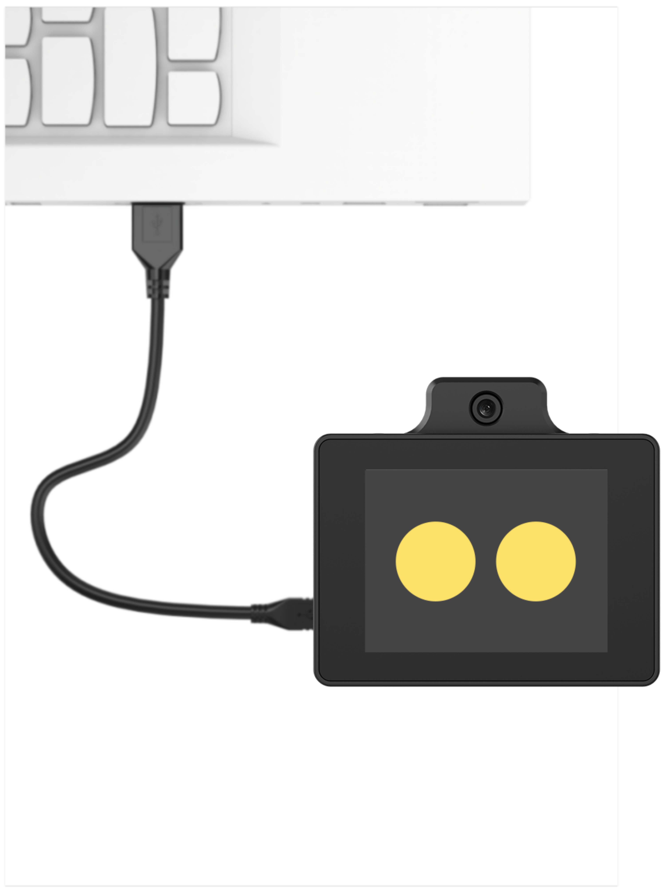

2) Open the **PACK_UPDATE_TOOL.exe** file in the **[Firmware Flashing Tool](https://drive.google.com/drive/folders/1IsZMSKCd41FFhy8bJ-cnhKEjz1c4LzZs?usp=sharing)** folder in the same directory as this document, select the **CI1302** chip, and then click **Update**.


> [!NOTE]
>
> **The flashing of the hello hiwonder firmware with the wake word hello hiwonder is used as an example.** 

3)  Click **Select firmware**, and locate the **.bin** firmware downloaded and extracted in the previous steps.


4) Locate the corresponding serial port and click to select it.


5) Next, **simultaneously press** the left and right buttons of the WonderLLM module to enter the flashing process, then wait for the flashing to complete successfully.


* **Wake-up Test**

After flashing the firmware, restart the module and wait for the module to complete network configuration. Once the expression interface appears, speak the new firmware wake word. If the module buzzer emits a single beep, the module enters the chat interface, and the voice replies with a greeting, the wake word modification is considered successful.

* **Expansion and Extension**

1) To ensure interaction flow consistency, the nickname of the agent bound to the module during interaction can be updated synchronously.

2) Enter the XiaoZhi AI platform at the URL https://xiaozhi.me/, or click the [**<u>XiaoZhi AI Chatbot</u>**]( https://xiaozhi.me/) for direct access. Enter the console, select the agent bound to the module, choose **Configure Role**, update the assistant name to match the newly configured wake word, click **Save**, and restart the device.


<p id ="Firmware Download"></p>

#### 5.4.1.4 Firmware Download

* **Overview**

After other programs are flashed onto the ESP32S3 chip of the WonderLLM large model module, the online feature functionality is overwritten. The factory firmware **WonderLLM.bin** provided in the course materials can be flashed to restore it.

> [!NOTE]
>
> **After re-flashing the firmware, the WiFi connection information must be reconfigured. The operation method is described in [5.4.1.1  WonderLLM Introduction and Network Configuration](#5.4.1.1).**

* **Device Connection**

Connect the Type-C interface on the top of the WonderLLM module to the computer using a USB cable, as shown below.


* **Operating Procedure**

1) In the directory [ESP32 Firmware Flashing Tool\flash_download_tool_3.9.7](https://drive.google.com/drive/folders/1Y96U8ERYIJJox7KkIOoqDBueMKeHMNVg?usp=sharing), open the file **flash_download_tool_3.9.7.exe**.

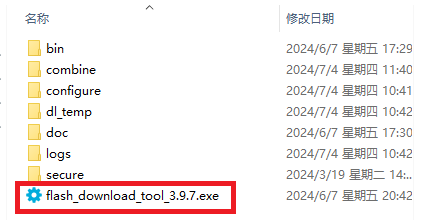

2) Select **ESP32-S3** in the Chip Type, keep other settings at their default values, and then click **OK**.


3) After the tool is opened, click **...** to select the program bin file to flash. The storage path is [**03 ESP32S3 Firmware**](https://drive.google.com/drive/folders/1h8nJM1nk0jNFSF2T5dLPFPAhZYA0BB10?usp=sharing). 


4) Check the box on the left, configure the remaining settings as shown in the figure below, and select the port number occupied by the module as the COM port.

> [!NOTE]
>
> **If SPI MODE is set to DIO as shown in the figure below, the module cannot work normally after firmware flashing. Try setting SPI MODE to DOUT and flash the firmware again.**


5)  Click **ERASE** to erase the previously downloaded firmware. This step is mandatory. Wait until the status bar shows **FINISH**.


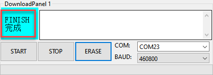

6) Click **START** to download the firmware just selected. Wait for the progress bar to finish loading, and the firmware download is complete.


7) After the download is completed, reconnect the data cable. Once the device is powered on again, it will start working according to the new firmware.

### 5.4.2 Free Chat

#### 5.4.2.1 Wake-Up Module

1. After network configuration is completed, the module enters expression mode as shown below.


2. The module can be activated by speaking the designated wake word factory default: **Hello Hiwonder** or briefly pressing the right button. A ding buzzer tone plays, the screen switches to the chat interface, and the activated module starts listening for voice input.

> [!NOTE]
>
> - **If no wake word is spoken within 20 seconds on the expression interface, the module switches to weather clock mode. Tapping any area of the screen returns the module to expression mode. The weather clock mode also supports entry into chat mode via wake word voice input or a short press of the right button.**
>
>   
>
> - **When chat mode is activated by speaking the wake word, the module automatically sends "Hello" as the opening message once the wake word is recognized. The large model generates a corresponding reply, which is displayed on the chat interface and played through the speaker before the module starts listening for voice input. If chat mode is entered via a short press of the right button, the module immediately starts listening for voice input.**

3. Free-form speech is accepted, and the module integrates with a cloud-based large language model to interpret the input and generate both text and voice replies. The module features a memory function that supports multi-turn continuous dialogue.

4. After each round of human-machine interactive dialogue, including the round following the wake-up of WonderLLM, the module continues to listen. If no speech is recognized for one consecutive minute, the module automatically stops listening, and the large model replies with an appropriate farewell message, which is displayed in the chat interface and broadcast simultaneously. If continued interaction is desired, the module must be re-awakened by **speaking the designated wake word or briefly pressing the right button**.

5. During the human-machine interaction dialogue, the conversation can also be ended proactively. The following expressions can be used to issue commands to the WonderLLM module: **① Goodbye**  **② Okay, let's stop here**. Upon receiving the command, the module replies with an appropriate farewell message and ends the listening operation.

>[!note]
>**Statements do not have to strictly follow the examples given above, as long as the intended meaning remains consistent.**

6. The WonderLLM module supports voice interruption. When the module is speaking, including: **① module voice reply to the speaker's utterance**  **② module voice greeting to the speaker**  **③ module voice farewell to the speaker**, a brief press of the **right button** causes the module to immediately end the current voice output and then start listening for the speaker's next utterance.

>[!note]
>**If the right button is briefly pressed when the module has not yet spoken, the module switches to expression mode and must be re-awakened.**

7. The WonderLLM module supports bilingual recognition and speech including English. The module's working language can be directly switched by referring to the following example expressions: **① Can you speak English with me?**  **② Can we communicate in English?**

>[!note]
>**Statements do not have to strictly follow the examples given above, as long as the intended meaning remains consistent.**

#### 5.4.2.2 Special Function Call


* #### Overview

The module incorporates several special functions that can be invoked via speech during human-machine dialogue. The following expressions are provided for issuing commands to the WonderLLM module to query all currently supported special functions: **① What can you do?**  **② Describe your functions.** The table below lists the special functions currently supported by the module:

>[!note]
>
>- **Statements do not have to strictly follow the examples given above, as long as the intended meaning remains consistent.**

| No.  | Function           | No.  | Function   |
| ---- | ------------------ | ---- | ---------- |
| 1    | Check weather      | 4    | Tell jokes |
| 2    | Broadcast news     | 5    | Play music |
| 3    | Outfit suggestions |      |            |

- #### Call Example

The WonderLLM module can be instructed using the expressions described below to invoke the corresponding special functions.

>[!note]
>**Statements do not have to strictly follow the examples given above, as long as the intended meaning remains consistent.**

| Function Description   | Query Statements                                             |
| ---------------------- | ------------------------------------------------------------ |
| Check weather          | **What's the weather like in the xx region**?                |
| Broadcast news         | **① News Broadcast for today**  **② Summarize today's hot events**. |
| Outfit sug**gestions** | **What kind of outfit should I wear today?**                 |
| Tell jokes             | **① Tell me a joke. ② Can you tell a joke to make me laugh?** |
| Play music             | ①**Play a song**. In subsequent conversations, the artist and song title must be specified. **② Play the song xxx created by xx**. |

>[!note]
>**The music library is sourced from the built-in resource library of the large model. External imports are not supported, and songs not in the library cannot be played.**

### 5.4.3 Scene Understanding


>[!note]
>
>**Before proceeding with this section, ensure that the module has been powered on and the WIFI and agent configurations have been completed according to [Module Networking](#Module Networking) and [Device Binding](#Device Binding).**

The WonderLLM module is equipped with a high-definition camera that captures real-time images and analyzes them with a visual large model, enabling deep interaction between the module and the external environment. This feature can be experienced in the following ways.

#### 5.4.3.1 Voice Interaction Control


1. After the module is powered on, it enters the expression interface. The module is then activated by speaking the wake word or short-pressing the right button to enter the chat interface.

2. The following expressions can be used to issue commands to the WonderLLM module: **① Describe the scene ahead ** **② Please take a photo.**

>[!note]
>
>**Statements do not have to strictly follow the examples given above, as long as the intended meaning remains consistent.**

3. After the module understands the command, the module camera starts capturing a real-time image and displays it briefly on the screen for confirmation. The dialog box then returns the image capture function to be called, which requires no attention. Subsequently, the dialog box displays the analysis statement generated by the large model for the image and announces it synchronously. The reply statement is randomly generated by the large model module, with only the semantic appropriateness guaranteed.

>[!note]
>
>**The module does not support long-term observation in the scene understanding function. It can only capture a real-time image and analyze it after a command is issued to enable this function.**


#### 5.4.3.2 Screen Touch Trigger


1. After power-on, the module enters the expression interface.

   

2. Double-tapping anywhere on the screen in the expression interface causes the module to enter camera mode, where the screen displays the real-time front view captured by the camera.

3. In camera mode, when any position on the screen is tapped again, the module camera captures a real-time image and briefly displays it on the screen for confirmation. The module then returns to camera mode and automatically announces the analysis statement of the image. The reply statement is randomly generated by the large model module and only ensures that the meaning is appropriately expressed.

>[!note]
>
>* **In camera mode, double-tapping again returns to the expression interface.**
>* **Before a single-tap trigger in camera mode, the module only captures real-time images through the camera and displays them on the screen. The large model is not invoked for analysis.**

### 5.4.4 Voice Control

> [!NOTE]
>
> **Before proceeding with this section, ensure the module has been enabled and the WIFI and agent configurations have been completed as described in [5.4.1.1 WonderLLM Introduction and Network Configuration](#5.4.1.1).**

#### 5.4.4.1 Project Introduction

In this lesson, the robotic car is controlled via WonderLLM module.

#### 5.4.4.2 Implementation Process

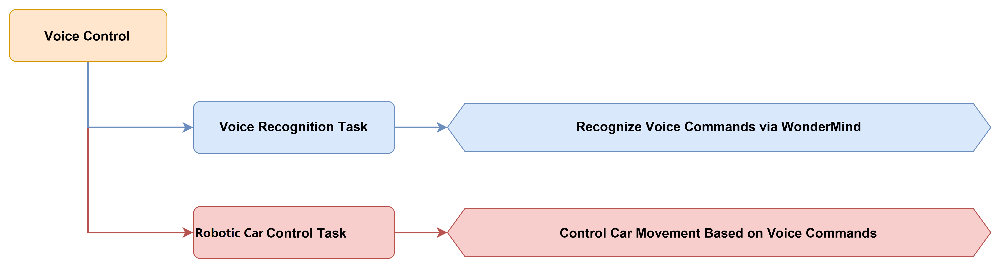

#### 5.4.4.3 Module Description


The WonderLLM module is built with a high-performance ESP32-S3 chip. Through programming, it enables functions such as color recognition and face detection. The module is equipped with an I2C interface, allowing convenient data exchange with various host controllers and providing an efficient solution for intelligent vision applications.

Module Wiring: As shown below, connect the module to any I2C interface in the red box of the servo controller before running the program in this section.

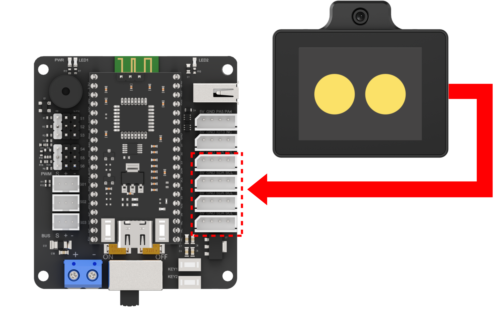

#### 5.4.4.4 Program Download

1. The core board is connected to the computer via a USB cable.

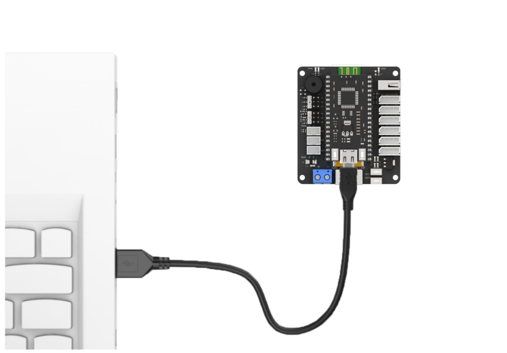

2. Open the program file in [**02 Program Files\Tankbot_ESP32_Arduino\Tankbot_ESP32_Arduino.ino**](https://drive.google.com/drive/folders/1eNwddL3jG9FAhyys-NaYSRd0nGq5g8Se?usp=sharing) in the same directory as this document.

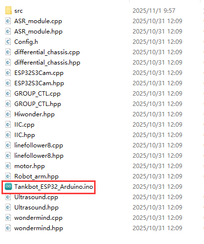

3. After opening, select the development board model as shown in the figure below.

   

4. In the menu bar, click **Tools** and select the corresponding ESP32 development board configuration as shown in the figure below.

   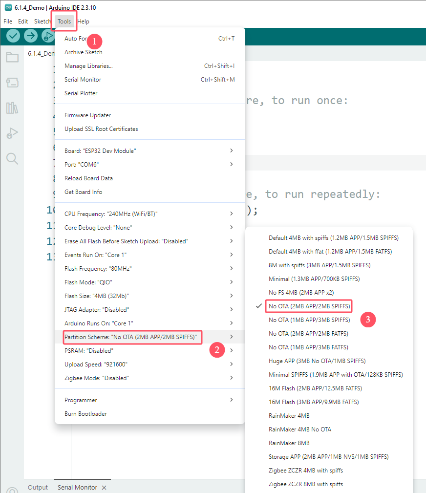

> [!NOTE]
>
> **Be sure to modify the development board configuration before downloading the program.**

5. First click the verify icon , then click the upload icon . After the upload is complete, if the following interface appears in the output box at the bottom of the software, the program download is complete.

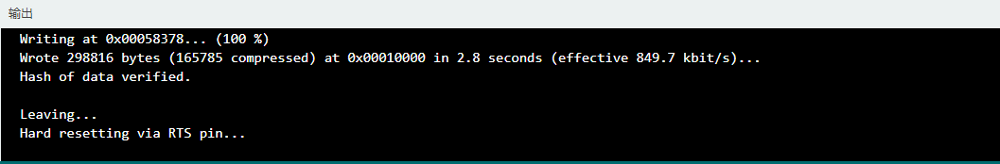

#### 5.4.4.5 Program Outcome

After the WonderLLM module is awakened by the wake word "Hello Hiwonder", corresponding commands can be spoken to the module to control the balancing car to perform corresponding actions.

| No.  | MCP tool name     | Description                                                  | Call example                                                 |
| ---- | ----------------- | ------------------------------------------------------------ | ------------------------------------------------------------ |
| 1    | Movement control  | Used to control the movement of the robotic car. The `distance` parameter controls the distance in cm. A positive value moves the robotic car forward, and a negative value moves it backward. | Move the robotic car forward 50 cm                           |
| 2    | Steering control  | Used to control the robotic car to rotate in place. The `rot` parameter controls the direction: `left` or `right`. | Turn the robotic car left                                    |
| 3    | Status query      | Used to obtain the real-time status of the balance car. Queryable status includes `battery`, `distance`, and `running_mode`. | ①Query the current motion status of the robotic car<br />②Query the current battery level of the robotic car |
| 4    | Mode control      | Used to switch the mode of the balance car. The `distance` parameter is only used in obstacle avoidance mode. Switchable modes include `avoid`, `follow`, `line_patrol`, `smart_transportation`, and `normal`. | Switch to normal mode                                        |
| 5    | RGB light control | Used to set the colors of the left and right RGB lights. lr, lg, and lb are the RGB values of the left light. rr, rg, and rb are the RGB values of the right light. Range:  0-255. | ①Set the left RGB light to pure green<br />②Set the red brightness to 0 and the green brightness to 255 for both RGB lights |
| 6    | Buzzer control    | Used to control the buzzer of the robotic car. The  `count` is the number of times the buzzer sounds. | Make the buzzer sound 5 times                                |
| 7    | Gripper control   | Used to control the robotic arm gripper of the robotic car. `start` grips at the default middle position, and `end` places the item. | Grip the item and place it on the left                       |

#### 5.4.4.6 Program Analysis

* **Tankbot_ESP32_Arduino.ino file**

1. The module library files are imported, including the buzzer, ultrasonic sensor, robotic arm, 8-channel line follower sensor, WonderLLM module, and other library files.

```c
#include "Config.h"
#include "Hiwonder.hpp"
#include "Robot_arm.hpp"
#include "motor.hpp"
#include "WonderLLM_Vision.hpp"
#include "Ultrasound.hpp"
#include "linefollower8.hpp"
#include "WonderLLM.hpp"
#include "differential_chassis.hpp"
```

2. The hardware is initialized, and the corresponding scalars and flags are defined.

```cpp
IIC iic_obj;
Motor motor_obj;
HW_ESP32Cam cam;
Ultrasound ult;
Linefollower8 lf_obj;

//-------------------
float result_speed = 0.0f;
float result_rot = 0.0f;
float avoid_speed = 0.0f;
float follow_speed = 0.0f;

uint8_t rgb_mode = 0;
uint8_t rgb_left[3];
uint8_t rgb_right[3];
uint8_t running_mode = Normal_Mode;
uint8_t last_running_mode = Normal_Mode;
uint8_t step = 0;
float voltage = 0;
uint16_t distance = 0;
uint16_t left_distance;
uint16_t right_distance;
uint16_t ult_distance = 0;  //Set follow distance
uint32_t duration = 0;

uint32_t sys_tick = 0;
uint32_t claw_tick = 0;
bool move_state = false;
uint8_t vision_result = Vision_NULL;
uint8_t start_arm = Arm_Null;
uint8_t end_arm = Arm_Null;
bool arm_state = false;
bool clamp_state = false;
```

3. The `setup()` function initializes the TankBot hardware modules and the WonderLLM module.

```cpp
void setup() {
  delay(1000);
  pinMode(IO_BLE_CTL, OUTPUT);
  digitalWrite(IO_BLE_CTL, LOW);  // Set the Bluetooth control pin low to disconnect the Bluetooth module power

  pinMode(PA4, OUTPUT);
  pinMode(PA5, OUTPUT);

  Serial.begin(115200);
  arm.init();
  buzzer_obj.init(IO_BUZZER);
  
  iic_obj.init();
  motor_obj.init(&iic_obj);
  cam.init(&iic_obj);
  ult.init(&iic_obj);
  lf_obj.init(&iic_obj);
  
  WonderLLM_Init(&iic_obj);

  differentials_chassis_run(0,0);
  Serial.println("begin");
  
  delay(1000);
}

```

4. The main loop polls and processes instructions from WonderLLM module.

```cpp
void loop() {
  WonderLLM_Poll_And_Process();
```

5. In default mode, movement control, gripper control, and robotic arm control are available.

(1) Motion Control

① If `duration` is 0, it indicates no time limit. The chassis is run directly with `result_speed` and `result_rot`. The action completion signal is then sent, and `move_state` is cleared.

② If `duration` is not zero, the system timer `sys_tick` is used for timing. Once the time elapses, the chassis is stopped, the status is cleared, and an action completion signal is sent.

```cpp
				if(move_state){
					if(duration == 0){
						differentials_chassis_run(result_speed,result_rot);
						WonderLLM_Send_Action_Finish();
						move_state = false; 
					}else{
						 // if run with time limit
						if (sys_tick == 0) {
								// first entry, record start time
								sys_tick = millis();
								differentials_chassis_run(result_speed, result_rot);
						}
						// check if time has been reached
						if ((millis() - sys_tick) >= duration) {
								differentials_chassis_run(0.0f, 0.0f);	
								result_speed = 0;
								move_state = false;
								sys_tick = 0; 
								WonderLLM_Send_Action_Finish();
						}
					}
				}
```

(2) Gripper Control

A 20-second timer is set. When the time expires, a robotic arm coordinate setting is executed, and then `clamp_state` is cleared.

```cpp
if(clamp_state){
					if (claw_tick == 0) {
							claw_tick = millis();
					}
					if ((millis() - claw_tick) >= 20000) {
						arm.coordinate_set(9.4,0,9.8,-40,-90,10,1000);
						clamp_state = false;
						claw_tick = 0; 
					}
				}
```

(3) Robotic Arm Control

If the gripper timer `claw_tick` is not 0, the gripper state and the timer are reset.

② Different gripping actions are executed based on `start_arm` as the start position, and the placement action is then performed based on `end_arm` as the target position.

③ After the action is completed, the action completion signal is sent and the state is reset.

```cpp
					switch(start_arm){
						case Arm_Left:
							arm.coordinate_set(0.2,12.6,-3.2,-40,-90,10,1500);  //Left home pose
							delay(2000);
							arm.coordinate_set(0.2,24.2,-15,-60,90,10,1500);   //Left gripping pose
							delay(2000);
							arm.claw_set(0, 500);
							delay(1000);
							arm.coordinate_set(0.2,15,2,-40,-90,10,1500);  //Left home pose
							delay(2000);
							WonderLLM_Send_Action_Finish();
							break;

						case Arm_Center:
							arm.coordinate_set(12.6,0,-3.2,-40,-90,10,1500);  //Center home pose
							delay(2000);
							arm.coordinate_set(24.2,0,-15,-60,-90,10,1500);   //Center gripping pose
							delay(2000);
							arm.claw_set(0, 500);
							delay(1000);
							arm.coordinate_set(15,0,2,-40,-90,10,1500);  // Center home pose
							delay(2000);
							WonderLLM_Send_Action_Finish();
							break;

						case Arm_Right:
							arm.coordinate_set(0.2,-12.6,-3.2,-40,-90,10,1500);  //Right home pose
							delay(2000);
							arm.coordinate_set(0.2,-24.2,-15,-60,90,10,1500);   // Right gripping pose
							delay(2000);
							arm.claw_set(0, 500);
							delay(1000);
							arm.coordinate_set(0.2,15,2,-40,-90,10,1500);  //Right home pose
							delay(2000);
							WonderLLM_Send_Action_Finish();
							break;
						
						default:
							break;
					}
					
					int arm_times = 0;
					int delay_times = 0;
					if(abs(end_arm - start_arm) == 2){
						arm_times = 3000;
						delay_times = 4000;
					}else{
						arm_times = 1500;
						delay_times = 2000;
					}
					
					switch(end_arm){
						case Arm_Left:
							arm.coordinate_set(0.2,15,2,-40,-90,10,arm_times);  //Left home pose
							delay(delay_times);
							arm.coordinate_set(0.2,24.2,-15,-60,90,10,1500);   // Left placing pose
							delay(2000);
							arm.claw_set(65, 500);
							delay(1000);
							arm.coordinate_set(0.2,15,2,-40,-90,10,1500);  //Left home pose
							delay(2000);
							WonderLLM_Send_Action_Finish();
							break;

						case Arm_Center:
							arm.coordinate_set(15,0,2,-40,-90,10,arm_times);  //Center home pose
							delay(delay_times);
							arm.coordinate_set(24.2,0,-15,-60,-90,10,1500);   //Center placing pose
							delay(2000);
							arm.claw_set(65, 500);
							delay(1000);
							arm.coordinate_set(15,0,2,-40,-90,10,1500);  //Center home pose
							delay(2000);
							WonderLLM_Send_Action_Finish();
							break;

						case Arm_Right:
							arm.coordinate_set(0.2,-15,2,-40,-90,10,arm_times);  // Right home pose
							delay(delay_times);
							arm.coordinate_set(0,-24.2,-15,-60,-90,10,1500);   // Right placing pose
							delay(2000);
							arm.claw_set(65, 500);
							delay(1000);
							arm.coordinate_set(0.2,-15,2,-40,-90,10,1500);  // Right home pose
							delay(2000);
							WonderLLM_Send_Action_Finish();
							break;
						
						default:
							break;
					}
					if(end_arm != Arm_Null){
						arm.coordinate_set(9.4,0,9.8,-40,-90,10,1000);  // Center home pose
						delay(1500);
					}
					start_arm = Arm_Null;
					end_arm = Arm_Null;
					arm_state = false;
				}
				break;
```

* **WonderLLM.cpp file**

1. The WonderLLM module is initialized.

```cpp
bool WonderLLM_Init(IIC* iic_obj) {
iic = iic_obj;
register_tools(); // call MCP write tool

buzzer_obj.blink(1500 , 100 , 100 , 2);
  return true;
}
```

2. In the `register_tools` function, all available tools for registration with the WonderLLM module are included. Before using the module to control the robotic car, the available functions must first be sent to the module, thereby enabling car control through the large model. The functions registered by `MCP` include car movement control, turning control, status query, mode switching, ultrasonic light control, buzzer control, and visual recognition.

```cpp
static bool register_tools(void) {
		const char* tool_move = "{\"tool_name\":\"self.Tankbot.move\","
			"\"command\":\"'move' only returns forward, backward, left, and right. The speed unit is mm/s. For in-place turning, a positive angular velocity means left and a negative one means right, and rot cannot be 0 when turning. The duration defaults to 0, which means maintaining the current state continuously, in ms.\","
			"\"params\":[[\"move\",\"string\"],[\"speed\",\"int\",0,80],[\"rot\",\"int\",-9,9],[\"duration\",\"int\"]],\"block\":\"true\",\"return\":\"false\"}";
		if (!send_frame((uint8_t*)tool_move, strlen(tool_move))) return false;

		const char* tool_arm_control = "{\"tool_name\":\"self.Tankbot.arm\","
			"\"command\":\"'start' is for gripping and defaults to gripping the middle; 'end' is for placement. Both only return 'null', 'left', 'center', or 'right'. One of 'start' and 'end' must have a parameter that returns 'null'; if no position is specified, 'null' is returned.\","
			"\"params\":[[\"start\",\"string\"],[\"end\",\"string\"]],\"block\":\"true\",\"return\":\"false\"}";
		if (!send_frame((uint8_t*)tool_arm_control, strlen(tool_arm_control))) return false;

const char* tool_status = "{\"tool_name\":\"self.Tankbot.get_status\",\"command\":\"Call this tool to obtain the robotic car's real-time status. "
			"The queryable statuses include: 'battery', 'distance', and 'running_mode'.\",\"params\":[[\"status_name\",\"string\"]],\"block\":\"true\",\"return\":\"true\"}";
if (!send_frame((uint8_t*)tool_status, strlen(tool_status))) return false;

const char* tool_mode = 
			"{\"tool_name\":\"self.Tankbot.set_mode\",\"command\":\"Call this tool to switch the robotic car's mode. distance defaults to 300, and the unit is mm. "
			"The switchable modes include: 'avoid', 'follow', 'line_patrol', 'smart_transportation', and 'normal'.\",\"params\":[[\"running_mode\",\"string\"],[\"distance\",\"int\"]],\"block\":\"true\",\"return\":\"false\"}";
if (!send_frame((uint8_t*)tool_mode, strlen(tool_mode))) return false;
		
		const char* tool_led = 
"{\"tool_name\":\"self.Tankbot.set_color\","
		"\"command\":\"0 is the steady-on mode, 1 is the breathing-light mode, and the default is 0. The parameters are the RGB values of the left and right lights respectively. In breathing-light mode, lr, lg, lb, rr, rg, rb represent the breathing durations of the corresponding colors; lr=20 means a bright red period of 2 seconds.\","
"\"params\":[[\"rgb_mode\",\"int\",0,1],[\"lr\",\"int\",0,255],[\"lg\",\"int\",0,255],[\"lb\",\"int\",0,255],"
   "[\"rr\",\"int\",0,255],[\"rg\",\"int\",0,255],[\"rb\",\"int\",0,255]],"
"\"block\":\"true\",\"return\":\"false\"}";
		if (!send_frame((uint8_t*)tool_led, strlen(tool_led))) return false;

		const char* tool_buzzer = 
			"{\"tool_name\":\"self.Tankbot.set_buzzer\",\"command\":\"Call this tool to control the robotic car's buzzer. 'count' is the number of times the buzzer sounds.\","
			"\"params\":[[\"count\",\"int\"]],\"block\":\"true\",\"return\":\"false\"}";
if (!send_frame((uint8_t*)tool_buzzer, strlen(tool_buzzer))) return false;

const char* tool_recognition = 
			"{\"tool_name\":\"self.Tankbot.set_recognition\",\"command\":\"Before having the robotic arm look at what objects are present, call this tool first; only after it completes can the vision recognition function be called. The return value of 'string' can only be a direction, namely center, left, or right, with the default being center.\","
			"\"params\":[[\"recognition\",\"string\"]],\"block\":\"true\",\"return\":\"false\"}";
if (!send_frame((uint8_t*)tool_recognition, strlen(tool_recognition))) return false;

const char* tool_finish = "{\"command\":\"mcp_setting\",\"params\":\"true\"}";
if (!send_frame((uint8_t*)tool_finish, strlen(tool_finish))) return false;

return true;
}

```

3. The `WonderLLM_Poll_And_Process` function is used in the main loop to poll and process instructions from WonderLLM.

```cpp
void WonderLLM_Poll_And_Process(void) {
  uint16_t received_len = sizeof(rx_json_buffer);
  if (receive_frame((uint8_t*)rx_json_buffer, &received_len)) {
if (received_len > 0) {
rx_json_buffer[received_len] = '\0';
parse_command(rx_json_buffer);
}
  }
}
```

4. JSON Instruction Parsing

This section uses the analysis of travel control as an example. The remaining MCP tools are largely similar to this MCP tool and are not elaborated further.

Control commands issued by the WonderLLM module are parsed using `parse_command`. First, the `JSON` string is checked for the "move" command. Then, the movement time parameter `duration`, the movement speed parameter `speed`, and the turning direction parameter `result_rot` are extracted to implement basic motion control of the robotic car.

```c
	if(strstr(json_str, "move") != NULL) {
		char move_result[32];
		char* move_ptr = strstr(json_str, "move");
		char* speed_ptr = strstr(json_str, "speed");
		char* rot_ptr = strstr(json_str, "rot");
		char* duration_ptr = strstr(json_str, "duration");
		
		if (move_ptr){
			sscanf(move_ptr, "%*[^:]:\"%[^\"]\"", move_result);
			if(strcmp(move_result, "forward") == 0){
				sscanf(speed_ptr, "%*[^:]:%f", &result_speed);
			}else if(strcmp(move_result, "backward") == 0){
				sscanf(speed_ptr, "%*[^:]:%f", &result_speed);
				result_speed = -result_speed;
			}
		}
		
		if (rot_ptr){
			sscanf(rot_ptr, "%*[^:]:%f", &result_rot);
			result_rot /= 10.0f;
		}
		
		if (duration_ptr) sscanf(duration_ptr, "%*[^:]:%u", &duration);
		
		move_state = true;
	}
	
	else if(strstr(json_str, "start") != NULL) {
		char start_result[32];
		char end_result[32];
		
		char* start_ptr = strstr(json_str, "start");
		char* end_ptr = strstr(json_str, "end");
		
		if (start_ptr){
			sscanf(start_ptr, "%*[^:]:\"%[^\"]\"", start_result);
			if(strcmp(start_result, "left") == 0){
				start_arm = Arm_Left;
			}else if(strcmp(start_result, "center") == 0){
				start_arm = Arm_Center;
			}else if(strcmp(start_result, "right") == 0){
				start_arm = Arm_Right;
			}else{
				start_arm = Arm_Null;
			}
		}
		
		if (end_ptr){
			sscanf(end_ptr, "%*[^:]:\"%[^\"]\"", end_result);
			if(strcmp(end_result, "left") == 0){
				end_arm = Arm_Left;
			}else if(strcmp(end_result, "center") == 0){
				end_arm = Arm_Center;
			}else if(strcmp(end_result, "right") == 0){
				end_arm = Arm_Right;
			}else{
				end_arm = Arm_Null;
			}
		}
		memset(start_result, 0, sizeof(start_result));
		memset(end_result, 0, sizeof(end_result));
		
		arm_state = true;
	} 
```

### 5.4.5 Smart Steward

> [!NOTE]
>
> **Before starting this section, please ensure that the module is powered on and the WIFI and agent configurations are completed according to [5.4.1.1 WonderLLM Introduction and Network Configuration](#5.4.1.1).**

#### 5.4.5.1 Project Introduction

This course obtains camera images via the WonderLLM module and controls the robotic car to execute corresponding commands based on the recognized images.

#### 5.4.5.2 Implementation Process

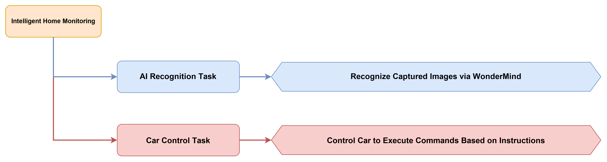

#### 5.4.5.3 Module Description


The WonderLLM module features a built-in high-performance ESP32-S3 chip and can be programmed to support functions such as color recognition and face detection. Equipped with an I2C interface, it enables convenient data exchange with various host controllers, providing an efficient solution for intelligent vision applications.

Module Wiring: As shown in the figure below, before running the program in this section, connect the module to any I2C interface in the red box on the servo controller.


#### 5.4.5.4 Program Download

1. Connect the core board to the computer via a USB cable.


2. Open the program file in [**02 Program Files\Tankbot_ESP32_Arduino\Tankbot_ESP32_Arduino.ino**](https://drive.google.com/drive/folders/1eNwddL3jG9FAhyys-NaYSRd0nGq5g8Se?usp=sharing) in the same directory as this document.


3. After opening, select the development board model, as shown in the figure below.

   

4. Click **Tools** in the menu bar, and select the corresponding ESP32 development board configuration as shown in the figure below.

   

> [!NOTE]
>
> **Be sure to modify the development board configuration before downloading the program.**

5. First click the verify icon , then click the upload icon . After the upload is complete, if the following interface appears in the output box at the bottom of the software, the program download is complete.


#### 5.4.5.5 Program Outcome

After the conversation mode of the WonderLLM module is entered via the wake word,  speak the command **When a face is detected, control the robotic car buzzer to sound twice** to the module. The module then acquires the camera feed and uses the large model to analyze whether a face is present in the image. If a face is detected, the module sounds the buzzer twice.

#### 5.4.5.6 Program Analysis

* **Tankbot_ESP32_Arduino.ino file**

1. The program imports the module library files, including the buzzer, ultrasonic sensor, robotic arm, 8-channel line follower sensor, WonderLLM module, and other modules.

```c
#include "Config.h"
#include "Hiwonder.hpp"
#include "Robot_arm.hpp"
#include "motor.hpp"
#include "WonderLLM_Vision.hpp"
#include "Ultrasound.hpp"
#include "linefollower8.hpp"
#include "WonderLLM.hpp"
#include "differential_chassis.hpp"
```

2. The hardware is initialized, and corresponding scalars and flag bits are defined.

```cpp
IIC iic_obj;
Motor motor_obj;
HW_ESP32Cam cam;
Ultrasound ult;
Linefollower8 lf_obj;

//-------------------
float result_speed = 0.0f;
float result_rot = 0.0f;
float avoid_speed = 0.0f;
float follow_speed = 0.0f;

uint8_t rgb_mode = 0;
uint8_t rgb_left[3];
uint8_t rgb_right[3];
uint8_t running_mode = Normal_Mode;
uint8_t last_running_mode = Normal_Mode;
uint8_t step = 0;
float voltage = 0;
uint16_t distance = 0;
uint16_t left_distance;
uint16_t right_distance;
uint16_t ult_distance = 0;  //set follow distance
uint32_t duration = 0;

uint32_t sys_tick = 0;
uint32_t claw_tick = 0;
bool move_state = false;
uint8_t vision_result = Vision_NULL;
uint8_t start_arm = Arm_Null;
uint8_t end_arm = Arm_Null;
bool arm_state = false;
bool clamp_state = false;
```

3. The `setup()` function initializes the TankBot hardware components and the WonderLLM module.

```cpp
void setup() {
  delay(1000);
  pinMode(IO_BLE_CTL, OUTPUT);
  digitalWrite(IO_BLE_CTL, LOW);  // set the Bluetooth control pin to low level to disconnect the Bluetooth module power

  pinMode(PA4, OUTPUT);
  pinMode(PA5, OUTPUT);

  Serial.begin(115200);
  arm.init();
  buzzer_obj.init(IO_BUZZER);
  
  iic_obj.init();
  motor_obj.init(&iic_obj);
  cam.init(&iic_obj);
  ult.init(&iic_obj);
  lf_obj.init(&iic_obj);
  
  WonderLLM_Init(&iic_obj);

  differentials_chassis_run(0,0);
  Serial.println("begin");
  
  delay(1000);
}
```

4. The main loop polls and processes instructions from WonderLLM.

```cpp
void loop() {
  WonderLLM_Poll_And_Process();
```

* **WonderLLM.cpp File**

1. The WonderLLM large model module is initialized.

```cpp
bool WonderLLM_Init(IIC* iic_obj) {
iic = iic_obj;
register_tools(); // call MCP write tool

buzzer_obj.blink(1500 , 100 , 100 , 2);
  return true;
}
```

2. The `register_tools` function contains all available tools registered with the WonderLLM module. Before the module is used to control the robotic car, the available functions must be sent to the module so that the robotic car can be controlled through the large model. The functions registered via `MCP` include car movement control, turning control, status query, mode switching, ultrasonic and light control, buzzer control, and visual recognition.

```cpp
static bool register_tools(void) {
		const char* tool_move = "{\"tool_name\":\"self.Tankbot.move\","
			"\"command\":\"'move' only returns forward, backward, left, and right. The speed unit is mm/s. For in-place turning, a positive angular velocity means left and a negative one means right, and rot cannot be 0 when turning. The duration defaults to 0, which means maintaining the current state continuously, in ms.\","
			"\"params\":[[\"move\",\"string\"],[\"speed\",\"int\",0,80],[\"rot\",\"int\",-9,9],[\"duration\",\"int\"]],\"block\":\"true\",\"return\":\"false\"}";
		if (!send_frame((uint8_t*)tool_move, strlen(tool_move))) return false;

		const char* tool_arm_control = "{\"tool_name\":\"self.Tankbot.arm\","
			"\"command\":\"'start' is for gripping and defaults to gripping the middle; 'end' is for placement. Both only return 'null', 'left', 'center', or 'right'. One of 'start' and 'end' must have a parameter that returns 'null'; if no position is specified, 'null' is returned.\","
			"\"params\":[[\"start\",\"string\"],[\"end\",\"string\"]],\"block\":\"true\",\"return\":\"false\"}";
		if (!send_frame((uint8_t*)tool_arm_control, strlen(tool_arm_control))) return false;

const char* tool_status = "{\"tool_name\":\"self.Tankbot.get_status\",\"command\":\"Call this tool to obtain the car's real-time status. "
			"The queryable statuses include: 'battery', 'distance', and 'running_mode'.\",\"params\":[[\"status_name\",\"string\"]],\"block\":\"true\",\"return\":\"true\"}";
if (!send_frame((uint8_t*)tool_status, strlen(tool_status))) return false;

const char* tool_mode = 
			"{\"tool_name\":\"self.Tankbot.set_mode\",\"command\":\"Call this tool to switch the car's mode. distance defaults to 300, and the unit is mm. "
			"The switchable modes include: 'avoid', 'follow', 'line_patrol', 'smart_transportation', and 'normal'.\",\"params\":[[\"running_mode\",\"string\"],[\"distance\",\"int\"]],\"block\":\"true\",\"return\":\"false\"}";
if (!send_frame((uint8_t*)tool_mode, strlen(tool_mode))) return false;
		
		const char* tool_led = 
"{\"tool_name\":\"self.Tankbot.set_color\","
		"\"command\":\"0 is the steady-on mode, 1 is the breathing-light mode, and the default is 0. The parameters are the RGB values of the left and right lights respectively. In breathing-light mode, lr, lg, lb, rr, rg, rb represent the breathing durations of the corresponding colors; lr=20 means a bright red period of 2 seconds.\","
"\"params\":[[\"rgb_mode\",\"int\",0,1],[\"lr\",\"int\",0,255],[\"lg\",\"int\",0,255],[\"lb\",\"int\",0,255],"
   "[\"rr\",\"int\",0,255],[\"rg\",\"int\",0,255],[\"rb\",\"int\",0,255]],"
"\"block\":\"true\",\"return\":\"false\"}";
		if (!send_frame((uint8_t*)tool_led, strlen(tool_led))) return false;

		const char* tool_buzzer = 
			"{\"tool_name\":\"self.Tankbot.set_buzzer\",\"command\":\"Call this tool to control the car's buzzer. 'count' is the number of times the buzzer sounds.\","
			"\"params\":[[\"count\",\"int\"]],\"block\":\"true\",\"return\":\"false\"}";
if (!send_frame((uint8_t*)tool_buzzer, strlen(tool_buzzer))) return false;

const char* tool_recognition = 
			"{\"tool_name\":\"self.Tankbot.set_recognition\",\"command\":\"Before having the robotic arm look at what objects are present, call this tool first; only after it completes can the vision recognition function be called. The return value of 'string' can only be a direction, namely center, left, or right, with the default being center.\","
			"\"params\":[[\"recognition\",\"string\"]],\"block\":\"true\",\"return\":\"false\"}";
if (!send_frame((uint8_t*)tool_recognition, strlen(tool_recognition))) return false;

const char* tool_finish = "{\"command\":\"mcp_setting\",\"params\":\"true\"}";
if (!send_frame((uint8_t*)tool_finish, strlen(tool_finish))) return false;

return true;
}

```

3. `WonderLLM_Poll_And_Process` is used in the main loop to poll and process instructions from WonderLLM module.

```cpp
void WonderLLM_Poll_And_Process(void) {
  uint16_t received_len = sizeof(rx_json_buffer);
  if (receive_frame((uint8_t*)rx_json_buffer, &received_len)) {
if (received_len > 0) {
rx_json_buffer[received_len] = '\0';
parse_command(rx_json_buffer);
}
  }
}
```

4. Buzzer Control JSON Command Parsing

After the WonderLLM module sends a car control command, the command is parsed in the `parse_command` function. The `strstr` function is used to check whether the `count` string exists in the received JSON data. If it exists, the value of the `count` string is retrieved via `sscanf` and stored in the `count` variable. Finally, the buzzer is triggered to sound, and the `WonderLLM_Send_Action_Finish` function is called to reply to the WonderLLM module that the control command has been completed.

```c
	//Control the buzzer to sound
	else if (strstr(json_str, "count") != NULL) {  
		int count = 0; 
		char* ptr;
		ptr = strstr(json_str, "\"count\"");
		if (ptr) sscanf(ptr, "%*[^:]:%d", &count);
		buzzer_obj.blink(1500 , 100 , 100 , count);
		WonderLLM_Send_Action_Finish();
	}
```

### 5.4.6 Intelligent Obstacle Avoidance

#### 5.4.6.1 Project Description

This lesson uses the WonderLLM module to send control commands to the robotic car for obstacle avoidance.

#### 5.4.6.2 Implementation Process

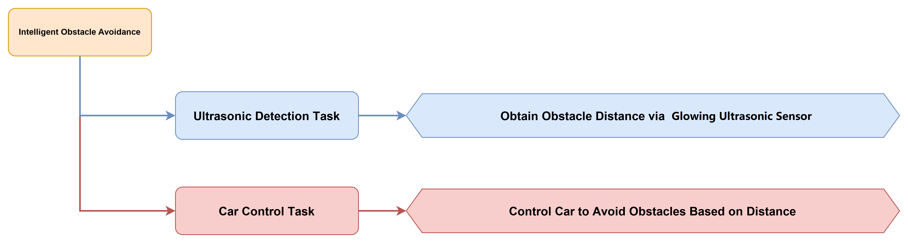

#### 5.4.6.3 Module Description


The WonderLLM module integrates a high-performance ESP32-S3 chip and supports color recognition, face detection, and other functions through programming. The module is equipped with an I2C interface for convenient data exchange with various host controllers, providing an efficient solution for intelligent vision applications.

Module Wiring: As shown in the figure below, before running the program in this section, connect the module to any I2C interface in the red box of the servo controller.


#### 5.4.6.4 Program Download

1. Connect the core board to the computer via a USB cable.


2. Open the program file in [**02 Program Files\Tankbot_ESP32_Arduino\Tankbot_ESP32_Arduino.ino**](https://drive.google.com/drive/folders/1eNwddL3jG9FAhyys-NaYSRd0nGq5g8Se?usp=sharing) in the same directory as this document.


3. After opening, select the development board model as shown in the figure below.

   

4. Click **Tools** in the menu bar, then select the corresponding ESP32 development board configuration as shown in the figure below.

   

> [!NOTE]
>
> **Be sure to modify the development board configuration before downloading the program.**

5. First click the verify icon , then click the upload icon . After the upload is complete, if the following interface appears in the output box at the bottom of the software, the program download is complete.


#### 5.4.6.5 Program Outcome

After entering the conversation mode of the WonderLLM module through the wake word, speaking the command to switch to obstacle avoidance mode, such as "Switch the robotic car to obstacle avoidance mode", controls the robotic car to perform obstacle avoidance driving.

#### 5.4.6.6 Program Analysis

* **Tankbot_ESP32_Arduino.ino file**

1. The module library files are imported, including libraries for the buzzer, ultrasonic sensor, robotic arm, 8-channel line follower sensor, and WonderLLM module.

```c
#include "Config.h"
#include "Hiwonder.hpp"
#include "Robot_arm.hpp"
#include "motor.hpp"
#include "WonderLLM_Vision.hpp"
#include "Ultrasound.hpp"
#include "linefollower8.hpp"
#include "WonderLLM.hpp"
#include "differential_chassis.hpp"
```

2. The hardware is initialized, and the corresponding scalars and flags are defined.

```cpp
IIC iic_obj;
Motor motor_obj;
HW_ESP32Cam cam;
Ultrasound ult;
Linefollower8 lf_obj;

//-------------------
float result_speed = 0.0f;
float result_rot = 0.0f;
float avoid_speed = 0.0f;
float follow_speed = 0.0f;

uint8_t rgb_mode = 0;
uint8_t rgb_left[3];
uint8_t rgb_right[3];
uint8_t running_mode = Normal_Mode;
uint8_t last_running_mode = Normal_Mode;
uint8_t step = 0;
float voltage = 0;
uint16_t distance = 0;
uint16_t left_distance;
uint16_t right_distance;
uint16_t ult_distance = 0;  //set follow distance
uint32_t duration = 0;

uint32_t sys_tick = 0;
uint32_t claw_tick = 0;
bool move_state = false;
uint8_t vision_result = Vision_NULL;
uint8_t start_arm = Arm_Null;
uint8_t end_arm = Arm_Null;
bool arm_state = false;
bool clamp_state = false;
```

3. The `setup()` function initializes the TankBot hardware components and the WonderLLM module.

```cpp
void setup() {
  delay(1000);
  pinMode(IO_BLE_CTL, OUTPUT);
  digitalWrite(IO_BLE_CTL, LOW);  // set Bluetooth control pin low to disconnect Bluetooth module power

  pinMode(PA4, OUTPUT);
  pinMode(PA5, OUTPUT);

  Serial.begin(115200);
  arm.init();
  buzzer_obj.init(IO_BUZZER);
  
  iic_obj.init();
  motor_obj.init(&iic_obj);
  cam.init(&iic_obj);
  ult.init(&iic_obj);
  lf_obj.init(&iic_obj);
  
  WonderLLM_Init(&iic_obj);

  differentials_chassis_run(0,0);
  Serial.println("begin");
  
  delay(1000);
}

```

4. The main loop polls and processes instructions from WonderLLM.

```cpp
void loop() {
  WonderLLM_Poll_And_Process();
```

5. When the robotic car is in ultrasonic obstacle avoidance mode `Ultrasonic_Avoid_Mode`, the ultrasonic sensor detects obstacles and controls the robot to avoid them.

（1）Mode Switching and Initialization

When the current mode switches to `Ultrasonic_Avoid_Mode`, initialization is executed. The robotic arm is reset via `robot_arm_knot_run()` using the `SERIAL_SERVO5_RESET_DUTY` setting, and the chassis is stopped via `differentials_chassis_run(0, 0)`.

```c
			case Ultrasonic_Avoid_Mode:  //Ultrasonic obstacle avoidance mode
				if(last_running_mode != Ultrasonic_Avoid_Mode){
					arm.knot_run(5,SERIAL_SERVO5_RESET_DUTY,500);
					differentials_chassis_run(0,0);
				}
```

(2) Ultrasonic Module Data Acquisition and Processing

① If the distance is less than 300, the RGB light color is set to red, the robotic car stops moving, and the code runs `step = 1`. If the distance is greater than or equal to 300, the robotic car adjusts the obstacle avoidance speed based on the detected distance.

```c
					case 0:{
						if(distance < 300){
							rgb_left[1] = rgb_left[2] = rgb_right[1] = rgb_right[2] =0;
							rgb_left[0] = rgb_right[0] = 250;
							ult.set_ultrasound_color(0, rgb_left, rgb_right);
							avoid_speed = 0.0;
							step = 1;
						}else{
							avoid_speed = (float)((distance - 100) / 2) > 80 ? 100 : ((distance - 100) / 2);
						}
						
						differentials_chassis_run(avoid_speed, 0.0f);
						break;
					}
```

② The robotic arm executes actions. The rotation of servo ID6 is controlled by calling the `robot_arm_knot_run()` function, and the distances to obstacles on the left and right sides are detected by the ultrasonic module. The `differentials_chassis_run()` function is called to steer the vehicle and avoid obstacles.

```c
					case 1:{
						arm.knot_run(6 , 875 , 900);
						delay(1200);
						left_distance = ult.GetDistance();
						arm.knot_run(6, 125 , 1900);
						delay(2200);
						right_distance = ult.GetDistance();
						arm.knot_run(6, 500, 1000);
						if(left_distance > right_distance){
							differentials_chassis_run(0.0f , 1.0f);
						}else{
							differentials_chassis_run(0.0f, -1.0f);
						}
						delay(1000);
						
						rgb_left[0] = rgb_left[2] = rgb_right[0] = rgb_right[2] =0;
						rgb_left[1] = rgb_right[1] = 250;
						ult.set_ultrasound_color(0, rgb_left, rgb_right);	
						differentials_chassis_run(0.0f, 0.0f);
						step = 0;
						break;
					}

					default:
						break;
```

* **WonderLLM.cpp file**

1. WonderLLM module is initalized.

```cpp
bool WonderLLM_Init(IIC* iic_obj) {
iic = iic_obj;
register_tools(); // call MCP write tool

buzzer_obj.blink(1500 , 100 , 100 , 2);
  return true;
}
```

2. The `register_tools` function contains all available tools registered to the WonderLLM module. Before using this module to control the robotic car, the available functions must be sent to the module first, so that the robotic car can be controlled through the large model. The functions registered via `MCP` include car movement control, turning control, status query, mode switching, ultrasonic light control, buzzer control, and visual recognition.

```cpp
static bool register_tools(void) {
		const char* tool_move = "{\"tool_name\":\"self.Tankbot.move\","
			"\"command\":\"'move' only returns forward, backward, left, and right. The speed unit is mm/s. For in-place turning, a positive angular velocity means left and a negative one means right, and rot cannot be 0 when turning. The duration defaults to 0, which means maintaining the current state continuously, in ms.\","
			"\"params\":[[\"move\",\"string\"],[\"speed\",\"int\",0,80],[\"rot\",\"int\",-9,9],[\"duration\",\"int\"]],\"block\":\"true\",\"return\":\"false\"}";
		if (!send_frame((uint8_t*)tool_move, strlen(tool_move))) return false;

		const char* tool_arm_control = "{\"tool_name\":\"self.Tankbot.arm\","
			"\"command\":\"'start' is for gripping and defaults to gripping the middle; 'end' is for placement. Both only return 'null', 'left', 'center', or 'right'. One of 'start' and 'end' must have a parameter that returns 'null'; if no position is specified, 'null' is returned.\","
			"\"params\":[[\"start\",\"string\"],[\"end\",\"string\"]],\"block\":\"true\",\"return\":\"false\"}";
		if (!send_frame((uint8_t*)tool_arm_control, strlen(tool_arm_control))) return false;

const char* tool_status = "{\"tool_name\":\"self.Tankbot.get_status\",\"command\":\"Call this tool to obtain the car's real-time status. "
			"The queryable statuses include: 'battery', 'distance', and 'running_mode'.\",\"params\":[[\"status_name\",\"string\"]],\"block\":\"true\",\"return\":\"true\"}";
if (!send_frame((uint8_t*)tool_status, strlen(tool_status))) return false;

const char* tool_mode = 
			"{\"tool_name\":\"self.Tankbot.set_mode\",\"command\":\"Call this tool to switch the car's mode. distance defaults to 300, and the unit is mm. "
			"The switchable modes include: 'avoid', 'follow', 'line_patrol', 'smart_transportation', and 'normal'.\",\"params\":[[\"running_mode\",\"string\"],[\"distance\",\"int\"]],\"block\":\"true\",\"return\":\"false\"}";
if (!send_frame((uint8_t*)tool_mode, strlen(tool_mode))) return false;
		
		const char* tool_led = 
"{\"tool_name\":\"self.Tankbot.set_color\","
		"\"command\":\"0 is the steady-on mode, 1 is the breathing-light mode, and the default is 0. The parameters are the RGB values of the left and right lights respectively. In breathing-light mode, lr, lg, lb, rr, rg, rb represent the breathing durations of the corresponding colors; lr=20 means a bright red period of 2 seconds.\","
"\"params\":[[\"rgb_mode\",\"int\",0,1],[\"lr\",\"int\",0,255],[\"lg\",\"int\",0,255],[\"lb\",\"int\",0,255],"
   "[\"rr\",\"int\",0,255],[\"rg\",\"int\",0,255],[\"rb\",\"int\",0,255]],"
"\"block\":\"true\",\"return\":\"false\"}";
		if (!send_frame((uint8_t*)tool_led, strlen(tool_led))) return false;

		const char* tool_buzzer = 
			"{\"tool_name\":\"self.Tankbot.set_buzzer\",\"command\":\"Call this tool to control the car's buzzer. 'count' is the number of times the buzzer sounds.\","
			"\"params\":[[\"count\",\"int\"]],\"block\":\"true\",\"return\":\"false\"}";
if (!send_frame((uint8_t*)tool_buzzer, strlen(tool_buzzer))) return false;

const char* tool_recognition = 
			"{\"tool_name\":\"self.Tankbot.set_recognition\",\"command\":\"Before having the robotic arm look at what objects are present, call this tool first; only after it completes can the vision recognition function be called. The return value of 'string' can only be a direction, namely center, left, or right, with the default being center.\","
			"\"params\":[[\"recognition\",\"string\"]],\"block\":\"true\",\"return\":\"false\"}";
if (!send_frame((uint8_t*)tool_recognition, strlen(tool_recognition))) return false;

const char* tool_finish = "{\"command\":\"mcp_setting\",\"params\":\"true\"}";
if (!send_frame((uint8_t*)tool_finish, strlen(tool_finish))) return false;

return true;
}

```

3. The `WonderLLM_Poll_And_Process` function is used in the main loop to poll and process instructions from WonderLLM.

```cpp
void WonderLLM_Poll_And_Process(void) {
  uint16_t received_len = sizeof(rx_json_buffer);
  if (receive_frame((uint8_t*)rx_json_buffer, &received_len)) {
if (received_len > 0) {
rx_json_buffer[received_len] = '\0';
parse_command(rx_json_buffer);
}
  }
}
```

* **low-level differential_chassis.cpp file**

Here, `differentials_chassis_run` is used as an example:

1. First, an array is defined to store the motor speeds and the left and right wheel speeds. Based on the differential drive kinematics, the left and right wheel speeds are calculated from the incoming linear velocity and angular velocity.

```c
void differentials_chassis_run(float speed, float rot)
{
	int8_t motor_speed[4];
	float vr, vl;
	
	speed = speed > MAX_SPEED ? MAX_SPEED : speed < MIN_SPEED ? MIN_SPEED : speed;
	rot = rot > MAX_ROT ? MAX_ROT : rot < MIN_ROT ? MIN_ROT : rot;
	
	vr = speed + rot * HALF_FR_WHEELBASE;
	vl = speed - rot * HALF_FR_WHEELBASE;

	motor_speed[0] = -(int8_t)vl;
	motor_speed[1] = 0;
	motor_speed[2] = (int8_t)vr; 
	motor_speed[3] = 0;
	
	set_motor_speed(motor_speed);
}
```

2. Finally, the speed is passed into the `motor_speed` array. Since the left and right wheel motors have different directions, the left wheel motor speed is set to the opposite direction. The motor speed is then set via `set_motor_speed` to control the chassis movement.

```c
	motor_speed[0] = -(int8_t)vl;
	motor_speed[1] = 0;
	motor_speed[2] = (int8_t)vr; 
	motor_speed[3] = 0;
	
	set_motor_speed(motor_speed);
```

### 5.4.7 Intelligent Transportation

#### 5.4.7.1 Project Description

This lesson sends control commands to the robotic car through the WonderLLM module to implement smart transportation.

#### 5.4.7.2 Implementation Procedure

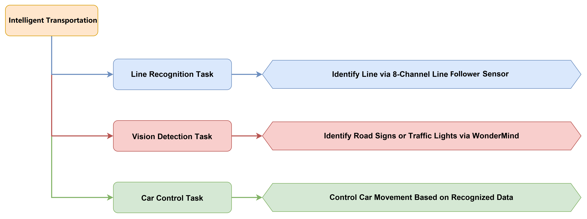

#### 5.4.7.3 Module Description


The WonderLLM module integrates a high-performance ESP32-S3 chip, enabling features such as color recognition and face detection through programming. The module is equipped with an I2C interface for convenient data exchange with various host controllers, providing an efficient solution for intelligent vision applications.

Module Wiring: Before running the program in this section, connect the module to any I2C interface in the red frame of the servo controller, as shown in the figure below.


#### 5.4.7.4 Program Download

1. xxxxxxxxxx else{  // line lost: continue turning based on last error direction  if(last_error > 0.5){    error = 5;  // last time was left, continue turning left  }  else if(last_error < -0.5){    error = -5;  // last time was right, continue turning right  }  else{    error = 0;  // go straight  }}// scale error to reasonable rangefloat scaled = error * 0.2f;if(scaled > 0.9f) scaled = 0.9f;if(scaled < -0.9f) scaled = -0.9f;last_error = scaled;// use error as steering value for line followingdifferentials_chassis_run(50.0f, last_error);delay(20);cpp


2. Open the program file in [**02 Program Files\Tankbot_ESP32_Arduino\Tankbot_ESP32_Arduino.ino**]() in the same directory as this document.


3. After opening, select the development board model as shown in the figure below.

   

4. Click **Tools** in the menu bar, and then select the corresponding ESP32 development board configuration as shown in the figure below.

   

> [!NOTE]
>
> **Be sure to modify the development board configuration before downloading the program.**

5. First click the verify icon , then click the upload icon . After the upload is complete, if the following interface appears in the output box at the bottom of the software, the program download is complete.


#### 5.4.7.5 Program Outcome

After entering the dialogue mode of the WonderLLM module through the wake word, the command for switching to smart traffic mode can be spoken, for example, **Switch the robotic car's current mode to smart traffic mode**. the robotic car can then be controlled to drive along the black line, while performing road sign detection and traffic light recognition. Based on the visual recognition results, the robotic car is controlled to move accordingly, such as stopping when a red light is detected, continuing forward when a green light is detected, and turning left when a left-turn road sign is detected.

#### 5.4.7.6 Program Analysis

* **Tankbot_ESP32_Arduino.ino file**

1. The imported module library includes library files for the buzzer, ultrasonic sensor, robotic arm, 8-channel line follower sensor, and the WonderLLM module.

```c
#include "Config.h"
#include "Hiwonder.hpp"
#include "Robot_arm.hpp"
#include "motor.hpp"
#include "WonderLLM_Vision.hpp"
#include "Ultrasound.hpp"
#include "linefollower8.hpp"
#include "WonderLLM.hpp"
#include "differential_chassis.hpp"
```

2. The hardware is initialized, and the corresponding scalars and flag bits are defined.

```cpp
IIC iic_obj;
Motor motor_obj;
HW_ESP32Cam cam;
Ultrasound ult;
Linefollower8 lf_obj;

//-------------------
float result_speed = 0.0f;
float result_rot = 0.0f;
float avoid_speed = 0.0f;
float follow_speed = 0.0f;

uint8_t rgb_mode = 0;
uint8_t rgb_left[3];
uint8_t rgb_right[3];
uint8_t running_mode = Normal_Mode;
uint8_t last_running_mode = Normal_Mode;
uint8_t step = 0;
float voltage = 0;
uint16_t distance = 0;
uint16_t left_distance;
uint16_t right_distance;
uint16_t ult_distance = 0;  //set following distance
uint32_t duration = 0;

uint32_t sys_tick = 0;
uint32_t claw_tick = 0;
bool move_state = false;
uint8_t vision_result = Vision_NULL;
uint8_t start_arm = Arm_Null;
uint8_t end_arm = Arm_Null;
bool arm_state = false;
bool clamp_state = false;
```

3. The `setup()` function initializes the TankBot hardware and the WonderLLM module.

```cpp
void setup() {
  delay(1000);
  pinMode(IO_BLE_CTL, OUTPUT);
  digitalWrite(IO_BLE_CTL, LOW);  // set Bluetooth control pin low to disconnect Bluetooth module power

  pinMode(PA4, OUTPUT);
  pinMode(PA5, OUTPUT);

  Serial.begin(115200);
  arm.init();
  buzzer_obj.init(IO_BUZZER);
  
  iic_obj.init();
  motor_obj.init(&iic_obj);
  cam.init(&iic_obj);
  ult.init(&iic_obj);
  lf_obj.init(&iic_obj);
  
  WonderLLM_Init(&iic_obj);

  differentials_chassis_run(0,0);
  Serial.println("begin");
  
  delay(1000);
}

```

4. In the main loop, the instructions from WonderLLM are polled and processed.

```cpp
void loop() {
  WonderLLM_Poll_And_Process();
}
```

5. When the robotic car is in smart traffic mode `WonderLLM_Traffic_Mode`, mode switching is handled first. Then the robotic car moves forward at a fixed speed, and its rotation speed is adjusted based on the return value of the `lf_obj.LineFollowControl()` function.

```cpp
			case WonderLLM_Traffic_Mode:  //Smart Traffic Mode
				if(last_running_mode != WonderLLM_Traffic_Mode){
					arm.knot_run(5,300,500);
					differentials_chassis_run(0,0);
				}
				differentials_chassis_run(50, lf_obj.LineFollowControl(WonderLLM_Traffic_Mode));
				break;
```

* **WonderLLM.cpp File**

1. The WonderLLM large model module is initialized.

```cpp
bool WonderLLM_Init(IIC* iic_obj) {
iic = iic_obj;
register_tools(); // call MCP write tool

buzzer_obj.blink(1500 , 100 , 100 , 2);
  return true;
}
```

2. The `register_tools` function contains all available tools registered with the WonderLLM module. Before using this module to control the robotic car, the available functions must first be sent to the module so that the robotic car can be controlled through the large language model. The functions registered by `MCP` include car movement control, turning control, status query, mode switching, ultrasonic and light control, buzzer control, and visual recognition.

```cpp
static bool register_tools(void) {
		const char* tool_move = "{\"tool_name\":\"self.Tankbot.move\","
			"\"command\":\"'move' only returns forward, backward, left, and right. The speed unit is mm/s. For in-place turning, a positive angular velocity means left and a negative one means right, and rot cannot be 0 when turning. The duration defaults to 0, which means maintaining the current state continuously, in ms.\","
			"\"params\":[[\"move\",\"string\"],[\"speed\",\"int\",0,80],[\"rot\",\"int\",-9,9],[\"duration\",\"int\"]],\"block\":\"true\",\"return\":\"false\"}";
		if (!send_frame((uint8_t*)tool_move, strlen(tool_move))) return false;

		const char* tool_arm_control = "{\"tool_name\":\"self.Tankbot.arm\","
			"\"command\":\"'start' is for gripping and defaults to gripping the middle; 'end' is for placement. Both only return 'null', 'left', 'center', or 'right'. One of 'start' and 'end' must have a parameter that returns 'null'; if no position is specified, 'null' is returned.\","
			"\"params\":[[\"start\",\"string\"],[\"end\",\"string\"]],\"block\":\"true\",\"return\":\"false\"}";
		if (!send_frame((uint8_t*)tool_arm_control, strlen(tool_arm_control))) return false;

const char* tool_status = "{\"tool_name\":\"self.Tankbot.get_status\",\"command\":\"Call this tool to obtain the car's real-time status. "
			"The queryable statuses include: 'battery', 'distance', and 'running_mode'.\",\"params\":[[\"status_name\",\"string\"]],\"block\":\"true\",\"return\":\"true\"}";
if (!send_frame((uint8_t*)tool_status, strlen(tool_status))) return false;

const char* tool_mode = 
			"{\"tool_name\":\"self.Tankbot.set_mode\",\"command\":\"Call this tool to switch the car's mode. distance defaults to 300, and the unit is mm. "
			"The switchable modes include: 'avoid', 'follow', 'line_patrol', 'smart_transportation', and 'normal'.\",\"params\":[[\"running_mode\",\"string\"],[\"distance\",\"int\"]],\"block\":\"true\",\"return\":\"false\"}";
if (!send_frame((uint8_t*)tool_mode, strlen(tool_mode))) return false;
		
		const char* tool_led = 
"{\"tool_name\":\"self.Tankbot.set_color\","
		"\"command\":\"0 is the steady-on mode, 1 is the breathing-light mode, and the default is 0. The parameters are the RGB values of the left and right lights respectively. In breathing-light mode, lr, lg, lb, rr, rg, rb represent the breathing durations of the corresponding colors; lr=20 means a bright red period of 2 seconds.\","
"\"params\":[[\"rgb_mode\",\"int\",0,1],[\"lr\",\"int\",0,255],[\"lg\",\"int\",0,255],[\"lb\",\"int\",0,255],"
   "[\"rr\",\"int\",0,255],[\"rg\",\"int\",0,255],[\"rb\",\"int\",0,255]],"
"\"block\":\"true\",\"return\":\"false\"}";
		if (!send_frame((uint8_t*)tool_led, strlen(tool_led))) return false;

		const char* tool_buzzer = 
			"{\"tool_name\":\"self.Tankbot.set_buzzer\",\"command\":\"Call this tool to control the car's buzzer. 'count' is the number of times the buzzer sounds.\","
			"\"params\":[[\"count\",\"int\"]],\"block\":\"true\",\"return\":\"false\"}";
if (!send_frame((uint8_t*)tool_buzzer, strlen(tool_buzzer))) return false;

const char* tool_recognition = 
			"{\"tool_name\":\"self.Tankbot.set_recognition\",\"command\":\"Before having the robotic arm look at what objects are present, call this tool first; only after it completes can the vision recognition function be called. The return value of 'string' can only be a direction, namely center, left, or right, with the default being center.\","
			"\"params\":[[\"recognition\",\"string\"]],\"block\":\"true\",\"return\":\"false\"}";
if (!send_frame((uint8_t*)tool_recognition, strlen(tool_recognition))) return false;

const char* tool_finish = "{\"command\":\"mcp_setting\",\"params\":\"true\"}";
if (!send_frame((uint8_t*)tool_finish, strlen(tool_finish))) return false;

return true;
}

```

3. The `WonderLLM_Poll_And_Process` function is used in the main loop to poll and process instructions from WonderLLM.

```cpp
void WonderLLM_Poll_And_Process(void) {
  uint16_t received_len = sizeof(rx_json_buffer);
  if (receive_frame((uint8_t*)rx_json_buffer, &received_len)) {
if (received_len > 0) {
rx_json_buffer[received_len] = '\0';
parse_command(rx_json_buffer);
}
  }
}
```

4. Parse the instructions related to traffic recognition.

The value of `vision_result` is set based on the traffic signal recognition result. The system is then notified via `WonderLLM_Send_Action_Finish()` that the task has been completed.

```cpp
	//traffic recognition
	else if (strstr(json_str, "Traffic") != NULL) {  
		if (strstr(json_str, "left") != NULL){
			vision_result = Left;
		}else if(strstr(json_str, "right") != NULL){
			vision_result = Right;
		}else if((strstr(json_str, "stop") != NULL) || (strstr(json_str, "red") != NULL) || (strstr(json_str, "yellow") != NULL)){
			vision_result = Stop;
		}else if(strstr(json_str, "green") != NULL){
			vision_result = Green;
		}
		
		WonderLLM_Send_Action_Finish();
	}
```

* **LineFollow8.cpp File at the Bottom Layer**

When the visual recognition result is `Left`, the chassis is controlled to turn right at a speed of 30.

```cpp
      while(1){
        if(vision_result == Left){
          differentials_chassis_run(30,-0.5);
          value_result = GetLineValue();
          if((value_result >> 3) & 0x01 || (value_result >> 4) & 0x01){
            vision_result = Vision_NULL;
            break;
          }
```

When the visual recognition result is `Right`, the chassis is controlled to turn left at a speed of 30.

```cpp
        }else if(vision_result == Right){
          differentials_chassis_run(30,0.5);
          value_result = GetLineValue();
          if((value_result >> 3) & 0x01 || (value_result >> 4) & 0x01){
            vision_result = Vision_NULL;
            break;
          }
        }
      }
```

When the visual recognition result is `Green`, the system controls the chassis to drive forward normally.

```cpp
    }else{
      if(vision_result == Green){
          vision_result = Vision_NULL;
        }	
```

* **Low-Level differential_chassis.c File**

This section uses `differentials_chassis_run` as an example:

1. The code first defines an array for storing motor speeds and the speeds of the left and right wheels. The left and right wheel speeds are then computed based on differential drive kinematics using the supplied linear velocity and angular velocity.

```c
void differentials_chassis_run(float speed, float rot)
{
	int8_t motor_speed[4];
	float vr, vl;
	
	speed = speed > MAX_SPEED ? MAX_SPEED : speed < MIN_SPEED ? MIN_SPEED : speed;
	rot = rot > MAX_ROT ? MAX_ROT : rot < MIN_ROT ? MIN_ROT : rot;
	
	vr = speed + rot * HALF_FR_WHEELBASE;
	vl = speed - rot * HALF_FR_WHEELBASE;
```

2) Finally, the speed is passed into the `motor_speed` array. Since the left and right wheel motors have different directions, the left wheel motor speed is set to the opposite direction. The motor speed is then set via the `set_motor_speed` function, thereby controlling the chassis movement.

```c
	motor_speed[0] = -(int8_t)vl;
	motor_speed[1] = 0;
	motor_speed[2] = (int8_t)vr; 
	motor_speed[3] = 0;
	
	set_motor_speed(motor_speed);
}
```

### 5.4.8 Intelligent Transport

#### 5.4.8.1 Project Description

In this section, control commands are sent to the robotic car through the WonderLLM module to enable intelligent transport.

#### 5.4.8.2 Implementation Process


#### 5.4.8.3 Module Description


The WonderLLM module integrates a high-performance ESP32-S3 chip and implements functions such as color recognition and face detection through programming. The module is equipped with an I2C interface for convenient data interaction with various host controllers, providing an efficient solution for intelligent vision applications.

Module wiring: As shown in the figure below, connect the module to any I2C interface in the red box of the servo controller before running the program in this section.


#### 5.4.8.4 Program Download

1. Connect the core board to the computer via a USB cable.


2. Open the program file in [**02 Program Files\Tankbot_ESP32_Arduino\Tankbot_ESP32_Arduino.ino**](https://drive.google.com/drive/folders/1eNwddL3jG9FAhyys-NaYSRd0nGq5g8Se?usp=sharing) in the same directory as this document.


3. After opening, select the development board model, as shown in the figure below.

   

4. Click **Tools** in the menu bar and select the corresponding ESP32 development board configuration as shown in the figure below.

   

> [!NOTE]
>
> **Be sure to modify the development board configuration before downloading the program**

5. First click the verify icon , then click the upload icon . After the upload is complete, if the following interface appears in the output box at the bottom of the software, the program download is complete.


#### 5.4.8.5 Program Outcome

When a command such as **If there is a red object ahead, pick it up and then put it down on the left** is given to the WonderLLM module, the robotic car first identifies the color of the object. If the object is red, the robotic car picks it up and places it on the left.

#### 5.4.8.6 Program Analysis

* **Tankbot_ESP32_Arduino.ino file**

1. The module library files are imported, including library files for the buzzer, ultrasonic sensor, robotic arm, 8-channel line tracking sensor, WonderLLM large model module, and others.

```c
#include "Config.h"
#include "Hiwonder.hpp"
#include "Robot_arm.hpp"
#include "motor.hpp"
#include "WonderLLM_Vision.hpp"
#include "Ultrasound.hpp"
#include "linefollower8.hpp"
#include "WonderLLM.hpp"
#include "differential_chassis.hpp"
```

2. The hardware is initialized, and the corresponding scalars and flag bits are defined.

```cpp
IIC iic_obj;
Motor motor_obj;
HW_ESP32Cam cam;
Ultrasound ult;
Linefollower8 lf_obj;

//-------------------
float result_speed = 0.0f;
float result_rot = 0.0f;
float avoid_speed = 0.0f;
float follow_speed = 0.0f;

uint8_t rgb_mode = 0;
uint8_t rgb_left[3];
uint8_t rgb_right[3];
uint8_t running_mode = Normal_Mode;
uint8_t last_running_mode = Normal_Mode;
uint8_t step = 0;
float voltage = 0;
uint16_t distance = 0;
uint16_t left_distance;
uint16_t right_distance;
uint16_t ult_distance = 0;  //set follow distance
uint32_t duration = 0;

uint32_t sys_tick = 0;
uint32_t claw_tick = 0;
bool move_state = false;
uint8_t vision_result = Vision_NULL;
uint8_t start_arm = Arm_Null;
uint8_t end_arm = Arm_Null;
bool arm_state = false;
bool clamp_state = false;
```

3. In the `setup()` function, the TankBot hardware components and the WonderLLM module are initialized.

```cpp
void setup() {
  delay(1000);
  pinMode(IO_BLE_CTL, OUTPUT);
  digitalWrite(IO_BLE_CTL, LOW);  // set Bluetooth control pin low to disconnect Bluetooth module power

  pinMode(PA4, OUTPUT);
  pinMode(PA5, OUTPUT);

  Serial.begin(115200);
  arm.init();
  buzzer_obj.init(IO_BUZZER);
  
  iic_obj.init();
  motor_obj.init(&iic_obj);
  cam.init(&iic_obj);
  ult.init(&iic_obj);
  lf_obj.init(&iic_obj);
  
  WonderLLM_Init(&iic_obj);

  differentials_chassis_run(0,0);
  Serial.println("begin");
  
  delay(1000);
}

```

4. The main loop polls and processes instructions from WonderLLM.

```cpp
void loop() {
  WonderLLM_Poll_And_Process();
```

5. During intelligent handling, the robotic arm performs pick-and-place actions at different positions, namely the left, middle, and right. The `start_arm` picking operation is used as an example for analysis.

(1) Left Arm Action

First, move to the initial position on the left, then move to the left pick-up position, open the gripper by calling `robot_arm_claw_set(0, 500)`, and grasp the item. Move back to the initial position on the left. Finally, call `WonderLLM_Send_Action_Finish()` to send the action completion signal.

```c
					switch(start_arm){
						case Arm_Left:
							arm.coordinate_set(0.2,12.6,-3.2,-40,-90,10,1500);  //left initial pose
							delay(2000);
							arm.coordinate_set(0.2,24.2,-15,-60,90,10,1500);   //left grasp
							delay(2000);
							arm.claw_set(0, 500);
							delay(1000);
							arm.coordinate_set(0.2,15,2,-40,-90,10,1500);  //left initial pose
							delay(2000);
							WonderLLM_Send_Action_Finish();
							break;
```

(2) Intermediate Arm Operation

The code first moves to the intermediate initial position, then to the intermediate gripping position, opens the gripper (`robot_arm_claw_set(0, 500)`) to grasp the item, and moves back to the intermediate initial position. Finally, the code calls `WonderLLM_Send_Action_Finish()` to send the action completion signal.

```c
						case Arm_Center:
							arm.coordinate_set(12.6,0,-3.2,-40,-90,10,1500);  //middle initial posture
							delay(2000);
							arm.coordinate_set(24.2,0,-15,-60,-90,10,1500);   //middle pick up
							delay(2000);
							arm.claw_set(0, 500);
							delay(1000);
							arm.coordinate_set(15,0,2,-40,-90,10,1500);  //middle initial posture
							delay(2000);
							WonderLLM_Send_Action_Finish();
							break;
```

(3) Right Arm Action

The robot first moves to the right initial position, then moves to the right gripping position, opens the gripper (`robot_arm_claw_set(0, 500)`), and grabs the item. It moves back to the right initial position. Finally, it calls `WonderLLM_Send_Action_Finish()` to send the action completion signal.

```c
						case Arm_Right:
							arm.coordinate_set(0.2,-12.6,-3.2,-40,-90,10,1500);  //right initial posture
							delay(2000);
							arm.coordinate_set(0.2,-24.2,-15,-60,90,10,1500);   //right grasp
							delay(2000);
							arm.claw_set(0, 500);
							delay(1000);
							arm.coordinate_set(0.2,15,2,-40,-90,10,1500);  //right initial posture
							delay(2000);
							WonderLLM_Send_Action_Finish();
							break;
						
```

* **WonderLLM.cpp file**

1. The WonderLLM large model module is initialized.

```cpp
bool WonderLLM_Init(IIC* iic_obj) {
iic = iic_obj;
register_tools(); // call MCP write tool

buzzer_obj.blink(1500 , 100 , 100 , 2);
  return true;
}
```

2. The `register_tools` function contains all available tools registered with the WonderLLM module. Before the module is used to control the robotic car, the available functions must be sent to the module so that the robotic car can be controlled through the large language model. The functions registered by `MCP` include car movement control, turning control, status query, mode switching, ultrasonic and light control, buzzer control, and visual recognition.

```cpp
static bool register_tools(void) {
		const char* tool_move = "{\"tool_name\":\"self.Tankbot.move\","
			"\"command\":\"'move' only returns forward, backward, left, and right. The speed unit is mm/s. For in-place turning, a positive angular velocity means left and a negative one means right, and rot cannot be 0 when turning. The duration defaults to 0, which means maintaining the current state continuously, in ms.\","
			"\"params\":[[\"move\",\"string\"],[\"speed\",\"int\",0,80],[\"rot\",\"int\",-9,9],[\"duration\",\"int\"]],\"block\":\"true\",\"return\":\"false\"}";
		if (!send_frame((uint8_t*)tool_move, strlen(tool_move))) return false;

		const char* tool_arm_control = "{\"tool_name\":\"self.Tankbot.arm\","
			"\"command\":\"'start' is for gripping and defaults to gripping the middle; 'end' is for placement. Both only return 'null', 'left', 'center', or 'right'. One of 'start' and 'end' must have a parameter that returns 'null'; if no position is specified, 'null' is returned.\","
			"\"params\":[[\"start\",\"string\"],[\"end\",\"string\"]],\"block\":\"true\",\"return\":\"false\"}";
		if (!send_frame((uint8_t*)tool_arm_control, strlen(tool_arm_control))) return false;

const char* tool_status = "{\"tool_name\":\"self.Tankbot.get_status\",\"command\":\"Call this tool to obtain the car's real-time status. "
			"The queryable statuses include: 'battery', 'distance', and 'running_mode'.\",\"params\":[[\"status_name\",\"string\"]],\"block\":\"true\",\"return\":\"true\"}";
if (!send_frame((uint8_t*)tool_status, strlen(tool_status))) return false;

const char* tool_mode = 
			"{\"tool_name\":\"self.Tankbot.set_mode\",\"command\":\"Call this tool to switch the car's mode. distance defaults to 300, and the unit is mm. "
			"The switchable modes include: 'avoid', 'follow', 'line_patrol', 'smart_transportation', and 'normal'.\",\"params\":[[\"running_mode\",\"string\"],[\"distance\",\"int\"]],\"block\":\"true\",\"return\":\"false\"}";
if (!send_frame((uint8_t*)tool_mode, strlen(tool_mode))) return false;
		
		const char* tool_led = 
"{\"tool_name\":\"self.Tankbot.set_color\","
		"\"command\":\"0 is the steady-on mode, 1 is the breathing-light mode, and the default is 0. The parameters are the RGB values of the left and right lights respectively. In breathing-light mode, lr, lg, lb, rr, rg, rb represent the breathing durations of the corresponding colors; lr=20 means a bright red period of 2 seconds.\","
"\"params\":[[\"rgb_mode\",\"int\",0,1],[\"lr\",\"int\",0,255],[\"lg\",\"int\",0,255],[\"lb\",\"int\",0,255],"
   "[\"rr\",\"int\",0,255],[\"rg\",\"int\",0,255],[\"rb\",\"int\",0,255]],"
"\"block\":\"true\",\"return\":\"false\"}";
		if (!send_frame((uint8_t*)tool_led, strlen(tool_led))) return false;

		const char* tool_buzzer = 
			"{\"tool_name\":\"self.Tankbot.set_buzzer\",\"command\":\"Call this tool to control the car's buzzer. 'count' is the number of times the buzzer sounds.\","
			"\"params\":[[\"count\",\"int\"]],\"block\":\"true\",\"return\":\"false\"}";
if (!send_frame((uint8_t*)tool_buzzer, strlen(tool_buzzer))) return false;

const char* tool_recognition = 
			"{\"tool_name\":\"self.Tankbot.set_recognition\",\"command\":\"Before having the robotic arm look at what objects are present, call this tool first; only after it completes can the vision recognition function be called. The return value of 'string' can only be a direction, namely center, left, or right, with the default being center.\","
			"\"params\":[[\"recognition\",\"string\"]],\"block\":\"true\",\"return\":\"false\"}";
if (!send_frame((uint8_t*)tool_recognition, strlen(tool_recognition))) return false;

const char* tool_finish = "{\"command\":\"mcp_setting\",\"params\":\"true\"}";
if (!send_frame((uint8_t*)tool_finish, strlen(tool_finish))) return false;

return true;
}

```

3. `WonderLLM_Poll_And_Process` is used in the main loop to poll and process commands from WonderLLM.

```cpp
void WonderLLM_Poll_And_Process(void) {
  uint16_t received_len = sizeof(rx_json_buffer);
  if (receive_frame((uint8_t*)rx_json_buffer, &received_len)) {
if (received_len > 0) {
rx_json_buffer[received_len] = '\0';
parse_command(rx_json_buffer);
}
  }
}
```

4. Parse the gripping command.

```cpp
		if (start_ptr){
			sscanf(start_ptr, "%*[^:]:\"%[^\"]\"", start_result);
			if(strcmp(start_result, "left") == 0){
				start_arm = Arm_Left;
			}else if(strcmp(start_result, "center") == 0){
				start_arm = Arm_Center;
			}else if(strcmp(start_result, "right") == 0){
				start_arm = Arm_Right;
			}else{
				start_arm = Arm_Null;
			}
		}
		
		if (end_ptr){
			sscanf(end_ptr, "%*[^:]:\"%[^\"]\"", end_result);
			if(strcmp(end_result, "left") == 0){
				end_arm = Arm_Left;
			}else if(strcmp(end_result, "center") == 0){
				end_arm = Arm_Center;
			}else if(strcmp(end_result, "right") == 0){
				end_arm = Arm_Right;
			}else{
				end_arm = Arm_Null;
			}
		}
```

## 5.5 AI Voice Project Course

### 5.5.1 WonderLLM Offline Voice Introduction

#### 5.5.1.1 Offline Voice Interaction Description

##### 5.5.1.1.1 Module Introduction


WonderLLM voice interaction is based on the CI1302 chip for speech recognition and voice broadcasting. It supports offline NN acceleration computing and speech signal processing acceleration hardware. Recognition results are derived through deep noise reduction and neural network model analysis.

The CI1302 chip incorporates a brain neural network processor core BNPU, supporting offline NN acceleration and hardware-accelerated voice signal processing. The CPU clock frequency reaches up to 220 MHz, enabling offline far-field voice recognition. The chip features 2 MB of built-in FLASH storage and supports up to 300 command words.

This module features simple operation and excellent speech recognition performance, making it widely applicable in fields such as smart homes, conversational robots, educational robots, and in-vehicle dispatch terminals.


##### 5.5.1.1.2 Work Principles

This module uses wake word mode for activation. The wake word must be spoken to activate the module, and recognition is available only after activation. The default recognition language is English, and the English wake word is **Hello Hiwonder**. If no speech is recognized within 15 seconds, the module enters sleep mode and must be re-awakened before the next use.

After the CI1302 chip recognizes the corresponding voice entry, it sends the instruction associated with that entry to the I2C chip and provides broadcast feedback. The I2C chip stores the received voice instruction and transmits it via the I2C slave protocol. Specific voice entries are listed in [**Command Word Broadcast Protocol List**](https://docs.google.com/spreadsheets/d/1cFhhg9cI3vhTersPBMMsNaFLUwfAZTo-/edit?usp=sharing&ouid=118382341883724205248&rtpof=true&sd=true) in the same path as this document.


#### 5.5.1.2 Module Wiring

Module Wiring: As shown in the figure below, connect the module to any I2C interface in the red frame of the servo controller before running the program in this section.


#### 5.5.1.3 Precautions

1. The module must be powered with 5 V. Otherwise, the module will be damaged.
2. The operating environment should be quiet. A noisy environment affects recognition performance.
3. Commands should be spoken loudly and at a moderate pace. The distance from the module should be kept within 5 meters.


### 5.5.2 WonderLLM Firmware Flashing Tutorial

* **Voice Chip Programming**

>[!Note]
>**The module is pre-flashed with English speech recognition firmware by default, with the wake word Hello Hiwonder. If firmware reflashing is required, the procedures described in this document can be followed.**

1. First, connect the WonderLLM module to the computer via a Type-C data cable, using the Type-C port at the lower left.

   

2. Open the **PACK_UPDATE_TOOL.exe** file in the [**Firmware Flashing Tool**](https://drive.google.com/drive/folders/1IsZMSKCd41FFhy8bJ-cnhKEjz1c4LzZs?usp=sharing) folder located in the same path as this document, select the **CI1302** chip, and then click **Update**.

   

3. Click **Select firmware** and locate the **WonderMind.bin** firmware in the same directory as this document.


   

4. Find the corresponding serial port and select it.


5. Then press and hold the **A** and **B** buttons on the WonderLLM module simultaneously to enter the flashing process, and wait until flashing completes successfully.

   


* **ESP32 Chip Flashing**

1. Connect the Type-C interface on the top of the WonderLLM large model module to a computer using a USB cable, as shown below.


2. Open the [**flash_download_tool_3.9.7.exe**](https://drive.google.com/drive/folders/1Y96U8ERYIJJox7KkIOoqDBueMKeHMNVg?usp=sharing) flashing tool.

   

3. Select **ESP32-S3** as the Chip Type, keep other settings at their defaults, and then click **OK**.

   

4. After the tool is opened, click **...** to select the program bin file to be flashed. Select the offline voice play bin file in the same directory as this document:

   

5. Tick the checkbox on the left, and configure the remaining settings as shown in the figure below. Select the COM port number corresponding to the module.

>[!note]
>**If the SPI MODE is set to DIO according to the configuration shown in the figure below, the module will not work properly after firmware flashing. Try setting the SPI MODE to DOUT and flashing the firmware again.**


6. First click **ERASE** to erase the previously downloaded firmware. Be sure to perform this step. Wait for the status bar to display **FINISH**.


7. Then click **START** to download the selected firmware, and wait for the progress bar to finish loading. The firmware download is then complete.


8. After the download is complete, reconnect the data cable. After power cycling the device, it will start working according to the new firmware program.

### 5.5.3 Voice Interaction

#### 5.5.3.1 Project Introduction

This lesson uses the WonderLLM module to recognize spoken entries and thereby control the robotic car to perform actions.


#### 5.5.3.2 Implementation Procedure

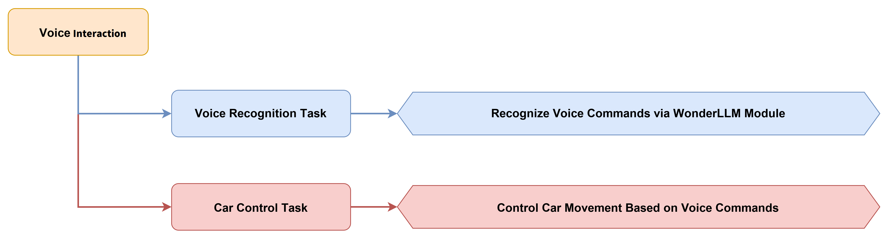


#### 5.5.3.3 Module Description


The offline voice interaction of the WonderLLM module performs speech recognition and voice playback based on the CI1302 chip. The module supports offline NN acceleration computation and speech signal processing acceleration hardware. Recognition results are derived through deep noise reduction and neural network model analysis.

Module Wiring: As shown in the figure below, before running the program in this section, connect the module to any I2C interface in the red box of the servo controller.


#### 5.5.3.4 Program Download

1. Connect the core board to the computer via a USB cable.

   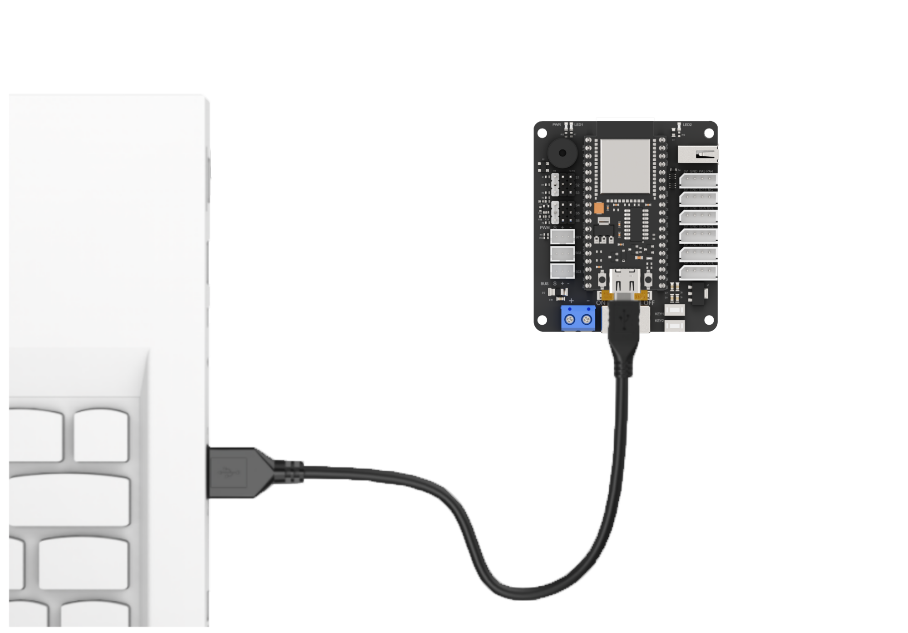

2. Find the corresponding example project file in the Arduino project folder [Tankbot_ESP32_Arduino](https://drive.google.com/drive/folders/1WFhI-X_y6oZlqilXjztOmjGrCEDK3ynO?usp=sharing) in the same directory as the document.

   

3. After opening, select the development board model as shown below:

   

4. First click the  verify icon, and then click the  upload icon. After the upload completes, if the output box at the bottom of the software displays the following interface, the program download is complete.

   


#### 5.5.3.5 Program Outcome

After the device is powered on, the module is awakened by saying **Hello Hiwonder**, and the module replies **I am here**. Other phrases can then be spoken to run the feature.

Commands such as **Hello**, **Introduce yourself**, **Take two steps**, and **Shake head** can be spoken to the module to control the robotic car to perform different actions.

If no new command is issued for an extended period, the module replies **I'm going to rest** and enters the sleep state. Reawakening is required to continue running the feature.


#### 5.5.3.6 Program Analysis

1) The hardware library and module library files are imported, including the configuration header file, hardware abstraction layer library, robotic arm control library, motor control library, speech recognition module library, chassis control library, and timer library.

```cpp
#include "Config.h"
#include "Hiwonder.hpp"
#include "Robot_arm.hpp"
#include "motor.hpp"
#include "ASR_module.hpp"
#include "differential_chassis.hpp"
#include "Ticker.h"
```

2) System function objects and module objects are created, including buzzer, key, LED, robotic arm, battery, I2C communication, motor, and voice recognition module objects. A timer object is also created for battery voltage monitoring.

```cpp
Buzzer_t buzzer_obj;
Button_t key_obj;
Led_t led_obj;
RobotArm_t arm;
Battery_t battery_obj;

IIC iic_obj;
Motor motor_obj;
ASR_MOUDLE hwsensor;

// timer object
Ticker battery_timer;
float voltage;
```

3) In the `setup()` function, the Bluetooth control pin is first set to a low level to disconnect the Bluetooth module power supply, and serial communication is initialized. Then, the robotic arm, LED, buzzer, battery, and other modules are initialized, followed by the initialization of I2C communication, motors, and the voice recognition module. Finally, the buzzer is controlled to emit one beep to indicate that the system startup is complete, and the battery voltage monitoring timer is started.

```cpp
pinMode(IO_BLE_CTL, OUTPUT);
digitalWrite(IO_BLE_CTL, LOW);  // set BLE control pin low to disconnect BLE module power

Serial.begin(9600);

arm.init();
led_obj.init(IO_LED);
buzzer_obj.init(IO_BUZZER);
battery_obj.init(ADC_BAT);

iic_obj.init();
motor_obj.init(&iic_obj);
hwsensor.init(&iic_obj);

buzzer_obj.blink(1500 , 50, 50, 1);  

battery_timer.attach_ms(1000, battery_check_callback);

delay(1000);
```

4) In the `loop()` function, the `hwsensor.rec_recognition()` function is called to obtain the speech recognition result, and the corresponding action is executed based on the recognized phrase. The program supports four voice commands. 'Hello' with code `0x1A` triggers the robotic arm waving action. 'Introduce yourself' with code `0x1B` triggers action group 4 and returns the robotic arm to its initial position. 'Walk two steps' with code `0x1D` makes the robotic car move forward for 1.5 seconds and then stop. 'Shake head' with code `0x1E` makes the servo ID 6 of the robotic arm swing left and right to simulate a head-shaking action.

```cpp
unsigned char result;
static bool have_move = true;

result = hwsensor.rec_recognition();  //get voice recognition module data
if(result)
{
  Serial.print("ASR result is:");
  Serial.println(result);

  if(result==0x1A) //hello
  {
    arm.coordinate_set(15,0,14,-45,-90,90,500);
    delay(600);
    arm.claw_set(30,200);
    delay(300);
    arm.claw_set(90,200);
    delay(300);
    arm.claw_set(30,200);
    delay(300);
    arm.claw_set(90,200);
    delay(300);
    arm.coordinate_set(15,0,2,-40,-90,10,1000);
    delay(1500);
  }
  else if(result==0x1B) //introduce yourself
  {
    arm.action_run(4, 1);
    arm.coordinate_set(15,0,2,-40,-90,10,1000);
    delay(1500);
  }
  else if(result==0x1D) //walk two steps
  {
    differentials_chassis_run(20.0f, 0.0f);
    delay(1500);
    differentials_chassis_run(0.0f, 0.0f);
    delay(500);
  }
  else if(result==0x1E) //shake head
  {
    arm.knot_run(6,700,500);
    delay(600);
    arm.knot_run(6,300,500);
    delay(600);
    arm.knot_run(6,700,500);
    delay(600);
    arm.knot_run(6,300,500);
    delay(600);
    arm.knot_run(6,500,500);
    delay(600);
    arm.coordinate_set(15,0,2,-40,-90,10,1000);
    delay(1500);
  }
}
delay(50);
```

5. The WonderLLM offline voice mode performs data exchange with the ESP32 controller via I2C communication to implement the voice recognition function. This function reads the recognition result from the module's `ASR_RESULT_ADDR` register, retrieves the recognition result value through I2C communication, and returns it.

```cpp
uint8_t ASR_MOUDLE::rec_recognition(void)
{
  if(iic != nullptr){
    uint8_t result = 0;
    iic->wireReadDataArray(I2C_ADDR_RESERVE , ASR_RESULT_ADDR ,&result,1);
    return result;
  }
  return 0;
}
```


### 5.5.4 Voice Control

#### 5.5.4.1 Project Introduction

This lesson uses the WonderLLM module to recognize spoken phrases, enabling the robotic car to perform different motion actions and robotic arm actions.


#### 5.5.4.2 Implementation Process


#### 5.5.4.3 Module Description


The offline voice interaction of the WonderLLM module performs speech recognition and voice broadcasting based on the CI1302 chip. The module supports offline NN acceleration computation and speech signal processing acceleration hardware. Recognition results are derived through deep noise reduction and neural network model analysis.

Module Wiring: As shown in the figure below, connect the module to any I2C interface in the red box of the servo controller before running the program in this section.


#### 5.5.4.4 Program Download

1. Connect the core board to the computer via a USB cable.

   

2. Find the corresponding example project file in the Arduino project folder [Tankbot_ESP32_Arduino](https://drive.google.com/drive/folders/1IcCdEOEukDEJXK-nmQiH-wtGczVgpBp1?usp=sharing) in the same directory as the document.

   

3. After opening, select the development board model as shown below.

   

4. First click the  verify icon, and then click the  upload icon. After the upload completes, if the output box at the bottom of the software displays the following interface, the program download is complete.

   


#### 5.5.4.5 Program Outcome

After the device is powered on, say "Hello Hiwonder" to wake up the module, and the module replies "I'm here". Then say other entries to run the feature.

The module recognizes spoken commands such as "forward", "backward", "turn left", "turn right", "battle mode", "waist twist", and "dance" to control the robotic car to execute different actions.

If no new command is issued for an extended period, the module replies "I am going to rest" and enters sleep mode. To continue running the feature, it needs to be woken up again.


#### 5.5.4.6 Program Analysis

1) The hardware library and module library files are imported, including configuration header files, hardware abstraction layer libraries, robotic arm control libraries, motor control libraries, speech recognition module libraries, chassis control libraries, and timer libraries.

```cpp
#include "Config.h"
#include "Hiwonder.hpp"
#include "Robot_arm.hpp"
#include "motor.hpp"
#include "ASR_module.hpp"
#include "differential_chassis.hpp"
#include "Ticker.h"
```

2. The system functional objects and module objects are created, including the buzzer, key, LED, robotic arm, battery, I2C communication, motor, and voice recognition module. In addition, a timer object is created for battery voltage monitoring.

```cpp
Buzzer_t buzzer_obj;
Button_t key_obj;
Led_t led_obj;
RobotArm_t arm;
Battery_t battery_obj;

IIC iic_obj;
Motor motor_obj;
ASR_MOUDLE hwsensor;

// timer object
Ticker battery_timer;
float voltage;
```

3) In the `setup()` function, a 1-second delay is first introduced, and the Bluetooth control pin is set to low level to disconnect the Bluetooth module power supply. Serial communication is then initialized, followed by the initialization of the robotic arm, LED, buzzer, battery, and other modules. Subsequently, I2C communication, the motor, and the voice recognition module are initialized. Finally, the buzzer is controlled to emit a single beep to indicate successful system startup, and the battery voltage monitoring timer is started.

```cpp
delay(1000);
pinMode(IO_BLE_CTL, OUTPUT);
digitalWrite(IO_BLE_CTL, LOW);  // set the bluetooth control pin low to disconnect the bluetooth module power

Serial.begin(9600);
arm.init();
led_obj.init(IO_LED);
buzzer_obj.init(IO_BUZZER);
battery_obj.init(ADC_BAT);

iic_obj.init();
motor_obj.init(&iic_obj);
hwsensor.init(&iic_obj);

buzzer_obj.blink(1500 , 50, 50, 1);

battery_timer.attach_ms(1000, battery_check_callback);

Serial.println("begin");
delay(1000);
```

4) In the `communicate()` function, the `hwsensor.rec_recognition()` function is called to obtain the speech recognition result, and the corresponding action is executed based on the recognized command. The program supports seven voice commands. With the forward command `0x01`, the robotic car moves forward for 1.5 seconds and then stops. With the backward command `0x02`, the robotic car moves backward for 1.5 seconds and then stops. With the left-turn command `0x03`, the robotic car turns left for 1 second and then stops. With the right-turn command `0x04`, the robotic car turns right for 1 second and then stops. With the battle mode command `0x21`, the robotic car executes action group 6 and returns to the initial position. With the waist-twist command `0x71`, the robotic car executes action group 3 and returns to the initial position. With the dance command `0x6C`, the robotic car executes action group 5 and returns to the initial position.

```cpp
unsigned char result;
static bool have_move = true;

result = hwsensor.rec_recognition();  // obtain the speech recognition result
if(result)
{
  Serial.print("ASR result is:");
  Serial.println(result);

  if(result==0x01) // move forward
  {
    differentials_chassis_run(20.0f, 0.0f);
    delay(1500);
    differentials_chassis_run(0.0f, 0.0f);
    delay(500);
  }else if(result==0x02) // move backward
  {
    differentials_chassis_run(-20.0f, 0.0f);
    delay(1500);
    differentials_chassis_run(0.0f, 0.0f);
    delay(500);
  }else if(result==0x03) // turn left
  {
    differentials_chassis_run(0.0f, 1.0f);
    delay(1000);
    differentials_chassis_run(0.0f, 0.0f);
    delay(500);
  }else if(result==0x04) // turn right
  {
    differentials_chassis_run(0.0f, -1.0f);
    delay(1000);
    differentials_chassis_run(0.0f, 0.0f);
    delay(500);
  }else if(result==0x21) // battle mode
  {
    arm.action_run(6, 1);
    arm.coordinate_set(15,0,2,-40,-90,10,1000);
    delay(1500);
  }else if(result==0x71) // twist waist
  {
    arm.action_run(3, 1);
    arm.coordinate_set(15,0,2,-40,-90,10,1000);
    delay(1500);
  }else if(result==0x6C) // dance 
  {
    arm.action_run(5, 1);
    arm.coordinate_set(15,0,2,-40,-90,10,1000);
    delay(1500);
  }
}
```

5) WonderLLM offline voice mode exchanges data with the ESP32 controller via I2C communication to implement the speech recognition function. This function reads the recognition result from the module's `ASR_RESULT_ADDR` register, obtains the recognition result value through I2C communication, and returns it.

```cpp
uint8_t ASR_MOUDLE::rec_recognition(void)
{
  if(iic != nullptr){
    uint8_t result = 0;
    iic->wireReadDataArray(I2C_ADDR_RESERVE , ASR_RESULT_ADDR ,&result,1);
    return result;
  }
  return 0;
}
```


### 5.5.5 Voice Broadcast

#### 5.5.5.1 Project Introduction

This lesson uses the WonderLLM module to implement the voice broadcast function and demonstrates different voice broadcast contents.


#### 5.5.5.2 Implementation Process

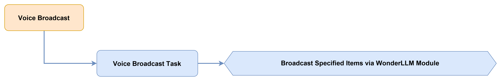


#### 5.5.5.3 Module Description


The offline voice interaction of the WonderLLM module is based on the CI1302 chip for speech recognition and voice playback. It supports offline NN acceleration operations and speech signal processing acceleration hardware. The recognition result is obtained through deep noise reduction and neural network model analysis.

Module Wiring: As shown in the figure below, connect the module to any I2C interface in the red frame of the servo controller before running the program in this section.


#### 5.5.5.4 Program Download

1. Connect the core board to the computer via a USB cable.

   

2. Find the corresponding example project file in the Arduino project folder [Tankbot_ESP32_Arduino](https://drive.google.com/drive/folders/1AC9ObuWGH4F_jDUjwpPGZf0kS4cROIdm?usp=sharing) in the same directory as the document.

   

3. After opening, select the development board model as shown below.

   

4. First click the  verify icon, and then click the  upload icon. After the upload completes, if the output box at the bottom of the software displays the following interface, the program download is complete.

   


#### 5.5.5.5 Program Outcome

After the device is powered on, the WonderLLM module sequentially broadcasts different voice content at preset time intervals, including self-introduction, forward instructions, broadcast content, and more.


#### 5.5.5.6 Program Analysis

1. The hardware library and module library files are imported, including the configuration header file, hardware abstraction layer library, robotic arm control library, motor control library, speech recognition module library, and ultrasonic module library.

```cpp
#include "Config.h"
#include "Hiwonder.hpp"
#include "Robot_arm.hpp"
#include "motor.hpp"
#include "ASR_module.hpp"
#include "Ultrasound.hpp"
#include "Ticker.h"
```

2) System function objects and module objects are created, including buzzer, key, LED, robotic arm, battery, I2C communication, motor, voice recognition module, and ultrasonic module. Meanwhile, a timer object is created for battery voltage monitoring.

```cpp
Buzzer_t buzzer_obj;
Button_t key_obj;
Led_t led_obj;
RobotArm_t arm;
Battery_t battery_obj;

IIC iic_obj;
Motor motor_obj;
ASR_MOUDLE asr;
Ultrasound ult;

// Timer object
Ticker battery_timer;
float voltage;
```

3) In the `setup()` function, the code first delays for 1 second, sets the Bluetooth control pin to low level to disconnect the power supply of the Bluetooth module, and initializes the serial port communication. Next, the modules including the robotic arm, the LED, the buzzer, and the battery are initialized. Then, the I2C communication, the motor, the voice recognition module, and the ultrasonic module are initialized. Finally, the buzzer beeps once to indicate the completion of system startup, and the battery voltage monitoring timer is started.

```cpp
delay(1000);
pinMode(IO_BLE_CTL, OUTPUT);
digitalWrite(IO_BLE_CTL, LOW);  // set the Bluetooth control pin to low level to disconnect the power supply of the Bluetooth module

Serial.begin(9600);
arm.init();
led_obj.init(IO_LED);
buzzer_obj.init(IO_BUZZER);
battery_obj.init(ADC_BAT);

iic_obj.init();
motor_obj.init(&iic_obj);
asr.init(&iic_obj);
ult.init(&iic_obj);

buzzer_obj.blink(1500 , 50, 50, 1);

battery_timer.attach_ms(1000, battery_check_callback);

Serial.println("begin");
delay(1000);
```

4) In the `loop()` function, the `asr.speak()` function is called to implement the voice broadcast function. The program broadcasts different voice content in sequence at preset time intervals. First, the command word "Introduce yourself" is broadcast, corresponding to `0x1B`. After a 5-second wait, the command word "Forward" is broadcast, corresponding to `0x01`. After a 2-second wait, "Hello, welcome" is broadcast, corresponding to `0x0F`. After a 3-second wait, "Red" is broadcast, corresponding to `0x2A`. After a 2-second wait, the cycle repeats. Here, the `ASR_CMDMAND` parameter is used for broadcasting command words, and the `ASR_ANNOUNCER` parameter is used for broadcasting announcement words. According to the command word and announcement word protocol list, `0x1B` corresponds to the "Introduce yourself" function, `0x01` corresponds to the "Forward" function, `0x0F` corresponds to "Hello, welcome", and `0x2A` corresponds to "Red".

```cpp
asr.speak(ASR_CMDMAND , 0x1B);
delay(5000);
asr.speak(ASR_CMDMAND , 0x01);
delay(2000);
asr.speak(ASR_ANNOUNCER , 0x0F);
delay(3000);
asr.speak(ASR_ANNOUNCER , 0x2A);
delay(2000);
```

5) The WonderLLM offline voice mode exchanges data with the ESP32 controller through I2C communication, thereby implementing the voice broadcast function. This function writes a broadcast command to the `ASR_SPEAK_ADDR` register of the module, causing the module to broadcast the specified voice content. The `cmd` parameter specifies the broadcast type, where `0x00` indicates a command word and `0xFF` indicates a broadcast word. The `id` parameter specifies the specific broadcast content ID.

```cpp
void ASR_MOUDLE::speak(uint8_t cmd , uint8_t id)
{
  if(iic != nullptr){
    if(cmd == 0xFF || cmd == 0x00)
    {
      send[0] = cmd;
      send[1] = id;
      iic->wireWriteDataArray(I2C_ADDR_RESERVE , ASR_SPEAK_ADDR , send , 2);
    }
  }
}
```


### 5.5.6 Distance Measurement Announcement

#### 5.5.6.1 Project Introduction

In this lesson, the ultrasonic sensor module is used to detect distance. When an obstacle is detected, the WonderLLM module plays a voice reminder, and the LED on the ultrasonic module turns red as a warning.


#### 5.5.6.2 Implementation Process


#### 5.5.6.3 Module Description

* **WonderLLM Module**


The offline voice interaction of the WonderLLM module is based on the CI1302 chip for speech recognition and playback. The module supports offline NN acceleration computing and speech signal processing acceleration hardware. Recognition results are derived through deep noise reduction and neural network model analysis.

Module Wiring: As shown in the figure below, connect the module to any I2C interface in the red box of the servo controller before running the program in this section.


* **Glowing Ultrasonic Sensor**


The glowing ultrasonic sensor module uses the I2C communication interface and can read distance measurements from the ultrasonic sensor via I2C communication. Meanwhile, two RGB lights are integrated at the ultrasonic probe position, which not only allow brightness adjustment but also achieve multicolor effects through variations in the red, green, and blue color channels and their combinations, also referred to R, G, and B.

Module Wiring: As shown in the figure below, connect the module to any I2C interface in the red box of the servo controller before running the program in this section.


#### 5.5.6.4 Program Download

1. Connect the core board to the computer via a USB cable.

   

2. Find the corresponding example project file in the Arduino project folder [Tankbot_ESP32_Arduino]() in the same directory as the document.

   

3. After opening, select the development board model as shown below.

   

4. First click the  verify icon, and then click the  upload icon. After the upload completes, if the output box at the bottom of the software displays the following interface, the program download is complete.

   


#### 5.5.6.5 Program Outcome

After the device is powered on, the ultrasonic module continuously detects the distance to obstacles ahead. When a distance within the range of 20 to 200 mm is detected, the LED on the ultrasonic module turns red and the WonderLLM module broadcasts a voice reminder. When no obstacle is detected, the LED on the ultrasonic module turns green.


#### 5.5.6.6 Program Analysis

1) The hardware library and module library files are imported, which include configuration header files, a hardware abstraction layer library, a robotic arm control library, a motor control library, a speech recognition module library, an ultrasonic module library, a timer library, and others.

```cpp
#include "Config.h"
#include "Hiwonder.hpp"
#include "Robot_arm.hpp"
#include "motor.hpp"
#include "ASR_module.hpp"
#include "Ultrasound.hpp"
#include "Ticker.h"
```

2) System function objects and module objects are created, including buzzer, key, LED, robotic arm, battery, I2C communication, motor, speech recognition module, and ultrasonic module. A timer object is also created for battery voltage monitoring.

```cpp
Buzzer_t buzzer_obj;
Button_t key_obj;
Led_t led_obj;
RobotArm_t arm;
Battery_t battery_obj;

IIC iic_obj;
Motor motor_obj;
ASR_MOUDLE asr;
Ultrasound ult;

// timer object
Ticker battery_timer;
float voltage;
```

3) In the `setup()` function, a 1-second delay is first executed, and the Bluetooth control pin is set to low level to disconnect the Bluetooth module power supply. The serial communication is then initialized, followed by the initialization of the robotic arm, LED, buzzer, and battery modules. Subsequently, the I2C communication, motors, speech recognition module, and ultrasonic module are initialized. Finally, the buzzer emits a single tone to indicate successful system startup, and the battery voltage monitoring timer is started.

```cpp
delay(1000);
pinMode(IO_BLE_CTL, OUTPUT);
digitalWrite(IO_BLE_CTL, LOW);  // set the Bluetooth control pin to low level to disconnect the Bluetooth module power

Serial.begin(9600);
arm.init();
led_obj.init(IO_LED);
buzzer_obj.init(IO_BUZZER);
battery_obj.init(ADC_BAT);

iic_obj.init();
motor_obj.init(&iic_obj);
asr.init(&iic_obj);
ult.init(&iic_obj);

buzzer_obj.blink(1500 , 50, 50, 1);

battery_timer.attach_ms(1000, battery_check_callback);

Serial.println("begin");
delay(1000);
```

4) In the `loop()` function, the program calls the `ult.GetDistance()` function to obtain the distance value from the ultrasonic sensor and determines whether an obstacle is present based on the distance. When the distance is in the range of 20-200 mm, the `ult.Color()` function is called to set the LED to red with an RGB value of 255,0,0 and to play a voice reminder with the content ID `0x05`. When no obstacle is present, the LED is set to green with an RGB value of 0,255,0. The program checks the distance every 250 ms and outputs the distance value through the serial port for debugging.

```cpp
uint16_t distance = ult.GetDistance();
Serial.println(distance);
if(distance < 200 && distance > 20)
{
  ult.Color(255, 0, 0, 255, 0, 0);
  delay(100);
  asr.speak(ASR_ANNOUNCER , 0x05);
  delay(1250);
}else{
  ult.Color(0, 255, 0, 0, 255, 0);
  delay(100);
}
delay(250);
```

5) The ultrasonic module communicates with the ESP32 controller via I2C communication to achieve distance measurement and LED color control. The `GetDistance()` function reads 2 bytes of distance data in millimeters from register address 0 of the module, and returns the distance value. The `Color()` function is used to set the LED colors on both sides of the ultrasonic module. The parameters `r1`, `g1`, `b1` and `r2`, `g2`, `b2` represent the RGB color values of the left and right LEDs respectively.

```cpp
uint16_t Ultrasound::GetDistance()
{
  uint16_t distance;
  iic->wireReadDataArray(ULTRASOUND_I2C_ADDR, 0,(uint8_t *)&distance,2);
  return distance;
}
```

## 5.6 AI Vision Project Course

### 5.6.1 Introduction to WonderLLM Offline Vision

#### 5.6.1.1 Module Introduction

WonderLLM is a large AI model module with a built-in ESP32-S3 high-performance chip. The module integrates a 2 MP high-definition camera, a microphone, a high-definition display, a speaker, and a CI1302 voice recognition chip, providing deep integration of text, voice, and vision models.

This module is easy to operate and is often used with robots, giving them a "super brain" that enables deep understanding of commands. It provides advanced perception, reasoning, and action capabilities, delivering flexible and natural human-robot interaction.


#### 5.6.1.2 Introduction to Working Modes

The WonderLLM module supports two working modes: offline mode and online mode. These two modes have different functions, and the corresponding firmware must be flashed for each mode. **The working mode used in this chapter is the offline mode**.

##### 5.6.1.2.1 Offline Mode

In offline mode, the module captures images through the built-in camera module and processes the image data using the ESP32-S3 microcontroller. The module supports image transmission, color recognition, face detection, and other functions. Data can be transmitted through multiple communication protocols.

##### 5.6.1.2.2 Online Mode

Online mode supports voice interaction with large AI models and adopts a passphrase-based wake-up mechanism. A wake word must be spoken to wake WonderLLM before human-machine interaction can begin. The default wake keyword is **Hello Hiwonder**.

After the module recognizes the wake word, the buzzer emits a single beep, after which interaction can begin. The module supports communication in English, and automatically identifies and switches the language based on the detected speech. If no speech is recognized within 1 minute, the module enters sleep mode and requires re-activation for subsequent use.

#### 5.6.1.3 Interface Description


| **Interface Name** |                  **Interface Description**                   |
| :----------------: | :----------------------------------------------------------: |
|   Serial port 1    |          Serial communication and firmware flashing          |
|   Serial port 2    |                 Voice chip firmware flashing                 |
|   Custom button    |        The button event can be customized in the code        |
|   I2C interface    | Secondary development interface connected to the main controller |

#### 5.6.1.4 Precautions

1) Ensure the module input power is at least 5 V and 2 A, otherwise image ripples may appear.

2) **The factory default includes a large AI model function. To change the function, the corresponding program must be flashed.**

#### 5.6.1.5 Specific Technical Parameters

WonderLLM technical parameters are detailed in the **Appendix**.


### 5.6.2 Vision Module Development Environment Setup

1. If an esp32 package with a version other than 2.0.11 or 2.0.12 has been installed, delete it first. If none has been installed, skip directly to Step 3.

2. Deletion method: In the File Manager address bar, enter **%LOCALAPPDATA%/Arduino15/packages**, press **Enter** to navigate, and then delete the **esp32** folder inside.

   

3. Finally, double-click the **esp32_package_2.0.11_arduinome.exe** file in the same directory as this document, and wait for the installation to complete.

   


### 5.6.3 Video Streaming

#### 5.6.3.1 Project Introduction

This section describes the process of connecting to the hotspot generated by the module and accessing a fixed URL to remotely view the real-time video feed from the camera.

#### 5.6.3.2 Program Download

1. Connect one end of the Type-C cable to the port on the top of WonderLLM, and the other end to the USB port on the computer.

   

2. Open the program file [**1. Video Streaming\APCameraWebServer\APCameraWebServer.ino**](https://drive.google.com/file/d/19zvlMzyR39CH_Tp-d8Rs5I9stkk805Zy/view?usp=sharing) in the same directory as this document.

   

3. Next, select the **ESP32S3 Dev Module** development board.

   

4. Click the **Tools** menu and select the corresponding ESP32S3 development board configuration as shown in the figure below.

   

5. Finally, click  to download the code to the ESP32S3, and wait for the flashing to complete.

   

#### 5.6.3.3 Device Connection

Use a Type-C cable to connect the vision module to the computer, then locate and connect to the hotspot generated by the module: HW_WonderLLM_Vision.


#### 5.6.3.4 Video Streaming Implementation

Enter 192.168.5.1 in the address bar of a mobile or PC browser and press **Enter**. On the opened page, click the  button to access the camera feed interface.


### 5.6.4 Color Recognition

#### 5.6.4.1 Project Introduction

In this lesson, red and green colors are detected with the WonderLLM module, and the robotic arm is controlled to sort items based on the colors detected by the vision module.

#### 5.6.4.2 Implementation Process


#### 5.6.4.3 Module Description


The WonderLLM module features a high-performance ESP32-S3 chip and can be programmed to achieve color recognition, face detection, and other functions. Equipped with an I2C interface, the module enables convenient data exchange with various host controllers, providing an efficient solution for intelligent vision applications.

Module Wiring: As shown in the figure below, connect the module to any I2C interface in the red box of the servo controller before running the program in this section.


#### 5.6.4.4 Program Download

##### 5.6.4.4.1 WonderLLM Program Download

1. Connect one end of the Type-C cable to the port on top of WonderLLM, and the other end to the USB port of the computer.

   

2. Open the program file [**ColorDetection.ino**](https://drive.google.com/drive/folders/1PHL-PiMFNZaBbT3NcMToVKx7vQSGH1H0?usp=sharing) in the same directory as this document.

   

3. Next, select the **ESP32S3 Dev Module** development board.

   

4. Click **Tools** in the menu bar, and select the corresponding ESP32S3 development board configuration as shown in the figure below.

   

5. Finally, click  to download the code to the ESP32S3 and wait for the flashing process to complete.

   

##### 5.6.4.4.2 ESP32 Program Download

1. Connect the core board to the computer via a USB cable.

   

2. Find the corresponding example project file in the Arduino project folder [Tankbot_ESP32_Arduino](https://drive.google.com/drive/folders/1Qvw9aCc0rfdeyT5ptzBjYiGHzgrhGTkr?usp=sharing) at the same path as the document.

   

3. After opening, select the development board model, as shown in the figure below.

   

4. First click the  verify icon, and then click the  upload icon. After the upload completes, if the output box at the bottom of the software displays the following interface, the program download is complete.

   

#### 5.6.4.5 Program Outcome

When the vision module detects red or green colored blocks ahead, the robotic arm is controlled to grasp and sort them into different positions based on the color of the blocks.

#### 5.6.4.6 Program Analysis

1) The hardware and module library files are imported, including configuration header files, the hardware abstraction layer library, the robotic arm control library, the motor control library, the WonderLLM_Vision vision module library, the ultrasonic module library, and the timer library.

```cpp
#include "Config.h"
#include "Hiwonder.hpp"
#include "Robot_arm.hpp"
#include "motor.hpp"
#include "WonderLLM_Vision.hpp"
#include "Ultrasound.hpp"
#include "Ticker.h"
```

2) System function objects and module objects are created, including the buzzer, battery, robotic arm, IIC communication, motor, vision module, and ultrasonic module. A timer object is also created for battery voltage monitoring.

```cpp
Buzzer_t buzzer_obj;
Battery_t battery_obj;
RobotArm_t arm;

IIC iic_obj;
Motor motor_obj;
HW_WonderLLM_Vision cam;
Ultrasound ult;
Ticker battery_timer;
float voltage;
```

3)  The `setup()` function first applies a 1-second delay, sets the Bluetooth control pin to a low level to disconnect power from the Bluetooth module, and initializes serial communication. Next, the robotic arm, IIC communication, motor, buzzer, battery, vision module, and ultrasonic module are initialized. Then, the ultrasonic LED is turned off and the initial position of the robotic arm is set. Finally, the buzzer is controlled to beep once to indicate successful system startup, and the battery voltage monitoring timer is started.

```cpp
void setup() {
  delay(1000);
  pinMode(IO_BLE_CTL, OUTPUT);
  digitalWrite(IO_BLE_CTL, LOW);  // when the Bluetooth control pin is set to low level, the Bluetooth module power is disconnected

  pinMode(PA4, OUTPUT);
  pinMode(PA5, OUTPUT);

  Serial.begin(9600);
  arm.init();
  iic_obj.init();
  motor_obj.init(&iic_obj);
  buzzer_obj.init(IO_BUZZER);
  battery_obj.init(ADC_BAT);
  cam.init(&iic_obj);
  ult.init(&iic_obj);

  ult.Color(0, 0, 0, 0, 0, 0);
  arm.coordinate_set(15, 0, 5, 0, -90, 90, 1000);
  buzzer_obj.blink(5000 , 50, 50, 1);
  
  battery_timer.attach_ms(1000, battery_check_callback);
  
  Serial.println("begin");
  delay(1000);
}
```

4) In the `loop()` function, the `cam.colorDetect()` function is called to obtain the recognized color data. If red or green is recognized with a result of `1` or `2`, the system waits 0.5 seconds and performs recognition again to filter out false detections. After the recognition is confirmed, the buzzer sounds as an alert. If red is recognized, with `result==1`, the ultrasonic module LED displays red, the robotic arm moves to the pickup position at coordinates (19,0,5), and after gripping the colored block, it moves to the left drop position at coordinates (0.5,22,-14).

```cpp
void loop() {
  int result = cam.colorDetect();
  if(result == 1 || result == 2){
    delay(500);
    result = cam.colorDetect();
    if(result == 1 || result == 2){
      buzzer_obj.blink(1500 , 50, 50, 1);
      if(result == 1){
        ult.Color(250,0,0,250,0,0);
        arm.coordinate_set(19, 0, 5, 0, -90, 90, 1000); // pickup position
        delay(1500);
        arm.claw_set(30 , 300); // grip 
        delay(500);
        arm.coordinate_set(0.5, 15, 0, -90, -90, 90, 1000); // above drop position
        delay(1200);
        arm.coordinate_set(0.5, 22, -14, -90, -90, 90, 1000); // drop position
        delay(1200);
        arm.claw_set(90 , 300); // release
        delay(500);
        arm.coordinate_set(0.5, 15, 0, -90, -90, 90, 1000); //above drop position
        delay(1200);
```

5) If green is detected with `result==2`, the ultrasonic LED light displays green. The robotic arm then moves to the gripping position, grips the colored block, moves to the right-side drop position (0.5,-22,-14), and releases the colored block.

```cpp
      }else{
        ult.Color(0,250,0,0,250,0);
        arm.coordinate_set(19, 0, 5, 0, -90, 90, 1000); // pickup position
        delay(1500);
        arm.claw_set(30 , 300); // grip
        delay(500);
        arm.coordinate_set(0.5, -15, 0, -90, -90, 90, 1000);  // above drop position
        delay(1000);
        arm.coordinate_set(0.5, -22, -14, -90, -90, 90, 1000);  // drop position
        delay(1200);
        arm.claw_set(90 , 300); // release
        delay(500);
        arm.coordinate_set(0.5, -15, 0, -90, -90, 90, 1000);  // above drop position
        delay(1000);
      }
```

6) After sorting is completed, the robotic arm returns to the initial position (15,0,5), turns off the ultrasonic LED light, and waits for the next recognition.

```cpp
      arm.coordinate_set(15, 0, 5, 0, -90, 90, 1000); // initial position
      delay(1000);
      ult.Color(0, 0, 0, 0, 0, 0);
      delay(1000);
    }
  }
  delay(100);
}
```

7. The WonderLLM vision module communicates with the ESP32 controller via IIC communication to enable color recognition. The `colorDetect()` function sequentially reads the detection results for red, green, and blue. When the width of a detected color, which is the third byte, is greater than 0, the corresponding color index is returned, where `1` is red, `2` is green, and `3` is blue. If no color is detected, `0` is returned.

```cpp
int HW_WonderLLM_Vision::colorDetect(void)
{
  uint8_t color_info[3][4];
  int num = iic->wireReadDataArray(WonderLLM_Vision_ADDR,0x00,color_info[0],4);
  if((num == 4) && (color_info[0][2] > 0)) //if w value greater than 0, color 1 recognized
  {
      return 1;
  }
  num = iic->wireReadDataArray(WonderLLM_Vision_ADDR,0x01,color_info[1],4);
  if(num == 4)
  {
    if(color_info[1][2] > 0) //if w value greater than 0, color 2 recognized
    {
      return 2;
    }
  }
  num = iic->wireReadDataArray(WonderLLM_Vision_ADDR,0x02,color_info[2],4);
  if(num == 4)
  {
    if(color_info[2][2] > 0) //if w value greater than 0, color 3 recognized
    {
      return 3;
    }
  }
  return 0;
}
```


### 5.6.5 Color Tracking

#### 5.6.5.1 Project Introduction

In this lesson, the WonderLLM vision module is used to detect red objects, and the robotic arm is controlled to follow the movement of the objects.

#### 5.6.5.2 Implementation Process

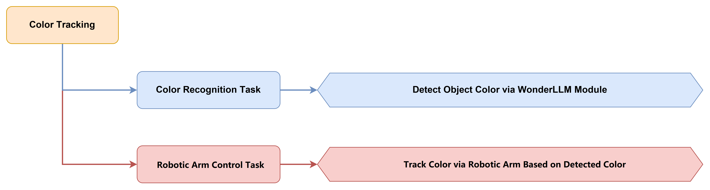

#### 5.6.5.3 Module Description


The WonderLLM module integrates a high-performance ESP32-S3 chip, and programming enables functions such as color recognition and face detection. The module is equipped with an I2C interface that facilitates data exchange with various host devices, providing an efficient solution for intelligent vision applications.

Module Wiring: As shown in the figure below, connect the module to any I2C interface in the red box of the servo controller before running the program in this section.


#### 5.6.5.4 Program Download

##### 5.6.5.4.1 WonderLLM Program Download

1. Connect one end of the Type-C data cable to the interface on top of the WonderLLM and the other end to the USB port on the computer.

   

2. Open the **ColorTracking.ino** program file in the same path as this document.

   

3. Next, select the **ESP32S3 Dev Module** development board.

   

4. Click **Tools** in the menu bar, and select the corresponding ESP32S3 development board configuration as shown in the figure below.

   

5. Finally, click  to download the code to the ESP32S3, and wait for the flashing to complete.

   

##### 5.6.5.4.2 ESP32 Program Download

1. Connect the core board to the computer via a USB cable.

   

2. In the Arduino project folder at the same path as the document, find the corresponding example project file.

   

3. After opening, select the development board model, with the specific model shown in the figure below.

   

4. First click the  verify icon, and then click the  upload icon. After the upload completes, if the output box at the bottom of the software displays the following interface, the program download is complete.

   

#### 5.6.5.5 Program Outcome

When the vision module detects red, the robotic arm rotates based on the color position data.

#### 5.6.5.6 Program Analysis

1) The hardware and module library files are imported, including configuration header files, hardware abstraction layer library, robotic arm control library, motor control library, WonderLLM_Vision vision module library, ultrasonic module library, and timer library.

```cpp
#include "Config.h"
#include "Hiwonder.hpp"
#include "Robot_arm.hpp"
#include "motor.hpp"
#include "WonderLLM_Vision.hpp"
#include "Ultrasound.hpp"
#include "Ticker.h"
```

2) The screen center coordinates and global variables are defined. `CENTER_X` and `CENTER_Y` are defined as 120 and 120, respectively, representing the image center position. The `color_info` array stores color position information (x, y, w, and h). `fsm_state` is used for state machine control. `x_bias` and `y_bias` store the offsets, and `x_inc_total` and `y_inc_total` store the cumulative servo offsets.

```cpp
// define global variables
uint8_t color_info[4];
uint8_t fsm_state = 0;
int x_bias = 0;
int y_bias = 0;
float x_inc_total = 0;
float y_inc_total = 0;
#define CENTER_X	120
#define CENTER_Y	120
```

3) In the `setup()` function, a delay of 1 second is first performed, and the Bluetooth control pin is set to a low level to disconnect the Bluetooth module power supply. Serial communication is initialized, followed by the initialization of the robotic arm, vision module, ultrasonic module, and other modules. The LED of the ultrasonic module is then turned off, and the initial position of the robotic arm is set. Finally, the buzzer is triggered to beep once to indicate that system startup is complete, and the battery voltage monitoring timer is started.

```cpp
void setup() {
  delay(1000);
  pinMode(IO_BLE_CTL, OUTPUT);
  digitalWrite(IO_BLE_CTL, LOW);  // When the Bluetooth control pin is set low, disconnect the Bluetooth module power.

  pinMode(PA4, OUTPUT);
  pinMode(PA5, OUTPUT);

  Serial.begin(9600);
  arm.init();
  iic_obj.init();
  motor_obj.init(&iic_obj);
  buzzer_obj.init(IO_BUZZER);
  battery_obj.init(ADC_BAT);
  cam.init(&iic_obj);
  ult.init(&iic_obj);

  ult.Color(0, 0, 0, 0, 0, 0);
  arm.coordinate_set(15, 0, 5, 0, -90, 90, 1000);
  buzzer_obj.blink(5000 , 50, 50, 1);
  
  battery_timer.attach_ms(1000, battery_check_callback);
  
  Serial.println("begin");
  delay(1000);
}
```

4) In the `loop()` function, the program controls the color tracking process using a state machine. It first enters the `case 0` branch for target detection, calls the `cam.color_position()` function to obtain the red color position data, and stores it in the `color_info` array. After successful detection, it enters the `case 1` branch for tracking control.

```cpp
void loop() {
  switch(fsm_state)
	{
	  case 0:
      // get color coordinates
      if(cam.color_position(color_info,RED))
      {
        fsm_state = 1;
      }
		  break;
```

5. In the `case 1` branch, the offset between the target color position and the screen center position is calculated. The X-axis offset is mapped from [-120, 120] to [-2, 2] using the `map` function, accumulated into `x_inc_total`, and limited to the range [-375, 375]. The Y-axis offset is mapped from [-120, 120] to [-1.5, 1.5], accumulated into `y_inc_total`, and limited to the range [-480, 50]. The `arm.knot_run()` function is called to control the servo movement. Servo ID 6 controls X-axis tracking, and its target position is calculated as `SERVO6_RESET_DUTY` minus `x_inc_total`. Servo ID 3 controls Y-axis tracking, and its target position is calculated as 220 minus `y_inc_total`. After a 30 ms delay, the state machine is reset for the next round of detection and tracking.

   ```cpp
   	  case 1:
         // robotic arm movement
         // calculate the offset of the robotic arm, and map it to get the target position of the robotic arm
   		  x_bias = color_info[0] - CENTER_X;
         y_bias = color_info[1] - CENTER_Y;
         if(abs(x_bias) > 8){
           x_inc_total += 1 * map((float)x_bias, -120.0f, 120.0f, -2, 2);
           x_inc_total = x_inc_total < -375 ?-375 : x_inc_total > 375 ? 375: x_inc_total;
           arm.knot_run(6, (int)(SERVO6_RESET_DUTY - x_inc_total), 10);
         }
         
         if(abs(y_bias) > 8){
           y_inc_total += 1 * map((float)y_bias, -120.0f, 120.0f, -1.5, 1.5);
           y_inc_total = y_inc_total < -480 ? -480 : y_inc_total > 50 ? 50: y_inc_total;
           arm.knot_run(3, (int)(220 - (int)y_inc_total), 10);
         }
   
   		  delay(30);
   		  fsm_state = 0;
   		  break;
   	}
   }
   ```

6) The WonderLLM vision module exchanges data with the ESP32 main controller via IIC communication to implement color position detection. The `color_position()` function reads 4 bytes of color position data (x, y, w, and h) from the vision module. When the width value is greater than 0, a color is detected. The function returns true and stores the position data in the `color_info` array.

```cpp
bool HW_WonderLLM_Vision::color_position(uint8_t *color_info)
{
  int num = iic->wireReadDataArray(ESP32CAM_ADDR, index, color_info, 4);
  if((num == 4) && (color_info[2] > 0)) //receive the recognized color's x,y,w,h values
  {
    return true;
  }
  return false;
}
```


### 5.6.6 Face Detection

#### 5.6.6.1 Project Introduction

This lesson uses the WonderLLM vision module to detect human faces and control the robotic arm to execute action groups.

#### 5.6.6.2 Implementation Process

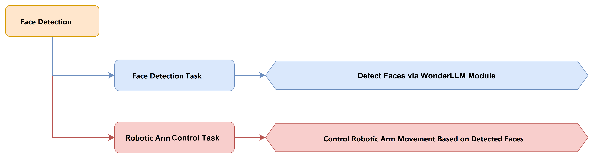

#### 5.6.6.3 Module Description


The WonderLLM module features a built-in high-performance ESP32-S3 chip, enabling color recognition and face detection through programming. The module is equipped with an I2C interface for convenient data exchange with various controllers, providing an efficient solution for intelligent vision applications.

Module Wiring: As shown in the figure below, connect the module to any I2C interface in the red box of the servo controller before running the program in this section.


#### 5.6.6.4 Program Download

##### 5.6.6.4.1 WonderLLM Program Download

1. Connect one end of the Type-C cable to the interface on top of the WonderLLM, and the other end to the USB port of the computer.

   

2. Open the program file [**FaceDetection.ino**](https://drive.google.com/file/d/1Lny5_Sc50DQnuWQfnwSl6jQUatZnbIRO/view?usp=sharing) in the same directory as this document.

   

3. Next, select the **ESP32S3 Dev Module** development board.

   

4. Click **Tools** on the menu bar, and then select the corresponding ESP32S3 development board configuration as shown in the figure below.

   

5. Finally, click  to upload the code to the ESP32S3, and wait for the flashing to complete.

   

##### 5.6.6.4.2 ESP32 Program Download

1. Connect the core board to the computer via a USB cable.

   

2. Find the corresponding example project file in the Arduino project folder [Tankbot_ESP32_Arduino](https://drive.google.com/drive/folders/1gAg-MQjs3rLlgM7A-VheDByB7nNqkEJY?usp=sharing) at the same path as the document.

   

3. After opening, select the development board model as shown in the figure below.

   

4. First click the  verify icon, and then click the  upload icon. After the upload completes, if the output box at the bottom of the software displays the following interface, the program download is complete.

   

#### 5.6.6.5 Program Outcome

When the vision module detects a face, the buzzer sounds an alert, and the robotic arm executes preset action group 5 before returning to the initial position.

#### 5.6.6.6 Program Analysis

1) The hardware library and module library files are imported, including the configuration header file, hardware abstraction layer library, robotic arm control library, motor control library, WonderLLM_Vision vision module library, and timer library.

```cpp
#include "Config.h"
#include "Hiwonder.hpp"
#include "Robot_arm.hpp"
#include "motor.hpp"
#include "WonderLLM_Vision.hpp"
#include "Ticker.h"
```

2) System function objects and module objects are created, including objects for the buzzer, battery, robotic arm, IIC communication, motor, and vision module. Additionally, a timer object was created for battery voltage monitoring.

```cpp
Buzzer_t buzzer_obj;
Battery_t battery_obj;
RobotArm_t arm;

IIC iic_obj;
Motor motor_obj;
HW_WonderLLM_Vision cam;
Ticker battery_timer;
float voltage;
```

3) In the `setup()` function, the system first delays for 1 second and pulls the Bluetooth control pin low to disconnect power from the Bluetooth module. It then initializes serial communication, followed by initialization of the robotic arm, I2C communication, motor, buzzer, battery, and vision module. Afterward, the system sets the initial position of the robotic arm and triggers a single beep from the buzzer to indicate successful system startup. Finally, the battery voltage monitoring timer is started.

```cpp
void setup() {
  delay(1000);
  pinMode(IO_BLE_CTL, OUTPUT);
  digitalWrite(IO_BLE_CTL, LOW);  // Set the Bluetooth control pin to low level to disconnect the Bluetooth module power

  pinMode(PA4, OUTPUT);
  pinMode(PA5, OUTPUT);

  Serial.begin(9600);
  arm.init();
  iic_obj.init();
  motor_obj.init(&iic_obj);
  buzzer_obj.init(IO_BUZZER);
  battery_obj.init(ADC_BAT);
  cam.init(&iic_obj);

  arm.coordinate_set(15, 0, 5, 0, -90, 90, 1000);
  buzzer_obj.blink(5000 , 50, 50, 1);
  
  battery_timer.attach_ms(1000, battery_check_callback);
  
  Serial.println("begin");
  delay(1000);
}
```

4) The `cam.faceDetect()` function is called in the `loop()` function to detect faces. When a face is detected with `result` set to true, the buzzer sounds for 100 ms as a prompt, and the robotic arm executes preset action group 5 via `action_run(5,1)`. After a 200 ms delay, action group 0 is executed to restore the initial position. Once the actions are completed, the `result` flag is cleared, and the system waits for the next detection.

```cpp
bool result;

void loop() {
  // get face information
  result = cam.faceDetect();
  if(result){
    // buzzer sounds
    buzzer_obj.blink(1500 , 100, 100 , 1);
    // arm movement
    arm.action_run(5,1);
    delay(200);
    // return to initial position
    arm.action_run(0,1);
    result = false;
  }
  delay(100);
}
```

5) The WonderLLM vision module exchanges data with the ESP32 main controller via IIC communication to implement the face detection function. The `faceDetect()` function reads 4 bytes of face position data (x, y, w, h) from register `0x01` of the vision module. When the width value in `face_info[2]` is greater than 0, a face is detected and the value of `true` is returned. Otherwise, the value of `false` is returned.

```cpp
bool HW_WonderLLM_Vision::faceDetect(void)
{
  uint8_t face_info[4];
  int num = iic->wireReadDataArray(WonderLLM_Vision_ADDR,0x01,face_info,4);
  if((num == 4) && (face_info[2] > 0)) // receive the recognized face's x,y,w,h values
  {
      return true;
  }
  return false;
}
```


### 5.6.7 Visual Line Following

#### 5.6.7.1 Project Introduction

In this lesson, the WonderLLM module is used to identify the red line and control the robot for line following.

#### 5.6.7.2 Implementation Process

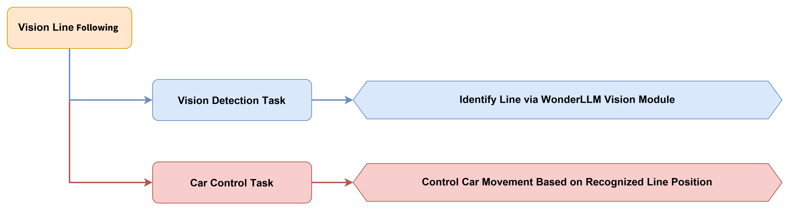

#### 5.6.7.3 Module Description


The WonderLLM module integrates a high-performance ESP32-S3 chip, enabling color recognition, face detection, and other functions through programming. The module is equipped with an I2C interface for convenient data exchange with various controllers, providing an efficient solution for intelligent vision applications.

Module Wiring: As shown in the figure below, before running the program in this section, connect the module to any I2C interface in the red box of the servo controller.


#### 5.6.7.4 Program Download

##### 5.6.7.4.1 WonderLLM Program Download

1. Connect one end of the Type-C data cable to the interface on the top of the WonderLLM and the other end to the USB port of the computer.

   

2. Open the program file [**ColorDetection.ino**](https://drive.google.com/file/d/1ccXA_WiMWh_-KUfqBOlry44uEm3lb1h7/view?usp=sharing) in the same directory as this document.

   

3. Next, select the **ESP32S3 Dev Module** development board.

   

4. Click **Tools** in the menu bar, and select the corresponding ESP32-S3 development board configuration as shown below.

   

5. Finally, click  to upload the code to the ESP32-S3, and wait for the flashing to complete.

   

##### 5.6.7.4.2 ESP32 Program Download

1. Connect the core board to the computer using a USB cable.

   

2. Find the corresponding example project file in the Arduino project folder [Tankbot_ESP32_Arduino](https://drive.google.com/drive/folders/1lrROQNDnToZc0OsEPaJL6fkcEtZUM2OZ?usp=sharing) at the same path as the document.

   

3. After opening, select the development board model. The specific model is shown in the figure below:

   

4. First click the  verify icon, and then click the  upload icon. After the upload completes, if the output box at the bottom of the software displays the following interface, the program download is complete.

   

#### 5.6.7.5 Program Outcome

After the vision module detects the red line, the robot moves along the line.

#### 5.6.7.6 Program Analysis

1) Hardware and module library files are imported, including configuration header files, the hardware abstraction layer library, the robotic arm control library, the motor control library, the WonderLLM_Vision vision module library, the chassis control library, and the timer library. A custom map function is also declared for value mapping.

```cpp
#include "Config.h"
#include "Hiwonder.hpp"
#include "Robot_arm.hpp"
#include "motor.hpp"
#include "WonderLLM_Vision.hpp"
#include "differential_chassis.hpp"
#include "Ticker.h"

static float map(float x, float in_min, float in_max, float out_min, float out_max);
```

2)  The system function objects and module objects are created, including the buzzer, battery, robotic arm, IIC communication, motor, and vision module. A timer object is also created for battery voltage monitoring. Variables related to the center coordinates and state machine are defined for vision-based line following control.

```cpp
Buzzer_t buzzer_obj;
Battery_t battery_obj;
RobotArm_t arm;

IIC iic_obj;
Motor motor_obj;
HW_WonderLLM_Vision cam;
Ticker battery_timer;
float voltage;

// define global variables
#define CENTER_X	80
#define CENTER_Y	60

uint8_t fsm_state = 0;
int x_bias = 0;
int x_bias_abs = 0;
float x_inc_total = 0;
```

3) In the `setup()` function, a 1-second delay is first executed, and the Bluetooth control pin is set to a low level to disconnect the Bluetooth module power. Serial communication is then initialized, followed by the initialization of the robotic arm, IIC communication, motor, buzzer, battery, and vision module. Chassis movement is stopped, and the buzzer sounds to indicate system startup. The robotic arm position is set to (16,0,-7) to orient the camera downward for line following. Finally, the battery voltage monitoring timer is started.

```cpp
void setup() {
  delay(1000);
  pinMode(IO_BLE_CTL, OUTPUT);
  digitalWrite(IO_BLE_CTL, LOW);  // when setting the Bluetooth control pin to low level, disconnect the Bluetooth module power

  Serial.begin(9600);
  arm.init();
  iic_obj.init();
  motor_obj.init(&iic_obj);
  buzzer_obj.init(IO_BUZZER);
  battery_obj.init(ADC_BAT);
  cam.init(&iic_obj);

  differentials_chassis_run(0.0f, 0.0f);
  buzzer_obj.blink(1500 , 50, 50, 1);
  arm.coordinate_set(16, 0, -7, 0, -90, 90, 1000);
  
  battery_timer.attach_ms(1000, battery_check_callback);
  
  Serial.println("begin");
  delay(1000);
}
```

4) In the `loop()` function, the program controls the line-following process through a state machine. In the `case 0` state, the `cam.color_position(RED)` function is called to obtain the position information of the red line. After successful detection, the program switches to the `case 1` state for chassis control.

```cpp
void loop() {
  switch(fsm_state)
  {
    case 0:
      // get position of red line
      if(cam.color_position(RED))
      {
        fsm_state = 1;
      }
      break;
```

5) In `case 1` state, the system first checks whether the area of the detected red region is greater than 20 pixels. If the condition is met, the X-axis offset between the red route center and the screen center is calculated, and its absolute value is used to determine whether steering correction is required.

```
    case 1:
      // Calculate offset and control chassis
      if(cam.ColorResults[RED - 1][2] * cam.ColorResults[RED - 1][3] > 20){
        x_bias = cam.ColorResults[RED - 1][0] - CENTER_X;
        x_bias_abs = abs(x_bias);
```

6) When the absolute offset value is greater than 1, the `map` function maps the X-axis offset from [-80, 80] to a steering speed in the range [-0.35, 0.35]. If the steering speed is greater than 0.05 or less than -0.05, the robotic car moves forward at a speed of 50 and performs a steering correction. Otherwise, the robotic car moves straight forward at a speed of 50. After completion, the state machine is reset to prepare for the next round of detection.

```cpp
        if(x_bias_abs > 1)
        {
          x_inc_total = map((float)x_bias, -80.0f, 80.0f, -0.35, 0.35);


          if(x_inc_total > 0.05 || x_inc_total < -0.05){
            differentials_chassis_run(50.0f, -x_inc_total);
          }else{
            differentials_chassis_run(50.0f, 0.0f);
          }
        }
      }
      fsm_state = 0;
      break;
  }
  delay(10);
}
```

7) The custom `map` function implements numeric mapping, linearly mapping the input value x from [in_min, in_max] to [out_min, out_max]. This function is used to convert visual offsets into chassis steering speed.

```cpp
static float map(float x, float in_min, float in_max, float out_min, float out_max)
{
    return out_min + (x - in_min) * ((out_max - out_min) / (in_max - in_min));
}
```

8) The WonderLLM vision module exchanges data with the ESP32 main controller through IIC communication, implementing the color position detection function. The `color_position()` function reads 4 bytes of color position data (x, y, w, h) from the corresponding register according to the specified color index `RED=1`. A width value greater than 0 indicates that a color is detected, and the data is then stored in the `ColorResults` array.

```cpp
bool HW_WonderLLM_Vision::color_position(uint8_t ColorIndex)
{
  int num = iic->wireReadDataArray(WonderLLM_Vision_ADDR, ColorIndex - 1, ColorResults[ColorIndex - 1], 4);
  if((num == 4) && (ColorResults[ColorIndex - 1][2] > 0)) //receive recognized color x,y,w,h values
  {
    return true;
  }
  return false;
}
```

## 5.7 Serial Communication Practical Course

### 5.7.1 Device Master-Slave Communication Principle

This section provides detailed information about the master-slave relationship when Tankbot communicates with different devices, such as a PC host, Arduino, and Raspberry Pi. The communication between a PC host and Tankbot is used as an example to explain how Tankbot acts as a slave device when communicating with other devices and how other devices act as master devices to control Tankbot.

In this section, Tankbot serves as a slave device, transmitting data with other devices via the UART serial port.

> [!NOTE]
>
> **The communication protocol used by other host computers to communicate with Tankbot is the Tankbot PC Software & App Communication Protocol. The analysis of the program parsing command frames sent by the PC software and controlling the robotic arm to perform corresponding operations has been presented in 5.2 Basic Development Project Course\PC Software Control. This topic is not further elaborated here.**

#### 5.7.1.1 Master-Slave Relationship

In the master-slave control system, the Tankbot serves as the slave device, while other devices such as microcontrollers act as the master.

* **Functions of Tankbot as a Slave Device**

1) The signals sent by the host are received and parsed:

The system waits for a serial port signal. When data is received, the data is parsed according to the communication protocol, and the corresponding function is called based on the data information.

2) Calling Tankbot functions based on received data:

When a signal is parsed, the corresponding Tankbot device function is invoked, such as action group invocation, single/multi-servo control, etc.

3) Data Encapsulation and Feedback:

When a read command is received, the corresponding read function is called. The read data is then encapsulated into a data packet according to the communication protocol and sent to the host device.

* **Other Devices as Master Devices**

1) Command Encapsulation and Transmission:

The host encapsulates control commands and data into data packets according to the communication protocol, and sends them to the device.

2) Control Coordination:

The host device is responsible for managing the collaborative operation of the entire system, ensuring conflict-free communication and operation between the Tankbot and other devices, and maintaining a good working condition.

3) Data Reception:

When the host device reads the robot status, a read command is sent, and the status data transmitted by Tankbot is subsequently received. The integrity and correctness of the data are ensured, and the data packet is parsed to extract useful information.

#### 5.7.1.2 Hardware Connection

> [!NOTE]
>
> **Before downloading the program, confirm that the serial port driver is installed.**

Connect the USB download cable between the USB port on the computer and the USB serial port on the motherboard.


#### 5.7.1.3 Data Transfer Format

The default UART serial data transmission format of Tankbot is:

| Baud rate | 9600 |
| :-------: | :--: |
| Data bits |  8   |
|  Parity   | None |
| Stop bits |  1   |

### 5.7.2 Tankbot PC Software & App Communication Protocol

#### 5.7.2.1 Protocol Format

| Frame Header 1 | Frame Header 2 | Data length | Function number | Data parameters |
| -------------- | -------------- | ----------- | --------------- | --------------- |
| 0 x 55         | 0 x 55         | Length      | CMD             | Parameter 1~N   |

#### 5.7.2.2 Function

* **Firmware Query**

Data length: 2

Function number: 1

Data parameters: None

Return content

| Frame Header 1 | Frame Header 2 | Data length | Function number | Data parameter 1                           | Data parameter 2 |
| -------------- | -------------- | ----------- | --------------- | ------------------------------------------ | ---------------- |
| 0 x 55         | 0 x 55         | 3           | 1               | Servo type 1-PWM digital servo 2-Bus servo | Firmware version |

* **Servo Deviation Reading**

**Description: Reading the deviation values of all servos**

Data length: 14

Function number: 2

Data parameters: None

Return content

| Frame Header 1 | Frame Header 2 | Data length | Function number | Parameter 1     | Parameter 2     | ...                                                      |
| -------------- | -------------- | ----------- | --------------- | --------------- | --------------- | -------------------------------------------------------- |
| 0 x 55         | 0 x 55         | 14          | 2               | Servo ID number | Deviation value | Subsequent parameters are the same as parameters 1 and 2 |

* **Single/Multiple Servo Pulse Width Control**

Data length: number of controlled servos × 3 + 5

Function number: 3

Data Parameters

| Parameter content                                            |
| ------------------------------------------------------------ |
| Parameter 1: total number of controlled servos               |
| Parameter 2: low 8 bits of servo running time                |
| Parameter 3: high 8 bits of servo running time               |
| Parameter 4: servo ID                                        |
| Parameter 5: low 8 bits of servo pulse width value           |
| Parameter 6: high 8 bits of servo pulse width value          |
| Subsequent data parameters follow the same pattern as parameters 4, 5, and 6 to control servos with different IDs |

Return content: None

* **Coordinate Control**

Data length: 5

Function number: 4

Data Parameters

| Parameter content                                            |
| ------------------------------------------------------------ |
| Parameter 1: X-axis coordinate increment of the controlled body frame |
| Parameter 2: Y-axis coordinate increment of the controlled body frame |
| Parameter 3: Z-axis coordinate increment of the controlled body frame |

Return content: None

* **Action Group Execution**

Data length: 5

Function number: 6

Data Parameters

| Parameter content                                            |
| ------------------------------------------------------------ |
| Parameter 1: number of the action group to run               |
| Parameter 2: low 8 bits of the execution count of the action group |
| Parameter 3: high 8 bits of the execution count of the action group |

Return content: None

* **Stop Running Action Group**

Data length: 2

Function number: 7

Data parameters: None

Return content: None

* **Erase the action group downloaded to the control board**

Data length: 2

Function number: 8

Data parameters: None

Return content

| Frame Header 1 | Frame Header 2 | Data length | Function number |
| -------------- | -------------- | ----------- | --------------- |
| 0 x 55         | 0 x 55         | 2           | 8               |

* **Chassis Control**

Data length: 4

Function number: 9

Data Parameters

| Parameter content                                            | Description                                                  |
| ------------------------------------------------------------ | ------------------------------------------------------------ |
| Parameter 1: controls forward, backward, left translation, and right translation | 0-stop 1-turn left 2-diagonal forward left 3-forward 4-diagonal forward right 5-translate right 6-diagonal backward right 7-backward 8-diagonal backward left |
| Parameter 2: controls in-place left rotation and in-place right rotation | 0-stop 1-rotate left in place 2-rotate right in place        |

Return content: None

* **Servo Deviation Setting**

Data length: 4

Function number: 10

Data Parameters

| Parameter content            |
| ---------------------------- |
| Parameter 1: servo ID        |
| Parameter 2: deviation value |

Return content: None

* **Servo Deviation Download**

Data length: 14

Function number: 11

Data Parameters

| Parameter content                                            |
| ------------------------------------------------------------ |
| Parameter 1: servo ID number                                 |
| Parameter 2: servo pulse width deviation value               |
| Subsequent data parameters follow the same pattern as parameters 1 and 2, downloading pulse width deviation values for servos with different IDs |

Return content

| Frame Header 1 | Frame Header 2 | Data length | Function number |
| -------------- | -------------- | ----------- | --------------- |
| 0 x 55         | 0 x 55         | 2           | 11              |

* **Servo Initial Pose Setting**

Data length: 2

Function number: 12

Data parameters: None

Return content: None

* **Servo Angle Readback**

Data length: 2

Function number: 13

Data Parameters: None

Return content

| Frame Header 1 | Frame Header 2 | Data length | Function number | Parameter 1 | Parameter 2                | Parameter 3                 | ...                                                          |
| -------------- | -------------- | ----------- | --------------- | ----------- | -------------------------- | --------------------------- | ------------------------------------------------------------ |
| 0 x 55         | 0 x 55         | 20          | 13              | Servo ID    | Servo pulse width low byte | Servo pulse width high byte | Subsequent parameters follow the same pattern as parameters 1, 2, and 3 |

* **Chassis Speed Setting**

Data length: 3

Function number: 14

Data Parameters

| Parameter content      | Description                    |
| ---------------------- | ------------------------------ |
| Parameter 1: car speed | Value range 50~100, default 80 |

Return content: None

* **Power Supply Voltage Reporting**

Data length: 4

Function number: 15

Data Parameters

| Parameter content | Description: unit mV       |
| ----------------- | -------------------------- |
| Parameter 1:      | Low eight bits of voltage  |
| Parameter 2:      | High eight bits of voltage |

Return content: None

* **Action Group Download**

**Explanation: The action group is downloaded to the control board frame by frame until all action frames are downloaded.**

Data length: number of controlled servos × 3 + 8

Function number: 25

Data Parameters

| Parameter content                                            |
| ------------------------------------------------------------ |
| Parameter 1: action group number to download                 |
| Parameter 2: total frame count of the action group           |
| Parameter 3: action frame number                             |
| Parameter 4: total number of servos to download              |
| Parameter 5: low 8 bits of control time                      |
| Parameter 6: high 8 bits of control time                     |
| Parameter 7: servo ID                                        |
| Parameter 8: low 8 bits of servo pulse width value           |
| Parameter 9: high 8 bits of servo pulse width value          |
| Subsequent data parameters follow the same sequence as parameters 7, 8, and 9, downloading servo pulse width values for different servo IDs |

Return content

| Frame Header 1 | Frame Header 2 | Data length | Function number |
| -------------- | -------------- | ----------- | --------------- |
| 0 x 55         | 0 x 55         | 2           | 25              |
