## 6.1 Programming Tool Installation and Introduction

[TOC]

### 6.1.1 Development Environment Setup

> [!NOTE]
>
> **After the Keil software installation is complete, activate the software. Otherwise, compilation failures may occur, affecting normal use.**

#### 6.1.1.1 Keil Software Installation

Keil is powerful software specifically developed for microcontrollers. The installation process is identical across all versions. This section uses V5.36 as an example.

1. Navigate to the path [**Programming Tool Installation Package\01 Keil MDK\01 MDK536**]() and double-click the **mdk536.exe** file.

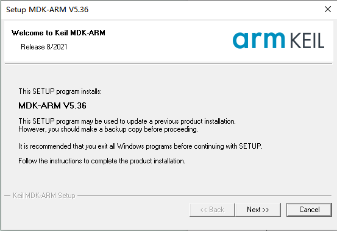

2. Tick the checkbox to accept the installation agreement.

3. Select the installation path.

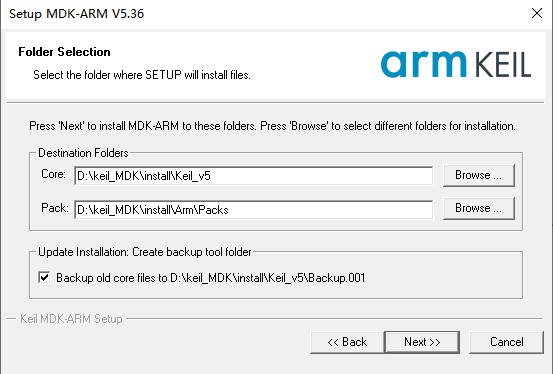

4. Enter the information here. Any content is acceptable.

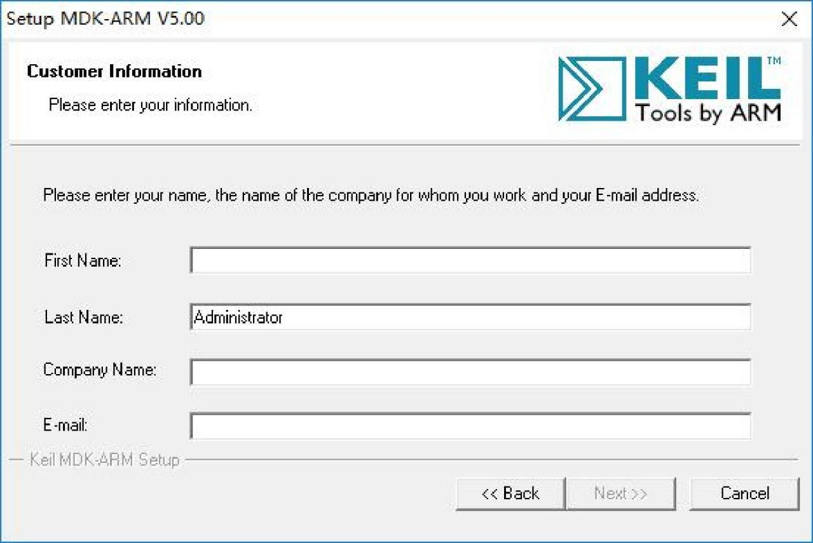

5. After completing the entries, click **Next** to enter the installation process.

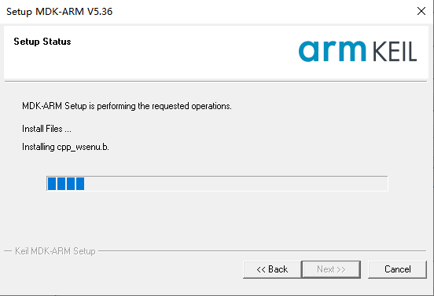

6. Wait a moment, and a prompt for installing the ULink driver appears. Then click **Install**.

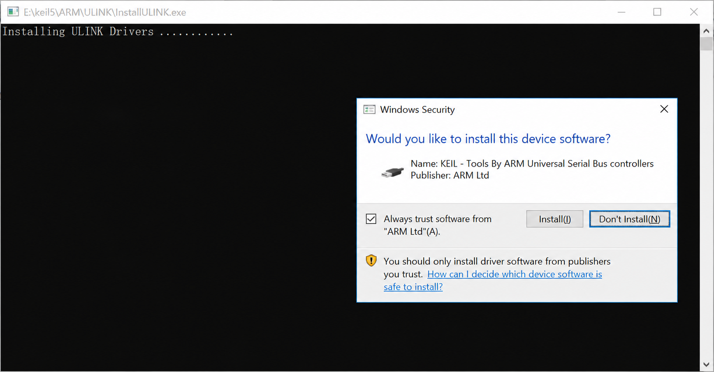

7. After the installation is completed, click **Finish**.

#### 6.1.1.2 Configuration Tasks

* **Adding Chip Support Package**

After installing the Keil5 software as described earlier, the required chip package must be installed manually. The chip package can be found in the directory [**Programming Tool Installation Package\01 Keil MDK\04 STM32 Chip Support Package**]().  

1) After opening, select the corresponding chip series. The product uses **Keil.STM32F1xx_DFP.2.2.0.pack**.

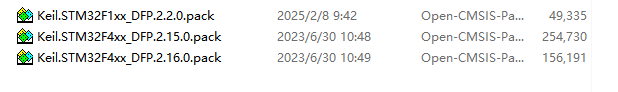

2) Double-click to open, then click **Next**.

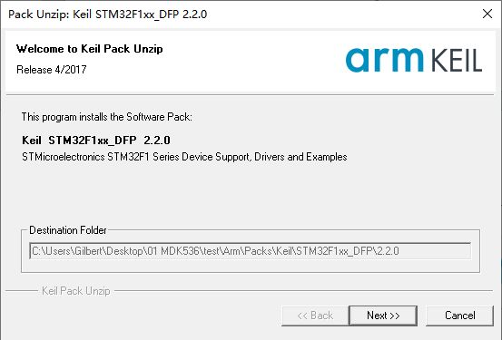

3) Wait for the installation to complete, and then click **Finish**.

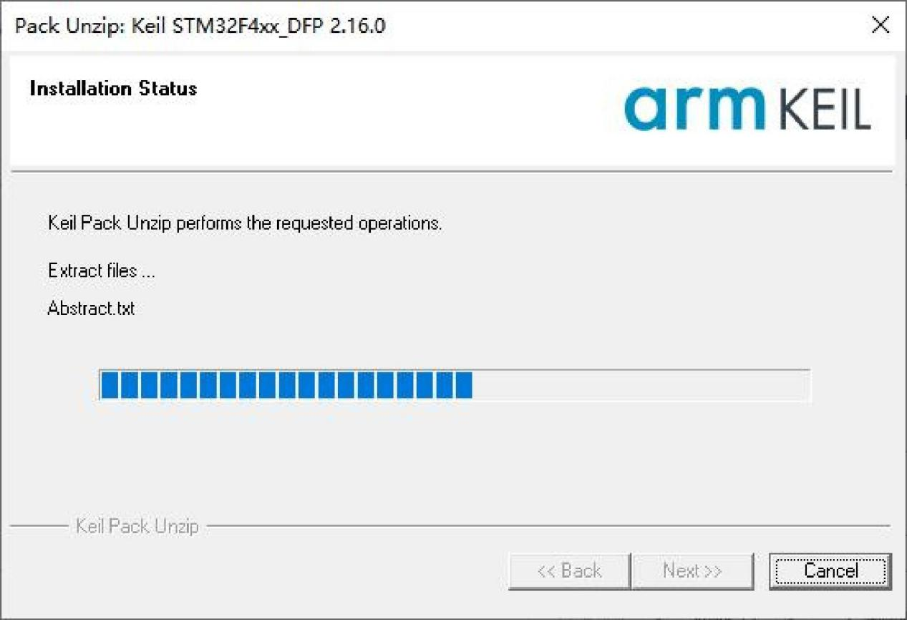

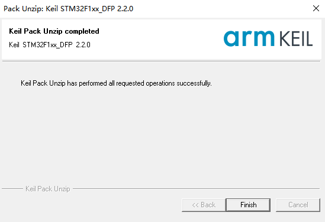

4) Click **Options for Target**.

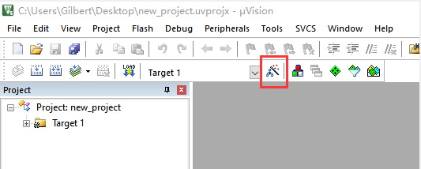

5) Click **Device**, then make a selection as shown in the figure below, and click **OK**.

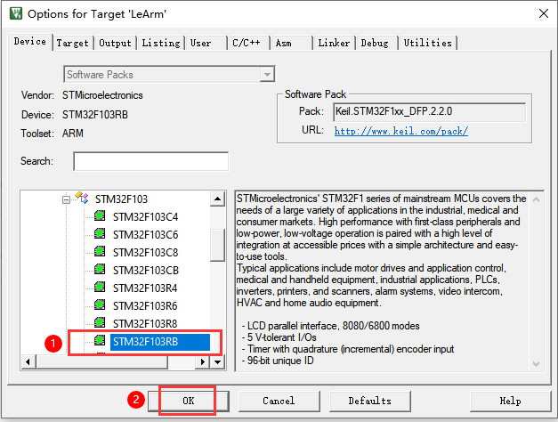

* **J-Link Driver Installation**

J-Link is a commonly used debugger/emulator that works with Keil5 for microcontroller development and debugging. Therefore, when programming and debugging microcontrollers with J-Link in Keil5, the J-Link driver must be installed.

1) The J-Link installation package can be found in the [**Programming Tool Installation Package**]() directory. Double-click to open it and click **Next**.

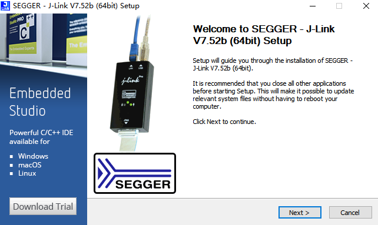

2) Then continue to click **I Agree**.

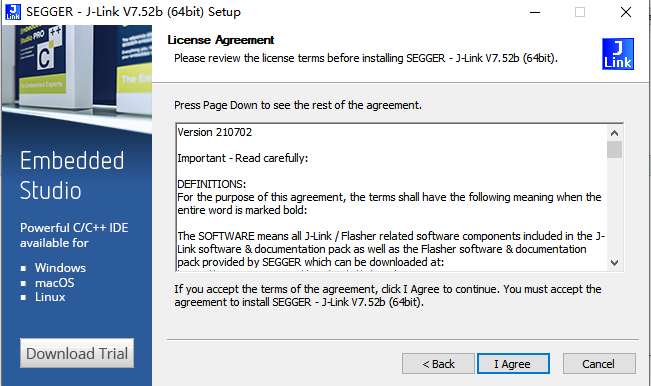

3) Choose the installation path.

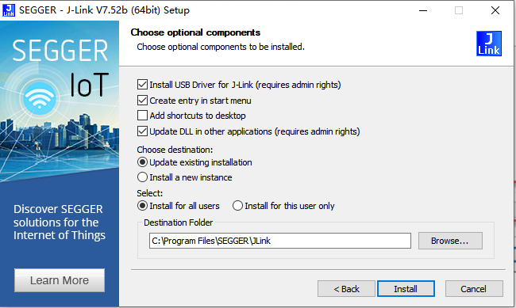

4) Wait for the installation to complete.

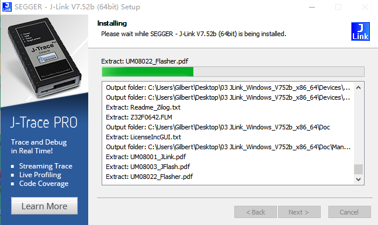

5) After installation is complete, if an upgrade prompt appears as shown in the figure below, close it.

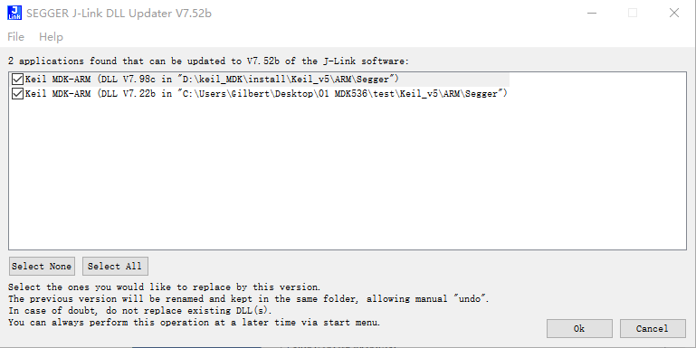

* **ST-Link Driver Installation**

In addition to the mainstream J-Link debugger, STMicroelectronics has also released the ST-Link debugger dedicated to ST series chips, which can be used with Keil5 for microcontroller development and debugging. The ST-Link also has a large audience in STM32 chip development. The USB driver installation method for the ST-Link debugger is introduced here.

1) Navigate to the [**Programming Tool Installation Package**]() directory, enter the **06 en.stsw-link004/STM32 ST-LINK Utility v4.6.0** folder, locate the **setup.exe** installation package, and double-click to run it.

> [!NOTE]
>
> **The currently provided ST-LINK USB driver supports only:**
>
> * **ST-LINK and ST-LINK/V2 debuggers**
>
> * **win7, win10, and winxp systems**
>
> * **STM32F0, STM32F1, STM32F2, STM32F3, STM32F4, STM32L4, STM32L1, STM32L0, and STM32W series chips**
>
> **To use newer versions of debuggers or higher-level operating systems, please visit the official website to download the latest driver.**

2) In the popup window, click **Run**.

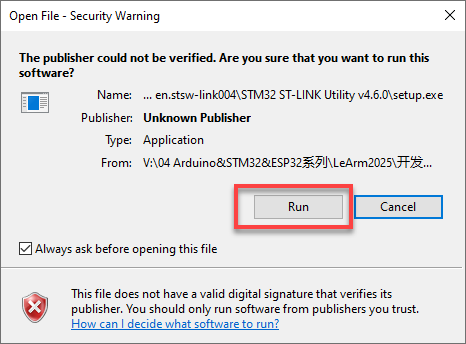

3) Click **Finish**.

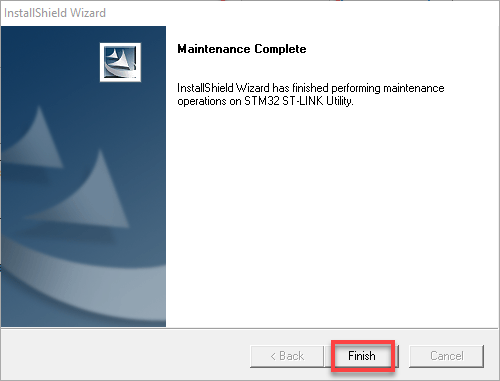

4) In the newly appeared popup, click **next**.

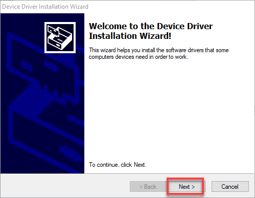

5) Click **Finish**.

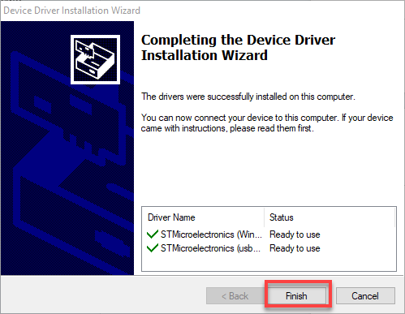

6) At this point, the ST-Link driver installation is complete.

#### 6.1.1.3 STM32CubeMX Installation

STM32CubeMX is a graphical tool for configuring STM32 microcontrollers. It enables rapid configuration of STM32 microcontroller peripherals including clocks, GPIO, interrupts, and DMA, generates initialization code, and supports multiple development environments such as Keil, IAR, and GCC.

1) The installation package is available in the directory for this section. Double-click to open it and click **Next**.

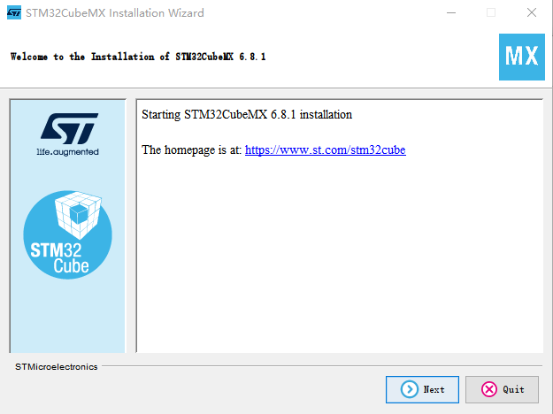

2) After agreeing to the agreement, click **Next**.

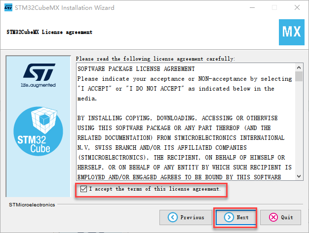

3) Check the first option above, then click **Next**.

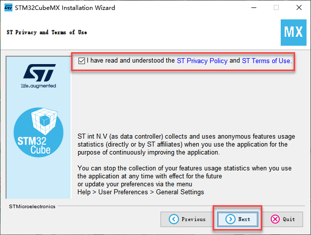

4) Select the installation path. Ensure the path contains no non-ASCII characters, then click **Next** and wait for the installation progress bar to complete.

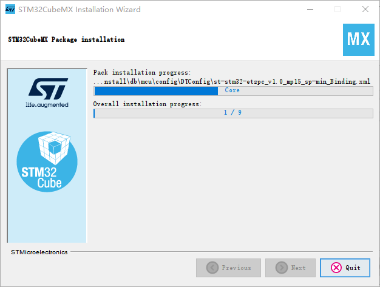

5) After the installation is complete, click **Next**, and then click **Done** to finish.

6) Double-click the installed **STM32CubeMX** software on the desktop to open it. On the initial interface, click **Help** > **Updater Settings**.

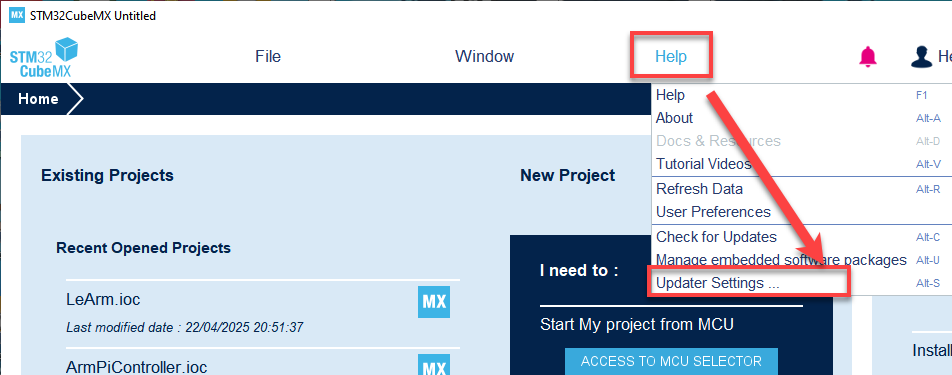

7) In the following pop-up window, locate the path where STM32CubeMX stores chip packages, copy it, paste it into File Explorer, and open it.

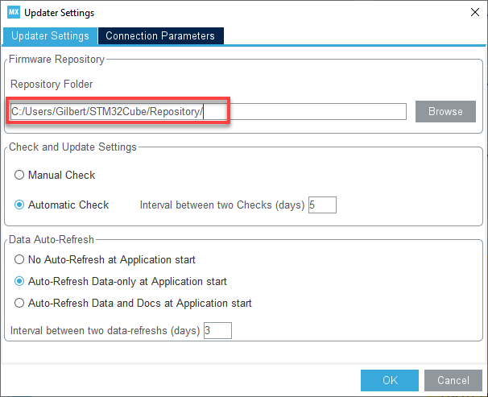

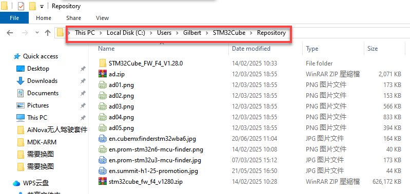

8) Extract the **02 en.stm32cubef1-v1-8-6** chip package archive under the [**Programming Tool Installation Package\02 STM32CubeMX**]() path, then copy the **STM32Cube_FW_F1_V1.8.0** subfolder inside the extracted archive to the previously opened software chip package file storage path.

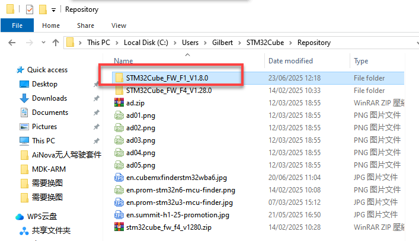

9) Return to the STM32CubeMX software interface, click **Help** > **Manage embedded software packages** to enter the chip package manager, and locate **STM32F1**. The STM32F1 series chip package V1.8.6 is already installed in the software, as indicated by the green color in the left box.

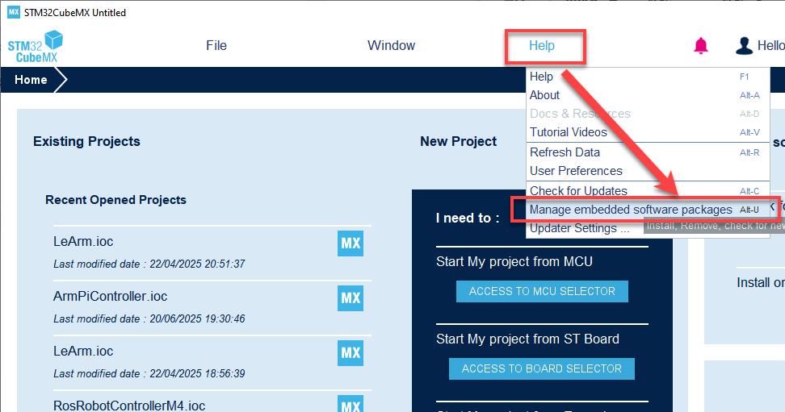

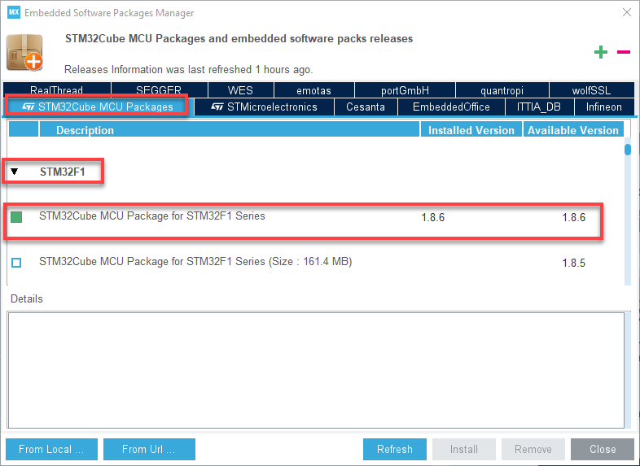

### 6.1.2 Project Compilation and Download

#### 6.1.2.1 Project Compilation

1) Open the program folder of any course in the **[6. STM32 Programming Projects]()** folder, navigate to the **Tankbot\MDK-ARM** path, and double-click the Keil project file to open the project, as shown in the figure below. Here, **Basic Development Project Course/Lighting LED** is used as an example.

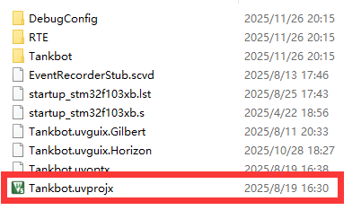

2) Open the generate hex file option in settings: In the menu bar of the Keil5 software interface, click the **Project** option, then click the **Options for Target ‘Tankbot’** button.

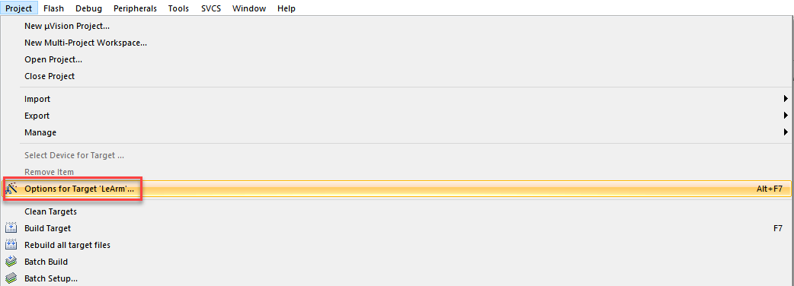

3) Click the **OutPut** option, check the three red options below, and then click **OK**.

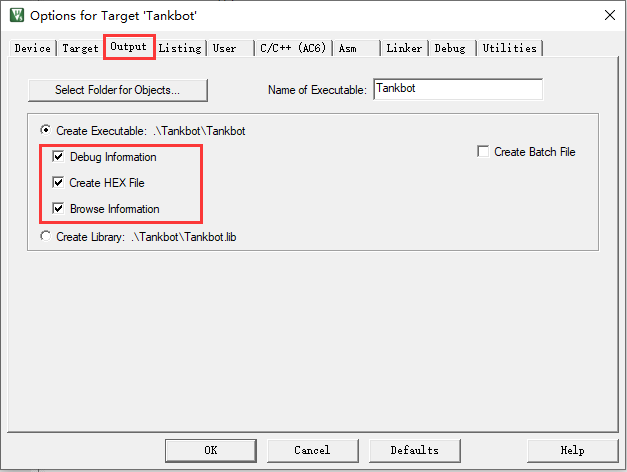

4) On the Keil5 software interface, click the **Project** option in the menu bar, and then select **Build Target** from the drop-down list to compile the project, as shown in the following figure.

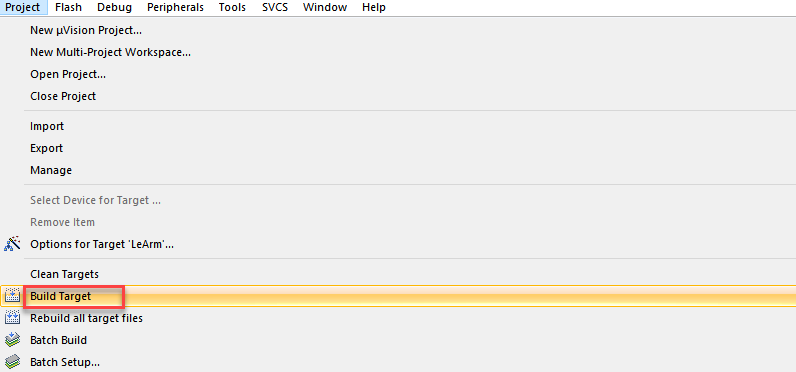

Similarly, the compile icon on the toolbar of the interface can also be clicked, as shown in the following figure:

The appearance of the following content in the **Build Output** window at the bottom of the software indicates that the compilation was successful.

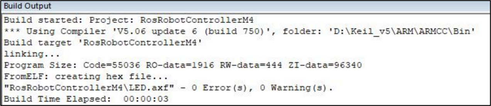

> [!NOTE]
>
> **If any error messages appear in the "Build OutPut" window after compiling the project, double-click the error line to jump to the corresponding location, correct it, and then compile again. If any warning messages appear, they can be ignored.**

5) After successful compilation, the automatically generated .hex file can be found in the program folder **Tankbot\MDK-ARM\Tankbot**, as shown in the following figure:

#### 6.1.2.2 Serial Port Driver Installation

> [!NOTE]
>
> **Before subsequent operations, ensure that the Keil software is installed. If the serial port driver for the CH341 chip has already been installed, this step can be skipped.**

1) Double-click to open **ch341ser.exe**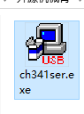 in [**Programming Tool Installation Package\04 Serial Port Driver**]() .

2) Click the **Install** button. The Install and Uninstall buttons then turn gray. After a while, a message indicates that the installation was successful.

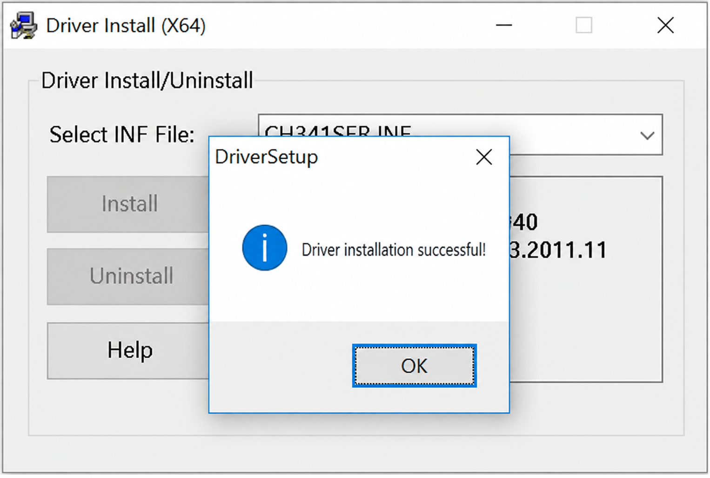

#### 6.1.2.3 Program Download Method

> [!NOTE]
>
> **Before downloading the program, confirm that the serial port driver is installed.**

1) Connect the computer USB port to the USB serial port on the mainboard using a USB download cable.

    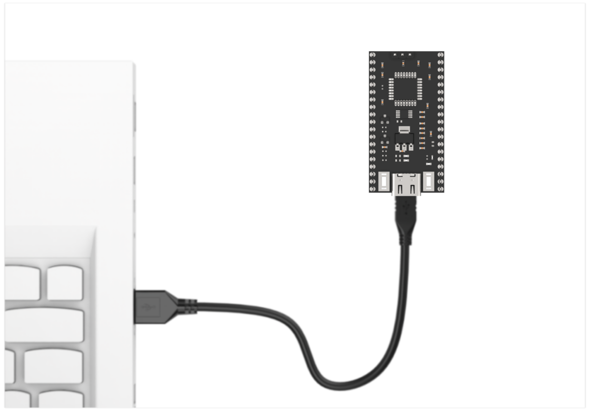

2) Double-click to open the STM32 serial port flashing software **FlyMcu** .

3) Click the **...** icon, and in the corresponding project's **Tankbot\MDK-ARM\Tankbot** path, select the HEX file to be flashed.

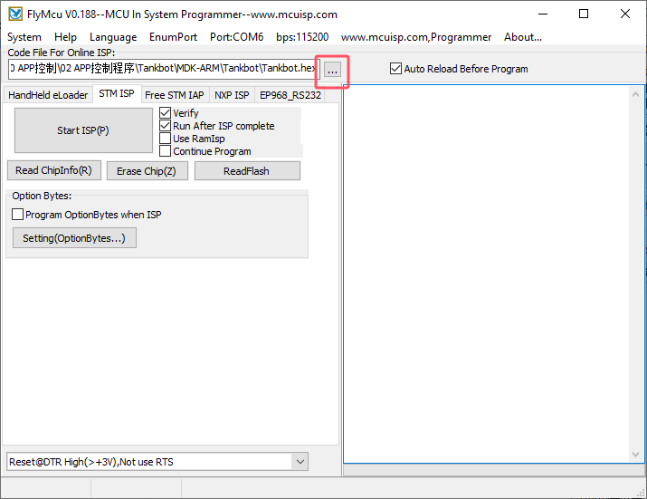

4) At position ① in the figure below, select the serial port number corresponding to the core board. At position ②, set the baud rate to 115200. At positions ③ and ④, configure according to the options shown in the figure.

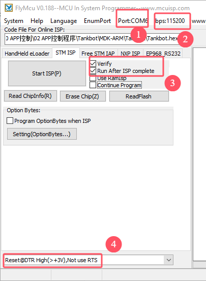

5) Click **Start ISP(P)**, press the **RST** button on the core board, and the program automatically starts downloading. When the right-side log output pane displays the following content, the program download is complete.

    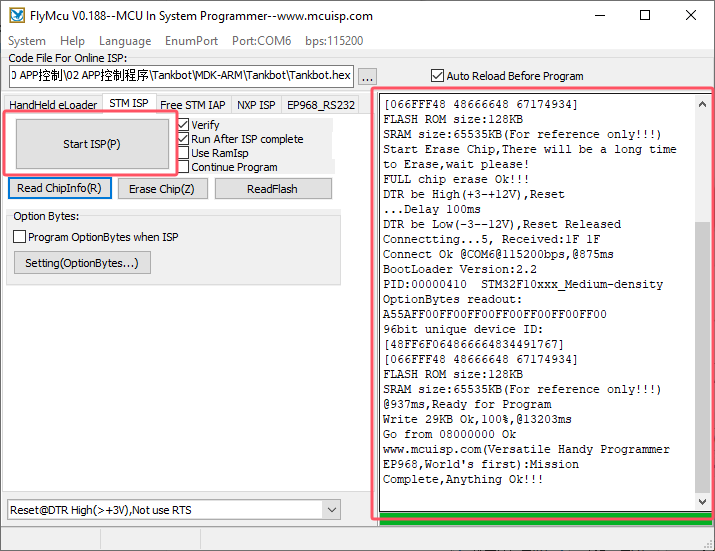