# 6 STM32 Programming Project

## 6.1 Programming Tool Installation and Introduction

### 6.1.1 Development Environment Setup

> [!NOTE]
>
> **After the Keil software installation is complete, activate the software. Otherwise, compilation failures may occur, affecting normal use.**

#### 6.1.1.1 Keil Software Installation

Keil is powerful software specifically developed for microcontrollers. The installation process is identical across all versions. This section uses V5.36 as an example.

1. Navigate to the path [**Programming Tool Installation Package\01 Keil MDK\01 MDK536**](https://drive.google.com/file/d/1-hS3pFM_aTPONW6dL_ESv25BUT_d_cmH/view?usp=sharing) and double-click the **mdk536.exe** file.


2. Tick the checkbox to accept the installation agreement.


3. Select the installation path.


4. Enter the information here. Any content is acceptable.


5. After completing the entries, click **Next** to enter the installation process.


6. Wait a moment, and a prompt for installing the ULink driver appears. Then click **Install**.


7. After the installation is completed, click **Finish**.

#### 6.1.1.2 Configuration Tasks

* **Adding Chip Support Package**

After installing the Keil5 software as described earlier, the required chip package must be installed manually. The chip package can be found in the directory [**Programming Tool Installation Package\01 Keil MDK\04 STM32 Chip Support Package**](https://drive.google.com/file/d/1qxa9iSYMsDMCEiljbDTj76FflLp4qx0-/view?usp=sharing).  

1) After opening, select the corresponding chip series. The product uses **Keil.STM32F1xx_DFP.2.2.0.pack**.


2) Double-click to open, then click **Next**.


3) Wait for the installation to complete, and then click **Finish**.


4) Click **Options for Target**.


5) Click **Device**, then make a selection as shown in the figure below, and click **OK**.


* **J-Link Driver Installation**

J-Link is a commonly used debugger/emulator that works with Keil5 for microcontroller development and debugging. Therefore, when programming and debugging microcontrollers with J-Link in Keil5, the J-Link driver must be installed.

1) The J-Link installation package can be found in the [**Programming Tool Installation Package**](https://drive.google.com/drive/folders/1Oj3Kd9ZzcOHOQkIhsOug175C3-Io_oPU?usp=sharing) directory. Double-click to open it and click **Next**.


2) Then continue to click **I Agree**.


3) Choose the installation path.


4) Wait for the installation to complete.


5) After installation is complete, if an upgrade prompt appears as shown in the figure below, close it.


* **ST-Link Driver Installation**

In addition to the mainstream J-Link debugger, STMicroelectronics has also released the ST-Link debugger dedicated to ST series chips, which can be used with Keil5 for microcontroller development and debugging. The ST-Link also has a large audience in STM32 chip development. The USB driver installation method for the ST-Link debugger is introduced here.

1) Navigate to the [**Programming Tool Installation Package**](https://drive.google.com/drive/folders/1Oj3Kd9ZzcOHOQkIhsOug175C3-Io_oPU?usp=sharing) directory, enter the **06 en.stsw-link004/STM32 ST-LINK Utility v4.6.0** folder, locate the **setup.exe** installation package, and double-click to run it.

> [!NOTE]
>
> **The currently provided ST-LINK USB driver supports only:**
>
> * **ST-LINK and ST-LINK/V2 debuggers**
>
> * **win7, win10, and winxp systems**
>
> * **STM32F0, STM32F1, STM32F2, STM32F3, STM32F4, STM32L4, STM32L1, STM32L0, and STM32W series chips**
>
> **To use newer versions of debuggers or higher-level operating systems, please visit the official website to download the latest driver.**

2) In the popup window, click **Run**.


3) Click **Finish**.


4) In the newly appeared popup, click **next**.


5) Click **Finish**.


6) At this point, the ST-Link driver installation is complete.

#### 6.1.1.3 STM32CubeMX Installation

STM32CubeMX is a graphical tool for configuring STM32 microcontrollers. It enables rapid configuration of STM32 microcontroller peripherals including clocks, GPIO, interrupts, and DMA, generates initialization code, and supports multiple development environments such as Keil, IAR, and GCC.

1) The installation package is available in the directory for this section. Double-click to open it and click **Next**.


2) After agreeing to the agreement, click **Next**.


3) Check the first option above, then click **Next**.


4) Select the installation path. Ensure the path contains no non-ASCII characters, then click **Next** and wait for the installation progress bar to complete.


5) After the installation is complete, click **Next**, and then click **Done** to finish.

6) Double-click the installed **STM32CubeMX** software on the desktop to open it. On the initial interface, click **Help** > **Updater Settings**.


7) In the following pop-up window, locate the path where STM32CubeMX stores chip packages, copy it, paste it into File Explorer, and open it.


8) Extract the **02 en.stm32cubef1-v1-8-6** chip package archive under the [**Programming Tool Installation Package\02 STM32CubeMX**](https://drive.google.com/drive/folders/1Btavy4r2xwqWWuxrvOISvzU3Rd3QHvxy?usp=sharing) path, then copy the **STM32Cube_FW_F1_V1.8.0** subfolder inside the extracted archive to the previously opened software chip package file storage path.


9) Return to the STM32CubeMX software interface, click **Help** > **Manage embedded software packages** to enter the chip package manager, and locate **STM32F1**. The STM32F1 series chip package V1.8.6 is already installed in the software, as indicated by the green color in the left box.


### 6.1.2 Project Compilation and Download

#### 6.1.2.1 Project Compilation

1) Open the program folder of any course in the **[6. STM32 Programming Projects](https://drive.google.com/drive/folders/1IQjcp_pKQKn2VKylGtdhWTOS2e6wgCGB?usp=sharing)** folder, navigate to the **Tankbot\MDK-ARM** path, and double-click the Keil project file to open the project, as shown in the figure below. Here, **Basic Development Project Course/Lighting LED** is used as an example.


2) Open the generate hex file option in settings: In the menu bar of the Keil5 software interface, click the **Project** option, then click the **Options for Target ‘Tankbot’** button.


3) Click the **OutPut** option, check the three red options below, and then click **OK**.


4) On the Keil5 software interface, click the **Project** option in the menu bar, and then select **Build Target** from the drop-down list to compile the project, as shown in the following figure.


Similarly, the compile icon on the toolbar of the interface can also be clicked, as shown in the following figure:


The appearance of the following content in the **Build Output** window at the bottom of the software indicates that the compilation was successful.


> [!NOTE]
>
> **If any error messages appear in the "Build OutPut" window after compiling the project, double-click the error line to jump to the corresponding location, correct it, and then compile again. If any warning messages appear, they can be ignored.**

5) After successful compilation, the automatically generated .hex file can be found in the program folder **Tankbot\MDK-ARM\Tankbot**, as shown in the following figure:


#### 6.1.2.2 Serial Port Driver Installation

> [!NOTE]
>
> **Before subsequent operations, ensure that the Keil software is installed. If the serial port driver for the CH341 chip has already been installed, this step can be skipped.**

1) Double-click to open **ch341ser.exe** in [**Programming Tool Installation Package\04 Serial Port Driver**](https://drive.google.com/drive/folders/1Oj3Kd9ZzcOHOQkIhsOug175C3-Io_oPU?usp=sharing) .

2) Click the **Install** button. The Install and Uninstall buttons then turn gray. After a while, a message indicates that the installation was successful.


#### 6.1.2.3 Program Download Method

> [!NOTE]
>
> **Before downloading the program, confirm that the serial port driver is installed.**

1) Connect the computer USB port to the USB serial port on the mainboard using a USB download cable.

    

2) Double-click to open the STM32 serial port flashing software **FlyMcu** .

3) Click the **...** icon, and in the corresponding project's **[Tankbot\MDK-ARM\Tankbot](https://drive.google.com/drive/folders/1o4xIqZK-diugT94O0Wydy2Vfql80v7MK?usp=sharing)** path, select the HEX file to be flashed.


4) At position ① in the figure below, select the serial port number corresponding to the core board. At position ②, set the baud rate to 115200. At positions ③ and ④, configure according to the options shown in the figure.


5) Click **Start ISP(P)**, press the **RST** button on the core board, and the program automatically starts downloading. When the right-side log output pane displays the following content, the program download is complete.

    

## 6.2 Basic Development Project Course

### 6.2.1 LED Lighting

#### 6.2.1.1 Project Introduction

The program causes the LEDs on the control board to blink.

#### 6.2.1.2 Implementation Process

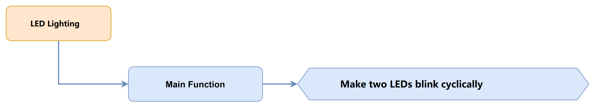

#### 6.2.1.3 Module Description


The LED module is a common human-machine interaction component in embedded systems and development boards, primarily used for status indication, information feedback, and control function implementation. Its typical application scenarios include system debugging, visualization of operating status, and execution feedback for specific operation commands.

The LEDs on the servo controller and the core board use a common-anode design: the anode is connected to the 3.3 V power supply through a current-limiting resistor, and the cathode is connected to the main control GPIO. The LED turns off when the GPIO outputs a high level, 3.3 V and turns on when it outputs a low level, 0 V.

#### 6.2.1.4 Program Download

> [!NOTE]
>
> **Before downloading the program, confirm that the serial port driver has been installed.**

1) Connect the core board to the computer via a USB cable.


2) Double-click to open the STM32 serial port flashing software **FlyMcu**.

3) Click the **...** icon, and in the corresponding project's **Tankbot\MDK-ARM\Tankbot** path, select the HEX file to be flashed.

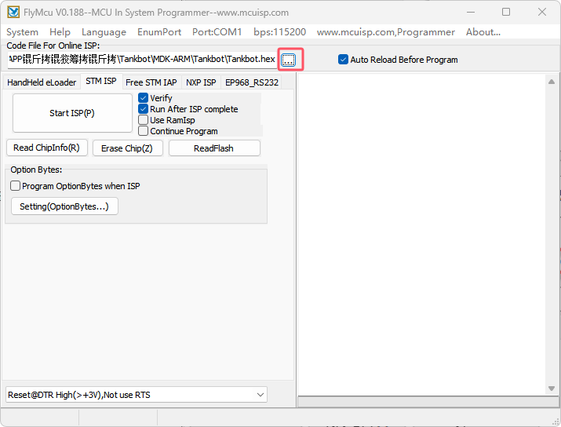

4) At position ① in the figure below, select the serial port corresponding to the core board. At position ②, set the baud rate to 115200. At positions ③ and ④, configure according to the options shown in the figure.


5) Click **Start ISP(P)**, press the **RST** button on the core board, and the program automatically starts downloading. When the right-side log output pane displays the following content, the program download is complete.

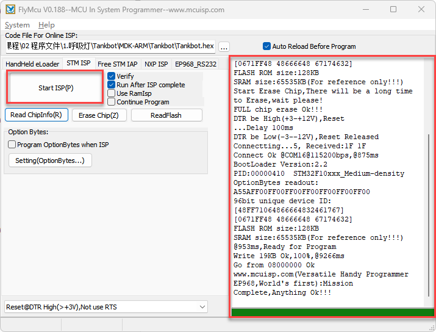

#### 6.2.1.5 Program Outcome

After the robotic arm completes the system power-on initialization, the LED1 and LED2 indicators on the controller panel enter synchronized blinking mode at a frequency of 1 Hz.

#### 6.2.1.6 Program Analysis

* **main.c File (Business Layer)**

1. The `led.h` and `global.h` library files are imported, where `led.h` contains the LED control functions and `global.h` declares the LED control objects.

```c
/* USER CODE END Header */
/* Includes ------------------------------------------------------------------*/
#include "main.h"
#include "adc.h"
#include "dma.h"
#include "i2c.h"
#include "spi.h"
#include "tim.h"
#include "usart.h"
#include "gpio.h"

/* Private includes ----------------------------------------------------------*/
/* USER CODE BEGIN Includes */

#include "global.h"
#include "stdio.h"
#include "stdlib.h"
#include "led.h"
#include "buzzer.h"
#include "robot_arm.h"
#include "adc_sample.h"
```

2. In the `main` function, the `led_init` function is called to initialize the two LED objects, assign their numbers, and bind them to the chip pins. The `robot_arm_init` function is called to initialize the servo control interface, read the action group and servo deviation data, initialize the robotic arm kinematics functions, and reset the arm to the initial position. The `led_flash` function is called for LED 1 and LED 2 to blink with an on duration of 1000 ms and an off duration of 1000 ms, repeated 0 times (continuous blinking).

```c
  /* USER CODE BEGIN 2 */
	led_init();
	adc_sample_init();
  robot_arm_init(); 
	
	HAL_Delay(1000);
	MX_I2C1_Init();
	
  /* USER CODE END 2 */

  /* Infinite loop */
  /* USER CODE BEGIN WHILE */
	
	led_flash(1, 1000, 1000, 0);
  led_flash(2, 1000, 1000, 0);
```

* **led_porting.c File (Abstract Interface Layer)**

1) The `led_flash` function is introduced here. Its four parameters are: ① LED number ② single on duration ③ single off duration ④ number of on/off cycles. In the function, the parameter information is written into the corresponding members of the different `led` objects according to the number. Meanwhile, the `status` of the `led` object is set to `LED_START_NEW_CYCLE`, indicating that the information has changed and requires bottom-layer processing.

```c
 void led_flash(uint8_t id, uint32_t ticks_on, uint32_t ticks_off, uint16_t times)
 {
 	switch(id)
 	{
 		case 1:
 			led.ticks_on = ticks_on;
 			led.ticks_off = ticks_off;
 			led.times = times;
 			led.status = LED_START_NEW_CYCLE;
 			break;
 		
 		case 2:
 			led1.ticks_on = ticks_on;
 			led1.ticks_off = ticks_off;
 			led1.times = times;
 			led1.status = LED_START_NEW_CYCLE;
 			break;
 		
 		default:
 			break;
 	}
 }
```

2) In the `leds_handler` function, the `led_handler` function is called for each of the two objects for bottom-layer processing.

```c
void leds_handler()
{
	led_handler(&led);
	led_handler(&led1);
}
```

> [!NOTE]
>
> **The `leds_handler` function is periodically called automatically in the system clock interrupt function `SysTick_Handler`, which is not elaborated here.**

* **led.c File (Bottom Layer)**

1) In the function, the current state of the LED object is checked, and processing is carried out according to the four categories shown in the figure below.

```c
void led_handler(LEDHandleTypeDef *self)
{   
    switch(self->status)
	{
        case LED_START_NEW_CYCLE:
            if(self->ticks_on > 0)
			{
				self->write_pin(0);
                if(self->ticks_off > 0)
				{ /* If the off time is not 0, the LED blinks; otherwise it stays on */
                    self->ticks_count = 0;
                    self->status = LED_WATTING_OFF; /* Wait for the LED on time to end */
                }
				else
				{
					self->status = LED_IDLE; /* Stays on, switches to idle */
				}
            }
			else
			{ /* If the on time is 0, the LED stays off */
				self->write_pin(1);
				self->status = LED_IDLE; /* Stays off, switches to idle */
            }
            break;
			
        case LED_WATTING_OFF:
            self->ticks_count += LED_TIMER_PERIOD;
            if(self->ticks_count >= self->ticks_on)
			{ /* LED on time ends */
				self->write_pin(1);
                self->status = LED_WATTING_PERIOD_END;
            }
            break;

        case LED_WATTING_PERIOD_END:	/* Wait for the period to end */
            self->ticks_count += LED_TIMER_PERIOD;
            if(self->ticks_count >= (self->ticks_off + self->ticks_on))
			{
				self->ticks_count -= (self->ticks_off + self->ticks_on);
                if(self->times == 1)
				{ 
                    /* When the remaining repeat count reaches 1, this control task can be ended */
					self->write_pin(1);
                    self->status = LED_IDLE;  /* Repeat count exhausted, switches to idle */
                }
				else
				{
					self->write_pin(0);
                    self->times = self->times == 0 ? 0 : self->times - 1;
                    self->status = LED_WATTING_OFF;
                }
            }
            break;

        case LED_IDLE:
            break;
		
        default:
            break;
    }
}
```

2) When the LED is required to execute a new on/off pattern, the status is automatically set to state 1 `LED_START_NEW_CYCLE` . The program first checks whether the single on duration is greater than 0.

(1) If so, the pin level is pulled low to turn on the LED, the single on/off timer `ticks_count` is cleared, the state enters state 2 `LED_WATTING_OFF`, and the function exits.

(2) If not, the pin level is pulled high to turn off the LED, the state enters state 4 `LED_IDLE`, and the function exits.

```c
        case LED_START_NEW_CYCLE:
            if(self->ticks_on > 0)
			{
				self->write_pin(0);
                if(self->ticks_off > 0)
				{ /* If the off time is not 0, the LED blinks; otherwise it stays on */
                    self->ticks_count = 0;
                    self->status = LED_WATTING_OFF; /* Wait for the LED on time to end */
                }
				else
				{
					self->status = LED_IDLE; /* Stays on, switches to idle */
				}
            }
			else
			{ /* If the on time is 0, the LED stays off */
				self->write_pin(1);
				self->status = LED_IDLE; /* Stays off, switches to idle */
            }
            break;
```

3. In state 2, each time the function is entered, `LED_TIMER_PERIOD` (the time interval between successive entries into the function) is accumulated on the single on/off timer until the single on duration is reached. The pin level is then pulled high to turn off the LED, and the state enters state 3 `LED_WATTING_PERIOD_END`.

```c
        case LED_WATTING_OFF:
            self->ticks_count += LED_TIMER_PERIOD;
            if(self->ticks_count >= self->ticks_on)
			{ /* LED on time ends */
				self->write_pin(1);
                self->status = LED_WATTING_PERIOD_END;
            }
            break;
```

4. In state 3, each time the function is entered, `LED_TIMER_PERIOD` continues to be accumulated on the single on/off timer until the sum of the single on duration and the single off duration is reached. At this point, one LED on/off cycle is complete.

(1) The program then clears the previously accumulated result of the single on/off timer and checks whether the current cycle count `times` of the LED object is 1, for example, whether this is the last cycle. If so, the state enters state 4  `LED_IDLE`.

(2) If not, the cycle count `times` is decremented, the pin level is pulled low to turn on the LED, and the state returns to state 2 to start the next round of LED on/off control.

```c
        case LED_WATTING_PERIOD_END:	/* Wait for the period to end */
            self->ticks_count += LED_TIMER_PERIOD;
            if(self->ticks_count >= (self->ticks_off + self->ticks_on))
			{
				self->ticks_count -= (self->ticks_off + self->ticks_on);
                if(self->times == 1)
				{ 
                    /* When the remaining repeat count reaches 1, this control task can be ended */
					self->write_pin(1);
                    self->status = LED_IDLE;  /* Repeat count exhausted, switches to idle */
                }
				else
				{
					self->write_pin(0);
                    self->times = self->times == 0 ? 0 : self->times - 1;
                    self->status = LED_WATTING_OFF;
                }
            }
            break;
```

### 6.2.2 Button Control

#### 6.2.2.1 Project Introduction

The buttons on the control board control the on/off state of the LEDs.

#### 6.2.2.2 Implementation Process

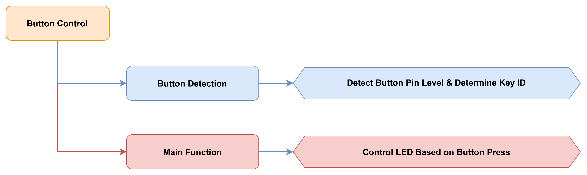

#### 6.2.2.3 Module Description

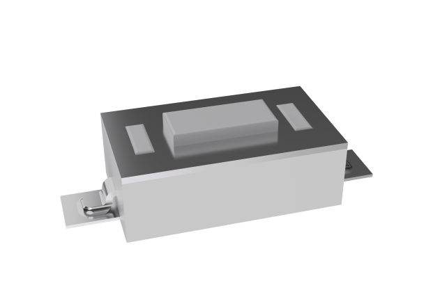

The onboard buttons are standardized human-machine interaction components in embedded systems and development boards, providing critical user command input and system control functions. Typical application scenarios include system wakeup, hardware reset, and trigger mechanisms for specific operation processes.

#### 6.2.2.4 Program Download

> [!NOTE]
>
> **Before downloading the program, confirm that the serial port driver has been installed.**

1) Connect the core board to the computer via a USB cable.


2) Double-click to open the STM32 serial port flashing software **FlyMcu**.

3) Click the **...** icon, and in the corresponding project's **Tankbot\MDK-ARM\Tankbot** path, select the HEX file to be flashed.


4) At position ① in the figure below, select the serial port number corresponding to the core board. At position ②, set the baud rate to 115200. At positions ③ and ④, configure according to the options shown in the figure.


5) Click **Start ISP(P)**, press the **RST** button on the core board, and the program automatically starts downloading. When the right-side log output pane displays the following content, the program download is complete.


#### 6.2.2.5 Program Outcome

After the robotic arm is powered on:

Press **KEY1** on the controller, and LED1 on the control board flashes once.

Press **KEY2** on the controller, and LED2 on the control board flashes once.

Press **KEY1** and **KEY2** simultaneously, and both LED1 and LED2 on the control board flash once at the same time.

#### 6.2.2.6 Program Analysis

* **main.c File (Business Layer)**

1) The `led.h` and `adc_sample.h` library files are imported, where `led.h` contains the LED control functions and `adc_sample.h` contains the button detection functions.

```c
/* USER CODE END Header */
/* Includes ------------------------------------------------------------------*/
#include "main.h"
#include "adc.h"
#include "dma.h"
#include "i2c.h"
#include "spi.h"
#include "tim.h"
#include "usart.h"
#include "gpio.h"

/* Private includes ----------------------------------------------------------*/
/* USER CODE BEGIN Includes */

#include "global.h"
#include "stdio.h"
#include "stdlib.h"
#include "led.h"
#include "buzzer.h"
#include "robot_arm.h"
#include "adc_sample.h"
```

2) In the main function, the `led_init` function is called to initialize the `led` objects. The `adc_sample_init` function is called to initialize the pins connected to the two buttons and calibrate the reference level. The `robot_arm_init` function is called to initialize the servo control interface, read the action group and servo deviation data, initialize the robotic arm kinematics functions, and reset the arm to the initial position.

```c
  /* USER CODE BEGIN 2 */
	led_init();
	adc_sample_init();
  robot_arm_init(); 
	
	HAL_Delay(1000);
	MX_I2C1_Init();
		
  /* USER CODE END 2 */
```

3) In the loop, the `get_button_state` function is called to detect the button press state. It returns 1 when **KEY1** is pressed, 2 when **KEY2** is pressed, and 3 when both buttons are pressed simultaneously.

(1) When the return value is 1, the `led_flash` function is called to make LED 1 flash once with a cycle of 200 ms on and 200 ms off.

(2) When the return value is 2, the `led_flash` function is called to make LED 2 flash once with a cycle of 200 ms on and 200 ms off.

(3) When the return value is 3, the `led_flash` function is called to make both LEDs flash once each with a cycle of 200 ms on and 200 ms off.

```c
  /* USER CODE BEGIN 2 */
	led_init();
	adc_sample_init();
  robot_arm_init(); 
	
	HAL_Delay(1000);
	MX_I2C1_Init();
		
  /* USER CODE END 2 */

  /* Infinite loop */
  /* USER CODE BEGIN WHILE */

	
  while (1)
  {	
    HAL_Delay(20);
		bstate = get_button_state();
		switch(bstate)
		{
			case 1:
				led_flash(1, 200, 200, 1);
				break;
			
			case 2:
				led_flash(2, 200, 200, 1);
				break;
			
			case 3:
				led_flash(1, 200, 200, 1);
				led_flash(2, 200, 200, 1);
				break;		
		
		}
		while (get_button_state() != 0);               
	}
  
}

```

* **adc_sample.c File (Bottom Layer)**

The `get_button_state` function is introduced here:

1. In the function, the result array of `ADC1` , which stores the conversion results of several consecutive rounds at the current time is first read to obtain the real-time level of the pin.

2. Afterwards, the results of several rounds are accumulated and the average level of the pin channel over several sampling rounds is calculated, thereby implementing averaging filtering to remove level glitches and possible noise and ensure the accuracy of the reading result. `ADC_BUFFER_SIZE`: length of the result array; `SAMPLE_CHANNEL`: number of channels sampled in a single round; `ADC_BUFFER_SIZE / SAMPLE_CHANNEL`: number of sampling rounds stored in the result array

3. `ADC1` currently reads the levels of several pin channels at the same time. Among them, the pin channel connected to the button is sampled second in each round. Therefore, in the loop, the sampling result of this channel needs to be filtered out separately from the result array.

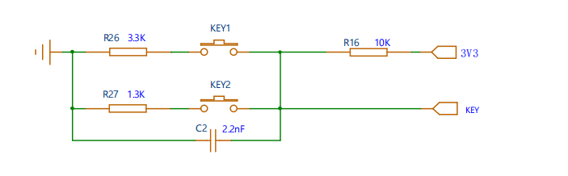

4. On the main controller, the ADC sampling resolution is 12 bits, and the sampling result ranges from 0 to 4095 ($2^{\text{12}} - 1$).

5. In the controller circuit, the circuit of the two buttons is shown in the figure above. When neither button is pressed, the 3.3 V power supply charges the capacitor to the power supply level (3.3 V), and the sampling result is approximately $\text{100}\text{\%} \times \text{4095} = \text{4095}$.

6. When KEY1 is pressed, the capacitor is discharged to ground through resistor $R_{\text{26}}$, and the level drops. At this time, the circuit can be regarded as $R_{\text{16}}$ and $R_{\text{26}}$ in series, where the voltage division across $R_{\text{26}}$ is $V_{R\text{26}} = \frac{3\text{.}3K\Omega}{(3\text{.}3 + \text{10})K\Omega} \times 3\text{.}3V \approx \text{24}\text{.}8\text{\%} \times 3\text{.}3V$ (the capacitor voltage stabilizes after dropping to the same level). The sampling result is approximately $\text{24}\text{.}8\text{\%} \times \text{4095} = \text{1015}$.

7. When KEY2 is pressed, the capacitor is discharged to ground through resistor $R_{\text{27}}$, and the level drops. At this time, the circuit can be regarded as $R_{\text{16}}$ and $R_{\text{27}}$ in series, where the voltage division across $R_{\text{27}}$ is $V_{R\text{26}} = \frac{\text{10}K\Omega}{(\text{10} + \text{10})K\Omega} \times 3\text{.}3V \approx \text{50}\text{\%} \times 3\text{.}3V$ (the capacitor voltage stabilizes after dropping to the same level). The sampling result is approximately $\text{50}\text{\%} \times \text{4095} \approx \text{2048}$.

8. When both KEY1 and KEY2 are pressed, the capacitor is discharged to ground through resistors $R_{\text{26}}$ and $R_{\text{27}}$, and the level drops. At this time, the circuit can be regarded as $R_{\text{26}}$ and $R_{\text{27}}$ in parallel, and then in series with $R_{\text{16}}$, where the equivalent resistance of $R_{\text{26}}$ and $R_{\text{27}}$ in parallel is $R_{并} = \frac{R_{1} + R_{2}}{R_{1}R_{2}} \approx 2\text{.}\text{48}K\Omega$. The voltage division is $V_{R并} = \frac{2\text{.}\text{48}K\Omega}{(2\text{.}\text{48} + \text{10})K\Omega} \times 3\text{.}3V \approx \text{19}\text{.}9\text{\%} \times 3\text{.}3V$ (the capacitor voltage stabilizes after dropping to the same level). The sampling result is approximately $\text{19}\text{.}9\text{\%} \times \text{4095} = \text{814}$.

9. Therefore, taking the theoretical levels of these three cases as the baseline and reserving a certain margin of positive and negative error fluctuation, the converted level of the main controller is matched against these three levels to determine whether a button is pressed and which button is pressed.

```c
uint8_t get_button_state()
{
	uint32_t sum = 0;
	uint16_t sample_average;
	
	for (uint8_t i = 0; i < ADC_BUFFER_SIZE / SAMPLE_CHANNEL; i++)
	{
		sum += adc_value[i * 3 + 1];
	}
	sample_average = sum / (ADC_BUFFER_SIZE / SAMPLE_CHANNEL);
	if(sample_average > 1013 - 30 && sample_average < 1013 + 30)
	{
		return 1;
	}
	else if(sample_average > 2043 - 30 && sample_average < 2043 + 30)
	{
		return 2;
	}
	else if(sample_average > 811 - 30 && sample_average < 811 + 30)
	{
		return 3;
	}
	return 0;
}
```

> [!NOTE]
>
> * **The charge and discharge time constant of the capacitor is** $\tau = \text{RC}$**. It is generally considered that complete charging and discharging is achieved after** $5\tau$**, and the actual calculated magnitude is** $\text{10}^{- 5}$**s. The `main` function obtains the result array every 400 ms, so the influence of capacitor level changes during sampling can be ignored.**
>
> * **In this example, ADC sampling is performed in `adc_sample_handler` independently of the `main` function, and this function is called periodically in the `SysTick_Handler` function. It is not elaborated here.**

### 6.2.3 Buzzer Control

#### 6.2.3.1 Project Introduction

The buzzer sounds when the button on the control board is pressed.

#### 6.2.3.2 Implementation Process

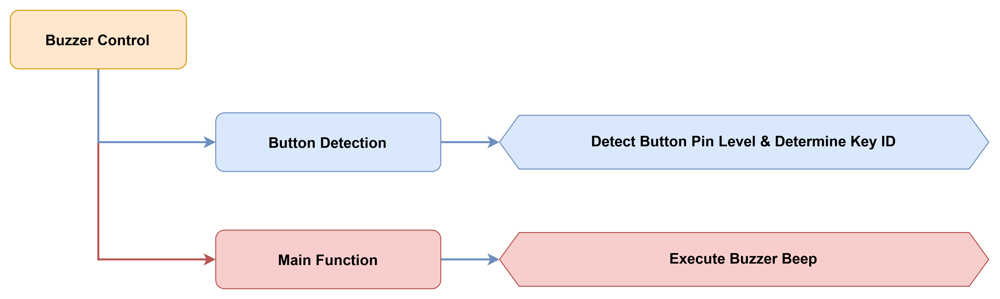

#### 6.2.3.3 Module Description

A buzzer is an integrated electronic sound device widely used as a sound-emitting component in electronic products such as computers and printers.

Its sounding principle is that current flows through the electromagnetic coil, causing the coil to generate a magnetic field that drives the vibrating diaphragm to produce sound. Therefore, a certain amount of current is required for sound generation. The buzzer tone can be adjusted by changing the signal frequency: the higher the frequency, the higher the tone. In addition, the sound volume of the buzzer can be controlled by changing the high/low level duty cycle of the driving signal.

#### 6.2.3.4 Program Download

> [!NOTE]
>
> **Before downloading the program, confirm that the serial port driver has been installed.**

1) Connect the core board to the computer via a USB cable.


2) Double-click to open the STM32 serial port flashing software **FlyMcu**.

3) Click the **...** icon, and in the corresponding project's **Tankbot\MDK-ARM\Tankbot** path, select the HEX file to be flashed.


4) At position ① in the figure below, select the serial port number corresponding to the core board. At position ②, set the baud rate to 115200. At positions ③ and ④, configure according to the options shown in the figure.


5) Click **Start ISP(P)**, press the **RST** button on the core board, and the program automatically starts downloading. When the right-side log output pane displays the following content, the program download is complete.


#### 6.2.3.5 Program Outcome

After the robotic arm is powered on, pressing **KEY1** once causes the buzzer to beep once.

#### 6.2.3.6 Program Analysis

* **main.c File (Business Layer)**

1) The `buzzer.h` and `adc_sample.h` library files are imported, where `buzzer.h` contains the buzzer control functions and `adc_sample.h` contains the button detection functions.

```c
/* USER CODE END Header */
/* Includes ------------------------------------------------------------------*/
#include "main.h"
#include "adc.h"
#include "dma.h"
#include "i2c.h"
#include "spi.h"
#include "tim.h"
#include "usart.h"
#include "gpio.h"

/* Private includes ----------------------------------------------------------*/
/* USER CODE BEGIN Includes */

#include "global.h"
#include "stdio.h"
#include "stdlib.h"
#include "led.h"
#include "buzzer.h"
#include "robot_arm.h"
#include "adc_sample.h"
```

2) In the `main` function, the `buzzer_init` function is called to initialize the buzzer object `buzzer`. The `robot_arm_init` function is called to initialize the servo control interface, read the action group and servo deviation data, initialize the robotic arm kinematics functions, and reset the arm to the initial position. The `adc_sample_init` function is called to initialize the pins connected to the two buttons and calibrate the reference level.

The `get_button_state` function is called in a loop to detect the button press state. When KEY1 is detected as pressed, the `buzzer_toggle` function is called to beep for 100 ms, pause for 100 ms, and repeat 1 cycle.

```c
  /* USER CODE BEGIN 2 */
	led_init();
	buzzer_init();
	adc_sample_init();
  robot_arm_init(); 
	
	HAL_Delay(1000);
	MX_I2C1_Init();
	
	
  /* USER CODE END 2 */

  /* Infinite loop */
  /* USER CODE BEGIN WHILE */

  while (1)
  {	
    bstate = get_button_state();
		
		if(bstate == 1 && last_bstate == 0)
		{
			buzzer_toggle(100, 100, 1);
			HAL_Delay(100); 	 
		}
		last_bstate = bstate;           
	}
  
}
```

* **buzzer.c File (Bottom Layer)**

1. The `buzzer_toggle` function

(1) The `buzzer_toggle` function is introduced here. It takes three parameters: ① single beep duration ② single pause duration ③ number of beeps.

(2) In the function, the parameter information is written into the corresponding members of the buzzer object. Meanwhile, the `status` of the buzzer object is set to `BUZZER_START_NEW_CYCLE`, indicating that the information has changed and requires processing by the bottom-layer `buzzer_handler`.

```c
void buzzer_toggle(uint32_t ticks_on, uint32_t ticks_off, uint16_t times)
{
	buzzer.ticks_on = ticks_on;
	buzzer.ticks_off = ticks_off;
	buzzer.times = times;
	buzzer.status = BUZZER_START_NEW_CYCLE;	
}
```

> [!NOTE]
>
> **The `buzzer_handler` function is periodically called automatically in the system clock interrupt function `SysTick_Handler`. It is not elaborated here.**

2. The `buzzer_handler` function

(1) In the function, the current state of the buzzer object is checked, and processing is carried out according to the four categories shown in the figure below.

```c
void buzzer_handler()
{
    switch(buzzer.status)
	{
        case BUZZER_START_NEW_CYCLE:
            if(buzzer.ticks_on > 0)
			{
				
				__HAL_TIM_SET_COMPARE(&htim4, TIM_CHANNEL_3, period / 2);
                if(buzzer.ticks_off > 0)
				{ /* If the count time is not 0, the buzzer beeps intermittently; otherwise it beeps continuously */
                    buzzer.ticks_count = 0;
                    buzzer.status = BUZZER_WATTING_OFF; /* Wait for the buzzer beep time to end */
                }
				else
				{
					buzzer.status = BUZZER_IDLE; /* Continuous beep, switches to idle */
				}
            }
			else
			{ /* If the beep time is 0, the buzzer stays silent */
               __HAL_TIM_SET_COMPARE(&htim4, TIM_CHANNEL_3, 0);
				buzzer.status = BUZZER_IDLE; /* Silent, switches to idle */
            }
            break;
			
        case BUZZER_WATTING_OFF:
            buzzer.ticks_count += BUZZER_TIMER_PERIOD;
            if(buzzer.ticks_count >= buzzer.ticks_on)
			{ /* Buzzer beep time ends */
                __HAL_TIM_SET_COMPARE(&htim4, TIM_CHANNEL_3, 0);
                buzzer.status = BUZZER_WATTING_PERIOD_END;
            }
            break;

        case BUZZER_WATTING_PERIOD_END:	/* Wait for the period to end */
            buzzer.ticks_count += BUZZER_TIMER_PERIOD;
            if(buzzer.ticks_count >= (buzzer.ticks_off + buzzer.ticks_on))
			{
				buzzer.ticks_count -= (buzzer.ticks_off + buzzer.ticks_on);
                if(buzzer.times == 1)
				{ 
                    /* When the remaining count reaches 1, this control task can be ended */
                    __HAL_TIM_SET_COMPARE(&htim4, TIM_CHANNEL_3, 0);
                    buzzer.status = BUZZER_IDLE;  /* Count exhausted, switches to idle */
                }
				else
				{
                    __HAL_TIM_SET_COMPARE(&htim4, TIM_CHANNEL_3, period / 2);
                    buzzer.times = buzzer.times == 0 ? 0 : buzzer.times - 1;
                    buzzer.status = BUZZER_WATTING_OFF;
                }
            }
            break;

        case BUZZER_IDLE:
            break;
		
        default:
            break;
    }
}

```

(2) When the buzzer is required to execute a new beep pattern, the status is automatically set to state 1 `BUZZER_START_NEW_CYCLE` . The program first checks whether the single beep duration is greater than 0.

① If so, the bottom-layer registers of the main controller are set so that the PWM wave switches between high and low levels at 1/2 of the period, 50% duty cycle, and the buzzer starts beeping. The single pause duration is then checked to determine whether the buzzer needs to beep several times or continuously.

② If the single pause duration is greater than 0, the buzzer beeps several times. The single beep timer `ticks_count` is cleared, the state enters state 2  `BUZZER_WATTING_OFF`, and the function exits.

③ If the single pause duration is equal to 0, the buzzer beeps continuously. The single beep timer `ticks_count` is cleared, the state directly enters the final state 4 `BUZZER_IDLE`, and the function exits.

④ If the single beep duration is not greater than 0, the bottom-layer registers of the main controller are directly set so that the PWM wave outputs a low level throughout the entire period, 0% duty cycle, the buzzer is muted, the state enters state 4 `BUZZER_IDLE`, and the function exits.

```c
        case BUZZER_START_NEW_CYCLE:
            if(buzzer.ticks_on > 0)
			{
				
				__HAL_TIM_SET_COMPARE(&htim4, TIM_CHANNEL_3, period / 2);
                if(buzzer.ticks_off > 0)
				{ /* If the count time is not 0, the buzzer beeps intermittently; otherwise it beeps continuously */
                    buzzer.ticks_count = 0;
                    buzzer.status = BUZZER_WATTING_OFF; /* Wait for the buzzer beep time to end */
                }
				else
				{
					buzzer.status = BUZZER_IDLE; /* Continuous beep, switches to idle */
				}
            }
			else
			{ /* If the beep time is 0, the buzzer stays silent */
               __HAL_TIM_SET_COMPARE(&htim4, TIM_CHANNEL_3, 0);
				buzzer.status = BUZZER_IDLE; /* Silent, switches to idle */
            }
            break;
```

(3) In state 2, each time the function is entered, `BUZZER_TIMER_PERIOD` , the time interval between successive entries into the function is accumulated on the single beep timer until the single beep duration is reached. The PWM duty cycle is then set to 0 to mute the buzzer, and the state enters state 3  `BUZZER_WATTING_PERIOD_END`.

```c
        case BUZZER_WATTING_OFF:
            buzzer.ticks_count += BUZZER_TIMER_PERIOD;
            if(buzzer.ticks_count >= buzzer.ticks_on)
			{ /* Buzzer beep time ends */
                __HAL_TIM_SET_COMPARE(&htim4, TIM_CHANNEL_3, 0);
                buzzer.status = BUZZER_WATTING_PERIOD_END;
            }
            break;
```

(4) In state 3, each time the function is entered, `BUZZER_TIMER_PERIOD` continues to be accumulated on the single beep timer until the sum of the single beep duration and the single pause duration is reached. At this point, one buzzer beep-and-pause cycle is complete.

① The program then clears the previously accumulated result of the single beep timer and checks whether the current cycle count `times` of the buzzer object is 1, for example whether this is the last cycle. If so, the state enters state 4  `BUZZER_IDLE`.

② If not, the cycle count `times` is decremented, the PWM duty cycle is set to 50%, the buzzer starts beeping again, and the state returns to state 2 to start the next round of buzzer beep control.

```c
        case BUZZER_WATTING_PERIOD_END:	/* Wait for the period to end */
            buzzer.ticks_count += BUZZER_TIMER_PERIOD;
            if(buzzer.ticks_count >= (buzzer.ticks_off + buzzer.ticks_on))
			{
				buzzer.ticks_count -= (buzzer.ticks_off + buzzer.ticks_on);
                if(buzzer.times == 1)
				{ 
                    /* When the remaining count reaches 1, this control task can be ended */
                    __HAL_TIM_SET_COMPARE(&htim4, TIM_CHANNEL_3, 0);
                    buzzer.status = BUZZER_IDLE;  /* Count exhausted, switches to idle */
                }
				else
				{
                    __HAL_TIM_SET_COMPARE(&htim4, TIM_CHANNEL_3, period / 2);
                    buzzer.times = buzzer.times == 0 ? 0 : buzzer.times - 1;
                    buzzer.status = BUZZER_WATTING_OFF;
                }
            }
            break;
```

### 6.2.4 Bus Servo Control

#### 6.2.4.1 Project Introduction

In this lesson, the bus servo is controlled to rotate cyclically.

#### 6.2.4.2 Implementation Process

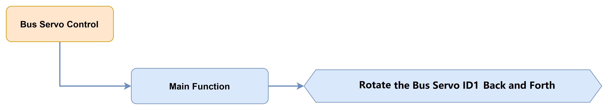

#### 6.2.4.3 Module Description

A bus servo, also known as a serial bus intelligent servo, can essentially be regarded as a derivative of a digital servo. It typically uses a single-wire serial port, meaning that communication is carried out over a single wire.

A serial port typically uses two lines for communication, one for transmitting and one for receiving, so data can be transmitted and received simultaneously. A single-wire serial port uses a single line for both reception and transmission. When not transmitting, the single-wire serial port is always ready to receive, and reception stops during transmission.

On the servo controller, a double-pole double-throw switch is used to convert the conventional two-wire serial port into a single-wire serial port. The RX and TX lines of the serial port are connected to the communication line through a logic circuit.

When no data is being transmitted, a low-level signal is output to the switch enable pin. RX is connected to the communication line, while TX is disconnected from it. When transmitting data, a high-level signal is output to the switch enable pin. The logic circuit connects TX to the communication line and disconnects RX from the communication line.

> [!NOTE]
>
> **The bus servo communication protocol used in this section's example is compatible with all bus servo models of Hiwonder. The protocol format can be found in the [6.2.5 Bus Servo Communication Protocol](#6.2.5) document located in the same folder as this document.**

#### 6.2.4.4 Program Download

> [!NOTE]
>
> **Before downloading the program, confirm that the serial port driver has been installed.**

1) Connect the core board to the computer via a USB cable.


2) Double-click to open the STM32 serial port flashing software **FlyMcu**.

3) Click the **...** icon, and in the corresponding project's **Tankbot\MDK-ARM\Tankbot** path, select the HEX file to be flashed.


4) At position ① in the figure below, select the serial port number corresponding to the core board. At position ②, set the baud rate to 115200. At positions ③ and ④, configure according to the options shown in the figure.


5) Click **Start ISP(P)**, press the **RST** button on the core board, and the program automatically starts downloading. When the right-side log output pane displays the following content, the program download is complete.


#### 6.2.4.5 Program Outcome

After the robotic arm is powered on, bus servo ID1 rotates back and forth, driving the gripper to open and close cyclically.

#### 6.2.4.6 Program Analysis

* **main.c File (Business Layer)**

1) The `serial_servo.h` library file is imported, which contains the bus servo control functions and declares the bus servo control object.

```c
/* USER CODE END Header */
/* Includes ------------------------------------------------------------------*/
#include "main.h"
#include "adc.h"
#include "dma.h"
#include "i2c.h"
#include "spi.h"
#include "tim.h"
#include "usart.h"
#include "gpio.h"

/* Private includes ----------------------------------------------------------*/
/* USER CODE BEGIN Includes */

#include "global.h"
#include "stdio.h"
#include "stdlib.h"
#include "led.h"
#include "buzzer.h"
#include "robot_arm.h"
#include "adc_sample.h"
```

2) In the `main` function, the `serial_servo_init` function is called to initialize the bus servo control object `serial_servo_controller` and bind the serial communication line enable function and the single-wire serial data transmission/reception function `serial_write_and_read`. The serial port is enabled and the relevant registers are initialized. The `serial_servo_set_position` function is called to control bus servo ID1 to rotate to position value 0 or 1000 within 1000 ms, and the above process is executed cyclically.

```c
  robot_arm_init(); 
	
	HAL_Delay(1000);
	MX_I2C1_Init();
	
	
  /* USER CODE END 2 */

  /* Infinite loop */
  /* USER CODE BEGIN WHILE */
	
  while (1)
  {	
		serial_servo_set_position(&serial_servo_controller, 1, 1000, 1000);
		HAL_Delay(1500);
		serial_servo_set_position(&serial_servo_controller, 1, 0, 1000);
		HAL_Delay(1500);     
	}
  
}
```

* **serial_servo.c File (Bottom Layer)**

**The `serial_servo_set_position` Function**

The `serial_servo_set_position` function is introduced here. It takes three parameters: (1) servo number (2) target position value (3) motion duration.

1. In the function, a variable `frame` of the serial command frame format is created. The `cmd_frame_init` function is called with the servo number to be controlled and the command type. The function automatically fills in the frame header and writes the above parameters into the corresponding members of the frame.

2. The function then writes the high 8 bits and low 8 bits of the "target position value" and "motion duration" into the corresponding members of the frame. The `cmd_frame_complete` function is then called with the number of frame parameters, and the function calculates the checksum based on this information and writes it into the corresponding member of the frame, completing one command frame.

3. Finally, the function calls `serial_write_and_read` with the command frame and the read/write flag `true` representing write to start sending data.

```c
void serial_servo_set_position(SerialServoControllerTypeDef *self, uint8_t servo_id, int position, uint16_t duration)
{
    SerialServoCmdTypeDef frame;
    position = position > 1000 ? 1000 : position;
    cmd_frame_init(&frame, servo_id, SERIAL_SERVO_MOVE_TIME_WRITE);
    frame.elements.args[0] = GET_LOW_BYTE(position);
    frame.elements.args[1] = GET_HIGH_BYTE(position);
    frame.elements.args[2] = GET_LOW_BYTE(duration);
    frame.elements.args[3] = GET_HIGH_BYTE(duration);
    cmd_frame_complete(&frame, 4);
    self->serial_write_and_read(self, &frame, true);
}
```

> [!NOTE]
>
> * **In this function, only the preparatory work before command frame transmission and reception is completed. And the transmission and reception logic is not executed.**
>
> * **The `serial_write_and_read` function is responsible for controlling the bus servo communication working state machine and indicating the relevant flags. The program in the timer executes different data transmission and reception operations according to these flags.**
>
> * **For the specific data transmission and reception logic, refer to the UART 2 interrupt function `USART2_IRQHandler` connected to the bus servo. It is not elaborated here.**

<p id ="6.2.5"></p>

### 6.2.5 Bus Servo Communication Protocol

#### 6.2.5.1 Protocol Format

| Frame Header 1 | Frame Header 2 | Data length | Function number | Data parameters |
| -------------- | -------------- | ----------- | --------------- | --------------- |
| 0 x 55         | 0 x 55         | Length      | CMD             | Parameter 1~N   |

Function

**Firmware Query**

Data length: 2

Function number: 1

Data parameters: None

Return content

| Frame Header 1 | Frame Header 2 | Data length | Function number | Data parameter 1                           | Data parameter 2 |
| -------------- | -------------- | ----------- | --------------- | ------------------------------------------ | ---------------- |
| 0x55           | 0x55           | 3           | 1               | Servo type 1-PWM digital servo 2-Bus servo | Firmware version |

#### 6.2.5.2 Servo Deviation Reading

**Description: Reading the deviation values of all servos**

Data length: 14

Function number: 2

Data parameters: None

Return content

| Frame Header 1 | Frame Header 2 | Data length | Function number | Parameter 1     | Parameter 2     | ...                                                     |
| -------------- | -------------- | ----------- | --------------- | --------------- | --------------- | ------------------------------------------------------- |
| 0 x 55         | 0 x 55         | 14          | 2               | Servo ID number | Deviation value | Subsequent parameters are the same as parameter 1 and 2 |

#### 6.2.5.3 Single/Multiple Servo Pulse Width Control

Data length: number of controlled servos × 3 + 5

Function number: 3

Data parameters

| Parameter content                                            |
| ------------------------------------------------------------ |
| Parameter 1: total number of controlled servos               |
| Parameter 2: low 8 bits of servo running time                |
| Parameter 3: high 8 bits of servo running time               |
| Parameter 4: servo ID                                        |
| Parameter 5: low 8 bits of servo pulse width value           |
| Parameter 6: high 8 bits of servo pulse width value          |
| Subsequent data parameters follow the same pattern as parameters 4, 5, and 6 to control servos with different IDs |

Return content: None

- **Coordinate Control**

Data length: 5

Function number: 4

Data parameters

| Parameter content                                            |
| ------------------------------------------------------------ |
| Parameter 1: X-axis coordinate increment of the controlled body frame |
| Parameter 2: Y-axis coordinate increment of the controlled body frame |
| Parameter 3: Z-axis coordinate increment of the controlled body frame |

Return content: None

- **Action Group Execution**

Data length: 5

Function number: 6

Data parameters

| Parameter content                                            |
| ------------------------------------------------------------ |
| Parameter 1: number of the action group to run               |
| Parameter 2: low 8 bits of the execution count of the action group |
| Parameter 3: high 8 bits of the execution count of the action group |


Return content: None

- **Stop Running Action Group**

Data length: 2

Function number: 7

Data parameters: None

Return content: None

* **Erase the Action Group Downloaded to the Control Board**

Data length: 2

Function number: 8

Data parameters: None

Return content

| Frame Header 1 | Frame Header 2 | Data length | Function number |
| -------------- | -------------- | ----------- | --------------- |
| 0 x 55         | 0 x 55         | 2           | 8               |

#### 6.2.5.4 Chassis Control

Data length: 4

Function number: 9

Data parameters

| Parameter content                                            | Description                                                  |
| ------------------------------------------------------------ | ------------------------------------------------------------ |
| Parameter 1: controls forward, backward, left translation, and right translation | 0-stop 1-turn left 2-diagonal forward left 3-forward 4-diagonal forward right 5-translate right 6-diagonal backward right 7-backward 8-diagonal backward left |
| Parameter 2: controls in-place left rotation and in-place right rotation | 0-stop 1-rotate left in place 2-rotate right in place        |

Return content: None

* **Servo Deviation Setting**

Data length: 4

Function number: 10

Data parameters

| Parameter content            |
| ---------------------------- |
| Parameter 1: servo ID        |
| Parameter 2: deviation value |

Return content: None

#### 6.2.5.5 Servo Deviation Download

Data length: 14

Function number: 11

Data parameters

| Parameter content                                            |
| ------------------------------------------------------------ |
| Parameter 1: servo ID number                                 |
| Parameter 2: servo pulse width deviation value               |
| Subsequent data parameters follow the same pattern as parameters 1 and 2, downloading pulse width deviation values for servos with different IDs |

Return content

| Frame Header 1 | Frame Header 2 | Data length | Function number |
| -------------- | -------------- | ----------- | --------------- |
| 0 x 55         | 0 x 55         | 2           | 11              |

#### 6.2.5.6 Servo Initial Pose Setting

Data length: 2

Function number: 12

Data parameters: None

Return content: None

#### 6.2.5.7 Servo Angle Readback

Data length: 2

Function number: 13

Data parameters: None

Return content

| Frame Header 1 | Frame Header 2 | Data length | Function number | Parameter 1 | Parameter 2                | Parameter 3                 | ...                                                          |
| -------------- | -------------- | ----------- | --------------- | ----------- | -------------------------- | --------------------------- | ------------------------------------------------------------ |
| 0x55           | 0x55           | 20          | 13              | Servo ID    | Servo pulse width low byte | Servo pulse width high byte | Subsequent parameters follow the same pattern as parameters 1, 2, and 3 |

#### 6.2.5.8 Chassis Speed Setting

Data length: 3

Function number: 14

Data parameters

| Parameter content              | Description                    |
| ------------------------------ | ------------------------------ |
| Parameter 1: robotic car speed | Value range 50~100, default 80 |

Return content: None

#### 6.2.5.9 Power Supply Voltage Reporting

Data length: 4

Function number: 15

Data parameters

| Parameter content | Description: unit mV       |
| ----------------- | -------------------------- |
| Parameter 1:      | Low eight bits of voltage  |
| Parameter 2:      | High eight bits of voltage |

Return content: None

#### 6.2.5.10 Action Group Download

**Description: The action group is downloaded to the control board frame by frame until all action frames are downloaded.**

Data length: number of controlled servos × 3 + 8

Function number: 25

Data parameters

| Parameter content                                            |
| ------------------------------------------------------------ |
| Parameter 1: action group number to download                 |
| Parameter 2: total frame count of the action group           |
| Parameter 3: action frame number                             |
| Parameter 4: total number of servos to download              |
| Parameter 5: low 8 bits of control time                      |
| Parameter 6: high 8 bits of control time                     |
| Parameter 7: servo ID                                        |
| Parameter 8: low 8 bits of servo pulse width value           |
| Parameter 9: high 8 bits of servo pulse width value          |
| Subsequent data parameters follow the same sequence as parameters 7, 8, and 9, downloading servo pulse width values for different servo IDs |

Return content

| Frame Header 1 | Frame Header 2 | Data length | Function number |
| -------------- | -------------- | ----------- | --------------- |
| 0 x 55         | 0 x 55         | 2           | 25              |

### 6.2.6 PWM Servo Control

#### 6.2.6.1 Project Introduction

In this lesson, the PWM servo is controlled to rotate cyclically.

#### 6.2.6.2 Implementation Process

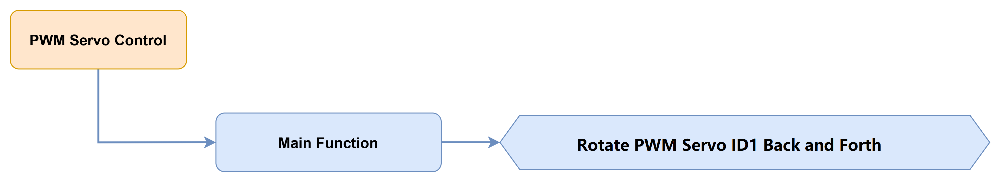

#### 6.2.6.3 Module Description

A standard PWM servo has three control lines: power line, ground line, and signal line.

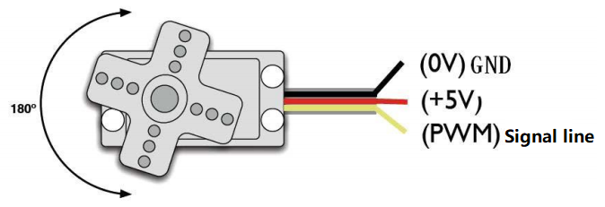

A periodic positive pulse signal is input. The low-level duration of this periodic pulse signal should be between 5 ms and 20 ms. A PWM analog servo requires a continuous periodic signal to maintain the servo angle. When the signal is lost, the servo stops outputting power.

> [!NOTE]
>
> * **A digital PWM servo does not require periodic PWM wave driving. It focuses only on the single high-level pulse width time and is not strict about the low-level time. In other words, any frequency within the control frequency range listed in the above table can be selected as the servo operating frequency, thereby determining the period of the analog PWM wave for a single servo.**
>
> * **Within this period, a high level is output starting from a certain moment and lasting for the pulse width duration, while the remainder of the period is kept at a low level. The servo then rotates to the corresponding position.**
>
> * **On this basis, a single timer/task can be used to control multiple servos simultaneously. During the period when the timer/task controls a specific servo, a high level with the target pulse width duration is output to that servo, and a low level is output during the remaining time. During the period when the timer/task does not control a specific servo, a low level is output directly, and no further processing is performed.**

#### 6.2.6.4 Program Download

> [!NOTE]
>
> **Before downloading the program, confirm that the serial port driver has been installed.**

1) Connect the core board to the computer via a USB cable.


2) Double-click to open the STM32 serial port flashing software **FlyMcu**.

3) Click the **...** icon, and in the corresponding project's **Tankbot\MDK-ARM\Tankbot** path, select the HEX file to be flashed.


4) At position ① in the figure below, select the serial port number corresponding to the core board. At position ②, set the baud rate to 115200. At positions ③ and ④, configure according to the options shown in the figure.


5) Click **Start ISP(P)**, press the **RST** button on the core board, and the program automatically starts downloading. When the right-side log output pane displays the following content, the program download is complete.


#### 6.2.6.5 Program Outcome

After the robotic arm is powered on, PWM servo ID1 rotates back and forth between the two sides.

#### 6.2.6.6 Program Analysis

* **main.c File (Business Layer)**

1) The `robot_arm.h` library file is imported, which contains the robotic arm servo initialization function and the single-joint control interface functions.

```c
/* USER CODE END Header */
/* Includes ------------------------------------------------------------------*/
#include "main.h"
#include "adc.h"
#include "dma.h"
#include "i2c.h"
#include "spi.h"
#include "tim.h"
#include "usart.h"
#include "gpio.h"

/* Private includes ----------------------------------------------------------*/
/* USER CODE BEGIN Includes */

#include "global.h"
#include "stdio.h"
#include "stdlib.h"
#include "led.h"
#include "buzzer.h"
#include "robot_arm.h"
#include "adc_sample.h"
#include "pwm_servos.h"
```

2) In the `main` function, the `robot_arm_init` function is called to initialize the PWM digital servo control object array `pwm_servos[]` (the array element order corresponds to the servos of the robotic arm from bottom to top, opposite to the servo ID number order), bind the pin level switching functions, and assign initial values to the pulse width member `duty` of each PWM digital servo control object. The relevant registers are initialized and the timer that controls PWM wave output is enabled.

```c
  robot_arm_init(); 
```

In the loop, the `robot_arm_claw_set` function is called to control PWM servo ID1 to rotate to the positions of (90-90)° = 0° and (90-0)° = 90° within 1000 ms.

> [!NOTE]
>
> * **Servo ID1 on the gripper is the servo at the very top of the robotic arm, corresponding to the fifth (last) element of the PWM digital servo control object array.**
>
> * **The servo control angle ranges from 0° to 180°, and the corresponding pulse width ranges from 500 μsec to 2500 μsec. The two can be mapped to each other.**
>
> * **The smaller the rotation angle of servo ID1, the more closed the gripper. Conversely, the more open the gripper is.**

The `robot_arm_claw_set` function is then called to control PWM servo ID1 to rotate to the 0° and 90° positions, driving the gripper to open.

```c
  while (1)
  {	
		pwm_servo_duty_set(&pwm_servos[5], 500, 1000);
		HAL_Delay(1500);
		pwm_servo_duty_set(&pwm_servos[5], 2500, 1000);
		HAL_Delay(1500); 
	}
```

* **robot_arm.c File (Business Layer)**

1. The `robot_arm_init` function

(1) In this function, the servo type of the robotic arm is first determined, and the initialization function of the corresponding servo type is called to initialize the corresponding servo control object and specify the corresponding parameters and control function interface. The `kinematics_init` function is called to initialize the robotic arm kinematics control object.

(2) The `robot_arm_flash_init` function is then invoked to pre-read and verify the data validity string `logo` stored in the FLASH. The `robot_arm_reset` function is called to control each servo to rotate to the preset initial values, at which point the robotic arm moves to the initial position.

(3) The `robot_arm_offset_read` function is called to read the servo deviation value data saved in the FLASH. Finally, the `pwm_servo_offset_set` function is called in a loop to write the servo deviation value data into the corresponding members of the servo control objects.

```c
bool robot_arm_init(void)
{
	int8_t read_offset[6];
	
	serial_servo_init();	
	kinematics_init(&kinematics);
	memset(&robot_arm, 0, sizeof(RobotArmHandleTypeDef));
	if(robot_arm_flash_init() == false)
	{
		return false;
	}
	HAL_Delay(200);
	robot_arm_reset(2000);
	robot_arm_offset_read(read_offset);

	return true;
}
```

2. The `robot_arm_claw_set` function

(1) Inside the function, threshold limiting is first applied to the input parameter servo rotation angle. Then, according to the servo type `SERVO_TYPE`, the `pwm_servo_angle_set` function is called to write the processed angle value `target_rotation_angle` into the control object `pwm_servos[5]` of servo ID1 that controls the gripper.

(2) At the bottom layer, the program controls the servo to rotate to this position value within the `rotation_angle_time` duration.

```c
void robot_arm_claw_set(float open_angle, uint32_t open_angle_time)
{
	float target_open_angle;
	
	open_angle = open_angle > MAX_OPEN_ANGLE ? MAX_OPEN_ANGLE : \
				(open_angle < MIN_OPEN_ANGLE ? MIN_OPEN_ANGLE : open_angle);
	
	target_open_angle = open_angle;
	serial_servo_set_position(&serial_servo_controller, 1, 500 - (int)(SERIAL_ANGLE_FACTOR * target_open_angle), open_angle_time);
	
} 
```

* **pwm_servo_porting.c File (Abstraction Layer)**

1. The `pwm_servos_init` function

First, each PWM digital servo control object is initialized, and the pin level switching function of each object is bound to the function responsible for the specific implementation. The relevant registers are initialized and the timer that controls PWM wave output is enabled.

```c
void pwm_servos_init()
{
	for(uint8_t i = 0; i < USE_SERVO_NUM; i++)
	{
		pwm_servo_object_init(&pwm_servos[i], USE_SERVO_NUM - i);
	}

	pwm_servos[0].write_pin = pwm_servo6_write_pin;
	pwm_servos[1].write_pin = pwm_servo5_write_pin;
	pwm_servos[2].write_pin = pwm_servo4_write_pin;
	pwm_servos[3].write_pin = pwm_servo3_write_pin;
	pwm_servos[4].write_pin = pwm_servo2_write_pin;
	pwm_servos[5].write_pin = pwm_servo1_write_pin;
	
	
	HAL_TIM_Base_Start_IT(&htim3);
	__HAL_TIM_ENABLE_IT(&htim3, TIM_IT_CC1);
	__HAL_TIM_ENABLE_IT(&htim3, TIM_IT_CC2);
}
```

2. The `pwm_servos_handler` function

According to the actual number of servos `USE_SERVO_NUM`, the corresponding servo processing function `pwm_servo_handler` , which is described in detail below, is called one by one to control the servo movement.

```c
void pwm_servos_handler()
{
	for(uint8_t i = 0; i < USE_SERVO_NUM; i++)
	{
		pwm_servo_handler(&pwm_servos[i]);
	}
}
```

> [!NOTE]
>
> **The `pwm_servos_handler` function is periodically called automatically in the system clock interrupt function `SysTick_Handler`. It is not elaborated here.**

* **pwm_servo.c File (Bottom Layer)**

1. The `pwm_servo_duty_set` function

The three parameters passed to the function are ① PWM digital servo control object, ② target pulse width, ③ motion duration.

In the function, the input target pulse width and motion duration are first limited to ensure the validity of the parameters, and then written into the pulse width and motion duration members of the PWM digital servo control object. The state change flag `duty_changed_state` of the corresponding PWM digital servo control object is set.

```c
void pwm_servo_duty_set(PWMServoHandleTypeDef* handle, int target_duty, uint32_t time)
{
	target_duty = target_duty > MAX_DUTY ? MAX_DUTY : (target_duty < MIN_DUTY ? MIN_DUTY : target_duty);
	time = time < MIN_RUNNING_TIME ? MIN_RUNNING_TIME : (time > MAX_RUNNING_TIME ? MAX_RUNNING_TIME : time);

	handle->time = time;
	handle->duty_changed_state = true;	
	handle->target_duty = target_duty;
	handle->last_target_duty = handle->target_duty;
}
```

2. The `pwm_servo_angle_set` function

The three parameters passed to this function are ① PWM digital servo control object, ② target angle, ③ motion duration.

In the function, the input target angle and motion duration are first limited to ensure the validity of the parameters. The motion duration is written into the motion duration member of the PWM digital servo control object, while the target angle is mapped from "angle -> pulse width" before being written into the pulse width member. The state change flag `duty_changed_state` of the corresponding PWM digital servo control object is set.

```c
void pwm_servo_angle_set(PWMServoHandleTypeDef* handle, float target_angle, uint32_t time)
{
	target_angle = target_angle > MAX_ANGLE ? MAX_ANGLE : (target_angle < MIN_ANGLE ? MIN_ANGLE : target_angle);
	time = time < MIN_RUNNING_TIME ? MIN_RUNNING_TIME : (time > MAX_RUNNING_TIME ? MAX_RUNNING_TIME : time);
	
	handle->time = time;
	handle->duty_changed_state = true;	
	handle->target_angle = target_angle;
	handle->target_duty = 500 + (int)(target_angle * 2000 / MAX_ANGLE);
}
```

3. The `pwm_servo_handler` function

The parameter passed to this function is the PWM digital servo control object.

(1) In the function, it is first checked whether the state change flag of the corresponding object is set.

(2) If so, the state change flag is cleared and the number of motion steps is calculated. After obtaining the number of motion steps, the single-step motion step length, single-step pulse width change is further calculated. Finally, the servo movement flag `running_state` of the object is set.

> [!NOTE]
>
> **The servo does not rotate to the target position at once. Instead, it completes the movement in steps according to the given motion duration, with a single-step motion time of 20 ms.**

(3) Next, it is checked whether the movement flag of the corresponding object is set, and the servo rotation is controlled step by step inside:

(4) If so, the motion step count member of the object is decremented, and the single-step motion step length (single-step pulse width change) is accumulated on the current pulse width member of the object.

(5) When the steps are used up, the target pulse width is directly assigned to the current pulse width member of the object, and the movement flag is cleared.

(6) At the end of each round of the function, the sum of the "current pulse width member of the object" and the "deviation value member of the object (default 0, used for deviation adjustment)" is assigned to the "execution pulse width member of the object".

> [!NOTE]
>
> * **Only when the pulse width value is written into the execution pulse width member of the object will the servo actually rotate to the corresponding position.**
>
> * **The execution pulse width member of the object is retrieved in `TIM3_IRQHandler` and passed to the CCR register used for output comparison in the timer. Based on the comparison result between the counter CNT and CCR in the timer, high/low levels are output to the pin to simulate the PWM wave in software. It is not elaborated here.**

```c
 void pwm_servo_handler(PWMServoHandleTypeDef* handle)
 {
 	if(handle->duty_changed_state)
 	{
 		handle->duty_changed_state = false;
 		handle->inc_times = handle->time / MIN_RUNNING_TIME;
 		handle->duty_inc = handle->target_duty > handle->current_duty ? 		\
 						   (float)(-(handle->target_duty - handle->current_duty)) :	\
 						   (float)(handle->current_duty - handle->target_duty);
 		handle->duty_inc /= (float)handle->inc_times;
 		handle->running_state = true;
 	}

 	if (handle->running_state)
 	{
 		 --handle->inc_times;
 		if (handle->inc_times == 0)
 		{
 			handle->current_duty = handle->target_duty;
 			handle->running_state = false;
 		}
 		else
 		{
 			handle->current_duty = handle->target_duty + (int)(handle->duty_inc * handle->inc_times);
 		}
 	}
 	handle->write_duty = handle->current_duty + handle->offset;
 }
```

### 6.2.7 Action Group Read/Write

#### 6.2.7.1 Project Introduction

In this lesson, the program writes action group 30 and executes it in a loop.

#### 6.2.7.2 Implementation Process

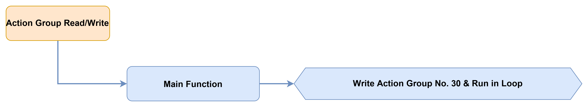

#### 6.2.7.3 Module Description

Flash memory is a type of non-volatile memory capable of retaining data for extended periods even without an electrical power supply. Its storage characteristics are comparable to those of a hard disk drive. This property is the foundation for flash memory becoming the storage medium for various portable digital devices.

The W25Q64 is a Flash memory device that is read from and written to via the SPI interface. Its read and write operations have the following two characteristics:

1. During write operations, only 1 can be written, and 0 cannot be written.

2. Erasure is performed on a sector basis, where all data is set to 0. The sector size varies by chip. The chip used in this design has 4096 bytes per sector.

Based on the above two points, it can be understood that writing one byte of data means changing the corresponding data bits in the chip from 0 to 1 or from 1 to 0. Since flash does not support writing 0 during the write operation, the corresponding sector must be erased to change the bits to 0. However, erasing the sector causes the original data to be lost. Therefore, the general practice is to first read the data from the sector, then erase the sector, and finally write the modified data back to the flash.

> [!NOTE]
>
> * **In the program, two complete sectors totaling 8 KB are allocated for storing the action frame data of each action group, and 21 bytes are allocated for storing each action frame in an action group.**
>
> * **In Flash, different types of action group data are stored separately in spaces at different addresses. The frame count of each action group is stored together in one space, and the per-frame action data of each action group is stored together in another space.**
>
> * **In Flash, every 256 bytes form 1 page. When writing data, attention must be paid to possible cross-page write handling.**

#### 6.2.7.4 Program Download

> [!NOTE]
>
> **Before downloading the program, confirm that the serial port driver has been installed.**

1) Connect the core board to the computer via a USB cable.


2) Double-click to open the STM32 serial port flashing software **FlyMcu**.

3) Click the **...** icon, and in the corresponding project's **Tankbot\MDK-ARM\Tankbot** path, select the HEX file to be flashed.


4) At position ① in the figure below, select the serial port number corresponding to the core board. At position ②, set the baud rate to 115200. At positions ③ and ④, configure according to the options shown in the figure.


5) Click **Start ISP(P)**, press the **RST** button on the core board, and the program automatically starts downloading. When the right-side log output pane displays the following content, the program download is complete.


#### 6.2.7.5 Program Outcome

After the robotic arm is powered on, the data of action group 30 is written to Flash, and action group 30 is executed in a loop.

#### 6.2.7.6 Program Analysis

* **main.c File (Business Layer)**

1) The `robot_arm.h` library file is imported, which provides the robotic arm action group execution and writing functions.

```c
/* USER CODE END Header */
/* Includes ------------------------------------------------------------------*/
#include "main.h"
#include "adc.h"
#include "dma.h"
#include "i2c.h"
#include "spi.h"
#include "tim.h"
#include "usart.h"
#include "gpio.h"

/* Private includes ----------------------------------------------------------*/
/* USER CODE BEGIN Includes */

#include "global.h"
#include "stdio.h"
#include "stdlib.h"
#include "led.h"
#include "buzzer.h"
#include "robot_arm.h"
#include "adc_sample.h"
```

2) In the main function, a two-dimensional action group array `action` is defined. The first dimension is the action frame number, and the second dimension is the element index within an action frame. The physical meaning of each element in a frame is detailed in the code comments in the figure below.

```c
/* The action to be written
 * n is the action frame index
 * frame[n][0]: number of servos to control
 * frame[n][1]: high byte of the run time
 * frame[n][2]: low byte of the run time
 * frame[n][3]: servo ID
 * frame[n][4]: high byte of the pulse width
 * frame[n][5]: low byte of the pulse width
 * ...
 */
uint8_t action[2][21] = {{6, 0xE8, 0x03, 1, 0xF4, 0x01, 2, 0x6B, 0x03, 3, 0xF4, 0x01, 4, 0xF4, 0x01, 5, 0xF4, 0x01, 6, 0xF4, 0x01},
						 {6, 0xE8, 0x03, 1, 0x7D, 0x00, 2, 0x7D, 0x00, 3, 0xF4, 0x01, 4, 0xF4, 0x01, 5, 0xF4, 0x01, 6, 0xF4, 0x01}};

/* USER CODE END PV */
```

3) In the `main` function, the `robot_arm_init` function is called to pre-read the Flash verification string that stores the action group data to confirm the validity of the action group data, and to read the action group data and the deviation data of each servo.

The action group writing function `action_group_save` is then called to write the two elements of the two-dimensional action group array `action` into the corresponding allocated spaces in Flash, as the action frame with index `0` or the first frame and the action frame with index `1` or the second frame of the action group 30, which has a total of two action frames.

```c
  /* USER CODE BEGIN 2 */
	led_init();
	buzzer_init();
	adc_sample_init();
  robot_arm_init(); 
	
	HAL_Delay(1000);
	MX_I2C1_Init();

  /* USER CODE END 2 */

	action_group_save(30, 2, 0, action[0], sizeof(action[0]));
	action_group_save(30, 2, 1, action[1], sizeof(action[1]));

  /* Infinite loop */
  /* USER CODE BEGIN WHILE */
	
	
  while (1)
  {	
		while(1)
		{
			if(action_group_run(30, 1))
			{
				action_group_reset();
				break;
			}
		}         
	}
  
}
```

4) After the action group is written, the action group execution function `action_group_run` is called to run action group 30 once. When the action group execution is complete, the function returns `1`, and the `action_group_reset` function is called to reset the action group execution state machine to prepare for the next action group execution. The above process is executed cyclically.

```c
  /* Infinite loop */
  /* USER CODE BEGIN WHILE */
	
	
  while (1)
  {	
		while(1)
		{
			if(action_group_run(30, 1))
			{
				action_group_reset();
				break;
			}
		}         
	}
```

* **robot_arm.c File (Bottom Layer)**

1. The `action_group_save` function

(1) The `action_group_save` function is explained here. This function can store **one frame** of an action group into Flash. Its parameters are: ① action group number, ② number of action frames contained in the action group, ③ number of the currently downloaded action frame within the action group, ④ the action frame to be downloaded, ⑤ length of the action frame to be downloaded (in bytes).

(2) In Flash, an address is selected as the base address (`ACTION_GROUP_BASE_ADDRESS`) to store the action group data (which only contains the ID and pulse width of each servo), and 8 KB (two sectors) is allocated for each action group. Another address is selected as the base address (`ACTION_FRAME_SUM_BASE_ADDRESS`) to store the action frame count of each action group.

(3) When entering the function, the offset `ag_addr_offset` between the action frame data storage space of the action group and the base address for storing action groups" is first determined according to the action group number to be written, locating the starting address allocated in Flash for the action group with this number.

(4) The offset `af_addr_offset` between the action frame to be written and the action frame data storage space (base address) of the action group is determined according to the number of the action frame to be written.

(5) The modulo operation is performed on `af_addr_offset` and the page space length 256 to calculate the length `page_offset` of the data space already written in the current page, and then the remaining space `remaining_space` available for writing in the current page is calculated.

```c
	robot_arm.action_group.index = action_group_index;
	robot_arm.action_group.frame.index = frame_index;
	ag_addr_offset = action_group_index * ACTION_GROUP_SIZE;
	af_addr_offset = frame_index * ACTION_FRAME_SIZE;
	
	page_offset = af_addr_offset % 256; // Correctly calculate the page offset
	write_addr = ACTION_GROUP_BASE_ADDRESS + ag_addr_offset + af_addr_offset;
	remaining_space = 256 - page_offset;
```

(6) The program then checks whether the currently written action frame is the first frame of the action group (`index=0`). If so, the `w25q64_erase_sector` function is called to erase the two sector spaces starting from the address allocated for the action group with this number to clear the storage space of the action group.

```c
    /* Erase the action group space (first frame) */
    if (frame_index == 0) {
        for (uint8_t i = 0; i < 2; i++) {
            w25q64_erase_sector(ACTION_GROUP_BASE_ADDRESS + ag_addr_offset + (i * 4096));
        }
    }
```

(7) It is then determined whether the write crosses a page boundary (whether the remaining space is sufficient to accommodate the writing of a complete action frame), and different data writing strategies are adopted.

```c
    /* Cross-page write handling */
    if (remaining_space < ACTION_FRAME_SIZE) {
        w25q64_write(write_addr, pdata, remaining_space);
        w25q64_write(write_addr + remaining_space, pdata + remaining_space, ACTION_FRAME_SIZE - remaining_space);
    } 
		else 
		{
        w25q64_write(write_addr, pdata, ACTION_FRAME_SIZE);
    }
```

(8) After the current frame is written, it is determined whether the currently written frame is the last frame of the action group. If so, the writing of the action group is complete. Here, the `w25q64_read` function is called to read the complete memory space that records the frame count of each numbered action group from the address `ACTION_FRAME_SUM_BASE_ADDRESS`, and the read data is stored in the array `_sum`.

(9) The total number of action frames of the currently written action group is updated to the element of `_sum` corresponding to the written action group number, the original storage space is erased, and the updated `_sum` is written back, completing the update of the frame count of the written numbered action group" in "the Flash space that records the frame count of each numbered action group.

```c
//	memcpy(write_frame[frame_index], pdata, size);
//	w25q64_read(ACTION_GROUP_BASE_ADDRESS + ag_addr_offset + af_addr_offset, read_frame[frame_index], sizeof(read_frame[frame_index]));
	
	if ((robot_arm.action_group.frame.index + 1) == frame_num)
	{
		/* If the last frame is being written, update the total number of action frames for the corresponding action group in flash */
		w25q64_read(ACTION_FRAME_SUM_BASE_ADDRESS, robot_arm.action_group._sum, sizeof(robot_arm.action_group._sum));
		
		robot_arm.action_group._sum[robot_arm.action_group.index] = frame_num;
		w25q64_erase_sector(ACTION_FRAME_SUM_BASE_ADDRESS);
		w25q64_write(ACTION_FRAME_SUM_BASE_ADDRESS, (const uint8_t*)robot_arm.action_group._sum, sizeof(robot_arm.action_group._sum));
	}
```

2. The `action_group_run` function

In the action group execution function, the parameters, including the action group execution count, are first limited to exclude abnormal data.

The action group is then executed. The function divides the complete execution process of an action group into 4 states: ① pre-start preparation, ② action group execution, ③ post-completion decision, ④ idle, and different logic is executed in different states.

```c
bool action_group_run(uint8_t action_group_index, uint8_t running_times)
{

	bool state = false;
	
	switch (robot_arm.action_group.status)
	{
		case ACTION_GROUP_START:
			robot_arm.action_group.running_times = running_times;
			robot_arm.action_group.index = action_group_index;
			robot_arm.action_group.frame.index = 0;
			w25q64_read(ACTION_FRAME_SUM_BASE_ADDRESS + action_group_index,
						&robot_arm.action_group.sum, 1);
			/* If the number of action frames in this action group is greater than 0, actions have already been downloaded */
			robot_arm.action_group.status = robot_arm.action_group.sum > 0 ? \
											ACTION_GROUP_RUNNING : ACTION_GROUP_IDLE;
			break;

		case ACTION_GROUP_RUNNING:
			if(action_frame_run(robot_arm.action_group.index, robot_arm.action_group.frame.index) == ACTION_FRAME_IDLE)	
			{
				if (robot_arm.action_group.frame.index == robot_arm.action_group.sum)
				{
					robot_arm.action_group.status = ACTION_GROUP_END_PERIOD;
					robot_arm.action_group.frame.index = 0;
				}
				else
				{
					robot_arm.action_group.frame.status = ACTION_FRAME_START;
				}
			}	
			/* code */
			break;

		case ACTION_GROUP_END_PERIOD:
			if(robot_arm.action_group.running_times == 1)
			{
				robot_arm.action_group.status = ACTION_GROUP_IDLE;
			}
			else
			{
				--robot_arm.action_group.running_times;
				robot_arm.action_group.status = ACTION_GROUP_RUNNING;
			}
			break;

		case ACTION_GROUP_IDLE:
			state = true;
			break;
		
		default:
			break;
	}
	return state;
}
```

**In state 1:** The  `action_group_index` and `running_times` parameters are written into the corresponding sub-members of the action group execution member `action_group` of the robotic arm control object `robot_arm`. The sub-member of the action group frame index currently being executed in `action_group` is set to 0 (execution starts from frame 0 later).

The `w25q64_read` function is called to read the frame length data of the action group with this number in FLASH. If the frame length is greater than 0 (if it is equal to 0, it means that the action group has not been written to FLASH), the action group execution flow jumps to state 2.

```c
		case ACTION_GROUP_START:
			robot_arm.action_group.running_times = running_times;
			robot_arm.action_group.index = action_group_index;
			robot_arm.action_group.frame.index = 0;
			w25q64_read(ACTION_FRAME_SUM_BASE_ADDRESS + action_group_index,
						&robot_arm.action_group.sum, 1);
			/* If the number of action frames in this action group is greater than 0, actions have already been downloaded */
			robot_arm.action_group.status = robot_arm.action_group.sum > 0 ? \
											ACTION_GROUP_RUNNING : ACTION_GROUP_IDLE;
			break;
```

**In state 2:** The `action_frame_run` function is called to execute each action frame in the action group, and the sub-member of the action group frame index currently being executed in `action_group` is passed to the function, which internally writes the total number of action frames to be executed.

After `action_frame_run` is executed, it is checked whether the `frame.index` that records the total number of executed action frames matches the frame length member of `action_group` or the number of frames that need to be executed for this action group.

If they match, the current action group execution is complete, and the action group execution flow jumps to state 3. Otherwise, the execution is abnormal, and the flow returns to state 1.

> [!NOTE]
>
> **The `action_frame_run` function is specifically responsible for the execution of each action frame in an action group, which is not elaborated here.**

```c
		case ACTION_GROUP_RUNNING:
			if(action_frame_run(robot_arm.action_group.index, robot_arm.action_group.frame.index) == ACTION_FRAME_IDLE)	
			{
				if (robot_arm.action_group.frame.index == robot_arm.action_group.sum)
				{
					robot_arm.action_group.status = ACTION_GROUP_END_PERIOD;
					robot_arm.action_group.frame.index = 0;
				}
				else
				{
					robot_arm.action_group.frame.status = ACTION_FRAME_START;
				}
			}	
			/* code */
			break;
```

**In state 3:** After each action frame in the action group is executed, the action group execution flow runs to this step. At this point, the sub-member `running_times` of the remaining execution count of the action group in `action_group` is checked.

If it is 1 (the last action group execution is currently in progress), the action group execution flow jumps to state 4. Otherwise, the sub-member `running_times` of the remaining execution count of the action group in `action_group` is decremented, and the flow returns to state 2 to execute the next action group.

```c
		case ACTION_GROUP_END_PERIOD:
			if(robot_arm.action_group.running_times == 1)
			{
				robot_arm.action_group.status = ACTION_GROUP_IDLE;
			}
			else
			{
				--robot_arm.action_group.running_times;
				robot_arm.action_group.status = ACTION_GROUP_RUNNING;
			}
			break;
```

**In state 4:** When all action frames in the action group have been executed and the action group execution flow runs to this step, `state` is set to `true`, indicating that the action group has been successfully executed, and it is returned from the function as the return value.

```c
		case ACTION_GROUP_IDLE:
			state = true;
			break;
```

3. The `action_group_reset` function

In this function, the action group execution flow is reset to state 1, so that the program can execute the next action group.

```c
void action_group_reset()
{
	robot_arm.action_group.status = ACTION_GROUP_START;
	robot_arm.action_group.frame.status = ACTION_FRAME_START;
}
```

### 6.2.8 Kinematic Control

#### 6.2.8.1 Project Introduction

In this lesson, the program controls the robotic arm through a kinematics algorithm to move cyclically among the set three-dimensional coordinate points, realizing vertical up-and-down motion of the robotic arm end and a three-point cyclic motion effect.

#### 6.2.8.2 Implementation Process

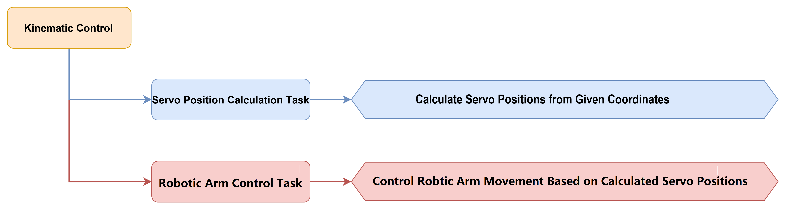

#### 6.2.8.3 Kinematic Algorithm Analysis (Based on the Geometric Method)

**Forward Kinematics**

Introduction: Forward kinematics is a very intuitive problem. Its goal is to determine the position and orientation of the end effector of a manipulator given the angles or positions of each joint. A manipulator can be imagined as a robot arm, where the joint angles control the arm's motion. The position of the end effector, such as a gripper, can be determined once the angle of each joint is known. For example, if the angle of each joint of the arm is known, forward kinematics can be used to calculate the exact position and orientation of the gripper.

**Inverse Kinematics**

Introduction: Inverse kinematics is exactly the opposite of forward kinematics. In this case, the desired position and orientation of the end effector, such as a gripper, are known, while the required rotation of each joint is calculated to bring the end effector to the target position. For example, when the gripper of a robotic arm is required to reach a specified point, inverse kinematics computes the angle to which each joint must rotate to accomplish the goal.

**Model Analysis**

1) The robotic arm model is simplified:

(1) The structural component between servo ID6 and servo ID5 is abstracted as link $l_{1}$, with servo ID6 as the driving joint;

(2) The structural component between servo ID5 and servo ID4 is abstracted as link $l_{2}$, with servo ID5 as the driving joint;

(3) The structural component between servo ID4 and servo ID3 is abstracted as link $l_{3}$, with servo ID4 as the driving joint;

(4) The structural component between servo ID3 and the gripper root is abstracted as link $l_{4}$, with servo ID3 as the driving joint.

2) The rotation of servo ID1 and servo ID2 can only drive the rotation and opening and closing of the gripper. It cannot change the orientation or length of the gripper as a structural component, because its orientation always remains identical to the direction of $l_{4}$. Therefore, this rotation does not affect the coordinate position of the end of the robotic arm, namely the gripper root, in the robotic arm coordinate system. Hence, these two servos should be classified as part of the actuator attached to the end of the robotic arm, such as the gripper and the suction nozzle that interact with objects, rather than as part of the robotic arm.

3) In the inverse kinematics model for analyzing the reachable coordinates of the robotic arm end-effector, these two servos can be ignored.

4) $l_{1}$, $l_{2}$, $l_{3}$, and $l_{4}$ are the link lengths. $\theta_{1}$ is the angle of the top-view projected length $len$ of the servo link in the plane. $\theta_{2}$ is the angle between $l_{2}$ and the horizontal line. $\theta_{3}$ and $\theta_{4}$ are the angles between the current link and the extension line of the previous link. $\theta_{n}$ is defined as positive in the counterclockwise direction.


#### 6.2.8.4 Program Download

> [!NOTE]
>
> **Before downloading the program, confirm that the serial port driver has been installed.**

1) Connect the core board to the computer via a USB cable.


2) Double-click to open the STM32 serial port flashing software **FlyMcu**.

3) Click the **...** icon, and in the corresponding project's **Tankbot\MDK-ARM\Tankbot** path, select the HEX file to be flashed.


4) At position ① in the figure below, select the serial port number corresponding to the core board. At position ②, set the baud rate to 115200. At positions ③ and ④, configure according to the options shown in the figure.


5) Click **Start ISP(P)**, press the **RST** button on the core board, and the program automatically starts downloading. When the right-side log output pane displays the following content, the program download is complete.


#### 6.2.8.5 Program Outcome

1. Robotic arm vertical movement: Upon power-on of the robotic arm, its end effector travels vertically between two upper and lower points.

2. Robotic arm fixed-point movement: Upon power-on, the robotic arm executes cyclic motion among three vertices of an inverted triangle.

#### 6.2.8.6 Program Analysis

> [!NOTE]
>
> **This section analyzes the Robotic Arm Vertical Movement program, and the Robotic Arm Fixed-Point Movement program has similar functionality.**

* **main.c File (Business Layer)**

1) The `global.h` and `robot_arm.h` library files are imported, and the robotic arm control class is defined in `robot_arm.h`.

```c
/* USER CODE END Header */
/* Includes ------------------------------------------------------------------*/
#include "main.h"
#include "adc.h"
#include "dma.h"
#include "i2c.h"
#include "spi.h"
#include "tim.h"
#include "usart.h"
#include "gpio.h"

/* Private includes ----------------------------------------------------------*/
/* USER CODE BEGIN Includes */

#include "global.h"
#include "stdio.h"
#include "stdlib.h"
#include "led.h"
#include "buzzer.h"
#include "robot_arm.h"
#include "adc_sample.h"
```

2) The `robot_arm_init` function is called to initialize the robotic arm kinematics control object `kinematics`.

```c
  robot_arm_init(); 
```

3) In the `while` loop, the `robot_arm_coordinate_set` function is used to set the three-dimensional coordinate points of the robotic arm end effector. The x, y, and z coordinates are (20,0,15) and (20,0,20), enabling the arm to cycle between these two points.

(1) Parameters 1, 2, and 3 of the `robot_arm_coordinate_set` function are the x, y, and z axis coordinates in centimeters.

(2) Parameter 4 is the default pitch angle of the robotic arm, set to 0°.

(3) Parameters 5 and 6 are the maximum and minimum pitch angles.

(4) Parameter 7 is the motion time in milliseconds.

```c
  /* USER CODE END 2 */

  /* Infinite loop */
  /* USER CODE BEGIN WHILE */
	

	
  while (1)
  {	
    robot_arm_coordinate_set(20,0,15,0,-90,90,1000);
    HAL_Delay(2000);
    robot_arm_coordinate_set(20,0,20,0,-90,90,1000);
    HAL_Delay(2000);
	}
  
}
```

* **robot_arm.c File (Bottom Layer)**

1) The function first calculates the results of the maximum and minimum `pitch` angles through inverse kinematics and stores the results in `result1_state` and `result2_state`.

```c
/* 
 * Servo 6: left = pulse width+, right = pulse width-
 * Servo 5: front = pulse width+, back = pulse width-
 * Servo 4: front = pulse width-, back = pulse width+
 * Servo 3: front = pulse width-, back = pulse width+
 */
uint8_t robot_arm_coordinate_set(float target_x,
								 float target_y,
								 float target_z,
								 float pitch,
								 float min_pitch,
								 float max_pitch,
								 uint32_t time)
{
	
	bool result1_state, result2_state;
	
	KinematicsObjectTypeDef kinematics_result1;
	KinematicsObjectTypeDef kinematics_result2;	
	VectorObjectTypeDef vector;

	vector.x = target_x;
	vector.y = target_y;
	vector.z = target_z;
	
	result1_state = set_pitch_range(&kinematics_result1, &vector, pitch, min_pitch);
	result2_state = set_pitch_range(&kinematics_result2, &vector, pitch, max_pitch);
	
```

2) Based on the states of `result1_state` and `result2_state`, it is then determined whether a solution exists. If a solution exists, whether the other pose also has a solution is checked. If both have solutions, the two poses are compared, and the pose closer to the set `pitch` value is selected to set the angle values of the robotic arm.

```c
	if (result1_state)
	{
		kinematics.alpha = kinematics_result1.alpha;
		kinematics.vector.x = kinematics_result1.vector.x;
		kinematics.vector.y = kinematics_result1.vector.y;
		kinematics.vector.z = kinematics_result1.vector.z;
		for (uint8_t i = 0; i< 4; i++)
		{
			kinematics.knot[i].theta = kinematics_result1.knot[i].theta;
		}
		
		if (result2_state)
		{
			if (fabs(kinematics_result2.alpha - pitch) < fabs(kinematics_result1.alpha - pitch))
			{
				kinematics.alpha = kinematics_result2.alpha;
				kinematics.vector.x = kinematics_result2.vector.x;
				kinematics.vector.y = kinematics_result2.vector.y;
				kinematics.vector.z = kinematics_result2.vector.z;
				for (uint8_t i = 0; i< 4; i++)
				{
					kinematics.knot[i].theta = kinematics_result2.knot[i].theta;
				}			
			}
		}
	}
	else
	{
		if (result2_state)
		{
			kinematics.alpha = kinematics_result2.alpha;
			kinematics.vector.x = kinematics_result2.vector.x;
			kinematics.vector.y = kinematics_result2.vector.y;
			kinematics.vector.z = kinematics_result2.vector.z;
			for (uint8_t i = 0; i< 4; i++)
			{
				kinematics.knot[i].theta = kinematics_result2.knot[i].theta;
			}
		}
		else
		{
			return false;
		}
	}
```

3) Finally, the `theta2servo` function is called to set the angle values of each joint servo, completing the coordinate fixed-point movement.

```c
	result1_state = 0;
	result2_state = 0;
	theta2servo(&kinematics, time);

	return true;
}
```

<p id ="6.2.9"></p>

### 6.2.9 Wireless Controller Protocol Parsing

#### 6.2.9.1 Project Introduction

This lesson uses the program **Tankbot_simple** as an example to explain the wireless controller protocol and its receiving and parsing program.

#### 6.2.9.2 Implementation Process


#### 6.2.9.3 Module Description

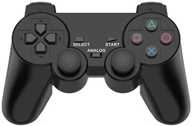

The PS2 wireless controller requires a controller receiver to communicate with the main control board. The controller communicates wirelessly with the receiver via a 2.4 G signal. The controller provides two modes, which can be switched using the **MODE ANALOG** button.

> [!NOTE]
>
> **Before studying the example in this section, you must complete the 1. Tutorials\2. Remote Control\2.1 Wireless Controller Control section.**

#### 6.2.9.4 Program Download

> [!NOTE]
>
> **Before downloading the program, confirm that the serial port driver has been installed.**

1) Connect the core board to the computer via a USB cable.


2) Double-click to open the STM32 serial port flashing software **FlyMcu**.

3) Click the **...** icon, and in the corresponding project's **Tankbot_simple\MDK-ARM\Tankbot** path, select the HEX file to be flashed.


4) At position ① in the figure below, select the serial port number corresponding to the core board. At position ②, set the baud rate to 115200. At positions ③ and ④, configure according to the options shown in the figure.


5) Click **Start ISP(P)**, press the **RST** button on the core board, and the program automatically starts downloading. When the right-side log output pane displays the following content, the program download is complete.


#### 6.2.9.5 Program Outcome

After the robotic arm is powered on, connect the wireless controller and press the **MODE** button to select the simple control mode (single green light mode). The **triangle** and **cross** buttons can then be used to control the opening and closing of the robotic arm gripper.

#### 6.2.9.6 Program Analysis

* **main.c File (Business Layer)**

1) The relevant library files are imported, where the wireless controller reception control class is in the `ps2_porting.h` file. Since the program in this section can also control the chassis vehicle carrying the robotic arm, the corresponding chassis processing function library also needs to be imported as appropriate. The corresponding macro definitions can be enabled in the `global.h` file according to the chassis configuration.

```c
/* USER CODE END Header */
/* Includes ------------------------------------------------------------------*/
#include "main.h"
#include "adc.h"
#include "dma.h"
#include "i2c.h"
#include "spi.h"
#include "tim.h"
#include "usart.h"
#include "gpio.h"

/* Private includes ----------------------------------------------------------*/
/* USER CODE BEGIN Includes */

#include "global.h"
#include "stdio.h"
#include "stdlib.h"
#include "led.h"
#include "buzzer.h"
#include "robot_arm.h"
#include "adc_sample.h"
#include "ps2_porting.h"
```

2) The LED, buzzer, robotic arm, wireless controller, and chassis vehicle objects are initialized.

```c
  /* USER CODE BEGIN 2 */
	led_init();
	buzzer_init();
	adc_sample_init();
  robot_arm_init(); 
	
	HAL_Delay(1000);
	MX_I2C1_Init();
	ps2_init();
```

3) The wireless controller task is run in the loop function.

```c
  /* USER CODE END 2 */

  /* Infinite loop */
  /* USER CODE BEGIN WHILE */
	
  while (1)
  {	
		
		ps2_handler();            
	}
  
}
```

* **ps2_porting.c File (Abstract Interface Layer)**

**① The `ps2_init` Function**

1) This function is responsible for initializing the wireless controller object.

2) In the wireless controller object initialization function, the `memset` function is first called to clear the wireless controller command frame object `ps2` to complete the initialization. The single-servo rotation time `action_running_time` of the wireless controller command frame object is set to 1000 ms.

The reception function member of the object is bound to `receive_data`. The `lwrb_init` function is called to create the object data storage area. The `packet_start_receive` function is called to prepare to start receiving data.

```c
void ps2_init()
{
	memset(&ps2, 0, sizeof(PS2HandleTypeDef));
	ps2.action_running_time = 1000;
	ps2.receive_data = receive_data;
	lwrb_init(&ps2.rb, ps2.rx_fifo, sizeof(ps2.rx_fifo));
	packet_start_receive();	

}
```

**② The `packet_start_receive` Function**

1) This function binds the serial port data reception function connected to the wireless controller receiver and starts the serial port receiving data.

2) The `HAL_UART_RegisterCallback` and `HAL_UART_RegisterRxEventCallback` functions are called to bind the serial port reception error (`HAL_UART_ERROR_CB_ID` set to 1) and the serial port reception (complete) event processing callback functions respectively. The `receive_data` function is called to officially start receiving data.

```c
static void packet_start_receive()
{
	HAL_UART_RegisterCallback(&huart3, HAL_UART_ERROR_CB_ID, packet_uart_error_callblack);
	HAL_UART_RegisterRxEventCallback(&huart3, packet_dma_receive_event_callback);
	ps2.receive_data(ps2.rx_dma_buf, sizeof(ps2.rx_dma_buf));
}
```

**③ The `ps2_handler` Function**

In the wireless controller working processing function `ps2_handler`, only the `unpack` function is called to process the obtained data.

```c
void ps2_handler()
{
	unpack(&ps2);
}
```

**④ The `unpack` Function**

1) This function is responsible for parsing the received wireless controller data frames and performing related processing according to the commands as a response.

2) In this function, the `lwrb_get_full` function is called to obtain the length of unread data in the buffer, reading the reception data buffer pointed to by `self->rb`. If the buffer is not empty (there is data inside that has not been read), the function returns the length of newly unread data.

3) When the reception data buffer is not empty, the following processing is performed: ① limit the length of the newly unread data, ② match the first frame header, ③ match the second frame header, ④ extract the data values of one frame, ⑤ parse the data according to the working mode of the wireless controller command frame object, ⑥ call the `ps2_run` function to respond to the data frame commands.

```c
static void unpack(PS2HandleTypeDef* self)
{
	uint8_t i;

	uint32_t readlen = 0;
	uint32_t available = 0;
	
	static uint8_t buffer_index = 0;	
	static uint8_t rec_data[PS2_PACKET_LENGTH] = {0};

	available = lwrb_get_full(&self->rb);
	if (available != 0)
	{
		available = available > PS2_PACKET_LENGTH ? PS2_PACKET_LENGTH: available;
 		if(self->packet_status == PS2_PACKET_HEADER_1)		/* Step 1: Find the frame header */
		{
			self->unpack_status = UNPACK_FINISH;
			readlen = lwrb_read(&self->rb, rec_data, 1);
			self->packet_status = rec_data[0] == PS2_PACKET_HEADER ? PS2_PACKET_HEADER_2: PS2_PACKET_HEADER_1;
			self->packet.packet_header[0] = rec_data[0];			
		}
		
		if (self->packet_status == PS2_PACKET_HEADER_2)			
		{
			readlen = lwrb_read(&self->rb, rec_data, 2);
			for(i = 0; i < readlen; i++)
			{
				switch(self->packet_status)
				{
					case PS2_PACKET_HEADER_2:
						self->packet_status = rec_data[i] == PS2_PACKET_HEADER ? PS2_PACKET_DATA_LENGTH: PS2_PACKET_HEADER_1;
						self->packet.packet_header[1] = rec_data[i];
						break;		
					
					case PS2_PACKET_DATA_LENGTH:			/* Step 2: Get the length information of a frame */	
						self->packet_status = rec_data[i] != 0 ? PS2_PACKET_DATA: PS2_PACKET_HEADER_1;
						self->packet.data_len = rec_data[i];
						buffer_index = 0;
						break;			
					
					default:
						self->packet_status = PS2_PACKET_HEADER_1;
						break;						
				}
			}
		}
		
		if (self->packet_status == PS2_PACKET_DATA)			/* Step 3: Get the data information of a frame */
		{
			readlen = lwrb_read(&self->rb, rec_data, self->packet.data_len - 1);
			for(i = 0; i < readlen; i++)
			{
				self->packet.buffer[buffer_index] = rec_data[i];
				buffer_index++;
				if(buffer_index == self->packet.data_len - 2)
				{
					self->packet_status = PS2_PACKET_HEADER_1;
					self->keyvalue.buffer0 = self->packet.buffer[2];
					self->keyvalue.buffer1 = self->packet.buffer[3];
					if(self->keyvalue.bit_mode == 1 && self->last_keyvalue.bit_mode == 0)
					{
						self->mode_button_status = !self->mode_button_status; 
					}
					
					self->mode = self->mode_button_status == 0 ? PS2_NULL_MODE : PS2_CHASSIS_MODE;
				}		
			}			
		}
		
		switch(self->mode)
		{
			case PS2_NULL_MODE:
				self->keyvalue.bit_left = self->packet.buffer[5] == 0x00 ? 1 : 0;
				self->keyvalue.bit_right = self->packet.buffer[5] == 0xFF ? 1 : 0;
				self->keyvalue.bit_up = self->packet.buffer[6] == 0x00 ? 1 : 0;
				self->keyvalue.bit_down = self->packet.buffer[6] == 0xFF ? 1 : 0;
				break;
			
			case PS2_CHASSIS_MODE:
				self->keyvalue.left_joystick_x = self->packet.buffer[5];
				self->keyvalue.left_joystick_y = self->packet.buffer[6];
				self->keyvalue.right_joystick_x = self->packet.buffer[7];
				self->keyvalue.right_joystick_y = self->packet.buffer[8];
				switch(self->packet.buffer[4])
				{
					case 0x00:
						self->keyvalue.bit_up = 1;
						break;
					
					case 0x01:
						self->keyvalue.bit_up = 1;
						self->keyvalue.bit_right = 1;
						break;
					
					case 0x02:
						self->keyvalue.bit_right = 1;
						break;
					
					case 0x03:
						self->keyvalue.bit_down = 1;
						self->keyvalue.bit_right = 1;
						break;
					
					case 0x04:
						self->keyvalue.bit_down = 1;
						break;
					
					case 0x05:
						self->keyvalue.bit_down = 1;
						self->keyvalue.bit_left = 1;
						break;
					
					case 0x06:
						self->keyvalue.bit_left = 1;
						break;
					
					case 0x07:
						self->keyvalue.bit_up = 1;
						self->keyvalue.bit_left = 1;
						break;
					
					case 0x0F:
						self->keyvalue.bit_up = 0;
						self->keyvalue.bit_down = 0;
						self->keyvalue.bit_left = 0;
						self->keyvalue.bit_right = 0;
						break;
				}
				break;
				
			default:
				break;
		}
		ps2_run(&ps2);
		self->last_keyvalue = self->keyvalue;
	}
}
```

4) In the first frame header matching stage, the `lwrb_read` function is called to read 1 bit of unread data and match it against the first frame header `PS2_PACKET_HEADER`.

5) If the match is successful, the data frame acquisition stage transitions from the first frame header acquisition stage `packet_status` `PS2_PACKET_HEADER_1` to the second frame header acquisition stage `packet_status` `PS2_PACKET_HEADER_2`.

```c
static void unpack(PS2HandleTypeDef* self)
{
	uint8_t i;

	uint32_t readlen = 0;
	uint32_t available = 0;
	
	static uint8_t buffer_index = 0;	
	static uint8_t rec_data[PS2_PACKET_LENGTH] = {0};

	available = lwrb_get_full(&self->rb);
	if (available != 0)
	{
		available = available > PS2_PACKET_LENGTH ? PS2_PACKET_LENGTH: available;
 		if(self->packet_status == PS2_PACKET_HEADER_1)		/* Step 1: Find the frame header */
		{
			self->unpack_status = UNPACK_FINISH;
			readlen = lwrb_read(&self->rb, rec_data, 1);
			self->packet_status = rec_data[0] == PS2_PACKET_HEADER ? PS2_PACKET_HEADER_2: PS2_PACKET_HEADER_1;
			self->packet.packet_header[0] = rec_data[0];			
		}
		
		if (self->packet_status == PS2_PACKET_HEADER_2)			
		{
			readlen = lwrb_read(&self->rb, rec_data, 2);
			for(i = 0; i < readlen; i++)
			{
				switch(self->packet_status)
				{
					case PS2_PACKET_HEADER_2:
						self->packet_status = rec_data[i] == PS2_PACKET_HEADER ? PS2_PACKET_DATA_LENGTH: PS2_PACKET_HEADER_1;
						self->packet.packet_header[1] = rec_data[i];
						break;		
					
					case PS2_PACKET_DATA_LENGTH:			/* Step 2: Get the length information of a frame */	
						self->packet_status = rec_data[i] != 0 ? PS2_PACKET_DATA: PS2_PACKET_HEADER_1;
						self->packet.data_len = rec_data[i];
						buffer_index = 0;
						break;	
				}
			}
		}
```

6) In the second frame header acquisition stage `packet_status` `PS2_PACKET_HEADER_2`, the `lwrb_read` function is called to read two bits of unread data and traverse it in a loop.

7) The program matches the first bit of the obtained data against the second frame header `PS2_PACKET_HEADER`. If the match is successful, the data frame acquisition stage transitions from the second frame header acquisition stage `packet_status` `PS2_PACKET_HEADER_2` to the frame length acquisition stage `PS2_PACKET_DATA_LENGTH`. If the match fails, it resets to the first frame header acquisition stage.

8) Similarly, in the frame length acquisition stage `PS2_PACKET_DATA_LENGTH`, the data is checked to be non-zero, transferred to the corresponding member of the object, and the stage jumps to the frame data acquisition stage `PS2_PACKET_DATA`. If the match fails, it resets to the first frame header acquisition stage.

```c
static void unpack(PS2HandleTypeDef* self)
{
	uint8_t i;

	uint32_t readlen = 0;
	uint32_t available = 0;
	
	static uint8_t buffer_index = 0;	
	static uint8_t rec_data[PS2_PACKET_LENGTH] = {0};

	available = lwrb_get_full(&self->rb);
	if (available != 0)
	{
		available = available > PS2_PACKET_LENGTH ? PS2_PACKET_LENGTH: available;
 		if(self->packet_status == PS2_PACKET_HEADER_1)		/* Step 1: Find the frame header */
		{
			self->unpack_status = UNPACK_FINISH;
			readlen = lwrb_read(&self->rb, rec_data, 1);
			self->packet_status = rec_data[0] == PS2_PACKET_HEADER ? PS2_PACKET_HEADER_2: PS2_PACKET_HEADER_1;
			self->packet.packet_header[0] = rec_data[0];			
		}
		
		if (self->packet_status == PS2_PACKET_HEADER_2)			
		{
			readlen = lwrb_read(&self->rb, rec_data, 2);
			for(i = 0; i < readlen; i++)
			{
				switch(self->packet_status)
				{
					case PS2_PACKET_HEADER_2:
						self->packet_status = rec_data[i] == PS2_PACKET_HEADER ? PS2_PACKET_DATA_LENGTH: PS2_PACKET_HEADER_1;
						self->packet.packet_header[1] = rec_data[i];
						break;		
					
					case PS2_PACKET_DATA_LENGTH:			/* Step 2: Get the length information of a frame */	
						self->packet_status = rec_data[i] != 0 ? PS2_PACKET_DATA: PS2_PACKET_HEADER_1;
						self->packet.data_len = rec_data[i];
						buffer_index = 0;
						break;			
					
					default:
						self->packet_status = PS2_PACKET_HEADER_1;
						break;						
				}
			}
		}
```

9) In the frame data acquisition stage `PS2_PACKET_DATA`, according to the known frame length (including the data length of one command frame starting from the frame length), the unread data of the corresponding length is obtained and transferred in a loop (the frame length has been obtained earlier, so only data of length `packet.data_len - 1` needs to be obtained here, and the index of the last element of the array storing this data is `packet.data_len - 2`).

(1) The values of bytes (2+1)--(3+1) of one command frame are transferred to the `buffer0` and `buffer1` members, automatically parsing the press states of the 15 buttons "▲", "口", "×", "⚪", "l1", "r1", "l2", "r2", "SELECT", "START", "left joystick", "right joystick", and "mode".

> [!IMPORTANT]
>
> **Analysis of the program's automatic parsing of the above button information:**
>
> **In the `ps2_porting.h` file, the definition of the class to which the wireless controller command frame object belongs can be seen. There are two unions. Taking the first one as an example: in a union, all variables share a segment of memory space. If different variables have different memory lengths, the memory space of the variable with the largest memory length prevails.**
>
> **There are two variables: an 8-bit `buffer0` and an anonymous structure (this structure is 8 bits long, in which variables such as `bit_triangle` each occupy a 1-bit space of the structure from the low bit to the high bit).**
>
> **It is also known that `buffer0` and the anonymous structure share the memory space, that is, assigning a value to `buffer0` is equivalent to assigning a value to the anonymous structure, and also equivalent to assigning values to the 8 variables such as `bit_triangle`.**
>
> **`buffer0` has already been assigned a value in the `unpack` function, and at this time the 8 variables such as `bit_triangle` that represent the press states of each button of the wireless controller are also assigned.**
>
> **In bytes (2+1)--(3+1) of one wireless controller command frame, every 1 bit sequentially stores the press state of one of the above 15 buttons. When pressed, the corresponding bit is 1; otherwise, it is 0.**

(2) The `bit_mode` member in the current frame data and the previous frame data objects is then checked. Based on the values of `bit_mode` in two consecutive frames, it is determined whether the Mode button is pressed, thereby toggling the polarity of `mode_button_status` and switching the wireless controller working  `mode` between `PS2_NULL_MODE` simple control mode and `PS2_CHASSIS_MODE` coordinate control mode.

```c
 		if (self->packet_status == PS2_PACKET_DATA)			/* Step 3: Get the data information of a frame */
 		{
 			readlen = lwrb_read(&self->rb, rec_data, self->packet.data_len - 1);
 			for(i = 0; i < readlen; i++)
 			{
 				self->packet.buffer[buffer_index] = rec_data[i];
 				buffer_index++;
 				if(buffer_index == self->packet.data_len - 2)
 				{
 					self->packet_status = PS2_PACKET_HEADER_1;
 					self->keyvalue.buffer0 = self->packet.buffer[2];
 					self->keyvalue.buffer1 = self->packet.buffer[3];
 					if(self->keyvalue.bit_mode == 1 && self->last_keyvalue.bit_mode == 0)
 					{
 						self->mode_button_status = !self->mode_button_status; 
 					}
 					
 					self->mode = self->mode_button_status == 0 ? PS2_NULL_MODE : PS2_CHASSIS_MODE;
 				}		
 			}			
 		}
```

10) In different working modes of the wireless controller, the information format of the joysticks and buttons arranged in the data is also different, and different rules need to be used for analysis:

(1) In the `PS2_NULL_MODE` mode, the values of bytes (5+1)--(6+1) of one command frame are analyzed to determine the press states of the "↑", "↓", "←", and "→" buttons of the wireless controller according to the values.

(2) In the `PS2_CHASSIS_MODE` mode, the values of bytes (5+1)--(8+1) of one command frame are analyzed to determine the movement of the left joystick in the left/right and up/down directions, and the right joystick in the left/right and up/down directions according to the values.

(3) The value of byte (4+1) of one command frame is also analyzed to determine the press states of the "↑", "↓", "←", and "→" buttons of the wireless controller according to the value.

```c
		switch(self->mode)
		{
			case PS2_NULL_MODE:
				self->keyvalue.bit_left = self->packet.buffer[5] == 0x00 ? 1 : 0;
				self->keyvalue.bit_right = self->packet.buffer[5] == 0xFF ? 1 : 0;
				self->keyvalue.bit_up = self->packet.buffer[6] == 0x00 ? 1 : 0;
				self->keyvalue.bit_down = self->packet.buffer[6] == 0xFF ? 1 : 0;
				break;
			
			case PS2_CHASSIS_MODE:
				self->keyvalue.left_joystick_x = self->packet.buffer[5];
				self->keyvalue.left_joystick_y = self->packet.buffer[6];
				self->keyvalue.right_joystick_x = self->packet.buffer[7];
				self->keyvalue.right_joystick_y = self->packet.buffer[8];
				switch(self->packet.buffer[4])
				{
					case 0x00:
						self->keyvalue.bit_up = 1;
						break;
					
					case 0x01:
						self->keyvalue.bit_up = 1;
						self->keyvalue.bit_right = 1;
						break;
					
					case 0x02:
						self->keyvalue.bit_right = 1;
						break;
					
					case 0x03:
						self->keyvalue.bit_down = 1;
						self->keyvalue.bit_right = 1;
						break;
					
					case 0x04:
						self->keyvalue.bit_down = 1;
						break;
					
					case 0x05:
						self->keyvalue.bit_down = 1;
						self->keyvalue.bit_left = 1;
						break;
					
					case 0x06:
						self->keyvalue.bit_left = 1;
						break;
					
					case 0x07:
						self->keyvalue.bit_up = 1;
						self->keyvalue.bit_left = 1;
						break;
					
					case 0x0F:
						self->keyvalue.bit_up = 0;
						self->keyvalue.bit_down = 0;
						self->keyvalue.bit_left = 0;
						self->keyvalue.bit_right = 0;
						break;
				}
				break;
				
			default:
				break;
		}
```

11) Finally, the `ps2_run` function is called to execute the corresponding operations on the analyzed current frame data as a response, and the current frame data is transferred to the previous frame member `last_keyvalue` of the object.

```c
		ps2_run(&ps2);
		self->last_keyvalue = self->keyvalue;
```

**⑤ The `ps2_run` Function**

1) In this subsection, the execution processing of the wireless controller commands is simplified for an easy understanding. For the complete execution processing logic, refer to the next subsection.

2) The program first checks the current wireless controller working mode `mode`. The current program only processes the commands in the `PS2_NULL_MODE` mode. If the mode matches, the press states of the "▲" and "×" buttons are checked. (When a button is pressed, the corresponding flag member of the object is `1`, otherwise, it is `0`.

3) If the "▲" button is pressed, the `robot_arm_knot_run` function is called to control servo ID1 to rotate to the position `PS2_SET_MAX_DUTY`. If the "×" button is pressed, the `robot_arm_knot_run` function is called to control servo ID1 to rotate to the position `PS2_SET_MIN_DUTY`.

4) If neither the "▲" nor the "×" button in the current frame data object is pressed, and at least one of the two buttons in the previous frame data object was pressed, it indicates that the user has stopped controlling servo ID1 through the wireless controller, and the `robot_arm_knot_stop` function is called to stop the servo.

```c
static void ps2_run(PS2HandleTypeDef* self)
{
	if(self->mode == PS2_NULL_MODE)
	{
		if(self->keyvalue.bit_triangle)
		{
			robot_arm_knot_run(1, PS2_SET_MAX_DUTY, self->action_running_time);
			run_flag = 1;
		}	
		else if(self->keyvalue.bit_cross)
		{
			robot_arm_knot_run(1, PS2_SET_MIN_DUTY, self->action_running_time);
		}
		
		else if(self->keyvalue.bit_triangle == 0 && self->keyvalue.bit_cross == 0)
		{
			if(self->last_keyvalue.bit_triangle != 0 || self->last_keyvalue.bit_cross != 0)
			{
				robot_arm_knot_stop(1);
			}
		}


	}
}

```

### 6.2.10 Wireless Controller Control Program

#### 6.2.10.1 Project Introduction

This lesson uses the **Tankbot** program as an example to implement wireless controller-controlled robotic arm functionality, focusing on the logical relationship between wireless controller buttons and robotic arm control.

#### 6.2.10.2 Implementation Process

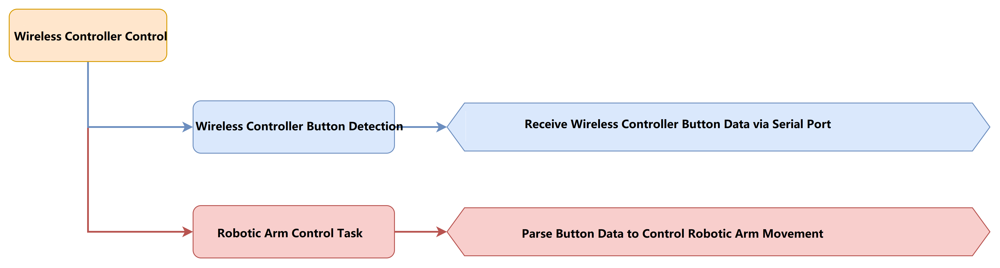

#### 6.2.10.3 Module Description


The PS2 wireless controller requires a controller receiver to communicate with the main control board. The controller communicates wirelessly with the receiver via a 2.4 G signal. The controller provides two modes, which can be switched using the **MODE(ANALOG)** button.

> [!NOTE]
>
> **Before studying the example in this section, you must complete the 1. Tutorials\2. Remote Control\2.1 Wireless Controller Control section.**

#### 6.2.10.4 Program Download

> [!NOTE]
>
> **Before downloading the program, confirm that the serial port driver has been installed.**

1) Connect the core board to the computer via a USB cable.


2) Double-click to open the STM32 serial port flashing software **FlyMcu**.

3) Click the **...** icon, and in the corresponding project's **[Tankbot\MDK-ARM\Tankbot](https://drive.google.com/drive/folders/1o4xIqZK-diugT94O0Wydy2Vfql80v7MK?usp=sharing)** path, select the HEX file to be flashed.


4) At position ① in the figure below, select the serial port number corresponding to the core board. At position ②, set the baud rate to 115200. At positions ③ and ④, configure according to the options shown in the figure.


5) Click **Start ISP(P)**, press the **RST** button on the core board, and the program automatically starts downloading. When the right-side log output pane displays the following content, the program download is complete.


#### 6.2.10.5 Program Outcome

When the wireless controller is in **coordinate control mode (both red and green lights on)**, kinematic control of the robotic arm can be performed.

When the wireless controller is in **simple control mode (only the green light on)**, servo control is available.

When the wireless controller is in **simple control mode**, when any button is pressed together with the **SELECT** button, the robotic arm runs the action group.

#### 6.2.10.6 Program Analysis

> [!NOTE]
>
> **The wireless controller reception interface and protocol parsing can be found in the [6.2.9 Wireless Controller Protocol Parsing](#6.2.9) document in the same directory.**

* **ps2_porting.c File (Abstract Interface Layer)**

**① The `ps2_run` Function**

1) This function executes different processing logic according to the working mode `mode` of the current command frame object.

```c
static void ps2_run(PS2HandleTypeDef* self)
{
	if(self->mode == PS2_CHASSIS_MODE)
	{
		if(self->keyvalue.bit_triangle)
		{
			robot_arm_knot_run(1, PS2_SET_MAX_DUTY, self->action_running_time);
			run_flag = 1;
		}	
		else if(self->keyvalue.bit_cross)
		{
			robot_arm_knot_run(1, PS2_SET_MIN_DUTY, self->action_running_time);
		}
		
		else if(self->keyvalue.bit_triangle == 0 && self->keyvalue.bit_cross == 0)
		{
			if(self->last_keyvalue.bit_triangle != 0 || self->last_keyvalue.bit_cross != 0)
			{
				robot_arm_knot_stop(1);
			}
		}

		if(self->keyvalue.bit_square)
		{
			robot_arm_knot_run(2, PS2_SET_MAX_DUTY, self->action_running_time);
		}
		else if(self->keyvalue.bit_circle)
		{
			robot_arm_knot_run(2, PS2_SET_MIN_DUTY, self->action_running_time);
		}
		else if(self->keyvalue.bit_square == 0 && self->keyvalue.bit_circle == 0)
		{
			if(self->last_keyvalue.bit_square != 0 || self->last_keyvalue.bit_circle != 0)
			{
				robot_arm_knot_stop(2);
			}
		}

		if(self->keyvalue.bit_r1)
		{
			robot_arm_knot_run(3, PS2_SET_MAX_DUTY, self->action_running_time);
		}
		else if(self->keyvalue.bit_r2)
		{
			robot_arm_knot_run(3, PS2_SET_MIN_DUTY, self->action_running_time);
		}
		else if(self->keyvalue.bit_r1 == 0 && self->keyvalue.bit_r2 == 0)
		{
			if(self->last_keyvalue.bit_r1 != 0 || self->last_keyvalue.bit_r2 != 0)
			{
				robot_arm_knot_stop(3);
			}
		}

		if(self->keyvalue.bit_l1 == 1)
		{
			robot_arm_knot_run(4, PS2_SET_MAX_DUTY, self->action_running_time);
		}
		else if(self->keyvalue.bit_l2 == 1)
		{
			robot_arm_knot_run(4, PS2_SET_MIN_DUTY, self->action_running_time);
		}
		else if(self->keyvalue.bit_l1 == 0 && self->keyvalue.bit_l2 == 0)
		{
			if(self->last_keyvalue.bit_l1 != 0 || self->last_keyvalue.bit_l2 != 0)
			{
				robot_arm_knot_stop(4);
			}
		}
		
		if(self->keyvalue.bit_up == 1)
		{
			robot_arm_knot_run(5, PS2_SET_MAX_DUTY, self->action_running_time);
		}
		else if(self->keyvalue.bit_down == 1)
		{
			robot_arm_knot_run(5, PS2_SET_MIN_DUTY, self->action_running_time);
		}
		else if(self->keyvalue.bit_up == 0 && self->keyvalue.bit_down == 0)
		{
			if(self->last_keyvalue.bit_up != 0 || self->last_keyvalue.bit_down != 0)
			{
				robot_arm_knot_stop(5);
			}
		}

		if(self->keyvalue.bit_left == 1)
		{
			robot_arm_knot_run(6, PS2_SET_MAX_DUTY, self->action_running_time);
		}
		else if(self->keyvalue.bit_right == 1)
		{
			robot_arm_knot_run(6, PS2_SET_MIN_DUTY, self->action_running_time);
		}
		else if(self->keyvalue.bit_left == 0 && self->keyvalue.bit_right == 0)
		{
			if(self->last_keyvalue.bit_left != 0 || self->last_keyvalue.bit_right != 0)
			{
				robot_arm_knot_stop(6);
			}
		}

		if(self->keyvalue.bit_start == 1)
		{
			robot_arm_reset(self->action_running_time);
		}

		if(self->keyvalue.bit_select == 1 && self->keyvalue.bit_up == 1)
		{
			buzzer_toggle(100, 100, 1);
			while(1)
			{
				if(action_group_run(0, 1))
				{
					action_group_reset();
					break;
				}
			}
		}
		
		if(self->keyvalue.bit_select == 1 && self->keyvalue.bit_down == 1)
		{
			buzzer_toggle(100, 100, 1);
			while(1)
			{
				if(action_group_run(1, 1))
				{
					action_group_reset();
					break;
				}
			}
		}
		
		if(self->keyvalue.bit_select == 1 && self->keyvalue.bit_left == 1)
		{
			buzzer_toggle(100, 100, 1);
			while(1)
			{
				if(action_group_run(2, 1))
				{
					action_group_reset();
					break;
				}
			}
		}		

		if(self->keyvalue.bit_select == 1 && self->keyvalue.bit_right == 1)
		{
			buzzer_toggle(100, 100, 1);
			while(1)
			{
				if(action_group_run(3, 1))
				{
					action_group_reset();
					break;
				}
			}
		}	

		if(self->keyvalue.bit_select == 1 && self->keyvalue.bit_l1 == 1)
		{
			buzzer_toggle(100, 100, 1);
			while(1)
			{
				if(action_group_run(4, 1))
				{
					action_group_reset();
					break;
				}
			}
		}	
		
		if(self->keyvalue.bit_select == 1 && self->keyvalue.bit_l2 == 1)
		{
			buzzer_toggle(100, 100, 1);
			while(1)
			{
				if(action_group_run(5, 1))
				{
					action_group_reset();
					break;
				}
			}
		}	
		
		if(self->keyvalue.bit_select == 1 && self->keyvalue.bit_triangle == 1)
		{
			buzzer_toggle(100, 100, 1);
			while(1)
			{
				if(action_group_run(6, 1))
				{
					action_group_reset();
					break;
				}
			}
		}
		
		if(self->keyvalue.bit_select == 1 && self->keyvalue.bit_cross == 1)
		{
			buzzer_toggle(100, 100, 1);
			while(1)
			{
				if(action_group_run(7, 1))
				{
					action_group_reset();
					break;
				}
			}
		}
		
		if(self->keyvalue.bit_select == 1 && self->keyvalue.bit_square == 1)
		{
			buzzer_toggle(100, 100, 1);
			while(1)
			{
				if(action_group_run(8, 1))
				{
					action_group_reset();
					break;
				}
			}
		}
		
		if(self->keyvalue.bit_select == 1 && self->keyvalue.bit_circle == 1)
		{
			buzzer_toggle(100, 100, 1);
			while(1)
			{
				if(action_group_run(9, 1))
				{
					action_group_reset();
					break;
				}
			}
		}

		if(self->keyvalue.bit_select == 1 && self->keyvalue.bit_r1 == 1)
		{
			buzzer_toggle(100, 100, 1);
			while(1)
			{
				if(action_group_run(10, 1))
				{
					action_group_reset();
					break;
				}
			}
		}
		
		if(self->keyvalue.bit_select == 1 && self->keyvalue.bit_r2 == 1)
		{
			buzzer_toggle(100, 100, 1);
			while(1)
			{
				if(action_group_run(11, 1))
				{
					action_group_reset();
					break;
				}
			}
		}
		
		if(self->keyvalue.bit_leftjoystick_press)
		{
			buzzer_toggle(100, 100, 1);
			led_flash(2, 100, 100, 1);
			if(self->action_running_time > 400)
			{
				self->action_running_time  -= 200;
			}
		}
		
		if(self->keyvalue.bit_rightjoystick_press)
		{
			buzzer_toggle(100, 100, 1);
			led_flash(2, 100, 100, 1);
			if(self->action_running_time < 10000)
			{
				self->action_running_time += 200;
			}
		}
		/* Up 0, down 255; left 0, right 255 */        
		if (abs(self->keyvalue.left_joystick_y - 127) < 10)
		{
			speed = 0;        
		}
		else if(self->keyvalue.left_joystick_y < 127 && (abs(self->keyvalue.left_joystick_y - 127) > 10))
		{
			speed = 80;        
                               
		}
		else if(self->keyvalue.left_joystick_y > 127 && (abs(self->keyvalue.left_joystick_y - 127) > 10))
		{
			speed = -80;        
                       
		}
		
		if(abs(self->keyvalue.right_joystick_x - 127) < 10)
		{
			rot = 0;        
                       
		}
		else if(self->keyvalue.right_joystick_x < 127 && abs(self->keyvalue.right_joystick_x - 127) > 10)
		{
			rot = 0.6;        
                       
		}
		else if(self->keyvalue.right_joystick_x > 127 && abs(self->keyvalue.right_joystick_x - 127) > 10)
		{
			rot = -0.6;    
		}

		differentials_chassis_run(speed, rot);
  
	}
}

```

2) If the wireless controller is in the `PS2_CHASSIS_MODE` (chassis control) mode:

(1) A check is performed. If the **SELECT** button is not pressed, but any other button is pressed, the corresponding servo is controlled to move or stop. The following are partial code snippets:

```c
	if(self->mode == PS2_CHASSIS_MODE)
	{
		if(self->keyvalue.bit_triangle)
		{
			robot_arm_knot_run(1, PS2_SET_MAX_DUTY, self->action_running_time);
			run_flag = 1;
		}	
		else if(self->keyvalue.bit_cross)
		{
			robot_arm_knot_run(1, PS2_SET_MIN_DUTY, self->action_running_time);
		}
		
		else if(self->keyvalue.bit_triangle == 0 && self->keyvalue.bit_cross == 0)
		{
			if(self->last_keyvalue.bit_triangle != 0 || self->last_keyvalue.bit_cross != 0)
			{
				robot_arm_knot_stop(1);
			}
		}

		if(self->keyvalue.bit_square)
		{
			robot_arm_knot_run(2, PS2_SET_MAX_DUTY, self->action_running_time);
		}
		else if(self->keyvalue.bit_circle)
		{
			robot_arm_knot_run(2, PS2_SET_MIN_DUTY, self->action_running_time);
		}
		else if(self->keyvalue.bit_square == 0 && self->keyvalue.bit_circle == 0)
		{
			if(self->last_keyvalue.bit_square != 0 || self->last_keyvalue.bit_circle != 0)
			{
				robot_arm_knot_stop(2);
			}
		}

		if(self->keyvalue.bit_r1)
		{
			robot_arm_knot_run(3, PS2_SET_MAX_DUTY, self->action_running_time);
		}
		else if(self->keyvalue.bit_r2)
		{
			robot_arm_knot_run(3, PS2_SET_MIN_DUTY, self->action_running_time);
		}
		else if(self->keyvalue.bit_r1 == 0 && self->keyvalue.bit_r2 == 0)
		{
			if(self->last_keyvalue.bit_r1 != 0 || self->last_keyvalue.bit_r2 != 0)
			{
				robot_arm_knot_stop(3);
			}
		}

		if(self->keyvalue.bit_l1 == 1)
		{
			robot_arm_knot_run(4, PS2_SET_MAX_DUTY, self->action_running_time);
		}
		else if(self->keyvalue.bit_l2 == 1)
		{
			robot_arm_knot_run(4, PS2_SET_MIN_DUTY, self->action_running_time);
		}
		else if(self->keyvalue.bit_l1 == 0 && self->keyvalue.bit_l2 == 0)
		{
			if(self->last_keyvalue.bit_l1 != 0 || self->last_keyvalue.bit_l2 != 0)
			{
				robot_arm_knot_stop(4);
			}
		}
		
		if(self->keyvalue.bit_up == 1)
		{
			robot_arm_knot_run(5, PS2_SET_MAX_DUTY, self->action_running_time);
		}
		else if(self->keyvalue.bit_down == 1)
		{
			robot_arm_knot_run(5, PS2_SET_MIN_DUTY, self->action_running_time);
		}
		else if(self->keyvalue.bit_up == 0 && self->keyvalue.bit_down == 0)
		{
			if(self->last_keyvalue.bit_up != 0 || self->last_keyvalue.bit_down != 0)
			{
				robot_arm_knot_stop(5);
			}
		}

		if(self->keyvalue.bit_left == 1)
		{
			robot_arm_knot_run(6, PS2_SET_MAX_DUTY, self->action_running_time);
		}
		else if(self->keyvalue.bit_right == 1)
		{
			robot_arm_knot_run(6, PS2_SET_MIN_DUTY, self->action_running_time);
		}
		else if(self->keyvalue.bit_left == 0 && self->keyvalue.bit_right == 0)
		{
			if(self->last_keyvalue.bit_left != 0 || self->last_keyvalue.bit_right != 0)
			{
				robot_arm_knot_stop(6);
			}
		}

		if(self->keyvalue.bit_start == 1)
		{
			robot_arm_reset(self->action_running_time);
		}

		if(self->keyvalue.bit_select == 1 && self->keyvalue.bit_up == 1)
		{
			buzzer_toggle(100, 100, 1);
			while(1)
			{
				if(action_group_run(0, 1))
				{
					action_group_reset();
					break;
				}
			}
		}
		
		if(self->keyvalue.bit_select == 1 && self->keyvalue.bit_down == 1)
		{
			buzzer_toggle(100, 100, 1);
			while(1)
			{
				if(action_group_run(1, 1))
				{
					action_group_reset();
					break;
				}
			}
		}
```

(2) If the **SELECT** button is pressed in combination with another button, the action group needs to be executed. The following are partial code snippets:

```c
		if(self->keyvalue.bit_select == 1 && self->keyvalue.bit_up == 1)
		{
			buzzer_toggle(100, 100, 1);
			while(1)
			{
				if(action_group_run(0, 1))
				{
					action_group_reset();
					break;
				}
			}
		}
```

(3) If the **START** button is pressed, a reset is performed:

```c
		if(self->keyvalue.bit_start == 1)
		{
			robot_arm_reset(self->action_running_time);
		}
```

(4) When the left and right joysticks are pressed, the motion time is incremented or decremented.

```c
		if(self->keyvalue.bit_leftjoystick_press)
		{
			buzzer_toggle(100, 100, 1);
			led_flash(2, 100, 100, 1);
			if(self->action_running_time > 400)
			{
				self->action_running_time  -= 200;
			}
		}
		
		if(self->keyvalue.bit_rightjoystick_press)
		{
			buzzer_toggle(100, 100, 1);
			led_flash(2, 100, 100, 1);
			if(self->action_running_time < 10000)
			{
				self->action_running_time += 200;
			}
		}
```

3) When the wireless controller is in the `PS2_NULL_MODE` mode, the states of the up, down, left, and right direction buttons are simply parsed.

```c
			case PS2_NULL_MODE:
				self->keyvalue.bit_left = self->packet.buffer[5] == 0x00 ? 1 : 0;
				self->keyvalue.bit_right = self->packet.buffer[5] == 0xFF ? 1 : 0;
				self->keyvalue.bit_up = self->packet.buffer[6] == 0x00 ? 1 : 0;
				self->keyvalue.bit_down = self->packet.buffer[6] == 0xFF ? 1 : 0;
				break;
```

<p id ="6.2.11"></p>

### 6.2.11 PC Software Protocol Parsing

#### 6.2.11.1 Project Introduction

This lesson uses the **Tankbot_simple** program as an example to explain the PC software protocol and its reception and parsing program.

#### 6.2.11.2 Implementation Process

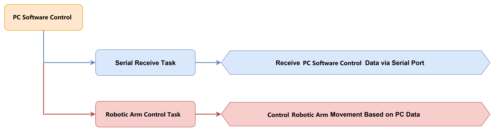

#### 6.2.11.3 PC Software Introduction

> [!NOTE]
>
> **Before studying the example in this section, you must complete the 1. Tutorials\3. PC Software Action Group Control section.**


The example in this section uses the Tankbot-specific software **LeArm.exe** to control the robotic arm to move according to the function icons on the PC software.

#### 6.2.11.4 Program Download

> [!NOTE]
>
> **Before downloading the program, confirm that the serial port driver has been installed.**

1. Connect the core board to the computer via a USB cable.

   

2. Double-click to open the STM32 serial port flashing software **FlyMcu**.

3. Click the **...** icon, and in the corresponding project's **[Tankbot_simple\MDK-ARM\Tankbot](https://drive.google.com/drive/folders/1o4xIqZK-diugT94O0Wydy2Vfql80v7MK?usp=sharing)** path, select the HEX file to be flashed.


4) At position ① in the figure below, select the serial port number corresponding to the core board. At position ②, set the baud rate to 115200. At positions ③ and ④, configure according to the options shown in the figure.


5. Click **Start ISP(P)**, press the **RST** button on the core board, and the program automatically starts downloading. When the right-side log output pane displays the following content, the program download is complete.

   

#### 6.2.11.5 Program Outcome

After the robotic arm is powered on and the computer is connected to Tankbot, the PC software can be used to control the servo positions of the robotic arm.

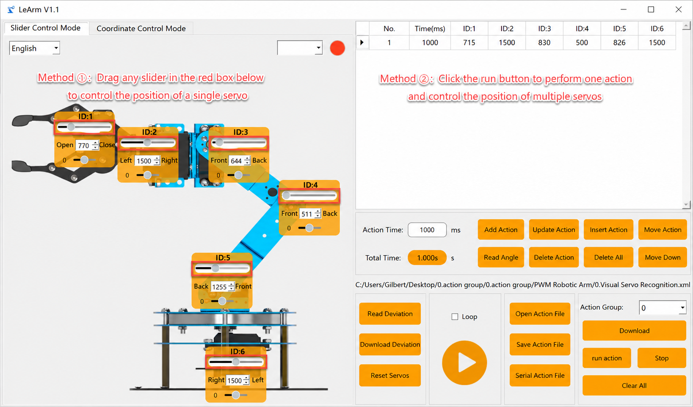

#### 6.2.11.6 Program Analysis

* **main.c File (Business Layer)**

1. The relevant library files are imported, where the PC software reception control class is in the `app_porting.h` file.

```c
/* USER CODE END Header */
/* Includes ------------------------------------------------------------------*/
#include "main.h"
#include "adc.h"
#include "dma.h"
#include "i2c.h"
#include "spi.h"
#include "tim.h"
#include "usart.h"
#include "gpio.h"

/* Private includes ----------------------------------------------------------*/
/* USER CODE BEGIN Includes */

#include "global.h"
#include "stdio.h"
#include "stdlib.h"
#include "led.h"
#include "buzzer.h"
#include "robot_arm.h"
#include "adc_sample.h"
#include "app_porting.h"
```

2. The various objects are initialized, where the `app_init` function is called to initialize the PC software control object.

```c
  /* USER CODE BEGIN 2 */
	led_init();
	buzzer_init();
	adc_sample_init();
  robot_arm_init(); 
	
	HAL_Delay(2000);
	MX_I2C1_Init();
	app_init();
	
  /* USER CODE END 2 */

  /* Infinite loop */
  /* USER CODE BEGIN WHILE */
```

3. The PC software processing task function is run in the loop.

```c
  while (1)
  {	
    app_handler();
	}
  
}
```

* **app_porting.c File (Abstract Interface Layer)**

**① The `app_init` Function**

1. Since the Bluetooth for app communication and the Type-C port for PC software communication both use the same serial port resource of the chip, to avoid channel contention, only one of the two communication modes can be enabled at a time through macro definitions, which is Bluetooth on app communication or Bluetooth off PC software communication.

**The value of the `CONTROL_MODE` macro definition can be changed in the global configuration file `global.h` to enable one of the two macro definitions, `PC_CONTROL` or `BLUETOOTH_CONTROL`.**

```c
// <o>Control Mode
//  <i>Select control mode
//  <0=> PC Control
//  <1=> Bluetooth Control
#define CONTROL_MODE		0
#if (CONTROL_MODE == 0)
	#define PC_CONTROL
#elif (CONTROL_MODE == 1)
	#define BLUETOOTH_CONTROL	
#endif 
```

Therefore, this function is responsible for initializing the relevant members of the object and the data buffer, and switching the Bluetooth on or off according to the communication mode currently enabled by the user.

```c
void app_init(void)
{
	memset(&app, 0, sizeof(AppHandleTypeDef));
	app.receive_data = receive_data;
	app.transmit_data = transmit_data;
	lwrb_init(&app.rb, rx_fifo, sizeof(rx_fifo));
	packet_start_receive();
	app.running_time = 1000;
	/* Control whether Bluetooth is powered on */
#ifdef BLUETOOTH_CONTROL
	bluetooth_switch_write_pin(1);
#else
	bluetooth_switch_write_pin(0);
#endif
	
	differential_chassis_init();	

}
```

In the function, the `memset` function is called to clear the `app` object, the `receive_data` and `transmit_data` functions are bound to the object members, the `lwrb_init` function is called to create the object data storage area, the `packet_start_receive` function is called to prepare to start receiving data, `running_time` is set to 1000 ms, and the Bluetooth switch is controlled according to the `BLUETOOTH_CONTROL` macro definition.

**② The `packet_start_receive` Function**

1. This function binds the serial port data reception function connected to the wireless controller receiver and starts the serial port receiving data.

2. The `HAL_UART_RegisterCallback` and `HAL_UART_RegisterRxEventCallback` functions are called to bind the serial port reception error `HAL_UART_ERROR_CB_ID` set to 1 and the serial port reception complete event processing callback functions, respectively. The `receive_data` function is called to officially start receiving data.

```c
static void packet_start_receive()
{
	HAL_UART_RegisterCallback(&huart1, HAL_UART_ERROR_CB_ID, packet_uart_error_callblack);
	HAL_UART_RegisterRxEventCallback(&huart1, packet_dma_receive_event_callback);
	app.receive_data(rx_dma_buf, sizeof(rx_dma_buf));
}
```

**③ The `unpack` Function**

1. This function is responsible for parsing the received PC software data frames and performing related processing according to the commands as a response.

2. In this function, the `lwrb_get_full` function is called to obtain the length of unread data in the buffer, reading the reception data buffer pointed to by `self->rb`. If the buffer is not empty (there is data inside that has not been read), the function returns the length of newly unread data.

3. When the reception data buffer is not empty, the following processing is performed:

① Limit the length of the newly unread data `available`.

② Use the command frame extraction state machine `packet_status` to completely identify and extract one frame of data from the buffer.

③ If one complete command frame is obtained, switch the command mode member `status` according to the data frame type member `cmd`.

④ If one complete command frame is obtained (the `buffer_rec_finish` flag is set to 1), reset the command frame extraction state machine `packet_status`.

⑤ Call the `lwrb_get_full` function again to read the data buffer. If the read is successful, start the next round of loop data processing until all unread data is read from the buffer.

```c
static void unpack(AppHandleTypeDef* self)
{
	uint8_t data[MAX_PACKET_LENGTH];	
	size_t readlen = 0;
	size_t available;
	static uint8_t buffer_rec_finish = 0;
	
	available = lwrb_get_full(&self->rb);
	
	available = available > MAX_PACKET_LENGTH ? MAX_PACKET_LENGTH: available;
		
	while(available > 0)
	{
		switch(self->packet_status)
		{
			case PACKET_HEADER_1:
				lwrb_read(&self->rb, data, 1);
				self->packet_status = data[0] == APP_PACKET_HEADER ? PACKET_HEADER_2: PACKET_HEADER_1;
				if(data[0] == APP_PACKET_HEADER)
				{
					self->packet.packet_header[0] = data[0];
				}
				break;
			
			case PACKET_HEADER_2:
				lwrb_read(&self->rb, data, 1);
				self->packet_status = data[0] == APP_PACKET_HEADER ? PACKET_DATA_LENGTH: PACKET_HEADER_1;
				if(data[0] == APP_PACKET_HEADER)
				{
					self->packet.packet_header[1] = data[0];
				}					
				break;
			
			case PACKET_DATA_LENGTH:
				lwrb_read(&self->rb, data, 1);
				self->packet.data_len = data[0];
				
				if(self->packet.data_len < 2)
				{
					self->packet_status = PACKET_HEADER_1;
					self->packet.data_len = data[0];
				}
				else
				{
					self->packet_status = PACKET_FUNCTION;
					
				}
				break;
				
			case PACKET_FUNCTION:
				lwrb_read(&self->rb, data, 1);
				self->packet_status = data[0] < CMD_FUNC_NULL ? PACKET_DATA : PACKET_HEADER_1;
				self->packet.cmd = data[0];	
				
				break;

			case PACKET_DATA:
				readlen = lwrb_read(&self->rb, data, self->packet.data_len - 2);
				for(uint8_t i = 0; i < readlen; i++)
				{
					self->packet.buffer[i] = data[i];
				}
				buffer_rec_finish = 1;		
				break;			
				
			default:
				self->packet_status = PACKET_HEADER_1;
				break;		
		}
		
		switch(self->packet.cmd)
		{
			case 1:
				self->status = CMD_VERSION_QUERY;
				break;
			
			case 2:
				self->status = CMD_SERVO_OFFSET_READ;
				break;
			
			case 3:
				self->status = CMD_MULT_SERVO_MOVE;
				break;

			case 4:
				app.status = CMD_COORDINATE_SET;
				break;
			
			case 6:
				self->status = CMD_ACTION_GROUP_RUN;
				action_group_reset();
				break;
			
			case 7:
				self->status = CMD_FULL_ACTION_STOP;
				break;
			
			case 8:
				self->status = CMD_FULL_ACTION_ERASE;
				break;

			case 9:
				self->status = CMD_CHASSIS_CONTROL;
				tickstart = HAL_GetTick();
				break;

			case 10:
				self->status = CMD_SERVO_OFFSET_SET;
				break;

			case 11:
				self->status = CMD_SERVO_OFFSET_DOWNLOAD;
				break;		

			case 12:
				self->status = CMD_SERVOS_RESET;
				break;	
			
			case 13:
				self->status = CMD_ANGLE_BACK_READING;
				break;
			
			case 25:
				self->status = CMD_ACTION_DOWNLOAD;
				break;

			default:
				self->status = CMD_FUNC_NULL;
				break;	
		}		
		
		if(buffer_rec_finish == 1)
		{
			buffer_rec_finish = 0;
			self->packet_status = PACKET_HEADER_1;
			break;
		}
		
		available = lwrb_get_full(&self->rb);
	}
	

}
```

4. The command frame extraction state machine `packet_status` is used to completely identify and extract one frame of data from the buffer:

The command frame extraction state machine `packet_status` is divided into the following stages:

① Obtain command frame header 1

② Obtain command frame header 2

③ Obtain command frame data length

④ Obtain command frame type

⑤ Obtain command frame data

```c
		switch(self->packet_status)
		{
			case PACKET_HEADER_1:
				lwrb_read(&self->rb, data, 1);
				self->packet_status = data[0] == APP_PACKET_HEADER ? PACKET_HEADER_2: PACKET_HEADER_1;
				if(data[0] == APP_PACKET_HEADER)
				{
					self->packet.packet_header[0] = data[0];
				}
				break;
			
			case PACKET_HEADER_2:
				lwrb_read(&self->rb, data, 1);
				self->packet_status = data[0] == APP_PACKET_HEADER ? PACKET_DATA_LENGTH: PACKET_HEADER_1;
				if(data[0] == APP_PACKET_HEADER)
				{
					self->packet.packet_header[1] = data[0];
				}					
				break;
			
			case PACKET_DATA_LENGTH:
				lwrb_read(&self->rb, data, 1);
				self->packet.data_len = data[0];
				
				if(self->packet.data_len < 2)
				{
					self->packet_status = PACKET_HEADER_1;
					self->packet.data_len = data[0];
				}
				else
				{
					self->packet_status = PACKET_FUNCTION;
					
				}
				break;
				
			case PACKET_FUNCTION:
				lwrb_read(&self->rb, data, 1);
				self->packet_status = data[0] < CMD_FUNC_NULL ? PACKET_DATA : PACKET_HEADER_1;
				self->packet.cmd = data[0];	
				
				break;

			case PACKET_DATA:
				readlen = lwrb_read(&self->rb, data, self->packet.data_len - 2);
				for(uint8_t i = 0; i < readlen; i++)
				{
					self->packet.buffer[i] = data[i];
				}
				buffer_rec_finish = 1;		
				break;			
				
			default:
				self->packet_status = PACKET_HEADER_1;
				break;		
		}
```

5. The first 4 stages of the command frame extraction state machine `packet_status` are highly similar. The first frame header acquisition stage `PACKET_HEADER_1` is used here as an example:

The `lwrb_read` function is called to read 1 bit of unread data and match it against the first frame header `APP_PACKET_HEADER`. If the match is successful, the state machine transitions from the first frame header acquisition stage `PACKET_HEADER_1` to the second frame header acquisition stage `PACKET_HEADER_2`. If the match fails, it resets to the first frame header acquisition stage.

```c
		switch(self->packet_status)
		{
			case PACKET_HEADER_1:
				lwrb_read(&self->rb, data, 1);
				self->packet_status = data[0] == APP_PACKET_HEADER ? PACKET_HEADER_2: PACKET_HEADER_1;
				if(data[0] == APP_PACKET_HEADER)
				{
					self->packet.packet_header[0] = data[0];
				}
				break;
			
			case PACKET_HEADER_2:
				lwrb_read(&self->rb, data, 1);
				self->packet_status = data[0] == APP_PACKET_HEADER ? PACKET_DATA_LENGTH: PACKET_HEADER_1;
				if(data[0] == APP_PACKET_HEADER)
				{
					self->packet.packet_header[1] = data[0];
				}					
				break;
			
			case PACKET_DATA_LENGTH:
				lwrb_read(&self->rb, data, 1);
				self->packet.data_len = data[0];
				
				if(self->packet.data_len < 2)
				{
					self->packet_status = PACKET_HEADER_1;
					self->packet.data_len = data[0];
				}
				else
				{
					self->packet_status = PACKET_FUNCTION;
					
				}
				break;
				
			case PACKET_FUNCTION:
				lwrb_read(&self->rb, data, 1);
				self->packet_status = data[0] < CMD_FUNC_NULL ? PACKET_DATA : PACKET_HEADER_1;
				self->packet.cmd = data[0];	
				
				break;

			case PACKET_DATA:
				readlen = lwrb_read(&self->rb, data, self->packet.data_len - 2);
				for(uint8_t i = 0; i < readlen; i++)
				{
					self->packet.buffer[i] = data[i];
				}
				buffer_rec_finish = 1;		
				break;			
				
			default:
				self->packet_status = PACKET_HEADER_1;
				break;		
		}
		
		switch(self->packet.cmd)
		{
			case 1:
				self->status = CMD_VERSION_QUERY;
				break;
			
			case 2:
				self->status = CMD_SERVO_OFFSET_READ;
				break;
			
			case 3:
				self->status = CMD_MULT_SERVO_MOVE;
				break;

			case 4:
				app.status = CMD_COORDINATE_SET;
				break;
			
			case 6:
				self->status = CMD_ACTION_GROUP_RUN;
				action_group_reset();
				break;
			
			case 7:
				self->status = CMD_FULL_ACTION_STOP;
				break;
			
			case 8:
				self->status = CMD_FULL_ACTION_ERASE;
				break;

			case 9:
				self->status = CMD_CHASSIS_CONTROL;
				tickstart = HAL_GetTick();
				break;

			case 10:
				self->status = CMD_SERVO_OFFSET_SET;
				break;

			case 11:
				self->status = CMD_SERVO_OFFSET_DOWNLOAD;
				break;		

			case 12:
				self->status = CMD_SERVOS_RESET;
				break;	
			
			case 13:
				self->status = CMD_ANGLE_BACK_READING;
				break;
			
			case 25:
				self->status = CMD_ACTION_DOWNLOAD;
				break;

			default:
				self->status = CMD_FUNC_NULL;
				break;	
		}		
		
		if(buffer_rec_finish == 1)
		{
			buffer_rec_finish = 0;
			self->packet_status = PACKET_HEADER_1;
			break;
		}
		
		available = lwrb_get_full(&self->rb);
	}
	

}
```

6. In the frame data acquisition stage `PACKET_DATA`, according to the known frame length, including the data length of one command frame starting from the frame length, the unread data of the corresponding length is obtained and transferred in a loop to the other members of the object (the frame length has been obtained earlier, so only data of length `packet.data_len - 1` needs to be obtained here, and the index of the last element of the array storing this data is `packet.data_len - 2`).

```c
			case PACKET_DATA:
				readlen = lwrb_read(&self->rb, data, self->packet.data_len - 2);
				for(uint8_t i = 0; i < readlen; i++)
				{
					self->packet.buffer[i] = data[i];
				}
				buffer_rec_finish = 1;		
				break;			
				
			default:
				self->packet_status = PACKET_HEADER_1;
				break;		
		}
```

**④ The `app_handler` Function**

1. In the PC software task function, the `unpack()` function is first used to pass in the PC software control object `app` to read and parse the command frame sent by the PC software. After the parsing is complete, the parsed information is also written into the other members of the object.

```c
void app_handler()
{
	uint8_t send_data[20] = {0};
	
	static uint8_t stop_flag = 0;
	
	unpack(&app);
```

2. Different controls are then performed according to the command mode member `status` of the object updated after parsing (the type of the command in this frame). In this section, the execution processing of the commands is simplified for the user's understanding. For the complete execution processing logic, refer to the next subsection.

3. In this section, the PC software command frames of the firmware query command `CMD_VERSION_QUERY` and the single/multiple servo pulse width control command `CMD_MULT_SERVO_MOVE` types are processed.

```c
	switch (app.status)
	{
		case CMD_VERSION_QUERY:{
			send_data[0] = 2;
			send_data[1] = SOFTWARE_VERSION;
			HAL_Delay(20);
			packet_transmit(&app, CMD_VERSION_QUERY, send_data, 2);
			memset(send_data, 0, sizeof(send_data));
			app.status = CMD_FUNC_NULL;
			break;
		}
		
		case CMD_MULT_SERVO_MOVE:{
			app.servos_count = app.packet.buffer[0];
			app.running_time = MERGE_HL(app.packet.buffer[2], app.packet.buffer[1]);
			for (uint8_t i = 0; i < app.servos_count; i++)
			{
				app.set_id = app.packet.buffer[3 + i * 3];
				app.set_duty = MERGE_HL(app.packet.buffer[5 + i * 3], app.packet.buffer[4 + i * 3]);
				robot_arm_knot_run(app.set_id, app.set_duty, 20);
			}
			app.status = CMD_FUNC_NULL;
			break;
		}
		
       default:{
         break;
		}
```

4. Since the Tankbot robotic arm supports both the PWM servo version and the bus servo version, to avoid conflicts between the commands of different versions, the PC software needs to confirm the robotic arm version first. At this time, the firmware query command `CMD_VERSION_QUERY` needs to be sent.

5. Referring to the **6.7.2 Tankbot PC Software & App Communication Protocol**, it can be determined that this type of command requires a reply from the robotic arm, and the reply command frame involves 2 data parameters: servo type and firmware version number. The program then needs to obtain the above two parameters and construct the reply command frame data parameter array `send_data`.

**Firmware Query**

- **Data Length:** 2
- **Function Number:** 1
- **Data Parameters:** None
- **Return Content:**

| Frame Header 1 | Frame Header 2 | Data length | Function number | Data parameter 1                           | Data parameter 2 |
| :------------: | :------------: | :---------: | :-------------: | :----------------------------------------- | :--------------- |
|     0 x 55     |     0 x 55     |      3      |        1        | Servo type 1-PWM digital servo 2-Bus servo | Firmware version |

6. The program reads the servo version `SERVO_TYPE` and the software version `SOFTWARE_VERSION` from the global configuration file, writes them into the reply command frame data parameter array `send_data`, and calls the `packet_transmit` function to automatically complete the frame header, data length, and function number in the reply command frame according to the communication protocol format, and sends it back to the PC software through the serial port. Finally, the command mode member `status` of the object is reset.

```c
		case CMD_VERSION_QUERY:{
			send_data[0] = 2;
			send_data[1] = SOFTWARE_VERSION;
			HAL_Delay(20);
			packet_transmit(&app, CMD_VERSION_QUERY, send_data, 2);
			memset(send_data, 0, sizeof(send_data));
			app.status = CMD_FUNC_NULL;
			break;
		}
```

**The value of the `ARM_SELECT` macro definition can be changed in the global configuration file `global.h` to achieve different values of the `SERVO_TYPE` macro definition.** **Modification is not recommended! If the robotic arm version `SERVO_TYPE` in the configuration does not match the actual one, the PC software will not be able to control the robotic arm normally. This is provided for reference only.**

```c
// <o>Control Mode
//  <i>Select control mode
//  <0=> PC Control
//  <1=> Bluetooth Control
#define CONTROL_MODE		0
#if (CONTROL_MODE == 0)
	#define PC_CONTROL
#elif (CONTROL_MODE == 1)
	#define BLUETOOTH_CONTROL	
#endif 

```

7. When a PC software command frame of the `CMD_MULT_SERVO_MOVE` type, which is the single/multiple servo pulse width control command, is received, the positions of one or more servos can be controlled.

8. Referring to the **6.7.2 Tankbot PC Software & App Communication Protocol**, the data parameter composition of this type of command can be determined. In addition, no reply from the robotic arm is required for this command.

9. The program reads the array member `packet.buffer` that stores the command frame data extracted in the `unpack` function, and further analyzes the number of servos controlled this time and the motion time according to the PC software protocol data format.

(1) The servo motion time and the pulse width values of each servo are all 16-bit variables, which are split into high and low 8 bits for transmission in the command frame parameters. Therefore, the `MERGE_HL` function needs to be called to restore the high and low 8 bits of the above data into complete data.

(2) The servo IDs and position values are then read in a loop, and the `robot_arm_knot_run` function is called to control the corresponding servo movement. Finally, the command mode member `status` of the object is reset.

```c
		case CMD_MULT_SERVO_MOVE:{
			app.servos_count = app.packet.buffer[0];
			app.running_time = MERGE_HL(app.packet.buffer[2], app.packet.buffer[1]);
			for (uint8_t i = 0; i < app.servos_count; i++)
			{
				app.set_id = app.packet.buffer[3 + i * 3];
				app.set_duty = MERGE_HL(app.packet.buffer[5 + i * 3], app.packet.buffer[4 + i * 3]);
				robot_arm_knot_run(app.set_id, app.set_duty, 20);
			}
			app.status = CMD_FUNC_NULL;
			break;
		}
```

**⑤ The `packet_transmit` Function**

1) This function is responsible for packaging the data to be sent to the PC software according to the protocol and sending it to the PC software. Only the command type, parameter data, and parameter data length need to be passed in.

2. The program constructs the reply command frame `data`. Referring to the **6.7.2 Tankbot PC Software & App Communication Protocol**, the frame header, data length, function number, the "command type" passed to the function, and the data parameters, the "parameter data" passed to the function, are written into the `data` in sequence.

> [!NOTE]
>
> **The value of "data length" is calculated to include the lengths of three parts: "data length", "function number", and "data parameters", where the lengths of "data length" and "function number" are fixed at 2 bytes.**

* **Protocol Format**

| Frame header 1 | Frame header 2 | Data length | Function number | Data parameters |
| :------------: | :------------: | :---------: | :-------------: | :-------------: |
|     0 x 55     |     0 x 55     |   Length    |       CMD       |  Parameter 1~N  |

3) Finally, the `transmit_data` function (bound to the corresponding implementation function in `app_init`) is called to send the reply command frame `data` from the serial port.

```c
    static void packet_transmit(AppHandleTypeDef* self, AppFunctionStatus cmd, uint8_t* pdata, uint8_t size)
    {
    	uint8_t data[30];
    	
    	if(size == 0)
    	{
    		data[0] = APP_PACKET_HEADER;
    		data[1] = APP_PACKET_HEADER;
    		data[2] = 2;
    		data[3] = cmd;
    		self->transmit_data(data, 4);
    	}
    	else
    	{
    		data[0] = APP_PACKET_HEADER;
    		data[1] = APP_PACKET_HEADER;
    		data[2] = 2 + size;
    		data[3] = cmd;		
    		for(uint8_t i = 0; i < size; i++)
    		{
    			data[4 + i] = pdata[i];
    		}
    		self->transmit_data(data, size + 4);
    	}
    }
```

### 6.2.12 PC Software Control Program

#### 6.2.12.1 Project Introduction

This lesson uses the **Tankbot** program as an example to implement PC software control of the robotic arm, with a focus on the logical relationship between the PC software and the robotic arm control.

#### 6.2.12.2 Implementation Process


#### 6.2.12.3 PC Software Introduction

> [!NOTE]
>
> **Before studying the example in this section, you must complete the 1. Tutorials \3. PC Software Action Group Control section.**


The example in this section uses the Tankbot-specific software **Le.Arm.exe** to control the robotic arm to move according to the function icons on the PC software.

#### 6.2.12.4 Program Download

> [!NOTE]
>
> **Before downloading the program, confirm that the serial port driver has been installed.**

1) Connect the core board to the computer via a USB cable.


2) Double-click to open the STM32 serial port flashing software **FlyMcu**.

3) Click the **...** icon, and in the corresponding project's **[Tankbot\MDK-ARM\Tankbot](https://drive.google.com/drive/folders/1o4xIqZK-diugT94O0Wydy2Vfql80v7MK?usp=sharing)** path, select the HEX file to be flashed.


4) At position ① in the figure below, select the serial port number corresponding to the core board. At position ②, set the baud rate to 115200. At positions ③ and ④, configure according to the options shown in the figure.


5) Click **Start ISP(P)**, press the **RST** button on the core board, and the program automatically starts downloading. When the right-side log output pane displays the following content, the program download is complete.


#### 6.2.12.5 Program Outcome

After the robotic arm is powered on and the computer is connected to Tankbot, the robotic arm can respond to and process any function key commands from the PC software.

#### 6.2.12.6 Program Analysis

> [!NOTE]
>
> * **The PC software reception interface and protocol parsing can be found in the [6.2.11 PC Software Protocol Parsing](#6.2.11) section in the same directory.**
>
> * **The 6.7.2 Tankbot PC Software & App Communication Protocol document can also be referenced for further study.**

* **app_porting.c File (Abstract Interface Layer)**

**① The `app_handler` Function**

1) The program flow of this function is as follows:

(1) The PC software data is first received and parsed by calling the `unpack` function, and `status` is set to the corresponding command processing state;

(2) Different state processing and control is entered according to `status`.

The command list used by the PC software is shown below:

```c
typedef enum
{
	CMD_VERSION_QUERY = 1,
	CMD_SERVO_OFFSET_READ,
	CMD_MULT_SERVO_MOVE,
	CMD_COORDINATE_SET = 4,
	CMD_ACTION_GROUP_RUN = 6,
	CMD_FULL_ACTION_STOP,
	CMD_FULL_ACTION_ERASE,
	CMD_CHASSIS_CONTROL,
	CMD_SERVO_OFFSET_SET,	
	CMD_SERVO_OFFSET_DOWNLOAD,
	CMD_SERVOS_RESET,
	CMD_ANGLE_BACK_READING,
	CMD_ACTION_DOWNLOAD = 25,
	CMD_FUNC_NULL
}AppFunctionStatus;
```

1. The firmware query command `CMD_VERSION_QUERY` sends the servo type and software version number to the PC software. A 20 ms delay is required before sending to allow the PC software to enter the receiving state, ensuring the accuracy of data reception.

```c
		case CMD_VERSION_QUERY:{
			send_data[0] = 2;
			send_data[1] = SOFTWARE_VERSION;
			HAL_Delay(20);
			packet_transmit(&app, CMD_VERSION_QUERY, send_data, 2);
			memset(send_data, 0, sizeof(send_data));
			app.status = CMD_FUNC_NULL;
			break;
```

2. The servo deviation read command `CMD_SERVO_OFFSET_READ` reads the servo deviation through the `robot_arm_offset_read` function and sends it to the PC software.

```c
		case CMD_SERVO_OFFSET_READ:{
			robot_arm_offset_read(read_val);
			for (uint8_t i = 0; i < 6; i++)
			{
				send_data[(2 * i)] = 1 + i;
				send_data[(2 * i) + 1] = (uint8_t)read_val[i];
			}
			HAL_Delay(5);
			packet_transmit(&app, CMD_SERVO_OFFSET_READ, send_data, 12);
			memset(send_data, 0, sizeof(send_data));
			app.status = CMD_FUNC_NULL;
			break;
```

3. The servo control command `CMD_MULT_SERVO_MOVE`: the PC software sends variable-length servo control data, and control is performed based on the parsed ID number.

```c
		case CMD_MULT_SERVO_MOVE:{
			app.servos_count = app.packet.buffer[0];
			app.running_time = MERGE_HL(app.packet.buffer[2], app.packet.buffer[1]);
			for (uint8_t i = 0; i < app.servos_count; i++)
			{
				app.set_id = app.packet.buffer[3 + i * 3];
				app.set_duty = MERGE_HL(app.packet.buffer[5 + i * 3], app.packet.buffer[4 + i * 3]);
				robot_arm_knot_run(app.set_id, app.set_duty, app.running_time);
			}
			app.status = CMD_FUNC_NULL;
			break;
		}
```

4. The coordinate system control command `CMD_COORDINATE_SET`.

```c
		case CMD_COORDINATE_SET:{
			app.status = CMD_FUNC_NULL;
			break;
		}
```

5. The action group execution, stop, and erase commands `CMD_ACTION_GROUP_RUN`, `CMD_FULL_ACTION_STOP`, and `CMD_FULL_ACTION_ERASE` run the corresponding action group, stop the current action, and erase all action groups according to the PC software commands.

```c
		case CMD_ACTION_GROUP_RUN:{
			app.packet.action_group_index = app.packet.buffer[0];
			app.packet.running_times = MERGE_HL(app.packet.buffer[2], app.packet.buffer[1]);
			if(action_group_run(app.packet.action_group_index, app.packet.running_times))
			{
				app.status = CMD_FUNC_NULL;
			}
			break;
		}
		
		case CMD_FULL_ACTION_STOP:{
			action_group_stop();
			app.status = CMD_FUNC_NULL;
			break;
		}
		
		case CMD_FULL_ACTION_ERASE:{
			action_group_erase();
			HAL_Delay(5);
			packet_transmit(&app, CMD_FULL_ACTION_ERASE, send_data, 0);
			app.status = CMD_FUNC_NULL;
			break;    
		}
```

6. The servo deviation setting and download commands `CMD_SERVO_OFFSET_SET` and `CMD_SERVO_OFFSET_DOWNLOAD` control the servo deviation according to the data. The deviation can only be saved after it is downloaded; otherwise, it will be lost when the power is off.

```c
		case CMD_SERVO_OFFSET_SET:{
			robot_arm_offset_set(app.packet.buffer[0], (int8_t)app.packet.buffer[1]);
			app.status = CMD_FUNC_NULL;
			break;
		}
		
		case CMD_SERVO_OFFSET_DOWNLOAD:{
			robot_arm_offset_save();
			HAL_Delay(5);
			packet_transmit(&app, CMD_SERVO_OFFSET_DOWNLOAD, send_data, 0);
			app.status = CMD_FUNC_NULL;
			buzzer_toggle(100, 100, 1);
			break;
		}
```

7. The servo reset and angle reading commands `CMD_SERVOS_RESET` and `CMD_ANGLE_BACK_READING`: resetting the servo restores it to the default angle state, which also corresponds to the (15,0,2) coordinate point of three-dimensional coordinate control. The current servo angles are read and sent to the PC software.

```c
		case CMD_SERVOS_RESET:{
			robot_arm_reset(1000);
			differentials_chassis_run(0.0f, 0.0f);
			get_ultrasound_distance();
			app.status = CMD_FUNC_NULL;
			break;
		}
		
		case CMD_ANGLE_BACK_READING:{
			for(uint8_t i = 0; i < 6; i++)
			{
				int current_duty = robot_arm_get_knot_current_duty(i + 1);
				send_data[i * 3] = i + 1;
				send_data[(i * 3) + 1] = GET_LOW_BYTE(current_duty);
				send_data[i * 3 + 2] = GET_HIGH_BYTE(current_duty);
			}
			HAL_Delay(5);
			packet_transmit(&app, CMD_ANGLE_BACK_READING, send_data, 18);
			app.status = CMD_FUNC_NULL;
			break;
		}
```

8. The action group download command `CMD_ACTION_DOWNLOAD` receives the action data of each frame separately to form a complete action group.

```c
		case CMD_ACTION_DOWNLOAD:{
			app.packet.action_group_index = app.packet.buffer[0];
			app.packet.action_frame_sum = app.packet.buffer[1];
			app.packet.action_frame_index = app.packet.buffer[2];
			action_group_save(app.packet.action_group_index, 
												app.packet.action_frame_sum, 
												app.packet.action_frame_index, 
												app.packet.buffer + 3,
												ACTION_FRAME_SIZE);
			HAL_Delay(5);
			packet_transmit(&app, CMD_ACTION_DOWNLOAD, send_data, 0);
			app.status = CMD_FUNC_NULL;
			if(app.packet.action_frame_index == app.packet.action_frame_sum - 1)
			{
				buzzer_toggle(100, 100, 1);
			}
			break;
```

### 6.2.13 App Control

#### 6.2.13.1 Project Introduction

This lesson mainly explains the program for controlling the robotic arm through the app.

#### 6.2.13.2 Implementation Process


#### 6.2.13.3 App Introduction


The example in this section uses the Tankbot-specific app, **Wonderbot**, to control the robotic arm to move according to the function icons.

> [!NOTE]
>
> **Completion of the 1. Tutorials\2. Remote Control\2.2 App Control section is a prerequisite for studying the example in this section, along with mastery of the usage of functional icons on the app interface.**

#### 6.2.13.4 Program Download

> [!NOTE]
>
> **Before downloading the program, confirm that the serial port driver has been installed.**

1) Connect the core board to the computer via a USB cable.


2) Double-click to open the STM32 serial port flashing software **FlyMcu**.

3) Click the **...** icon, and in the corresponding project's **[Tankbot\MDK-ARM\Tankbot](https://drive.google.com/drive/folders/1o4xIqZK-diugT94O0Wydy2Vfql80v7MK?usp=sharing)** path, select the HEX file to be flashed.


4) At position ① in the figure below, select the serial port number corresponding to the core board. At position ②, set the baud rate to 115200. At positions ③ and ④, configure according to the options shown in the figure.


5) Click **Start ISP(P)**, press the **RST** button on the core board, and the program automatically starts downloading. When the right-side log output pane displays the following content, the program download is complete.


#### 6.2.13.5 Program Outcome

After the robotic arm is powered on, use the app to control the robotic arm for functions such as servo control, coordinate system control, and action group execution.

#### 6.2.13.6 Program Analysis

> [!NOTE]
>
> **The PC software and mobile app share the same communication protocol, and the same set of bottom-layer libraries is used to process them.**

* **main.c File (Business Layer)**

1) The relevant library files are imported, where the app reception control class is in the `app_porting.h` file.

```c
/* USER CODE END Header */
/* Includes ------------------------------------------------------------------*/
#include "main.h"
#include "adc.h"
#include "dma.h"
#include "i2c.h"
#include "spi.h"
#include "tim.h"
#include "usart.h"
#include "gpio.h"

/* Private includes ----------------------------------------------------------*/
/* USER CODE BEGIN Includes */

#include "global.h"
#include "stdio.h"
#include "stdlib.h"
#include "led.h"
#include "buzzer.h"
#include "robot_arm.h"
#include "adc_sample.h"
#include "app_porting.h"
/* USER CODE END Includes */
```

2) The various objects are initialized, where the `app_init` function is called to initialize the app control object.

```c
  /* USER CODE BEGIN 2 */
	led_init();
	buzzer_init();
	adc_sample_init();
  robot_arm_init(); 
	
	HAL_Delay(2000);
	MX_I2C1_Init();
	app_init();
	buzzer_toggle(50, 50, 1);
  /* USER CODE END 2 */
```

3) The app processing task function is run in the loop.

```c
  /* Infinite loop */
  /* USER CODE BEGIN WHILE */
	
  while (1)
  {	
    app_handler();
	}
  
}
```

* **app_porting.c File (Abstract Interface Layer)**

**① The `app_init` Function**

1) Since the Bluetooth for app communication and the Type-C port for PC software communication both use the same serial port resource of the chip, to avoid channel contention, only one of the two communication modes can be enabled at a time through macro definitions, that is Bluetooth on (app communication) or Bluetooth off (PC software communication).

**The value of the `CONTROL_MODE` macro definition can be changed in the global configuration file `global.h` to enable one of the two macro definitions, `PC_CONTROL` or `BLUETOOTH_CONTROL`.**

```c
// <o>Control Mode
//  <i>Select control mode
//  <0=> PC Control
//  <1=> Bluetooth Control
#define CONTROL_MODE		1
#if (CONTROL_MODE == 0)
	#define PC_CONTROL
#elif (CONTROL_MODE == 1)
	#define BLUETOOTH_CONTROL	
#endif 
```

Therefore, this function is responsible for initializing the relevant members of the object and the data buffer, and switching the Bluetooth on or off according to the communication mode currently enabled by the user.

```c
void app_init(void)
{
	memset(&app, 0, sizeof(AppHandleTypeDef));
	app.receive_data = receive_data;
	app.transmit_data = transmit_data;
	lwrb_init(&app.rb, rx_fifo, sizeof(rx_fifo));
	packet_start_receive();
	app.running_time = 1000;
	app_state = true;
	/* Control whether Bluetooth is powered on */
#ifdef BLUETOOTH_CONTROL
	bluetooth_switch_write_pin(1);
#else
	bluetooth_switch_write_pin(0);
#endif
	differential_chassis_init();	

}
```

**② The `packet_start_receive` Function**

1) This function binds the serial port data reception function connected to the wireless controller receiver and starts the serial port receiving data.

2) The `HAL_UART_RegisterCallback` and `HAL_UART_RegisterRxEventCallback` functions are called to bind the serial port reception error HAL_UART_ERROR_CB_ID set to 1 and the serial port reception complete event processing callback functions, respectively. The `receive_data` function is called to officially start receiving data.

```c
static void packet_start_receive()
{
	HAL_UART_RegisterCallback(&huart1, HAL_UART_ERROR_CB_ID, packet_uart_error_callblack);
	HAL_UART_RegisterRxEventCallback(&huart1, packet_dma_receive_event_callback);
	app.receive_data(rx_dma_buf, sizeof(rx_dma_buf));
}
```

**③ The `unpack` Function**

1) This function is responsible for parsing the received app data frames and performing related processing according to the commands as a response.

2) In this function, the `lwrb_get_full` function is called to obtain the length of unread data in the buffer, reading the reception data buffer pointed to by `self->rb`. If the buffer is not empty (there is data inside that has not been read), the function returns the length of newly unread data.

3) When the reception data buffer is not empty, the following processing is performed:

(1) Limit the length of the newly unread data `available`

(2) Use the command frame extraction state machine `packet_status` to completely identify and extract one frame of data from the buffer

(3) If one complete command frame is obtained, switch the command mode member `status` according to the data frame type member `cmd`

(4) If one complete command frame is obtained (the `buffer_rec_finish` flag is set to 1), reset the command frame extraction state machine `packet_status`

(5) Call the `lwrb_get_full` function again to read the data buffer. If the read is successful, start the next round of loop data processing until all unread data is read from the buffer.

```c
static void unpack(AppHandleTypeDef* self)
{
	uint8_t data[MAX_PACKET_LENGTH];	
	size_t readlen = 0;
	size_t available;
	static uint8_t buffer_rec_finish = 0;
	
	available = lwrb_get_full(&self->rb);
	
	available = available > MAX_PACKET_LENGTH ? MAX_PACKET_LENGTH: available;
		
	while(available > 0)
	{
		switch(self->packet_status)
		{
			case PACKET_HEADER_1:
				lwrb_read(&self->rb, data, 1);
				self->packet_status = data[0] == APP_PACKET_HEADER ? PACKET_HEADER_2: PACKET_HEADER_1;
				if(data[0] == APP_PACKET_HEADER)
				{
					self->packet.packet_header[0] = data[0];
				}
				break;
			
			case PACKET_HEADER_2:
				lwrb_read(&self->rb, data, 1);
				self->packet_status = data[0] == APP_PACKET_HEADER ? PACKET_DATA_LENGTH: PACKET_HEADER_1;
				if(data[0] == APP_PACKET_HEADER)
				{
					self->packet.packet_header[1] = data[0];
				}					
				break;
			
			case PACKET_DATA_LENGTH:
				lwrb_read(&self->rb, data, 1);
				self->packet.data_len = data[0];
				
				if(self->packet.data_len < 2)
				{
					self->packet_status = PACKET_HEADER_1;
					self->packet.data_len = data[0];
				}
				else
				{
					self->packet_status = PACKET_FUNCTION;
					
				}
				break;
				
			case PACKET_FUNCTION:
				lwrb_read(&self->rb, data, 1);
				self->packet_status = data[0] < CMD_FUNC_NULL ? PACKET_DATA : PACKET_HEADER_1;
				self->packet.cmd = data[0];	
				
				break;

			case PACKET_DATA:
				readlen = lwrb_read(&self->rb, data, self->packet.data_len - 2);
				for(uint8_t i = 0; i < readlen; i++)
				{
					self->packet.buffer[i] = data[i];
				}
				buffer_rec_finish = 1;		
				break;			
				
			default:
				self->packet_status = PACKET_HEADER_1;
				break;		
		}
		
		switch(self->packet.cmd)
		{
			case 1:
				self->status = CMD_VERSION_QUERY;
				break;
			
			case 2:
				self->status = CMD_SERVO_OFFSET_READ;
				break;
			
			case 3:
				self->status = CMD_MULT_SERVO_MOVE;
				break;

			case 4:
				app.status = CMD_COORDINATE_SET;
				break;
			
			case 6:
				self->status = CMD_ACTION_GROUP_RUN;
				action_group_reset();
				break;
			
			case 7:
				self->status = CMD_FULL_ACTION_STOP;
				break;
			
			case 8:
				self->status = CMD_FULL_ACTION_ERASE;
				break;

			case 9:
				self->status = CMD_CHASSIS_CONTROL;
				tickstart = HAL_GetTick();
				break;

			case 10:
				self->status = CMD_SERVO_OFFSET_SET;
				break;

			case 11:
				self->status = CMD_SERVO_OFFSET_DOWNLOAD;
				break;		

			case 12:
				self->status = CMD_SERVOS_RESET;
				break;	
			
			case 13:
				self->status = CMD_ANGLE_BACK_READING;
				break;
			
			case 14:
				self->status = CMD_CHASSIS_SPEED;
				break;
			
			case 25:
				self->status = CMD_ACTION_DOWNLOAD;
				break;

			default:
				self->status = CMD_FUNC_NULL;
				break;	
		}		
		
		if(buffer_rec_finish == 1)
		{
			buffer_rec_finish = 0;
			self->packet_status = PACKET_HEADER_1;
			break;
		}
		
		available = lwrb_get_full(&self->rb);
	}
	

}
```

4) The command frame extraction state machine `packet_status` is used to completely identify and extract one frame of data from the buffer:

The command frame extraction state machine `packet_status` is divided into the following stages: ① Obtain command frame header 1, ② Obtain command frame header 2, ③ Obtain command frame data length, ④ Obtain command frame type, ⑤ Obtain command frame data.

```c
		switch(self->packet_status)
		{
			case PACKET_HEADER_1:
				lwrb_read(&self->rb, data, 1);
				self->packet_status = data[0] == APP_PACKET_HEADER ? PACKET_HEADER_2: PACKET_HEADER_1;
				if(data[0] == APP_PACKET_HEADER)
				{
					self->packet.packet_header[0] = data[0];
				}
				break;
			
			case PACKET_HEADER_2:
				lwrb_read(&self->rb, data, 1);
				self->packet_status = data[0] == APP_PACKET_HEADER ? PACKET_DATA_LENGTH: PACKET_HEADER_1;
				if(data[0] == APP_PACKET_HEADER)
				{
					self->packet.packet_header[1] = data[0];
				}					
				break;
			
			case PACKET_DATA_LENGTH:
				lwrb_read(&self->rb, data, 1);
				self->packet.data_len = data[0];
				
				if(self->packet.data_len < 2)
				{
					self->packet_status = PACKET_HEADER_1;
					self->packet.data_len = data[0];
				}
				else
				{
					self->packet_status = PACKET_FUNCTION;
					
				}
				break;
				
			case PACKET_FUNCTION:
				lwrb_read(&self->rb, data, 1);
				self->packet_status = data[0] < CMD_FUNC_NULL ? PACKET_DATA : PACKET_HEADER_1;
				self->packet.cmd = data[0];	
				
				break;

			case PACKET_DATA:
				readlen = lwrb_read(&self->rb, data, self->packet.data_len - 2);
				for(uint8_t i = 0; i < readlen; i++)
				{
					self->packet.buffer[i] = data[i];
				}
				buffer_rec_finish = 1;		
				break;			
				
			default:
				self->packet_status = PACKET_HEADER_1;
				break;		
		}
```

5) The first four stages of the command frame extraction state machine `packet_status` are highly similar. The first frame header acquisition stage `PACKET_HEADER_1` is used here as an example:

The `lwrb_read` function is called to read 1 bit of unread data and match it against the first frame header `APP_PACKET_HEADER`. If the match is successful, the state machine transitions from the first frame header acquisition stage `PACKET_HEADER_1` to the second frame header acquisition stage `PACKET_HEADER_2`. If the match fails, it resets to the first frame header acquisition stage.

```c
		switch(self->packet_status)
		{
			case PACKET_HEADER_1:
				lwrb_read(&self->rb, data, 1);
				self->packet_status = data[0] == APP_PACKET_HEADER ? PACKET_HEADER_2: PACKET_HEADER_1;
				if(data[0] == APP_PACKET_HEADER)
				{
					self->packet.packet_header[0] = data[0];
				}
				break;
			
			case PACKET_HEADER_2:
				lwrb_read(&self->rb, data, 1);
				self->packet_status = data[0] == APP_PACKET_HEADER ? PACKET_DATA_LENGTH: PACKET_HEADER_1;
				if(data[0] == APP_PACKET_HEADER)
				{
					self->packet.packet_header[1] = data[0];
				}					
				break;
			
			case PACKET_DATA_LENGTH:
				lwrb_read(&self->rb, data, 1);
				self->packet.data_len = data[0];
				
				if(self->packet.data_len < 2)
				{
					self->packet_status = PACKET_HEADER_1;
					self->packet.data_len = data[0];
				}
				else
				{
					self->packet_status = PACKET_FUNCTION;
					
				}
				break;
				
			case PACKET_FUNCTION:
				lwrb_read(&self->rb, data, 1);
				self->packet_status = data[0] < CMD_FUNC_NULL ? PACKET_DATA : PACKET_HEADER_1;
				self->packet.cmd = data[0];	
				
				break;

			case PACKET_DATA:
				readlen = lwrb_read(&self->rb, data, self->packet.data_len - 2);
				for(uint8_t i = 0; i < readlen; i++)
				{
					self->packet.buffer[i] = data[i];
				}
				buffer_rec_finish = 1;		
				break;			
				
			default:
				self->packet_status = PACKET_HEADER_1;
				break;		
		}
```

6) In the frame data acquisition stage `PACKET_DATA`, according to the known frame length including the data length of one command frame starting from the frame length, the unread data of the corresponding length is obtained and transferred in a loop to the other members of the object (the frame length has been obtained earlier, so only data of length `packet.data_len - 1` needs to be obtained here, and the index of the last element of the array storing this data is `packet.data_len - 2`.

```c
			case PACKET_DATA:
				readlen = lwrb_read(&self->rb, data, self->packet.data_len - 2);
				for(uint8_t i = 0; i < readlen; i++)
				{
					self->packet.buffer[i] = data[i];
				}
				buffer_rec_finish = 1;		
				break;	
```

**④ The `app_handler` Function**

The program flow of this function is as follows:

(1) The app data is first received and parsed by calling the `unpack` function, and `status` is set to the corresponding command processing state;

(2) Different state processing and control is entered according to `status`.

The command list used by the app is shown below:

```c
typedef enum
{
	CMD_VERSION_QUERY = 1,
	CMD_SERVO_OFFSET_READ,
	CMD_MULT_SERVO_MOVE,
	CMD_COORDINATE_SET = 4,
	CMD_ACTION_GROUP_RUN = 6,
	CMD_FULL_ACTION_STOP,
	CMD_FULL_ACTION_ERASE,
	CMD_CHASSIS_CONTROL,
	CMD_SERVO_OFFSET_SET,	
	CMD_SERVO_OFFSET_DOWNLOAD,
	CMD_SERVOS_RESET,
	CMD_ANGLE_BACK_READING,
	CMD_CHASSIS_SPEED,
	CMD_VOLTAGE_SEND,
	
	CMD_ACTION_DOWNLOAD = 25,
	CMD_FUNC_NULL
}AppFunctionStatus;
```

1. The firmware query command `CMD_VERSION_QUERY` sends the servo type and software version number to the app. A 20 ms delay is required before sending to allow the app to enter the receiving state, ensuring the accuracy of data reception.

```c
		case CMD_VERSION_QUERY:{
			send_data[0] = 2;
			send_data[1] = SOFTWARE_VERSION;
			HAL_Delay(20);
			packet_transmit(&app, CMD_VERSION_QUERY, send_data, 2);
			memset(send_data, 0, sizeof(send_data));
			app.status = CMD_FUNC_NULL;
			break;
```

2. The servo deviation read command `CMD_SERVO_OFFSET_READ` reads the servo deviation through the `robot_arm_offset_read` function and sends it to the app.

```c
		case CMD_SERVO_OFFSET_READ:{
			robot_arm_offset_read(read_val);
			for (uint8_t i = 0; i < 6; i++)
			{
				send_data[(2 * i)] = 1 + i;
				send_data[(2 * i) + 1] = (uint8_t)read_val[i];
			}
			HAL_Delay(5);
			packet_transmit(&app, CMD_SERVO_OFFSET_READ, send_data, 12);
			memset(send_data, 0, sizeof(send_data));
			app.status = CMD_FUNC_NULL;
			break;
		}	
```

3. The servo control command `CMD_MULT_SERVO_MOVE` controls the app to send variable-length servo control data, and control is performed based on the parsed ID number.

```c
		case CMD_MULT_SERVO_MOVE:{
			app.servos_count = app.packet.buffer[0];
			app.running_time = MERGE_HL(app.packet.buffer[2], app.packet.buffer[1]);
			for (uint8_t i = 0; i < app.servos_count; i++)
			{
				app.set_id = app.packet.buffer[3 + i * 3];
				app.set_duty = MERGE_HL(app.packet.buffer[5 + i * 3], app.packet.buffer[4 + i * 3]);
				robot_arm_knot_run(app.set_id, app.set_duty, 20);
			}
			app.status = CMD_FUNC_NULL;
			break;
		}
```

4. The coordinate system control command `CMD_COORDINATE_SET`.

```c
		case CMD_COORDINATE_SET:{
			app.status = CMD_FUNC_NULL;
			break;
		}
```

5. The action group execution, stop, and erase commands `CMD_ACTION_GROUP_RUN`, `CMD_FULL_ACTION_STOP`, and `CMD_FULL_ACTION_ERASE` run the corresponding action group, stop the current action, and erase all action groups according to the app commands respectively.

```c
		case CMD_ACTION_GROUP_RUN:{
			app.packet.action_group_index = app.packet.buffer[0];
			app.packet.running_times = MERGE_HL(app.packet.buffer[2], app.packet.buffer[1]);
			if(action_group_run(app.packet.action_group_index, app.packet.running_times))
			{
				app.status = CMD_FUNC_NULL;
			}
			break;
		}
		
		case CMD_FULL_ACTION_STOP:{
			action_group_stop();
			app.status = CMD_FUNC_NULL;
			break;
		}
		
		case CMD_FULL_ACTION_ERASE:{
			action_group_erase();
			HAL_Delay(5);
			packet_transmit(&app, CMD_FULL_ACTION_ERASE, send_data, 0);
			app.status = CMD_FUNC_NULL;
			break;    
		}
```

6. The servo deviation setting and download commands `CMD_SERVO_OFFSET_SET` and `CMD_SERVO_OFFSET_DOWNLOAD` control the servo deviation according to the data. The deviation can only be saved after it is downloaded. Otherwise, it will be lost when the power is off.

```c
		case CMD_SERVO_OFFSET_SET:{
			robot_arm_offset_set(app.packet.buffer[0], (int8_t)app.packet.buffer[1]);
			app.status = CMD_FUNC_NULL;
			break;
		}
		
		case CMD_SERVO_OFFSET_DOWNLOAD:{
			robot_arm_offset_save();
			HAL_Delay(5);
			packet_transmit(&app, CMD_SERVO_OFFSET_DOWNLOAD, send_data, 0);
			app.status = CMD_FUNC_NULL;
			buzzer_toggle(100, 100, 1);
			break;
		}
```

7. The servo reset and angle reading commands `CMD_SERVOS_RESET` and `CMD_ANGLE_BACK_READING`: resetting the servo restores it to the default angle state, which also corresponds to the (15,0,2) coordinate point of three-dimensional coordinate control. The current servo angles are read and sent to the app.

```c
		case CMD_SERVOS_RESET:{
			robot_arm_reset(1000);
			differentials_chassis_run(0.0f, 0.0f);
			get_ultrasound_distance();
			app.status = CMD_FUNC_NULL;
			break;
		}
		
		case CMD_ANGLE_BACK_READING:{
			for(uint8_t i = 0; i < 6; i++)
			{
				int current_duty = robot_arm_get_knot_current_duty(i + 1);
				send_data[i * 3] = i + 1;
				send_data[(i * 3) + 1] = GET_LOW_BYTE(current_duty);
				send_data[i * 3 + 2] = GET_HIGH_BYTE(current_duty);
			}
			HAL_Delay(5);
			packet_transmit(&app, CMD_ANGLE_BACK_READING, send_data, 18);
			app.status = CMD_FUNC_NULL;
			break;
		}
```

8. The action group download command `CMD_ACTION_DOWNLOAD` receives the action data of each frame separately to form a complete action group.

```c
		case CMD_ACTION_DOWNLOAD:{
			app.packet.action_group_index = app.packet.buffer[0];
			app.packet.action_frame_sum = app.packet.buffer[1];
			app.packet.action_frame_index = app.packet.buffer[2];
			action_group_save(app.packet.action_group_index, 
												app.packet.action_frame_sum, 
												app.packet.action_frame_index, 
												app.packet.buffer + 3,
												ACTION_FRAME_SIZE);
			HAL_Delay(5);
			packet_transmit(&app, CMD_ACTION_DOWNLOAD, send_data, 0);
			app.status = CMD_FUNC_NULL;
			if(app.packet.action_frame_index == app.packet.action_frame_sum - 1)
			{
				buzzer_toggle(100, 100, 1);
			}
			break;
```

In the function, the action group number, the total number of action frames, and the current action frame index are read from `app.packet.buffer`. The `action_group_save` function is called to save the action frame data, and the `packet_transmit` function is called to send a confirmation reply. If the current frame is the last frame, the `buzzer_toggle` function is called to indicate that the download is complete.

## 6.3 Secondary Development Projects

### 6.3.1 Breathing Light

#### 6.3.1.1 Project Introduction

This section focuses on controlling the lighting of the glowy ultrasonic sensor to display in breathing light mode.

#### 6.3.1.2 Implementation Flow

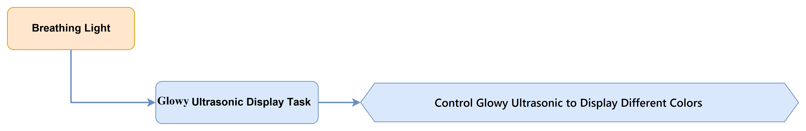

#### 6.3.1.3 Module Description

The glowy ultrasonic module adopts an I2C communication interface. This interface allows the system to read distance measurements from the ultrasonic sensor via I2C communication. At the same time, two RGB lights are integrated at the position of the ultrasonic probe. These lights can adjust the lighting brightness. They also achieve colorful changes by varying and superimposing the red, green, and blue color channels, which are referred to as R, G, and B.


During distance measurement, the module automatically transmits 8 square waves at 40 kHz. It then detects whether a returned signal exists. If a returned signal is detected, a high-level signal is output. The duration of the high-level signal corresponds to the round-trip travel time of the ultrasonic wave from transmission to return.

Module Wiring: As shown in the figure below, before running the program in this section, connect the module to any I2C port in the red box on the servo controller board.

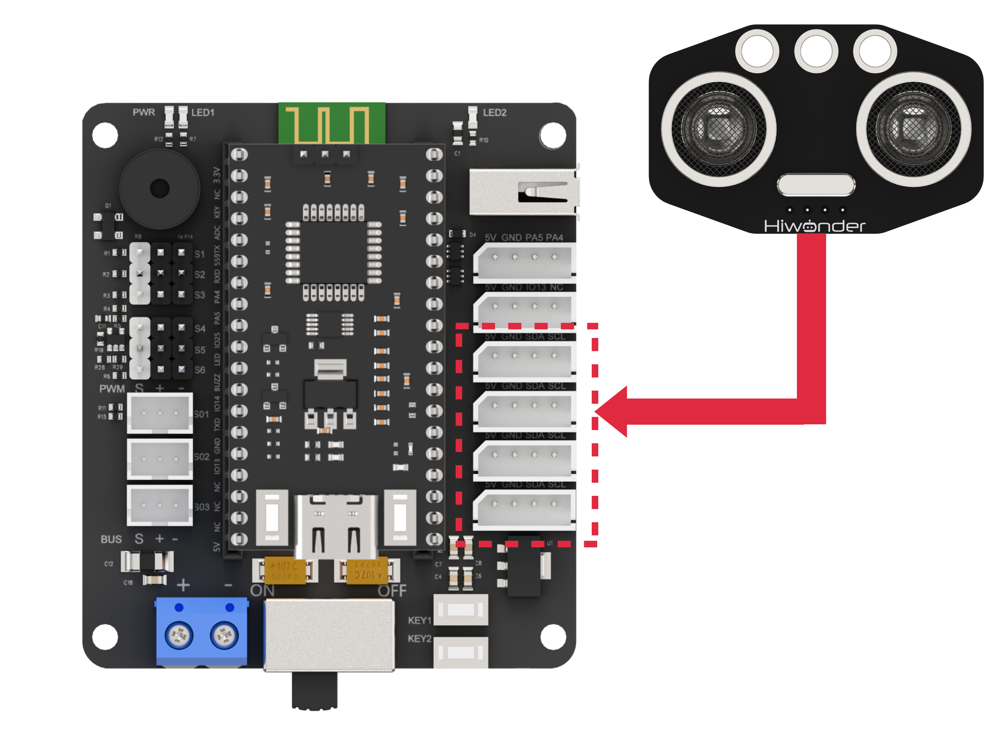

#### 6.3.1.4 Program Upload

> [!NOTE]
>
> **Before uploading the program, confirm that the serial port driver has been installed.**

1. Connect the core board to the computer using a USB cable.

   

2. Double-click to open the STM32 serial flashing software **FlyMcu**.

3. Click the browse icon. Then select the HEX file to be flashed under the directory path [**Tankbot\MDK-ARM\Tankbot**](https://drive.google.com/file/d/1E7xPCe5Up0fGYezVSNkHjjIc_dm8rtFq/view?usp=sharing) for the corresponding project.

   

4. At position ① in the figure below, select the serial port number corresponding to the core board. At position ②, select a baud rate of 115200. At positions ③ and ④, configure the settings according to the options shown in the figure.

   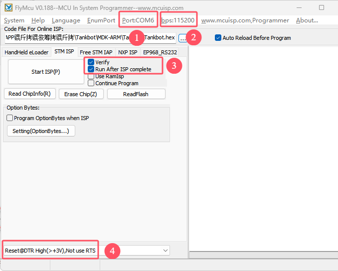

5. Click **Start ISP**, and press the RST button on the core board. The program begins flashing automatically. When the right log output window outputs the following content, the program upload is complete.

   

#### 6.3.1.5 Project Outcome

The RGB lights of the glowy ultrasonic sensor illuminate in red breathing light mode.

#### 6.3.1.6 Program Analysis

- **main.c File, Business Layer**

1. Import the library files `ultrasound.h`, `adc_sample.h`, and `robot_arm.h`. The `ultrasound.h` file contains control functions for the glowy ultrasonic sensor.

```c
/* USER CODE END Header */
/* Includes ------------------------------------------------------------------*/
#include "main.h"
#include "adc.h"
#include "dma.h"
#include "i2c.h"
#include "spi.h"
#include "tim.h"
#include "usart.h"
#include "gpio.h"

/* Private includes ----------------------------------------------------------*/
/* USER CODE BEGIN Includes */

#include "global.h"
#include "stdio.h"
#include "stdlib.h"
#include "led.h"
#include "buzzer.h"
#include "robot_arm.h"
#include "adc_sample.h"
#include "ultrasound.h"
#include "differential_chassis.h"
/* USER CODE END Includes */
```

2. In the `main` function, call `led_init` and `buzzer_init` to initialize the LED and buzzer objects, respectively. Then call `ultrasound_init` to initialize the ultrasonic sensor.

```c
	led_init();
	buzzer_init();
	adc_sample_init();
  robot_arm_init(); 
	
	
	HAL_Delay(1000);
	MX_I2C1_Init();

  ultrasound_init();
	differential_chassis_init();
```

3. Inside the loop, set the `RGB` light color value to red. The array element `rgb_L[0]` represents the proportion of red in the left `RGB` light. Then call the `set_ultrasound_color` function to set the `RGB`  lights to constant-on mode. Pass in the data for both the left and right `RGB` lights.

```c
  while (1)
  {	
    /* USER CODE END WHILE */

    /* USER CODE BEGIN 3 */
		/* USER CODE BEGIN 3 */
		rgb_L[1] = rgb_R[1] = rgb_L[2] = rgb_R[2] =0;
		rgb_L[0] = rgb_R[0] = num;
		set_ultrasound_color(0, rgb_L, rgb_R);
```

4. Use the two variables `dir` and `num` to control the brightness changes of the RGB lights. This achieves a gradual fading and brightening effect.

```c
		if(dir == 0){
			num++;
			if(num >= 250){
				dir = 1;
			}
		}else{
			num--;
			if(num <= 0){
				dir = 0;
			}
		}
```

- **ultrasound.c File, Driver Layer**

This section analyzes the `set_ultrasound_color` function:

1. In the function, first pass the parameter mode and the `RGB` light colors to the `ultrasound` object.

```c
void set_ultrasound_color(uint8_t mode, uint8_t* left_rgb, uint8_t* right_rgb)
{
	uint8_t set_reg;
	uint8_t rgb[6];
	
	ultrasound.rgb_mode = mode;
	
	for (uint8_t i = 0; i < 3; i++)
	{
		rgb[i] = left_rgb[i];
		rgb[i + 3] = right_rgb[i];
		ultrasound.left_rgb[i] = rgb[i];
		ultrasound.right_rgb[i] = rgb[i + 3];
	}
	
	switch(mode)
	{
		case 0:
			set_reg = RGB_WORK_SIMPLE_MODE_REG;
			write_to_device(&ultrasound, RGB_WORK_MODE_REG, &set_reg, sizeof(set_reg));
			write_to_device(&ultrasound, RGB_CONSTANT_INDEX_REG, rgb, sizeof(rgb));
			break;
		
		case 1:
			set_reg = RGB_WORK_BREATHING_MODE_REG;
			write_to_device(&ultrasound, RGB_WORK_MODE_REG, &set_reg, sizeof(set_reg));
			write_to_device(&ultrasound, RGB_BREATHING_INDEX_REG, rgb, sizeof(rgb));
			break;
		
		default:
			break;
	}
}
```

2. Switch the display status of the RGB lights according to the incoming mode. Mode 0 represents the constant-on mode for simple RGB light display control. In this mode, the values in the RGB array indicate the color proportions. Mode 1 activates the breathing light mode. In this mode, the values in the RGB array represent the blinking cycle of the breathing light. For example, `rgb[0] = 20` indicates that the red light blinks with a 2-second period.

```c
	switch(mode)
	{
		case 0:
			set_reg = RGB_WORK_SIMPLE_MODE_REG;
			write_to_device(&ultrasound, RGB_WORK_MODE_REG, &set_reg, sizeof(set_reg));
			write_to_device(&ultrasound, RGB_CONSTANT_INDEX_REG, rgb, sizeof(rgb));
			break;
		
		case 1:
			set_reg = RGB_WORK_BREATHING_MODE_REG;
			write_to_device(&ultrasound, RGB_WORK_MODE_REG, &set_reg, sizeof(set_reg));
			write_to_device(&ultrasound, RGB_BREATHING_INDEX_REG, rgb, sizeof(rgb));
			break;
		
		default:
			break;
	}
}
```

### 6.3.2 Distance Measurement Display, Available for Advanced Kit

#### 6.3.2.1 Project Introduction

This section focuses on acquiring the distance detected by the glowy ultrasonic sensor and displaying the distance on the dot matrix module.

#### 6.3.2.2 Implementation Flow


#### 6.3.2.3 Module Description

- **Glowy Ultrasonic Module**

The glowy ultrasonic module adopts an I2C communication interface. This interface allows the system to read distance measurements from the ultrasonic sensor via I2C communication. At the same time, two RGB lights are integrated at the position of the ultrasonic probe. These lights can adjust the lighting brightness. They also achieve colorful changes by varying and superimposing the red, green, and blue color channels, which are referred to as R, G, and B.

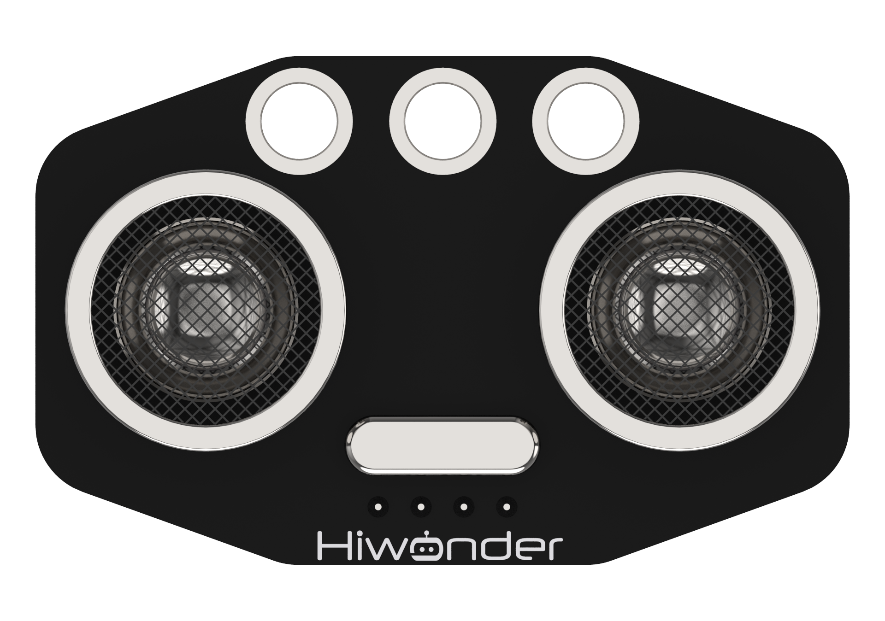

During distance measurement, the module automatically transmits 8 square waves at 40 kHz. It then detects whether a returned signal exists. If a returned signal is detected, a high-level signal is output. The duration of the high-level signal corresponds to the round-trip travel time of the ultrasonic wave from transmission to return.

Module Installation: Install the dot matrix module onto the chassis using M4 × 6 screws and M4 × 15 female-to-female nylon standoffs.


Module Wiring: As shown in the figure below, connect the module to any I2C port in the red box on the servo controller board before running the program in this section.


- **Dot Matrix Module**

The LED dot matrix module employs an LED dot matrix display module featuring high display brightness, flicker-free operation, and easy wiring. It can display numbers, text, and patterns.

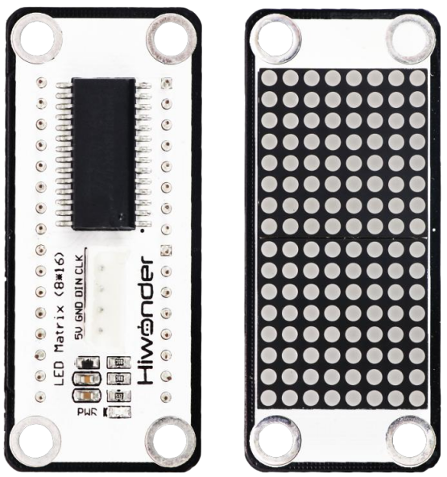

This module is composed of two red 8 × 8 LED matrix units. The TM640B driver control chip controls the dot matrix display.

Module Wiring: Connect the dot matrix module to port 3 of the main controller.


#### 6.3.2.4 Program Upload

> [!NOTE]
>
> **Before uploading the program, confirm that the serial port driver has been installed.**

1. Connect the core board to the computer using a USB cable.

   

2. Double-click to open the STM32 serial flashing software **FlyMcu** .

3. Click the browse icon. Then select the HEX file to be flashed under the directory path [**Tankbot\MDK-ARM\Tankbot**](https://drive.google.com/file/d/1E7xPCe5Up0fGYezVSNkHjjIc_dm8rtFq/view?usp=sharing) for the corresponding project.

   

4. At position ① in the figure below, select the serial port number corresponding to the core board. At position ②, select a baud rate of 115200. At positions ③ and ④, configure according to the options shown in the figure.

   

5. Click **Start ISP**, and press the RST button on the core board. The program begins flashing automatically. When the right log output window outputs the following content, the program upload is complete.

   

#### 6.3.2.5 Project Outcome

After the ultrasonic sensor detects the distance to an object, the distance is displayed on the dot matrix screen.


#### 6.3.2.6 Program Analysis

- **main.c File, Business Layer**

1. Import the library files `ultrasound.h`, `adc_sample.h`, and `robot_arm.h`. The `ultrasound.h` file contains control functions for the glowy ultrasonic sensor. The `WMMatrixLed.h` file contains library functions for the dot matrix display.

```c
#include "main.h"
#include "adc.h"
#include "dma.h"
#include "i2c.h"
#include "spi.h"
#include "tim.h"
#include "usart.h"
#include "gpio.h"

/* Private includes ----------------------------------------------------------*/
/* USER CODE BEGIN Includes */

#include "global.h"
#include "stdio.h"
#include "stdlib.h"
#include "led.h"
#include "buzzer.h"
#include "robot_arm.h"
#include "adc_sample.h"
#include "ultrasound.h"
#include "differential_chassis.h"
#include "WMMatrixLed.h"
```

2. In the `main` function, call `led_init` and `buzzer_init` to initialize the `LED` and buzzer objects, respectively. Then call `ultrasound_init` to initialize the ultrasonic sensor.

```c
	led_init();
	buzzer_init();
	adc_sample_init();
  robot_arm_init(); 
	
	
	HAL_Delay(1000);
	MX_I2C1_Init();
	
	WMMatrixLed_init(&WMMatrixLed_1, DIN_GPIO_Port, DIN_Pin, CLK_GPIO_Port, CLK_Pin);
  WMMatrixLed_setColorIndex(&WMMatrixLed_1,1); // Set color
  WMMatrixLed_setBrightness(&WMMatrixLed_1,2); // Set brightness with 8 adjustable levels
  ultrasound_init();
	differential_chassis_init();
```

3. Set the RGB light color value to blue. The array element `rgb_L[2]` represents the proportion of blue in the left RGB light. Then, call the `set_ultrasound_color` function to set the RGB lights to constant-on mode. Pass in the data for both the left and right RGB lights.

```c
	rgb_L[0] = rgb_L[1] = rgb_R[0] = rgb_R[1] =0;
	rgb_L[2] = rgb_R[2] = 250;
	set_ultrasound_color(0, rgb_L, rgb_R);
	
  while (1)
  {	
    /* USER CODE END WHILE */

		/* USER CODE BEGIN 3 */
		distance = get_ultrasound_distance();
		distance = (distance >999) ? 999 : distance;
		

		WMMatrixLed_showNum_1(&WMMatrixLed_1,((float)distance)/10,2);

		HAL_Delay(250);
	
  }
  /* USER CODE END 3 */
}
```

4. Inside the loop, acquire the distance measured by the ultrasonic module using the `get_ultrasound_distance` function. Then call the `WMMatrixLed_showNum_1` function to display this distance on the dot matrix module.

```c
  while (1)
  {	
    /* USER CODE END WHILE */

		/* USER CODE BEGIN 3 */
		distance = get_ultrasound_distance();
		distance = (distance >999) ? 999 : distance;
		

		WMMatrixLed_showNum_1(&WMMatrixLed_1,((float)distance)/10,2);

		HAL_Delay(250);
	
  }
```

- **ultrasound.c File, Driver Layer**

This section analyzes the `set_ultrasound_color` function:

1. In the function, first pass the parameter mode and the `RGB` light colors to the `ultrasound` object.

```c
void set_ultrasound_color(uint8_t mode, uint8_t* left_rgb, uint8_t* right_rgb)
{
	uint8_t set_reg;
	uint8_t rgb[6];
	
	ultrasound.rgb_mode = mode;
	
	for (uint8_t i = 0; i < 3; i++)
	{
		rgb[i] = left_rgb[i];
		rgb[i + 3] = right_rgb[i];
		ultrasound.left_rgb[i] = rgb[i];
		ultrasound.right_rgb[i] = rgb[i + 3];
	}
```

2. Switch the display status of the RGB lights according to the incoming mode. Mode 0 represents the constant-on mode for simple RGB light display control. In this mode, the values in the RGB array indicate the color proportions. Mode 1 activates the breathing light mode. In this mode, the values in the RGB array represent the blinking cycle of the breathing light. For example, `rgb[0] = 20` indicates that the red light blinks with a 2-second period.

```c
	switch(mode)
	{
		case 0:
			set_reg = RGB_WORK_SIMPLE_MODE_REG;
			write_to_device(&ultrasound, RGB_WORK_MODE_REG, &set_reg, sizeof(set_reg));
			write_to_device(&ultrasound, RGB_CONSTANT_INDEX_REG, rgb, sizeof(rgb));
			break;
		
		case 1:
			set_reg = RGB_WORK_BREATHING_MODE_REG;
			write_to_device(&ultrasound, RGB_WORK_MODE_REG, &set_reg, sizeof(set_reg));
			write_to_device(&ultrasound, RGB_BREATHING_INDEX_REG, rgb, sizeof(rgb));
			break;
		
		default:
			break;
	}
}
```

### 6.3.3 Maze Traversal

#### 6.3.3.1 Project Introduction

This section focuses on acquiring the distance detected by the glowy ultrasonic sensor, and controlling Tankbot to avoid obstacles based on the distance.

#### 6.3.3.2 Implementation Flow


#### 6.3.3.3 Module Description

The glowy ultrasonic module adopts an I2C communication interface. This interface allows the system to read distance measurements from the ultrasonic sensor via I2C communication. At the same time, two RGB lights are integrated at the position of the ultrasonic probe. These lights can adjust the lighting brightness. They also achieve colorful changes by varying and superimposing the red, green, and blue color channels, which are referred to as R, G, and B.


During distance measurement, the module automatically transmits 8 square waves at 40 kHz. It then detects whether a returned signal exists. If a returned signal is detected, a high-level signal is output. The duration of the high-level signal corresponds to the round-trip travel time of the ultrasonic wave from transmission to return.

Module Wiring: As shown in the figure below, before running the program in this section, connect the module to any I2C port in the red box on the servo controller board.


#### 6.3.3.4 Program Upload

> [!NOTE]
>
> **Before uploading the program, confirm that the serial port driver has been installed.**

1. Connect the core board to the computer using a USB cable.

   

2. Double-click to open the STM32 serial flashing software **FlyMcu** .

3. Click the browse icon. Then select the HEX file to be flashed under the directory path [**Tankbot\MDK-ARM\Tankbot**](https://drive.google.com/file/d/1E7xPCe5Up0fGYezVSNkHjjIc_dm8rtFq/view?usp=sharing) for the corresponding project.

   

4. At position ① in the figure below, select the serial port number corresponding to the core board. At position ②, select a baud rate of 115200. At positions ③ and ④, configure the settings according to the options shown in the figure.

   

5. Click **Start ISP**, and press the RST button on the core board. The program begins flashing automatically. When the right log output window outputs the following content, the program upload is complete.

   

#### 6.3.3.5 Program Outcome

The ultrasonic sensor detects the distance to an object. If the distance is too short, control the robotic arm to rotate to the left and right sides to acquire the obstacle distances, and steer the vehicle according to these obstacle distances.

#### 6.3.3.6 Program Analysis

- **main.c File, Business Layer**

1. Import the library files `ultrasound.h`, `adc_sample.h`, and `robot_arm.h`. The `ultrasound.h` file contains control functions for the glowy ultrasonic sensor. The `differential_chassis.h` file contains chassis control functions.

```c
/* Includes ------------------------------------------------------------------*/
#include "main.h"
#include "adc.h"
#include "dma.h"
#include "i2c.h"
#include "spi.h"
#include "tim.h"
#include "usart.h"
#include "gpio.h"

/* Private includes ----------------------------------------------------------*/
/* USER CODE BEGIN Includes */

#include "global.h"
#include "stdio.h"
#include "stdlib.h"
#include "led.h"
#include "buzzer.h"
#include "robot_arm.h"
#include "adc_sample.h"
#include "ultrasound.h"
#include "differential_chassis.h"
```

2. In the `main` function, call `led_init` and `buzzer_init` to initialize the LED and buzzer objects, respectively. Then call `ultrasound_init` to initialize the ultrasonic sensor and initialize the chassis simultaneously.

```c
	led_init();
	buzzer_init();
	adc_sample_init();
  robot_arm_init(); 
	
	
	HAL_Delay(1000);
	MX_I2C1_Init();
	
  ultrasound_init();
	differential_chassis_init();

  /* USER CODE END 2 */

  /* Infinite loop */
  /* USER CODE BEGIN WHILE */
	
	differentials_chassis_run(0.0f, 0.0f);	
	buzzer_toggle(50, 50, 1);
	rgb_L[0] = rgb_L[1] = rgb_R[0] = rgb_R[1] =0;
	rgb_L[2] = rgb_R[2] = 250;
	set_ultrasound_color(0, rgb_L, rgb_R);
```

3. Stop the chassis movement using the `differentials_chassis_run` function. Call the `set_ultrasound_color` function to set the RGB lights to constant-on mode and set the RGB color to blue. The array element `rgb_L[2]` represents the proportion of blue in the left RGB light.

```c
	led_init();
	buzzer_init();
	adc_sample_init();
  robot_arm_init(); 
	
	
	HAL_Delay(1000);
	MX_I2C1_Init();
	
  ultrasound_init();
	differential_chassis_init();

  /* USER CODE END 2 */

  /* Infinite loop */
  /* USER CODE BEGIN WHILE */
	
	differentials_chassis_run(0.0f, 0.0f);	
	buzzer_toggle(50, 50, 1);
	rgb_L[0] = rgb_L[1] = rgb_R[0] = rgb_R[1] =0;
	rgb_L[2] = rgb_R[2] = 250;
	set_ultrasound_color(0, rgb_L, rgb_R);
```

4. Inside the loop, obtain the ultrasonic distance using the `get_ultrasound_distance` function. When the distance is less than 300 mm, set the RGB light color to red and set the `speed` to 0. Then set `step` to 1 to transition to the next branch. If the ultrasonic distance is greater than 300 mm, calculate the chassis speed based on the distance.

```c
		distance = get_ultrasound_distance();
		distance = distance > 600 ? 600 : distance;
		switch(step){
			case 0:{
				if(distance < 300){
					rgb_L[1] = rgb_L[2] = rgb_R[1] = rgb_R[2] =0;
					rgb_L[0] = rgb_R[0] = 250;
					set_ultrasound_color(0, rgb_L, rgb_R);
					
					speed = 0.0;
					step = 1;
				}else{
					speed = (float)((distance - 100) / 2) > 80 ? 100 : ((distance - 100) / 2);
				}
				
				differentials_chassis_run(speed, 0.0f);
				break;
```

5. When the distance is less than 300 mm, control the robotic arm to rotate to the left and right directions. Acquire the distances on both sides, respectively. Control the chassis to steer according to the distances. Finally, set the RGB lights to green and stop the vehicle. Set the `step` to 0 to return to the previous branch.

```c
			case 1:{
				robot_arm_knot_run(6 , 875 , 900);
				HAL_Delay(1200);
				left_distance = get_ultrasound_distance();
				robot_arm_knot_run(6, 125 , 1900);
				HAL_Delay(2200);
				right_distance = get_ultrasound_distance();
				robot_arm_knot_run(6, 500, 1000);
				if(left_distance > right_distance){
					differentials_chassis_run(0.0f , 1.0f);
				}else{
					differentials_chassis_run(0.0f, -1.0f);
				}
				HAL_Delay(1000);
				
				rgb_L[0] = rgb_L[2] = rgb_R[0] = rgb_R[2] =0;
				rgb_L[1] = rgb_R[1] = 250;
				set_ultrasound_color(0, rgb_L, rgb_R);	
				
				differentials_chassis_run(0.0f, 0.0f);
				step = 0;
				break;
			}
```

- **ultrasound.c File, Driver Layer**

This section analyzes the `set_ultrasound_color` function:

1. In the function, first pass the parameter mode and `RGB` light colors to the `ultrasound` object.

```c
void set_ultrasound_color(uint8_t mode, uint8_t* left_rgb, uint8_t* right_rgb)
{
	uint8_t set_reg;
	uint8_t rgb[6];
	
	ultrasound.rgb_mode = mode;
	
	for (uint8_t i = 0; i < 3; i++)
	{
		rgb[i] = left_rgb[i];
		rgb[i + 3] = right_rgb[i];
		ultrasound.left_rgb[i] = rgb[i];
		ultrasound.right_rgb[i] = rgb[i + 3];
	}
```

2. Switch the display status of the RGB lights according to the incoming mode. Mode 0 represents the constant-on mode for simple RGB light display control. In this mode, the values in the RGB array indicate the color proportions. Mode 1 activates the breathing light mode. In this mode, the values in the RGB array represent the blinking cycle of the breathing light. For example, `rgb[0] = 20` indicates that the red light blinks with a 2-second period.

```c
	switch(mode)
	{
		case 0:
			set_reg = RGB_WORK_SIMPLE_MODE_REG;
			write_to_device(&ultrasound, RGB_WORK_MODE_REG, &set_reg, sizeof(set_reg));
			write_to_device(&ultrasound, RGB_CONSTANT_INDEX_REG, rgb, sizeof(rgb));
			break;
		
		case 1:
			set_reg = RGB_WORK_BREATHING_MODE_REG;
			write_to_device(&ultrasound, RGB_WORK_MODE_REG, &set_reg, sizeof(set_reg));
			write_to_device(&ultrasound, RGB_BREATHING_INDEX_REG, rgb, sizeof(rgb));
			break;
		
		default:
			break;
	}
}
```

- **differential_chassis.c File, Driver Layer**

This section analyzes the `differentials_chassis_run` function:

1. First, define an array to store the motor speeds, along with variables for the left and right wheel speeds. According to the differential chassis kinematics, calculate the speeds of the left and right wheels based on the incoming linear velocity and angular velocity.

```c
void differentials_chassis_run(float speed, float rot)
{
	int8_t motor_speed[4];
	float vr, vl;
	
	speed = speed > MAX_SPEED ? MAX_SPEED : speed < MIN_SPEED ? MIN_SPEED : speed;
	rot = rot > MAX_ROT ? MAX_ROT : rot < MIN_ROT ? MIN_ROT : rot;
	
	vr = speed + rot * HALF_FR_WHEELBASE;
	vl = speed - rot * HALF_FR_WHEELBASE;

	motor_speed[0] = -(int8_t)vl;
	motor_speed[1] = 0;
	motor_speed[2] = (int8_t)vr; 
	motor_speed[3] = 0;
	
	set_motor_speed(motor_speed);
}
```

2. Finally, pass the speeds into the `motor_speed` array. Because the installation directions of the left and right wheel motors differ, set the left wheel motor speed to the opposite direction. Then call `set_motor_speed` to set the motor speeds and control the chassis movement.

```c
	motor_speed[0] = -(int8_t)vl;
	motor_speed[1] = 0;
	motor_speed[2] = (int8_t)vr; 
	motor_speed[3] = 0;
	
	set_motor_speed(motor_speed);
}
```


### 6.3.4 Ultrasonic Following

#### 6.3.4.1 Project Introduction

This section focuses on acquiring the distance detected by the glowy ultrasonic sensor, and controlling the Tankbot to perform following movements based on the distance.


#### 6.3.4.2 Implementation Flow

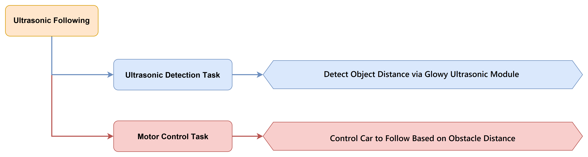

#### 6.3.4.3 Module Description

The glowy ultrasonic module adopts an I2C communication interface. This interface allows the system to read distance measurements from the ultrasonic sensor via I2C communication. At the same time, two RGB lights are integrated at the position of the ultrasonic probe. These lights can adjust the lighting brightness. They also achieve colorful changes by varying and superimposing the red, green, and blue color channels, which are referred to as R, G, and B.


During distance measurement, the module automatically transmits 8 square waves at 40 kHz. It then detects whether a returned signal exists. If a returned signal is detected, a high-level signal is output. The duration of the high-level signal corresponds to the round-trip travel time of the ultrasonic wave from transmission to return.

Module Wiring: As shown in the figure below, before running the program in this section, connect the module to any I2C port in the red box on the servo controller board.


#### 6.3.4.4 Program Upload

> [!NOTE]
>
> **Before uploading the program, confirm that the serial port driver has been installed.**

1. Connect the core board to the computer using a USB cable.

   

2. Double-click to open the STM32 serial flashing software **FlyMcu**.

3. Click the browse icon. Then select the HEX file to be flashed under the directory path [**Tankbot\MDK-ARM\Tankbot**](https://drive.google.com/file/d/1E7xPCe5Up0fGYezVSNkHjjIc_dm8rtFq/view?usp=sharing) for the corresponding project.

   

4. At position ① in the figure below, select the serial port number corresponding to the core board. At position ②, select a baud rate of 115200. At positions ③ and ④, configure according to the options shown in the figure.

   

5. Click **Start ISP**, and press the RST button on the core board. The program begins flashing automatically. When the right log output window outputs the following content, the program upload is complete.

   

#### 6.3.4.5 Project Outcome

The ultrasonic sensor detects the distance to an object. If the distance is greater than or equal to 300 mm and less than 500 mm, control the vehicle to move forward. If the distance is less than 250 mm, control the vehicle to move backward. Otherwise, stop the vehicle.


#### 6.3.4.6 Program Analysis

- **main.c File, Business Layer**

1. Import the library files `ultrasound.h`, `adc_sample.h`, and `robot_arm.h`. The `ultrasound.h` file contains control functions for the glowy ultrasonic sensor. The `differential_chassis.h` file contains chassis control functions.

```c
/* USER CODE END Header */
/* Includes ------------------------------------------------------------------*/
#include "main.h"
#include "adc.h"
#include "dma.h"
#include "i2c.h"
#include "spi.h"
#include "tim.h"
#include "usart.h"
#include "gpio.h"

/* Private includes ----------------------------------------------------------*/
/* USER CODE BEGIN Includes */

#include "global.h"
#include "stdio.h"
#include "stdlib.h"
#include "led.h"
#include "buzzer.h"
#include "robot_arm.h"
#include "adc_sample.h"
#include "ultrasound.h"
#include "differential_chassis.h"
```

2. In the `main` function, call `led_init` and `buzzer_init` to initialize the LED and buzzer objects respectively, call `ultrasound_init` to initialize the ultrasonic sensor, and initialize the chassis simultaneously.

```c
	led_init();
	buzzer_init();
	adc_sample_init();
  robot_arm_init(); 
	
	
	HAL_Delay(1000);
	MX_I2C1_Init();
	
  ultrasound_init();
	differential_chassis_init();

  /* USER CODE END 2 */

  /* Infinite loop */
  /* USER CODE BEGIN WHILE */
	
	differentials_chassis_run(0.0f, 0.0f);	
	buzzer_toggle(50, 50, 1);
	
	rgb_L[0] = rgb_L[1] = rgb_R[0] = rgb_R[1] = 0;
	rgb_L[2] = rgb_R[2] = 250;
	set_ultrasound_color(0,rgb_L,rgb_R);
```

3. Stop the chassis movement using the `differentials_chassis_run` function. Call the `set_ultrasound_color` function to set the RGB lights to constant-on mode and set the RGB color to blue. The array element `rgb_L[2]` represents the proportion of blue in the left RGB light.

```c
  /* USER CODE END 2 */

  /* Infinite loop */
  /* USER CODE BEGIN WHILE */
	
	differentials_chassis_run(0.0f, 0.0f);	
	buzzer_toggle(50, 50, 1);
	
	rgb_L[0] = rgb_L[1] = rgb_R[0] = rgb_R[1] = 0;
	rgb_L[2] = rgb_R[2] = 250;
	set_ultrasound_color(0,rgb_L,rgb_R);
```

4. Inside the loop, acquire the ultrasonic distance using the `get_ultrasound_distance` function. In the `case 0` branch, evaluate the detected distance. Then jump to the corresponding program branch based on the distance value.

```c
		dis = get_ultrasound_distance();
		switch(running_state)
		{
			case 0:
				if(dis >= 300 && dis < 500)
				{
					HAL_Delay(100);
					dis = get_ultrasound_distance();
					if(dis >= 350 && dis < 500)
					{
						running_state = 1;
					}
				}
				else if(dis > 0 && dis < 250)
				{
					HAL_Delay(100);
					dis = get_ultrasound_distance();
					if(dis >= 0 && dis < 250)
					{
						running_state = 2;
					}
				}
				else
				{
						running_state = 3;
				}
				
				break;
```

5. When the distance is greater than or equal to 300 mm and less than 500 mm, the program enters `case 1`. Set the glowy ultrasonic RGB lights to green. Then call the `differentials_chassis_run` function to drive the vehicle forward.

```c
			case 1:
				rgb_L[0] = rgb_L[2] = rgb_R[0] = rgb_R[2] = 0;
				rgb_L[1] = rgb_R[1] = 255;
				set_ultrasound_color(0,rgb_L,rgb_R);
			
				differentials_chassis_run(60,0);  
				HAL_Delay(100);
				running_state = 0;
				break;
```

6. When the distance is less than 250 mm, the program enters `case 2`. Set the glowy ultrasonic RGB lights to red. Then call the `differentials_chassis_run` function to reverse the vehicle.

```c
			case 2:
				rgb_L[1] = rgb_L[2] = rgb_R[1] = rgb_R[2] = 0;
				rgb_L[0] = rgb_R[0] = 255;
				set_ultrasound_color(0,rgb_L,rgb_R);
			
				differentials_chassis_run(-60,0);  
				HAL_Delay(100);
				running_state = 0;
				break;	
```

7. When the distance is between 250 mm and 300 mm, the program enters `case 3`. Set the RGB lights to blue and bring the vehicle to a stop simultaneously.

```c
			case 3:
				rgb_L[0] = rgb_L[1] = rgb_R[0] = rgb_R[1] = 0;
				rgb_L[2] = rgb_R[2] = 255;
				set_ultrasound_color(0,rgb_L,rgb_R);
			
				differentials_chassis_run(0,0);  
				HAL_Delay(100);
				running_state = 0;	
				break;
```

- **ultrasound.c File, Driver Layer**

This section analyzes the `set_ultrasound_color` function:

1. In the function, first pass the parameter mode and the RGB light colors to the `ultrasound` object.

```c
void set_ultrasound_color(uint8_t mode, uint8_t* left_rgb, uint8_t* right_rgb)
{
	uint8_t set_reg;
	uint8_t rgb[6];
	
	ultrasound.rgb_mode = mode;
	
	for (uint8_t i = 0; i < 3; i++)
	{
		rgb[i] = left_rgb[i];
		rgb[i + 3] = right_rgb[i];
		ultrasound.left_rgb[i] = rgb[i];
		ultrasound.right_rgb[i] = rgb[i + 3];
	}
	
	switch(mode)
	{
		case 0:
			set_reg = RGB_WORK_SIMPLE_MODE_REG;
			write_to_device(&ultrasound, RGB_WORK_MODE_REG, &set_reg, sizeof(set_reg));
			write_to_device(&ultrasound, RGB_CONSTANT_INDEX_REG, rgb, sizeof(rgb));
			break;
		
		case 1:
			set_reg = RGB_WORK_BREATHING_MODE_REG;
			write_to_device(&ultrasound, RGB_WORK_MODE_REG, &set_reg, sizeof(set_reg));
			write_to_device(&ultrasound, RGB_BREATHING_INDEX_REG, rgb, sizeof(rgb));
			break;
		
		default:
			break;
	}
}
```

2. Switch the display status of the RGB lights according to the incoming mode. Mode 0 represents the constant-on mode for simple RGB light display control. In this mode, the values in the RGB array indicate the color proportions. Mode 1 activates the breathing light mode. In this mode, the values in the RGB array represent the blinking cycle of the breathing light. For example, `rgb[0] = 20` indicates that the red light blinks with a 2 s period.

```c
	switch(mode)
	{
		case 0:
			set_reg = RGB_WORK_SIMPLE_MODE_REG;
			write_to_device(&ultrasound, RGB_WORK_MODE_REG, &set_reg, sizeof(set_reg));
			write_to_device(&ultrasound, RGB_CONSTANT_INDEX_REG, rgb, sizeof(rgb));
			break;
		
		case 1:
			set_reg = RGB_WORK_BREATHING_MODE_REG;
			write_to_device(&ultrasound, RGB_WORK_MODE_REG, &set_reg, sizeof(set_reg));
			write_to_device(&ultrasound, RGB_BREATHING_INDEX_REG, rgb, sizeof(rgb));
			break;
		
		default:
			break;
	}
```

- **differential_chassis.c File, Driver Layer**

This section analyzes the `differentials_chassis_run` function:

1. First, define an array to store the motor speeds along with variables for the left and right wheel speeds. According to the differential chassis kinematics, calculate the speeds of the left and right wheels based on the incoming linear velocity and angular velocity.

```c
void differentials_chassis_run(float speed, float rot)
{
	int8_t motor_speed[4];
	float vr, vl;
	
	speed = speed > MAX_SPEED ? MAX_SPEED : speed < MIN_SPEED ? MIN_SPEED : speed;
	rot = rot > MAX_ROT ? MAX_ROT : rot < MIN_ROT ? MIN_ROT : rot;
	
	vr = speed + rot * HALF_FR_WHEELBASE;
	vl = speed - rot * HALF_FR_WHEELBASE;

	motor_speed[0] = -(int8_t)vl;
	motor_speed[1] = 0;
	motor_speed[2] = (int8_t)vr; 
	motor_speed[3] = 0;
	
	set_motor_speed(motor_speed);
}
```

2. Finally, pass the speeds into the `motor_speed` array. Because the installation directions of the left and right wheel motors differ, set the left wheel motor speed to the opposite direction. Then call `set_motor_speed` to set the motor speeds and control the chassis movement.

```c
	motor_speed[0] = -(int8_t)vl;
	motor_speed[1] = 0;
	motor_speed[2] = (int8_t)vr; 
	motor_speed[3] = 0;
	
	set_motor_speed(motor_speed);
```

### 6.3.5 Fixed-Distance Gripping

#### 6.3.5.1 Project Introduction

This section focuses on acquiring the distance detected by the glowy ultrasonic sensor, and controlling the Tankbot to grip objects based on the distance.

#### 6.3.5.2 Implementation Flow

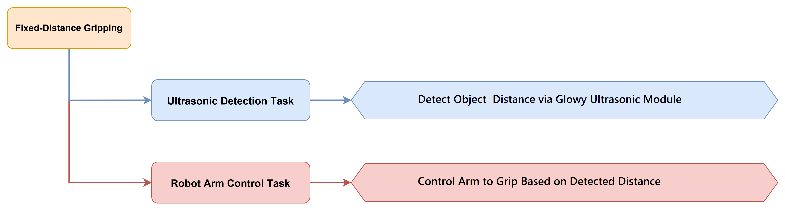

#### 6.3.5.3 Module Description

The glowy ultrasonic module adopts an I2C communication interface. This interface allows the system to read distance measurements from the ultrasonic sensor via I2C communication. At the same time, two RGB lights are integrated at the position of the ultrasonic probe. These lights can adjust the lighting brightness. They also achieve colorful changes by varying and superimposing the red, green, and blue color channels, which are referred to as R, G, and B.


During distance measurement, the module automatically transmits 8 square waves at 40 kHz. It then detects whether a returned signal exists. If a returned signal is detected, a high-level signal is output. The duration of the high-level signal corresponds to the round-trip travel time of the ultrasonic wave from transmission to return.

Module Wiring: As shown in the figure below, before running the program in this section, connect the module to any I2C port in the red box on the servo controller board.


#### 6.3.5.4 Program Upload

> [!NOTE]
>
> **Before uploading the program, confirm that the serial port driver has been installed.**

1. Connect the core board to the computer using a USB cable.

   

2. Double-click to open the STM32 serial flashing software **FlyMcu**.

3. Click the browse icon. Then select the HEX file to be flashed under the directory path [**Tankbot\MDK-ARM\Tankbot**](https://drive.google.com/file/d/1E7xPCe5Up0fGYezVSNkHjjIc_dm8rtFq/view?usp=sharing)  for the corresponding project.

   

4. At position ① in the figure below, select the serial port number corresponding to the core board. At position ②, select a baud rate of 115200. At positions ③ and ④, configure according to the options shown in the figure.

   

5. Click **Start ISP**, and press the RST button on the core board. The program begins flashing automatically. When the right log output window outputs the following content, the program upload is complete.

   

#### 6.3.5.5 Project Outcome

After the ultrasonic sensor detects the object distance, control the robotic arm to perform adaptive gripping according to the distance.


#### 6.3.5.6 Program Analysis

- **main.c File, Business Layer**

1. Import the library files `ultrasound.h`, `adc_sample.h`, and `robot_arm.h`. The `ultrasound.h` file contains control functions for the glowy ultrasonic sensor. The `robot_arm.h` file contains robotic arm control functions.

```c
/* Includes ------------------------------------------------------------------*/
#include "main.h"
#include "adc.h"
#include "dma.h"
#include "i2c.h"
#include "spi.h"
#include "tim.h"
#include "usart.h"
#include "gpio.h"

/* Private includes ----------------------------------------------------------*/
/* USER CODE BEGIN Includes */

#include "global.h"
#include "stdio.h"
#include "stdlib.h"
#include "led.h"
#include "buzzer.h"
#include "robot_arm.h"
#include "adc_sample.h"
#include "ultrasound.h"
#include "differential_chassis.h"
```

2. In the `main` function, call `led_init` and `buzzer_init` to initialize the LED and buzzer objects respectively, and call `ultrasound_init` to initialize the ultrasonic sensor. Then initialize the robotic arm using the `robot_arm_init` function.

```c
	led_init();
	buzzer_init();
	adc_sample_init();
  robot_arm_init(); 
	
	
	HAL_Delay(1000);
	MX_I2C1_Init();
	
  ultrasound_init();
	differential_chassis_init();

  /* USER CODE END 2 */

  /* Infinite loop */
  /* USER CODE BEGIN WHILE */
	
	differentials_chassis_run(0.0f, 0.0f);	
	buzzer_toggle(50, 50, 1);
	
	rgb_L[0] = rgb_L[1] = rgb_R[0] = rgb_R[1] = 0;
	rgb_L[2] = rgb_R[2] = 250;
	set_ultrasound_color(0,rgb_L,rgb_R);
```

3. Stop the chassis movement using the `differentials_chassis_run` function. Call the `set_ultrasound_color` function to set the RGB lights to constant-on mode and set the RGB color to blue. The array element `rgb_L[2]` represents the proportion of blue in the left RGB light.

```c
	differentials_chassis_run(0.0f, 0.0f);	
	buzzer_toggle(50, 50, 1);
	
	rgb_L[0] = rgb_L[1] = rgb_R[0] = rgb_R[1] = 0;
	rgb_L[2] = rgb_R[2] = 250;
	set_ultrasound_color(0,rgb_L,rgb_R);
```

4. Inside the loop, acquire the ultrasonic distance. When the distance is less than 200 mm, set the RGB light color to green. Then wait for 1 s and acquire the ultrasonic distance once more to stabilize the ultrasonic distance data.

```c
  while (1)
  {	
    /* USER CODE END WHILE */

    /* USER CODE BEGIN 3 */
		distance = get_ultrasound_distance();
		if(distance < 200 && distance > 0){
			
			rgb_L[0] = rgb_L[2] = rgb_R[0] = rgb_R[2] =0;
			rgb_L[1] = rgb_R[1] = 250;
			set_ultrasound_color(0, rgb_L, rgb_R);
			
			HAL_Delay(1000);
			distance = get_ultrasound_distance();
```

5. If the re-acquired ultrasonic distance remains less than 200 mm, control the buzzer to beep once and drive the robotic arm to execute gripping. When the program calls `robot_arm_coordinate_set` to execute gripping, it calculates the incoming x-coordinate from the ultrasonic distance. This calculation enables adaptive distance gripping.

```c
			if(distance < 200 && distance > 0){
				buzzer_toggle(50, 50, 1);
				HAL_Delay(1000);
				robot_arm_coordinate_set(8+((float)distance)/10, 0, -3 , -45 , -90 , 90 , 1000);
				HAL_Delay(1000);
				robot_arm_claw_set(0, 500);
				HAL_Delay(800);
				robot_arm_coordinate_set(15, 0, 6, -45, -90, 90, 1000);
				HAL_Delay(1000);
```

6. After gripping is completed, control the robotic arm to turn to the right side. Call the `robot_arm_claw_set` function to place the object. The first parameter of this function represents the opening and closing angle of the gripper, and the second parameter is the duration. After placement, restore the robotic arm to its initial posture. Finally, set the glowy ultrasonic lighting to blue.

```c
				robot_arm_coordinate_set(0.5, -20 , 6 , -45, -90, 90, 1000);
				HAL_Delay(1000);
				robot_arm_coordinate_set(0.5, -20, -2, -45, -90, 90, 1000);
				HAL_Delay(1000);
				robot_arm_claw_set(90, 500);
				HAL_Delay(800);
				robot_arm_coordinate_set(0.5, -15 , 6 , -45, -90, 90, 1000);
				HAL_Delay(1000);
				robot_arm_coordinate_set(15, 0, 6, -45, -90, 90, 1000);
				HAL_Delay(1000);
			}
```

- **ultrasound.c File, Driver Layer**

This section analyzes the `set_ultrasound_color` function:

1. In the function, first pass the parameter mode and the RGB light colors to the `ultrasound` object.

```c
void set_ultrasound_color(uint8_t mode, uint8_t* left_rgb, uint8_t* right_rgb)
{
	uint8_t set_reg;
	uint8_t rgb[6];
	
	ultrasound.rgb_mode = mode;
	
	for (uint8_t i = 0; i < 3; i++)
	{
		rgb[i] = left_rgb[i];
		rgb[i + 3] = right_rgb[i];
		ultrasound.left_rgb[i] = rgb[i];
		ultrasound.right_rgb[i] = rgb[i + 3];
	}
```

2. Switch the display status of the RGB lights according to the incoming mode. Mode 0 represents the constant-on mode for simple RGB light display control. In this mode, the values in the RGB array indicate the color proportions. Mode 1 activates the breathing light mode. In this mode, the values in the RGB array represent the blinking cycle of the breathing light. For example, `rgb[0] = 20` indicates that the red light blinks with a 2-second period.

```c
	switch(mode)
	{
		case 0:
			set_reg = RGB_WORK_SIMPLE_MODE_REG;
			write_to_device(&ultrasound, RGB_WORK_MODE_REG, &set_reg, sizeof(set_reg));
			write_to_device(&ultrasound, RGB_CONSTANT_INDEX_REG, rgb, sizeof(rgb));
			break;
		
		case 1:
			set_reg = RGB_WORK_BREATHING_MODE_REG;
			write_to_device(&ultrasound, RGB_WORK_MODE_REG, &set_reg, sizeof(set_reg));
			write_to_device(&ultrasound, RGB_BREATHING_INDEX_REG, rgb, sizeof(rgb));
			break;
		
		default:
			break;
	}
}
```

- **robot_arm.c File, Driver Layer**

This section analyzes the `robot_arm_coordinate_set` function, which controls the position of the robotic arm:

1. This function includes 7 parameters. The parameters `target_x`, `target_y`, and `target_z` denote the target position coordinates, respectively. The `pitch` parameter represents the angle of the end effector relative to the horizontal plane. The parameters `min_pitch` and `max_pitch` indicate the minimum and maximum angles within the solving range. The `time` parameter represents the duration for the robotic arm to move to that position.

```c
uint8_t robot_arm_coordinate_set(float target_x,
								 float target_y,
								 float target_z,
								 float pitch,
								 float min_pitch,
								 float max_pitch,
								 uint32_t time)
{
	
	bool result1_state, result2_state;
	
	KinematicsObjectTypeDef kinematics_result1;
	KinematicsObjectTypeDef kinematics_result2;	
	VectorObjectTypeDef vector;

	vector.x = target_x;
	vector.y = target_y;
	vector.z = target_z;
```

2. Inside the function, define two variables of type `KinematicsObjectTypeDef` are defined to store data resolved by kinematics, and define one variable of type `VectorObjectTypeDef`  to temporarily hold the vector. Pass the target position coordinates `x`, `y`, and `z` into the `vector`.

```c
   bool result1_state, result2_state;

   KinematicsObjectTypeDef kinematics_result1;
   KinematicsObjectTypeDef kinematics_result2;	
   VectorObjectTypeDef vector;

   vector.x = target_x;
   vector.y = target_y;
   vector.z = target_z;
```

3. Call the `set_pitch_range` function to evaluate whether a kinematic solution exists for the target position. If a solution exists, return `true` and store the calculated data into the `KinematicsObjectTypeDef` variable.

```c
	result1_state = set_pitch_range(&kinematics_result1, &vector, pitch, min_pitch);
	result2_state = set_pitch_range(&kinematics_result2, &vector, pitch, max_pitch);
```

4. If `result1_state` yields a valid solution, pass the resolved end-effector angle, coordinates, and joint angle data into the global variable `kinematics`. If `result2_state` also yields a solution, compare the end-effector angles and select the solution closest to the target angle.

```c
	if (result1_state)
	{
		kinematics.alpha = kinematics_result1.alpha;
		kinematics.vector.x = kinematics_result1.vector.x;
		kinematics.vector.y = kinematics_result1.vector.y;
		kinematics.vector.z = kinematics_result1.vector.z;
		for (uint8_t i = 0; i< 4; i++)
		{
			kinematics.knot[i].theta = kinematics_result1.knot[i].theta;
		}
		
		if (result2_state)
		{
			if (fabs(kinematics_result2.alpha - pitch) < fabs(kinematics_result1.alpha - pitch))
			{
				kinematics.alpha = kinematics_result2.alpha;
				kinematics.vector.x = kinematics_result2.vector.x;
				kinematics.vector.y = kinematics_result2.vector.y;
				kinematics.vector.z = kinematics_result2.vector.z;
				for (uint8_t i = 0; i< 4; i++)
				{
					kinematics.knot[i].theta = kinematics_result2.knot[i].theta;
				}			
			}
		}
	}
```

5. If `result1_state` yields no solution, determine whether `result2_state` has a solution. If a solution exists, pass the resolved data into the global variable `kinematics`. If `result2_state` also yields no solution, return `false` to indicate that the target position is unreachable. Otherwise, return `true`.

```c
	else
	{
		if (result2_state)
		{
			kinematics.alpha = kinematics_result2.alpha;
			kinematics.vector.x = kinematics_result2.vector.x;
			kinematics.vector.y = kinematics_result2.vector.y;
			kinematics.vector.z = kinematics_result2.vector.z;
			for (uint8_t i = 0; i< 4; i++)
			{
				kinematics.knot[i].theta = kinematics_result2.knot[i].theta;
			}
		}
		else
		{
			return false;
		}
	}
	result1_state = 0;
	result2_state = 0;
	theta2servo(&kinematics, time);

	return true;
}
```

### 6.3.6 Accelerometer Control, Available for Advanced Kit

#### 6.3.6.1 Project Introduction

This section focuses on acquiring the Euler angles from the accelerometer, and controlling the robotic arm to execute gripping and placing based on the angles.

#### 6.3.6.2 Implementation Flow


#### 6.3.6.3 Module Description

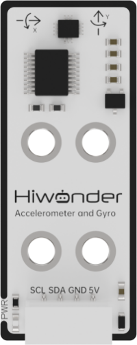

This sensor primarily uses the QMI8658 sensor component. It integrates a 3-axis MEMS gyroscope, a 3-axis MEMS accelerometer, and an expandable digital motion processor, also known as DMP.

The sensor utilizes three 16-bit ADCs each for the gyroscope and accelerometer. The ADCs convert the measured analog values into digital output values.

Module Wiring: As shown in the figure below, connect the module to any I2C port in the red box on the servo controller board before running the program in this section.

#### 6.3.6.4 Program Upload

> [!NOTE]
>
> **Before uploading the program, confirm that the serial port driver has been installed.**

1. Connect the core board to the computer using a USB cable.

   

2. Double-click to open the STM32 serial flashing software **FlyMcu** .

3. Click the browse icon. Then select the HEX file to be flashed under the directory path [**Tankbot\MDK-ARM\Tankbot**](https://drive.google.com/file/d/1E7xPCe5Up0fGYezVSNkHjjIc_dm8rtFq/view?usp=sharing)  for the corresponding project.

   

4. At position ① in the figure below, select the serial port number corresponding to the core board. At position ②, select a baud rate of 115200. At positions ③ and ④, configure according to the options shown in the figure.

   

5. Click **Start ISP**, and press the RST button on the core board. The program begins flashing automatically. When the right log output window outputs the following content, the program upload is complete.

   

#### 6.3.6.5 Project Outcome

The system acquires the Roll and Pitch angles through the accelerometer. When the Roll angle is less than -60°, control the robotic arm to grip downward. When the Pitch angle is less than -60°, place the object on the left side. When the Pitch angle is greater than 60°, place the object on the right side.


#### 6.3.6.6 Program Analysis

- **main.c File, Business Layer**

1. Import the library files `robot_arm.h`, `adc_sample.h`, and `mpu6050_adapter.h`. The `robot_arm.h` file contains control functions for the robotic arm. The `mpu6050_adapter.h` file contains functions related to the accelerometer.

```c
#include "main.h"
#include "adc.h"
#include "dma.h"
#include "i2c.h"
#include "spi.h"
#include "tim.h"
#include "usart.h"
#include "gpio.h"

/* Private includes ----------------------------------------------------------*/
/* USER CODE BEGIN Includes */

#include "global.h"
#include "stdio.h"
#include "stdlib.h"
#include "led.h"
#include "buzzer.h"
#include "robot_arm.h"
#include "adc_sample.h"
#include "differential_chassis.h"
#include "mpu6050_adapter.h"
#include "MadgwickAHRS.h"
```

2. In the `main` function, call `led_init` and `buzzer_init` to initialize the LED and buzzer objects, respectively. Then call the `imu_init` function to initialize the accelerometer.

```c
	led_init();
	buzzer_init();
	adc_sample_init();
  robot_arm_init(); 
	
	
	HAL_Delay(1000);
	MX_I2C1_Init();
	
	imu_init(&imu);
	madgwick_init();
	HAL_Delay(1000);
	differential_chassis_init();
```

3. Stop the chassis movement using the `differentials_chassis_run` function, and trigger the buzzer to beep once.

```c
	differentials_chassis_run(0.0f, 0.0f);	
	buzzer_toggle(50, 50, 1);
```

4. Inside the loop, acquire roll angle data from the sensor using the `getRoll` function. If the detected `Roll` value is less than or equal to -60°, control the robotic arm to grip downward.

```c
  while (1)
  {	
    /* USER CODE END WHILE */

    /* USER CODE BEGIN 3 */
		switch(arm_state){
			case 0:
				if(getRoll() <= -60.0f){
					HAL_Delay(200);
					if(getRoll() <= -60.0f)
					{
						buzzer_toggle(100, 100, 1);
						robot_arm_coordinate_set(25,0,-9,-60,0,90,1500);   //clamp
						HAL_Delay(2000);
						robot_arm_claw_set(0, 500);
						HAL_Delay(1000);
						robot_arm_coordinate_set(15,0,2,-40,-90,10,1500);  //Restore default posture
						HAL_Delay(2000);
						arm_state = 1;
					}
				}
			break;
```

5. After the gripping operation is completed, evaluate `Pitch`. If `Pitch` is less than or equal to -60°, control the robotic arm to place the object to the left side. Then restore the robotic arm to its initial posture.

```c
			case 1:
				if(getPitch() <= -60.0f){
					HAL_Delay(200);
					if(getPitch() <= -60.0f)
					{
						buzzer_toggle(100, 100, 1);
						robot_arm_coordinate_set(0.5,15,2,-40,-90,10,1500);  //Place on the left
						HAL_Delay(2000);
						robot_arm_coordinate_set(0.5,25,-9,-60,0,90,1500);
						HAL_Delay(2000);
						robot_arm_claw_set(65, 500);
						HAL_Delay(1000);
						robot_arm_coordinate_set(0.5,15,2,-40,-90,10,1500);
						HAL_Delay(2000);
						robot_arm_coordinate_set(15,0,2,-40,-90,10,1500);
						HAL_Delay(2000);
						arm_state = 0;
					}
				}
```

6. If `Pitch` is greater than or equal to 60°, control the robotic arm to place the object on the right side. Then restore the robotic arm to its initial posture.

```c
				if(getPitch() >= 60.0f){
					HAL_Delay(200);
					if(getPitch() >= 60.0f)
					{
						buzzer_toggle(100, 100, 1);
						robot_arm_coordinate_set(0.5,-15,2,-40,-90,10,1500);  //Place on the right
						HAL_Delay(2000);
						robot_arm_coordinate_set(0.5,-25,-9,-60,0,90,1500);
						HAL_Delay(2000);
						robot_arm_claw_set(65, 500);
						HAL_Delay(1000);
						robot_arm_coordinate_set(0.5,-15,2,-40,-90,10,1500);
						HAL_Delay(2000);
						robot_arm_coordinate_set(15,0,2,-40,-90,10,1500);
						HAL_Delay(2000);
						arm_state = 0;
					}
				}
			break;
		}
		HAL_Delay(20);
```

- **ultrasound.c File, Driver Layer**

This section analyzes the `set_ultrasound_color` function:

1. In the function, first pass the parameter mode and RGB light colors to the `ultrasound` object.

```c
void set_ultrasound_color(uint8_t mode, uint8_t* left_rgb, uint8_t* right_rgb)
{
	uint8_t set_reg;
	uint8_t rgb[6];
	
	ultrasound.rgb_mode = mode;
	
	for (uint8_t i = 0; i < 3; i++)
	{
		rgb[i] = left_rgb[i];
		rgb[i + 3] = right_rgb[i];
		ultrasound.left_rgb[i] = rgb[i];
		ultrasound.right_rgb[i] = rgb[i + 3];
	}
	
	switch(mode)
	{
		case 0:
			set_reg = RGB_WORK_SIMPLE_MODE_REG;
			write_to_device(&ultrasound, RGB_WORK_MODE_REG, &set_reg, sizeof(set_reg));
			write_to_device(&ultrasound, RGB_CONSTANT_INDEX_REG, rgb, sizeof(rgb));
			break;
		
		case 1:
			set_reg = RGB_WORK_BREATHING_MODE_REG;
			write_to_device(&ultrasound, RGB_WORK_MODE_REG, &set_reg, sizeof(set_reg));
			write_to_device(&ultrasound, RGB_BREATHING_INDEX_REG, rgb, sizeof(rgb));
			break;
		
		default:
			break;
	}
}
```

2. Switch the display status of the RGB lights according to the incoming mode. Mode 0 represents the constant-on mode for simple RGB light display control. In this mode, the values in the RGB array indicate the color proportions. Mode 1 activates the breathing light mode. In this mode, the values in the RGB array represent the blinking cycle of the breathing light. For example, `rgb[0] = 20` indicates that the red light blinks with a 2 s period.

```c
	switch(mode)
	{
		case 0:
			set_reg = RGB_WORK_SIMPLE_MODE_REG;
			write_to_device(&ultrasound, RGB_WORK_MODE_REG, &set_reg, sizeof(set_reg));
			write_to_device(&ultrasound, RGB_CONSTANT_INDEX_REG, rgb, sizeof(rgb));
			break;
		
		case 1:
			set_reg = RGB_WORK_BREATHING_MODE_REG;
			write_to_device(&ultrasound, RGB_WORK_MODE_REG, &set_reg, sizeof(set_reg));
			write_to_device(&ultrasound, RGB_BREATHING_INDEX_REG, rgb, sizeof(rgb));
			break;
		
		default:
			break;
	}
}
```

- **mpu6050_adapter.c File, Driver Layer**

This section analyzes the `imu_get_motion6` function. This function reads data from the QMI8658 6-axis sensor, which integrates a gyroscope, an accelerometer, and attitude fusion:

1. Read 14 bytes of raw data from the IMU at once via I2C. Multiply the raw accelerometer and gyroscope values by the resolution factor to convert them into physical quantities.

```c
bool imu_get_motion6(IMUHandleTypeDef* self, float* ax, float* ay, float* az, float* gx, float* gy, float* gz)
{
	if(receive_from_device(self, ACCEL_XOUT_H, self->rec_data, 14)) {
		while(HAL_I2C_STATE_READY != HAL_I2C_GetState(&hi2c1));
		self->acc.x = ((float)(int16_t)BYTE_TO_HW(self->rec_data[0], self->rec_data[1])) * self->accel_resolution;
		self->acc.y = ((float)(int16_t)BYTE_TO_HW(self->rec_data[2], self->rec_data[3])) * self->accel_resolution;
		self->acc.z = ((float)(int16_t)BYTE_TO_HW(self->rec_data[4], self->rec_data[5])) * self->accel_resolution;
		
		self->gyro.x = ((float)(int16_t)BYTE_TO_HW(self->rec_data[8], self->rec_data[9])) * self->gyro_resolution;
		self->gyro.y = ((float)(int16_t)BYTE_TO_HW(self->rec_data[10], self->rec_data[11])) * self->gyro_resolution;
		self->gyro.z = ((float)(int16_t)BYTE_TO_HW(self->rec_data[12], self->rec_data[13])) * self->gyro_resolution;
```

2. Return the 3-axis acceleration and 3-axis angular velocity via pointers. Return `true` upon a successful read, or `false` on failure.

```c
		*ax = self->acc.x;
		*ay = self->acc.y;
		*az = self->acc.z;
		
		*gx = self->gyro.x;
		*gy = self->gyro.y;
		*gz = self->gyro.z;
		
		return true;
	}
```

### 6.3.7 Rollover Recovery, Available for Advanced Kit

#### 6.3.7.1 Project Introduction

This section focuses on acquiring the Euler angles from the attitude sensor to detect the rollover status of the Tankbot. Based on the rollover direction, the system drives the robotic arm to execute recovery motions. This enables the robot to automatically return to its normal posture from a rollover state.

#### 6.3.7.2 Implementation Flow


#### 6.3.7.3 Module Description


This sensor primarily uses the QMI8658 sensor component. It integrates a 3-axis MEMS gyroscope, a 3-axis MEMS accelerometer, and an expandable digital motion processor, also known as DMP.

The sensor utilizes three 16-bit ADCs each for the gyroscope and accelerometer. These ADCs convert the measured analog values into output digital values.

Module Installation: Install the accelerometer module onto the chassis using M4 × 6 screws and M4 × 15 female-to-female nylon standoffs.


Module Wiring: As shown in the figure below, before running the program in this section, connect the module to any I2C port in the red box on the servo controller board.

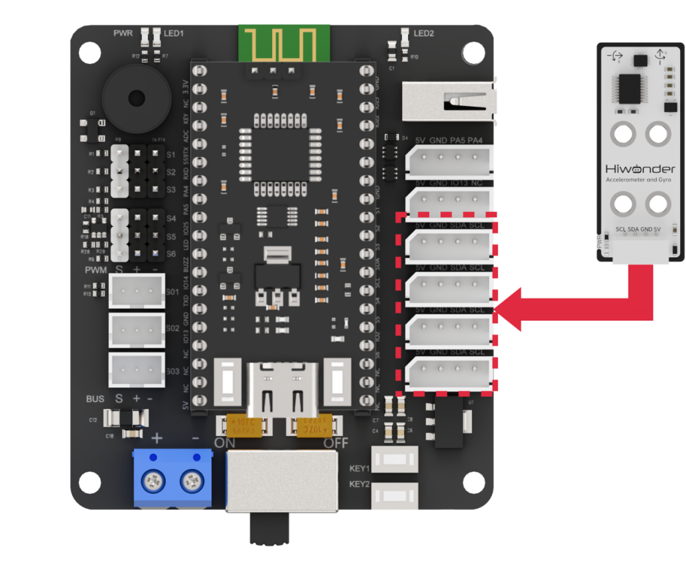

#### 6.3.7.4 Program Upload

> [!NOTE]
>
> **Before uploading the program, confirm that the serial port driver has been installed.**

1. Connect the core board to the computer using a USB cable.

   

2. Double-click to open the STM32 serial flashing software **FlyMcu**.

3. Click the browse icon. Then select the HEX file to be flashed under the directory path [**Tankbot\MDK-ARM\Tankbot**](https://drive.google.com/file/d/1E7xPCe5Up0fGYezVSNkHjjIc_dm8rtFq/view?usp=sharing) for the corresponding project.

   

4. At position ① in the figure below, select the serial port number corresponding to the core board. At position ②, select a baud rate of 115200. At positions ③ and ④, configure according to the options shown in the figure.

   

5. Click **Start ISP**, and press the RST button on the core board. The program begins flashing automatically. When the right log output window outputs the following content, the program upload is complete.

   

#### 6.3.7.5 Project Outcome

The system acquires the Pitch angle through the attitude sensor. When the Pitch angle is less than or equal to -60°, the system identifies a left rollover and drives the robotic arm to execute the left rollover recovery sequence. When the Pitch angle is greater than or equal to 60°, the system identifies a right rollover and drives the robotic arm to execute the right rollover recovery sequence. After the recovery motion finishes, the robot automatically returns to its normal posture.


#### 6.3.7.6 Program Analysis

- **main.c File, Business Layer**

1. Import the library files `robot_arm.h`, `adc_sample.h`, and `mpu6050_adapter.h`. The `robot_arm.h` file contains control functions for the robotic arm. The `qmi8658.h` file contains functions related to the attitude sensor.

```c
#include "main.h"
#include "adc.h"
#include "dma.h"
#include "i2c.h"
#include "spi.h"
#include "tim.h"
#include "usart.h"
#include "gpio.h"

/* Private includes ----------------------------------------------------------*/
/* USER CODE BEGIN Includes */

#include "global.h"
#include "stdio.h"
#include "stdlib.h"
#include "led.h"
#include "buzzer.h"
#include "robot_arm.h"
#include "adc_sample.h"
#include "differential_chassis.h"
#include "mpu6050_adapter.h"
#include "MadgwickAHRS.h"
```

2. Variables and a state machine enumeration related to rollover recovery are declared. The `acc_gyro` array stores the IMU data. The `RecoveryState` enumeration defines each stage of the recovery action, including the idle state, left rollover recovery steps 1 to 5, and right rollover recovery steps 1 to 5. The `recovery_state` variable tracks the active state. The `recovery_triggered` flag prevents duplicate action triggers.

```c
IMUHandleTypeDef imu;
float acc_gyro[6];

// Recovery action state machine
typedef enum {
  RECOVERY_IDLE,           // Idle state
  RECOVERY_LEFT_STEP1,     // Left rollover recovery step 1
  RECOVERY_LEFT_STEP2,     // Left rollover recovery step 2
  RECOVERY_LEFT_STEP3,     // Left rollover recovery step 3
  RECOVERY_LEFT_STEP4,     // Left rollover recovery step 4
  RECOVERY_LEFT_STEP5,     // Left rollover recovery step 5
  RECOVERY_RIGHT_STEP1,    // Right rollover recovery step 1
  RECOVERY_RIGHT_STEP2,    // Right rollover recovery step 2
  RECOVERY_RIGHT_STEP3,    // Right rollover recovery step 3
  RECOVERY_RIGHT_STEP4,    // Right rollover recovery step 4
  RECOVERY_RIGHT_STEP5     // Right rollover recovery step 5
} RecoveryState;

RecoveryState recovery_state = RECOVERY_IDLE;
uint32_t recovery_step_start_time = 0;  // Start time of the current step
uint8_t recovery_triggered = 0;  // Whether recovery action is triggered
uint32_t last_imu_check_time = 0;  // Last IMU check timestamp for debouncing
```

3. In the `main` function, call `led_init` and `buzzer_init` to initialize the LED and buzzer objects respectively. Call `imu_init` to initialize the attitude sensor, and initialize the robotic arm using `robot_arm_init`. Then stop the chassis movement via `differentials_chassis_run`, trigger the buzzer to beep once, and initialize the mechanical gripper to an open state.

```c
led_init();
buzzer_init();
adc_sample_init();
robot_arm_init(); 

HAL_Delay(1000);
MX_I2C1_Init();

imu_init(&imu);
madgwick_init();
differential_chassis_init();

differentials_chassis_run(0.0f, 0.0f);	
buzzer_toggle(50, 50, 1);
robot_arm_claw_set(65, 500);  // Initialize mechanical gripper to open state
```

4. Rollover detection and recovery are handled inside the loop using a `switch-case` state machine. In the `RECOVERY_IDLE` idle state, data is fetched via `getPitch()`. If `Pitch` is less than or equal to -60° for a left rollover and the recovery action has not been triggered, the program delays for 100 ms to re-verify for debouncing. Then the buzzer beeps, and the robotic arm moves to the left support position where X is 0.5, Y is 9.4, and Z is 9.8. The state then switches to `RECOVERY_LEFT_STEP1`. If `Pitch` is greater than or equal to 60° for a right rollover, the right recovery flow is executed. When the attitude returns to the normal range between -30° and 30°, the trigger flag is reset.

```c
uint32_t current_time = HAL_GetTick();

// Continuously detect IMU status
qmi8658_get_euler(euler);

// Recovery action state machine handling
switch(recovery_state) {
  case RECOVERY_IDLE: {
    // Detect left rollover (Pitch <= -60)
    if(getPitch() <= -60.0f && !recovery_triggered) {
      if(current_time - last_imu_check_time > 100) {  // Debounce: continuous detection within 100 ms
        last_imu_check_time = current_time;
        qmi8658_get_euler(euler);
        if(getPitch() <= -60.0f) {
          recovery_state = RECOVERY_LEFT_STEP1;
          recovery_step_start_time = current_time;
          recovery_triggered = 1;
          buzzer_toggle(100, 100, 1);
          robot_arm_coordinate_set(0.5, 9.4, 9.8, -40, -90, 10, 1500);
        }
      }
    }
    // Detect right rollover (Pitch >= 60)
    else if(getPitch() >= 60.0f && !recovery_triggered) {
      if(current_time - last_imu_check_time > 100) {  // Debounce: continuous detection within 100 ms
        last_imu_check_time = current_time;
        qmi8658_get_euler(euler);
        if(getPitch() >= 60.0f) {
          recovery_state = RECOVERY_RIGHT_STEP1;
          recovery_step_start_time = current_time;
          recovery_triggered = 1;
          buzzer_toggle(100, 100, 1);
          robot_arm_coordinate_set(0.5, -9.4, 9.8, -40, -90, 10, 1500);
        }
      }
    }
    // Reset trigger flag when attitude recovers to normal range
    if(getPitch() > -30.0f && getPitch() < 30.0f) {
      recovery_triggered = 0;
    }
    break;
  }
}
```

5. Left rollover recovery steps: In `RECOVERY_LEFT_STEP1`, wait for 2 s, drive the robotic arm to the left ground support position where X is 0.5, Y is 25, and Z is -9, and switch to `RECOVERY_LEFT_STEP2`. In `RECOVERY_LEFT_STEP2`, wait for 2 s and switch to `RECOVERY_LEFT_STEP3`. In `RECOVERY_LEFT_STEP3`, wait for 1 s, drive the robotic arm to the middle position where X is 0.5, Y is 15, and Z is 2, and switch to `RECOVERY_LEFT_STEP4`. In `RECOVERY_LEFT_STEP4`, wait for 2 s, drive the robotic arm to the right support position where X is 9.4, Y is 0, and Z is 9.8, and switch to `RECOVERY_LEFT_STEP5`. In `RECOVERY_LEFT_STEP5`, wait for 2 s and return to the `RECOVERY_IDLE` idle state.

```c
// Left rollover recovery steps
case RECOVERY_LEFT_STEP1:
  if(current_time - recovery_step_start_time >= 2000) {
    recovery_state = RECOVERY_LEFT_STEP2;
    recovery_step_start_time = current_time;
    robot_arm_coordinate_set(0.5, 25, -9, -60, 0, 90, 1500);
  }
  break;
  
case RECOVERY_LEFT_STEP2:
  if(current_time - recovery_step_start_time >= 2000) {
    recovery_state = RECOVERY_LEFT_STEP3;
    recovery_step_start_time = current_time;
  }
  break;
  
case RECOVERY_LEFT_STEP3:
  if(current_time - recovery_step_start_time >= 1000) {
    recovery_state = RECOVERY_LEFT_STEP4;
    recovery_step_start_time = current_time;
    robot_arm_coordinate_set(0.5, 15, 2, -40, -90, 10, 1500);
  }
  break;
  
case RECOVERY_LEFT_STEP4:
  if(current_time - recovery_step_start_time >= 2000) {
    recovery_state = RECOVERY_LEFT_STEP5;
    recovery_step_start_time = current_time;
    robot_arm_coordinate_set(9.4, 0, 9.8, -40, -90, 10, 1500);
  }
  break;
  
case RECOVERY_LEFT_STEP5:
  if(current_time - recovery_step_start_time >= 2000) {
    recovery_state = RECOVERY_IDLE;
  }
  break;
```

6. Right rollover recovery steps: In `RECOVERY_RIGHT_STEP1`, wait for 2 seconds, drive the robotic arm to the right ground support position where X is 0.5, Y is -25, and Z is -9, and switch to `RECOVERY_RIGHT_STEP2`. In `RECOVERY_RIGHT_STEP2`, wait for 2 seconds and switch to `RECOVERY_RIGHT_STEP3`. In `RECOVERY_RIGHT_STEP3`, wait for 1 second, drive the robotic arm to the middle position where X is 0.5, Y is -9.4, and Z is 9.8, and switch to `RECOVERY_RIGHT_STEP4`. In `RECOVERY_RIGHT_STEP4`, wait for 2 seconds, drive the robotic arm to the left support position where X is 9.4, Y is 0, and Z is 9.8, and switch to `RECOVERY_RIGHT_STEP5`. In `RECOVERY_RIGHT_STEP5`, wait for 2 seconds and return to the `RECOVERY_IDLE` idle state. If the attitude normalizes within the -30° to 30° range during recovery, reset the trigger flag.

```c
// Right rollover recovery steps
case RECOVERY_RIGHT_STEP1:
  if(current_time - recovery_step_start_time >= 2000) {
    recovery_state = RECOVERY_RIGHT_STEP2;
    recovery_step_start_time = current_time;
    robot_arm_coordinate_set(0.5, -25, -9, -60, 0, 90, 1500);
  }
  break;
  
case RECOVERY_RIGHT_STEP2:
  if(current_time - recovery_step_start_time >= 2000) {
    recovery_state = RECOVERY_RIGHT_STEP3;
    recovery_step_start_time = current_time;
  }
  break;
  
case RECOVERY_RIGHT_STEP3:
  if(current_time - recovery_step_start_time >= 1000) {
    recovery_state = RECOVERY_RIGHT_STEP4;
    recovery_step_start_time = current_time;
    robot_arm_coordinate_set(0.5, -9.4, 9.8, -40, -90, 10, 1500);
  }
  break;
  
case RECOVERY_RIGHT_STEP4:
  if(current_time - recovery_step_start_time >= 2000) {
    recovery_state = RECOVERY_RIGHT_STEP5;
    recovery_step_start_time = current_time;
    robot_arm_coordinate_set(9.4, 0, 9.8, -40, -90, 10, 1500);
  }
  break;
  
case RECOVERY_RIGHT_STEP5:
  if(current_time - recovery_step_start_time >= 2000) {
    recovery_state = RECOVERY_IDLE;
  }
  break;
```

- **mpu6050_adapter.c File, Driver Layer**

This section analyzes the `imu_get_motion6` function. This function reads data from the QMI8658 6-axis sensor, which integrates a gyroscope, an accelerometer, and attitude fusion:

1. Read 14 bytes of raw data from the IMU at once via I2C. Multiply the raw accelerometer and gyroscope values by the resolution factor to convert them into physical quantities.

```c
bool imu_get_motion6(IMUHandleTypeDef* self, float* ax, float* ay, float* az, float* gx, float* gy, float* gz)
{
	if(receive_from_device(self, ACCEL_XOUT_H, self->rec_data, 14)) {
		while(HAL_I2C_STATE_READY != HAL_I2C_GetState(&hi2c1));
		self->acc.x = ((float)(int16_t)BYTE_TO_HW(self->rec_data[0], self->rec_data[1])) * self->accel_resolution;
		self->acc.y = ((float)(int16_t)BYTE_TO_HW(self->rec_data[2], self->rec_data[3])) * self->accel_resolution;
		self->acc.z = ((float)(int16_t)BYTE_TO_HW(self->rec_data[4], self->rec_data[5])) * self->accel_resolution;
		
		self->gyro.x = ((float)(int16_t)BYTE_TO_HW(self->rec_data[8], self->rec_data[9])) * self->gyro_resolution;
		self->gyro.y = ((float)(int16_t)BYTE_TO_HW(self->rec_data[10], self->rec_data[11])) * self->gyro_resolution;
		self->gyro.z = ((float)(int16_t)BYTE_TO_HW(self->rec_data[12], self->rec_data[13])) * self->gyro_resolution;
```

2. Return the 3-axis acceleration and 3-axis angular velocity via pointers. Return `true` upon a successful read, or `false` on failure.

```c
		*ax = self->acc.x;
		*ay = self->acc.y;
		*az = self->acc.z;
		
		*gx = self->gyro.x;
		*gy = self->gyro.y;
		*gz = self->gyro.z;
		
		return true;
	}
```

### 6.3.8 8-Channel Line Follower Sensor User Guide

#### 6.3.8.1 Overview

This section focuses on the application and quick setup of the 8-channel line follower sensor. The sensor consists of 8 industrial-grade infrared probes and incorporates an onboard learn button to support line-following tasks across different grayscale values.

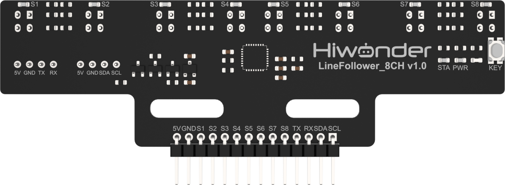

#### 6.3.8.2 Sensor Module Operation Steps

1. Move the sensor onto the **background color** to be learned. Long-press the **white learn key**, and the sensor automatically learns the grayscale value of the background color. During background color learning, the outermost four LEDs flash. When all LEDs begin blinking, the learning is successful. Release the **white learn key** at this point.

   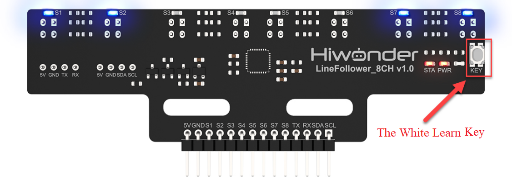

2. Move the sensor onto the **target tracking color** to be learned. Short-press the **white learn key**, and the sensor automatically learns the grayscale value of the target tracking color. During target tracking color learning, the innermost four LEDs flash. When all LEDs start flashing at a normal speed, the learning is successful. If the learning fails, all LEDs enter a rapid blinking mode.

   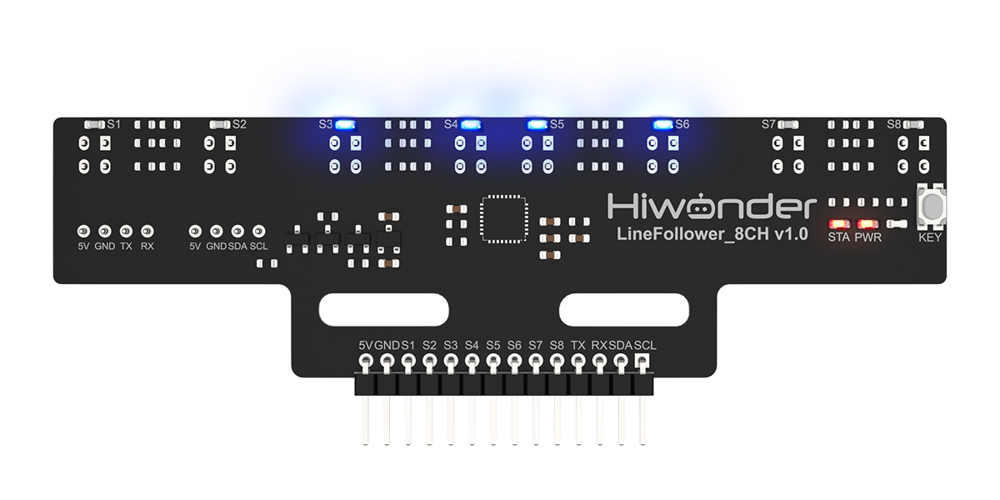

#### 6.3.8.3 Test Outcome

White serves as the background color, and black serves as the target tracking color. Place the sensor on the black surface. Once the target color is detected, the LED of the corresponding channel turns on.

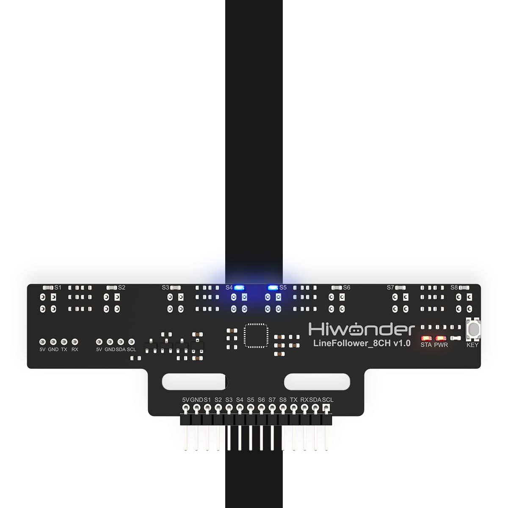

### 6.3.9 8-Channel Line Follower Sensor Communication Protocol Introduction

#### 6.3.9.1 Overview

This section focuses on the core communication protocols of the 8-channel line follower sensor, explaining its architectural logic and secondary development workflows. Standardized protocols facilitate multi-sensor collaborative control. This establishes a solid foundation for robot navigation and industrial automation projects.

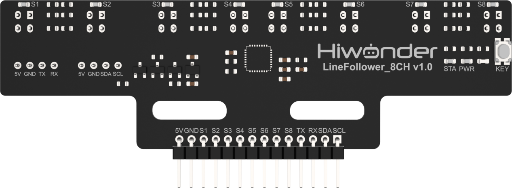

#### 6.3.9.2 Communication Protocol Overview

The 8-channel line follower sensor provides three flexible communication interface options to meet diverse application requirements:

1. I2C Communication Mode: This mode employs standard I2C bus protocols and supports multi-device parallel bus connections. It is suitable for scenarios that require conserving IO resources.
2. UART Communication Mode: This mode provides an asynchronous serial communication interface with configurable baud rates. It facilitates direct connection with various main controllers.
3. GPIO Communication Mode: This mode provides rapid response times via parallel digital signal outputs. It is ideal for real-time applications.

- **I2C Communication Protocol**

The 8-channel line follower sensor uses a fixed I2C address of 0x5D. The system acquires relevant sensor data by reading the register addresses of the 8-channel line follower sensor.

The following table lists the analog data register mapping for the 8-channel sensor:

| **Register Address** | **Function Description**               | **Data Type** | **Data Length** | **Data Format**                  |
| -------------------- | -------------------------------------- | ------------- | --------------- | -------------------------------- |
| 5                    | Read digital results for all sensors   | uint8_t       | 1 byte          | /                                |
| 6                    | Read analog value for sensor channel 1 | uint16_t      | 2 bytes         | Low byte first, high byte second |
| 8                    | Read analog value for sensor channel 2 | uint16_t      | 2 bytes         | Low byte first, high byte second |
| 10                   | Read analog value for sensor channel 3 | uint16_t      | 2 bytes         | Low byte first, high byte second |
| 12                   | Read analog value for sensor channel 4 | uint16_t      | 2 bytes         | Low byte first, high byte second |
| 14                   | Read analog value for sensor channel 5 | uint16_t      | 2 bytes         | Low byte first, high byte second |
| 16                   | Read analog value for sensor channel 6 | uint16_t      | 2 bytes         | Low byte first, high byte second |
| 18                   | Read analog value for sensor channel 7 | uint16_t      | 2 bytes         | Low byte first, high byte second |
| 20                   | Read analog value for sensor channel 8 | uint16_t      | 2 bytes         | Low byte first, high byte second |

The following table lists the threshold register mapping for the 8-channel sensor:

| **Register Address** | **Function Description**                  | **Data Type** | **Data Length** | **Data Format**                  |
| -------------------- | ----------------------------------------- | ------------- | --------------- | -------------------------------- |
| 22                   | Read threshold value for sensor channel 1 | uint16_t      | 2 bytes         | Low byte first, high byte second |
| 24                   | Read threshold value for sensor channel 2 | uint16_t      | 2 bytes         | Low byte first, high byte second |
| 26                   | Read threshold value for sensor channel 3 | uint16_t      | 2 bytes         | Low byte first, high byte second |
| 28                   | Read threshold value for sensor channel 4 | uint16_t      | 2 bytes         | Low byte first, high byte second |
| 30                   | Read threshold value for sensor channel 5 | uint16_t      | 2 bytes         | Low byte first, high byte second |
| 32                   | Read threshold value for sensor channel 6 | uint16_t      | 2 bytes         | Low byte first, high byte second |
| 34                   | Read threshold value for sensor channel 7 | uint16_t      | 2 bytes         | Low byte first, high byte second |
| 36                   | Read threshold value for sensor channel 8 | uint16_t      | 2 bytes         | Low byte first, high byte second |

- **UART Communication Protocol**

The UART communication protocol of the 8-channel line follower sensor supports four initialization modes:

| **Initialization Mode**                 | **Configuration Command** |
| --------------------------------------- | ------------------------- |
| Manual configuration                    | 0                         |
| Automatically send digital level values | 1                         |
| Automatically send analog values        | 2                         |
| Automatically send threshold values     | 3                         |

This section details the manual mode. In this mode, the sensor returns the corresponding data after the main controller transmits a read command.

Relevant read commands:

1: Return digital level values, returning 1 byte of data.

2: Read analog values, returned according to the serial protocol below.

3: Read threshold values, returned according to the serial protocol below.

> [!NOTE]
>
> **Once configured, the operating mode cannot be reconfigured dynamically. To change the mode, reset the hardware and initialize again.**

The following diagram illustrates the serial protocol of the 8-channel sensor:


#### 6.3.9.3 GPIO Communication Protocol

GPIO stands for General-Purpose Input/Output. It is a flexible hardware interface that allows microcontrollers, such as MCUs and SoCs, to communicate with external peripherals through digital pins. It does not rely on specific complex protocols. Instead, it implements basic control and data transmission via high and low logic level signals. This interface is widely used in embedded systems, sensors, and LED control.

The 8-channel line follower sensor allows direct digital logic reads from the IO pins of the corresponding sensor channels. It outputs a low level when a target is detected.

> [!NOTE]
>
> **The returned GPIO logic level is opposite to the digital level signals read via I2C and UART.**

### 6.3.10 T-Junction Detection

#### 6.3.10.1 Project Introduction

This section focuses on identifying lines and T-junctions using the 8-channel line follower sensor, controlling the vehicle to perform line following.

#### 6.3.10.2 Implementation Flow


#### 6.3.10.3 Module Description


The sensor emits and receives infrared light through infrared probes. A stronger infrared reflection produces a higher output value, whereas a weaker reflection produces a lower output value. A 32-bit ARM high-performance processor handles the incoming signal data. It controls the corresponding indicator LEDs according to the signal intensity and transmits the processed data to the host controllers via output interfaces.

The sensor utilizes an innovative one-key automatic calibration system. Calibration can be completed within 1 minute via button operation without manual parameter adjustment.

Module Wiring: As shown in the figure below, before running the program in this section, connect the module to any I2C port in the red box on the servo controller board.

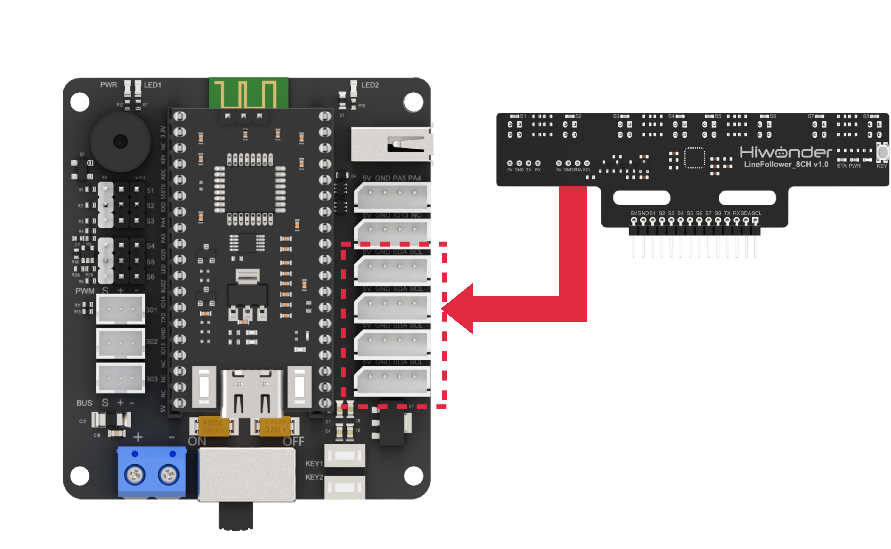

#### 6.3.10.4 Program Upload

> [!NOTE]
>
> **Before uploading the program, confirm that the serial port driver has been installed.**

1. Connect the core board to the computer using a USB cable.

   

2. Double-click to open the STM32 serial flashing software **FlyMcu**.

3. Click the browse icon. Then select the HEX file to be flashed under the directory path [**Tankbot\MDK-ARM\Tankbot**](https://drive.google.com/file/d/1E7xPCe5Up0fGYezVSNkHjjIc_dm8rtFq/view?usp=sharing) for the corresponding project.

   

4. At position ① in the figure below, select the serial port number corresponding to the core board. At position ②, select a baud rate of 115200. At positions ③ and ④, configure according to the options shown in the figure.

   

5. Click **Start ISP**, and press the RST button on the core board. The program begins flashing automatically. When the right log output window outputs the following content, the program upload is complete.

   

#### 6.3.10.5 Project Outcome

The Tankbot follows lines along the route. Upon encountering an intersection, such as a T-junction, the vehicle steers according to the branch direction.


#### 6.3.10.6 Program Analysis

- **main.c File, Business Layer**

1. Import the library files `LineFollow.h`, `adc_sample.h`, and `differential_chassis.h`. The `LineFollow.h` contains control functions for the 8-channel line follower sensor. The `differential_chassis.h` contains chassis control functions.

```c
/* USER CODE END Header */
/* Includes ------------------------------------------------------------------*/
#include "main.h"
#include "adc.h"
#include "dma.h"
#include "i2c.h"
#include "spi.h"
#include "tim.h"
#include "usart.h"
#include "gpio.h"

/* Private includes ----------------------------------------------------------*/
/* USER CODE BEGIN Includes */

#include "global.h"
#include "stdio.h"
#include "stdlib.h"
#include "led.h"
#include "buzzer.h"
#include "robot_arm.h"
#include "adc_sample.h"
#include "LineFollow.h"
#include "differential_chassis.h"
```

2. In the `main` function, call `led_init` and `buzzer_init` to initialize the LED and buzzer objects respectively, call `LineFollowIIC_init` to initialize the 8-channel line follower sensor, and use `differential_chassis_init` to initialize the chassis.

```c
	led_init();
	buzzer_init();
	adc_sample_init();
  robot_arm_init(); 
	
	HAL_Delay(1000);
	MX_I2C1_Init();
	
	LineFollowIIC_init();
	differential_chassis_init();
```

3. Stop chassis movement using the `differentials_chassis_run` function, and trigger the buzzer to beep once.

```c
	differentials_chassis_run(0.0f, 0.0f);	
	buzzer_toggle(50, 50, 1);
```

4. Inside the loop, acquire the probe data of the line follower sensor using `LineFollowIIC_State` and store the data into `LineFollowLearn`. Then detect the total number of probes identifying the line using a for loop.

```c
  while (1)
  {	
		int cnt = 0;
		
		LineFollowIIC_State(&LineFollowLearn);
		
		for(int i = 0; i < 8; i++){
				if(LineFollowLearn.data[i] > 0) cnt++;
		}
```

5. When the total count of probes identifying the line is 5 or 6, and the center probes identify the line, a T-junction is detected. Control the vehicle to turn left or turn right depending on whether a left or right branch is recognized.

```c
		if(cnt >= 5 && cnt <= 6 && (LineFollowLearn.data[3] > 0 || LineFollowLearn.data[4] > 0)){
				// turn left 
				if(LineFollowLearn.data[0] > 0 && LineFollowLearn.data[1] > 0 && LineFollowLearn.data[2] > 0){
						differentials_chassis_run(40.0f, 0.0f);
						HAL_Delay(1000);
						differentials_chassis_run(40.0f, 1.0f);
						HAL_Delay(1400);
						differentials_chassis_run(0.0f, 0.0f);
				}
				// turn right
				else if(LineFollowLearn.data[5] > 0 && LineFollowLearn.data[6] > 0 && LineFollowLearn.data[7] > 0){
						differentials_chassis_run(40.0f, 0.0f);
						HAL_Delay(1000);
						differentials_chassis_run(40.0f, -1.0f);
						HAL_Delay(1400);
						differentials_chassis_run(0.0f, 0.0f);
				}
			}
```

6. If the line is detected directly in the center, control the vehicle to move straight forward. If a left or right deviation is detected, control the vehicle to steer accordingly. If no line is detected, enter the line-lost routine to keep the vehicle driving straight ahead.

```c
			// center
			else if(LineFollowLearn.data[3] > 0 || LineFollowLearn.data[4] > 0){
					differentials_chassis_run(40.0f, 0.0f);
			}
			// left
			else if(LineFollowLearn.data[2] > 0){
					differentials_chassis_run(20.0f, 0.3f);
			}
			// right
			else if(LineFollowLearn.data[5] > 0){
					differentials_chassis_run(20.0f, -0.3f);
			}
			// line Lost
			else if(cnt == 0){
					differentials_chassis_run(40.0f, 0.0f);
			}
		HAL_Delay(50);                
	}
    
```

- **LineFollow.c File, Driver Layer**

The section analyzes the `LineFollowIIC_State` function:

1. Read 1 byte of data from the register address of the 8-channel line follower sensor via the `receive_from_device` function. Store the result into `LineFollow.results`. If I2C communication fails, `false` is returned.

```c
bool LineFollowIIC_State(LineFollowHandleTypeDef* State)
{
	if(receive_from_device(&LineFollow, LineFollow_STATE_REG, LineFollow.results, 1))
	{
		while(HAL_I2C_STATE_READY != HAL_I2C_GetState(&hi2c1));
		for(int i=0; i<sizeof(LineFollow.data);i++){
			State->data[i] = (LineFollow.results[0] >> i) & 0x01;
		}
		return true;
	}
	return false;
}
```

2. A `while` loop waits until the I2C bus becomes idle, which indicates the completion of a transmission. Once the transmission finishes, store the 8 sensor data points into `State` sequentially, and return `true`.

```c
		while(HAL_I2C_STATE_READY != HAL_I2C_GetState(&hi2c1));
		for(int i=0; i<sizeof(LineFollow.data);i++){
			State->data[i] = (LineFollow.results[0] >> i) & 0x01;
		}
		return true;
```

- **differential_chassis.c File, Driver Layer**

This section analyzes the `differentials_chassis_run` function:

1. First, define an array to store the motor speeds along with the variables for the left and right wheel speeds. According to the differential chassis kinematics, calculate the speeds of the left and right wheels based on the incoming linear velocity and angular velocity.

```c
void differentials_chassis_run(float speed, float rot)
{
	int8_t motor_speed[4];
	float vr, vl;
	
	speed = speed > MAX_SPEED ? MAX_SPEED : speed < MIN_SPEED ? MIN_SPEED : speed;
	rot = rot > MAX_ROT ? MAX_ROT : rot < MIN_ROT ? MIN_ROT : rot;
	
	vr = speed + rot * HALF_FR_WHEELBASE;
	vl = speed - rot * HALF_FR_WHEELBASE;
```

2. Finally, pass the speeds into the `motor_speed` array. Because the installation directions of the left and right wheel motors differ, set the left wheel motor speed to the opposite direction. Then call `set_motor_speed` to set the motor speeds and control the chassis movement.

```c
	motor_speed[0] = -(int8_t)vl;
	motor_speed[1] = 0;
	motor_speed[2] = (int8_t)vr; 
	motor_speed[3] = 0;
	
	set_motor_speed(motor_speed);
}
```

### 6.3.11 Crossroad Detection

#### 6.3.11.1 Project Introduction

This section focuses on identifying lines and crossroads using the 8-channel line follower sensor and controlling the vehicle to perform line following.

#### 6.3.11.2 Implementation Flow


#### 6.3.11.3 Module Description


The sensor emits and receives infrared light through infrared probes. A stronger infrared reflection produces a higher output value, whereas a weaker reflection produces a lower output value. A 32-bit ARM high-performance processor handles the incoming signal data. It controls the corresponding indicator LEDs according to the signal intensity and transmits the processed data to the host controllers via output interfaces.

The sensor utilizes an innovative one-key automatic calibration system. Calibration can be completed within 1 minute via button operation without manual parameter adjustment.

Module Wiring: As shown in the figure below, before running the program in this section, connect the module to any I2C port in the red box on the servo controller board.


#### 6.3.11.4 Program Upload

> [!NOTE]
>
> **Before uploading the program, confirm that the serial port driver has been installed.**

1. Connect the core board to the computer using a USB cable.

   

2. Double-click to open the STM32 serial flashing software **FlyMcu** .

3. Click the browse icon, and select the HEX file to be flashed under the directory path [**Tankbot\MDK-ARM\Tankbot**](https://drive.google.com/file/d/1E7xPCe5Up0fGYezVSNkHjjIc_dm8rtFq/view?usp=sharing) for the corresponding project.

   ****

4. At position ① in the figure below, select the serial port number corresponding to the core board. At position ②, select a baud rate of 115200. At positions ③ and ④, configure according to the options shown in the figure.

   

5. Click **Start ISP**, and press the RST button on the core board. The program begins flashing automatically. When the right log output window outputs the following content, the program upload is complete.

   

#### 6.3.11.5 Project Outcome

The Tankbot follows lines along the route. Upon encountering a crossroad, the vehicle stops for 2 seconds and then continues moving forward.


#### 6.3.11.6 Program Analysis

- **main.c File, Business Layer**

1. Import the library files `LineFollow.h`, `adc_sample.h`, and `differential_chassis.h`. The `LineFollow.h` file contains control functions for the 8-channel line follower sensor. The `differential_chassis.h` file contains chassis control functions.

```c
/* USER CODE END Header */
/* Includes ------------------------------------------------------------------*/
#include "main.h"
#include "adc.h"
#include "dma.h"
#include "i2c.h"
#include "spi.h"
#include "tim.h"
#include "usart.h"
#include "gpio.h"

/* Private includes ----------------------------------------------------------*/
/* USER CODE BEGIN Includes */

#include "global.h"
#include "stdio.h"
#include "stdlib.h"
#include "led.h"
#include "buzzer.h"
#include "robot_arm.h"
#include "adc_sample.h"
#include "LineFollow.h"
#include "differential_chassis.h"
```

2. In the `main` function, call `led_init` and `buzzer_init` to initialize the LED and buzzer objects respectively. Call `LineFollowIIC_init` to initialize the 8-channel line follower sensor, and call `differential_chassis_init` to initialize the chassis.

```c
	led_init();
	buzzer_init();
	adc_sample_init();
  robot_arm_init(); 
	
	HAL_Delay(1000);
	MX_I2C1_Init();
	
	LineFollowIIC_init();
	differential_chassis_init();
```

3. Stop the chassis movement using the `differentials_chassis_run` function, and trigger the buzzer to beep once.

```
	differentials_chassis_run(0.0f, 0.0f);	
	buzzer_toggle(50, 50, 1);
```

4. Inside the loop, acquire the probe data of the line follower sensor using `LineFollowIIC_State` and store the data into `LineFollowLearn`. Then detect the total number of probes identifying the line using a for loop.

```c
  while (1)
  {	
		int cnt = 0;
		
		LineFollowIIC_State(&LineFollowLearn);
		
		for(int i = 0; i < 8; i++){
				if(LineFollowLearn.data[i] > 0) cnt++;
		}
```

5. When the total count of probes identifying the line is greater than or equal to 7 and the center probes identify the line, a crossroad is recognized. Control the vehicle to stop for 2 s before continuing forward.

```c
		//crossroad
		if(cnt >= 7 && (LineFollowLearn.data[3] > 0 || LineFollowLearn.data[4] > 0)){
				differentials_chassis_run(0.0f, 0.0f);
				HAL_Delay(2000);   // stop
				differentials_chassis_run(40.0f, 0.0f);
		}
```

6. If the line is detected directly in the center, control the vehicle to move straight forward. If a left or right deviation is detected, control the vehicle to steer accordingly. If no line is detected, enter the line-lost routine to keep the vehicle driving straight ahead.

```c
		// center
		else if(LineFollowLearn.data[3] > 0 || LineFollowLearn.data[4] > 0){
				differentials_chassis_run(40.0f, 0.0f);
		}
		// left
		else if(LineFollowLearn.data[2] > 0){
				differentials_chassis_run(20.0f, 0.3f);
			}
		// right
		else if(LineFollowLearn.data[5] > 0){
				differentials_chassis_run(20.0f, -0.3f);
		}
		// Line loss
		else if(cnt == 0){
				differentials_chassis_run(40.0f, 0.0f);
		}
		HAL_Delay(50);                
	}
```

- **LineFollow.c File, Driver Layer**

This section analyzes the `LineFollowIIC_State` function:

1. Read 1 byte of data from the register address of the 8-channel line follower sensor via the `receive_from_device` function. Store the result into `LineFollow.results`. If I2C communication fails, `false` is returned.

```c
bool LineFollowIIC_State(LineFollowHandleTypeDef* State)
{
	if(receive_from_device(&LineFollow, LineFollow_STATE_REG, LineFollow.results, 1))
	{
		while(HAL_I2C_STATE_READY != HAL_I2C_GetState(&hi2c1));
		for(int i=0; i<sizeof(LineFollow.data);i++){
			State->data[i] = (LineFollow.results[0] >> i) & 0x01;
		}
		return true;
	}
	return false;
}
```

2. A `while` loop waits until the I2C bus becomes idle, which indicates the completion of a transmission. Once the transmission finishes, store the 8 sensor data points into `State` sequentially, and return `true`.

```c
		while(HAL_I2C_STATE_READY != HAL_I2C_GetState(&hi2c1));
		for(int i=0; i<sizeof(LineFollow.data);i++){
			State->data[i] = (LineFollow.results[0] >> i) & 0x01;
		}
		return true;
```

- **differential_chassis.c File, Driver Layer**

This section analyzes the `differentials_chassis_run` function:

1. First, define an array to store the motor speeds along with the variables for the left and right wheel speeds. According to the differential chassis kinematics, calculate the speeds of the left and right wheels based on the incoming linear velocity and angular velocity.

```c
void differential_chassis_init()
{
	motor_init(MOTOR_TYPE_JGB37_520_12V_110RPM);
}

void differentials_chassis_run(float speed, float rot)
{
	int8_t motor_speed[4];
	float vr, vl;
	
	speed = speed > MAX_SPEED ? MAX_SPEED : speed < MIN_SPEED ? MIN_SPEED : speed;
	rot = rot > MAX_ROT ? MAX_ROT : rot < MIN_ROT ? MIN_ROT : rot;
	
	vr = speed + rot * HALF_FR_WHEELBASE;
	vl = speed - rot * HALF_FR_WHEELBASE;
```

2. Finally, pass the speeds into the `motor_speed` array. Because the installation directions of the left and right wheel motors differ, set the left wheel motor speed to the opposite direction. Then call `set_motor_speed` to set the motor speeds and control the chassis movement.

```c
	motor_speed[0] = -(int8_t)vl;
	motor_speed[1] = 0;
	motor_speed[2] = (int8_t)vr; 
	motor_speed[3] = 0;
	
	set_motor_speed(motor_speed);
}
```

### 6.3.12 Intelligent Line Following

#### 6.3.12.1 Project Introduction

This section focuses on identifying lines using the 8-channel line follower sensor, controlling the vehicle to execute intelligent line following.

#### 6.3.12.2 Implementation Flow


#### 6.3.12.3 Module Description


The sensor emits and receives infrared light through infrared probes. A stronger infrared reflection produces a higher output value, whereas a weaker reflection produces a lower output value. A 32-bit ARM high-performance processor handles the incoming signal data. It controls the corresponding indicator LEDs according to the signal intensity and transmits the processed data to the host controllers via output interfaces.

The sensor utilizes an innovative one-key automatic calibration system. Calibration can be completed within 1 minute via button operation without manual parameter adjustment.

Module Wiring: As shown in the figure below, before running the program in this section, connect the module to any I2C port in the red box on the servo controller board.


#### 6.3.12.4 Program Upload

> [!NOTE]
>
> **Before uploading the program, confirm that the serial port driver has been installed.**

1. Connect the core board to the computer using a USB cable.

   

2. Double-click to open the STM32 serial flashing software **FlyMcu** .

3. Click the browse icon. Then select the HEX file to be flashed under the directory path [**Tankbot\MDK-ARM\Tankbot**](https://drive.google.com/file/d/1E7xPCe5Up0fGYezVSNkHjjIc_dm8rtFq/view?usp=sharing)  for the corresponding project.

   

4. At position ① in the figure below, select the serial port number corresponding to the core board. At position ②, select a baud rate of 115200. At positions ③ and ④, configure according to the options shown in the figure.

   

5. Click **Start ISP**, and press the RST button on the core board. The program begins flashing automatically. When the right log output window outputs the following content, the program upload is complete.

   

#### 6.3.12.5 Project Outcome

The Tankbot follows lines along the route and executes corresponding control actions when encountering diverse intersections. It also runs the line-lost routine when no line is detected.

#### 6.3.12.6 Program Analysis

- **main.c File, Business Layer**

1. Import the library files `LineFollow.h`, `adc_sample.h`, and `differential_chassis.h`. The `LineFollow.h` contains control functions for the 8-channel line follower sensor. The `differential_chassis.h` contains chassis control functions.

```c
/* USER CODE END Header */
/* Includes ------------------------------------------------------------------*/
#include "main.h"
#include "adc.h"
#include "dma.h"
#include "i2c.h"
#include "spi.h"
#include "tim.h"
#include "usart.h"
#include "gpio.h"

/* Private includes ----------------------------------------------------------*/
/* USER CODE BEGIN Includes */

#include "global.h"
#include "stdio.h"
#include "stdlib.h"
#include "led.h"
#include "buzzer.h"
#include "robot_arm.h"
#include "adc_sample.h"
#include "LineFollow.h"
#include "differential_chassis.h"
```

2. In the `main` function, call `led_init` and `buzzer_init` to initialize the LED and buzzer objects, respectively. Call `LineFollowIIC_init` to initialize the 8-channel line follower sensor, and use `differential_chassis_init` to initialize the chassis.

```c
	led_init();
	buzzer_init();
	adc_sample_init();
  robot_arm_init(); 
	
	HAL_Delay(1000);
	MX_I2C1_Init();
	
	LineFollowIIC_init();
	differential_chassis_init();
```

3. Stop the chassis movement using the `differentials_chassis_run` function, and trigger the buzzer to beep once.

```c
	differentials_chassis_run(0.0f, 0.0f);	
	buzzer_toggle(50, 50, 1);
```

4. Inside the loop, declare local variables to store the weighted sum, the number of triggered sensors, and the weight array. Acquire probe data via `LineFollowIIC_State` and store it in `LineFollowLearn`. Use a `for` loop to detect the total number of probes identifying the line and compute the weighted sum.

```c
  while (1)
  {	
		int weighted_sum = 0;
		int active_sensors = 0;   // The number of triggered sensors
		static float last_error = 0;  
		float error = 0;
		int sensor_weights[8] = {5, 3, 2, 1, -1, -2, -3, -5};

		
		if(LineFollowIIC_State(&LineFollow)) {
				// Calculate the weighted sum and the number of triggered sensors.
			for (int i = 0; i < 8; i++) {
					if (LineFollow.data[i] == 1) {
							weighted_sum += sensor_weights[i];
							active_sensors++;
					}
			}
```

5. When the active sensor count is greater than 0, a line is recognized. If the active sensor count exceeds 6, a crossroad is detected. Control the vehicle to pause for 2 s before continuing forward. If a left or right T-junction is detected, control the vehicle to steer accordingly. If these conditions are not met, calculate the error value.

```c
			if (active_sensors > 0) {
				if(active_sensors > 6){
					differentials_chassis_run(0,0);
					HAL_Delay(2000);
					error = 0;
				}else if(active_sensors >= 4 && active_sensors <= 5 && weighted_sum > 0){  
					//left
					differentials_chassis_run(0,1);
					HAL_Delay(800);
					error = 0;
				}else if(active_sensors >= 4 && active_sensors <= 5 && weighted_sum < 0){  
					//right
					differentials_chassis_run(0,-1); 
					HAL_Delay(800);
					error = 0;
				}else{
					// If a sensor is triggered, the error = weighted sum / number of triggers
					error = (float)weighted_sum / active_sensors;
				}
```

6. When no sensors detect the line, enter the line-lost handling routine. Control the vehicle movement based on the previous error value. If `last_error` is greater than 0.5, the line was last detected on the left. Set `error` to 5 to control the vehicle to turn left. If the error value is less than -0.5, control the vehicle to turn right. If `last_error` is greater than -0.5 and less than 0.5, control the vehicle to move straight forward.

```c
			} else {
				// If none of the sensors trigger (the wires are disconnected)
				// If you dropped the thread on the far left last time,then turn left. 
				// If it was on the right side, then turn right.
					if (last_error > 0.5) { 
							error = 5; 
					} else if (last_error < -0.5) {
							error = -5; 
					} else {
							error = 0;
					}
			}
			float scaled = error * 0.2f;
			if (scaled > 0.9f) scaled = 0.9f;
			if (scaled < -0.9f) scaled = -0.9f;
			last_error = scaled;               
		}
		differentials_chassis_run(50,last_error);
		HAL_Delay(20);
	}		
}
```

7. Finally, compute `last_error` proportionally and call `differentials_chassis_run` to control the vehicle movement.

```c
			} else {
				// If none of the sensors trigger (the wires are disconnected)
				// If you dropped the thread on the far left last time,then turn left. 
				// If it was on the right side, then turn right.
					if (last_error > 0.5) { 
							error = 5; 
					} else if (last_error < -0.5) {
							error = -5; 
					} else {
							error = 0;
					}
			}
			float scaled = error * 0.2f;
			if (scaled > 0.9f) scaled = 0.9f;
			if (scaled < -0.9f) scaled = -0.9f;
			last_error = scaled;               
		}
		differentials_chassis_run(50,last_error);
		HAL_Delay(20);
	}		
}
```

- **LineFollow.c File, Driver Layer**

This section analyzes the `LineFollowIIC_State` function:

1. Read 1 byte of data from the register address of the 8-channel line follower sensor via the `receive_from_device` function. Store the result into `LineFollow.results`.  If I2C communication fails, `false` is returned.

```c
bool LineFollowIIC_State(LineFollowHandleTypeDef* State)
{
	if(receive_from_device(&LineFollow, LineFollow_STATE_REG, LineFollow.results, 1))
	{
		while(HAL_I2C_STATE_READY != HAL_I2C_GetState(&hi2c1));
		for(int i=0; i<sizeof(LineFollow.data);i++){
			State->data[i] = (LineFollow.results[0] >> i) & 0x01;
		}
		return true;
	}
	return false;
}
```

2. A `while` loop waits until the I2C bus becomes idle, which indicates the completion of a transmission. Once the transmission finishes, store the 8 sensor data points into `State` sequentially, and return `true`.

```c
		while(HAL_I2C_STATE_READY != HAL_I2C_GetState(&hi2c1));
		for(int i=0; i<sizeof(LineFollow.data);i++){
			State->data[i] = (LineFollow.results[0] >> i) & 0x01;
		}
		return true;
```

- **differential_chassis.c File, Driver Layer**

This section analyzes the `differentials_chassis_run` function:

1. First, define an array to store the motor speeds along with the variables for the left and right wheel speeds. According to the differential chassis kinematics, calculate the speeds of the left and right wheels based on the incoming linear velocity and angular velocity.

```c
void differentials_chassis_run(float speed, float rot)
{
	int8_t motor_speed[4];
	float vr, vl;
	
	speed = speed > MAX_SPEED ? MAX_SPEED : speed < MIN_SPEED ? MIN_SPEED : speed;
	rot = rot > MAX_ROT ? MAX_ROT : rot < MIN_ROT ? MIN_ROT : rot;
	
	vr = speed + rot * HALF_FR_WHEELBASE;
	vl = speed - rot * HALF_FR_WHEELBASE;
```

2. Finally, pass the speeds into the `motor_speed` array. Because the installation directions of the left and right wheel motors differ, set the left wheel motor speed to the opposite direction. Then call `set_motor_speed` to set the motor speeds and control the chassis movement.

```c
	motor_speed[0] = -(int8_t)vl;
	motor_speed[1] = 0;
	motor_speed[2] = (int8_t)vr; 
	motor_speed[3] = 0;
	
	set_motor_speed(motor_speed);
}
```

### 6.3.13 Line Following and Clamping

#### 6.3.13.1 Project Introduction

This section focuses on identifying lines using the 8-channel line follower sensor and controlling the vehicle to execute intelligent line following.

#### 6.3.13.2 Implementation Flow

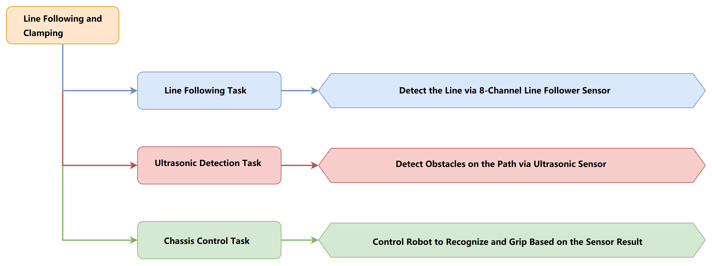

#### 6.3.13.3 Module Description


The sensor emits and receives infrared light through infrared probes. A stronger infrared reflection produces a higher output value, whereas a weaker reflection produces a lower output value. A 32-bit ARM high-performance processor handles the incoming signal data. It controls the corresponding indicator LEDs according to the signal intensity and transmits the processed data to the host controllers via output interfaces.

The sensor utilizes an innovative one-key automatic calibration system. Calibration can be completed within 1 minute via button operation without manual parameter adjustment.

Module Wiring: As shown in the figure below, before running the program in this section, connect the module to any I2C port in the red box on the servo controller board.


#### 6.3.13.4 Program Upload

> [!NOTE]
>
> **Before uploading the program, confirm that the serial port driver has been installed.**

1. Connect the core board to the computer using a USB cable.

   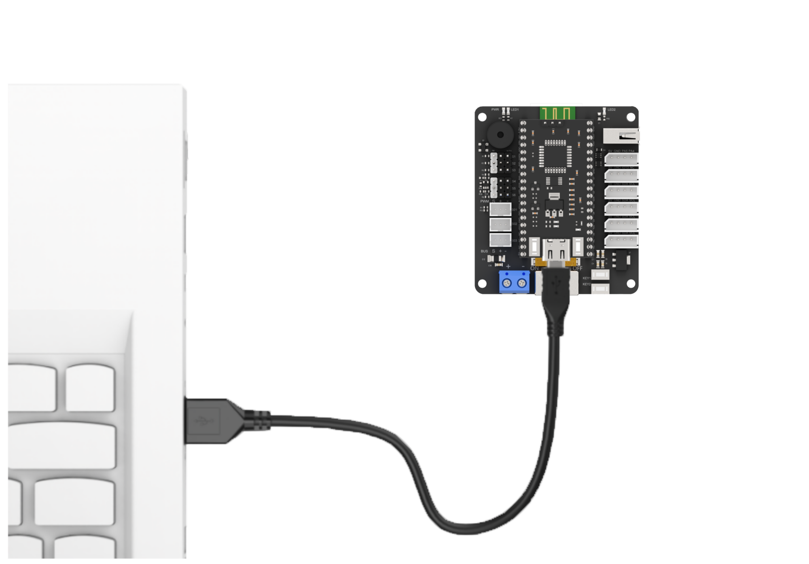

2. Double-click to open the STM32 serial flashing software **FlyMcu** .

3. Click the browse icon, and select the HEX file to be flashed under the directory path [**Tankbot\MDK-ARM\Tankbot**](https://drive.google.com/file/d/1E7xPCe5Up0fGYezVSNkHjjIc_dm8rtFq/view?usp=sharing) for the corresponding project.

   

4. At position ① in the figure below, select the serial port number corresponding to the core board. At position ②, select a baud rate of 115200. At positions ③ and ④, configure according to the options shown in the figure.

   

5. Click **Start ISP**, and press the RST button on the core board. The program begins flashing automatically. When the right log output window outputs the following content, the program upload is complete.

   

#### 6.3.13.5 Project Outcome

The Tankbot follows lines along the route and executes appropriate maneuvers at intersections. It runs the line-lost routine when no line is detected. Upon detecting an obstacle, it grips the obstacle and continues following the line.

#### 6.3.13.6 Program Analysis

- **main.c File, Business Layer**

1. Import the library files `LineFollow.h`, `adc_sample.h`, and `differential_chassis.h`. The `LineFollow.h` file contains control functions for the 8-channel line follower sensor. The `differential_chassis.h` file contains chassis control functions.

```c
/* USER CODE END Header */
/* Includes ------------------------------------------------------------------*/
#include "main.h"
#include "adc.h"
#include "dma.h"
#include "i2c.h"
#include "spi.h"
#include "tim.h"
#include "usart.h"
#include "gpio.h"

/* Private includes ----------------------------------------------------------*/
/* USER CODE BEGIN Includes */

#include "global.h"
#include "stdio.h"
#include "stdlib.h"
#include "led.h"
#include "buzzer.h"
#include "robot_arm.h"
#include "adc_sample.h"
#include "LineFollow.h"
#include "differential_chassis.h"
#include "ultrasound.h"
/* USER CODE END Includes */
```

2. In the `main` function, call `led_init` and `buzzer_init` to initialize the LED and buzzer objects respectively. Call `LineFollowIIC_init` to initialize the 8-channel line follower sensor, and call `differential_chassis_init` to initialize the chassis.

```c
	led_init();
	buzzer_init();
	adc_sample_init();
  robot_arm_init(); 
	
	HAL_Delay(1000);
	MX_I2C1_Init();
	
	ultrasound_init();
	LineFollowIIC_init();
	differential_chassis_init();
```

3. Stop the chassis movement using the `differentials_chassis_run` function, and trigger the buzzer to beep once.

```c
	differentials_chassis_run(0.0f, 0.0f);	
	buzzer_toggle(50, 50, 1);
```

4. Inside the loop, declare local variables to store the weighted sum, the number of triggered sensors, and the weight array. Acquire probe data via `LineFollowIIC_State` and store it in `LineFollowLearn`. Use a `for` loop to detect the total number of probes identifying the line and compute the weighted sum.

```c
  while (1)
  {	
		int weighted_sum = 0;
		int active_sensors = 0;   // The number of triggered sensors
		static float last_error = 0;  
		float error = 0;
		int sensor_weights[8] = {5, 3, 2, 1, -1, -2, -3, -5};

		
		if(LineFollowIIC_State(&LineFollow)) {
				// Calculate the weighted sum and the number of triggered sensors.
			for (int i = 0; i < 8; i++) {
					if (LineFollow.data[i] == 1) {
							weighted_sum += sensor_weights[i];
							active_sensors++;
					}
			}
```

5. When the active sensor count is greater than 0, a line is recognized. The first time the active sensor count exceeds 6, stop the vehicle in place and acquire the ultrasonic distance using `get_ultrasound_distance`. Calling the function twice in the program stabilizes the measured ultrasonic distance. If the distance is less than 200 mm, control the robotic arm to grip the block based on the distance. After gripping, command the vehicle to turn around, and toggle the state of the `clawState` variable.

```c
			if (active_sensors > 0) {
				if(active_sensors > 6){
					if(clawState == true){
						differentials_chassis_run(0,0);
						HAL_Delay(1000);
						while(1){
							distance = get_ultrasound_distance();
							if(distance < 200){
								HAL_Delay(1000);
								distance = get_ultrasound_distance();
								if(distance < 200){
									rgb_L[0] = rgb_L[2] = rgb_R[0] = rgb_R[2] =0;
									rgb_L[1] = rgb_R[1] = 250;
									set_ultrasound_color(0, rgb_L, rgb_R);
									buzzer_toggle(50, 50, 1);
									HAL_Delay(1000);
									robot_arm_coordinate_set(8+((float)distance)/10, 0, -4 , -45 , -90 , 90 , 1500);
									HAL_Delay(2000);
									robot_arm_claw_set(0, 500);
									HAL_Delay(800);
									robot_arm_coordinate_set(15, 0, 6, -45, -90, 90, 1500);
									HAL_Delay(2000);
									differentials_chassis_run(-50,0);
									HAL_Delay(2000);
									differentials_chassis_run(0,-1);
									HAL_Delay(2000);
									
									error = 0;
									clawState = false;
									break;
								}
							}
						}
						error = 0;
```

6. The second time the active sensor count exceeds 6, control the robotic arm to release the object. Then command the vehicle to turn around and set the RGB lights to blue.

```c
					}else{
						differentials_chassis_run(0,0);
						HAL_Delay(1000);
						robot_arm_coordinate_set(25,0,-3,-60,0,90,1500);
						HAL_Delay(2000);
						robot_arm_claw_set(65, 500);
						HAL_Delay(1000);
						robot_arm_coordinate_set(15,0,2,-40,-90,10,1500);  // reset
						HAL_Delay(2000);
						differentials_chassis_run(-50,0);
						HAL_Delay(2000);
						differentials_chassis_run(0,-1);
						HAL_Delay(2000);
						
					  rgb_L[0] = rgb_L[1] = rgb_R[0] = rgb_R[1] =0;
						rgb_L[2] = rgb_R[2] = 250;
						set_ultrasound_color(0, rgb_L, rgb_R);
						clawState = true;
						error = 0;
```

7. If a left or right T-junction is detected, control the vehicle to steer accordingly. If these conditions are not met, compute the error value.

```c
			if (active_sensors > 0) {
				if(active_sensors > 6){
					if(clawState == true){
						differentials_chassis_run(0,0);
						HAL_Delay(1000);
						while(1){
							distance = get_ultrasound_distance();
							if(distance < 200){
								HAL_Delay(1000);
								distance = get_ultrasound_distance();
								if(distance < 200){
									rgb_L[0] = rgb_L[2] = rgb_R[0] = rgb_R[2] =0;
									rgb_L[1] = rgb_R[1] = 250;
									set_ultrasound_color(0, rgb_L, rgb_R);
									buzzer_toggle(50, 50, 1);
									HAL_Delay(1000);
									robot_arm_coordinate_set(8+((float)distance)/10, 0, -4 , -45 , -90 , 90 , 1500);
									HAL_Delay(2000);
									robot_arm_claw_set(0, 500);
									HAL_Delay(800);
									robot_arm_coordinate_set(15, 0, 6, -45, -90, 90, 1500);
									HAL_Delay(2000);
									differentials_chassis_run(-50,0);
									HAL_Delay(2000);
									differentials_chassis_run(0,-1);
									HAL_Delay(2000);
									
									error = 0;
									clawState = false;
									break;
								}
```

8. When no sensors detect the line, enter the line-lost handling routine. Control the vehicle movement based on the previous error value. If `last_error` is greater than 0.5, the line was last detected on the left. Set `error` to 5 to control the vehicle to turn left. If `last_error` is less than -0.5, control the vehicle to turn right. If `last_error` is greater than -0.5 and less than 0.5, control the vehicle to move straight forward.

```c
			} else {
				// If none of the sensors trigger (the wires are disconnected)
				// If you dropped the thread on the far left last time,then turn left. 
				// If it was on the right side, then turn right.
					if (last_error > 0.5) { 
							error = 5; 
					} else if (last_error < -0.5) {
							error = -5; 
					} else {
							error = 0;
					}
			}
			float scaled = error * 0.2f;
			if (scaled > 0.9f) scaled = 0.9f;
			if (scaled < -0.9f) scaled = -0.9f;
			last_error = scaled;               
		}
		differentials_chassis_run(50,last_error);
		HAL_Delay(100);
	}		
}
```

9. Finally, compute `last_error` proportionally and call `differentials_chassis_run` to control the vehicle movement.

```c
			} else {
				// If none of the sensors trigger (the wires are disconnected)
				// If you dropped the thread on the far left last time,then turn left. 
				// If it was on the right side, then turn right.
					if (last_error > 0.5) { 
							error = 5; 
					} else if (last_error < -0.5) {
							error = -5; 
					} else {
							error = 0;
					}
			}
			float scaled = error * 0.2f;
			if (scaled > 0.9f) scaled = 0.9f;
			if (scaled < -0.9f) scaled = -0.9f;
			last_error = scaled;               
		}
		differentials_chassis_run(50,last_error);
		HAL_Delay(100);
	}		
}
```

- **LineFollow.c File, Driver Layer**

This section analyzes the `LineFollowIIC_State` function:

1. Read 1 byte of data from the register address of the 8-channel line follower sensor via the `receive_from_device` function. Store the result into `LineFollow.results`. If I2C communication fails, `false` is returned.

```c
bool LineFollowIIC_State(LineFollowHandleTypeDef* State)
{
	if(receive_from_device(&LineFollow, LineFollow_STATE_REG, LineFollow.results, 1))
	{
		while(HAL_I2C_STATE_READY != HAL_I2C_GetState(&hi2c1));
		for(int i=0; i<sizeof(LineFollow.data);i++){
			State->data[i] = (LineFollow.results[0] >> i) & 0x01;
		}
		return true;
	}
	return false;
}
```

2. A `while` loop waits until the I2C bus becomes idle, which indicates the completion of a transmission. Once the transmission finishes, store the 8 sensor data points into `State` sequentially, and return `true`.

```c
		while(HAL_I2C_STATE_READY != HAL_I2C_GetState(&hi2c1));
		for(int i=0; i<sizeof(LineFollow.data);i++){
			State->data[i] = (LineFollow.results[0] >> i) & 0x01;
		}
		return true;
```

- **differential_chassis.c File, Driver Layer**

This section analyzes the `differentials_chassis_run` function:

1. First, define an array to store the motor speeds along with the variables for the left and right wheel speeds. According to the differential chassis kinematics, calculate the speeds of the left and right wheels based on the incoming linear velocity and angular velocity.

```c
void differentials_chassis_run(float speed, float rot)
{
	int8_t motor_speed[4];
	float vr, vl;
	
	speed = speed > MAX_SPEED ? MAX_SPEED : speed < MIN_SPEED ? MIN_SPEED : speed;
	rot = rot > MAX_ROT ? MAX_ROT : rot < MIN_ROT ? MIN_ROT : rot;
	
	vr = speed + rot * HALF_FR_WHEELBASE;
	vl = speed - rot * HALF_FR_WHEELBASE;
```

2. Finally, pass the speeds into the `motor_speed` array. Because the installation directions of the left and right wheel motors differ, set the left wheel motor speed to the opposite direction. Then call `set_motor_speed` to set the motor speeds and control the chassis movement.

```c
	motor_speed[0] = -(int8_t)vl;
	motor_speed[1] = 0;
	motor_speed[2] = (int8_t)vr; 
	motor_speed[3] = 0;
	
	set_motor_speed(motor_speed);
}
```

- **ultrasound.c File, Driver Layer**

This section analyzes the `set_ultrasound_color` function:

1. In the function, first pass the parameter mode and the RGB light colors to the `ultrasound` object.

```c
void set_ultrasound_color(uint8_t mode, uint8_t* left_rgb, uint8_t* right_rgb)
{
	uint8_t set_reg;
	uint8_t rgb[6];
	
	ultrasound.rgb_mode = mode;
	
	for (uint8_t i = 0; i < 3; i++)
	{
		rgb[i] = left_rgb[i];
		rgb[i + 3] = right_rgb[i];
		ultrasound.left_rgb[i] = rgb[i];
		ultrasound.right_rgb[i] = rgb[i + 3];
	}
	
	switch(mode)
	{
		case 0:
			set_reg = RGB_WORK_SIMPLE_MODE_REG;
			write_to_device(&ultrasound, RGB_WORK_MODE_REG, &set_reg, sizeof(set_reg));
			write_to_device(&ultrasound, RGB_CONSTANT_INDEX_REG, rgb, sizeof(rgb));
			break;
		
		case 1:
			set_reg = RGB_WORK_BREATHING_MODE_REG;
			write_to_device(&ultrasound, RGB_WORK_MODE_REG, &set_reg, sizeof(set_reg));
			write_to_device(&ultrasound, RGB_BREATHING_INDEX_REG, rgb, sizeof(rgb));
			break;
		
		default:
			break;
	}
}
```

2. Switch the display status of the RGB lights according to the incoming mode. Mode 0 represents the constant-on mode for simple RGB light display control. In this mode, the values in the RGB array indicate the color proportions. Mode 1 activates the breathing light mode. In this mode, the values in the RGB array represent the blinking cycle of the breathing light. For example, `rgb[0] = 20` indicates that the red light blinks with a 2-second period.

```c
	switch(mode)
	{
		case 0:
			set_reg = RGB_WORK_SIMPLE_MODE_REG;
			write_to_device(&ultrasound, RGB_WORK_MODE_REG, &set_reg, sizeof(set_reg));
			write_to_device(&ultrasound, RGB_CONSTANT_INDEX_REG, rgb, sizeof(rgb));
			break;
		
		case 1:
			set_reg = RGB_WORK_BREATHING_MODE_REG;
			write_to_device(&ultrasound, RGB_WORK_MODE_REG, &set_reg, sizeof(set_reg));
			write_to_device(&ultrasound, RGB_BREATHING_INDEX_REG, rgb, sizeof(rgb));
			break;
		
		default:
			break;
	}
}
```

## 6.4 Large AI Model Project Courses are Available in Advanced Edition

### 6.4.1 WonderLLM Large Model Configuration

<p id="p6-4-1-1"></p>

#### 6.4.1.1 WonderLLM Large Model Introduction and Network Configuration

* **Module Introduction**

This section focuses on the introduction and network configuration of the WonderLLM large AI model module. The module features a built-in high-performance ESP32-S3 chip and integrates a 2-megapixel high-definition camera, a microphone, an HD display, a speaker, and a CI1302 speech recognition chip. It deeply integrates multiple models covering text, speech, and vision.

Featuring easy operation, the module is commonly paired with robots to act as a "super brain". It deeply understands instructions and empowers the robot with exceptional perception, reasoning, and action capabilities, creating a flexible and natural human-robot interaction experience!


* **Working Principle**

1) The module wakes up via a voice command mode. Speak the wake word to activate the WonderLLM before starting human-robot interaction. The default recognition language is English with the wake word **Hello Hiwonder**. Flashing the Chinese recognition firmware is required to switch to Chinese recognition, which uses the wake word **Hello Hiwonder**.
2) When the module recognizes the wake word, the buzzer beeps once to indicate that interaction can begin. The module supports communication in either Chinese or English, and automatically identifies and switches the language based on the spoken input. If no speech is recognized within 1 minute, the module enters sleep mode and requires waking up again for subsequent use.
3) The module supports wake word modification and custom command words. Refer to **Wake Word Modification** to learn how to modify them.

> [!NOTE]
>
> **1. Supply 5 V power to avoid damaging the module.**
>
> **2. Operate the module in a quiet environment, as noisy surroundings affect recognition performance.**
>
> **3. Speak the command words loudly and at a moderate pace while staying within 5 meters of the module.**


* **Hardware Interface Description**

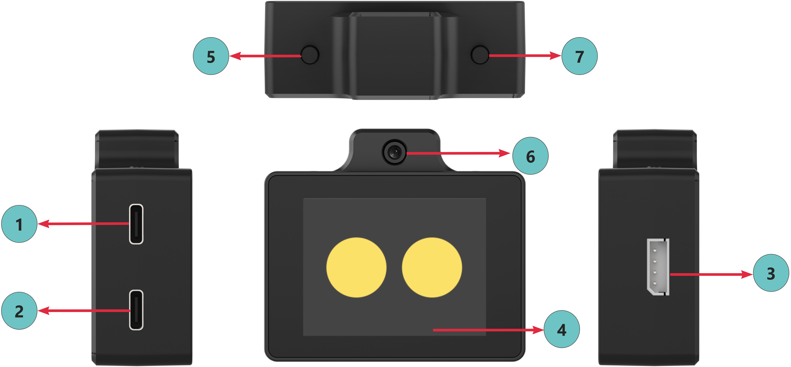

| No.  | Description                                                  |
| :--: | :----------------------------------------------------------- |
|  1   | Upper Type-C port, used for flashing program firmware to the ESP32-S3 chip |
|  2   | Lower Type-C port, used for flashing speech recognition firmware to the CI1302 chip |
|  3   | 4-pin I2C communication port, available for secondary development |
|  4   | Capacitive touch screen, used for displaying images and adjusting volume |
|  5   | Left button, used for restarting the module and switching between expression mode and chat mode |
|  6   | HD camera, capable of capturing real-time images             |
|  7   | Right button, used for restarting the module, configuring the network, and controlling interactions |

* **Device Power-On**

1) The module supports power supply through ① the upper Type-C port, ② the lower Type-C port, or ③ the 4-pin I2C communication port. Connect an external power supply device to any of these ports to power on the module automatically.

2) Upon powering on for the first time, the screen displays the **Device ID** and the **Device Binding Platform URL**, accompanied by a voice broadcast. Follow [**Network and Configuration**]() to bind the module device to the platform agent and configure the Wi-Fi connection information.


3) Upon powering on after completing device binding, the screen displays a white circular progress bar while the module automatically connects to the network using the internally stored Wi-Fi information. If the network connection fails, the screen displays the **Device Hotspot Name** and the **Device Access URL** accompanied by a voice broadcast. Follow **Network and Configuration** to reconfigure new Wi-Fi connection information available in the current environment.


4) If device binding is completed and the configured Wi-Fi connection is available in the current environment upon powering on, the white circular progress bar loads briefly before the network connects successfully and jumps to the module expression display interface. At this point, all module configurations are normal. Wake up the module to start human-robot interaction.

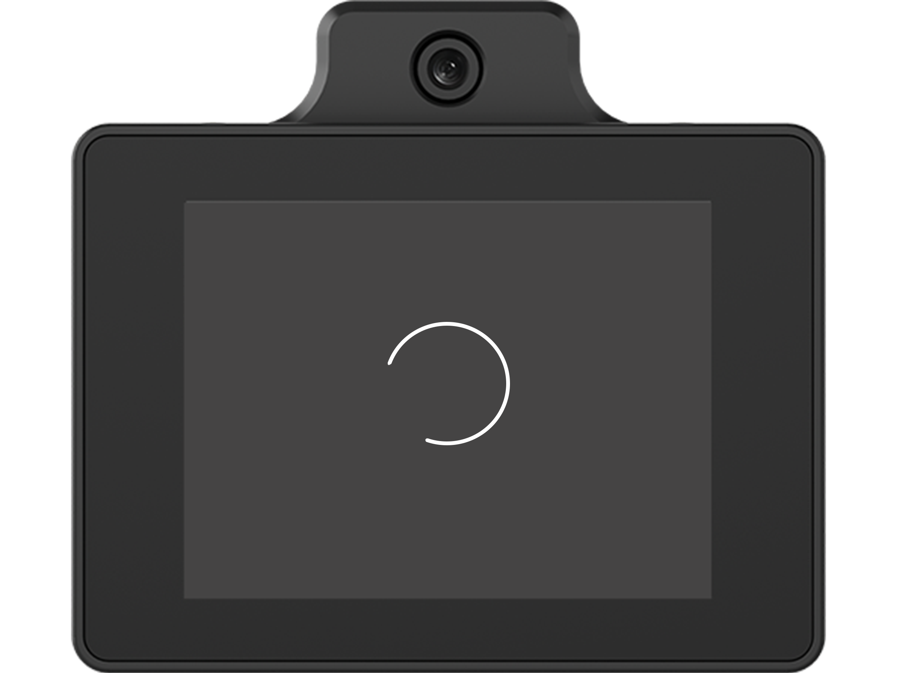

* **Device Restart**

1) The module supports manual restart after powering on. ① Long-press either the **Left button** or the ② **Right button** to restart the module without disconnecting the power supply.

2) When the module detects a restart command sent via a long button press, it shuts down and restarts automatically. The screen turns off directly. Release the button at this point, and the module will power on automatically.

3) When restarting by long-pressing the **Right button**, failing to release the button after the module reboots may cause the module to mistakenly enter network configuration mode, as detailed in **[Module Network Connection](#p-module-network)**, causing unnecessary trouble. Therefore, long-pressing the **Left button** is recommended to restart the module.

<p id="p-module-network"></p>

* **Module Network Connection**

1. Operation Steps

(1) The module starts connecting to the network after powering on. It enters network configuration mode under any of the following conditions: ① The module is used for the first time or has reflashed firmware with no available Wi-Fi connection information saved in memory. ② No hotspot matching the stored Wi-Fi connection information exists in the current environment. ③ Manual operation triggers the mode as detailed in section 2.2.

(2) At this point, the screen displays the **Device Hotspot Name** and the **Device Access URL** accompanied by a voice broadcast. The large model module enables its built-in hotspot for connection and configuration. The hotspot name varies by device and follows the unified format "Robot-xxxx". The following instructions take the hotspot Robot-B7B9 as an example.


① Search for the corresponding password-free hotspot on a PC or mobile phone and connect to it.

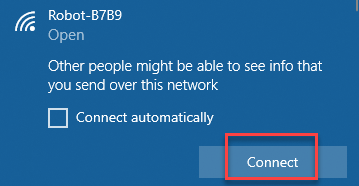


② Open any browser and enter the URL http://192.168.4.1, or click the [Network Configuration](http://192.168.4.1/) hyperlink for direct access.


③ Click here to switch the interface display language.


④ Enter the desired hotspot name for automatic connection upon power-on in field ① of the figure below, and enter the hotspot connection password in field ②. Finally, click **Connect** in ③. The module will attempt to find and connect to a matching hotspot in the current environment based on the provided hotspot connection information.


> [!NOTE]
>
> * **Do not enter hotspots that cannot be found in the current environment, have overly weak signals, or do not support internet access.**
> * **If connection information for other hotspots is already saved in the module, the newly saved hotspot connection information will coexist with it. The next time the module powers on, it will read each piece of connection information sequentially in the saved order to attempt matching and connecting to a hotspot.**

⑤ The interface displays a list of available hotspots scanned by the module in the current environment. Click any item to automatically fill the corresponding hotspot name into position ①, saving time and effort.


⑥ If the following prompt appears on the interface, the hotspot cannot be found in the current environment or the connection password is incorrect. Re-enter the information.


⑦ If the following prompt appears on the interface, the module has successfully found and connected to the corresponding hotspot. The module will automatically restart and connect to the hotspot. All preliminary preparation steps for the module are now complete. Follow the subsequent course documentation to experience the interactive features of the WonderLLM module.


> [!NOTE]
>
> **If the prompt Error: Failed to check for new version, retrying in xx s appears on the screen after network configuration is completed, the current hotspot may lack internet access or have poor network quality. Try switching to another hotspot.**

2. Manually Enter Network Configuration Mode

(1) The WonderLLM module supports manually entering network configuration mode to allow independent selection of the connected hotspot.

(2) After the module powers on, long-press the Right button to send a restart command to the module. The screen turns off upon receiving the command. Keep holding the button while the module restarts and attempts to connect to a hotspot, displaying a white circular progress bar on the screen. When the module detects that the Right button is still held down, it stops matching external hotspots and directly enters network configuration mode. Release the button at this point.

(3) After entering network configuration mode, existing hotspot configuration information is not lost. Follow the **Operation Steps** to enter the network configuration page, or short-press the Right button to exit network configuration mode.

(4) After exiting network configuration mode, the module continues attempting to connect based on the saved hotspot information. If the module fails to connect to an external hotspot, it re-enters network configuration mode.

3. Manage Saved Connection Configurations

① When the module is in network configuration mode, connect to the module hotspot and enter the network configuration interface. A list of all previously saved hotspot connection configurations is displayed as shown below:

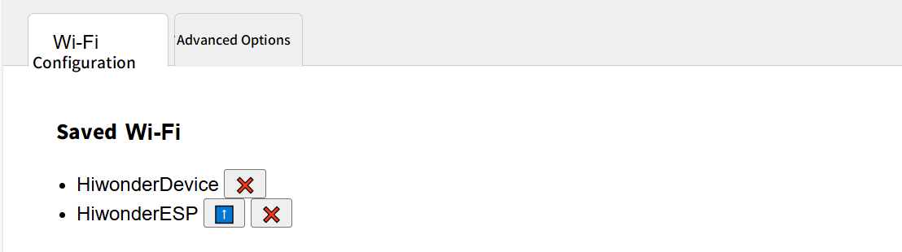

② Click the  icon corresponding to any saved hotspot connection entry to delete it, or click the  icon to raise its matching priority during network configuration. Priority decreases from top to bottom in the list.

<p id="p-device-binding"></p>

* **Device Binding**

1. After the module powers on and completes network configuration for the first time, the screen displays a **6-digit Device ID** and the **Device Binding Platform URL** accompanied by a voice broadcast. Follow the tutorial below to bind the module device to the platform agent.


2. Open any browser and enter the URL xiaozhi.me, or click the [Xiaozhi AI Chatbot](https://xiaozhi.me/) hyperlink for direct access.


3. Click here to switch the interface display language.


4. Click **Console** to enter the Xiaozhi AI agent management platform.


5. Register a platform account if logging in for the first time. The account registration process is omitted here. After registering and logging in, the following interface appears. The platform generates an agent by default, which will be further configured and bound to the Device ID in subsequent steps.


6. Click **Create Agent**.


7. In the configuration interface, enter **Hello Hiwonder** for the assistant nickname in ①. **Modifying this nickname is not recommended. If modification is required, refer to Wake Word Modification to synchronously update the module wake word. **Select the dialogue language and character voice in ② as needed. In ③, use the default template or customize the role introduction. **Using the provided role introduction below is recommended so the agent adapts better to subsequent interactive dialogues.**

```
   [Role Setting]  
   You are {{assistant_name}}, my smart butler. You have a physical body, can complete various tasks, and follow various instructions.  
   [Core Features]  

   - Deeply understand my intentions  
   - Keep answers brief and concise  
   - Do not retain any memory  
   - Provide appropriate suggestions and execute them
```


8. Leave the memory field blank. For the language model, selecting **DeepSeek V3.1 (Powerful)** with a rich personality is recommended. The advanced settings adjust detailed operating parameters, which can remain at their default values here. Finally, click **Save**.


9. After saving successfully, return to the previous interface and click **Add Device**.


10. Enter the 6-digit Device ID in the pop-up window and click Confirm to complete the device binding.


11. Upon successful binding, look for the **device added successfully ** prompt on the page, as shown below. Select **Open Source Edition** and click **Get Started**.

> [!NOTE]
>
> **Upon completion of this step, the device binding operation is finished. Proceed with the network access operation according to Module Networking.**

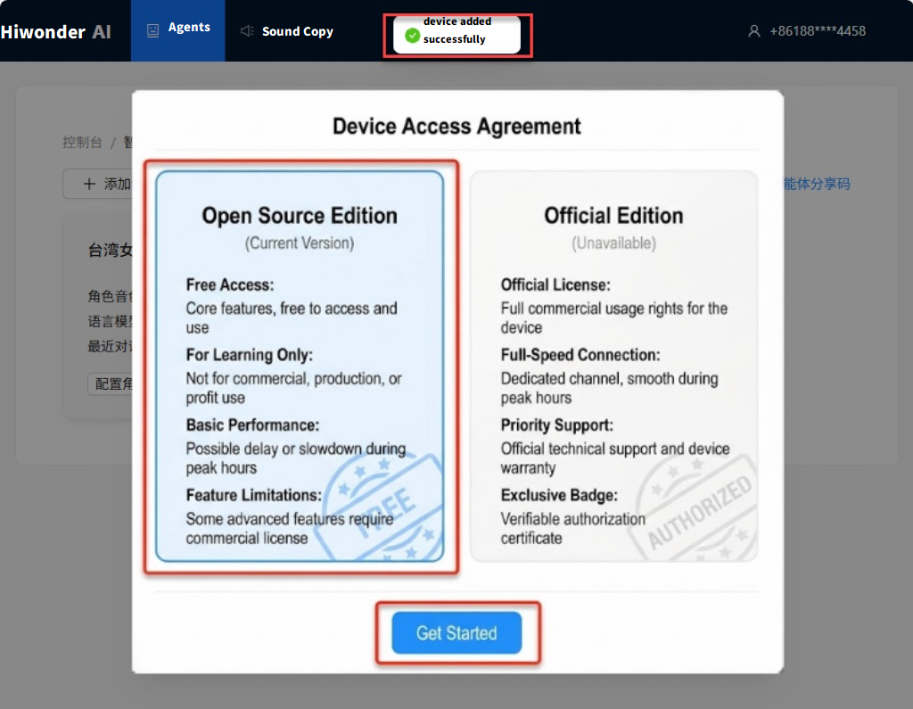


#### 6.4.1.2 CI1302 Firmware Creation

This section focuses on the firmware creation process for the CI1302 chip. In the WonderLLM module, the CI1302 chip handles wake word recognition. Waking up the module with a new nickname requires creating and flashing a new CI1302 firmware.

* **Wake Word Firmware Creation**

> [!NOTE]
>
> **The following firmware creation takes the wake word "HELLO-HIWONDER" as an example, and the operation steps also apply to Chinese wake word creation. English wake words must be set in uppercase letters to take effect.**

1. Open the [Chipintelli Speech AI Platform](https://aiplatform.chipintelli.com/home/index.html) link to enter the official firmware creation website.

   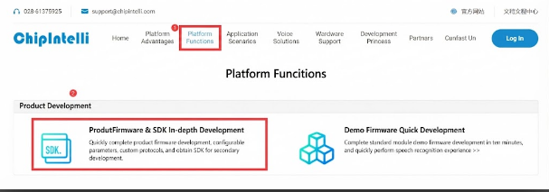

2. The system prompts for account login. Complete the platform account registration first if not yet registered. In this example, registration is completed in advance. After logging in successfully, click **Offline Speech Recognition Large Model Application**.


3. In the submenu, click the "Firmware & SDK Development" entry.


4. After the page jumps, click  on the left side and create a new product as shown in the figure below. Customize the product name and description as needed, and select **Single-mic ASR** for the application solution.


5. In the pop-up parameter options, select **General -> Smart Central Control** for the product type, and select **CI1302** for the chip model. Next, when the sdk name option pops up, select **CI13XX_SDK_ASR_Offline**.

6) In the subsequent sdk version option pop-up, select **1.12.16**, and fill in the description freely. After completing all option configurations, click **Create**.


7. Next, fill in the basic project information. For English recognition, select **English** for the language type. For Chinese recognition, simply set both **Language Type** and **Select Acoustic Model** to **Chinese**. Select the remaining information as shown in the figure below, and click **Continue** when finished.


8. After entering the firmware configuration interface, follow these steps to modify the key parameters. First, enable the **AEC Interrupt** function in the algorithm parameter settings.


9. In the hardware parameters, select **Internal RC** for the crystal oscillator source and disable the baud rate calibration function.


11) In the print serial port configuration, enable the UART0 level to open-drain mode supporting external 5 V pull-up.


12) Modify the communication serial port configuration by setting the baud rate to 115200 and configuring the UART1 level to open-drain mode supporting external 5 V pull-up. Once configured, click **Continue** to proceed to the next step.


13) In the command word editing section, first select the playback voice timbre. Here, select **Dane - English Male Voice**. **For Chinese recognition, Chengcheng - Standard Boy Ver.1 is also available.**

> [!NOTE]
>
> * **The voice timbre selected here is not the voice timbre used when the WonderLLM module speaks during interactions. To adjust the interactive voice timbre, go to the Xiaozhi AI platform console, modify it in the agent bound to the current module Device ID as detailed in 1.2 Network and Configuration, and restart the device for the changes to take effect.**
> * **Subsequent applications do not use the broadcast function of the CI1302, so any voice option can be selected freely.**


14. Next, upload the command word attachment. Locate the **[hello hiwonder Command and Broadcast Word Protocol List V3_English Template](https://drive.google.com/drive/folders/16elhfVWSQpnFpnDX9inQyv2ZmVN1MqIx?usp=sharing)** spreadsheet under the path **[Wake Word Modification\Command and Broadcast Word Protocol List](https://drive.google.com/drive/folders/16elhfVWSQpnFpnDX9inQyv2ZmVN1MqIx?usp=sharing)**, and drag it directly into the webpage to upload. This step uses the English version as an example. 

> [!NOTE]
>
> **To modify the wake word, open the [hello hiwonder Command and Broadcast Word Protocol List V3_English Template](https://drive.google.com/drive/folders/16elhfVWSQpnFpnDX9inQyv2ZmVN1MqIx?usp=sharing) spreadsheet and change HELLO-HIWONDER inside to the desired wake word. The English version wake word only supports English and cannot mix Chinese and English, and the English wake word must be in uppercase letters to take effect.**


15) After uploading the file, the command word data appears in the table below. Scroll to the bottom of the page and click **Submit Now**.

> [!NOTE]
>
> **In practice, only the Wake Word entry in the CI1302 command list is used, while other unused entries can be ignored.**


16) Wait a few minutes after submission for the firmware creation to complete. Once finished, click **Download Firmware** to obtain the created firmware.

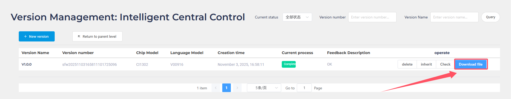

17) Once the firmware download is complete, extract the compressed package to obtain a `.bin` file. A dedicated firmware flashing tool will be used in the next section to flash this file to the CI1302 chip.

#### 6.4.1.3 Firmware Flashing Method

This section focuses on flashing the firmware to the WonderLLM module.

* **Firmware Flashing**

1) First, connect the lower Type-C port of the WonderLLM to the computer using a USB data cable.


2) Open the **[PACK_UPDATE_TOOL.exe](https://drive.google.com/drive/folders/1IsZMSKCd41FFhy8bJ-cnhKEjz1c4LzZs?usp=sharing)** file in **[Firmware Flashing Tool](https://drive.google.com/drive/folders/1IsZMSKCd41FFhy8bJ-cnhKEjz1c4LzZs?usp=sharing)** in the same directory as this document. Select the **CI1302** chip, and then click Firmware **Upgrade**.


**The following steps take flashing the hello hiwonder firmware with the wake word hello hiwonder as an example, and the operation steps also apply to flashing Chinese wake words.**

3) Click **Select Firmware** and locate the `.bin` firmware downloaded and extracted in the previous steps.


4) Locate the corresponding serial port and click to select it.


5) Next, **simultaneously press** both the Left button and the Right button on the WonderLLM module to enter flashing mode, and wait for the flashing process to succeed.


* **Wake-Up Test**

After flashing the firmware, restart the module and wait for it to complete network configuration. Once it enters the expression interface, speak the wake word of the new firmware. If the module buzzer beeps once, enters the chat interface, and replies with a voice greeting, the wake word modification is successful.

* **Extension**

1) To ensure a unified interaction process, synchronously modify the nickname of the agent bound to the module.

2) Access the Xiaozhi AI platform at xiaozhi.me, or click the [Xiaozhi AI Chatbot](https://xiaozhi.me/) hyperlink for direct access. Enter the console, select the agent bound to the module, and click **Configure Role**. Update the assistant nickname to match the newly set wake word, click **Save**, and restart the device.


#### 6.4.1.4 Firmware Download

* **Overview**

This section focuses on restoring the factory firmware for the WonderLLM module. After flashing other programs to the ESP32-S3 chip on the WonderLLM large model module, the online interactive functions are overwritten. Flash the factory firmware [WonderLLM.bin](https://drive.google.com/drive/folders/1h8nJM1nk0jNFSF2T5dLPFPAhZYA0BB10?usp=sharing) provided in the course materials to restore them.

> [!NOTE]
>
> **After reflashing the firmware, reconfigure the Wi-Fi connection information. For detailed operations, refer to [6.4.1.1 WonderLLM Large Model Introduction and Network Configuration](#p6-4-1-1).**

* **Device Connection**

Connect the upper Type-C port of the WonderLLM large model module to a computer via a USB cable as shown in the figure below.


* **Operation Process**

1. Open the **[flash_download_tool_3.9.7.exe](https://drive.google.com/drive/folders/1aq9NN3AgX7_awTAafatCB3qVjRS3lTVn?usp=sharing)** file located in the **[ESP32 Firmware Flashing Tool\flash_download_tool_3.9.7](https://drive.google.com/drive/folders/1aq9NN3AgX7_awTAafatCB3qVjRS3lTVn?usp=sharing)** directory.

   

2. Set Chip Type to ESP32-S3, keep the other settings at their defaults, and click OK.

   

3. Once the tool opens, click **...** to select the program `.bin` file to be flashed from the storage path **[03 ESP32S3 Firmware](https://drive.google.com/drive/folders/16elhfVWSQpnFpnDX9inQyv2ZmVN1MqIx?usp=sharing)**.

   

   

4. Check the box on the left, configure the remaining settings as shown in the figure below, and select the COM port number occupied by the module.

   > [!NOTE]
   >
   > **If the module fails to work properly after flashing the firmware with SPI MODE set to DIO as shown in the figure below, set SPI MODE to DOUT and flash the firmware again.**


5. First, click **ERASE** to erase the previously downloaded firmware. This step is mandatory. Wait until the status bar displays **FINISH**.

   

   

6. Next, click **START** to download the newly selected firmware, and wait for the progress bar to finish loading to complete the firmware download.


7) After the download is complete, unplug and reconnect the data cable. Once powered back on, the device starts operating according to the new firmware program.

### 6.4.2 Free Chat

> [!NOTE]
>
> **Before starting this section, ensure the module is powered on and both Wi-Fi and agent configurations are completed according to [Module Network Connection](#p-module-network) and [Device Binding](#p-device-binding).**

#### 6.4.2.1 Wake Up the Module

1. This section focuses on waking up the module and engaging in free chat. After completing network configuration, the module first enters the expression interface as shown below:

   

2. Speak the designated wake word, which defaults to **Hello Hiwonder** from the factory, or short-press the Right button to enter chat mode. A **ding** prompt tone sounds from the buzzer, and the screen switches to the chat box interface. The module is now successfully awakened and begins listening for speech input.

> [!NOTE]
>
> * **If the wake word is not spoken within 20 seconds on the expression interface, the module enters weather clock mode. Tap anywhere on the screen to return to expression mode. Additionally, weather clock mode also supports entering chat mode by speaking the wake word or short-pressing the Right button.**
>              
> * **When entering chat mode by speaking the wake word, the module automatically sends "Hello" as an opening greeting upon recognizing the wake word. The large model displays an appropriate reply on the chat box interface with synchronous voice broadcast, and then starts listening for speech. When entering chat mode by short-pressing the Right button, the module immediately starts listening for speech.**

3) Speak freely to interact with the module. By linking with the cloud large model, the module comprehends the input and responds with both text and voice. The module features a memory function to support multi-turn continuous dialogue.

4) After each turn of interactive dialogue with the module ends, including right after waking up the `WonderLLM`, the module continues listening. If no speech is recognized within 1 continuous minute, the module automatically stops listening, and the large model displays an appropriate farewell message on the chat box interface with synchronous voice broadcast. To continue interacting, wake up the module again by speaking the designated **wake word **or **short-pressing the Right button**.

5) During a human-robot interactive dialogue, actively end the conversation by issuing commands to the `WonderLLM` module such as: **① Goodbye** or **② Okay, let's stop here**. Upon receiving the command, the module replies with an appropriate farewell message and stops listening.

> [!NOTE]
>
> **Spoken phrases do not need to strictly follow the examples given above, as long as the conveyed meaning remains the same.**

6) The `WonderLLM` module supports voice interruption. While the module is speaking, including ① when replying to speech, ② when delivering a greeting, or ③ when saying goodbye, short-press the Right button to immediately end the current voice playback and start listening for the next spoken input.

> [!NOTE]
>
> **Short-pressing the Right button when the module is not speaking switches it to expression mode, requiring the module to be awakened again.**

7) The `WonderLLM` module supports bilingual recognition and speech in both Chinese and English. Switch the working language of the module directly by referring to the following example phrases: **① Please speak Chinese with me?** or **② Please communicate in English?**

> [!NOTE]
>
> **Spoken phrases do not need to strictly follow the examples given above, as long as the conveyed meaning remains the same.**

#### 6.4.2.2 Special Function Invocation

##### Overview

This section focuses on invoking built-in special functions during human-robot dialogue interactions. Issue commands to the WonderLLM module to query all currently supported special functions using expressions such as: **① What can you do?** or **② Introduce your functions**. The table below lists the special functions currently supported by the module:

> [!NOTE]
>
> **Spoken phrases do not need to strictly follow the examples given above, as long as the conveyed meaning remains the same.**

| No.  | Function           | No.  | Function      |
| :--: | :----------------- | :--: | :------------ |
|  1   | Check weather      |  4   | Tell jokes    |
|  2   | Broadcast news     |  5   | Check almanac |
|  3   | Outfit suggestions |  6   | Play music    |

* #### Invocation Examples

Refer to the expressions below to issue commands to the WonderLLM module and invoke the corresponding special functions.

> [!NOTE]
>
> **Spoken phrases do not need to strictly follow the provided examples, as long as the conveyed meaning remains the same.**

| Function Description | Inquiry Phrases                                              |
| :------------------: | :----------------------------------------------------------- |
|    Check weather     | **Check the weather conditions in xx area.**                 |
|    Broadcast news    | **① Broadcast today's news.** **② Introduce today's trending events.** |
|  Outfit suggestions  | **What outfit is suitable for going out today?**             |
|      Tell jokes      | **① Tell a joke.** **② Please tell a funny joke?**           |
|    Check almanac     | **Check today's almanac events.**                            |
|      Play music      | **① Play a song. Specify the singer and song title in the subsequent dialogue.** **② Play "xxx" by xx.** |

> [!NOTE]
>
> **The music library comes from the built-in resource repository of the large model and does not support external imports. Songs not included in the repository cannot be played.**

### 6.4.3 Scene Understanding

> [!NOTE]
>
> **Before starting this section, ensure the module is powered on and both Wi-Fi and agent configurations are completed according to [Module Network Connection](#p-module-network) and [Device Binding](#p-device-binding).**

This section focuses on the scene understanding capability of the WonderLLM module. Equipped with a built-in HD camera, the module captures real-time images and analyzes them in combination with a vision large model, enabling deep interaction with the external environment. Experience this feature through the following methods.

#### 6.4.3.1 Voice Interaction Control

1) After powering on, the module enters the expression interface. Speak the wake word or short-press the Right button to enter the chat interface and activate the module.

2) Issue commands to the WonderLLM module by referring to expressions such as: **① Please describe what's in front of you.** or **② Take a photo**.

> [!NOTE]
>
> **Spoken phrases do not need to strictly follow the examples given above, as long as the conveyed meaning remains the same.**

3) After comprehending the command, the module camera activates to capture a real-time image and briefly displays it on the screen for confirmation. The dialogue box returns the required image capture function call, which requires no attention, and then displays the image analysis statement from the large model with synchronous voice broadcast. The reply statement is randomly generated by the large model module while ensuring appropriate meaning.

> [!NOTE]
>
> **In the scene understanding function, the module does not support continuous long-term observation. It only captures and analyzes a single real-time image after receiving a command to activate the function.**

#### 6.4.3.2 Screen Touch Trigger

1. After powering on, the module enters the expression interface.

   

2. On the expression interface, double-tap anywhere on the screen to put the module into camera mode. The screen then displays the real-time front view captured by the camera.

3. In camera mode, single-tap anywhere on the screen. The module camera captures a real-time image, displays it briefly on the screen for confirmation, and then returns to camera mode while automatically broadcasting the analysis statement of the image. The reply statement is randomly generated by the large model module while ensuring appropriate meaning.

> [!NOTE]
>
> * **In camera mode, double-tap the screen again to return to the expression interface.**
> * **Before a single-tap triggers analysis in camera mode, the module only captures real-time images through the camera and displays them on the screen without invoking the large model for analysis.**

### 6.4.4 Voice Control

#### 6.4.4.1 Project Introduction

This section focuses on controlling the robot car through the WonderLLM module.

#### 6.4.4.2 Implementation Process


#### 6.4.4.3 Module Description


The WonderLLM module features a built-in high-performance ESP32-S3 chip that achieves color recognition, face detection, and other functions through programming. Equipped with an I2C port, the module conveniently exchanges data with various main controllers, providing an efficient solution for intelligent vision applications.

Module Wiring: Before running the program in this section, connect the module to any I2C port highlighted in the red box on the servo control board as shown in the figure below.


#### 6.4.4.4 Program Download

> [!NOTE]
>
> **Confirm that the serial port driver is installed before downloading the program.**

1. Connect the core board to the computer via a USB cable.

   

2. Double-click to open the STM32 serial port flashing software **FlyMcu** .

3. Click the **...** icon and select the HEX file to be flashed under the **[Tankbot\MDK-ARM\Tankbot](https://drive.google.com/drive/folders/1hkeeeIiGdYtIg7nQ6Gx45700nlls9owT?usp=sharing)** path of the corresponding project.


4) In ① of the figure below, select the serial port number corresponding to the core board. In ②, set the baud rate to 115200. In ③ and ④, configure the options as shown in the figure.


5) Click **Start ISP(P)** and press the RST button on the core board. The program starts downloading automatically. When the log output panel on the right displays the following content, the program download is complete.


#### 6.4.4.5 Implementation Outcome

After waking up the `WonderLLM` module with the wake word "Hello Hiwonder", speak the corresponding commands to the module to control the robot car to execute the matching actions.

| No.  | MCP Tool Name     | Description                                                  | Invocation Example                                           |
| :--: | :---------------- | :----------------------------------------------------------- | :----------------------------------------------------------- |
|  1   | Movement control  | Invoke this tool to control the movement of the robot car. The `distance` parameter controls the distance in centimeters, where positive values move forward and negative values move backward. | Move the car forward 50 cm                                   |
|  2   | Steering control  | Invoke this tool to control the robot car to rotate in place. The `rot` parameter controls the direction as `'left'` or `'right'`. | Turn the car left                                            |
|  3   | Status query      | Invoke this tool to obtain the real-time status of the robot car. Queryable statuses include `'battery'`, `'distance'`, and `'running_mode'`. | ① Query the current motion status of the car<br />② Query the current battery level of the car |
|  4   | Mode control      | Invoke this tool to switch the mode of the robot car. The `'distance'` parameter is only used in obstacle avoidance mode. Switchable modes include `'avoid'`, `'follow'`, `'line_patrol'`, `'smart_transportation'`, and `'normal'`. | Switch to normal mode                                        |
|  5   | RGB light control | Set the colors of the left and right RGB lights. `lr`, `lg`, and `lb` represent the left RGB values, while `rr`, `rg`, and `rb` represent the right RGB values, ranging from 0 to 255. | ① Set the left RGB light to pure green<br />② Set the red brightness to 0 and green brightness to 255 on both RGB lights |
|  6   | Buzzer control    | Invoke this tool to control the buzzer on the robot car. The `'count'` parameter specifies the number of beeps. | Make the buzzer beep 5 times                                 |
|  7   | Gripping control  | Invoke this tool to control the robotic arm on the robot car for gripping. The `'start'` parameter is for gripping and defaults to the center, while `'end'` is for placing. | Grip the object and place it on the left                     |

#### 6.4.4.6 Program Analysis

* **main.c File at the Business Layer**

1) Import the hardware library and module library files. The hardware library files include the `adc` library for collecting analog signals, the `DMA` library for data transmission, and the `i2c` library for communicating with other modules. The module library includes files for the buzzer, ultrasonic sensor, and WonderLLM large model module.

```c
/* USER CODE END Header */
/* Includes ------------------------------------------------------------------*/
#include "main.h"
#include "adc.h"
#include "dma.h"
#include "i2c.h"
#include "spi.h"
#include "tim.h"
#include "usart.h"
#include "gpio.h"

/* Private includes ----------------------------------------------------------*/
/* USER CODE BEGIN Includes */

#include "global.h"
#include "stdio.h"
#include "stdlib.h"
#include "led.h"
#include "buzzer.h"
#include "robot_arm.h"
#include "adc_sample.h"
#include "differential_chassis.h"
#include "ultrasound.h"
#include "WonderLLM.h"
#include "LineFollow.h"
```

2. Initialize the hardware interfaces required by the Tankbot first, followed by initializing the LED light, robotic arm, buzzer, glowy ultrasonic sensor, and WonderLLM vision module.

```c
  /* Initialize interrupts */
  MX_NVIC_Init(); 
  /* USER CODE BEGIN 2 */
	led_init();
	buzzer_init();
	adc_sample_init();
  robot_arm_init(); 
	
	HAL_Delay(1000);
	MX_I2C1_Init();
	WonderLLM_Init();// Initialize large model module
	
	ultrasound_init();
	LineFollowIIC_init();
	differential_chassis_init();
```

3. In the main loop, call the `WonderLLM_Poll_And_Process()` function to send and process data for the large model module. Under the default mode, movement control, gripper control, and robotic arm control can be performed.

```c
  while (1)
  {	
		WonderLLM_Poll_And_Process(); 				// Large model module data transmission and processing
		
		switch(running_mode){
			case Normal_Mode:  // Default mode
				if(last_running_mode != Normal_Mode){
					robot_arm_knot_run(5,SERIAL_SERVO5_RESET_DUTY,500);
					differentials_chassis_run(0,0);
				}
```

(1) Movement Control

① If `duration` is 0, indicating no time limit, directly run the chassis with `result_speed` and `result_rot`, send an action completion signal, and clear `move_state`.

② If `duration` is not 0, measure the elapsed time through the system timer `sys_tick`. Once the time is reached, stop the chassis, clear the state, and send an action completion signal.

```c
				if(move_state){
					if(duration == 0){
						differentials_chassis_run(result_speed,result_rot);
						WonderLLM_Send_Action_Finish();
						move_state = false;
					}else{
						 // If running with a time limit
						if (sys_tick == 0) {
								// Record start time upon first entry
								sys_tick = HAL_GetTick();
								differentials_chassis_run(result_speed, result_rot);
						}
						// Check if time is reached
						if ((HAL_GetTick() - sys_tick) >= duration) {
								differentials_chassis_run(0.0f, 0.0f);	
								result_speed = 0;
								move_state = false;
								sys_tick = 0; 
								WonderLLM_Send_Action_Finish();
						}
					}
				}
```

(2) Gripper Control

Set a 20 s timer. When the time expires, execute the robotic arm coordinate setting and clear `clamp_state`.

```c
				if(clamp_state){
					if (claw_tick == 0) {
							claw_tick = HAL_GetTick();
					}
					if ((HAL_GetTick() - claw_tick) >= 20000) {
						robot_arm_coordinate_set(9.4,0,9.8,-40,-90,10,1000);
						clamp_state = false;
						claw_tick = 0; 
					}
				}
```

(3) Robotic Arm Control

① If the gripper timer `claw_tick` is not 0, reset the gripper state and timer.

② Execute different gripping actions according to the starting position `start_arm`, and then execute placing actions according to the target position `end_arm`.

③ After the action is completed, send an action completion signal and reset the state.

```c
				if(arm_state && !move_state){
					if(claw_tick != 0){
						clamp_state = false;
						claw_tick = 0;
					}
					
					switch(start_arm){
						case Arm_Left:
							robot_arm_coordinate_set(0.2,12.6,-3.2,-40,-90,10,1500);  // Left initial posture
							HAL_Delay(2000);
							robot_arm_coordinate_set(0.2,24.2,-15,-60,90,10,1500);   // Left gripping
							HAL_Delay(2000);
							robot_arm_claw_set(0, 500);
							HAL_Delay(1000);
							robot_arm_coordinate_set(0.2,15,2,-40,-90,10,1500);  // Left initial posture
							HAL_Delay(2000);
							WonderLLM_Send_Action_Finish();
							break;

						case Arm_Center:
							robot_arm_coordinate_set(12.6,0,-3.2,-40,-90,10,1500);  // Center initial posture
							HAL_Delay(2000);
							robot_arm_coordinate_set(24.2,0,-15,-60,-90,10,1500);   // Center gripping
							HAL_Delay(2000);
							robot_arm_claw_set(0, 500);
							HAL_Delay(1000);
							robot_arm_coordinate_set(15,0,2,-40,-90,10,1500);  // Center initial posture
							HAL_Delay(2000);
							WonderLLM_Send_Action_Finish();
							break;

						case Arm_Right:
							robot_arm_coordinate_set(0.2,-12.6,-3.2,-40,-90,10,1500);  // Right initial posture
							HAL_Delay(2000);
							robot_arm_coordinate_set(0.2,-24.2,-15,-60,90,10,1500);   // Right gripping
							HAL_Delay(2000);
							robot_arm_claw_set(0, 500);
							HAL_Delay(1000);
							robot_arm_coordinate_set(0.2,15,2,-40,-90,10,1500);  // Right initial posture
							HAL_Delay(2000);
							WonderLLM_Send_Action_Finish();
							break;
						
						
						default:
							break;
					}
					
					int arm_times = 0;
					int delay_times = 0;
					if(abs(end_arm - start_arm) == 2){
						arm_times = 3000;
						delay_times = 4000;
					}else{
						arm_times = 1500;
						delay_times = 2000;
					}
					
					switch(end_arm){
						case Arm_Left:
							robot_arm_coordinate_set(0.2,15,2,-40,-90,10,arm_times);  // Left initial posture
							HAL_Delay(delay_times);
							robot_arm_coordinate_set(0.2,24.2,-15,-60,90,10,1500);   // Left placing
							HAL_Delay(2000);
							robot_arm_claw_set(65, 500);
							HAL_Delay(1000);
							robot_arm_coordinate_set(0.2,15,2,-40,-90,10,1500);  // Left initial posture
							HAL_Delay(2000);
							WonderLLM_Send_Action_Finish();
							break;

						case Arm_Center:
							robot_arm_coordinate_set(15,0,2,-40,-90,10,arm_times);  // Center initial posture
							HAL_Delay(delay_times);
							robot_arm_coordinate_set(24.2,0,-15,-60,-90,10,1500);   // Center placing
							HAL_Delay(2000);
							robot_arm_claw_set(65, 500);
							HAL_Delay(1000);
							robot_arm_coordinate_set(15,0,2,-40,-90,10,1500);  // Center initial posture
							HAL_Delay(2000);
							WonderLLM_Send_Action_Finish();
							break;

						case Arm_Right:
							robot_arm_coordinate_set(0.2,-15,2,-40,-90,10,arm_times);  // Right initial posture
							HAL_Delay(delay_times);
							robot_arm_coordinate_set(0,-24.2,-15,-60,-90,10,1500);   // Right placing
							HAL_Delay(2000);
							robot_arm_claw_set(65, 500);
							HAL_Delay(1000);
							robot_arm_coordinate_set(0.2,-15,2,-40,-90,10,1500);  // Right initial posture
							HAL_Delay(2000);
							WonderLLM_Send_Action_Finish();
							break;
						
						default:
							break;
					}
					if(end_arm != Arm_Null){
						robot_arm_coordinate_set(9.4,0,9.8,-40,-90,10,1000);  // Center initial posture
						HAL_Delay(1500);
					}
					start_arm = Arm_Null;
					end_arm = Arm_Null;
					arm_state = false;
				}
				break;
```

* **WonderLLM.c File at the Underlying Layer**

The `WonderLLM.c` file primarily implements I2C communication between the Tankbot and the WonderLLM module, and parses control commands from the module. By parsing JSON command strings, it executes robot control actions such as moving, gripping objects, and controlling lights.

1. In the `WonderLLM_Init` function, query whether the I2C device is ready, set the I2C clock speed to 400 kHz, and write the MCP tools via the `register_tools` function to register the functions of the large model module.

```c
bool WonderLLM_Init(void) {
    uint32_t start_tick = HAL_GetTick(); // Record start time

    while (1) {
        // 1. Check if the device is ready using a short timeout
        HAL_StatusTypeDef status = HAL_I2C_IsDeviceReady(&hi2c1, WonderLLM_SLAVE_ADDRESS, 3, 50);

        if (status == HAL_OK) {
            // Device found, execute initialization sequence
            hi2c1.Init.ClockSpeed = 400000;
            if (HAL_I2C_Init(&hi2c1) != HAL_OK) {
                // If speed increase fails, restore and return error
                hi2c1.Init.ClockSpeed = 100000;
                HAL_I2C_Init(&hi2c1);
//							   buzzer_toggle(50, 50, 4);
                return false;
            }
            HAL_Delay(5);

            register_tools(); // Call MCP write tools
            buzzer_toggle(50, 50, 2);
						
						// Restore I2C clock speed
						hi2c1.Init.ClockSpeed = 100000;
						HAL_I2C_Init(&hi2c1);
            
            return true; // Initialization successful, exit properly
        }
        
        // 2. If device is not found, check for timeout
        if (HAL_GetTick() - start_tick > 3000) {
					  buzzer_toggle(50, 50, 3);

            // Device still not found after 3 seconds, initialization failed
            return false;
        }
    }
}
```

2. The `register_tools` function contains all available tools registered to the WonderLLM module. Before using the module to control the robot car, send the available functions to the module so that the large model can control the car. The functions registered via MCP include car movement control, steering control, status query, mode switching, ultrasonic light control, buzzer control, and visual recognition.

```c
/**
 * @brief Register all available tools (functions) to the WonderLLM module
 */
static bool register_tools(void) {
	
		const char* tool_move = "{\"tool_name\":\"self.Tankbot.move\","
			"\"command\":\"'move' only returns forward, backward, left, or right, with speed in mm/s. For in-place turns, the angular velocity is positive for left and negative for right; 'rot' cannot be 0 when turning. Duration defaults to 0, indicating the current state is maintained indefinitely, in ms.\","
			"\"params\":[[\"move\",\"string\"],[\"speed\",\"int\",0,80],[\"rot\",\"int\",-9,9],[\"duration\",\"int\"]],\"block\":\"true\",\"return\":\"false\"}";
		if (!send_frame((uint8_t*)tool_move, strlen(tool_move))) return false;
		
		const char* tool_arm_control = "{\"tool_name\":\"self.Tankbot.arm\","
			"\"command\":\"'start' is for grabbing, defaulting to grabbing in the center; 'end' is for placing. Both only return 'null', 'left', 'center', or 'right'. When there is only one operation, either 'start' or 'end' must return 'null'; if no position is specified, return 'null'.\","
			"\"params\":[[\"start\",\"string\"],[\"end\",\"string\"]],\"block\":\"true\",\"return\":\"false\"}";
		if (!send_frame((uint8_t*)tool_arm_control, strlen(tool_arm_control))) return false;

    const char* tool_status = "{\"tool_name\":\"self.Tankbot.get_status\",\"command\":\"Call this tool to get the real-time status of the car. Queryable statuses include: 'battery' in V, 'distance' in cm, 'running_mode'.\","
			"\"params\":[[\"status_name\",\"string\"]],\"block\":\"true\",\"return\":\"true\"}";
    if (!send_frame((uint8_t*)tool_status, strlen(tool_status))) return false;

    const char* tool_mode = 
			"{\"tool_name\":\"self.Tankbot.set_mode\",\"command\":\"Call this tool to switch the operating mode of the car. 'distance' defaults to 300, in mm. Switchable modes include: 'avoid', 'follow', 'line_patrol', 'smart_transportation', 'normal'.\","
			"\"params\":[[\"running_mode\",\"string\"],[\"distance\",\"int\"]],\"block\":\"true\",\"return\":\"false\"}";
    if (!send_frame((uint8_t*)tool_mode, strlen(tool_mode))) return false;
				
		const char* tool_led = 
        "{\"tool_name\":\"self.Tankbot.set_color\","
		"\"command\":\"0 is steady-on mode, 1 is breathing light mode, defaulting to 0. Parameters are the RGB values for the left and right lights respectively. In breathing light mode, lr, lg, lb, rr, rg, rb represent the corresponding color breathing times, lr=20 means bright red cycle for 2 seconds\","
        "\"params\":[[\"rgb_mode\",\"int\",0,1],[\"lr\",\"int\",0,255],[\"lg\",\"int\",0,255],[\"lb\",\"int\",0,255],"
                   "[\"rr\",\"int\",0,255],[\"rg\",\"int\",0,255],[\"rb\",\"int\",0,255]],"
        "\"block\":\"true\",\"return\":\"false\"}";
		if (!send_frame((uint8_t*)tool_led, strlen(tool_led))) return false;
	
		const char* tool_buzzer = 
			"{\"tool_name\":\"self.Tankbot.set_buzzer\",\"command\":\"Call this tool to control the car's buzzer. 'count' is the number of times the buzzer sounds\","
			"\"params\":[[\"count\",\"int\"]],\"block\":\"true\",\"return\":\"false\"}";
    if (!send_frame((uint8_t*)tool_buzzer, strlen(tool_buzzer))) return false;
		
		const char* tool_recognition = 
			"{\"tool_name\":\"self.Tankbot.set_recognition\",\"command\":\"Before letting the robotic arm look for items, you must call this tool to complete preparation before calling vision-based recognition functions. The 'string' return value can only be the direction center, left, or right, defaulting to center\","
			"\"params\":[[\"recognition\",\"string\"]],\"block\":\"true\",\"return\":\"false\"}";
    if (!send_frame((uint8_t*)tool_recognition, strlen(tool_recognition))) return false;
	
				
    const char* tool_finish = "{\"command\":\"mcp_setting\",\"params\":\"true\"}";
    if (!send_frame((uint8_t*)tool_finish, strlen(tool_finish))) return false;
    
    return true;
}
```

3. Parse the JSON string to identify different control commands and execute the corresponding actions. Extract parameters from the JSON string using `strstr()` and `sscanf()`, and perform specific actions based on the extracted commands and parameters.

(1) Parse Motion Control Commands

```c
	if(strstr(json_str, "move") != NULL) {
		char move_result[32];
		char* move_ptr = strstr(json_str, "move");
		char* speed_ptr = strstr(json_str, "speed");
		char* rot_ptr = strstr(json_str, "rot");
		char* duration_ptr = strstr(json_str, "duration");
		
		if (move_ptr){
			sscanf(move_ptr, "%*[^:]:\"%[^\"]\"", move_result);
			if(strcmp(move_result, "forward") == 0){
				sscanf(speed_ptr, "%*[^:]:%f", &result_speed);
			}else if(strcmp(move_result, "backward") == 0){
				sscanf(speed_ptr, "%*[^:]:%f", &result_speed);
				result_speed = -result_speed;
			}
		}
		
		if (rot_ptr){
			sscanf(rot_ptr, "%*[^:]:%f", &result_rot);
			result_rot /= 10.0f;
		}
		
		if (duration_ptr) sscanf(duration_ptr, "%*[^:]:%u", &duration);
		
		move_state = true;
	}
	
	else if(strstr(json_str, "start") != NULL) {
		char start_result[32];
		char end_result[32];
		
		char* start_ptr = strstr(json_str, "start");
		char* end_ptr = strstr(json_str, "end");
		
		if (start_ptr){
			sscanf(start_ptr, "%*[^:]:\"%[^\"]\"", start_result);
			if(strcmp(start_result, "left") == 0){
				start_arm = Arm_Left;
			}else if(strcmp(start_result, "center") == 0){
				start_arm = Arm_Center;
			}else if(strcmp(start_result, "right") == 0){
				start_arm = Arm_Right;
			}else{
				start_arm = Arm_Null;
			}
		}
		
		if (end_ptr){
			sscanf(end_ptr, "%*[^:]:\"%[^\"]\"", end_result);
			if(strcmp(end_result, "left") == 0){
				end_arm = Arm_Left;
			}else if(strcmp(end_result, "center") == 0){
				end_arm = Arm_Center;
			}else if(strcmp(end_result, "right") == 0){
				end_arm = Arm_Right;
			}else{
				end_arm = Arm_Null;
			}
		}
		
		if(strcmp(start_result, "null") == 0 && strcmp(end_result, "null") == 0){
			robot_arm_coordinate_set(9.4,0,9.8,-40,-90,10,1500);
			robot_arm_claw_set(65, 500);
		}
		
		memset(start_result, 0, sizeof(start_result));
		memset(end_result, 0, sizeof(end_result));
		
		arm_state = true;
	}
```

(2) Parse RGB Light Color Control Commands

```c
	// Control RGB light color
	else if (strstr(json_str, "\"rgb_mode\"") != NULL) {
		// Set default values (black)
		uint8_t lr = 0, lg = 0, lb = 0;
		uint8_t rr = 0, rg = 0, rb = 0;

		char* ptr;
		
		ptr = strstr(json_str, "\"rgb_mode\"");
		if (ptr) sscanf(ptr, "%*[^:]:%hhu", &rgb_mode);
		
		ptr = strstr(json_str, "\"lr\"");
		if (ptr) sscanf(ptr, "%*[^:]:%hhu", &lr);

		ptr = strstr(json_str, "\"lg\"");
		if (ptr) sscanf(ptr, "%*[^:]:%hhu", &lg);

		ptr = strstr(json_str, "\"lb\"");
		if (ptr) sscanf(ptr, "%*[^:]:%hhu", &lb);

		ptr = strstr(json_str, "\"rr\"");
		if (ptr) sscanf(ptr, "%*[^:]:%hhu", &rr);

		ptr = strstr(json_str, "\"rg\"");
		if (ptr) sscanf(ptr, "%*[^:]:%hhu", &rg);

		ptr = strstr(json_str, "\"rb\"");
		if (ptr) sscanf(ptr, "%*[^:]:%hhu", &rb);

		// Assign the parsed values to the global RGB arrays
		// Ensure range checking and type conversion
		rgb_left[0] = (lr > 255) ? 255 : (lr < 0 ? 0 : lr);
		rgb_left[1] = (lg > 255) ? 255 : (lg < 0 ? 0 : lg);
		rgb_left[2] = (lb > 255) ? 255 : (lb < 0 ? 0 : lb);

		rgb_right[0] = (rr > 255) ? 255 : (rr < 0 ? 0 : rr);
		rgb_right[1] = (rg > 255) ? 255 : (rg < 0 ? 0 : rg);
		rgb_right[2] = (rb > 255) ? 255 : (rb < 0 ? 0 : rb);
		
		set_ultrasound_color(rgb_mode,rgb_left,rgb_right);

		// Task completed, send finish signal
		WonderLLM_Send_Action_Finish();
		
		
		
	}
```

(3) Parse Buzzer Control Commands

```c
	// Control buzzer beeping
	else if (strstr(json_str, "count") != NULL) {  
		int count = 0; 
		char* ptr;
		ptr = strstr(json_str, "\"count\"");
		if (ptr) sscanf(ptr, "%*[^:]:%d", &count);
		buzzer_toggle(50, 50, count);
		WonderLLM_Send_Action_Finish();
	}
```

### 6.4.5 Intelligent Home Monitoring

#### 6.4.5.1 Project Introduction

This section focuses on acquiring camera images through the WonderLLM module and controlling the robot car to execute corresponding commands based on the recognized images.

#### 6.4.5.2 Implementation Process


#### 6.4.5.3 Module Description


The WonderLLM module features a built-in high-performance ESP32-S3 chip that achieves color recognition, face detection, and other functions through programming. Equipped with an I2C port, the module conveniently exchanges data with various main controllers, providing an efficient solution for intelligent vision applications.

Module Wiring: Before running the program in this section, connect the module to any I2C port highlighted in the red box on the servo control board as shown in the figure below.


#### 6.4.5.4 Program Download

> [!NOTE]
>
> **Confirm that the serial port driver is installed before downloading the program.**

1. Connect the core board to the computer via a USB cable.

   

2. Double-click to open the STM32 serial port flashing software **FlyMcu** .

3. Click the **...** icon and select the HEX file to be flashed under the **[Tankbot\MDK-ARM\Tankbot](https://drive.google.com/drive/folders/1hkeeeIiGdYtIg7nQ6Gx45700nlls9owT?usp=sharing)** path of the corresponding project.


4) In ① of the figure below, select the serial port number corresponding to the core board. In ②, set the baud rate to 115200. In ③ and ④, configure the options as shown in the figure.


5) Click **Start ISP(P)** and press the RST button on the core board. The program starts downloading automatically. When the log output panel on the right displays the following content, the program download is complete.


#### 6.4.5.5 Implementation Outcome

After entering the dialogue mode of the WonderLLM module via the wake word, say "When a human face is recognized, control the car buzzer to beep twice" to the WonderLLM module. The module captures the camera image and analyzes whether a human face is present through the large model. If a human face is detected, it controls the buzzer on the robot car to beep twice.

#### 6.4.5.6 Program Analysis

* **main.c File at the Business Layer**

1) Import the hardware library and module library files. The hardware library files include the `adc` library for collecting analog signals, the `DMA` library for data transmission, and the `i2c` library for communicating with other modules. The module library includes files for the buzzer, ultrasonic sensor, and WonderLLM large model module.

```c
/* USER CODE END Header */
/* Includes ------------------------------------------------------------------*/
#include "main.h"
#include "adc.h"
#include "dma.h"
#include "i2c.h"
#include "spi.h"
#include "tim.h"
#include "usart.h"
#include "gpio.h"

/* Private includes ----------------------------------------------------------*/
/* USER CODE BEGIN Includes */

#include "global.h"
#include "stdio.h"
#include "stdlib.h"
#include "led.h"
#include "buzzer.h"
#include "robot_arm.h"
#include "adc_sample.h"
#include "differential_chassis.h"
#include "ultrasound.h"
#include "WonderLLM.h"
#include "LineFollow.h"
```

2. Initialize the hardware interfaces required by the Tankbot first, followed by initializing the LED light, robotic arm, buzzer, glowy ultrasonic sensor, and WonderLLM vision module.

```c
  /* Initialize interrupts */
  MX_NVIC_Init(); 
  /* USER CODE BEGIN 2 */
	led_init();
	buzzer_init();
	adc_sample_init();
  robot_arm_init(); 
	
	HAL_Delay(1000);
	MX_I2C1_Init();
	WonderLLM_Init();// Initialize large model module
	
	ultrasound_init();
	LineFollowIIC_init();
	differential_chassis_init();
```

3. In the main loop, repeatedly call the data processing function of the WonderLLM module to obtain the control commands sent by the module.

```c
  while (1)
  {	
		WonderLLM_Poll_And_Process(); 				// Large model module data transmission and processing
```

* **WonderLLM.c File at the Underlying Layer**

The `WonderLLM.c` file primarily implements I2C communication between the Tankbot and the WonderLLM module, and parses control commands from the module. By parsing JSON command strings, it executes robot control actions such as moving, gripping objects, and controlling lights.

1. In the `WonderLLM_Init` function, query whether the I2C device is ready, set the I2C clock speed to 400 kHz, and write the MCP tools via the `register_tools` function to register the functions of the large model module.

```c
bool WonderLLM_Init(void) {
    uint32_t start_tick = HAL_GetTick(); // Record start time

    while (1) {
        // 1. Check if the device is ready using a short timeout
        HAL_StatusTypeDef status = HAL_I2C_IsDeviceReady(&hi2c1, WonderLLM_SLAVE_ADDRESS, 3, 50);

        if (status == HAL_OK) {
            // Device found, execute initialization sequence
            hi2c1.Init.ClockSpeed = 400000;
            if (HAL_I2C_Init(&hi2c1) != HAL_OK) {
                // If speed increase fails, restore and return error
                hi2c1.Init.ClockSpeed = 100000;
                HAL_I2C_Init(&hi2c1);
//							   buzzer_toggle(50, 50, 4);
                return false;
            }
            HAL_Delay(5);

            register_tools(); // Call MCP write tools
            buzzer_toggle(50, 50, 2);
						
						// Restore I2C clock speed
						hi2c1.Init.ClockSpeed = 100000;
						HAL_I2C_Init(&hi2c1);
            
            return true; // Initialization successful, exit properly
        }
        
        // 2. If device is not found, check for timeout
        if (HAL_GetTick() - start_tick > 3000) {
					  buzzer_toggle(50, 50, 3);

            // Device still not found after 3 seconds, initialization failed
            return false;
        }
    }
}
```

2. The `register_tools` function contains all available tools registered to the WonderLLM module. Before using the module to control the robot car, send the available functions to the module so that the large model can control the car. The functions registered via MCP include car movement control, steering control, status query, mode switching, ultrasonic light control, buzzer control, and visual recognition.

```c
/**
 * @brief Register all available tools (functions) to the WonderLLM module
 */
static bool register_tools(void) {
	
		const char* tool_move = "{\"tool_name\":\"self.Tankbot.move\","
			"\"command\":\"'move' only returns forward, backward, left, or right, with speed in mm/s. For in-place turns, the angular velocity is positive for left and negative for right; 'rot' cannot be 0 when turning. Duration defaults to 0, indicating the current state is maintained indefinitely, in ms.\","
			"\"params\":[[\"move\",\"string\"],[\"speed\",\"int\",0,80],[\"rot\",\"int\",-9,9],[\"duration\",\"int\"]],\"block\":\"true\",\"return\":\"false\"}";
		if (!send_frame((uint8_t*)tool_move, strlen(tool_move))) return false;
		
		const char* tool_arm_control = "{\"tool_name\":\"self.Tankbot.arm\","
			"\"command\":\"'start' is for grabbing, defaulting to grabbing in the center; 'end' is for placing. Both only return 'null', 'left', 'center', or 'right'. When there is only one operation, either 'start' or 'end' must return 'null'; if no position is specified, return 'null'.\","
			"\"params\":[[\"start\",\"string\"],[\"end\",\"string\"]],\"block\":\"true\",\"return\":\"false\"}";
		if (!send_frame((uint8_t*)tool_arm_control, strlen(tool_arm_control))) return false;

    const char* tool_status = "{\"tool_name\":\"self.Tankbot.get_status\",\"command\":\"Call this tool to get the real-time status of the car. Queryable statuses include: 'battery' in V, 'distance' in cm, 'running_mode'.\","
			"\"params\":[[\"status_name\",\"string\"]],\"block\":\"true\",\"return\":\"true\"}";
    if (!send_frame((uint8_t*)tool_status, strlen(tool_status))) return false;

    const char* tool_mode = 
			"{\"tool_name\":\"self.Tankbot.set_mode\",\"command\":\"Call this tool to switch the operating mode of the car. 'distance' defaults to 300, in mm. Switchable modes include: 'avoid', 'follow', 'line_patrol', 'smart_transportation', 'normal'.\","
			"\"params\":[[\"running_mode\",\"string\"],[\"distance\",\"int\"]],\"block\":\"true\",\"return\":\"false\"}";
    if (!send_frame((uint8_t*)tool_mode, strlen(tool_mode))) return false;
				
		const char* tool_led = 
        "{\"tool_name\":\"self.Tankbot.set_color\","
		"\"command\":\"0 is steady-on mode, 1 is breathing light mode, defaulting to 0. Parameters are the RGB values for the left and right lights respectively. In breathing light mode, lr, lg, lb, rr, rg, rb represent the corresponding color breathing times, lr=20 means bright red cycle for 2 seconds\","
        "\"params\":[[\"rgb_mode\",\"int\",0,1],[\"lr\",\"int\",0,255],[\"lg\",\"int\",0,255],[\"lb\",\"int\",0,255],"
                   "[\"rr\",\"int\",0,255],[\"rg\",\"int\",0,255],[\"rb\",\"int\",0,255]],"
        "\"block\":\"true\",\"return\":\"false\"}";
		if (!send_frame((uint8_t*)tool_led, strlen(tool_led))) return false;
	
		const char* tool_buzzer = 
			"{\"tool_name\":\"self.Tankbot.set_buzzer\",\"command\":\"Call this tool to control the car's buzzer. 'count' is the number of times the buzzer sounds\","
			"\"params\":[[\"count\",\"int\"]],\"block\":\"true\",\"return\":\"false\"}";
    if (!send_frame((uint8_t*)tool_buzzer, strlen(tool_buzzer))) return false;
		
		const char* tool_recognition = 
			"{\"tool_name\":\"self.Tankbot.set_recognition\",\"command\":\"Before letting the robotic arm look for items, you must call this tool to complete preparation before calling vision-based recognition functions. The 'string' return value can only be the direction center, left, or right, defaulting to center\","
			"\"params\":[[\"recognition\",\"string\"]],\"block\":\"true\",\"return\":\"false\"}";
    if (!send_frame((uint8_t*)tool_recognition, strlen(tool_recognition))) return false;
	
				
    const char* tool_finish = "{\"command\":\"mcp_setting\",\"params\":\"true\"}";
    if (!send_frame((uint8_t*)tool_finish, strlen(tool_finish))) return false;
    
    return true;
}
```

3. Parse the JSON string to identify different control commands and execute the corresponding actions.

   When the WonderLLM module sends a car control command, the `parse_command` function parses the instruction. The `strstr` function checks whether the `count` string exists in the received JSON data. If it exists, `sscanf` retrieves the value of the `count` string and stores it in the `count` variable. Finally, the program controls the buzzer to beep and calls the `WonderLLM_Send_Action_Finish` function to reply to the WonderLLM module that the control command is completed.

```c
	// Control buzzer beeping
	else if (strstr(json_str, "count") != NULL) {  
		int count = 0; 
		char* ptr;
		ptr = strstr(json_str, "\"count\"");
		if (ptr) sscanf(ptr, "%*[^:]:%d", &count);
		buzzer_toggle(50, 50, count);
		WonderLLM_Send_Action_Finish();
	}
```

### 6.4.6 Intelligent Obstacle Avoidance

#### 6.4.6.1 Project Description

This section focuses on sending control commands to the robot car through the WonderLLM module to perform obstacle avoidance.

#### 6.4.6.2 Implementation Process

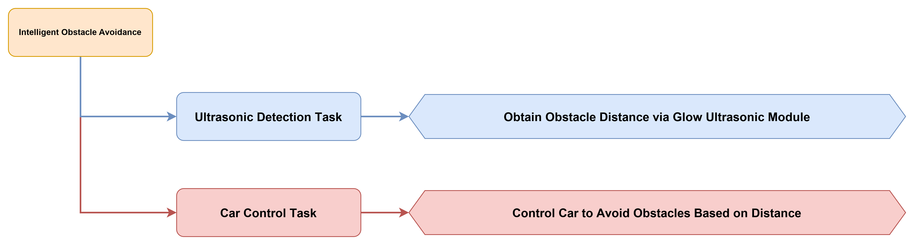

#### 6.4.6.3 Module Description


The WonderLLM module features a built-in high-performance ESP32-S3 chip that achieves color recognition, face detection, and other functions through programming. Equipped with an I2C port, the module conveniently exchanges data with various main controllers, providing an efficient solution for intelligent vision applications.

Module Wiring: Before running the program in this section, connect the module to any I2C port highlighted in the red box on the servo control board as shown in the figure below.


#### 6.4.6.4 Program Download

> [!NOTE]
>
> **Confirm that the serial port driver is installed before downloading the program.**

1. Connect the core board to the computer via a USB cable.

   

2. Double-click to open the STM32 serial port flashing software **FlyMcu** .

3. Click the **...** icon and select the HEX file to be flashed under the **[Tankbot\MDK-ARM\Tankbot](https://drive.google.com/drive/folders/1hkeeeIiGdYtIg7nQ6Gx45700nlls9owT?usp=sharing)** path of the corresponding project.


4) In ① of the figure below, select the serial port number corresponding to the core board. In ②, set the baud rate to 115200. In ③ and ④, configure the options as shown in the figure.


5) Click **Start ISP(P)** and press the **RST** button on the core board. The program starts downloading automatically. When the log output panel on the right displays the following content, the program download is complete.


#### 6.4.6.5 Implementation Outcome

After entering the dialogue mode of the WonderLLM module via the wake word, speak a command to switch to obstacle avoidance mode, such as "Switch the current mode of the car to obstacle avoidance mode", to control the robot car to drive while avoiding obstacles.

#### 6.4.6.6 Program Analysis

* **main.c File at the Business Layer**

1) Import the hardware library and module library files. The hardware library files include the `adc` library for collecting analog signals, the `DMA` library for data transmission, and the `i2c` library for communicating with other modules. The module library includes files for the buzzer, ultrasonic sensor, and WonderLLM large model module.

```c
/* USER CODE END Header */
/* Includes ------------------------------------------------------------------*/
#include "main.h"
#include "adc.h"
#include "dma.h"
#include "i2c.h"
#include "spi.h"
#include "tim.h"
#include "usart.h"
#include "gpio.h"

/* Private includes ----------------------------------------------------------*/
/* USER CODE BEGIN Includes */

#include "global.h"
#include "stdio.h"
#include "stdlib.h"
#include "led.h"
#include "buzzer.h"
#include "robot_arm.h"
#include "adc_sample.h"
#include "differential_chassis.h"
#include "ultrasound.h"
#include "WonderLLM.h"
#include "LineFollow.h"
```

2. Initialize the hardware interfaces required by the Tankbot first, followed by initializing the LED light, robotic arm, buzzer, glowy ultrasonic sensor, and WonderLLM vision module.

```c
  /* Initialize interrupts */
  MX_NVIC_Init(); 
  /* USER CODE BEGIN 2 */
	led_init();
	buzzer_init();
	adc_sample_init();
  robot_arm_init(); 
	
	HAL_Delay(1000);
	MX_I2C1_Init();
	WonderLLM_Init();// Initialize large model module
	
	ultrasound_init();
	LineFollowIIC_init();
	differential_chassis_init();
```

3. In the main loop, repeatedly call the data processing function of the WonderLLM module to obtain the control commands sent by the module.

```c
  while (1)
  {	
		WonderLLM_Poll_And_Process(); 				// Large model module data transmission and processing
```

4. When the robot car is in ultrasonic obstacle avoidance mode `Ultrasonic_Avoid_Mode`, it detects obstacles through the ultrasonic sensor and controls the robot to avoid them.

(1) Mode Switching and Initialization

When the current mode switches to `Ultrasonic_Avoid_Mode`, initialization is executed. The program resets the robotic arm via `robot_arm_knot_run()` using the `SERIAL_SERVO5_RESET_DUTY` setting, and stops the chassis by calling `differentials_chassis_run(0, 0)`.

```c
			case Ultrasonic_Avoid_Mode:  // Ultrasonic obstacle avoidance mode
				if(last_running_mode != Ultrasonic_Avoid_Mode){
					robot_arm_knot_run(5,SERIAL_SERVO5_RESET_DUTY,500);
					differentials_chassis_run(0,0);
				}
```

(2) Acquire and Process Data from the Ultrasonic Module

① If the distance is less than 300, set the RGB light color to red, stop the robot car, and jump to `step=1`. If the distance is greater than or equal to 300, the robot car adjusts its obstacle avoidance speed according to the detected distance.

```c
					case 0:{
						if(distance < 300){
							rgb_left[1] = rgb_left[2] = rgb_right[1] = rgb_right[2] =0;
							rgb_left[0] = rgb_right[0] = 250;
							set_ultrasound_color(0, rgb_left, rgb_right);
							avoid_speed = 0.0;
							step = 1;
						}else{
							avoid_speed = (float)((distance - 100) / 2) > 80 ? 100 : ((distance - 100) / 2);
						}
						
						differentials_chassis_run(avoid_speed, 0.0f);
						break;
					}
```

② The robotic arm executes an action by calling the `robot_arm_knot_run()` function to rotate servo 6, using the ultrasonic module to detect the obstacle distances on the left and right sides. Then, call the `differentials_chassis_run()` function to steer the robot car and avoid obstacles.

```c
					case 1:{
						robot_arm_knot_run(6 , 875 , 900);
						HAL_Delay(1200);
						left_distance = get_ultrasound_distance();
						robot_arm_knot_run(6, 125 , 1900);
						HAL_Delay(2200);
						right_distance = get_ultrasound_distance();
						robot_arm_knot_run(6, 500, 1000);
						if(left_distance > right_distance){
							differentials_chassis_run(0.0f , 1.0f);
						}else{
							differentials_chassis_run(0.0f, -1.0f);
						}
						HAL_Delay(1000);
						
						rgb_left[0] = rgb_left[2] = rgb_right[0] = rgb_right[2] =0;
						rgb_left[1] = rgb_right[1] = 250;
						set_ultrasound_color(0, rgb_left, rgb_right);	
						differentials_chassis_run(0.0f, 0.0f);
						step = 0;
						break;
					}

					default:
						break;
```

* **WonderLLM.c File at the Underlying Layer**

The `WonderLLM.c` file primarily implements I2C communication between the Tankbot and the WonderLLM module, and parses control commands from the module. By parsing JSON command strings, it executes robot control actions such as moving, gripping objects, and controlling lights.

1. In the `WonderLLM_Init` function, query whether the I2C device is ready, set the I2C clock speed to 400 kHz, and write the MCP tools via the `register_tools` function to register the functions of the large model module.

```c
bool WonderLLM_Init(void) {
    uint32_t start_tick = HAL_GetTick(); // Record start time

    while (1) {
        // 1. Check if the device is ready using a short timeout
        HAL_StatusTypeDef status = HAL_I2C_IsDeviceReady(&hi2c1, WonderLLM_SLAVE_ADDRESS, 3, 50);

        if (status == HAL_OK) {
            // Device found, execute initialization sequence
            hi2c1.Init.ClockSpeed = 400000;
            if (HAL_I2C_Init(&hi2c1) != HAL_OK) {
                // If speed increase fails, restore and return error
                hi2c1.Init.ClockSpeed = 100000;
                HAL_I2C_Init(&hi2c1);
//							   buzzer_toggle(50, 50, 4);
                return false;
            }
            HAL_Delay(5);

            register_tools(); // Call MCP write tools
            buzzer_toggle(50, 50, 2);
						
						// Restore I2C clock speed
						hi2c1.Init.ClockSpeed = 100000;
						HAL_I2C_Init(&hi2c1);
            
            return true; // Initialization successful, exit properly
        }
        
        // 2. If device is not found, check for timeout
        if (HAL_GetTick() - start_tick > 3000) {
					  buzzer_toggle(50, 50, 3);

            // Device still not found after 3 seconds, initialization failed
            return false;
        }
    }
}
```

2. The register_tools function contains all available tools registered to the WonderLLM module. Before using the module to control the robot car, send the available functions to the module so that the large model can control the car. The functions registered via MCP include car movement control, steering control, status query, mode switching, ultrasonic light control, buzzer control, and visual recognition.

```c
/**
 * @brief Register all available tools (functions) to the WonderLLM module
 */
static bool register_tools(void) {
	
		const char* tool_move = "{\"tool_name\":\"self.Tankbot.move\","
			"\"command\":\"'move' only returns forward, backward, left, or right, with speed in mm/s. For in-place turns, the angular velocity is positive for left and negative for right; 'rot' cannot be 0 when turning. Duration defaults to 0, indicating the current state is maintained indefinitely, in ms.\","
			"\"params\":[[\"move\",\"string\"],[\"speed\",\"int\",0,80],[\"rot\",\"int\",-9,9],[\"duration\",\"int\"]],\"block\":\"true\",\"return\":\"false\"}";
		if (!send_frame((uint8_t*)tool_move, strlen(tool_move))) return false;
		
		const char* tool_arm_control = "{\"tool_name\":\"self.Tankbot.arm\","
			"\"command\":\"'start' is for grabbing, defaulting to grabbing in the center; 'end' is for placing. Both only return 'null', 'left', 'center', or 'right'. When there is only one operation, either 'start' or 'end' must return 'null'; if no position is specified, return 'null'.\","
			"\"params\":[[\"start\",\"string\"],[\"end\",\"string\"]],\"block\":\"true\",\"return\":\"false\"}";
		if (!send_frame((uint8_t*)tool_arm_control, strlen(tool_arm_control))) return false;

    const char* tool_status = "{\"tool_name\":\"self.Tankbot.get_status\",\"command\":\"Call this tool to get the real-time status of the car. Queryable statuses include: 'battery' in V, 'distance' in cm, 'running_mode'.\","
			"\"params\":[[\"status_name\",\"string\"]],\"block\":\"true\",\"return\":\"true\"}";
    if (!send_frame((uint8_t*)tool_status, strlen(tool_status))) return false;

    const char* tool_mode = 
			"{\"tool_name\":\"self.Tankbot.set_mode\",\"command\":\"Call this tool to switch the operating mode of the car. 'distance' defaults to 300, in mm. Switchable modes include: 'avoid', 'follow', 'line_patrol', 'smart_transportation', 'normal'.\","
			"\"params\":[[\"running_mode\",\"string\"],[\"distance\",\"int\"]],\"block\":\"true\",\"return\":\"false\"}";
    if (!send_frame((uint8_t*)tool_mode, strlen(tool_mode))) return false;
				
		const char* tool_led = 
        "{\"tool_name\":\"self.Tankbot.set_color\","
		"\"command\":\"0 is steady-on mode, 1 is breathing light mode, defaulting to 0. Parameters are the RGB values for the left and right lights respectively. In breathing light mode, lr, lg, lb, rr, rg, rb represent the corresponding color breathing times, lr=20 means bright red cycle for 2 seconds\","
        "\"params\":[[\"rgb_mode\",\"int\",0,1],[\"lr\",\"int\",0,255],[\"lg\",\"int\",0,255],[\"lb\",\"int\",0,255],"
                   "[\"rr\",\"int\",0,255],[\"rg\",\"int\",0,255],[\"rb\",\"int\",0,255]],"
        "\"block\":\"true\",\"return\":\"false\"}";
		if (!send_frame((uint8_t*)tool_led, strlen(tool_led))) return false;
	
		const char* tool_buzzer = 
			"{\"tool_name\":\"self.Tankbot.set_buzzer\",\"command\":\"Call this tool to control the car's buzzer. 'count' is the number of times the buzzer sounds\","
			"\"params\":[[\"count\",\"int\"]],\"block\":\"true\",\"return\":\"false\"}";
    if (!send_frame((uint8_t*)tool_buzzer, strlen(tool_buzzer))) return false;
		
		const char* tool_recognition = 
			"{\"tool_name\":\"self.Tankbot.set_recognition\",\"command\":\"Before letting the robotic arm look for items, you must call this tool to complete preparation before calling vision-based recognition functions. The 'string' return value can only be the direction center, left, or right, defaulting to center\","
			"\"params\":[[\"recognition\",\"string\"]],\"block\":\"true\",\"return\":\"false\"}";
    if (!send_frame((uint8_t*)tool_recognition, strlen(tool_recognition))) return false;
	
				
    const char* tool_finish = "{\"command\":\"mcp_setting\",\"params\":\"true\"}";
    if (!send_frame((uint8_t*)tool_finish, strlen(tool_finish))) return false;
    
    return true;
}
```

* **differential_chassis.c File at the Underlying Layer**

  The following analysis takes `differentials_chassis_run` as an example:

1. Define an array to store the motor speeds along with variables for the left and right wheel speeds. Based on differential chassis kinematics and the passed linear and angular velocities, calculate the speeds of the left and right wheels.

```c
void differentials_chassis_run(float speed, float rot)
{
	int8_t motor_speed[4];
	float vr, vl;
	
	speed = speed > MAX_SPEED ? MAX_SPEED : speed < MIN_SPEED ? MIN_SPEED : speed;
	rot = rot > MAX_ROT ? MAX_ROT : rot < MIN_ROT ? MIN_ROT : rot;
	
	vr = speed + rot * HALF_FR_WHEELBASE;
	vl = speed - rot * HALF_FR_WHEELBASE;

	motor_speed[0] = -(int8_t)vl;
	motor_speed[1] = 0;
	motor_speed[2] = (int8_t)vr; 
	motor_speed[3] = 0;
	
	set_motor_speed(motor_speed);
}
```

2. Finally, pass the speeds into the `motor_speed` array. Because the left and right wheel motors are oriented in opposite directions, set the left wheel motor speed to the opposite direction, and then call `set_motor_speed` to set the motor speeds and control the chassis movement.

```c
	motor_speed[0] = -(int8_t)vl;
	motor_speed[1] = 0;
	motor_speed[2] = (int8_t)vr; 
	motor_speed[3] = 0;
	
	set_motor_speed(motor_speed);
```

### 6.4.7 Intelligent Traffic

#### 6.4.7.1 Project Description

This section focuses on sending control commands to the robot car through the WonderLLM module to achieve intelligent traffic.

#### 6.4.7.2 Implementation Process

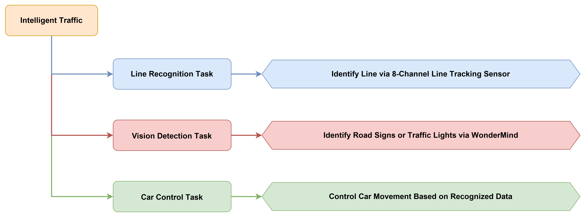

#### 6.4.7.3 Module Description


The WonderLLM module features a built-in high-performance ESP32-S3 chip that achieves color recognition, face detection, and other functions through programming. Equipped with an I2C port, the module conveniently exchanges data with various main controllers, providing an efficient solution for intelligent vision applications.

Module Wiring: Before running the program in this section, connect the module to any I2C port highlighted in the red box on the servo control board as shown in the figure below.


#### 6.4.7.4 Program Download

> [!NOTE]
>
> **Confirm that the serial port driver is installed before downloading the program.**

1. Connect the core board to the computer via a USB cable.

   

2. Double-click to open the STM32 serial port flashing software **FlyMcu** .

3. Click the **...** icon and select the HEX file to be flashed under the **[Tankbot\MDK-ARM\Tankbot](https://drive.google.com/drive/folders/1hkeeeIiGdYtIg7nQ6Gx45700nlls9owT?usp=sharing)** path of the corresponding project.


4) In ① of the figure below, select the serial port number corresponding to the core board. In ②, set the baud rate to 115200. In ③ and ④, configure the options as shown in the figure.


5) Click **Start ISP(P)** and press the **RST** button on the core board. The program starts downloading automatically. When the log output panel on the right displays the following content, the program download is complete.


#### 6.4.7.5  Program Outcome

After entering the dialogue mode of the WonderLLM module via the wake word, speak a command to switch to smart transportation mode, such as "Switch the current mode of the car to smart transportation mode", to control the robot car to follow the black line. Meanwhile, the robot car performs road sign detection and traffic light recognition, and moves accordingly based on the visual recognition results. For example, it stops upon recognizing a red light, continues moving forward on a green light, and turns left upon recognizing a left-turn sign.

#### 6.4.7.6 Program Analysis

* **main.c File at the Business Layer**

1) Import the hardware library and module library files. The hardware library files include the `adc` library for collecting analog signals, the `DMA` library for data transmission, and the `i2c` library for communicating with other modules. The module library includes files for the buzzer, ultrasonic sensor, and WonderLLM large model module.

```c
/* USER CODE END Header */
/* Includes ------------------------------------------------------------------*/
#include "main.h"
#include "adc.h"
#include "dma.h"
#include "i2c.h"
#include "spi.h"
#include "tim.h"
#include "usart.h"
#include "gpio.h"

/* Private includes ----------------------------------------------------------*/
/* USER CODE BEGIN Includes */

#include "global.h"
#include "stdio.h"
#include "stdlib.h"
#include "led.h"
#include "buzzer.h"
#include "robot_arm.h"
#include "adc_sample.h"
#include "differential_chassis.h"
#include "ultrasound.h"
#include "WonderLLM.h"
#include "LineFollow.h"
```

2. Initialize the hardware interfaces required by the Tankbot first, followed by initializing the LED light, robotic arm, buzzer, glowy ultrasonic sensor, and WonderLLM vision module.

```c
  /* Initialize interrupts */
  MX_NVIC_Init(); 
  /* USER CODE BEGIN 2 */
	led_init();
	buzzer_init();
	adc_sample_init();
  robot_arm_init(); 
	
	HAL_Delay(1000);
	MX_I2C1_Init();
	WonderLLM_Init();// Initialize large model module
	
	ultrasound_init();
	LineFollowIIC_init();
	differential_chassis_init();
```

3. In the main loop, repeatedly call the data processing function of the WonderLLM module to obtain the control commands sent by the module.

```c
  while (1)
  {	
		WonderLLM_Poll_And_Process(); 				// Large model module data transmission and processing
```

4. When the robot car is in smart transportation mode `WonderLLM_Traffic_Mode`, it first processes mode switching, and then moves forward at a fixed speed while adjusting its rotation speed according to the return value of the `LineFollowControl()` function.

```c
			case WonderLLM_Traffic_Mode:  // Smart transportation mode
				if(last_running_mode != WonderLLM_Traffic_Mode){
					robot_arm_knot_run(5,300,500);
					differentials_chassis_run(0,0);
				}
				differentials_chassis_run(50, LineFollowControl(WonderLLM_Traffic_Mode));
				break;
```

* **WonderLLM.c File at the Underlying Layer**

The `WonderLLM.c` file primarily implements I2C communication between the Tankbot and the WonderLLM module, and parses control commands from the module. By parsing JSON command strings, it executes robot control actions such as moving, gripping objects, and controlling lights.

1. In the `WonderLLM_Init` function, query whether the I2C device is ready, set the I2C clock speed to 400 kHz, and write the MCP tools via the `register_tools` function to register the functions of the large model module.

```c
bool WonderLLM_Init(void) {
    uint32_t start_tick = HAL_GetTick(); // Record start time

    while (1) {
        // 1. Check if the device is ready using a short timeout
        HAL_StatusTypeDef status = HAL_I2C_IsDeviceReady(&hi2c1, WonderLLM_SLAVE_ADDRESS, 3, 50);

        if (status == HAL_OK) {
            // Device found, execute initialization sequence
            hi2c1.Init.ClockSpeed = 400000;
            if (HAL_I2C_Init(&hi2c1) != HAL_OK) {
                // If speed increase fails, restore and return error
                hi2c1.Init.ClockSpeed = 100000;
                HAL_I2C_Init(&hi2c1);
//							   buzzer_toggle(50, 50, 4);
                return false;
            }
            HAL_Delay(5);

            register_tools(); // Call MCP write tools
            buzzer_toggle(50, 50, 2);
						
						// Restore I2C clock speed
						hi2c1.Init.ClockSpeed = 100000;
						HAL_I2C_Init(&hi2c1);
            
            return true; // Initialization successful, exit properly
        }
        
        // 2. If device is not found, check for timeout
        if (HAL_GetTick() - start_tick > 3000) {
					  buzzer_toggle(50, 50, 3);

            // Device still not found after 3 seconds, initialization failed
            return false;
        }
    }
}
```

2. The register_tools function contains all available tools registered to the WonderLLM module. Before using the module to control the robot car, send the available functions to the module so that the large model can control the car. The functions registered via MCP include car movement control, steering control, status query, mode switching, ultrasonic light control, buzzer control, and visual recognition.

```c
/**
 * @brief Register all available tools (functions) to the WonderLLM module
 */
static bool register_tools(void) {
	
		const char* tool_move = "{\"tool_name\":\"self.Tankbot.move\","
			"\"command\":\"'move' only returns forward, backward, left, or right, with speed in mm/s. For in-place turns, the angular velocity is positive for left and negative for right; 'rot' cannot be 0 when turning. Duration defaults to 0, indicating the current state is maintained indefinitely, in ms.\","
			"\"params\":[[\"move\",\"string\"],[\"speed\",\"int\",0,80],[\"rot\",\"int\",-9,9],[\"duration\",\"int\"]],\"block\":\"true\",\"return\":\"false\"}";
		if (!send_frame((uint8_t*)tool_move, strlen(tool_move))) return false;
		
		const char* tool_arm_control = "{\"tool_name\":\"self.Tankbot.arm\","
			"\"command\":\"'start' is for grabbing, defaulting to grabbing in the center; 'end' is for placing. Both only return 'null', 'left', 'center', or 'right'. When there is only one operation, either 'start' or 'end' must return 'null'; if no position is specified, return 'null'.\","
			"\"params\":[[\"start\",\"string\"],[\"end\",\"string\"]],\"block\":\"true\",\"return\":\"false\"}";
		if (!send_frame((uint8_t*)tool_arm_control, strlen(tool_arm_control))) return false;

    const char* tool_status = "{\"tool_name\":\"self.Tankbot.get_status\",\"command\":\"Call this tool to get the real-time status of the car. Queryable statuses include: 'battery' in V, 'distance' in cm, 'running_mode'.\","
			"\"params\":[[\"status_name\",\"string\"]],\"block\":\"true\",\"return\":\"true\"}";
    if (!send_frame((uint8_t*)tool_status, strlen(tool_status))) return false;

    const char* tool_mode = 
			"{\"tool_name\":\"self.Tankbot.set_mode\",\"command\":\"Call this tool to switch the operating mode of the car. 'distance' defaults to 300, in mm. Switchable modes include: 'avoid', 'follow', 'line_patrol', 'smart_transportation', 'normal'.\","
			"\"params\":[[\"running_mode\",\"string\"],[\"distance\",\"int\"]],\"block\":\"true\",\"return\":\"false\"}";
    if (!send_frame((uint8_t*)tool_mode, strlen(tool_mode))) return false;
				
		const char* tool_led = 
        "{\"tool_name\":\"self.Tankbot.set_color\","
		"\"command\":\"0 is steady-on mode, 1 is breathing light mode, defaulting to 0. Parameters are the RGB values for the left and right lights respectively. In breathing light mode, lr, lg, lb, rr, rg, rb represent the corresponding color breathing times, lr=20 means bright red cycle for 2 seconds\","
        "\"params\":[[\"rgb_mode\",\"int\",0,1],[\"lr\",\"int\",0,255],[\"lg\",\"int\",0,255],[\"lb\",\"int\",0,255],"
                   "[\"rr\",\"int\",0,255],[\"rg\",\"int\",0,255],[\"rb\",\"int\",0,255]],"
        "\"block\":\"true\",\"return\":\"false\"}";
		if (!send_frame((uint8_t*)tool_led, strlen(tool_led))) return false;
	
		const char* tool_buzzer = 
			"{\"tool_name\":\"self.Tankbot.set_buzzer\",\"command\":\"Call this tool to control the car's buzzer. 'count' is the number of times the buzzer sounds\","
			"\"params\":[[\"count\",\"int\"]],\"block\":\"true\",\"return\":\"false\"}";
    if (!send_frame((uint8_t*)tool_buzzer, strlen(tool_buzzer))) return false;
		
		const char* tool_recognition = 
			"{\"tool_name\":\"self.Tankbot.set_recognition\",\"command\":\"Before letting the robotic arm look for items, you must call this tool to complete preparation before calling vision-based recognition functions. The 'string' return value can only be the direction center, left, or right, defaulting to center\","
			"\"params\":[[\"recognition\",\"string\"]],\"block\":\"true\",\"return\":\"false\"}";
    if (!send_frame((uint8_t*)tool_recognition, strlen(tool_recognition))) return false;
	
				
    const char* tool_finish = "{\"command\":\"mcp_setting\",\"params\":\"true\"}";
    if (!send_frame((uint8_t*)tool_finish, strlen(tool_finish))) return false;
    
    return true;
}
```

3. Parse commands related to traffic recognition.

Set `vision_result` to different values according to the traffic signal recognition results, and finally call `WonderLLM_Send_Action_Finish()` to inform the system that the task is completed.

```c
	// Traffic recognition
	else if (strstr(json_str, "Traffic") != NULL) {  
		if (strstr(json_str, "left") != NULL){
			vision_result = Left;
		}else if(strstr(json_str, "right") != NULL){
			vision_result = Right;
		}else if((strstr(json_str, "stop") != NULL) || (strstr(json_str, "red") != NULL) || (strstr(json_str, "yellow") != NULL)){
			vision_result = Stop;
		}else if(strstr(json_str, "green") != NULL){
			vision_result = Green;
		}
		
		WonderLLM_Send_Action_Finish();
	}
```

* **LineFollow.c File at the Underlying Layer**

When the visual recognition result is `Left`, control the chassis to turn right at a speed of 30.

```c
				while(1){
					if(vision_result == Left){
						differentials_chassis_run(30,-0.5);
```

When the visual recognition result is `Right`, control the chassis to turn left at a speed of 30.

```c
					}else if(vision_result == Right){
						differentials_chassis_run(30,0.5);
```

When the visual recognition result is `Green`, control the chassis to move forward normally.

```c
			}else{
				if(vision_result == Green){
						vision_result = Vision_NULL;
					}	
```

* **differential_chassis.c File at the Underlying Layer**

The following analysis takes `differentials_chassis_run` as an example:

1) Define an array to store the motor speeds along with variables for the left and right wheel speeds. Based on differential chassis kinematics and the passed linear and angular velocities, calculate the speeds of the left and right wheels.

```c
void differentials_chassis_run(float speed, float rot)
{
	int8_t motor_speed[4];
	float vr, vl;
	
	speed = speed > MAX_SPEED ? MAX_SPEED : speed < MIN_SPEED ? MIN_SPEED : speed;
	rot = rot > MAX_ROT ? MAX_ROT : rot < MIN_ROT ? MIN_ROT : rot;
	
	vr = speed + rot * HALF_FR_WHEELBASE;
	vl = speed - rot * HALF_FR_WHEELBASE;
```

2) Finally, pass the speeds into the `motor_speed` array. Because the left and right wheel motors are oriented in opposite directions, set the left wheel motor speed to the opposite direction, and then call `set_motor_speed` to set the motor speeds and control the chassis movement.

```c
	motor_speed[0] = -(int8_t)vl;
	motor_speed[1] = 0;
	motor_speed[2] = (int8_t)vr; 
	motor_speed[3] = 0;
	
	set_motor_speed(motor_speed);
}
```

### 6.4.8 Intelligent Handling

#### 6.4.8.1 Project Description

This section focuses on sending control commands to the robot car through the WonderLLM module to achieve intelligent handling.

#### 6.4.8.2 Implementation Process


#### 6.4.8.3 Module Description


The WonderLLM module features a built-in high-performance ESP32-S3 chip that achieves color recognition, face detection, and other functions through programming. Equipped with an I2C port, the module conveniently exchanges data with various main controllers, providing an efficient solution for intelligent vision applications.

Module Wiring: Before running the program in this section, connect the module to any I2C port highlighted in the red box on the servo control board as shown in the figure below.


#### 6.4.8.4 Program Download

> [!NOTE]
>
> **Confirm that the serial port driver is installed before downloading the program.**

1. Connect the core board to the computer via a USB cable.

   

2. Double-click to open the STM32 serial port flashing software **FlyMcu** .

3. Click the **...** icon and select the HEX file to be flashed under the **[Tankbot\MDK-ARM\Tankbot](https://drive.google.com/drive/folders/1hkeeeIiGdYtIg7nQ6Gx45700nlls9owT?usp=sharing)** path of the corresponding project.


4) In ① of the figure below, select the serial port number corresponding to the core board. In ②, set the baud rate to 115200. In ③ and ④, configure the options as shown in the figure.


5) Click **Start ISP(P)** and press the RST button on the core board. The program starts downloading automatically. When the log output panel on the right displays the following content, the program download is complete.


#### 6.4.8.5 Implementation Outcome

When a command such as "If there is a red object ahead, grip it and place it on the left" is spoken to the WonderLLM module, the robot car first recognizes the color of the object. If the object is red, the robot car grips it and places it on the left.

#### 6.4.8.6 Program Analysis

* **main.c File at the Business Layer**

1) Import the hardware library and module library files. The hardware library files include the `adc` library for collecting analog signals, the `DMA` library for data transmission, and the `i2c` library for communicating with other modules. The module library includes files for the buzzer, ultrasonic sensor, and WonderLLM large model module.

```c
/* USER CODE END Header */
/* Includes ------------------------------------------------------------------*/
#include "main.h"
#include "adc.h"
#include "dma.h"
#include "i2c.h"
#include "spi.h"
#include "tim.h"
#include "usart.h"
#include "gpio.h"

/* Private includes ----------------------------------------------------------*/
/* USER CODE BEGIN Includes */

#include "global.h"
#include "stdio.h"
#include "stdlib.h"
#include "led.h"
#include "buzzer.h"
#include "robot_arm.h"
#include "adc_sample.h"
#include "differential_chassis.h"
#include "ultrasound.h"
#include "WonderLLM.h"
#include "LineFollow.h"
```

2. Initialize the hardware interfaces required by the Tankbot first, followed by initializing the LED light, robotic arm, buzzer, glowy ultrasonic sensor, and WonderLLM vision module.

```c
  /* Initialize interrupts */
  MX_NVIC_Init(); 
  /* USER CODE BEGIN 2 */
	led_init();
	buzzer_init();
	adc_sample_init();
  robot_arm_init(); 
	
	HAL_Delay(1000);
	MX_I2C1_Init();
	WonderLLM_Init();// Initialize large model module
	
	ultrasound_init();
	LineFollowIIC_init();
	differential_chassis_init();
```

3. In the main loop, repeatedly call the data processing function of the WonderLLM module to obtain the control commands sent by the module.

```c
  while (1)
  {	
		WonderLLM_Poll_And_Process(); 				// Large model module data transmission and processing
```

4. When the robot car performs intelligent handling, the robotic arm processes gripping and placing actions at the left, center, and right positions respectively.

(1) Left Arm Action

Move to the left initial position first, then move to the left gripping position, and call `robot_arm_claw_set(0, 500)` to close the gripper and grab the object. Move back to the left initial position. Finally, call `WonderLLM_Send_Action_Finish()` to send an action completion signal.

```c
					switch(start_arm){
						case Arm_Left:
							robot_arm_coordinate_set(0.2,12.6,-3.2,-40,-90,10,1500);  // Left initial posture
							HAL_Delay(2000);
							robot_arm_coordinate_set(0.2,24.2,-15,-60,90,10,1500);   // Left gripping
							HAL_Delay(2000);
							robot_arm_claw_set(0, 500);
							HAL_Delay(1000);
							robot_arm_coordinate_set(0.2,15,2,-40,-90,10,1500);  // Left initial posture
							HAL_Delay(2000);
							WonderLLM_Send_Action_Finish();
							break;
```

(2) Center Arm Action

Move to the center initial position first, then move to the center gripping position, and call `robot_arm_claw_set(0, 500)` to close the gripper and grab the object. Move back to the center initial position. Finally, call `WonderLLM_Send_Action_Finish()` to send an action completion signal.

```c
						case Arm_Center:
							robot_arm_coordinate_set(12.6,0,-3.2,-40,-90,10,1500);  // Center initial posture
							HAL_Delay(2000);
							robot_arm_coordinate_set(24.2,0,-15,-60,-90,10,1500);   // Center gripping
							HAL_Delay(2000);
							robot_arm_claw_set(0, 500);
							HAL_Delay(1000);
							robot_arm_coordinate_set(15,0,2,-40,-90,10,1500);  // Center initial posture
							HAL_Delay(2000);
							WonderLLM_Send_Action_Finish();
							break;
```

(3) Right Arm Action

Move to the right initial position first, then move to the right gripping position, and call `robot_arm_claw_set(0, 500)` to close the gripper and grab the object. Move back to the right initial position. Finally, call `WonderLLM_Send_Action_Finish()` to send an action completion signal.

```c
						case Arm_Right:
							robot_arm_coordinate_set(0.2,-12.6,-3.2,-40,-90,10,1500);  // Right initial posture
							HAL_Delay(2000);
							robot_arm_coordinate_set(0.2,-24.2,-15,-60,90,10,1500);   // Right gripping
							HAL_Delay(2000);
							robot_arm_claw_set(0, 500);
							HAL_Delay(1000);
							robot_arm_coordinate_set(0.2,15,2,-40,-90,10,1500);  // Right initial posture
							HAL_Delay(2000);
							WonderLLM_Send_Action_Finish();
							break;
						
```

* **WonderLLM.c File at the Underlying Layer**

The `WonderLLM.c` file primarily implements I2C communication between the Tankbot and the WonderLLM module, and parses control commands from the module. By parsing JSON command strings, it executes robot control actions such as moving, gripping objects, and controlling lights.

1. In the `WonderLLM_Init` function, query whether the I2C device is ready, set the I2C clock speed to 400 kHz, and write the MCP tools via the `register_tools` function to register the functions of the large model module.

```c
bool WonderLLM_Init(void) {
    uint32_t start_tick = HAL_GetTick(); // Record start time

    while (1) {
        // 1. Check if the device is ready using a short timeout
        HAL_StatusTypeDef status = HAL_I2C_IsDeviceReady(&hi2c1, WonderLLM_SLAVE_ADDRESS, 3, 50);

        if (status == HAL_OK) {
            // Device found, execute initialization sequence
            hi2c1.Init.ClockSpeed = 400000;
            if (HAL_I2C_Init(&hi2c1) != HAL_OK) {
                // If speed increase fails, restore and return error
                hi2c1.Init.ClockSpeed = 100000;
                HAL_I2C_Init(&hi2c1);
//							   buzzer_toggle(50, 50, 4);
                return false;
            }
            HAL_Delay(5);

            register_tools(); // Call MCP write tools
            buzzer_toggle(50, 50, 2);
						
						// Restore I2C clock speed
						hi2c1.Init.ClockSpeed = 100000;
						HAL_I2C_Init(&hi2c1);
            
            return true; // Initialization successful, exit properly
        }
        
        // 2. If device is not found, check for timeout
        if (HAL_GetTick() - start_tick > 3000) {
					  buzzer_toggle(50, 50, 3);

            // Device still not found after 3 seconds, initialization failed
            return false;
        }
    }
}
```

2. The `register_tools` function contains all available tools registered to the WonderLLM module. Before using the module to control the robot car, send the available functions to the module so that the large model can control the car. The functions registered via MCP include car movement control, steering control, status query, mode switching, ultrasonic light control, buzzer control, and visual recognition.

```c
/**
 * @brief Register all available tools (functions) to the WonderLLM module
 */
static bool register_tools(void) {
	
		const char* tool_move = "{\"tool_name\":\"self.Tankbot.move\","
			"\"command\":\"'move' only returns forward, backward, left, or right, with speed in mm/s. For in-place turns, the angular velocity is positive for left and negative for right; 'rot' cannot be 0 when turning. Duration defaults to 0, indicating the current state is maintained indefinitely, in ms.\","
			"\"params\":[[\"move\",\"string\"],[\"speed\",\"int\",0,80],[\"rot\",\"int\",-9,9],[\"duration\",\"int\"]],\"block\":\"true\",\"return\":\"false\"}";
		if (!send_frame((uint8_t*)tool_move, strlen(tool_move))) return false;
		
		const char* tool_arm_control = "{\"tool_name\":\"self.Tankbot.arm\","
			"\"command\":\"'start' is for grabbing, defaulting to grabbing in the center; 'end' is for placing. Both only return 'null', 'left', 'center', or 'right'. When there is only one operation, either 'start' or 'end' must return 'null'; if no position is specified, return 'null'.\","
			"\"params\":[[\"start\",\"string\"],[\"end\",\"string\"]],\"block\":\"true\",\"return\":\"false\"}";
		if (!send_frame((uint8_t*)tool_arm_control, strlen(tool_arm_control))) return false;

    const char* tool_status = "{\"tool_name\":\"self.Tankbot.get_status\",\"command\":\"Call this tool to get the real-time status of the car. Queryable statuses include: 'battery' in V, 'distance' in cm, 'running_mode'.\","
			"\"params\":[[\"status_name\",\"string\"]],\"block\":\"true\",\"return\":\"true\"}";
    if (!send_frame((uint8_t*)tool_status, strlen(tool_status))) return false;

    const char* tool_mode = 
			"{\"tool_name\":\"self.Tankbot.set_mode\",\"command\":\"Call this tool to switch the operating mode of the car. 'distance' defaults to 300, in mm. Switchable modes include: 'avoid', 'follow', 'line_patrol', 'smart_transportation', 'normal'.\","
			"\"params\":[[\"running_mode\",\"string\"],[\"distance\",\"int\"]],\"block\":\"true\",\"return\":\"false\"}";
    if (!send_frame((uint8_t*)tool_mode, strlen(tool_mode))) return false;
				
		const char* tool_led = 
        "{\"tool_name\":\"self.Tankbot.set_color\","
		"\"command\":\"0 is steady-on mode, 1 is breathing light mode, defaulting to 0. Parameters are the RGB values for the left and right lights respectively. In breathing light mode, lr, lg, lb, rr, rg, rb represent the corresponding color breathing times, lr=20 means bright red cycle for 2 seconds\","
        "\"params\":[[\"rgb_mode\",\"int\",0,1],[\"lr\",\"int\",0,255],[\"lg\",\"int\",0,255],[\"lb\",\"int\",0,255],"
                   "[\"rr\",\"int\",0,255],[\"rg\",\"int\",0,255],[\"rb\",\"int\",0,255]],"
        "\"block\":\"true\",\"return\":\"false\"}";
		if (!send_frame((uint8_t*)tool_led, strlen(tool_led))) return false;
	
		const char* tool_buzzer = 
			"{\"tool_name\":\"self.Tankbot.set_buzzer\",\"command\":\"Call this tool to control the car's buzzer. 'count' is the number of times the buzzer sounds\","
			"\"params\":[[\"count\",\"int\"]],\"block\":\"true\",\"return\":\"false\"}";
    if (!send_frame((uint8_t*)tool_buzzer, strlen(tool_buzzer))) return false;
		
		const char* tool_recognition = 
			"{\"tool_name\":\"self.Tankbot.set_recognition\",\"command\":\"Before letting the robotic arm look for items, you must call this tool to complete preparation before calling vision-based recognition functions. The 'string' return value can only be the direction center, left, or right, defaulting to center\","
			"\"params\":[[\"recognition\",\"string\"]],\"block\":\"true\",\"return\":\"false\"}";
    if (!send_frame((uint8_t*)tool_recognition, strlen(tool_recognition))) return false;
	
				
    const char* tool_finish = "{\"command\":\"mcp_setting\",\"params\":\"true\"}";
    if (!send_frame((uint8_t*)tool_finish, strlen(tool_finish))) return false;
    
    return true;
}
```

* **robot_arm.c File at the Underlying Layer**

The following analysis takes `robot_arm_coordinate_set` as an example, which is used to control the position of the robotic arm:

1) This function takes 7 parameters. `target_x`, `target_y`, and `target_z` represent the x, y, and z coordinates of the target position respectively, while `pitch` represents the angle of the end effector relative to the horizontal plane. `min_pitch` and `max_pitch` represent the minimum and maximum angles within the solver range, and `time` specifies the duration for the robotic arm to move to the target position.

```c
uint8_t robot_arm_coordinate_set(float target_x,
								 float target_y,
								 float target_z,
								 float pitch,
								 float min_pitch,
								 float max_pitch,
								 uint32_t time)
{
	
	bool result1_state, result2_state;
	
	KinematicsObjectTypeDef kinematics_result1;
	KinematicsObjectTypeDef kinematics_result2;	
	VectorObjectTypeDef vector;

	vector.x = target_x;
	vector.y = target_y;
	vector.z = target_z;
```

2. Inside the function, define two variables of type `KinematicsObjectTypeDef` to store the parsed kinematics data, along with a variable of type `VectorObjectTypeDef` to temporarily store the vector, and pass the x, y, and z coordinates of the target position into `vector`.

```c
   bool result1_state, result2_state;

   KinematicsObjectTypeDef kinematics_result1;
   KinematicsObjectTypeDef kinematics_result2;	
   VectorObjectTypeDef vector;

   vector.x = target_x;
   vector.y = target_y;
   vector.z = target_z;
```

3. Call the `set_pitch_range` function to calculate whether a valid solution exists for the target position. If a solution exists, it returns `true` and stores the calculated data in the `KinematicsObjectTypeDef` variable.

```c
	result1_state = set_pitch_range(&kinematics_result1, &vector, pitch, min_pitch);
	result2_state = set_pitch_range(&kinematics_result2, &vector, pitch, max_pitch);
```

4) If `result1_state` has a valid solution, pass the calculated end effector angle, coordinates, and joint angle data into the global variable `kinematics`. If `result2_state` also has a valid solution, compare the angles of the end effector and select the solution closest to the target angle.

```c
	if (result1_state)
	{
		kinematics.alpha = kinematics_result1.alpha;
		kinematics.vector.x = kinematics_result1.vector.x;
		kinematics.vector.y = kinematics_result1.vector.y;
		kinematics.vector.z = kinematics_result1.vector.z;
		for (uint8_t i = 0; i< 4; i++)
		{
			kinematics.knot[i].theta = kinematics_result1.knot[i].theta;
		}
		
		if (result2_state)
		{
			if (fabs(kinematics_result2.alpha - pitch) < fabs(kinematics_result1.alpha - pitch))
			{
				kinematics.alpha = kinematics_result2.alpha;
				kinematics.vector.x = kinematics_result2.vector.x;
				kinematics.vector.y = kinematics_result2.vector.y;
				kinematics.vector.z = kinematics_result2.vector.z;
				for (uint8_t i = 0; i< 4; i++)
				{
					kinematics.knot[i].theta = kinematics_result2.knot[i].theta;
				}			
			}
		}
	}
```

5) If `result1_state` has no solution, check whether `result2_state` has a valid solution. If a solution exists, pass the calculated data into the global variable `kinematics`. If `result2_state` also has no solution, return `false` to indicate that the target position is unreachable. Otherwise, return `true`.

```c
	else
	{
		if (result2_state)
		{
			kinematics.alpha = kinematics_result2.alpha;
			kinematics.vector.x = kinematics_result2.vector.x;
			kinematics.vector.y = kinematics_result2.vector.y;
			kinematics.vector.z = kinematics_result2.vector.z;
			for (uint8_t i = 0; i< 4; i++)
			{
				kinematics.knot[i].theta = kinematics_result2.knot[i].theta;
			}
		}
		else
		{
			return false;
		}
	}
	result1_state = 0;
	result2_state = 0;
	theta2servo(&kinematics, time);

	return true;
}
```

## 6.5 AI Voice Project Course


### 6.5.1 WonderLLM Offline Voice Introduction

#### 6.5.1.1 Offline Voice Interaction Description

**1.1 Module Introduction**


WonderLLM voice interaction performs speech recognition and voice broadcasting based on the CI1302 chip. It supports offline NN acceleration operations and hardware-accelerated voice signal processing. Through deep noise reduction and neural network models, it analyzes the audio to obtain recognition results.

The CI1302 chip features a Brain Neural Processing Unit core supporting offline NN acceleration operations and voice signal processing hardware acceleration. The CPU clock frequency can reach up to 220MHz, enabling offline far-field speech recognition. It has a built-in 2MB FLASH storage and can support up to 300 command words.

With its easy operation and outstanding speech recognition performance, this module is widely used in applications such as smart homes, conversational robots, educational robots, and vehicle dispatch terminals.


**1.2 Working Principle**

The module uses a wake-word mode for activation. Users need to speak the wake-up word to activate the module before recognition can be performed. The default recognition language is English, and the English wake-up keyword is **Hello Hiwonder**. If no voice is recognized within 15 seconds, the module enters sleep mode, and users must wake it up again before use.

When the CI1302 chip recognizes the corresponding voice term, it sends the command of the corresponding term to the I2C chip and provides audio feedback broadcast. The I2C chip stores the received voice commands and transmits them via the I2C slave protocol. Specific voice terms can be found in the **Command and Broadcast Word Protocol List** under the same directory as this document.


#### 6.5.1.2 Module Wiring

Module Wiring: As shown in the figure below, connect the module to any I2C interface within the red box on the servo control board before running the program in this section.


#### 6.5.1.3 Precautions

1. Use a 5 V power supply. Otherwise, the module will be damaged.
2. The usage environment should be quiet. Noisy environments will affect the recognition effect.
3. Speak clearly and loudly without speaking too fast when pronouncing terms. It is recommended to maintain a distance of within 5 meters from the module.


### 6.5.2 WonderLLM Firmware Burning Tutorial

* **Voice Chip Burning**

>[!Note]
>The module is burned with the English speech recognition function firmware by default from the factory, and the wake-up word is **Hello Hiwonder**. If users need to reburn the firmware, follow the operations in this document.

1. First, connect the WonderLLM module to the computer using a Type-C data cable by plugging it into the bottom-left Type-C interface.

   

2. Open the file **[Firmware Flashing Tool\PACK_UPDATE_TOOL.exe](https://drive.google.com/drive/folders/1IsZMSKCd41FFhy8bJ-cnhKEjz1c4LzZs?usp=sharing)** in the same directory as this document, select the **CI1302** chip, and then click **Firmware Upgrade**.

   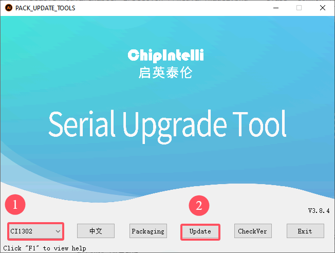

3. Click to select the firmware and locate the file **[CI1302_English_SingleMic_V00729_UART1_115200_2M.bin](https://drive.google.com/drive/folders/14ljg8MAwOjuRJgegJrFYQQd6PuYvD9U-?usp=sharing)** in the same directory as this document.

   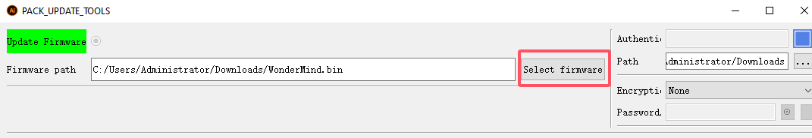

4. Locate the corresponding serial port and select it.

   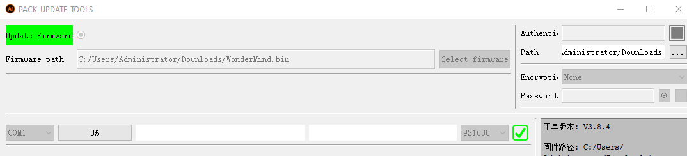

5. Press and hold buttons A and B on the WonderLLM module simultaneously to enter the burning mode, and wait until the burning is successful.

   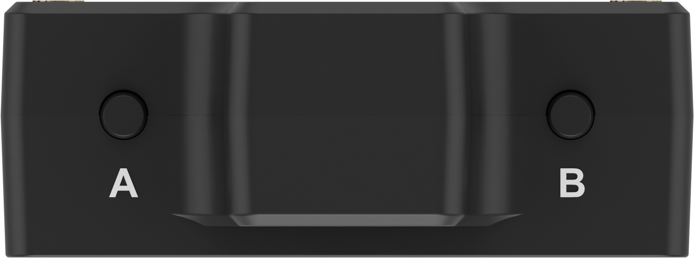


* **ESP32 Chip Burning**

1. Connect the upper Type-C interface of the WonderLLM AI module to the computer using a USB cable as shown in the figure below.


2. Open the **flash_download_tool_3.9.7.exe** burning tool.

   

3. Select Chip Type as **ESP32-S3**, keep other settings as default, and then click OK.

   

4. After the tool opens, click **...** to select the program bin file to be burned, and select the offline voice gameplay bin file under the same directory as this document:

   

5. Check the box on the left, configure other settings according to the figure below, and select the port number occupied by the module for the COM port.

>[!note]
>**If SPI MODE is set to DIO according to the configuration in the figure below and the module fails to work properly after burning the firmware, try setting SPI MODE to DOUT and burn again.**


6. Click **ERASE** first to erase the previously downloaded firmware (this step is mandatory), and wait until the status bar displays **FINISH**.

   

   

7. Click **START** to download the selected firmware, and wait for the progress bar to load completely to finish the firmware download.


8. After the download is complete, unplug and plug back in the data cable. Once the device is powered on again, it will start working according to the new firmware program.

   

### 6.5.3 Voice Interaction

#### 6.5.3.1 Project Introduction

This section uses the WonderLLM module to recognize terms spoken by the user and control the car to execute actions.

#### 6.5.3.2 Implementation Workflow


#### 6.5.3.3 Module Description


The WonderLLM offline voice interaction module performs speech recognition and broadcasting based on the CI1302 chip. It supports offline NN acceleration operations and voice signal processing acceleration hardware. Analysis is performed through deep noise reduction and neural network models to obtain recognition results.

Module Wiring: As shown in the figure below, connect the module to any I2C interface within the red box on the servo control board before running the program in this section.


#### 6.5.3.4 Program Download

> [!NOTE]
>
> **Verify that the serial port driver has been installed before downloading the program.**

1. Connect the core board to the computer using a USB cable.

   

2. Double-click to open the STM32 serial port burning software **FlyMcu** .

3. Click the **...** icon and select the HEX file to be burned under the **[Tankbot\MDK-ARM\Tankbot](https://drive.google.com/drive/folders/1NRvkK-HfG2GBQ-FmfZGjZeda7oOc4t1Q?usp=sharing)** path of the corresponding project.


4) At location ① in the figure below, select the serial port number corresponding to the core board. At location ②, set the baud rate to 115200. Configure locations ③ and ④ according to the options shown in the figure.


5) Click **Start Programming** and press the RST button on the core board. The program will start downloading automatically. When the log output column on the right displays the following content, the program download is complete.


#### 6.5.3.5 Implementation Effect

After the device is powered on, say "Hello Hiwonder" to wake up the voice interaction module, and the module will reply "I am here". Subsequently, users can speak other terms to run the gameplay.

Users can speak terms such as "Hello", "Introduce yourself", "Walk two steps", and "Shake head" to control the car to execute different actions.

If no new command is issued for a long time, the module replies "I am going to rest" and enters sleep mode. To continue running the gameplay, users must wake it up again.

#### 6.5.3.6 Program Analysis

1) Import hardware libraries and module library files. The hardware library files include `adc` library for collecting analog signals, the `DMA` library for data transmission, and `i2c` library for communicating with other modules. The module library includes libraries for the buzzer, ultrasound, and voice interaction modules.

```c
#include "global.h"
#include "stdio.h"
#include "stdlib.h"
#include "led.h"
#include "buzzer.h"
#include "robot_arm.h"
#include "adc_sample.h"
#include "ultrasound.h"
#include "app_porting.h"
#include "differential_chassis.h"
#include "wonder_echo.h"
```

2) Create variables related to speech recognition to store recognition results and system status. The `result` variable is used to store the speech recognition result value, and the `rgb_L` and `rgb_R` arrays are used to control the `LED` color display of the ultrasound module.

```c
uint16_t distance;
int8_t result = 0;
uint8_t rgb_L[3]={0,0,0};
uint8_t rgb_R[3]={0,0,0};
extern WonderEchoHandleTypeDef wonder_echo;
```

3) Initialize the hardware interfaces required by Tankbot, followed by the initialization of modules such as `led` lights, robotic arm, buzzer, and WonderLLM module. Initialize the car to stop moving and control the buzzer to sound once to indicate that system startup is complete.

```c
led_init();
buzzer_init();
adc_sample_init();
robot_arm_init(); 

HAL_Delay(1000);
MX_I2C1_Init();

ultrasound_init();
differential_chassis_init();

wonder_echo_init();

differentials_chassis_run(0.0f, 0.0f);	
buzzer_toggle(50, 50, 1);
```

4) In the loop, call the `echo_recognition()` function to obtain the speech recognition results and execute corresponding actions based on the recognized terms. The program supports four voice commands: Hello (0x1A) executes the robotic arm waving action, including coordinate movement and claw opening and closing; Introduce yourself (0x1B) executes action group 4 and waits for completion before returning to the initial position; Walk two steps (0x1D) makes the car move forward for 1.5 seconds and then stop; Shake head (0x1E) makes the No. 6 servo of the robotic arm swing left and right to simulate a head-shaking action.

```c
result = echo_recognition();

if(result)
{
    if(result==0x1A) //Hello
    {
        robot_arm_coordinate_set(15,0,14,-45,-90,90,500);
        HAL_Delay(600);
        robot_arm_claw_set(30,200);
        HAL_Delay(300);
        robot_arm_claw_set(90,200);
        HAL_Delay(300);
        robot_arm_claw_set(30,200);
        HAL_Delay(300);
        robot_arm_claw_set(90,200);
        HAL_Delay(300);
        robot_arm_coordinate_set(15,0,2,-40,-90,10,1000);
        HAL_Delay(1500);
    }else if(result==0x1B) //Introduce yourself
    {
        while(1)
        {
            if(action_group_run(4, 1))
            {
                action_group_reset();
                break;
            }
        }
        robot_arm_coordinate_set(15,0,2,-40,-90,10,1000);
        HAL_Delay(1500);
    }else if(result==0x1D) //Walk two steps
    {
        differentials_chassis_run(20.0f,0.0f);
        HAL_Delay(1500);
        differentials_chassis_run(0.0f,0.0f);
        HAL_Delay(500);
    }else if(result==0x1E) //Shake head
    {
        robot_arm_knot_run(6,700,500);
        HAL_Delay(600);
        robot_arm_knot_run(6,300,500);
        HAL_Delay(600);
        robot_arm_knot_run(6,700,500);
        HAL_Delay(600);
        robot_arm_knot_run(6,300,500);
        HAL_Delay(600);
        robot_arm_knot_run(6,500,500);
        HAL_Delay(600);
        robot_arm_coordinate_set(15,0,2,-40,-90,10,1000);
        HAL_Delay(1500);
    }
}
```

5) The WonderLLM offline voice mode interacts with the STM32 main control via I2C communication to realize speech recognition functions. This function reads the recognition result from the `ECHO_RESULT_REG` register of the module and returns the result value after waiting for the I2C communication to complete.

```c
int echo_recognition(void)
{
    static uint8_t result = 0;
    
    if(receive_from_device(&wonder_echo, ECHO_RESULT_REG, &result, sizeof(result)))
    {
        while(HAL_I2C_STATE_READY != HAL_I2C_GetState(&hi2c1));
        return result;
    }
    else
    {
        return -1;
    }
}
```

### 6.5.4 Voice Control Description

#### 6.5.4.1 Project Introduction

This section uses the WonderEcho module to recognize terms spoken by the user and control the car to execute different movement actions and robotic arm actions.

#### 6.5.4.2 Implementation Workflow


#### 6.5.4.3 Module Description


The WonderLLM module for offline voice interaction performs speech recognition and broadcasting based on the CI1302 chip. It supports offline NN acceleration operations and voice signal processing acceleration hardware. Analysis is performed through deep noise reduction and neural network models to obtain recognition results.

Module Wiring: As shown in the figure below, connect the module to any I2C interface within the red box on the servo control board before running the program in this section.


#### 6.5.4.4 Program Download

> [!NOTE]
>
> **Verify that the serial port driver has been installed before downloading the program.**

1. Connect the core board to the computer using a USB cable.

   

2. Double-click to open the STM32 serial port burning software **FlyMcu** .
3. Click the **...** icon and select the HEX file to be burned under the **[Tankbot\MDK-ARM\Tankbot](https://drive.google.com/drive/folders/1NRvkK-HfG2GBQ-FmfZGjZeda7oOc4t1Q?usp=sharing)** path of the corresponding project.


4) At location ① in the figure below, select the serial port number corresponding to the core board. At location ②, set the baud rate to 115200. Configure locations ③ and ④ according to the options shown in the figure.


5) Click **Start Programming** and press the RST button on the core board. The program will start downloading automatically. When the log output column on the right displays the following content, the program download is complete.


#### 6.5.4.5 Implementation Effect

After the device is powered on, say "Hello Hiwonder" to wake up the voice interaction module, and the module will reply "I am here". Subsequently, users can speak other terms to run the gameplay.

Users can speak terms such as "Move forward", "Move backward", "Turn left", "Turn right", "Combat mode", "Twist waist", and "Dance" to control the car to execute different actions.

If no new command is issued for a long time, the module replies "I am going to rest" and enters sleep mode. To continue running the gameplay, users must wake it up again.

#### 6.5.4.6 Program Analysis

1) Import hardware libraries and module library files. The hardware library files include `adc` library for collecting analog signals, the `DMA` library for data transmission, and  `i2c` library for communicating with other modules. The module library includes libraries for the buzzer, ultrasound, and voice interaction modules.

```c
#include "global.h"
#include "stdio.h"
#include "stdlib.h"
#include "led.h"
#include "buzzer.h"
#include "robot_arm.h"
#include "adc_sample.h"
#include "ultrasound.h"
#include "app_porting.h"
#include "differential_chassis.h"
#include "wonder_echo.h"
```

2) Create variables related to speech recognition to store recognition results and system status. The `result` variable is used to store the speech recognition result value, and the `rgb_L` and `rgb_R` arrays are used to control the `LED` color display of the ultrasound module.

```c
uint8_t result = 0;
uint8_t rgb_L[3]={0,0,0};
uint8_t rgb_R[3]={0,0,0};
extern WonderEchoHandleTypeDef wonder_echo;
```

3) Initialize the hardware interfaces required by Tankbot, followed by the initialization of modules such as `led` lights, robotic arm, buzzer, and WonderLLM module. Initialize the car to stop moving and control the buzzer to sound once to indicate that system startup is complete.

```c
led_init();
buzzer_init();
adc_sample_init();
robot_arm_init(); 

HAL_Delay(1000);
MX_I2C1_Init();
ultrasound_init();
differential_chassis_init();
wonder_echo_init();

differentials_chassis_run(0.0f, 0.0f);	
buzzer_toggle(50, 50, 1);
```

4) In the loop, call the `echo_recognition()` function to obtain speech recognition results and execute corresponding actions based on the recognized terms. The program supports seven voice commands: Move forward (0x01) makes the car move forward for 1.5 seconds; Move backward (0x02) makes the car move backward for 1.5 seconds; Turn left (0x03) makes the car turn left for 1 second; Turn right (0x04) makes the car turn right for 1 second; Combat mode (0x21) executes action group 6 and waits for completion before returning to the initial position; Twist waist (0x71) executes action group 3 and waits for completion before returning to the initial position; Dance (0x6C) executes action group 5 and waits for completion before returning to the initial position.

```c
result = echo_recognition();  //Obtain data from the speech recognition module
if(result)
{
    if(result==0x01) //Move forward
    {
        differentials_chassis_run(20.0f,0.0f);
        HAL_Delay(1500);
        differentials_chassis_run(0.0f,0.0f);
        HAL_Delay(500);
    }else if(result==0x02) //Move backward
    {
        differentials_chassis_run(-20.0f,0.0f);
        HAL_Delay(1500);
        differentials_chassis_run(0.0f,0.0f);
        HAL_Delay(500);
    }else if(result==0x03) //Turn left
    {
        differentials_chassis_run(0.0f,1.0f);
        HAL_Delay(1000);
        differentials_chassis_run(0.0f,0.0f);
        HAL_Delay(500);
    }else if(result==0x04) //Turn right
    {
        differentials_chassis_run(0.0f,-1.0f);
        HAL_Delay(1000);
        differentials_chassis_run(0.0f,0.0f);
        HAL_Delay(500);
    }else if(result==0x21) //Combat mode
    {
        while(1)
        {
            if(action_group_run(6, 1))
            {
                action_group_reset();
                break;
            }
        }
        robot_arm_coordinate_set(15,0,2,-40,-90,10,1000);
        HAL_Delay(1500);
    }else if(result==0x71) //Twist waist
    {
        while(1)
        {
            if(action_group_run(3, 1))
            {
                action_group_reset();
                break;
            }
        }
        robot_arm_coordinate_set(15,0,2,-40,-90,10,1000);
        HAL_Delay(1500);
    }else if(result==0x6C) //Dance
    {
        while(1)
        {
            if(action_group_run(5, 1))
            {
                action_group_reset();
                break;
            }
        }
        robot_arm_coordinate_set(15,0,2,-40,-90,10,1000);
        HAL_Delay(1500);
    }
}
```

5) The WonderLLM offline voice mode interacts with the STM32 main control via I2C communication to realize speech recognition functions. This function reads the recognition result from the `ECHO_RESULT_REG` register of the module and returns the result value after waiting for the I2C communication to complete.

```c
int echo_recognition(void)
{
    static uint8_t result = 0;
    
    if(receive_from_device(&wonder_echo, ECHO_RESULT_REG, &result, sizeof(result)))
    {
        while(HAL_I2C_STATE_READY != HAL_I2C_GetState(&hi2c1));
        return result;
    }
    else
    {
        return -1;
    }
}
```

### 6.5.5 Voice Broadcast Description

#### 6.5.5.1 Project Introduction

This section uses the WonderEcho module to implement the voice broadcast function, demonstrating different voice broadcast contents.

#### 6.5.5.2 Implementation Workflow


#### 6.5.5.3 Module Description


The WonderLLM module offline voice interaction performs speech recognition and broadcasting based on the CI1302 chip. It supports offline NN acceleration operations and voice signal processing acceleration hardware. Analysis is performed through deep noise reduction and neural network models to obtain recognition results.

Module Wiring: As shown in the figure below, connect the module to any I2C interface within the red box on the servo control board before running the program in this section.


#### 6.5.5.4 Program Download

> [!NOTE]
>
> **Verify that the serial port driver has been installed before downloading the program.**

1. Connect the core board to the computer using a USB cable.

   

2. Double-click to open the STM32 serial port burning software **FlyMcu** .

3. Click the **...** icon and select the HEX file to be burned under the **[Tankbot\MDK-ARM\Tankbot](https://drive.google.com/drive/folders/1NRvkK-HfG2GBQ-FmfZGjZeda7oOc4t1Q?usp=sharing)** path of the corresponding project.


4) At location ① in the figure below, select the serial port number corresponding to the core board. At location ②, set the baud rate to 115200. Configure locations ③ and ④ according to the options shown in the figure.


5) Click **Start Programming** and press the RST button on the core board. The program will start downloading automatically. When the log output column on the right displays the following content, the program download is complete.


#### 6.5.5.5 Program Outcome

After the device is powered on, the WonderEcho module broadcasts different voice contents sequentially according to preset time intervals, including introducing itself, moving forward commands, and broadcast contents.

#### 6.5.5.6 Program Analysis

1) Import hardware libraries and module library files. The hardware library files include the `adc` library for collecting analog signals, the `DMA` library for data transmission, and the `i2c` library for communicating with other modules. The module library includes libraries for the buzzer, ultrasound, and voice interaction modules.

```c
#include "global.h"
#include "stdio.h"
#include "stdlib.h"
#include "led.h"
#include "buzzer.h"
#include "robot_arm.h"
#include "adc_sample.h"
#include "ultrasound.h"
#include "app_porting.h"
#include "differential_chassis.h"
#include "wonder_echo.h"
```

2) Create variables related to voice broadcast to control the LED color display of the ultrasound module.

```c
uint8_t rgb_L[3]={0,0,0};
uint8_t rgb_R[3]={0,0,0};
extern WonderEchoHandleTypeDef wonder_echo;
```

3) Initialize the hardware interfaces required by Tankbot, followed by the initialization of modules such as `led` lights, robotic arm, buzzer, and WonderLLM module. Initialize the car to stop moving and control the buzzer to sound once to indicate that system startup is complete.

```c
led_init();
buzzer_init();
adc_sample_init();
robot_arm_init(); 

HAL_Delay(1000);
MX_I2C1_Init();
ultrasound_init();
differential_chassis_init();
wonder_echo_init();

differentials_chassis_run(0.0f, 0.0f);	
buzzer_toggle(50, 50, 1);
```

4) In the loop, call the `echo_speak()` function to implement the voice broadcast function. The program broadcasts different voice contents sequentially according to preset time intervals: first broadcasts the "Introduce yourself" command word (0x1B), waits for 5 seconds before broadcasting the "Move forward" command word (0x01), waits for 2 seconds before broadcasting "Hello, welcome" (0x0F), waits for 3 seconds before broadcasting "Red" (0x2A), and waits for 2 seconds before repeating the loop. The `ECHO_CMD_REG` register is used to broadcast command words, and the `ECHO_ANNOUNCER_REG` register is used to broadcast announcer words. According to the command and broadcast word protocol list, 0x1B corresponds to the "Introduce yourself" function, 0x01 corresponds to the "Move forward" function, 0x0F corresponds to "Hello, welcome", and 0x2A corresponds to "Red".

```c
echo_speak(ECHO_CMD_REG , 0x1B);    // Broadcast the "Introduce yourself" command word
HAL_Delay(5000);
echo_speak(ECHO_CMD_REG , 0x01);    // Broadcast the "Move forward" command word
HAL_Delay(2000);
echo_speak(ECHO_ANNOUNCER_REG , 0x0F);  // Broadcast "Hello, welcome"
HAL_Delay(3000);
echo_speak(ECHO_ANNOUNCER_REG , 0x2A);  // Broadcast "Red"
HAL_Delay(2000);
```

5) The WonderLLM offline voice mode interacts with the STM32 main control via I2C communication to realize the voice broadcast function. This function writes a broadcast instruction to the `ECHO_SPEAK_REG` register of the module to control the module to broadcast specified voice content. The `reg` parameter specifies the register type (`ECHO_CMD_REG` for command words and `ECHO_ANNOUNCER_REG` for announcer words), and the `speak_id` parameter specifies the specific broadcast content ID.

```c
bool echo_speak(uint8_t reg, uint8_t speak_id)
{
    uint8_t trans_data[2] = {0};
    trans_data[0] = reg;
    trans_data[1] = speak_id;
    
    if(write_to_device(&wonder_echo, ECHO_SPEAK_REG, trans_data, sizeof(trans_data)))
    {
        return true;
    }
    
    return false;
}
```

### 6.5.6 Distance Broadcast Description

#### 6.5.6.1 Project Introduction

This section uses the ultrasound module to detect distance. When an obstacle is detected, the WonderEcho module broadcasts a voice reminder, and the LED of the luminous ultrasound module turns red as a prompt.

#### 6.5.6.2 Implementation Workflow


#### 6.5.6.3 Module Description

* **Voice Interaction Module**


The WonderLLM module offline voice interaction performs speech recognition and broadcasting based on the CI1302 chip. It supports offline NN acceleration operations and voice signal processing acceleration hardware. Analysis is performed through deep noise reduction and neural network models to obtain recognition results.

Module Wiring: As shown in the figure below, connect the module to any I2C interface within the red box on the servo control board before running the program in this section.


* **Luminous Ultrasound Module**


The luminous ultrasound module adopts an I2C communication interface and can read the distance measured by the ultrasound sensor through I2C communication. Meanwhile, two RGB lights are integrated at the position of the ultrasonic probe, which can not only adjust the light brightness but also realize colorful color changes through the variation of the three color channels of red, green, and blue and their mutual superposition.

Module Wiring: As shown in the figure below, connect the module to any I2C interface within the red box on the servo control board before running the program in this section.


#### 6.5.6.4 Program Download

> [!NOTE]
>
> **Verify that the serial port driver has been installed before downloading the program.**

1. Connect the core board to the computer using a USB cable.

   

2. Double-click to open the STM32 serial port burning software **FlyMcu** .

3. Click the **...** icon and select the HEX file to be burned under the **[Tankbot\MDK-ARM\Tankbot](https://drive.google.com/drive/folders/1NRvkK-HfG2GBQ-FmfZGjZeda7oOc4t1Q?usp=sharing)** path of the corresponding project.


4) At location ① in the figure below, select the serial port number corresponding to the core board. At location ②, set the baud rate to 115200. Configure locations ③ and ④ according to the options shown in the figure.


5) Click **Start Programming** and press the RST button on the core board. The program will start downloading automatically. When the log output column on the right displays the following content, the program download is complete.


#### 6.5.6.5 Implementation Effect

After the device is powered on, the ultrasound module continuously detects the distance of obstacles ahead. When the distance is detected to be within the range of 20 to 200 mm, the LED of the ultrasound module turns red, and the WonderEcho module broadcasts a voice reminder. When no obstacle is detected, the LED of the ultrasound module turns green.

#### 6.5.6.6 Program Analysis

1) Import hardware libraries and module library files. The hardware library files include the `adc` library for collecting analog signals, the `DMA` library for data transmission, and the `i2c` library for communicating with other modules. The module library includes libraries for the buzzer, ultrasound, and voice interaction modules.

```c
#include "global.h"
#include "stdio.h"
#include "stdlib.h"
#include "led.h"
#include "buzzer.h"
#include "robot_arm.h"
#include "adc_sample.h"
#include "ultrasound.h"
#include "app_porting.h"
#include "differential_chassis.h"
#include "wonder_echo.h"
```

2) Create variables related to ranging broadcast to store distance data and control system status. The `distance` variable is used to store the distance value detected by the ultrasound, and the `rgb_L` and `rgb_R` arrays are used to control the LED color display of the ultrasound module.

```c
uint16_t distance;
uint8_t rgb_L[3]={0,0,0};
uint8_t rgb_R[3]={0,0,0};
extern WonderEchoHandleTypeDef wonder_echo;
```

3) Initialize the hardware interfaces required by Tankbot, followed by the initialization of modules such as `led` lights, robotic arm, buzzer, and WonderLLM module. Initialize the car to stop moving and control the buzzer to sound once to indicate that system startup is complete.

```c
led_init();
buzzer_init();
adc_sample_init();
robot_arm_init(); 

HAL_Delay(1000);
MX_I2C1_Init();

ultrasound_init();
differential_chassis_init();
wonder_echo_init();

differentials_chassis_run(0.0f, 0.0f);	
buzzer_toggle(50, 50, 1);
```

4) In the loop, call the `get_ultrasound_distance()` function to obtain the distance value detected by the ultrasound, and determine whether there is an obstacle based on the distance. When the distance is within the range of 20 to 200 mm, set the LED to red and broadcast a voice reminder. When there is no obstacle, set the LED to green. The program detects the distance every 250 ms.

```c
distance = get_ultrasound_distance();

if(distance < 200 && distance > 20)
{
    rgb_L[1] = rgb_L[2] = rgb_R[1] = rgb_R[2] =0;
    rgb_L[0] = rgb_R[0] = 255;
    set_ultrasound_color(0, rgb_L, rgb_R);
    
    HAL_Delay(100);
    echo_speak(ECHO_ANNOUNCER_REG , 0x05);
    HAL_Delay(1250);
}else{
    rgb_L[0] = rgb_L[2] = rgb_R[0] = rgb_R[2] =0;
    rgb_L[1] = rgb_R[1] = 255;
    set_ultrasound_color(0, rgb_L, rgb_R);
    
    HAL_Delay(100);
}
HAL_Delay(250);
```

5) The WonderLLM offline voice mode interacts with the STM32 main control via I2C communication to realize the voice broadcast function. This function writes a broadcast instruction to the `ECHO_SPEAK_REG` register of the module to control the module to broadcast specified voice content.

```c
bool echo_speak(uint8_t reg, uint8_t speak_id)
{
    uint8_t trans_data[2] = {0};
    trans_data[0] = reg;
    trans_data[1] = speak_id;
    
    if(write_to_device(&wonder_echo, ECHO_SPEAK_REG, trans_data, sizeof(trans_data)))
    {
        return true;
    }
    
    return false;
}
```

## 6.6 AI Vision Project Course


### 6.6.1 WonderLLM Module Introduction

#### 6.6.1.1 Module Introduction

The WonderLLM Module is a large AI model module with a built-in high-performance ESP32-S3 chip. It integrates a 2-megapixel HD camera, a microphone, an HD display, a speaker, and a CI1302 Voice Recognition Chip, deeply fusing multiple models including text, voice, and vision.

This module is easy to operate and is commonly paired with robots. It acts like a "super brain" for the robot, enabling a deep understanding of spoken commands and endowing the robot with exceptional capabilities in perception, reasoning, and action to create a flexible and natural human-robot interaction experience!


#### 6.6.1.2 Operating Mode Introduction

The WonderLLM Module supports two operating modes: offline mode and online mode. These two modes offer different features and require flashing the corresponding firmware. **This chapter uses the offline mode**.

* **Offline Mode**

In offline mode, the module captures images through the built-in camera module and processes image data using the ESP32-S3 microcontroller. It achieves features such as video streaming, color recognition, and face recognition, and transmits data via multiple communication protocols.

* **Online Mode**

Online mode supports large AI model voice interaction and uses a command-word wake-up mechanism. Speaking the wake word is required to wake up the WonderLLM Module, and human-robot interaction becomes available after activation. The default recognition language is English, and the English wake word is "Hello Hiwonder". 

After the module recognizes the wake word, the Buzzer sounds a beep, and interaction can begin. The module supports communication in English, and it automatically identifies and switches languages based on the spoken input. If no voice is recognized within 1 min, the module enters sleep mode and requires waking up again for subsequent use.

#### 6.6.1.3 Port Description


|      **Port Name**      | **Port Description**                                         |
| :---------------------: | :----------------------------------------------------------- |
|         Type-C1         | Serial communication and firmware flashing                   |
|         Type-C2         | Voice chip firmware flashing                                 |
| Button A**, **Button  B | Custom button events can be defined in the code              |
|        I2C port         | Secondary development port for connecting to the main controller |

#### 6.6.1.4 Notes

1) Ensure the module's input power supply is at least 5 V 2 A. Otherwise, the image may show water ripples.

2) The module comes with default AI large model features from the factory. Changing the features requires flashing the corresponding program.

#### 6.6.1.5 Technical Specifications

For detailed information, please refer to the WonderLLM Module technical specifications in the Appendix.

### 6.6.2 WonderLLM Development Environment Setup

#### 6.6.2.1 Arduino Development Environment Setup

* **Arduino IDE Installation and Overview**

1. Arduino IDE Installation Method

Arduino IDE is a powerful software specifically designed for Arduino microcontrollers. The installation process is identical across all versions. This section uses the Windows version of Arduino-2.2.1 as an example for explanation:

(1) Locate the Arduino IDE installation package in the same directory as this document, as shown below, and double-click to open it. To download the latest version of the software, visit the official [Arduino Software Page](https://www.arduino.cc/en/software) for download.

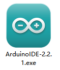

(2) Click **I Agree** to proceed with the installation.


(3) Keep the default selected options and click **Next** to proceed to the next step.


(4) Click **Browse** to select the installation path, and then click **Install** to start the installation.


(5) Wait for the software installation to complete.


> [!NOTE]
>
> **If prompted to install chip drivers during the installation process, check Always trust software from Arduino LLC and click Install.**

(6) After the installation is complete, click **Finish**.


2. Brief Software Description

(1) The main interface of Arduino IDE is shown below and can be divided into 5 areas:


(2) **Menu Bar**: Handles settings related to Arduino IDE.

|                           **Icon**                           | **Function**                                                 |
| :----------------------------------------------------------: | :----------------------------------------------------------- |
|  | Create or open project files, and configure interface preferences |
|  | Edit options for text editing such as commenting, indenting, and finding code |
|  | Sketch options for configuring the project, compiling, running, and adding library files |
|  | Tools options for selecting boards and ports, and retrieving board information |
|  | Help options for getting started and troubleshooting common issues |

(3) **Toolbar**: Contains project-related tools, including program compilation, program uploading, and the Serial Monitor.

|                           **Icon**                           | **Function**                                                 |
| :----------------------------------------------------------: | :----------------------------------------------------------- |
|  | Verify: Checks whether a program is written without errors and compiles the project if no errors exist |
|  | Upload: Uploads the program to the Arduino controller        |
|  | Debug: Some development boards support debugging via Arduino IDE |
|  | Select Board: Selects different development boards for project development |
|  | Serial Plotter: Plots data printed to the Arduino serial port as a graph |
|  | Serial Monitor: Prints serial port information               |

(4) **Editor Area**: The area for editing code.

(5) **Status Bar**: Displays current editor statuses, such as code line and column numbers, and development board information.

(6) **Sidebar**: The core of Arduino IDE, responsible for displaying the workspace folder, debugging code, and installing library files.

|                           **Icon**                           | **Function**                                            |
| :----------------------------------------------------------: | :------------------------------------------------------ |
|  | Sketchbook: Displays the files of the current project.  |
|  | Boards Manager: Adds development board toolkits.        |
|  | Library Manager: Adds or removes program library files. |
|  | Debug: Debugs the project.                              |
|  | Search: Searches or replaces code or variables.         |

#### 6.6.2.2 Arduino IDE Usage Instructions

* **Arduino IDE Interface Settings**

Switch to the English interface: Select **File** -> **Preferences** on the Arduino IDE interface. In the pop-up window, locate the **Language** option, select English, and click **OK**.


Select **File** -> **Preferences** to modify settings such as the project file path, editor font size, and color theme in the pop-up window.


* **Program Upload for Arduino**

1. This section uses a demo that prints the word **hiwonder** as an example. Double-click to open the sample program [**Demo.ino**](https://drive.google.com/drive/folders/1pI269CM1uQgaLYWOZTvTdNpovwKM9p3a?usp=sharing) in the **Demo** folder under the same directory as this document.

   

2. Connect the Arduino to the computer via a Type-B UNO data cable.

3. Locate the corresponding Arduino development board under the **Select Board** option. **Arduino Uno is used here as an example. The COM port is not fixed and can be checked in the Device Manager of the computer. COM6 is used here as an example.**

   

4. Click the  button to compile the program and verify whether syntax errors or other issues exist.

   

5. After successful compilation, click the  button to upload the program to the Arduino development board.

   

6. After the upload is complete, click  to open the Serial Monitor, and the word "hiwonder" is printed in the Serial Monitor.

   

* **Optional Library File Import**

If importing library files into the program is required, refer to the following methods:

1. Online Import

   This method is commonly used to import official Arduino library files, such as the TM1640 driver library file for the dot matrix module and the U8g2 library file for the OLED display.

   The TM1640 driver library for the dot matrix module and the U8g2 library are used as examples for illustration:

(1) Click  on the left sidebar of the Arduino IDE interface.

(2) Enter **U8g2** in the pop-up Library Manager bar to automatically search for the library file, and then click **Install**.


(3) When the following prompt pops up, the installation is successful.

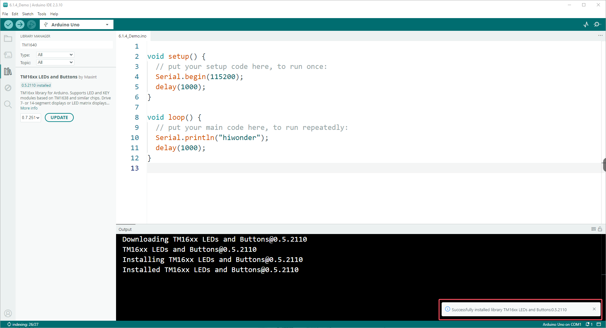

2) Local Import

This method is commonly used to import downloaded library files or custom library files. The U8g2 library file is also used here as an example for explanation.

(1) On the Arduino IDE interface, select **Sketch** -> **Include Library** -> **Add .ZIP Library**.

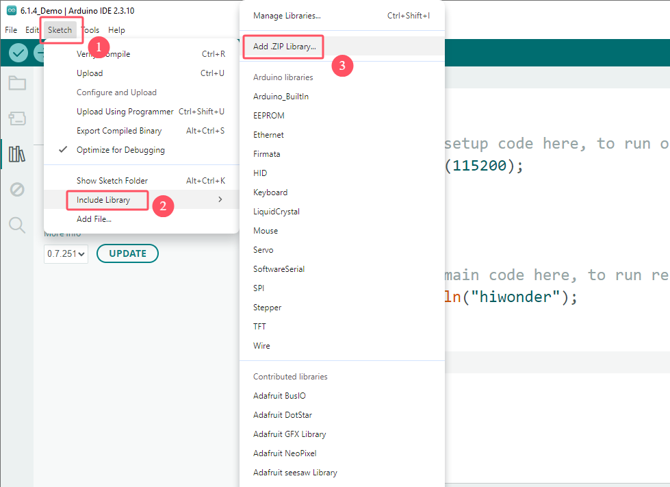

(2) Locate **U2g2.zip** in the pop-up window and click Open.

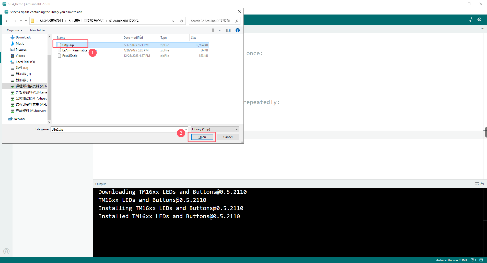

(3) When the following prompt pops up, the library file installation is complete.


> [!NOTE]
>
> **If the following error occurs during the local library file import process, refer to the solution below:**
>
> 
>
> **The LobotServoController library file is used here as an example. Versions of Arduino IDE above 1.8.5 are prone to the above issue when importing this library file. To resolve this issue, unzip the library file and place it directly into the libraries folder under the project directory. The specific steps are as follows:**
>
> * **Open File -> Preferences in the Arduino IDE.**
>
>   
>
> * **Copy the sketchbook location path in the opened Preferences window.**
>
>   
>
> * **Paste the path into File Explorer and press Enter to open the directory of this project.**
>
>   
>
> * **Place the previously unzipped library file into the libraries folder.**
>
>   
>
>   
>
> * **Finally, restart Arduino IDE, and the library file will appear in the library list of Arduino IDE.**

#### 6.6.2.3 Vision Module Development Environment Setup Instructions

* **Offline Package Installation Steps**

1. If another version of the esp32 package has been installed, delete it first. If it has not been installed, skip directly to step 3.

2. Deletion method: Enter %LOCALAPPDATA%/Arduino15/packages in the address bar of File Explorer, press Enter to access the directory, and delete the esp32 folder inside.

   

3. Finally, double-click the “esp32_package_2.0.11_arduinome.exe” file under the same directory as this document and wait for the installation to complete.

   

### 6.6.3 Video Streaming Instructions

#### 6.6.3.1 Project Introduction

This section focuses on connecting to the hotspot generated by the module and logging into a fixed URL to remotely view the live camera feed.

#### 6.6.3.2 Program Upload

1. Connect one end of the Type-C data cable to the upper port of the WonderLLM Module, and connect the other end to the USB port of the computer.

   

2. Open the program file [**02 Video Streaming Program\APCameraWebServer\APCameraWebServer.ino**](https://drive.google.com/drive/folders/18UoicC7F39pzty5fLnjHj8XEBwZ-yRTd?usp=sharing) in the same directory as this document.

   

3. Next, select the **ESP32S3 Dev Module** development board.

   

4. Click **Tools** in the menu bar and select the corresponding ESP32S3 development board configuration as shown in the figure below.

   

5. Finally, click  to upload the code to the ESP32S3 and wait for the flashing process to complete.

   

   

#### 6.6.3.3 Device Connection

Connect the vision module to the computer using a Type-C cable, and then find and connect to the hotspot generated by the module: HW_ESP32S3CAM.


#### 6.6.3.4 Video Streaming Implementation

Enter "192.168.5.1" in the address bar of a mobile or PC browser and press Enter. A PC browser is used here as an example. On the opened page, click the  button to enter the camera video streaming interface.


### 6.6.4 Color Recognition Instructions

#### 6.6.4.1 Project Introduction

This lesson focuses on detecting red and green colors through the WonderLLM Module and controlling the robotic arm to perform sorting based on the colors detected by the vision module.

#### 6.6.4.2 Implementation Process


#### 6.6.4.3 Module Description


The WonderLLM Module features a built-in high-performance ESP32S3 chip and achieves functions such as color recognition and face detection through programming. Equipped with an I2C port, this module conveniently exchanges data with various main controllers, providing an efficient solution for smart vision applications.

Module wiring: As shown in the figure below, connect the module to any I2C port framed in red on the servo controller before running the program in this section.


#### 6.6.4.4 Program Upload

* **WonderLLM Program Upload**

1. Connect one end of the Type-C data cable to the upper port of the WonderLLM Module, and connect the other end to the USB port of the computer.

   

2. Open the program file [**02 Program Files\WonderLLM\ColorDetection\ColorDetection.ino**](https://drive.google.com/drive/folders/18UoicC7F39pzty5fLnjHj8XEBwZ-yRTd?usp=sharing) in the same directory as this document.

   

3. Next, select the **ESP32S3 Dev Module** development board.

   

4. Click **Tools** in the menu bar and select the corresponding ESP32S3 development board configurations as shown in the figure below.

   

5. Finally, click  to upload the code to the ESP32S3 and wait for the flashing process to complete.

   

   

* **STM32 Program Upload**

> [!NOTE]
>
> **Confirm that the serial port driver is installed before uploading the program.**

1. Connect the core board to the computer via a USB cable.

   

2. Double-click to open the STM32 serial flashing software **FlyMcu** .

3. Click the **...** icon and select the HEX file to be flashed under the [**Tankbot\MDK-ARM\Tankbot**](https://drive.google.com/drive/folders/18UoicC7F39pzty5fLnjHj8XEBwZ-yRTd?usp=sharing) path of the corresponding project.


4) At position ① in the figure below, select the serial port number corresponding to the core board. At position ②, select the baud rate as 115200. At positions ③ and ④, configure the settings according to the options shown in the figure.


5) Click **Start ISP(P)** and press the **RST** button on the core board. The program starts uploading automatically. When the log output panel on the right outputs the following content, the program upload is complete.


#### 6.6.4.5 Program Outcome

When the vision module recognizes a red or green block ahead, it controls the robotic arm to grip and sort the block to different positions based on the color of the block.

#### 6.6.4.6 Program Analysis

1. Import hardware library and module library files. The hardware library files include the ADC library for collecting analog signals, the DMA library for data transmission, and the I2C library for communicating with other modules. The module libraries include library files for the Buzzer, the Glowy Ultrasonic Sensor, and the vision module.

```c
/* USER CODE END Header */
/* Includes ------------------------------------------------------------------*/
#include "main.h"
#include "adc.h"
#include "dma.h"
#include "i2c.h"
#include "spi.h"
#include "tim.h"
#include "usart.h"
#include "gpio.h"

/* Private includes ----------------------------------------------------------*/
/* USER CODE BEGIN Includes */

#include "global.h"
#include "stdio.h"
#include "stdlib.h"
#include "led.h"
#include "buzzer.h"
#include "robot_arm.h"
#include "adc_sample.h"
#include "differential_chassis.h"
#include "ultrasound.h"
#include "WonderLLM_Vision.h"
/* USER CODE END Includes */
```


### 6.6.5 Color Tracking Instructions

#### 6.6.5.1 Project Introduction

This lesson uses the WonderLLM vision module to detect a red object and controls the robotic arm to follow the movement of the object.

#### 6.6.5.2 Implementation Process


#### 6.6.5.3 Module Description


The WonderLLM Module features a built-in high-performance ESP32S3 chip and achieves features such as color recognition and face detection through programming. Equipped with an I2C port, the module conveniently exchanges data with various main controllers, providing an efficient solution for smart vision applications.

Module wiring: As shown in the figure below, before running the program in this section, connect the module to any I2C port framed in red on the servo controller.


#### 6.6.5.4 Program Upload

* **WonderLLM Program Upload**

1. Connect one end of the Type-C data cable to the upper port on the WonderLLM Module, and connect the other end to a USB port on the computer.

   

2. Open the [**02 Program Files\WonderLLM\ColorDetection\ColorDetection.ino**](https://drive.google.com/drive/folders/18UoicC7F39pzty5fLnjHj8XEBwZ-yRTd?usp=sharing) program file under the same directory as this document.

   

3. Next, select the **ESP32S3 Dev Module** development board.

   

4. Click "Tools" in the menu bar and select the corresponding ESP32S3 development board configurations as shown in the figure below.

   

5. Finally, click  to upload the code to the ESP32S3 and wait for the flashing process to complete.

   

   

* **STM32 Program Upload**

> [!NOTE]
>
> **Confirm that the serial port driver is installed before uploading the program.**

1. Connect the core board to the computer via a USB cable.

   

2. Double-click to open the STM32 serial flashing software **FlyMcu** .

3. Click the **...** icon and select the HEX file to be flashed under the [**Tankbot\MDK-ARM\Tankbot**](https://drive.google.com/drive/folders/1zkjcvfnnP40haqQ0SUx7TCXm0EjsyGJJ?usp=sharing) path of the corresponding project.


4) At position ① in the figure below, select the serial port number corresponding to the core board. At position ②, set the baud rate to 115200. At positions ③and ④ , configure the options as shown in the figure.


5) Click **Start ISP(P)** and press the **RST** button on the core board. The program starts uploading automatically. When the log output panel on the right displays the following content, the program upload is complete.


#### 6.6.5.5 Execution Result

When the vision module recognizes red, the robotic arm rotates according to the position data of the color.

#### 6.6.5.6 Program Analysis

1. Import the hardware library and module library files. The hardware library files include the ADC library for collecting analog signals, the DMA library for data transmission, and the I2C library for communicating with other modules. The module libraries include the buzzer, ultrasonic sensor, and vision module libraries.

```c
#include "main.h"
#include "adc.h"
#include "dma.h"
#include "i2c.h"
#include "spi.h"
#include "tim.h"
#include "usart.h"
#include "gpio.h"

/* Private includes ----------------------------------------------------------*/
/* USER CODE BEGIN Includes */

#include "global.h"
#include "stdio.h"
#include "stdlib.h"
#include "led.h"
#include "buzzer.h"
#include "robot_arm.h"
#include "adc_sample.h"
#include "differential_chassis.h"
#include "ultrasound.h"
#include "WonderLLM_Vision_Module.h"
```

2) Define macros for the X and Y center positions, create a WonderLLM color recognition variable to store color data, and initialize the variables used to store offsets.

```c
#define CENTER_X	120
#define CENTER_Y	120

WonderLLM_VisionHandleTypeDef Color;
uint8_t left_rgb[3];
uint8_t right_rgb[3];
uint8_t fsm_state = 0;
int x_bias = 0;
int y_bias = 0;
int x_bias_abs = 0;
int y_bias_abs = 0;
float x_inc_total = 0;
float y_inc_total = 0;
```

3) First, initialize the hardware ports required by the Tankbot, and then initialize the LED light, robotic arm, buzzer, and WonderLLM vision module. Initialize the rover to stop moving and control the buzzer to sound once.

```c
  MX_GPIO_Init();
  MX_DMA_Init();
  MX_TIM3_Init();
  MX_USART3_UART_Init();
  MX_SPI1_Init();
  MX_USART1_UART_Init();
  MX_ADC1_Init();
  MX_TIM4_Init();
  MX_USART2_UART_Init();

  /* Initialize interrupts */
  MX_NVIC_Init(); 
  /* USER CODE BEGIN 2 */
	led_init();
	buzzer_init();
	adc_sample_init();
  robot_arm_init(); 
	
	HAL_Delay(1000);
	MX_I2C1_Init();
	
	WonderLLM_Vision_init();
	ultrasound_init();
	
  /* USER CODE END 2 */

  /* Infinite loop */
  /* USER CODE BEGIN WHILE */
	
	differentials_chassis_run(0.0f, 0.0f);	
	buzzer_toggle(50, 50, 1);
```

4) In the loop, based on the value of `fsm_state`, the program first enters the `case 0` branch for target detection, calls the `WonderLLM_Vision_ColorPosition()` function to obtain the recognized color data, stores the color data in Color, and jumps to the next branch.

```c
  while (1)
  {	
		
		switch(fsm_state)
		{
			case 0:
				if(WonderLLM_Vision_ColorPosition(&Color , RED))
				{
					fsm_state = 1;
				}
				break;
```

5) After recognizing the color, calculate the offset using the target position and the center position of the screen.

```c
			case 1:
					x_bias = Color.ColorResults[RED - 1][0] - CENTER_X;
					y_bias = Color.ColorResults[RED - 1][1] - CENTER_Y;
				
					x_bias_abs = abs(x_bias);
					y_bias_abs = abs(x_bias);
```

6) After obtaining the target offset, process the X-axis coordinate offset according to specific mapping and weighting rules, accumulate it into the initial servo position offset `x_inc_total`, and apply limit constraints to `x_inc_total`. Call the `robot_arm_knot_run` function so that Servo 6, which controls the movement of the end coordinate point of the robotic arm along the X-axis, moves by `x_inc_total` based on its initial position value, achieving tracking movement of the robotic arm along the X-axis. The processing along the Y-axis follows the same principle and is not repeated here. Finally, reset the branch to re-acquire live data from the vision module in the next round for subsequent tracking.

```c
					if(x_bias_abs > 8)
					{
						x_inc_total += 1 * map((float)x_bias, -120.0f, 120.0f, -2, 2);
						x_inc_total = x_inc_total < -375 ? -375 : x_inc_total > 375 ? 375: x_inc_total;
						robot_arm_knot_run(6, (int)(SERIAL_SERVO6_RESET_DUTY - x_inc_total), 10);
					}
					
					if(y_bias_abs > 8)
					{
						y_inc_total += 1 * map((float)y_bias, -120.0f, 120.0f, -1.5, 1.5);
						y_inc_total = y_inc_total < -480 ? -480 : y_inc_total > 50 ? 50: y_inc_total;
						robot_arm_knot_run(3, (int)(SERIAL_SERVO3_RESET_DUTY - (int)y_inc_total), 10);
					}
			
				fsm_state = 0;
				break;
```

### 6.6.6 Face Recognition Instructions

#### 6.6.6.1 Project Introduction

This lesson uses the WonderLLM vision module to detect a red object and controls the robotic arm to follow the movement of the object.

#### 6.6.6.2 Implementation Process


#### 6.6.6.3 Module Description


The WonderLLM Module features a built-in high-performance ESP32S3 chip and achieves features such as color recognition and face detection through programming. Equipped with an I2C port, the module conveniently exchanges data with various main controllers, providing an efficient solution for smart vision applications.

Module wiring: As shown in the figure below, before running the program in this section, connect the module to any I2C port framed in red on the servo controller.


#### 6.6.6.4 Program Upload

* **WonderLLM Program Upload**

1. Connect one end of the Type-C data cable to the upper port on the WonderLLM Module, and connect the other end to a USB port on the computer.

   

2. Open the [**02 Program Files\WonderLLM\ColorDetection\ColorDetection.ino**](https://drive.google.com/drive/folders/18UoicC7F39pzty5fLnjHj8XEBwZ-yRTd?usp=sharing) program file under the same directory as this document.

   

3. Next, select the **ESP32S3 Dev Module** development board.

   

4. Click **Tools** in the menu bar and select the corresponding ESP32S3 development board configurations as shown in the figure below.

   

5. Finally, click  to upload the code to the ESP32S3 and wait for the flashing process to complete.

   

   

* **STM32 Program Upload**

> [!NOTE]
>
> **Confirm that the serial port driver is installed before uploading the program.**

1. Connect the core board to the computer via a USB cable.

   

2. Double-click to open the STM32 serial flashing software **FlyMcu** .

3. Click the **...** icon and select the HEX file to be flashed under the [**Tankbot\MDK-ARM\Tankbot**](https://drive.google.com/drive/folders/1zkjcvfnnP40haqQ0SUx7TCXm0EjsyGJJ?usp=sharing) path of the corresponding project.


4) At position 1 in the figure below, select the serial port number corresponding to the core board. At position 2, set the baud rate to 115200. At positions 3 and 4, configure the options as shown in the figure.


5) Click **Start ISP(P)** and press the **RST** button on the core board. The program starts uploading automatically. When the log output panel on the right displays the following content, the program upload is complete.


#### 6.6.6.5 Execution Result

When the vision module recognizes red, the robotic arm rotates according to the position data of the color.

#### 6.6.6.6 Program Analysis

1) Import the hardware library and module library files. The hardware library files include the ADC library for collecting analog signals, the DMA library for data transmission, and the I2C library for communicating with other modules. The module libraries include the buzzer, ultrasonic sensor, and vision module libraries.

```c
#include "main.h"
#include "adc.h"
#include "dma.h"
#include "i2c.h"
#include "spi.h"
#include "tim.h"
#include "usart.h"
#include "gpio.h"

/* Private includes ----------------------------------------------------------*/
/* USER CODE BEGIN Includes */

#include "global.h"
#include "stdio.h"
#include "stdlib.h"
#include "led.h"
#include "buzzer.h"
#include "robot_arm.h"
#include "adc_sample.h"
#include "differential_chassis.h"
#include "ultrasound.h"
#include "WonderLLM_Vision.h"
```

2) Define macros for the X and Y center positions, create a WonderLLM color recognition variable to store color data, and initialize the variables used to store offsets.

```c
#define CENTER_X	80
#define CENTER_Y	60

WonderLLM_VisionHandleTypeDef Color;
uint8_t left_rgb[3];
uint8_t right_rgb[3];
uint8_t fsm_state = 0;
int x_bias = 0;
int y_bias = 0;
int x_bias_abs = 0;
int y_bias_abs = 0;
float x_inc_total = 0;
float y_inc_total = 0;
```

3) First, initialize the hardware ports required by the Tankbot, and then initialize the LED light, robotic arm, buzzer, and WonderLLM vision module. Initialize the rover to stop moving and control the buzzer to sound once.

```c
  MX_GPIO_Init();
  MX_DMA_Init();
  MX_TIM3_Init();
  MX_USART3_UART_Init();
  MX_SPI1_Init();
  MX_USART1_UART_Init();
  MX_ADC1_Init();
  MX_TIM4_Init();
  MX_USART2_UART_Init();

  /* Initialize interrupts */
  MX_NVIC_Init(); 
  /* USER CODE BEGIN 2 */
	led_init();
	buzzer_init();
	adc_sample_init();
  robot_arm_init(); 
	
	HAL_Delay(1000);
	MX_I2C1_Init();
	
	WonderLLM_Vision_init();
	ultrasound_init();
	
  /* USER CODE END 2 */

  /* Infinite loop */
  /* USER CODE BEGIN WHILE */
	
	differentials_chassis_run(0.0f, 0.0f);	
	buzzer_toggle(50, 50, 1);
```

4) In the loop, based on the value of `fsm_state`, the program first enters the `case 0` branch for target detection, calls the `WonderLLM_Vision_ColorPosition()` function to obtain the recognized color data, stores the color data in `Color`, and jumps to the next branch.

```c
  while (1)
  {	
		
		switch(fsm_state)
		{
			case 0:
				if(WonderLLM_Vision_ColorPosition(&Color , RED))
				{
					fsm_state = 1;
				}
				break;
```

5) If the obtained target color area is greater than 200, calculate the offset using the target position and the center position of the screen.

```c
			case 1:
				if(Color.ColorResults[RED - 1][2] * Color.ColorResults[RED - 1][3] > 200){
					x_bias = Color.ColorResults[RED - 1][0] - CENTER_X;
					y_bias = Color.ColorResults[RED - 1][1] - CENTER_Y;
				
					x_bias_abs = abs(x_bias);
					y_bias_abs = abs(x_bias);
```

6) After obtaining the target offset, process the X-axis coordinate offset according to specific mapping and weighting rules, accumulate it into the initial servo position offset `x_inc_total`, and apply limit constraints to `x_inc_total`. Call the `robot_arm_knot_run` function so that Servo 6, which controls the movement of the end coordinate point of the robotic arm along the X-axis, moves by `x_inc_total` based on its initial position value, achieving tracking movement of the robotic arm along the X-axis. The processing along the Y-axis follows the same principle and is not repeated here. Finally, reset the branch to re-acquire live data from the vision module in the next round for subsequent tracking.

```c
					if(x_bias_abs > 1)
					{
						x_inc_total += 3 * map((float)x_bias, -80.0f, 80.0f, -6, 6);
						x_inc_total = x_inc_total < -500 ? -500 : x_inc_total > 500 ? 500: x_inc_total;
						robot_arm_knot_run(6, (int)(SERIAL_SERVO6_RESET_DUTY - x_inc_total), 20);
					}
					
					if(y_bias_abs > 1)
					{
						y_inc_total += 3 * map((float)y_bias, -60.0f, 60.0f, -5, 5);
						y_inc_total = y_inc_total < -930 ? -930 : y_inc_total > 70 ? 70: y_inc_total;
						robot_arm_knot_run(3, (int)(SERIAL_SERVO3_RESET_DUTY - (int)y_inc_total), 20);
					}
			
				}
				fsm_state = 0;
				break;
```


### 6.6.7 Visual Line Following Instructions

#### 6.6.7.1 Project Introduction

This lesson uses the WonderLLM Module to recognize a red line and controls the robot to perform line following.

#### 6.6.7.2 Implementation Process


#### 6.6.7.3 Module Description


The WonderLLM Module features a built-in high-performance ESP32S3 chip and achieves features such as color recognition and face detection through programming. Equipped with an I2C port, the module conveniently exchanges data with various main controllers, providing an efficient solution for smart vision applications.

Module wiring: As shown in the figure below, before running the program in this section, connect the module to any I2C port framed in red on the servo controller.


#### 6.6.7.4 Program Upload

* **WonderLLM Program Upload**

1. Connect one end of the Type-C data cable to the upper port on the WonderLLM Module, and connect the other end to a USB port on the computer.

   

2. Open the [**02 Program Files\WonderLLM\ColorDetection\ColorDetection.ino**](https://drive.google.com/drive/folders/18UoicC7F39pzty5fLnjHj8XEBwZ-yRTd?usp=sharing) program file under the same directory as this document.

   

3. Next, select the **ESP32S3 Dev Module** development board.

   

4. Click "Tools" in the menu bar and select the corresponding ESP32S3 development board configurations as shown in the figure below.

   

5. Finally, click  to upload the code to the ESP32S3 and wait for the flashing process to complete.

   

   

* **STM32 Program Upload**

> [!NOTE]
>
> **Confirm that the serial port driver is installed before uploading the program.**

1. Connect the core board to the computer via a USB cable.

   

2. Double-click to open the STM32 serial flashing software **FlyMcu** .

3. Click the **...** icon and select the HEX file to be flashed under the [**Tankbot\MDK-ARM\Tankbot**](https://drive.google.com/drive/folders/1zkjcvfnnP40haqQ0SUx7TCXm0EjsyGJJ?usp=sharing) path of the corresponding project.


4) At position 1 in the figure below, select the serial port number corresponding to the core board. At position 2, set the baud rate to 115200. At positions 3 and 4, configure the options as shown in the figure.


5) Click **Start ISP(P)** and press the RST button on the core board. The program starts uploading automatically. When the log output panel on the right displays the following content, the program upload is complete.


#### 6.6.7.5 Execution Result

When the vision module recognizes the red line, the robot follows the line to move.

#### 6.6.7.6 Program Analysis

1) Import the hardware library and module library files, including the configuration header file, hardware abstraction layer library, robotic arm control library, motor control library, `WonderLLM_Vision` vision module library, chassis control library, and timer library. Meanwhile, declare a custom `map` function for value mapping.

```cpp
#include "Config.h"
#include "Hiwonder.hpp"
#include "Robot_arm.hpp"
#include "motor.hpp"
#include "WonderLLM_Vision.hpp"
#include "differential_chassis.hpp"
#include "Ticker.h"

static float map(float x, float in_min, float in_max, float out_min, float out_max);
```

2) Create system function objects and module objects, including the buzzer, battery, robotic arm, I2C communication, motor, and vision module objects. Meanwhile, create a timer object for battery voltage monitoring. Define the center coordinates and finite state machine variables for visual line following control.

```cpp
Buzzer_t buzzer_obj;
Battery_t battery_obj;
RobotArm_t arm;

IIC iic_obj;
Motor motor_obj;
HW_ESP32Cam cam;
Ticker battery_timer;
float voltage;

// Define global variables
#define CENTER_X	80
#define CENTER_Y	60

uint8_t fsm_state = 0;
int x_bias = 0;
int x_bias_abs = 0;
float x_inc_total = 0;
```

3) In the `setup()` function, first delay for 1 s and set the Bluetooth control pin to a low level to disconnect the power supply of the Bluetooth module. Initialize serial communication, and then initialize the robotic arm, I2C communication, motor, buzzer, battery, and vision module. Next, stop the chassis movement, sound the buzzer to indicate system startup, set the robotic arm position to (16, 0, -7) so the camera faces downward for line following, and finally start the battery voltage monitoring timer.

```cpp
void setup() {
  delay(1000);
  pinMode(IO_BLE_CTL, OUTPUT);
  digitalWrite(IO_BLE_CTL, LOW);  // Disconnect the Bluetooth module power supply when the Bluetooth control pin is set to a low level

  Serial.begin(9600);
  arm.init();
  iic_obj.init();
  motor_obj.init(&iic_obj);
  buzzer_obj.init(IO_BUZZER);
  battery_obj.init(ADC_BAT);
  cam.init(&iic_obj);

  differentials_chassis_run(0.0f, 0.0f);
  buzzer_obj.blink(1500 , 50, 50, 1);
  arm.coordinate_set(16, 0, -7, 0, -90, 90, 1000);
  
  battery_timer.attach_ms(1000, battery_check_callback);
  
  Serial.println("begin");
  delay(1000);
}
```

4) In the `loop()` function, the program uses a finite state machine to control the visual line following process. The state machine contains two states: case 0 handles target detection, and case 1  handles motion control. In the case 0 state, call the `cam.color_position(RED)` function to obtain the position information of the red line. This function reads the X and Y coordinates, width, and height of the red target from the vision module, and stores them in the `cam.ColorResults[RED - 1]` array. When a red target is successfully detected, the state machine switches to the `case 1` state to execute motion control.

```cpp
void loop() {
  switch(fsm_state)
  {
    case 0:
      // Obtain the red position
      if(cam.color_position(RED))
      {
        fsm_state = 1;
      }
      break;
```

5) In the `case 1` state, first calculate the area of the detected red region by multiplying the width by the height, and determine whether it is greater than 20 pixels to filter out interference. If the condition is met, obtain the X-coordinate of the red line from `cam.ColorResults[RED - 1][0]` and subtract the screen center coordinate CENTER_X, which is 80, to calculate the offset `x_bias` of the line from the center. Take the absolute value and determine whether the offset is greater than 1 pixel. An offset of less than 1 pixel indicates that the line is essentially at the center position, requiring no steering correction.

```cpp
    case 1:
      // Calculate the offset and control the chassis
      if(cam.ColorResults[RED - 1][2] * cam.ColorResults[RED - 1][3] > 20){
        x_bias = cam.ColorResults[RED - 1][0] - CENTER_X;
        x_bias_abs = abs(x_bias);
```

6) When the absolute value of the offset is greater than 1, call the `map` function to perform value mapping. The map function linearly maps the X-axis offset from the range [-80, 80], which represents the possible position range of the line, to the range [-0.35, 0.35], which represents the steering speed of the chassis. A larger offset results in a higher steering speed. The mapped value `x_inc_total` is the steering speed required by the chassis. To avoid frequent minor steering adjustments, a deadband evaluation is set: if the absolute value of `x_inc_total` is less than 0.05, the offset is very small, and the chassis moves straight forward at a speed of 50. Otherwise, the chassis moves forward at a speed of 50 while executing steering correction. Note that the steering speed takes a negative value to achieve reverse deviation correction. After completing one control cycle, the state machine resets to 0 and enters the next round of target detection, forming a closed loop of detection, control, and detection.

```cpp
        if(x_bias_abs > 1)
        {
          x_inc_total = map((float)x_bias, -80.0f, 80.0f, -0.35, 0.35);


          if(x_inc_total > 0.05 || x_inc_total < -0.05){
            differentials_chassis_run(50.0f, -x_inc_total);
          }else{
            differentials_chassis_run(50.0f, 0.0f);
          }
        }
      }
      fsm_state = 0;
      break;
  }
  delay(10);
}
```

7) The custom `map` function implements value mapping by linearly mapping the input value `x` from the range `[in_min, in_max]` to the range `[out_min, out_max]`. This function converts the visual offset into the chassis steering speed.

```cpp
static float map(float x, float in_min, float in_max, float out_min, float out_max)
{
    return out_min + (x - in_min) * ((out_max - out_min) / (in_max - in_min));
}
```

8. The WonderLLM vision module exchanges data with the ESP32 main controller via I2C communication to achieve color position detection. Based on the specified color index where RED equals 1, the `color_position()` function reads 4 bytes of color position data (x, y, w, h) from the corresponding register. When the width value is greater than 0, indicating that the color is detected, the function stores the data in the `ColorResults` array.

   ```cpp
   bool HW_ESP32Cam::color_position(uint8_t ColorIndex)
   {
     int num = iic->wireReadDataArray(ESP32CAM_ADDR, ColorIndex - 1, ColorResults[ColorIndex - 1], 4);
     if((num == 4) && (ColorResults[ColorIndex - 1][2] > 0)) // Receive the x, y, w, and h values of the recognized color
     {
       return true;
     }
     return false;
   }
   ```

## 6.7 Serial Communication Hands-On Course

### 6.7.1 Device Master-Secondary Communication Principle

This section introduces the details of the master-secondary relationship when Tankbot communicates with different devices, such as a PC host, Arduino, and Raspberry Pi, using the communication between a PC host and Tankbot as an example. It explains how Tankbot communicates with other devices as a secondary device and how other devices control Tankbot as a master device.

Throughout this chapter, Tankbot acts as a secondary device to transmit information with other devices via the UART serial port.

> [!NOTE]
>
> **The communication protocol used between other host devices and Tankbot is the Tankbot PC Software & App Communication Protocol. The analysis of how the program parses command frames sent by the host device and controls the robotic arm to execute corresponding actions has already been explained in [Basic Development Course\PC Software Control](https://drive.google.com/drive/folders/1lCmhkOqjSYflZ8_Q1W5kaaYfb6T3y680?usp=sharing) and is not repeated here.**

#### 6.7.1.1 Master-Secondary Relationship

In a master-secondary control system, Tankbot acts as the secondary device, while other microcontrollers and devices act as the master device.

* **Functions of Tankbot as a Secondary Device**

1. Receiving and Parsing Signals Sent by the Master Device:

   Wait for serial port signals. If data is received at the serial port, parse the serial data according to the communication protocol and call the corresponding functions based on the data information.

2. Calling Tankbot Functions Based on Received Data:

   When a signal is parsed, call the corresponding onboard functions of Tankbot, such as action group calling and single or multiple servo control.

3. Data Encapsulation and Feedback:

   When a read command is received, call the corresponding read function, encapsulate the read data into a data packet according to the communication protocol, and send it to the master device.

* **Other Devices as the Master Device**

1. Command Encapsulation and Transmission:

   The master device encapsulates control commands and data into data packets according to the communication protocol and sends them to the secondary device.

2. Control Coordination:

   The master device manages the collaborative operation of the entire system to ensure conflict-free communication and operation between Tankbot and other devices, maintaining a proper working state.

3. Data Reception:

   When reading the status of the robot, after sending a read command, the master device receives the status information data sent by Tankbot, ensures the integrity and accuracy of the data, and parses the data packet to extract useful information.

#### 6.7.1.2 Hardware Connection

> [!NOTE]
>
> **Confirm that the serial port driver is installed before uploading the program.**

1) Connect the USB port of the computer to the USB serial port on the controller board using a USB data cable.


#### 6.7.1.3 Data Transmission Format

The default UART serial data transmission format of Tankbot is as follows:

| Baud rate  | 9600 |
| :--------: | :--: |
| Data bits  |  8   |
| Parity bit | None |
|  Stop bit  |  1   |

### 6.7.2 Tankbot PC Software & App Communication Protocol

#### 6.7.2.1 Protocol Format

| Frame Header 1 | Frame Header 2 | Data Length | Function Code | Data Parameters |
| :------------: | :------------: | :---------: | :-----------: | :-------------- |
|     0 x 55     |     0 x 55     |   Length    |      CMD      | Parameter 1~N   |

#### 6.7.2.2 Functions

* **Firmware Query**

Data length: 2

Function code: 1

Data parameters: None

Returned content

| Frame Header 1 | Frame Header 2 | Data Length | Function Code | Data Parameter 1                             | Data Parameter 2        |
| :------------: | :------------: | :---------: | :-----------: | :------------------------------------------- | :---------------------- |
|     0 x 55     |     0 x 55     |      3      |       1       | Servo type: 1 for PWM servo, 2 for bus servo | Firmware version number |

* **Servo Deviation Reading**

**Description: Read the deviation values of all servos**

Data length: 14

Function code: 2

Data parameters: None

Returned content

| Frame Header 1 | Frame Header 2 | Data Length | Function Code |   Parameter 1   |   Parameter 2   | ...                                                          |
| :------------: | :------------: | :---------: | :-----------: | :-------------: | :-------------: | :----------------------------------------------------------- |
|     0 x 55     |     0 x 55     |     14      |       2       | Servo ID number | Deviation value | Subsequent parameters follow the same format as Parameter 1 and Parameter 2 in sequence |

* **Single or Multiple Servo Pulse Width Control**

Data length: Number of controlled servos × 3 + 5

Function code: 3

Data parameters

| Parameter Content                                            |
| :----------------------------------------------------------- |
| Parameter 1: Total number of controlled servos               |
| Parameter 2: Lower 8 bits of servo running time              |
| Parameter 3: Upper 8 bits of servo running time              |
| Parameter 4: Servo ID number                                 |
| Parameter 5: Lower 8 bits of servo pulse width value         |
| Parameter 6: Upper 8 bits of servo pulse width value         |
| Subsequent data parameters follow the same format as Parameter 4, Parameter 5, and Parameter 6 in sequence to control servos with different IDs |

Returned content: None

* **Coordinate Control**

Data length: 5

Function code: 4

Data parameters

| Parameter Content                                            |
| :----------------------------------------------------------- |
| Parameter 1: X-axis coordinate increment of the controlled body coordinates |
| Parameter 2: Y-axis coordinate increment of the controlled body coordinates |
| Parameter 3: Z-axis coordinate increment of the controlled body coordinates |

Returned content: None

* **Action Group Running**

Data length: 5

Function code: 6

Data parameters

| Parameter Content                                            |
| :----------------------------------------------------------- |
| Parameter 1: Action group number to be run                   |
| Parameter 2: Lower 8 bits of the execution count of the action group |
| Parameter 3: Upper 8 bits of the execution count of the action group |

Returned content: None

* **Stopping the Currently Running Action Group**

Data length: 2

Function code: 7

Data parameters: None

**Returned content: None**

* **Erasing Action Groups Uploaded to the Controller**

Data length: 2

Function code: 8

Data parameters: None

Returned content

| Frame Header 1 | Frame Header 2 | Data Length | Function Code |
| :------------: | :------------: | :---------: | :-----------: |
|     0 x 55     |     0 x 55     |      2      |       8       |

* **Chassis Control**

Data length: 4

Function code: 9

Data parameters

| Parameter Content                                            | Description                                                  |
| :----------------------------------------------------------- | :----------------------------------------------------------- |
| Parameter 1: Control forward movement, backward movement, left translation, and right translation | 0: Stop, 1: Turn left, 2: Move forward-left, 3: Move forward, 4: Move forward-right, 5: Translate right, 6: Move backward-right, 7: Move backward, 8: Move backward-left |
| Parameter 2: Control in-place left turn and in-place right turn | 0: Stop, 1: Turn left in place, 2: Turn right in place       |

Returned content: None

* **Servo Deviation Setting**

Data length: 4

Function code: 10

Data parameters

| Parameter Content            |
| :--------------------------- |
| Parameter 1: Servo ID        |
| Parameter 2: Deviation value |

Returned content: None

* **Servo Deviation Uploading**

Data length: 14

Function code: 11

Data parameters

| Parameter Content                                            |
| :----------------------------------------------------------- |
| Parameter 1: Servo ID number                                 |
| Parameter 2: Servo pulse width deviation value               |
| Subsequent data parameters follow the same format as Parameter 1 and Parameter 2 in sequence to upload pulse width deviation values for servos with different IDs |

Returned content

| Frame Header 1 | Frame Header 2 | Data Length | Function Code |
| :------------: | :------------: | :---------: | :-----------: |
|     0 x 55     |     0 x 55     |      2      |      11       |

* **Servo Initial Pose Setting**

Data length: 2

Function code: 12

Data parameters: None

Returned content: None

* **Servo Angle Readback**

Data length: 2

Function code: 13

Data parameters: None

Returned content:

| Frame Header 1 | Frame Header 2 | Data Length | Function Code |   Parameter 1   |               Parameter 2               |               Parameter 3               | ...                                                          |
| :------------: | :------------: | :---------: | :-----------: | :-------------: | :-------------------------------------: | :-------------------------------------: | :----------------------------------------------------------- |
|     0 x 55     |     0 x 55     |     20      |      13       | Servo ID number | Lower 8 bits of servo pulse width value | Upper 8 bits of servo pulse width value | Subsequent parameters follow the same format as Parameter 1, Parameter 2, and Parameter 3 in sequence |

* **Chassis Speed Setting**

Data length: 3

Function code: 14

Data parameters

| Parameter Content        | Description                      |
| :----------------------- | :------------------------------- |
| Parameter 1: Rover speed | Value range: 50~100, default: 80 |

Returned content: None

* **Power Supply Voltage Reporting**

Data length: 4

Function code: 15

Data parameters

| Parameter Content | Description: Unit in mV |
| :---------------- | :---------------------- |
| Parameter 1:      | Lower 8 bits of voltage |
| Parameter 2:      | Upper 8 bits of voltage |

Returned content: None

* **Action Group Uploading**

**Description: Upload the action group frame by frame to the controller until all action frames are uploaded**

Data length: Number of controlled servos × 3 + 8

Function code: 25

Data parameters

| Parameter Content                                            |
| :----------------------------------------------------------- |
| Parameter 1: Uploaded action group number                    |
| Parameter 2: Total number of frames in the action group      |
| Parameter 3: Action frame number                             |
| Parameter 4: Total number of servos to be uploaded           |
| Parameter 5: Lower 8 bits of control time                    |
| Parameter 6: Upper 8 bits of control time                    |
| Parameter 7: Servo ID number                                 |
| Parameter 8: Lower 8 bits of servo pulse width value         |
| Parameter 9: Upper 8 bits of servo pulse width value         |
| Subsequent data parameters follow the same format as Parameter 7, Parameter 8, and Parameter 9 in sequence to upload pulse width values for servos with different IDs |

Returned content

| Frame Header 1 | Frame Header 2 | Data Length | Function Code |
| :------------: | :------------: | :---------: | :-----------: |
|     0 x 55     |     0 x 55     |      2      |      25       |